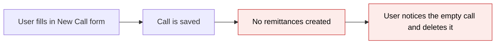
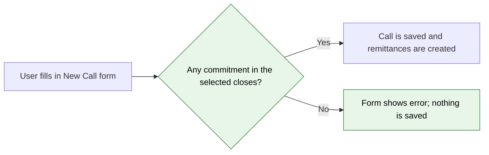
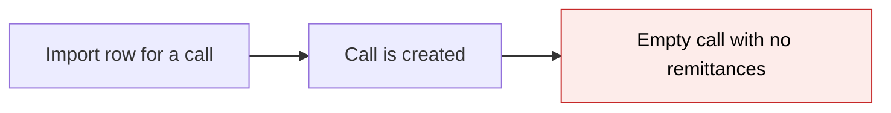
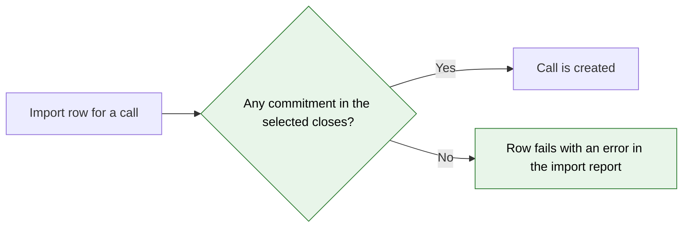

# Block Capital Calls Without Commitments — Proposal

> **Audience:** Business team, product, QA, support — non-technical.
> **Companion document:** [Design](design.md)

> **Planning phase — no code changes.** This document proposes and explains the change. Do not
> edit application code while writing it; implementation happens later, in the tasks phase.

---

## Why

Today a fund manager can create a capital call on a fund that has no commitments, or for fund closes
that have no commitments. The call saves, but it has no investors to call from: no remittances are
created, its totals stay at zero, and its journey stays stuck on "Create remittances". The user then has
to find the problem and delete the call. Blocking such calls when they are created stops these empty
calls from being saved at all.

## What Changes

- Creating a capital call is refused when **no commitment in the fund applies to the call**: either
  the fund has no commitments at all, or none of its commitments belong to the fund closes the call
  selects.
- The rule applies to **every call basis**, including "Upload".
- The rule applies to **both ways of creating a call**: the "New Call" form and the capital call
  import (Upload on the fund's Capital Calls tab).
- On the form, the user stays on the page with the values they entered and sees an error explaining
  why. In an import, the row fails and the import's error report shows the same message.
- The "New Call" button itself does not change. It stays visible and enabled.
- **BREAKING** (behaviour): an import that creates capital calls for a fund before its commitments
  are imported now fails on those rows. Import the commitments first, then the calls.

### Flow Diagram

Creating a call from the "New Call" form:

**Before**: an empty call is saved.



**After**: the call is refused before it is saved.



Importing calls:

**Before**: the import row succeeds and an empty call is created.



**After**: the row fails with a clear message.



---

## User Stories

### US-1: Stop an empty call on a fund with no commitments

**As a** fund manager,
**I want** the app to refuse a new capital call on a fund that has no commitments,
**So that** I don't create a call that has nobody to collect from.

**Acceptance criteria:**
- On a fund with no commitments, submitting the New Call form with valid fields does not create a call.
- The form is shown again with the entered values and this error:
  "No commitments in this fund apply to this call. Add commitments for the selected fund closes before
  creating a capital call."
- The fund's Capital Calls tab shows no new call.

### US-2: Stop an empty call for closes that have no commitments

**As a** fund manager,
**I want** the app to refuse a call whose selected fund closes have no commitments,
**So that** I don't call a close that nobody has committed to yet.

**Acceptance criteria:**
- The fund has commitments in "First Close" only. A call created with Applicable To = "Second Close" is
  refused with the same error.
- On the same fund, a call with Applicable To = "First Close" or "All" is created as today.

### US-3: Upload-basis calls follow the same rule

**As a** fund manager,
**I want** "Upload" calls to be held to the same rule,
**So that** I can't create a call whose remittances could never be imported.

**Acceptance criteria:**
- On a fund with no commitments, a call with Call Basis = "Upload" is refused with the same error.
- On a fund with commitments, an "Upload" call is created as today.

### US-4: Imports report the problem per row

**As a** fund manager importing calls,
**I want** a call row for a fund with no applicable commitments to fail with a clear reason,
**So that** I know to import commitments first.

**Acceptance criteria:**
- The import row fails and the import's error report shows the same message for that row.
- Other rows in the same file whose funds do have applicable commitments are still imported.

---

## UI Behavior

### New Capital Call form (after submitting)

```
┌──────────────────────────────────────────────────────────────────┐
│  Funds / Growth Fund I / New                                     │
│                                                                  │
│  ┌────────────────────────────────────────────────────────────┐  │
│  │ 1 error prohibited this capital call from being saved:     │  │
│  │  • No commitments in this fund apply to this call. Add     │  │
│  │    commitments for the selected fund closes before         │  │
│  │    creating a capital call.                                │  │
│  └────────────────────────────────────────────────────────────┘  │
│                                                                  │
│  Name            [ Call 1                     ]                  │
│  Call Basis      [ Percentage of Commitment ▾ ]                  │
│  Applicable To   [ Second Close ▾ ]                              │
│  Percentage      [ 10                         ]                  │
│  ...                                                             │
│                                         [ Save ]                 │
└──────────────────────────────────────────────────────────────────┘
```

**Behavior notes:**
- The error appears in the form's existing error box, the same place other errors are shown.
- The values entered stay in the form so the user can change the selected closes and save again.
- The "New Call" button on the fund's Capital Calls tab looks and works as it does today.

### Capital call import

**Behavior notes:**
- A failing row is listed in the import result with the message above. Other rows are not affected.

---

## What This Feature Does NOT Cover

| Excluded | Covered In |
|---|---|
| Disabling or hiding the "New Call" button on funds without commitments | Not planned. The server-side error is enough. |
| Editing an existing call so that its closes no longer match any commitment | Possible later change |
| Existing calls that already have no commitments (no clean-up or migration) | Not planned |
| Deleting the last commitment of a fund that already has calls | Not planned |
| Commitments with a zero committed amount (they still count as commitments) | Not planned |
| Capital distributions | Not planned |

---

## Validation Rules

| Field | Rule | Default |
|---|---|---|
| Fund + Applicable To (fund closes) | At least one commitment in the fund must belong to the selected closes. "All" (or no closes, as Upload calls may leave it) means any commitment in the fund. Checked only when the call is created. | — |

---

## Behavior Rules

| Scenario | What User Sees |
|---|---|
| Fund has no commitments; New Call submitted | Form re-shown with the error; no call created |
| Fund has commitments only in "First Close"; call for "Second Close" | Form re-shown with the error; no call created |
| Fund has commitments only in "First Close"; call for "First Close, Second Close" | Call created. Remittances are created for First Close commitments. |
| Fund has commitments; call for "All" | Call created as today |
| Fund has no commitments; call basis "Upload" | Form re-shown with the error; no call created |
| Import row for a fund with no applicable commitments | That row fails with the error; other rows still import |
| Existing call edited later | Unchanged from today (this rule is not checked on edit) |

---

## Resolved Design Decisions

| # | Decision | Resolution |
|---|---|---|
| 1 | What counts as "no commitments"? | No commitment applies to the call: the fund has none, or none are in the selected closes. |
| 2 | Are "Upload" calls blocked too? | Yes. The same rule applies to every call basis. |
| 3 | Should the "New Call" button be disabled? | No. Only the server-side error is shown. |
| 4 | Is the rule checked on edit? | No. It is checked only when a call is created, as requested. |
| 5 | Does the import enforce it? | Yes. It uses the same create path, so the row fails with the same message. |

---

## Capabilities

### New Capabilities

- `funds/capital-call-creation`: rules a new capital call must satisfy before it is created, starting
  with requiring at least one applicable commitment.

### Modified Capabilities

<!-- None. funds/capital-call-journey describes journeys of calls that already exist; its requirements do not change. -->

---

## Impact

- The New Capital Call form (error shown on submit).
- The capital call import (rows fail with the new message).
- The capital call JSON API create endpoint (returns the error with status 422).
- No database changes, no new settings, no notification changes.

---

## Benefits

1. Users can't create empty calls by mistake, so there is nothing to find and delete afterwards.
2. The message tells the user what to do next: add commitments, or pick different closes.
3. Imports fail early with a clear reason, instead of leaving empty calls behind.
4. Call journeys no longer get stuck on "Create remittances" for calls that could never pass it.

---

## FAQ

| Question | Answer |
|---|---|
| Who is affected? | Anyone who creates capital calls, from the form or by import. |
| What happens to existing calls with no commitments? | Nothing. They are left as they are; the rule is checked only when a call is created. |
| Can I still edit a call's closes to ones with no commitments? | Yes, as today. Editing is not covered by this change. |
| I import calls before commitments during onboarding. What now? | Import commitments first, then calls. Call rows imported earlier now fail with a clear message. |
| Do commitments with a zero amount count? | Yes. Any commitment in the selected closes allows the call. |
| Does this change notifications or billing? | No. |
| How is it implemented? | See [design.md](design.md). |

---

## Design Principle for the Next Phase

Keep it to one check in the existing capital call create step, reusing the existing logic that finds the
commitments a call applies to. Both the form and the import already go through that step. Do not add a
model-wide validation: it would also run on edits and in the many test setups that create calls directly,
which is wider than "creating". Do not add a new service or UI component.
