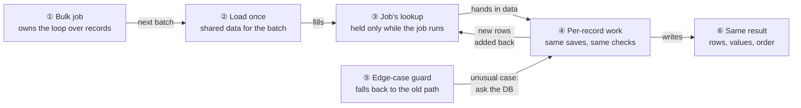
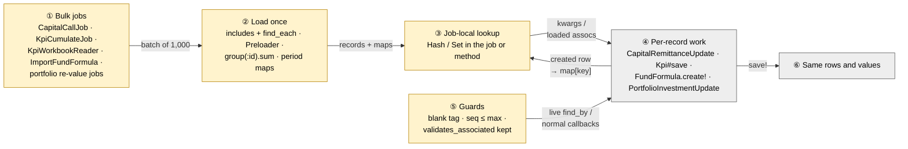
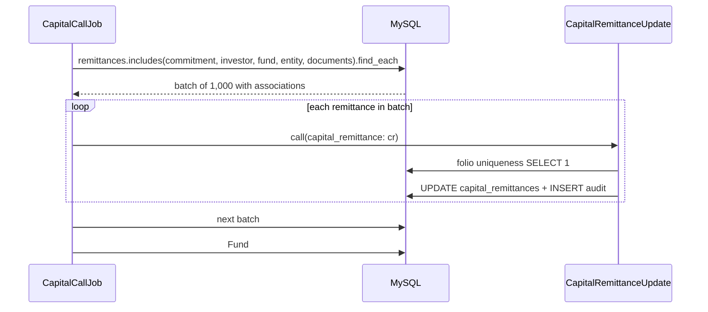
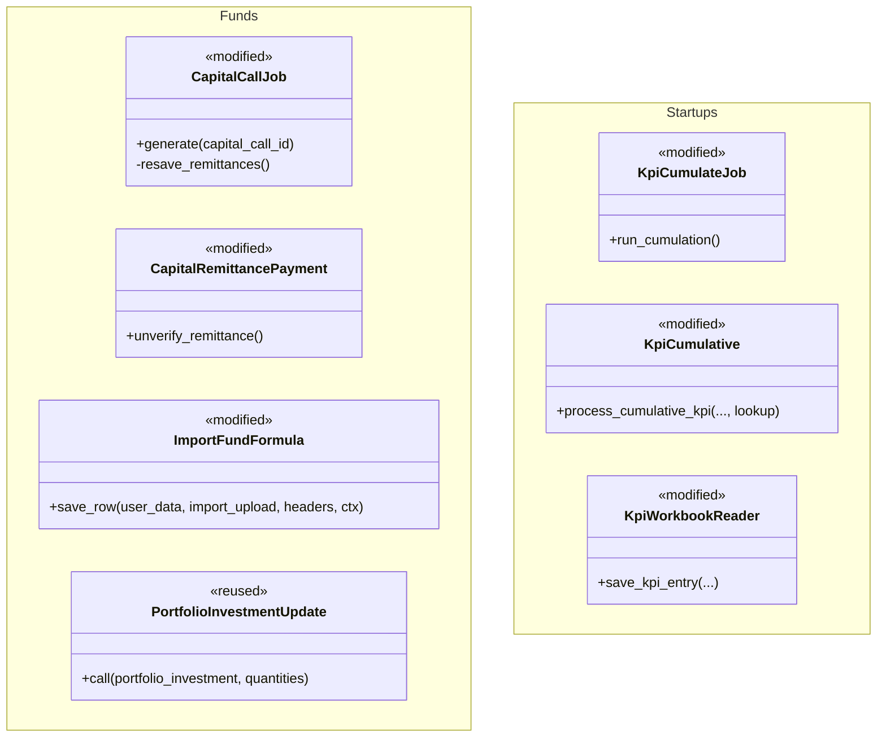

# Faster bulk jobs — Design

> **Audience:** Engineering team.
> **Companion documents:** [Proposal](proposal.md) · [Spec](specs/) · [Business rules (H/E/X)](business-rules.md) · [LLD](lld.md)

> **Planning phase — no code changes.** This document explains HOW the proposal will be built.

> **Zoom one picture.** Everything hangs off one numbered picture. ①–⑥ mean the same box everywhere.

---

## Contents

- [1. The idea](#1-the-idea)
  - [What this adds](#what-this-adds)
  - [The idea in one picture](#the-idea-in-one-picture)
  - [Walkthrough: one example, start to finish](#walkthrough-one-example-start-to-finish)
  - [Key ideas](#key-ideas)
- [2. The same picture with real names](#2-the-same-picture-with-real-names)
  - [Picture](#picture)
  - [What each box does](#what-each-box-does)
  - [One run, end to end](#one-run-end-to-end)
  - [Lifecycles](#lifecycles)
  - [What users see](#what-users-see)
  - [Design decisions](#design-decisions)
- [3. One card per box](#3-one-card-per-box)
  - [① The bulk job](#-the-bulk-job)
  - [② Load once per batch](#-load-once-per-batch)
  - [③ The job's lookup](#-the-jobs-lookup)
  - [④ Per-record work](#-per-record-work)
  - [⑤ Edge-case guard](#-edge-case-guard)
  - [⑥ Same result](#-same-result)
- [4. Reference](#4-reference)
  - [Class diagram](#class-diagram)
  - [Data model and schema changes](#data-model-and-schema-changes)
  - [Component contracts](#component-contracts)
  - [Notifications](#notifications)
  - [Cross-cutting concerns](#cross-cutting-concerns)
  - [Worked examples](#worked-examples)
  - [Testing](#testing)
  - [Risks and open questions](#risks-and-open-questions)

---

## 1. The idea

### What this adds

Six bulk jobs stop asking the database, once per record, for data that is the same for the whole batch
or that the job already holds. Each job loads that data **once per batch** into a plain local lookup
that lives only inside the job, and hands it to the existing per-record code. This follows the pattern
already used by `KpiWorkbookReader#find_or_create_kpi_report` (`@results` cache per period) and
`CapitalCallJob#generate` (`existing_commitment_ids` read once).

### The idea in one picture



### Walkthrough: one example, start to finish

**Setup.** Fund *Alpha* has 500 commitments. Company *Acme* has 8 quarters of monthly KPIs for
*Revenue*. Legend: ✓ done · ● we are here (in progress, not done) · ○ not started.

| # | When | What happens | Behind the scenes | Result |
|---|---|---|---|---|
| 1 | 10:00 | Meera generates the Q3 call | the bulk job (①) creates 500 remittances (already batched by fe7f6ffacb) | **●&nbsp;Create&nbsp;remittances**<br>○&nbsp;Re-save&nbsp;remittances<br>○&nbsp;Generate&nbsp;payments |
| 2 | 10:01 | Follow-up re-save starts | the bulk job (①) asks load-once (②) for the next 1,000 remittances with investor, commitment, fund, entity and documents | ✓&nbsp;Create&nbsp;remittances<br>**●&nbsp;Re-save&nbsp;remittances**<br>○&nbsp;Generate&nbsp;payments |
| 3 | 10:01 | Each remittance is re-saved | per-record work (④) reads related rows from the batch, not the DB; folio check, audit and counters still run per save | Same as row 2 |
| 4 | 10:02 | Payments generated; each unverifies its remittance | per-record work (④) reloads the remittance and preloads its related rows once (②) before saving | ✓&nbsp;Create&nbsp;remittances<br>✓&nbsp;Re-save&nbsp;remittances<br>**●&nbsp;Generate&nbsp;payments** |
| 5 | 10:03 | **Failure:** remittance #241 has an invalid document | per-record work (④) still validates every document; that save fails exactly as before; #1–#240 stay saved | ✓&nbsp;Create&nbsp;remittances<br>✓&nbsp;Re-save&nbsp;remittances<br>**●&nbsp;Generate&nbsp;payments&nbsp;(stopped&nbsp;at&nbsp;241)** |
| 6 | 11:00 | Arjun approves Acme's KPIs; cumulation runs | the bulk job (①) cumulates *Revenue* once (repeat skipped, D3); load-once (②) reads Acme's Quarter/YTD/Year reports into the job's lookup (③) | ✓&nbsp;Approve<br>**●&nbsp;Cumulate&nbsp;Revenue** |
| 7 | 11:00 | Q4 has no Quarter report yet | per-record work (④) creates it and adds it back to the lookup (③); the YTD step that needs it finds it there | Same as row 6 |
| 8 | 11:01 | **Mistake:** a KPI with a blank tag | the edge-case guard (⑤) uses the original tag-less lookup for that KPI | ✓&nbsp;Approve<br>✓&nbsp;Cumulate&nbsp;Revenue |

Snapshot after row 7 — the job's lookup for *Revenue*:

```
[Quarter, 2026-03-31] → report #81   (existed)
[Quarter, 2026-06-30] → report #82   (existed)
[Quarter, 2026-09-30] → report #83   (existed)
[Quarter, 2026-12-31] → report #97   (created in row 7, added back)
[YTD,     2026-12-31] → report #98   (created next — finds #97's KPI via the lookup)
```

**What to notice**
- Data read once lives only inside the job (③); nothing is shared across requests or jobs.
- Rows created mid-job are added back to the lookup, so later steps see them exactly as a DB query would.
- Per-record writes, validations, audits and counters are untouched (④).
- Unusual inputs take the original path (⑤), so edge cases keep today's behaviour.

### Key ideas

| # | Idea | In one line | Card |
|---|---|---|---|
| 1 | The loop owner loads | Only the job/method that owns the loop reads shared data — never a model callback | [①](#-the-bulk-job) |
| 2 | Batch, then preload | `find_each` batches of 1,000 with `includes`/`Preloader`/grouped sums | [②](#-load-once-per-batch) |
| 3 | Add back what you create | A row created mid-job goes into the lookup immediately | [③](#-the-jobs-lookup) |
| 4 | Writes stay per record | Saves, validations, audits, counters, touches that decide success are unchanged | [④](#-per-record-work) |
| 5 | Guard the odd case | Blank tag, out-of-order sequence, invalid document → original path | [⑤](#-edge-case-guard) |

**FAQ**

| Question | Answer |
|---|---|
| Why not a request-scoped cache? | Rejected 2026-10-22: it can serve stale answers (test steps, write-then-read, long jobs, console). A job-local lookup dies with the job. |
| Does any number change? | No; see [⑥](#-same-result). D3/D4 change only error-email duplicates and intermediate audit rows. |
| Why not bulk `insert_all`? | It skips callbacks, validations and audits — behaviour change. |

---

## 2. The same picture with real names

### Picture



*① modified: each job loads before its loop. ② modified: new preload lines. ③ modified: a local Hash/Set.
④ reused unchanged. ⑤ modified: explicit fallbacks. ⑥ reused: existing outputs.*

### What each box does

| # | Box | Real parts | What it does | When it runs | What it decides | Details |
|---|---|---|---|---|---|---|
| ① | Bulk jobs | `CapitalCallJob`, `CapitalRemittancePayment#unverify_remittance`, `KpiCumulateJob`, `KpiWorkbookReader`, `ImportFundFormula`, `FundFairValueRecomputeJob`/`ExchangeRatePortfolioInvestmentJob`/`UpdatePortfolioInvestmentsJob`/`ChangeFundCurrencyJob`/`MarketDataFeedRunner`, `ImportPortfolioInvestment` | Owns the loop; loads before iterating | Each job run | Batch boundaries; D3 repeat skip | [①](#-the-bulk-job) |
| ② | Load once | `includes(...).find_each`, `ActiveRecord::Associations::Preloader`, `group(...).sum`, `index_by` | Reads shared data per batch | Start of each batch / autofill | Which associations | [②](#-load-once-per-batch) |
| ③ | Job-local lookup | local `Hash`/`Set`, instance variable on the job/reader object | Holds the batch data; updated on create | Lifetime of one job/method call | Key shape | [③](#-the-jobs-lookup) |
| ④ | Per-record work | `CapitalRemittanceUpdate`, `KpiCumulative#process_cumulative_kpi`, `KpiWorkbookReader#save_kpi_entry`, `FundFormula.create!`, `PortfolioInvestmentUpdate` | Unchanged saves and callbacks | Per record | Nothing new | [④](#-per-record-work) |
| ⑤ | Guards | blank `tag_list`, `sequence ≤ @max_seq`, `validates_associated :documents` | Keeps the original path for edge cases | Per record | Use lookup or live query | [⑤](#-edge-case-guard) |
| ⑥ | Same result | remittances, KPIs, formulas, PIs, audits | Output | — | — | [⑥](#-same-result) |

### One run, end to end



### Lifecycles

N/A — no stored or derived status is added or changed; all lookups are transient.

### What users see

N/A — no screen, email or alert changes (see proposal).

### Design decisions

| Choice | Alternative | Why rejected |
|---|---|---|
| Load in the loop owner (①) | Request-scoped `CurrentAttributes` cache | Stale answers; rejected by user 2026-10-22 |
| `includes` + `find_each` | `.each` on the association | `.each` loads the whole call unbatched (CLAUDE.md large-table rule) |
| Keep `validates_associated :documents`; preload documents' associations | Skip/narrow document validation | Invalid document must still block the owner save (`tasks_controller.rb:305-307`) |
| Keep folio uniqueness check, audits, counter_culture per save | Skip in bulk | No unique index; counters would be wrong until async job |
| D3 skip repeat KPI autofills | Re-run per report | Quadratic cost; outputs identical (decimal(20,6) rounding), approved 2026-10-22 |
| D4 skip per-PI aggregate save on import | Keep | `post_process` re-saves every aggregate; approved 2026-10-22 |
| `acts_as_list_no_update` only when seq > max | Wrap whole import | Would change sequences for duplicates/descending sheets |

**FAQ**

| Question | Answer |
|---|---|
| Why is ① amber and ④ grey? | Only the loop owners change; the per-record services are reused untouched. |
| Why does the job still touch the fund once? | Cache busting on dashboards relies on `Fund#updated_at`; one touch after the loop keeps it. |

---

## 3. One card per box

### ① The bulk job

The method that owns the loop. It is the only place that loads shared data.

| Owns | Reads / receives | Produces |
|---|---|---|
| The loop and its batches; D3 repeat-skip `Set` | Records to process | Calls into ④ with data from ③ |

| Chain | Loop owner (file) | Change |
|---|---|---|
| 1 Remittance re-save | `CapitalCallJob` post-generation loop (`capital_call_job.rb` ~130) | `.includes(...).find_each`; wrap `generate_remittance_payments` in `Fund.no_touching`, touch fund once after |
| 1 Remittance unverify | `CapitalRemittancePayment#unverify_remittance` | Preload after `reload` |
| 1 Remittance import | `ImportCapitalRemittance` | Pass `entity:` object, not `entity_id:` |
| 2 KPI cumulation | `KpiCumulateJob#run_cumulation` | `preload(:investor_kpi_mapping)`; D3 `Set` of `[name, tag_list, mapping_id]` |
| 3 KPI import | `KpiWorkbookReader` | Per-report KPI maps beside `@results`; entity once |
| 4 Formula import | `ImportFundFormula` | `@max_seq` once |
| 5 Portfolio | re-value jobs; `ImportPortfolioInvestment` | Grouped SUMs per batch; D4 skip aggregate save on import |

**Worked examples:** H1–H7 ([business-rules](business-rules.md)).

**FAQ**

| Question | Answer |
|---|---|
| What if a job is retried by Sidekiq? | The lookup is rebuilt from the DB on the new run; nothing carries over. |
| Does D3 change which KPIs are processed first? | No; the first occurrence of a key is processed exactly as today. |

### ② Load once per batch

| Owns | Reads / receives | Produces |
|---|---|---|
| The preload statements | Batch ids | Loaded associations, grouped totals, period maps |

| Chain | What is loaded once | Keyed by |
|---|---|---|
| 1 | `capital_commitment, investor: :investor_entity, fund, entity, documents: [:folder, :form_type, :e_signatures, :stamp_papers, :user, :entity]` | association |
| 1 | `setup_call_fees` account entries → `pluck(:name, :reporting_date, :amount_cents)` | — |
| 2 | Company's Quarter/YTD/Year `KpiReport`s for the tag | `[period, as_of]` |
| 2 | Approved KPIs of those reports for the name | `kpi_report_id` |
| 3 | Unapproved KPIs of the report (order by id, first per key) | `[name, investor_kpi_mapping_id]` |
| 3 | Approved KPIs of the report (no entity filter, as today) | `[name, investor_kpi_mapping_id]` |
| 4 | `fund.fund_formulas.maximum(:sequence)` | — |
| 5 | `PortfolioAttribution.group(:bought_pi_id).sum(:quantity)`, `StockConversion.group(:from_portfolio_investment_id).sum(:from_quantity)` | PI id (missing → 0) |

**Worked examples:** H1–H6, H9, H10 (phase 8).

**FAQ**

| Question | Answer |
|---|---|
| Does preloading documents read more rows from a big table? | No — `validates_associated` already reads the same documents; preloading only batches their folders/signatures. |
| MySQL DISTINCT/ORDER risk? | No new DISTINCT; grouped sums have no ORDER. Verify each on dev MySQL (tasks). |

### ③ The job's lookup

| Owns | Reads / receives | Produces |
|---|---|---|
| A local Hash/Set | ②'s results; rows ④ creates | Data handed to ④ |

Rule: **every row ④ creates that a later lookup could match is written into the Hash in the same
method that creates it.** Places: `KpiReport.find_or_create_by` and the new cumulative `Kpi` (chain 2);
the saved KPI in `save_kpi_entry` (chain 3); `@max_seq` after each formula (chain 4).

**Worked examples:** E1, E2, E3.

**FAQ**

| Question | Answer |
|---|---|
| Why not reload after each create? | That is the per-record query we are removing. |
| What if two keys collide (YTD and Year same as_of)? | Keys include `period`, so they are distinct. |

### ④ Per-record work

Unchanged: `CapitalRemittanceUpdate` steps (incl. `touch_investor`, a Trailblazer step whose return
value decides success), folio uniqueness, audits, counter_culture, `set_payment_date` on saved rows,
`Kpi` save callbacks (RAG cascade gets only `preload(:investor_kpi_mapping)`), `FundFormula` audit/touch,
`PortfolioInvestmentUpdate`.

| Owns | Reads / receives | Produces |
|---|---|---|
| Every write and validation | Preloaded associations / kwargs | The same rows |

**Worked examples:** X1, X2.

**FAQ**

| Question | Answer |
|---|---|
| Why keep counter_culture per save? | Skipping leaves counters wrong until `CapitalRemittancesCountersJob` runs. |

### ⑤ Edge-case guard

| Case | Guard | Original path kept |
|---|---|---|
| KPI with blank tag | `tag_list.blank?` | live `KpiReport.find_by` without tag |
| Formula sequence k ≤ `@max_seq`, or k ≤ 0, or blank | not the shortcut | acts_as_list shift as today |
| Invalid document on owner | `validates_associated` kept | save fails |
| Portfolio import when counters are NOT skipped | D4 only when skipped | aggregate save per PI |
| Job running past midnight (portfolio "today") | grouped sums computed per batch | per-batch date |

**Worked examples:** E4–E7, X1.

**FAQ**

| Question | Answer |
|---|---|
| Why not handle blank tag in the map? | Without a tag the query matches any tag — reproducing that in Ruby is error-prone. |

### ⑥ Same result

Proven by: existing features unchanged and green; new before/after query-count scenarios; dev-MySQL
check of every new query. **Worked examples:** H1–H6.

**FAQ**

| Question | Answer |
|---|---|
| How is "same" verified for KPI cumulation? | Existing `kpi_cumulate*.feature` assert values; new scenario asserts the repeat is skipped and values match. |

---

## 4. Reference

### Class diagram



### Data model and schema changes

N/A — no tables, columns or indexes change.

### Component contracts

| From → To | Contract | Direction rule |
|---|---|---|
| ① → ② | batch relation | job calls preload; never a model callback |
| ② → ③ | records / Hash keyed as in card ② | read-only after build, except ④'s add-backs |
| ③ → ④ | loaded associations or an optional kwarg (`lookup:`, `quantities:`) | optional: callers that don't pass it get today's query |
| ④ → ③ | created row → `map[key]` | same method that creates the row |
| ⑤ → ④ | live query | used when the guard condition holds |

### Notifications

None added, changed or suppressed. **Investors:** no investor email/WhatsApp is touched — remittance and
KPI notifications are sent by the same per-record code. **Internal users:** the KPI cumulation error email
(`KpiCumulateJob`, recipient: the user who triggered the approval) keeps sending on error; with D3 a
duplicate error line for a repeated KPI name no longer appears (approved 2026-10-22). The "Approve all"
alert shipped separately in 3de3bcaefc.

### Cross-cutting concerns

**Transactions and queries.** No new transactions. Batches of 1,000 (`find_each`). Every new query is run
on dev MySQL (port 33066) before merge; no DISTINCT added.

**Exception handling and monitoring.** Unchanged — failures raise from the same per-record code.

**Performance and security.** Expected per-run savings (from the 2026-10-22 run): remittance re-save
~14 → ~5 queries per record; KPI cumulation lookups ~3,000 → one per KPI name; workbook import 3 → 0
lookups per cell; formula import one shift UPDATE per row → 0 for ascending sheets; portfolio SUMs per PI
→ 2 per batch. Phase 8 (found in the final debug run): remittance form-type lookups 1 per remittance → 1 per
call; past-date portfolio values 4 SUMs per buy → 4 grouped queries per aggregate. No authorization change; all data stays entity-scoped by the same queries.

### Worked examples

Full H/E/X tables live in [business-rules.md](business-rules.md) (large-change convention).

### Testing

Cucumber only. Existing features run unchanged as the behaviour guard. One new feature per
phase (`features/fund/bulk_query_*.feature`, `features/startup/bulk_query_*.feature`) with a shared
query-counting step (`ActiveSupport::Notifications` `sql.active_record`, new `features/step_definitions/query_budget_steps.rb`). Every scenario carries an `# H1 — …` comment; code comments name the IDs.

### Risks and open questions

- **A lookup misses a row created mid-job** → duplicate report/KPI. *Mitigation:* add-back rule (card ③), E1–E3 scenarios.
- **Preloaded associations stale after an in-loop write** → *Mitigation:* only preload rows the loop does not modify before reading.
- **D3 masks a transient error** (not retried in a later report) → *Mitigation:* error still emailed once; approved.
- No open questions.

**FAQ**

| Question | Answer |
|---|---|
| Can this be shipped piecemeal? | Yes — each chain is independent; tasks are grouped per chain. |
| What if a future callback reads a new association? | It falls back to a per-record query (slower, still correct). |
