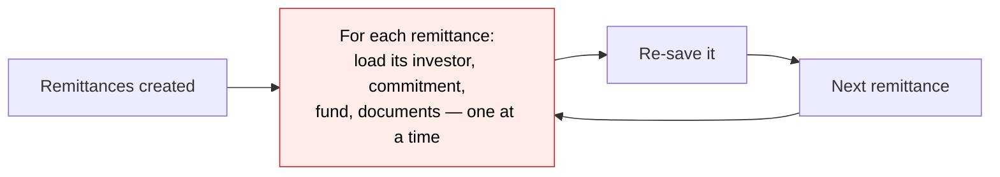
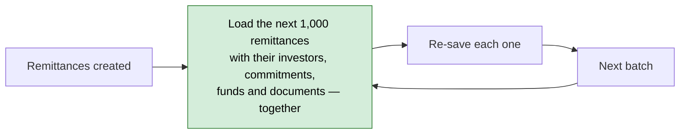
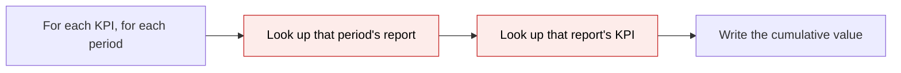
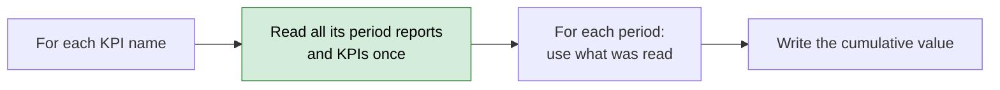
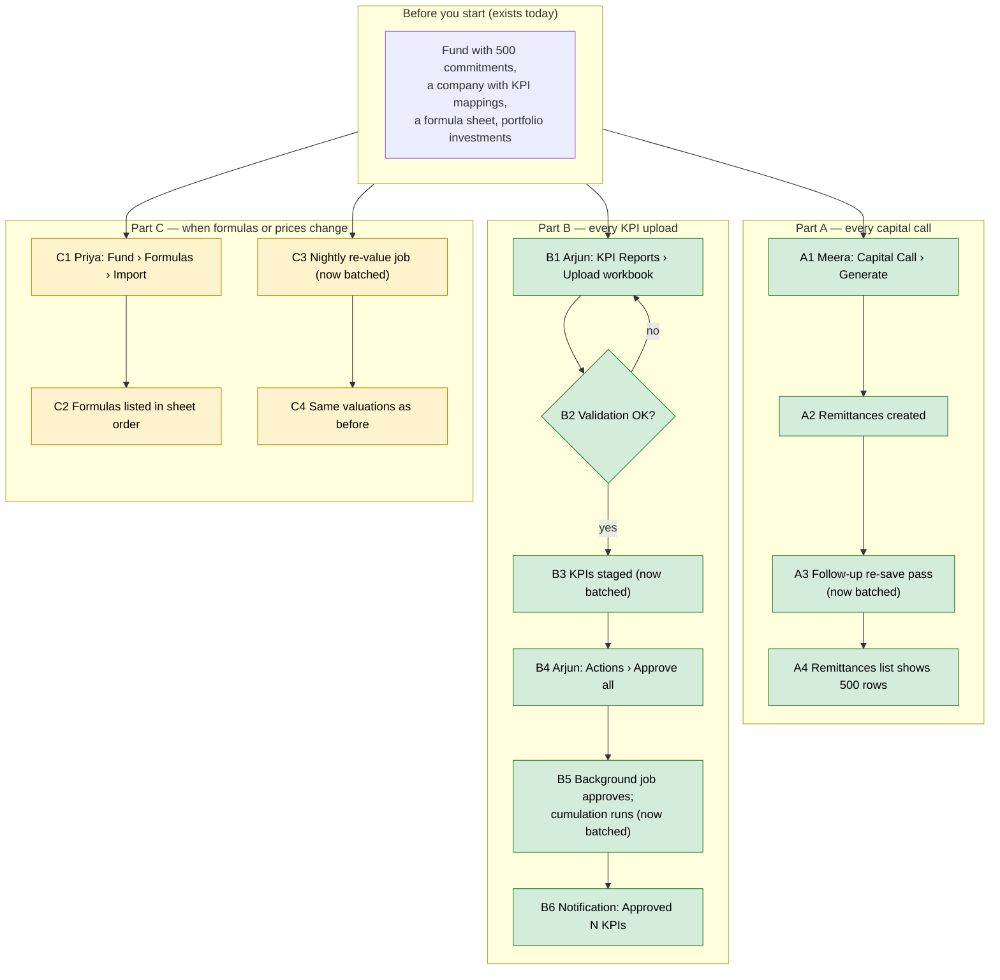

# Faster bulk jobs: capital calls, KPI uploads, formula and portfolio recomputes — Proposal

> **Audience:** Business team, product, QA, support — non-technical.
> **Companion document:** [Design](design.md)
> **New to this? Start with the [Workflow Journey](#workflow-journey)** — every action, in order, from start to the outcome.

> **Planning phase — no code changes.** This document proposes and explains the change. Do not
> edit application code while writing it; implementation happens later, in the tasks phase.

---

## Why

Six everyday bulk jobs ask the database the same question again for every row they process. A
500-investor capital call makes about 14 small database trips per remittance after creating it; a KPI
recompute for one company can make ~3,000 trips; an "approve all" on a large company could time the
page out. The answers are identical every time — the work is simply repeated. We measured this on
2026-10-22 by running the fund, core and startup test suites with full database logging.

## What Changes

Nothing a user sees or gets changes — the same remittances, KPIs, formulas, valuations, documents,
emails and numbers come out. What changes is how much repeated work happens behind the scenes:

- **Generating a capital call** — after the remittances are created, the follow-up pass that re-saves
  each one (and the pass that un-verifies them when payments are generated) loads each remittance's
  investor, commitment, fund and documents in one go per batch, instead of one at a time.
- **Recomputing cumulative KPIs** (Quarter / YTD / Year) — the period reports and KPIs a company
  already has are read once per KPI name, instead of once per KPI per period.
- **Uploading a KPI workbook** — each report's existing KPIs are read once, instead of twice per cell.
- **Importing fund formulas** — a formula placed at the end of the list no longer asks the database to
  shift every formula after it (there are none to shift).
- **Recomputing portfolio investments** (fair value, FX, currency change, price feeds) — the
  "how many units were bought / converted" totals are worked out once per batch, not once per investment.
- **Saving a record with documents** (remittances, portfolio investments, …) — the documents still get
  checked exactly as today, but their folders and signatures are loaded together.

Two extras were approved on 2026-10-22 (see [Resolved Design Decisions](#resolved-design-decisions)):
skipping KPI cumulations that are pure repeats, and skipping intermediate portfolio-total saves during
an investment import.

### Flow Diagram

Capital call generation — the follow-up re-save pass (the slowest part today):


*Before: each of 500 remittances fetches its own related records (~14 trips each).*


*After: related records arrive with the batch; each re-save only does its own writes.*

KPI cumulation — working out Quarter / YTD / Year values:


*Before: two lookups for every KPI × period.*


*After: one read per KPI name; new reports/KPIs are added to what was read as they are created.*

---

## Workflow Journey

### Who is involved

| Person | Role | What they do in the journey |
|---|---|---|
| Meera | Fund admin | Generates a capital call for a 500-investor fund |
| Arjun | Portfolio analyst | Uploads a company's KPI workbook and approves it |
| Priya | Fund accountant | Imports a fund's formulas from Excel |
| (system) | Nightly jobs | Re-values portfolio investments (fair value, FX, price feeds) |

### The journey on one page



### Before you start

| Needed | Why | Where it comes from |
|---|---|---|
| A fund with commitments | Capital calls create one remittance per commitment | Fund › Commitments (exists today) |
| KPI mappings for the company | Cumulation needs to know which KPIs add up | Portfolio company › KPI Mappings (exists today) |
| A formula sheet | Formula import | Fund › Formulas › Download template (exists today) |
| Portfolio investments | Re-value jobs | Fund › Portfolio (exists today) |

Nothing new needs to be set up — there is no setting, flag or permission for this change.

### Part A — every capital call

| Step | Who | Where (screen › button) | Action | What the system does | What you see |
|---|---|---|---|---|---|
| A1 | Meera | Capital Call › Generate Remittances | Clicks Generate | Queues the generation job | "Generating remittances… 0 of 500" |
| A2 | system | — | — | Creates one remittance per commitment | Progress line counts up |
| A3 | system | — | — | Re-saves each remittance (fees, status) — **related records now loaded per batch of 1,000** | Progress line finishes sooner |
| A4 | Meera | Capital Call › Remittances | Opens list | — | 500 remittances, same amounts as before |

### Part B — every KPI upload

| Step | Who | Where (screen › button) | Action | What the system does | What you see |
|---|---|---|---|---|---|
| B1 | Arjun | KPI Reports › Upload | Uploads workbook | Validates the sheet | Validation summary |
| B2 | Arjun | Validation result | Fixes and re-uploads if errors | — | Errors listed per row (unchanged) |
| B3 | system | — | — | Stages KPIs — **each report's existing KPIs read once** | Staged KPIs in the grid |
| B4 | Arjun | KPI grid › Actions › Approve all | Clicks Approve all | Queues the approval job (already shipped separately) | "Approving 240 pending KPIs in the background…" |
| B5 | system | — | — | Approves, then works out Quarter/YTD/Year — **periods read once per KPI name** | — |
| B6 | Arjun | Bell / toast | — | — | "Approved 240 KPIs for Acme. Cumulative values are being computed." |

### Part C — when formulas or prices change

| Step | Who | Where (screen › button) | Action | What the system does | What you see |
|---|---|---|---|---|---|
| C1 | Priya | Fund › Formulas › Import | Uploads sheet | Creates formulas in sheet order — **no shifting when a formula goes at the end** | Import summary |
| C2 | Priya | Fund › Formulas | Opens list | — | Same order and sequence numbers as today |
| C3 | system | — | — | Re-values investments — **bought/converted unit totals worked out once per batch** | — |
| C4 | anyone | Fund › Portfolio | Opens | — | Same fair values as before |

### What the user sees

Capital call remittances list — identical figures before and after, only produced faster:

```
Capital Call: Q3 2026 Drawdown        Remittances: 500        Due: 15 Nov 2026
┌──────────────┬──────────────┬──────────────┬──────────┐
│ Investor     │ Commitment   │ Call Amount  │ Status   │
├──────────────┼──────────────┼──────────────┼──────────┤
│ Acme LP      │ ₹10,00,00,000│ ₹1,00,00,000 │ Pending  │   10% of commitment
│ Beta Trust   │ ₹ 5,00,00,000│ ₹  50,00,000 │ Pending  │   10% of commitment
│ …            │ …            │ …            │ …        │
└──────────────┴──────────────┴──────────────┴──────────┘
Database trips for the follow-up pass: before ≈ 500 × 14 = 7,000; after ≈ 500 × 5 + 6 per batch ≈ 2,506
```

### What goes wrong

**Approve all fails halfway** (e.g. a KPI fails validation): the KPIs approved before the failure stay
approved, Arjun gets a red alert "Approving KPIs for Acme stopped: <reason>. 120 of 240 were approved."
He fixes the KPI and clicks Approve all again — only the 120 still pending are approved.

**A formula sheet has two rows with the same sequence**: behaves exactly as today — the second one is
inserted before the first and later formulas move down. The shortcut only applies when a formula goes
after every existing one.

### Summary: the minimum actions

| # | Action | Who | How often |
|---|---|---|---|
| 1 | Generate a capital call | Fund admin | Every call |
| 2 | Upload a KPI workbook, approve all | Portfolio analyst | Every reporting period |
| 3 | Import formulas | Fund accountant | When formulas change |
| — | Re-value jobs | System | Nightly / on change |

No new action is added; none is removed.

---

## User Stories

- As a **fund admin**, when I generate a capital call for a large fund, I want the remittances to be
  ready sooner, with exactly the same amounts and statuses.
- As a **portfolio analyst**, when I approve a company's KPIs, I want Quarter / YTD / Year values to
  appear sooner, with the same values as today.
- As a **portfolio analyst**, when I upload a large KPI workbook, I want it staged faster.
- As a **fund accountant**, when I import formulas, I want the same order and sequence numbers as today.
- As **operations**, I want nightly re-value jobs to finish sooner and use the database less.

## UI Behavior

No screen, button, message or email changes. (The "Approve all" background job and its notice were
shipped separately on 2026-10-22 and are not part of this change.)

## What This Feature Does NOT Cover

- Caching answers across requests or jobs ("remember this for a while") — rejected on 2026-10-22
  because it can serve out-of-date answers.
- The duplicate-folio check, audit trail entries and counter updates on each remittance — they stay
  per save on purpose (dropping them would change behaviour).
- Packs not covered by the 2026-10-22 run (deals, AI, secondaries, misc, API).
- New database indexes (only `entities.domain` was added, in the earlier fix set).

## Validation Rules

Unchanged. Every record is validated exactly as today — including each document attached to a
remittance or portfolio investment.

## Behavior Rules

- **Same output:** every bulk job produces the same rows, values, order and notifications as before.
- **Same failures:** a record that fails to save today fails the same way, with the same message.
- **Same order of work:** where a later step depends on an earlier one (e.g. Quarter values before
  YTD-from-quarters), that order is kept.
- **New rows count:** anything a job creates mid-way (a new period report, a new KPI) is visible to the
  rest of that same job, exactly as when it re-asked the database.

## Resolved Design Decisions

| # | Decision | Recommendation | Status |
|---|---|---|---|
| D1 | No request-scoped caches | Load once in the bulk job and hand it in | Agreed 2026-10-22 |
| D2 | Behaviour identical; existing features untouched; new scenarios allowed | — | Agreed 2026-10-22 |
| D3 | **KPI cumulation: skip pure repeats.** Today a KPI name is cumulated again for every report it appears in; repeats read the same inputs and write nothing new. Skipping them is the biggest saving. Visible differences: a duplicate line disappears from the cumulation error email, and a name that errored in one report is not retried in later reports of the same run. | Do it | Approved 2026-10-22 |
| D4 | **Portfolio import: skip intermediate portfolio-total saves.** During an investment import, each investment re-saves its portfolio total, and the import re-saves every total again at the end. Skipping the intermediate saves gives the same final totals but fewer intermediate audit-trail entries. | Do it | Approved 2026-10-22 |

## Capabilities

### New Capabilities
- `platform/bulk-path-query-efficiency`: bulk jobs (capital call generation, KPI cumulation and
  upload, formula import, portfolio re-valuation, document checks on save) load shared data once per
  batch and produce identical results.

### Modified Capabilities
- None — no existing requirement changes.

## Impact

- **Capital calls:** remittance generation and the payment generation step.
- **KPIs:** cumulation (Quarter / YTD / Year), workbook upload, RAG recompute.
- **Fund formulas:** formula import.
- **Portfolio:** fair-value, FX, currency-change and price-feed re-valuation; investment import.
- **Documents:** saving any record that has documents attached (checks unchanged, loads batched).
- No change to APIs, exports, emails, permissions or data.

## Benefits

- Large capital calls, KPI approvals and nightly re-values finish sooner.
- Less load on the production database during month-end and quarter-end peaks.
- Lower risk of a background job timing out or locking rows other users are waiting on.

## FAQ

**Q: Will any number change?**
No. Every value is computed the same way; only how often the same data is fetched changes. The
existing test suite (unchanged) and new before/after query-count checks prove it.

**Q: Do users need to do anything?**
No. There is no setting, no migration of data and no new permission.

**Q: What happens if a job fails halfway?**
Exactly what happens today — records saved before the failure stay saved, the same error is shown.

**Q: Why not just cache the answers?**
A cache can hand out an answer that has since changed (e.g. a rule edited mid-import). We chose to load
data once inside the job that needs it, so nothing outlives that job. See [design](design.md).

**Q: Is anything rolled out gradually?**
No flag — each fix is a code-level change verified by the test suite and a query-count comparison.

## Design Principle for the Next Phase

- **Risk of complexity:** KPI cumulation creates reports and KPIs mid-loop that later steps must see.
  The design must keep the "add to what was read as you create it" rule obvious — one small lookup
  per KPI name, updated in the same place the row is created.
- **Reuse:** no new services or abstractions. Each fix lives in the job or method that owns the loop,
  using `includes`, a grouped total, or a lookup built at the top of the loop.
- **Behaviour first:** where a shortcut could change an edge case (duplicate formula sequences, blank
  KPI tag, invalid documents), the design keeps the existing path for that case.
