# Capital Call & Distribution Maker–Checker — Design

> **Audience:** Engineering team.
> **Companion documents:** [Proposal](proposal.md) · [Spec](specs/funds/capital-call-distribution-maker-checker/spec.md) · [Business rules](business-rules.md) · [LLD](lld.md) · [Screen mock](mocks/approve_actions.html)

> **Planning phase — no code changes.** This document explains HOW the proposal will be built.
> Do not edit application code while writing it; implementation happens later, in the tasks phase.

> **Design, not code.** Real class, method, table and path names live inside the diagrams and tables.

> **Zoom one picture.** Part 1 draws the picture in plain words; Part 2 redraws it with real names; Part 3 has one
> card per box ①–⑧; Part 4 is reference material.

---

## Contents

- [1. The idea](#1-the-idea)
  - [What this adds](#what-this-adds)
  - [What approve does today](#what-approve-does-today)
  - [The idea in one picture](#the-idea-in-one-picture)
  - [Key concepts](#key-concepts)
  - [Walkthrough: one example, start to finish](#walkthrough-one-example-start-to-finish)
  - [Key ideas](#key-ideas)
- [2. The same picture with real names](#2-the-same-picture-with-real-names)
  - [Picture](#picture)
  - [What each box does](#what-each-box-does)
  - [One run, end to end](#one-run-end-to-end)
  - [Lifecycles](#lifecycles)
  - [What users see](#what-users-see)
  - [Design decisions](#design-decisions)
- [3. One card per box](#3-one-card-per-box)
  - [① Firm setting](#①-firm-setting)
  - [② Change watcher](#②-change-watcher)
  - [③ Preparer log](#③-preparer-log)
  - [④ Approval rule](#④-approval-rule)
  - [⑤ Approve paths](#⑤-approve-paths)
  - [⑥ Call and distribution pages](#⑥-call-and-distribution-pages)
  - [⑦ Approval notices](#⑦-approval-notices)
  - [⑧ Withdrawal](#⑧-withdrawal)
- [4. Reference](#4-reference)
  - [Class diagram](#class-diagram)
  - [Data model and schema changes](#data-model-and-schema-changes)
  - [Component contracts](#component-contracts)
  - [Notifications](#notifications)
  - [Cross-cutting concerns](#cross-cutting-concerns)
  - [Worked examples](#worked-examples)
  - [Testing](#testing)
  - [Risks and open questions](#risks-and-open-questions)

---

## 1. The idea

### What this adds

- A per-firm switch (`entity_settings.approval_maker_checker`) and an append-only log of who prepared each capital
  call / distribution (`approval_makers`), fed by model callbacks wherever figures change.
- The Approve permission (`CapitalCallPolicy#approve?`, `CapitalDistributionPolicy#approve?`) additionally refuses a
  preparer when the switch is on — the same "approver ≠ requester" idea Fund Compliance already enforces in
  `ComplianceRequestDecide#check_decider` (`app/packs/funds/compliance/operations/compliance_request_decide.rb:21-36`).
- A "Request approval" action and three internal notices, modelled on `ComplianceNotices` + `ComplianceNotifier`.

### What approve does today

Read from the current branch (`fix/owasp-top10-2026-11`, uncommitted fixes included).

| Record | Who may approve | What Approve does | What it does NOT do |
|---|---|---|---|
| Capital call | `!approved && update? && :approver` — `capital_call_policy.rb:43-45`; `update?` = `permissioned_employee?(:update)` `:39-41` (company admin, or an `AccessRight` with update on the fund — `application_policy.rb:133-160`) | `CapitalCallsController#approve` `:131-152` → `CapitalCallApproval.call` (`capital_call_approval.rb:11-22`): validation rules (blockers stop it), sets `approved` + `approved_by_user`, then `CapitalCallApprove` (`capital_call_approve.rb:1-6`): refuses if generated notices are unapproved (`:31-43`), saves, `generate_capital_remittances` (no-op unless figures changed), journey progress | Does **not** email anyone: notices go out only on **Send Notification** (`notify?` = `update? && approved`, `capital_call_policy.rb:75-77`; `CapitalCall#send_notification` `capital_call.rb:119-123`). Journey text agrees: `approve_call.rb:15` |
| Capital distribution | `!approved && update? && :approver` — `capital_distribution_policy.rb:164-166` (the report's `:62-64` is the pre-hardening position) | `CapitalDistributionsController#approve` `:131-147`: sets `approved` + `approved_by_user`, saves, journey progress. No validation rules, no notice check | Unlocks **Mark Payments Completed** (`payments_completed?` `:146-148`, waived for imported) and **Send Payment Notification** (`:150-152`) |
| Bulk | `CapitalCallsBulkActionJob` `:7,22,27` and `CapitalDistributionsBulkActionJob` `:7,21,26-29` ask the same `approve?` per record; queued by `WithBulkActions#bulk_actions` (`with_bulk_actions.rb:10,38`) — **API only**, no UI button | Same as the single action | Refusal message is "Not authorized to approve" |
| Unapprove | Calls only: `approved && update? && :approver` `:47-49` → `CapitalCallUnapprove` (journey undo) | Resets `approved`, `approved_by_user` | Distributions have no Unapprove |

**Separate approvals and steps (not changed here)**

| Thing | Where | Relationship to Approve |
|---|---|---|
| Notice (document) approval | `DocumentPolicy#approve?` = `update? && to_be_approved? && :approver` (`document_policy.rb:144-146`) | Prerequisite for call approval (`CapitalCallApprove#check_unapproved_docs`) — a separate approval, out of scope |
| Remittance / notice generation | `generate_docs?` = `!approved && update?` (`capital_call_policy.rb:59-61`) | Any editor; before approval |
| Payments | `CapitalRemittancePayment` create/verify | After approval; not "figures" |
| Journey "CFO sign-off" (human step) + "Approve call" (system step, unlocks "Approve") | `capital_call_journey_setup.rb:38-41`; `capital_distribution_journey_setup.rb:41-44` | **Advisory only** — `Workflowable#workflow_gated?` returns false for journeys (`workflowable.rb:154-160`); never disables Approve |

**Who prepares a call, and who can change it afterwards**

| Path | Where | Approved on create? |
|---|---|---|
| Form / JSON API | `CapitalCallsController#create` `:89-103` → `CapitalCallCreate` | No |
| Import of calls | `ImportCapitalCall#save_row` `import_capital_call.rb:64-77` (`manual_generation: true`) | No |
| Import of distributions | `ImportCapitalDistribution#save_row` `import_capital_distribution.rb:25-38` | No |
| Remittance generation from formulas | `CapitalCall#generate_capital_remittances` `capital_call.rb:104-114` (fee formulas via `fee_formula_ids`) | n/a — runs as the creator/editor |
| Open-ended settlements | `DealingSettlement.subscription_call` `dealing_settlement.rb:18-25`, `.redemption_distribution` `:122-129` | **Yes** (system, `approved: true`) |
| AI drafting | None — assistants and MCP tools are read-only | — |
| Edit after create | `update?` has **no** `approved` check: call edit `CapitalCallUpdate` (`capital_call_update.rb`), distribution plain `update` (`capital_distributions_controller.rb:92-105`), remittance edit permits `call_amount` (`capital_remittances_controller.rb:214-216`), payment edit permits `income` (`capital_distribution_payments_controller.rb:195-197`) | Edits stay allowed after approval today |

### The idea in one picture

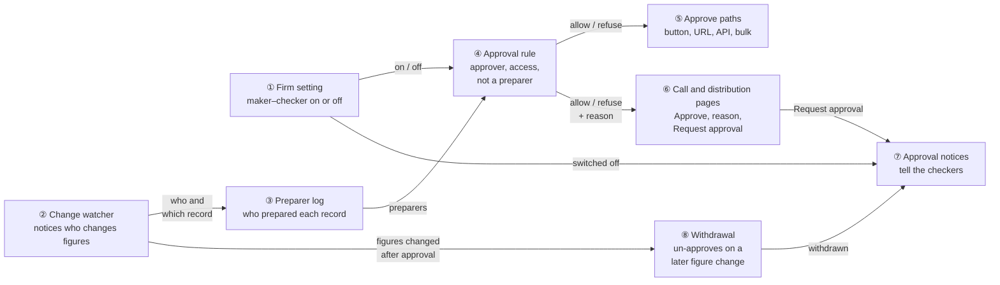

### Key concepts

**How the concepts fit together**

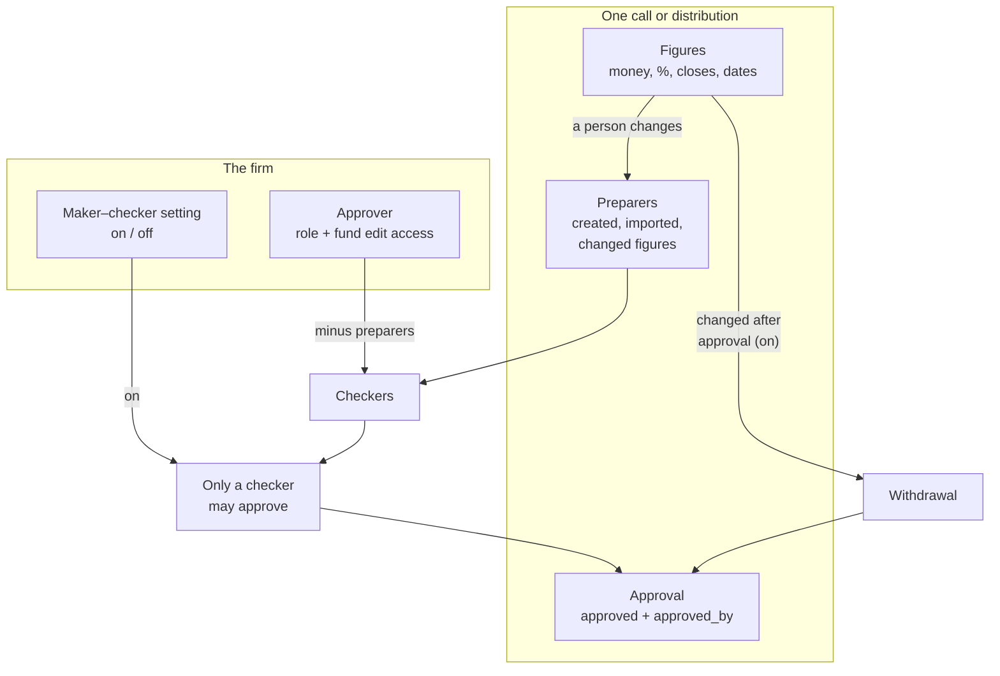

- **The firm** decides whether the rule applies and who holds the Approver role.
- **One record** carries its figures, its preparers and its approval.
- **The rule** joins them: with the setting on, only a checker may approve; a later figure change withdraws approval.

**Glossary**

| Concept | What it is, in one line | Example | Stored in |
|---|---|---|---|
| Approver | Active user with the `approver` role and `update?` on the record's fund | Ravi, Meera, Priya | `roles` / `users_roles`; `access_rights` |
| Maker–checker setting | Firm switch: a preparer may not approve | Nilgiri ON, Solo Ventures OFF | `entity_settings.approval_maker_checker` (new) |
| Figures | The fields that decide what LPs pay/receive (list in card ②) | Percentage called 10%; remittance call amount ₹1.2 Cr | Existing columns |
| Preparer (maker) | A user who created, imported or changed figures of the record (or its remittances/payments/fee lines) | Meera (created), Anil (edited) | `approval_makers` (new) ∪ create audit's user |
| Acting user | The person behind the current request or job | Anil in a request; the uploader in an import job | `Current.user` (`current.rb:17-19`) |
| Checker | An approver who is not a preparer of this record | Ravi, Priya | Not stored (derived) |
| Self-approval | `approved_by_user_id` is a preparer | Sam on Solo Fund I | Not stored (derived) |
| Request approval | Preparer-triggered notice to checkers | Meera → Ravi, Priya | `noticed_events` (existing) |
| Withdrawal | Setting on + figure change by a person after approval → `approved = false` | Anil edits ₹1.2 → ₹1.25 Cr | `capital_calls.approved` (existing) |
| Open-ended settlement | Call/distribution created approved by a dealing date | Nilgiri Flexi Nov 30 subscription settlement | `dealing_dates.subscription_call_id` / `redemption_distribution_id` |

#### Maker–checker — two-person approval

- **What:** the person who prepares a call/distribution (maker) may not be the one who approves it (checker).
- **Why:** 76% of approved calls and 81% of approved distributions in the last 12 months were approved by their creator
  (production copy, see [D6](#d6-setting-off-by-default-for-every-firm)); one insider could release money alone.

| Kind / trigger | What it does | Example |
|---|---|---|
| Approve by a checker | Allowed as today | Ravi approves Meera's call |
| Approve by a preparer, setting on | Refused (policy) | Meera's own call |
| Approve by a preparer, setting off | Allowed, labelled | Sam's own call |
| Figure change after approval, setting on | Approval withdrawn | Anil edits a remittance |

**What it does NOT cover:** Unapprove (any approver), generating/approving notices, sending notifications, payments,
unit allocation, open-ended settlements created approved by the system.

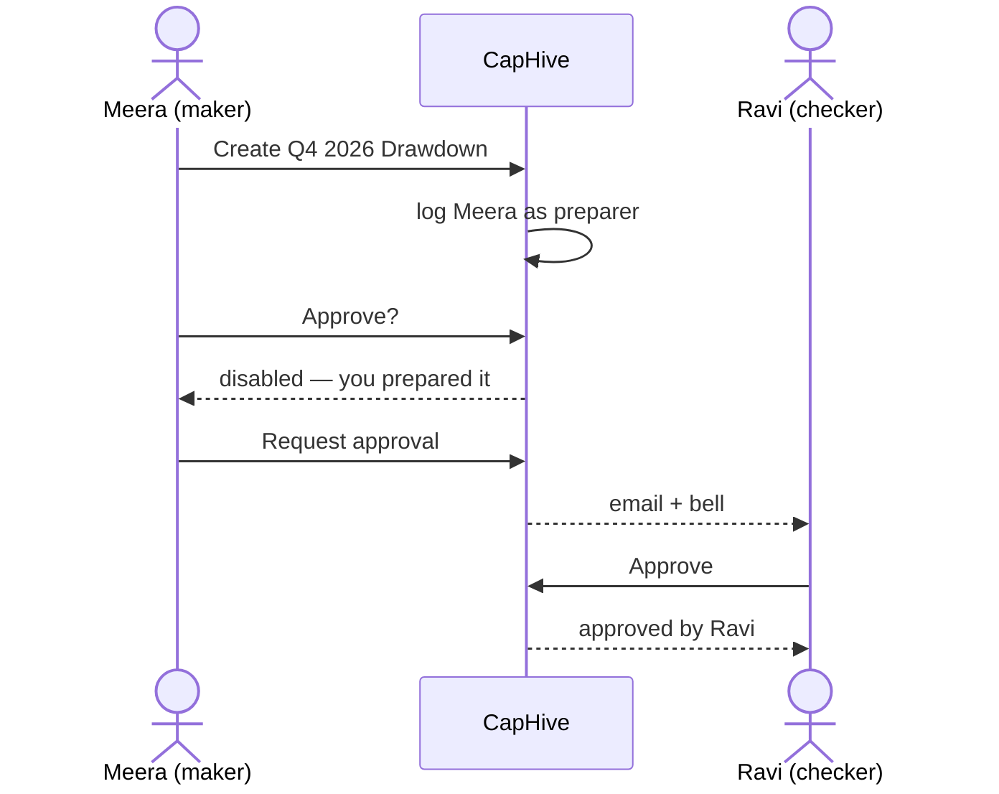

**Rules**
- Preparers are permanent for the record (append-only); un-approving does not clear them.
- Unapprove stays with any approver; a preparer may unapprove.
- With the setting on there is no single-approver fallback ([D7](#d7-strict-when-on-no-single-approver-fallback)).

#### Preparer — who counts

- **What:** anyone whose action created or changed the record's figures, by any path.
- **Why:** the creator alone misses real cases — 1 of the 15 calls approved by a non-creator in 12 months was approved
  by someone who had changed a remittance amount first.

| Trigger | Recorded? | Example |
|---|---|---|
| Create call / distribution (form, API, import) | Yes | Meera creates Q4 |
| Update a figure of the call / distribution | Yes | 10% → 12% |
| Update / destroy a figure of an existing remittance, payment, call fee, distribution fee | Yes | ₹1.2 → ₹1.25 Cr |
| Create remittance/payment while the parent is unapproved (generation, import) | Yes (deduped) | 3 generated remittances → 1 row |
| Create remittance/payment for a new commitment when the parent is approved | No | Late closer added |
| Recompute fees that changes a fee | Yes (job's acting user) | Anil's click |
| Non-figure fields, payments received, verify | No | Notes |
| No acting user | No | Console / cron |
| Support acting as a user | The support person (real human) | Sunil as Meera → Sunil |
| Creator in the audit trail | Always counted | Calls created before release |

**What it does NOT cover:** who viewed, generated notices or sent emails.

**Rules**
- One row per (record, user); repeated actions add nothing.
- Recorded in the same transaction as the change; a rolled-back change records nobody.

#### Withdrawal

- **What:** with the setting on, a person changing figures of an approved record un-approves it.
- **Why:** "Approval locks the call's figures" (`approve_call.rb:14`) is not enforced today — `update?` has no
  `approved` check, so figures could change after a checker approved and notices could then go out.

| Trigger | Withdraws? | Example |
|---|---|---|
| Figure update on record / existing child / fee line by a person | Yes | Anil edits a remittance |
| Child destroyed by a person | Yes | Remittance deleted |
| New child for a new commitment | No | Late closer |
| No acting user | No (logged) | Job without actor |
| Open-ended settlement | No | Subscription payment added |
| Setting off | No | Today's behaviour |

**What it does NOT cover:** notices already emailed are not recalled (the alert says so).

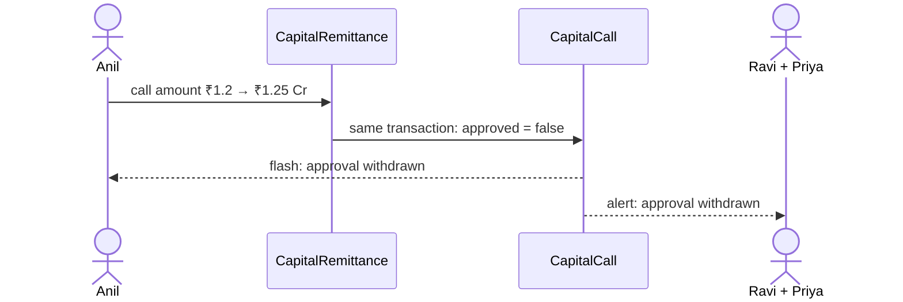

**Rules**
- Runs inside the change's transaction, so figures and approval never disagree ([D8](#d8-withdraw-approval-on-a-later-figure-change)).
- Production copy: 0 figure edits after approval in 12 months, so no firm is surprised in practice.

### Walkthrough: one example, start to finish

Nilgiri Capital (setting ON), Nilgiri Growth Fund I, commitments ₹20 Cr + ₹18 Cr + ₹12 Cr. Data from the
[shared setup](business-rules.md#shared-setup). **Legend:** ✓ done · ● we are here: waiting on this, not done yet ·
○ not yet · ↺ moved back.

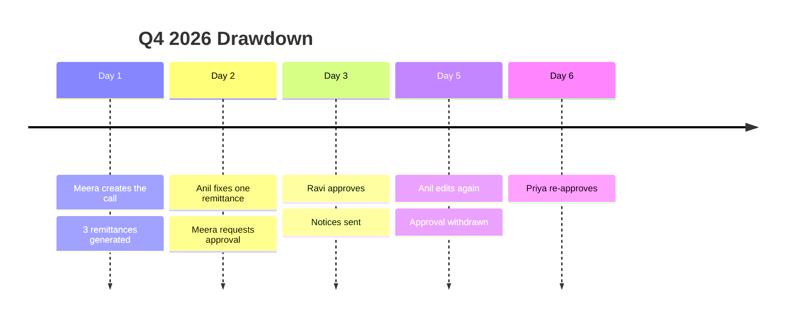

**Phase A — prepare**

| # | When | What happens | Behind the scenes | Result&nbsp;(after) |
|---|---|---|---|---|
| 1 | Day 1 | Meera creates "Q4 2026 Drawdown", 10% | the change watcher (②) sees a create and writes Meera to the preparer log (③) | Approved:&nbsp;No<br>Preparers:&nbsp;Meera<br>**Approve&nbsp;call&nbsp;●** |
| 2 | Day 1 | 3 remittances generated: ₹2 Cr + ₹1.8 Cr + ₹1.2 Cr = ₹5 Cr | the change watcher (②) sees 3 creates under Meera's job; its per-job memo skips rows 2 and 3 | Same as row 1 |
| 3 | Day 2 | Anil changes ₹1.2 Cr → ₹1.25 Cr (total ₹5.05 Cr) | the change watcher (②) logs Anil in the preparer log (③) | Approved:&nbsp;No<br>Preparers:&nbsp;Meera,&nbsp;Anil<br>**Approve&nbsp;call&nbsp;●** |
| 4 | Day 2 | Meera opens Actions | the approval rule (④) reads the setting (①) and the preparer log (③): Meera is a preparer | Approve disabled for Meera |

**Phase B — ask and approve**

| # | When | What happens | Behind the scenes | Result&nbsp;(after) |
|---|---|---|---|---|
| 5 | Day 2 | Meera clicks Request approval | the pages (⑥) call the notices (⑦): checkers = approvers with access − preparers = Ravi, Priya | Ravi, Priya notified |
| 6 | Day 2 | Meera clicks again 10 min later | the notices (⑦) find a request event under an hour old | Refused: "already asked at 10:42" |
| 7 | Day 3 | Ravi approves | the approve path (⑤) asks the approval rule (④): Ravi is a checker → `CapitalCallApproval` | Approved:&nbsp;Yes&nbsp;by&nbsp;Ravi<br>Preparers:&nbsp;Meera,&nbsp;Anil<br>Approve&nbsp;call&nbsp;✓<br>**Send&nbsp;notices&nbsp;●** |
| 8 | Day 3 | Meera sends notices | unchanged | Send&nbsp;notices&nbsp;✓ |

**Phase C — mistake and recovery**

| # | When | What happens | Behind the scenes | Result&nbsp;(after) |
|---|---|---|---|---|
| 9 | Day 5 | Anil changes ₹1.25 Cr → ₹1.3 Cr | the change watcher (②) sees a figure update on an approved call with an acting user → withdrawal (⑧) in the same transaction; after commit the notices (⑦) alert Ravi, Priya, Meera | Approved:&nbsp;No<br>Approve&nbsp;call&nbsp;↺<br>**Approve&nbsp;call&nbsp;●** |
| 10 | Day 5 | Ravi tries to re-approve | Ravi is not a preparer (Anil is) → allowed — but Ravi is away | Same as row 9 |
| 11 | Day 6 | Priya approves | the approval rule (④) → allowed | Approved:&nbsp;Yes&nbsp;by&nbsp;Priya<br>Approve&nbsp;call&nbsp;✓ |

**Stall:** had Ravi and Priya both lost the Approver role, step 5 would answer "No one else can approve this call…"
and send nothing.

**Snapshot at row 4 (Meera's Actions menu)**

```
[⚙ Actions ▾]
 ├ ✓ Approve           (greyed) ⓘ You prepared this call, so another approver must approve it (maker–checker is on).
 ├ ✉ Request approval
 └ View Generated Documents …
```

**What to notice**
- One rule (④) answers the button, URL, API and bulk paths alike.
- The preparer log grows from every figure path without any controller knowing about it (②).
- Withdrawal makes "approval covers the figures" true instead of advisory.

### Key ideas

| # | Idea | In one line | Card |
|---|---|---|---|
| 1 | Policy is the only gate | `approve?` gains one clause; every path already asks it | [④](#④-approval-rule) |
| 2 | Record at the model, not the screen | Callbacks on 6 figure-bearing models + `Current.user` | [②](#②-change-watcher) |
| 3 | Append-only preparer log + audit creator | New rows only; creator from the audit trail covers old records | [③](#③-preparer-log) |
| 4 | Off by default | Nobody's flow changes on release day | [①](#①-firm-setting) |
| 5 | Withdraw in the same transaction | Figures and approval never disagree | [⑧](#⑧-withdrawal) |

**FAQ**

| Question | Answer |
|---|---|
| Does approving email LPs today? | No. Approval unlocks Send Notification; emails go only on Send (`approve_call.rb:15`). The risk is the unlocked path, not an automatic email. |
| Why not block on the journey's CFO sign-off instead? | Journeys are advisory by design (`workflowable.rb:154-160`), only exist for records created after seeding, and a firm can edit/remove steps. |
| Why not just a `created_by` column, as the report suggests? | Creator-only misses editors and importers (1 real case in 12 months), and the creator is already in the audit trail. See [D1](#d1-a-preparer-is-anyone-who-changed-figures)/[D2](#d2-an-append-only-preparer-table). |
| Will tests that create and approve as one user break? | No — setting off by default keeps every existing scenario green. |

---

## 2. The same picture with real names

### Picture

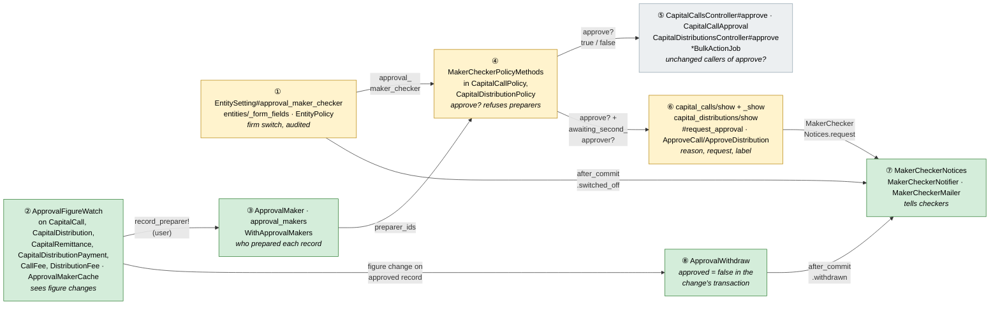

Colour = footprint: **green** new, **amber** modified, **grey** reused (⑤'s bulk jobs change only a message). Exact
files are in [lld.md File Map](lld.md#file-map).

### What each box does

| # | Box | Real parts | What it does | When it runs | What it decides | Details |
|---|---|---|---|---|---|---|
| ① | Firm setting | `EntitySetting#approval_maker_checker`, `EntityPolicy::ENTITY_SETTING_ATTRIBUTES`, `entities/_form_fields` | Stores the switch; announces switch-off | Entity form save | On / off | [card ①](#①-firm-setting) |
| ② | Change watcher | `ApprovalFigureWatch` concern, `ApprovalMakerCache` | Detects figure changes; records preparers; triggers withdrawal | Model save/destroy, request or job | Is this a figure change by a person? | [card ②](#②-change-watcher) |
| ③ | Preparer log | `ApprovalMaker`, `WithApprovalMakers` | Stores and answers "who prepared" | On write; on read by ④ ⑥ ⑦ | Preparer ids (rows ∪ audit creator) | [card ③](#③-preparer-log) |
| ④ | Approval rule | `MakerCheckerPolicyMethods` | Adds "not a preparer" to `approve?`; `awaiting_second_approver?`, `request_approval?` | Each policy check | Allow / refuse + why | [card ④](#④-approval-rule) |
| ⑤ | Approve paths | controllers, `CapitalCallApproval`, bulk jobs | Unchanged callers; bulk names the reason | Request / bulk job | — | [card ⑤](#⑤-approve-paths) |
| ⑥ | Pages | show views, `#request_approval`, journey checks | Disabled Approve + tooltip, Request approval popup, Prepared by row, label | Page render / POST | What the user sees | [card ⑥](#⑥-call-and-distribution-pages) |
| ⑦ | Notices | `MakerCheckerNotices`, `MakerCheckerNotifier`, `MakerCheckerMailer` | Picks recipients, sends email + bell | Request; after commit | Who is told | [card ⑦](#⑦-approval-notices) |
| ⑧ | Withdrawal | `ApprovalWithdraw` | Un-approves, journey undo note | Inside the change's transaction | Withdraw or not | [card ⑧](#⑧-withdrawal) |

### One run, end to end

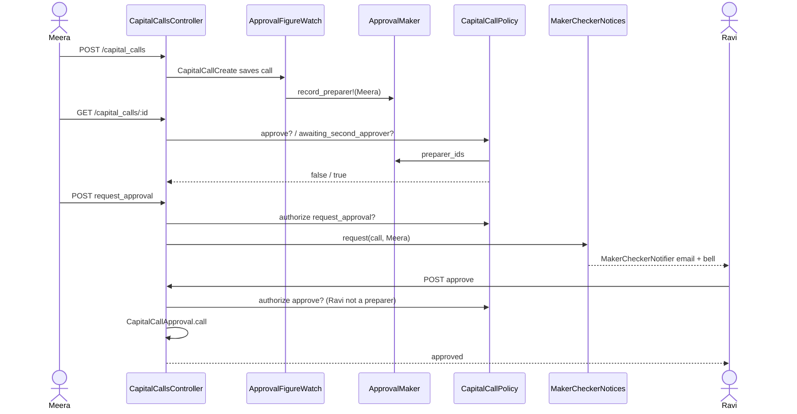

### Lifecycles

**Approval of one call / distribution (stored: `approved`, `approved_by_user_id`)**

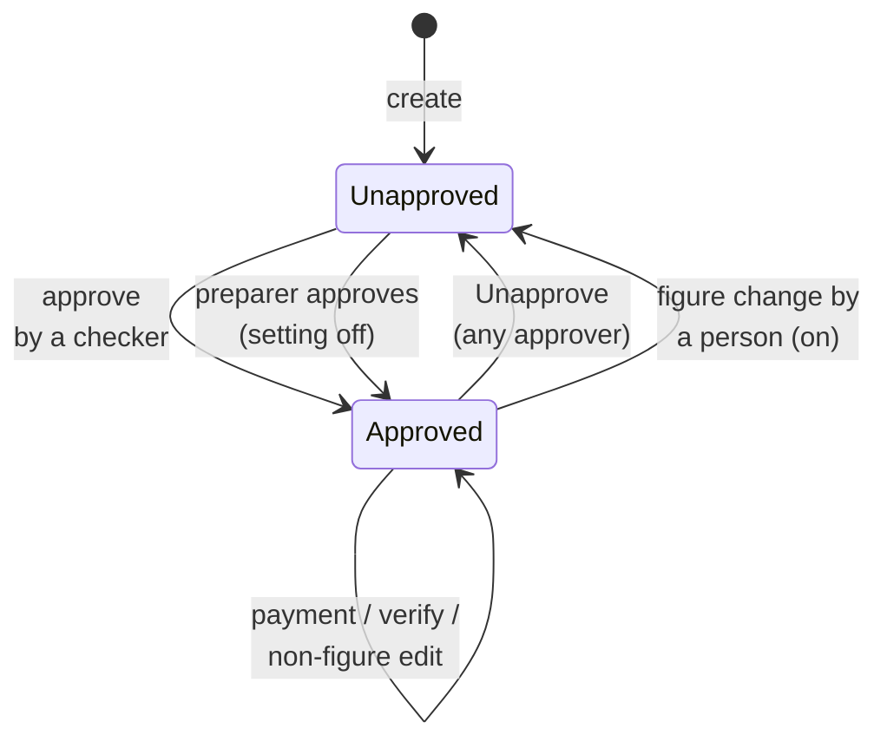

- Self-approved is **derived** (`approved_by_user_id ∈ preparer_ids`), never stored.
- Open-ended settlements are created in Approved and never leave it through this change.

**Preparer log (stored: `approval_makers` rows — append-only)**

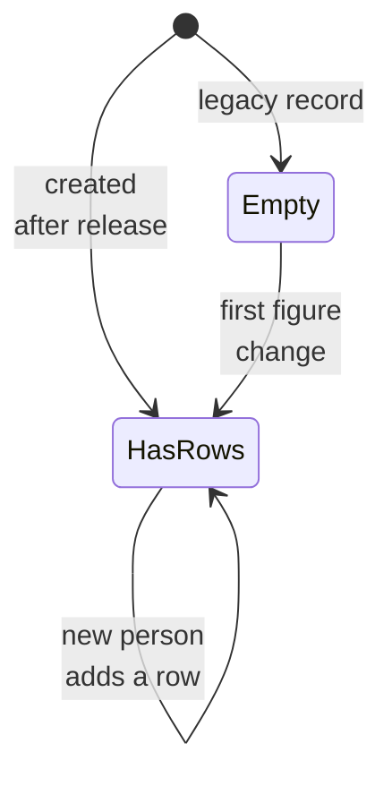

- In every state the audit-trail creator is also a preparer ([D4](#d4-audit-trail-creator-always-counts)).

### What users see

**At a glance**

| Where in CapHive | Today | After this change | Who sees it |
|---|---|---|---|
| Call / distribution page › Actions › Approve | Shown to approvers with edit rights | Same; **disabled + tooltip** for a preparer when ON | Approvers |
| Actions › Request approval | — | New, for editors when ON and unapproved | Editors |
| Details card | Approved Yes/No | + "Prepared by" row; "· by Sam Mehta (also prepared it)" when self-approved | Everyone who can open it |
| Journey panel at Approve step | "The call is not approved yet" | ON: "… — it needs an approver who did not prepare it" | Everyone |
| Entity form | — | "Approvals" section with the switch | Company admins |
| Bulk approve completion email | "Not authorized to approve" | "You prepared <name> — another approver must approve it" | API caller |
| Email / bell | — | Approval requested · Approval withdrawn · Maker–checker turned off | Checkers, preparers, admins |

**Main journey — preparer asks, checker approves** (mock: [mocks/approve_actions.html](mocks/approve_actions.html))

```
┌ Capital Call: Q4 2026 Drawdown ─────────────────────────────────┐
│ [stats cards: Call ₹5,05,00,000 · Collected ₹0 · Due …]          │
│ Approved      No                                                 │
│ Prepared by   Meera Shah, Anil Rao  ⓘ   ①                        │
│ [Edit] [Delete] [⚙ Actions ▾]                                    │
│                 ├ ✓ Approve (greyed) ⓘ   ②                       │
│                 ├ ✉ Request approval     ③                       │
└──────────────────────────────────────────────────────────────────┘
```

| Step | The user… | They see |
|---|---|---|
| ① | Opens the call | Who prepared it (tooltip: "Created, imported or changed this call's figures") |
| ② | Hovers Approve | "You prepared this call, so another approver must approve it (maker–checker is on)." |
| ③ | Clicks Request approval | Immediate Actions popup (3 cards) → Send request → flash "Approval requested from Ravi Iyer and Priya Nair." |

**Screen standards**

| Screen | Kind | Copies | Breadcrumbs | Tabs (lazy pills) | Turbo | Stats cards | Filter + search | Actions | Help | Full width |
|---|---|---|---|---|---|---|---|---|---|---|
| Capital call page | show (modified) | `capital_calls/show` + `_show` (itself) | Unchanged (`set_capital_call`) | Unchanged | `request_approval` → full redirect (as `approve`, `turbo: false`) | Unchanged | n/a | Items inside the existing Actions dropdown | Tooltips on Approve, Prepared by; popup cards | Unchanged |
| Capital distribution page | show (modified) | `capital_distributions/show` (itself) | Unchanged (`set_capital_distribution`) | Unchanged | Same as above | Unchanged | n/a | Existing Actions dropdown | Same | Unchanged |
| Request approval popup | modal | `investor_kycs/_request_updates_modal` (Immediate Actions) via `action_summary_modal.scss` classes | n/a | n/a | Form POST | n/a | n/a | Cancel / Send request (`btn-outline-danger` / `btn-outline-success`) | 3 cards: blue mail, amber user, green check | n/a |
| Entity form › Approvals | form section | the Weekly Task Digest block in `entities/_form_fields` | Unchanged | n/a | Unchanged | n/a | n/a | Form Save | `ti-info-circle` tooltip + `small.form-text.text-muted` | Unchanged |
| Emails | internal email | `ComplianceMailer#notice` layout | n/a | n/a | n/a | n/a | n/a | One button "Open call" | Dates `Mon dd, yyyy` | n/a |

- `approve` and the new `request_approval` keep the page's existing full-redirect pattern (`turbo: false`), because
  approval changes the stats, journey panel and Actions menu at once — the whole page changes.
- The disabled Approve stays a `dropdown-item` with `disabled` + `aria-disabled` and a wrapping `span` for the tooltip
  (Bootstrap tooltips don't fire on disabled elements).

### Design decisions

**At a glance**

| # | Decision | Why, in one line |
|---|---|---|
| D1 | A preparer is anyone who changed figures, not only the creator | Creator-only misses real editors (1 case in 12 months) |
| D2 | An append-only `approval_makers` table | Many preparers per record; no change to four big tables |
| D3 | Record via model callbacks + `Current.user`, deduped per request/job | Catches every path (forms, imports, jobs) in one place |
| D4 | Audit-trail creator always counts | Covers records created before release without a backfill |
| D5 | The rule lives in `approve?` via a policy mixin | Every path already asks `approve?` |
| D6 | Setting off by default for every firm | 12 of 15 approving firms self-approve; 5 have ≤1 approver |
| D7 | Strict when on: no single-approver fallback | The switch is the visible escape; a fallback can be engineered |
| D8 | Withdraw approval on a later figure change | Makes approval cover what LPs receive; 0 such edits in 12 months |
| D9 | Support acting as a user: record the real person, check both ids on approve | Closes self-approval through impersonation |
| D10 | Show a disabled Approve with the reason; server refuses generically | Users learn why; the server path stays the standard Pundit denial |
| D11 | Explicit "Request approval", once an hour | Calls are drafted over days; automatic alerts would spam |
| D12 | Self-approval label is derived | No column; always consistent with the log |
| D13 | Announce switching off; switching on is silent | Removing the control is the risky direction |
| D14 | Imports and open-ended settlements keep working | Importer is a preparer; system-approved settlements exempt |

#### D1. A preparer is anyone who changed figures

- **Problem:** The report suggests `created_by`. But Ravi can create nothing and still change a remittance from ₹1.2 Cr
  to ₹2.2 Cr, then approve it himself.
- **Decision:** A [preparer](#preparer--who-counts) is the creator, the importer, and anyone who changed a figure on the
  record, its existing remittances/payments, or its fee lines (incl. Recompute Fees).
- **Why:**
  - Production copy: 1 of 15 non-creator approvals was by someone who had changed a remittance amount.
  - Matches what auditors mean by "maker": whoever shaped the numbers.
- **Not chosen:** Creator only — misses the case above. "Anyone who saved anything" — a typo fix in notes would block
  a genuine checker.
- **Where:** `ApprovalFigureWatch::FIGURES` (card ②).

#### D2. An append-only preparer table

- **Problem:** A record can have several preparers; where to keep them?
- **Decision:** New table `approval_makers` (polymorphic `approvable`, `user_id`, `role`, unique per record+user).
- **Why:**
  - Several people per record; a column holds one.
  - Adds nothing to `capital_calls`/`capital_distributions`; append-only rows are their own audit.
  - Works the same on MySQL and SQLite (`insert_all … unique_by`), unlike JSON-array updates.
- **Not chosen:** JSON array column on each parent — engine-specific JSON functions, rewrite on every append, and a
  change to two existing tables. Reading `audits` at approve time — remittance audits aren't associated with the call,
  so it means scanning a very large table (CLAUDE.md).
- **Where:** `ApprovalMaker`, `WithApprovalMakers` (card ③); [schema](#data-model-and-schema-changes).

#### D3. Record via model callbacks, deduped per request/job

- **Problem:** Figures change in controllers, Trailblazer ops, imports and jobs (≥ 12 entry points); wiring each risks a
  miss.
- **Decision:** `ApprovalFigureWatch` callbacks on the six figure-bearing models read `Current.user` (set per request
  by `WithAuthentication#set_current_user` `with_authentication.rb:255-257`, restored in jobs by
  `ApplicationJob` `application_job.rb:31,88`). `ApprovalMakerCache` (a `CurrentAttributes`, like
  `LpPortfolioVisibilityCache`) skips repeats of the same (record, user) in one request/job.
- **Why:**
  - One hook point covers every path in the "Who counts" table.
  - Generating 3,000 remittances costs one insert, not 3,000.
- **Not chosen:** Explicit calls in each op/controller — easy to miss one (e.g. the distribution update is a plain
  `update`, `capital_distributions_controller.rb:94`). Adding state to `Current` — its header forbids more attributes.
- **Where:** card ②.

#### D4. Audit-trail creator always counts

- **Problem:** 180 unapproved calls and 127 unapproved distributions already exist with no preparer rows.
- **Decision:** `preparer_ids` = rows ∪ the `user_id` of the record's `create` audit (one indexed query on
  `auditable_index`), the same lookup `Workflowable#workflow_default_owner` already makes (`workflowable.rb:180-190`).
- **Why:** 0 of the last 12 months' approved calls/distributions lack a create-audit user; no backfill, no migration
  of data.
- **Not chosen:** Backfill rake task — extra ops step for the same answer. Fallback only when no rows — a legacy call
  edited after release would forget its creator.
- **Where:** `WithApprovalMakers#preparer_ids`.

#### D5. The rule lives in `approve?` via a policy mixin

- **Problem:** Four paths approve (button, URL, JSON, bulk).
- **Decision:** `MakerCheckerPolicyMethods` (included like `WorkflowablePolicyMethods`) adds `maker_checker_allows?` to
  `approve?` and provides `awaiting_second_approver?` and `request_approval?`.
- **Why:** All four already call `approve?` (controller `authorize`, bulk `Pundit.policy!…public_send`); the rule
  lives in the policy as the project requires.
- **Not chosen:** A check in `CapitalCallApproval` — distributions don't use it; a controller guard — forbidden pattern.
- **Where:** card ④.

#### D6. Setting off by default for every firm

- **Problem:** On or off for existing firms on release day?
- **Decision:** Column default `false`, not null; new firms off too. CapHive support/onboarding switches it on with each
  firm that has 2+ approvers.
- **Why:** Production copy (read-only aggregates, 12 months to 2026-11-04):

| Measure | Value |
|---|---|
| Firms with calls or distributions | 19 |
| Firms that approved anything | 15 |
| …self-approved at least once / only ever self-approve / never | 12 / 6 / 3 |
| Self-approving firms with ≤1 active approver today | 5 (would be hard-blocked) |
| Self-approving firms with ≥2 approvers | 7 (can adopt with a habit change) |
| Active firms by approver count: 0 / 1 / 2 / 3+ | 2 / 6 / 3 / 8 |
| Approved calls self-approved | 47 / 62 |
| Approved distributions self-approved | 30 / 37 (23 of them imported) |
| Figure edits after approval (calls, remittances) | 0 |

  - ON by default would stop 12 firms' normal path overnight; also every existing Cucumber scenario where one user
    creates and approves.
- **Not chosen:** On for existing firms (above). On for new firms only — new firms are set up through the same entity
  code as test fixtures and onboarding; flipping it there is a deliberate onboarding step instead
  ([open question 1](#risks-and-open-questions)).
- **Where:** `entity_settings.approval_maker_checker`; card ①.

#### D7. Strict when on: no single-approver fallback

- **Problem:** Compliance lets the only eligible approver self-approve (labelled). Should calls?
- **Decision:** No fallback. With the setting on, a preparer is always refused; the firm's escape is to switch it off
  (audited, announced — D13).
- **Why:** A company admin can make themselves the only approver by removing the role from others (M11: grants not yet
  recorded); a silent fallback would then reopen self-approval. The switch makes the choice explicit.
- **Not chosen:** `ComplianceRequestDecide`-style fallback.
- **Where:** `MakerCheckerPolicyMethods#maker_checker_allows?`.

#### D8. Withdraw approval on a later figure change

- **Problem:** `update?` has no `approved` check, so a checker approves ₹5 Cr and an editor then makes it ₹5.5 Cr.
- **Decision:** With the setting on and an acting user, a figure update/destroy on an approved record (or its existing
  children / fee lines) sets `approved = false`, `approved_by_user = nil` in the same transaction (`ApprovalWithdraw`),
  then after commit records a journey undo and alerts.
- **Why:** Approval then really "locks the figures" (`approve_call.rb:14`); production shows 0 such edits in 12 months,
  so the cost is nil today.
- **Not chosen:** Refuse figure edits on approved records — `edit?` is shared by non-figure edits and Unapprove-then-edit
  works already, but late-closer remittances and fee recomputes need to keep working. After-commit withdrawal — a
  failure would leave approved stale figures.
- **Where:** `ApprovalWithdraw`, card ⑧.

#### D9. Support acting as a user: record the real person, check both ids

- **Problem:** `Current.user` is the support person when impersonating (`with_authentication.rb:255-262`), while Pundit's
  `user` is the impersonated user — Sunil could prepare "as Meera" and approve "as Ravi".
- **Decision:** Record `Current.user` (the support person — the real human, as audits do); `maker_checker_allows?`
  refuses if either the policy user or its `support_user_id` is a preparer.
- **Why:** Closes the gap without special support rules; the client user who was impersonated did nothing, so they
  stay free to approve as a genuine second person.
- **Not chosen:** Ignore impersonation — leaves X10 open.
- **Where:** `ApprovalFigureWatch` (records `Current.user`), `MakerCheckerPolicyMethods#actor_ids`.

#### D10. Disabled Approve with the reason; generic server refusal

- **Problem:** Hiding Approve leaves the preparer guessing; a custom server message would need a controller guard.
- **Decision:** Page renders Approve disabled with tooltip when `awaiting_second_approver?`; a forced request gets
  the standard `deny_access` ("Access Denied" / JSON 403, `with_authentication.rb:101-114`). Bulk jobs build the
  specific message from `awaiting_second_approver?`.
- **Why:** UI explains itself; server stays standard Pundit.
- **Not chosen:** Custom 403 messages per policy — a new pattern in `WithAuthentication`.
- **Where:** cards ⑤ ⑥.

#### D11. Explicit Request approval, once an hour

- **Problem:** "Tell other approvers when a call awaits approval" — when exactly?
- **Decision:** A `request_approval` member action (POST) sends to checkers; refused if a `MakerCheckerNotifier` event of
  kind `approval_request` for the record is under an hour old.
- **Why:** A call is drafted over days; "awaits approval" is a human judgement. Re-using `noticed_events` for the
  throttle avoids a column.
- **Not chosen:** Alert on every create/edit — noise; alert when the journey reaches Approve call — journeys are
  optional and advisory.
- **Where:** card ⑦.

#### D12. Self-approval label is derived

- **Problem:** Show "also prepared it" without a column.
- **Decision:** `WithApprovalMakers#approved_by_preparer?` = `approved_by_user_id ∈ preparer_ids`.
- **Why:** Always consistent; no migration on two big tables.
- **Not chosen:** A `self_approved` boolean like `ComplianceRequest` — would need setting on every path that approves.
- **Where:** `_show` partials.

#### D13. Announce switching off

- **Problem:** A company admin can switch the control off before self-approving.
- **Decision:** `EntitySetting` after-commit on `approval_maker_checker` true → false sends `switched_off` to every other
  active company admin and approver; the change is in the entity's audit trail (`Trackable.new(associated_with: :entity)`
  on `EntitySetting`).
- **Why:** Detection is enough for an opt-in control; support-only would block one-person firms' self-service.
- **Not chosen:** Support-only setting (as `permissions`) — ops burden for 19 firms.
- **Where:** card ①, ⑦.

#### D14. Imports and open-ended settlements keep working

- **Problem:** Imports create records in jobs; open-ended settlements are created approved and receive remittances later.
- **Decision:** Importers are preparers through ② (job `Current.user` = uploader); imports never set `approved`
  (unchanged). Records where `DealingDate` references them are exempt from ② and ⑧ (`maker_checker_exempt?`, like
  `CapitalCall#skip_journey?` `capital_call.rb:25-27`).
- **Why:** Settlements are system-approved by design (open-ended-funds design); withdrawing them would break dealing.
- **Not chosen:** Run the rule on settlements — breaks every subscription.
- **Where:** `WithApprovalMakers#maker_checker_exempt?`.

**FAQ**

| Question | Answer |
|---|---|
| Why model callbacks if the project prefers ops? | The ops differ per path and some paths have none (distribution update, imports); one concern on the models is the only single point. Callbacks only record/flag — no business flow. |
| Can a figure list drift as columns are added? | `FIGURES` lives in one constant per model next to the concern include; the LLD has a reviewer check, and E-rows test each listed field group. |
| What about the race "Ravi approves while Anil edits"? | Approval needs a checker either way, so maker–checker holds; staleness is covered by ⑧ when Anil's commit lands after Ravi's. See Risks. |
| Does this add queries to the call page? | ≤ 3 small indexed queries, memoised per request — see [Query budget](#performance). |

---

## 3. One card per box

> Same order and numbers as the picture.

### ① Firm setting

New to this? Read [Maker–checker](#maker-checker--two-person-approval) first.

| Owns | Reads / receives | Produces |
|---|---|---|
| `entity_settings.approval_maker_checker` | Entity form params (company admin) | On/off for ④; `switched_off` event for ⑦ |

- Added to `EntityPolicy::ENTITY_SETTING_ATTRIBUTES` (`entity_policy.rb:73-79`); only company admins reach the form
  (`EntityPolicy#permissioned_employee?` `:122-127`), so non-admins and other firms are refused by the existing `update?`.
- Form: new "Approvals" block in `entities/_form_fields`, modelled on the Weekly Task Digest block (`:124-135`), shown
  for `entity_type == "Investment Fund"` only.
- `EntitySetting` already `Trackable.new(associated_with: :entity)` — the switch is audited with user and before/after.
- After commit, when `saved_change_to_approval_maker_checker == [true, false]`: `MakerCheckerNotices.switched_off(setting, Current.user)`.

**Worked examples:** H1, E1–E3, X1–X2, H25, E54–E55 ([§1](business-rules.md#1-firm-setting--phase-1), [§8](business-rules.md#8-switch-off-notice--phase-3)).

**FAQ**

| Question | Answer |
|---|---|
| Why `entity_settings`, not `entities.permissions`? | `permissions` is support-only (`entity_policy.rb:81-88`); this is the firm's own control. |
| Why not ValidationRule-style global default + override? | One boolean per firm, no versioning need; config-as-data would be heavier than the setting. |

### ② Change watcher

New to this? Read [Preparer — who counts](#preparer--who-counts) first.

| Owns | Reads / receives | Produces |
|---|---|---|
| `ApprovalFigureWatch` concern; `FIGURES` per model; `ApprovalMakerCache` | `saved_changes`, `Current.user`, `Current.user.support_user`, parent `approved`, setting | `record_preparer!` calls (③); `ApprovalWithdraw` calls (⑧) |

**Figures per model**

| Model | Parent | Figure columns (`FIGURES`) | Events watched |
|---|---|---|---|
| `CapitalCall` | itself | `percentage_called`, `amount_to_be_called_cents`, `fund_closes`, `close_percentages`, `call_date`, `call_basis`, `fee_formula_ids`, `unit_prices` | create, update |
| `CapitalDistribution` | itself | `income_cents`, `cost_of_investment_cents`, `reinvestment_cents`, `distribution_date`, `distribution_on`, `unit_prices` | create, update |
| `CapitalRemittance` | `capital_call` | `call_amount_cents`, `folio_call_amount_cents`, `capital_fee_cents`, `other_fee_cents`, `investment_amount_cents` | create (parent unapproved), update, destroy |
| `CapitalDistributionPayment` | `capital_distribution` | `income_cents`, `cost_of_investment_cents`, `reinvestment_cents`, `net_payable_cents`, `gross_payable_cents` | same as above |
| `CallFee` | `capital_call` | `name`, `start_date`, `end_date`, `fee_type`, `formula` (which account entries are pulled in as fees) | create, update, destroy |
| `DistributionFee` | `capital_distribution` | `name`, `start_date`, `end_date`, plus its fee-type/entry-type columns (confirmed in LLD) | create, update, destroy |

- Roll-up columns (`call_amount_cents`, `collected_amount_cents` on the call; `distribution_amount_cents` etc.) are
  **not** figures — they move when children change and would double-count.

**Decision flow (after_save / after_destroy, inside the transaction)**

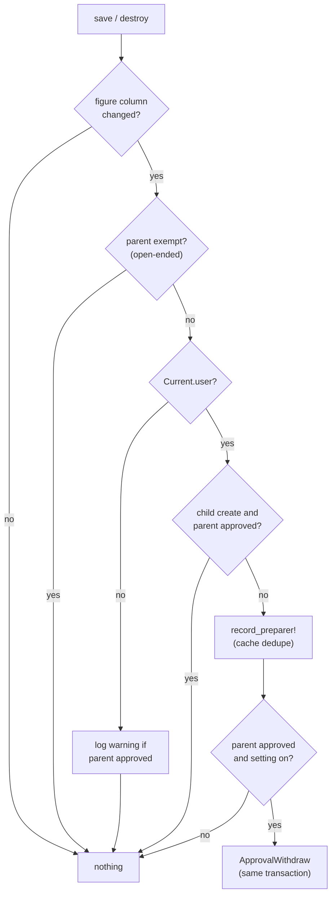

| Responsibility | Detail |
|---|---|
| Queue | None — inline in the model's transaction |
| Idempotency | `ApprovalMakerCache` per request/job + unique index + `insert_all … unique_by` (no error on repeat) |
| Transaction | Rides the caller's transaction; rollback removes the preparer row too |
| Cost | First change per (record, user) per request: 1 insert; repeats: 0 queries |

**Worked examples:** H2–H11, E4–E14 ([§2](business-rules.md#2-who-is-a-preparer--phase-1)); E43, E45, E50 ([§7](business-rules.md#7-withdrawal-on-figure-change--phase-3)).

**FAQ**

| Question | Answer |
|---|---|
| Why skip child creates on an approved parent? | `CapitalCommitmentRemittanceJob` (`capital_commitment_remittance_job.rb:17-28`) creates remittances in every existing call for a late commitment; that is expected catch-up, not re-preparing. |
| Why `after_save` and not `after_commit`? | Withdrawal must share the change's transaction (D8); recording is cheap and rolls back with it. |
| What about `update_columns` / `update_all` writers? | They bypass callbacks; the LLD lists every one on these tables and confirms none writes a figure column outside generation (reviewer check). |

### ③ Preparer log

| Owns | Reads / receives | Produces |
|---|---|---|
| `approval_makers` table, `ApprovalMaker` model, `WithApprovalMakers` concern | `record_preparer!(user, role:)` from ②; create audit | `preparer_ids`, `preparers`, `approved_by_preparer?`, `maker_checker_exempt?` |

- `preparer_ids` = `approval_makers.pluck(:user_id)` ∪ create-audit `user_id` (D4), memoised on the record instance.
- `role` records how the person became a preparer (`created`, `edited`, `imported`) for the "Prepared by"
  tooltip; it is informational, the rule ignores it.
- Rows are never updated or deleted except with the record (`dependent: :delete_all` on hard delete; soft delete keeps them).

**Worked examples:** E8, E9, E12, E13 ([§2](business-rules.md#2-who-is-a-preparer--phase-1)); H15.

**FAQ**

| Question | Answer |
|---|---|
| Why polymorphic? | Two parent types share one table and one concern; a third (e.g. dealing dates) can join later. |
| Could the table grow large? | ~1–3 rows per call/distribution: ~2,100 records today → a few thousand rows. |

### ④ Approval rule

| Owns | Reads / receives | Produces |
|---|---|---|
| `MakerCheckerPolicyMethods#maker_checker_allows?`, `#awaiting_second_approver?`, `#request_approval?` | setting (①), `preparer_ids` (③), `user`, `user.support_user` | Booleans for ⑤ ⑥ |

**Role → access (setting ON)**

| Who | `approve?` | `awaiting_second_approver?` | `request_approval?` |
|---|---|---|---|
| Approver + fund update, not a preparer | ✓ | ✗ | ✗ |
| Approver + fund update, preparer | ✗ | ✓ | ✓ |
| Editor without Approver role | ✗ (as today) | ✗ | ✓ |
| Read-only employee, investor, other firm | ✗ | ✗ | ✗ |
| Any user, record approved | ✗ | ✗ | ✗ |
| Setting OFF | as today | ✗ | ✗ |

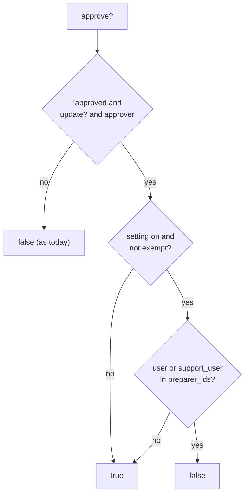

- `request_approval?` is offered only to people who cannot approve the record themselves — a checker just approves.
- Entity scoping: `update?` → `permissioned_employee?` already requires `belongs_to_entity?` and fund access
  (`application_policy.rb:133-160`); the setting is read from `record.entity`, never `user.entity`.

**Worked examples:** H12–H14, E15–E27 ([§3](business-rules.md#3-approving-a-capital-call--phase-2)), H16–H17, E28–E31 ([§4](business-rules.md#4-approving-a-distribution--phase-2)).

**FAQ**

| Question | Answer |
|---|---|
| Why not change `unapprove?`? | Unapproving reduces risk; the proposal keeps it with any approver (E19). |
| Is the policy free of side effects? | Yes — reads only, memoised per policy instance. |

### ⑤ Approve paths

| Owns | Reads / receives | Produces |
|---|---|---|
| Nothing new — existing `approve` actions, `CapitalCallApproval`, bulk jobs | `approve?` (④) | Approval as today; bulk failure text |

- Controllers unchanged: `set_capital_call` / `set_capital_distribution` already `authorize` (`:309-311`; distributions `:201-203`).
- Bulk jobs: when `approve?` is false and `awaiting_second_approver?` is true, `record_failure` with "You prepared
  <name> — another approver must approve it" instead of "Not authorized to approve" (`capital_calls_bulk_action_job.rb:22`).

**Worked examples:** X3–X12 ([§5](business-rules.md#5-direct-requests-api-bulk-other-firms--phase-2)).

**FAQ**

| Question | Answer |
|---|---|
| Does the JSON API change shape? | No — a refused approve is the standard 403 `{"error":"Access Denied"}`. |

### ⑥ Call and distribution pages

| Owns | Reads / receives | Produces |
|---|---|---|
| Actions items, popup, Prepared by row, label, journey messages, `request_approval` actions | ④ predicates, ③ preparers | POST to ⑦ |

**Routes**

| Verb and path | Action | Does | Responds with |
|---|---|---|---|
| POST `/capital_calls/:id/request_approval` | `CapitalCallsController#request_approval` | `authorize :request_approval?` → `MakerCheckerNotices.request` | Redirect to call with notice/alert; JSON `{status, recipients}` |
| POST `/capital_distributions/:id/request_approval` | `CapitalDistributionsController#request_approval` | same | same |

- Build notes: approve item wraps in `span[data-bs-toggle=tooltip]` when disabled; Request approval uses the existing
  `confirm#popup` with `data-msg` built by a `maker_checker_action_summary` helper copied from
  `DocChecksHelper#doc_check_action_summary` (`doc_checks_helper.rb:194-207`) — tints `blue`, `amber`, `green` only.
- Journey checks `ApproveCall` / `ApproveDistribution`: fail message gains "— it needs an approver who did not prepare
  it" when `record.entity.entity_setting.approval_maker_checker`.
- `_show` / distribution details: "Prepared by" row with `ti-info-circle` tooltip.

**Worked examples:** H13–H15, E24–E26, E28, H18–H20, E37–E38, E56.

**FAQ**

| Question | Answer |
|---|---|
| Why not Turbo for request_approval? | It sits next to `approve`, which is `turbo: false`; one flash on a redirect keeps the page consistent. |

### ⑦ Approval notices

| Owns | Reads / receives | Produces |
|---|---|---|
| `MakerCheckerNotices` (recipients + send), `MakerCheckerNotifier < BaseNotifier`, `MakerCheckerMailer` | request, withdrawal, switch-off events | Email + bell per recipient |

- Recipients (one place): **checkers** = active users of `record.entity_id` with `approver`, `update?` on the record,
  not in `preparer_ids`; **switch-off** = active company admins + approvers of the firm except the actor. Users are
  loaded once with `includes(:roles)` and filtered with the memoised policy check.
- `record` = recipient user, as `ComplianceNotifier`; params carry `entity_id`, `kind`, `approvable_type/id`, message.
- Throttle: `MakerCheckerNotifier` events with `kind: approval_request` for the record newer than 1 hour → refuse (D11).

**Worked examples:** H18–H20, E32–E36, E39, H22, H25.

**FAQ**

| Question | Answer |
|---|---|
| Why a new notifier rather than `WorkflowNotifier`? | `WorkflowNotifier` needs a workflow instance; calls without journeys must still be covered. |

### ⑧ Withdrawal

New to this? Read [Withdrawal](#withdrawal) first.

| Owns | Reads / receives | Produces |
|---|---|---|
| `ApprovalWithdraw.call(record:, actor:)` | ② trigger | `approved=false`, `approved_by_user=nil` (audited save); after-commit journey undo + ⑦ `withdrawn` |

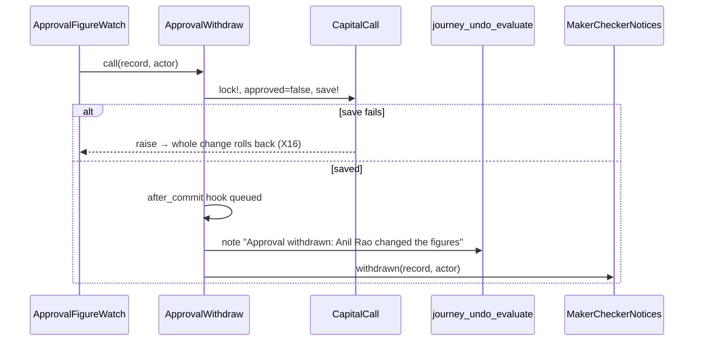

- Calls reuse `CapitalCallUnapprove`'s steps' effect (reset approval, journey undo) but inside the open transaction; the
  journey part runs after commit, exactly as `CapitalCallAction#evaluate_journey_undo`.
- The editor's flash: controllers already redirect with a notice; the op sets `record.approval_withdrawn = true` (attr
  accessor) and the update actions append the sentence (calls, distributions, remittances, payments).

**Worked examples:** H21–H24, E40–E53, X16 ([§7](business-rules.md#7-withdrawal-on-figure-change--phase-3)).

**FAQ**

| Question | Answer |
|---|---|
| Why lock the parent? | Two remittance edits in parallel would otherwise both withdraw and both alert; the lock serialises them and the second sees `approved = false`. |

---

## 4. Reference

### Class diagram

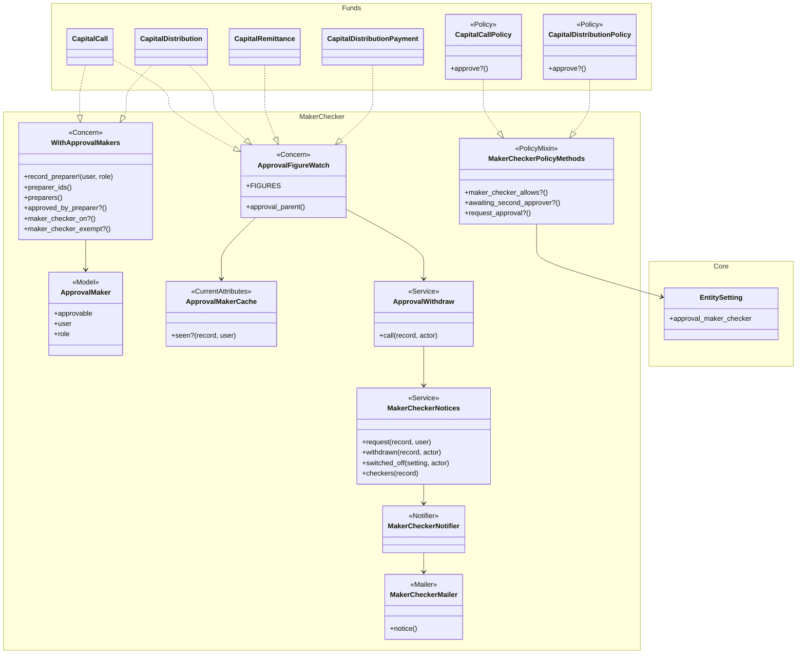

`CallFee` and `DistributionFee` include `ApprovalFigureWatch` like the remittance/payment models (omitted for space).

### Data model and schema changes

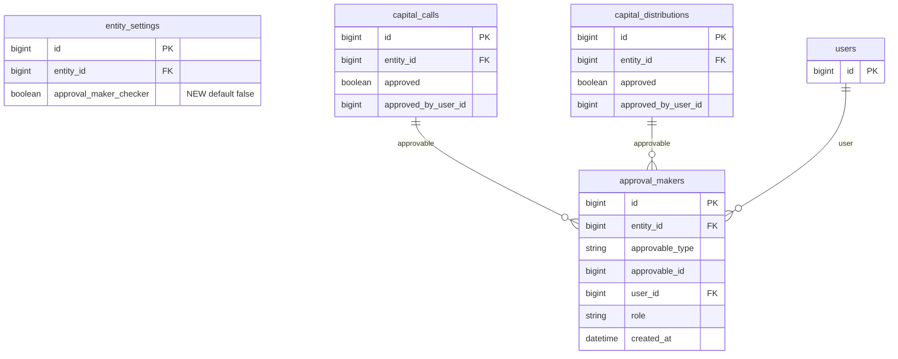

**Indexes:** `approval_makers` unique `[approvable_type, approvable_id, user_id]`; `[user_id]`; `[entity_id]`.

**Schema changes**

**`entity_settings`** (existing): holds the firm's on/off switch.

| Column / index | What changed | Why it's needed |
|---|---|---|
| `approval_maker_checker` | Added: boolean, default false, not null | The firm's choice (D6); not null so policies never see nil |

**`approval_makers`** (new): who prepared each call/distribution (D2).

| Column / index | What changed | Why it's needed |
|---|---|---|
| `id` | Added | PK |
| `entity_id` | Added: bigint, not null, FK `entities` | Tenant scoping for any listing/report; copied from the record |
| `approvable_type` | Added: string(40), not null | `CapitalCall` / `CapitalDistribution` |
| `approvable_id` | Added: bigint, not null | The record |
| `user_id` | Added: bigint, not null, FK `users` | The preparer |
| `role` | Added: string(20), not null | `created` / `edited` / `imported` — tooltip only |
| `created_at` | Added | When they first prepared it (no `updated_at`: append-only) |
| unique `[approvable_type, approvable_id, user_id]` | Added | One row per person per record; makes `insert_all … unique_by` idempotent |
| `[user_id]` | Added | FK index |
| `[entity_id]` | Added | FK index / tenant queries |

**Changes to existing models** (also listed as K1–K17 in the [proposal](proposal.md#key-changes-needing-approval)):
- `EntitySetting`: new attribute + after-commit switch-off notice.
- `CapitalCall`, `CapitalDistribution`: include `WithApprovalMakers`, `ApprovalFigureWatch`; `attr_accessor :approval_withdrawn`.
- `CapitalRemittance`, `CapitalDistributionPayment`, `CallFee`, `DistributionFee`: include `ApprovalFigureWatch`.
- No column of `capital_calls`, `capital_distributions`, `capital_remittances`, `capital_distribution_payments` changes.

### Component contracts

| From → To | Contract | Direction rule |
|---|---|---|
| ② → ③ | `record.record_preparer!(user, role:)` — no-op if cached or already present | Models only; never from views |
| ① → ④ | `record.maker_checker_on?` → `record.entity.entity_setting&.approval_maker_checker` | Read-only |
| ③ → ④ | `record.preparer_ids` → `Array<Integer>` (memoised) | Read-only |
| ④ → ⑤ | `approve?` boolean | Callers never re-implement the rule |
| ④ → ⑥ | `approve?`, `awaiting_second_approver?`, `request_approval?` | Views only call policy |
| ⑥ → ⑦ | `MakerCheckerNotices.request(record, user)` → `Result(sent:, recipients:, error:)` | Only after `authorize :request_approval?` |
| ② → ⑧ | `ApprovalWithdraw.call(record:, actor:)` inside the open transaction | Only when on + approved + actor + figure |
| ⑧ → ⑦ | after-commit `MakerCheckerNotices.withdrawn(record, actor)` | Never inside the transaction |
| ① → ⑦ | after-commit `MakerCheckerNotices.switched_off(setting, actor)` | Only true → false |

### Notifications

| Notification | Trigger | Recipients | Channel | Customisable | Default | Sent once? |
|---|---|---|---|---|---|---|
| Approval requested | Request approval (⑥) | Checkers: active users of the firm with Approver role + `update?` on the record, not preparers | Email + in-app bell (`MakerCheckerNotifier`) | No (internal; `custom_notification` nil, as `ComplianceNotifier`) | On when the setting is on | Once per click; refused within 1 hour of the last request for the record |
| Approval withdrawn | ⑧ after commit | Checkers ∪ active preparers, minus the actor | Email + bell | No | On when the setting is on | Once per withdrawal (a second change finds `approved = false` and does nothing) |
| Maker–checker turned off | ① true → false | Active company admins + approvers of the firm, minus the actor | Email + bell | No | Always | Once per switch-off |
| Bulk approve result | Existing `BulkActionJob` completion | API caller (unchanged) | Existing | — | — | Unchanged; only failure text changes |
| **Investors** | — | **None.** No investor, advisor or LP receives anything new; investor notices (call notice, payment notification) are unchanged | — | — | — | — |
| Suppressed | — | Nothing suppressed | — | — | — | — |

### Cross-cutting concerns

#### Transactions and queries

- Preparer insert and withdrawal run inside the figure change's transaction; notices and journey undo after commit.
- Withdrawal locks the parent row (`lock!`) — one row, short transaction.
- No new query in any list page; show pages add ≤ 3 queries (below).

#### Exception handling and monitoring

| Failure | Who is alerted | Channel | Detail |
|---|---|---|---|
| Withdrawal save fails | The editor | Validation message; change rolled back | X16 |
| Figure change on approved record with no actor | Engineering | `Rails.logger.warn` with record id/entity | E45 |
| Notifier delivery fails | Noticed retry | Sidekiq retries; ExceptionNotification on exhaustion | As every notifier |

#### Architecture and design patterns

| # | Pattern | How this design applies it | Existing example reused | Where |
|---|---|---|---|---|
| 1 | Pack boundaries | New sub-pack folder `app/packs/funds/maker_checker/` inside the `funds` pack; `EntitySetting` is `core` (funds already depends on core) | `funds/compliance` layout | ②③④⑦⑧ |
| 2 | Thin controllers, skinny models | One new 6-line action per controller; models only include concerns; `ApprovalWithdraw`/`MakerCheckerNotices` services | `ComplianceRequestsController` | ⑥⑧⑦ |
| 3 | Single responsibility | Watch (②), log (③), rule (④), notices (⑦), withdraw (⑧) each one job | — | all |
| 4 | Reuse before you add | `Trackable` audit, `Current.user`, `CapitalCallUnapprove` semantics, `ComplianceNotifier` pattern, `confirm#popup` + action-summary, `WorkflowablePolicyMethods`-style mixin. Existing-model changes flagged K1–K17 | listed | all |
| 5 | Configuration as data | Per-firm boolean in `entity_settings`; no global default table needed (one switch, no versions) | `weekly_task_digest_enabled` | ① |
| 6 | Explicit state machines | Approval lifecycle drawn above; transitions guarded in the policy + ⑧ | — | ④⑧ |
| 7 | Append-only audit records | `approval_makers` insert-only; approvals audited by `audited` | `audits` | ③ |
| 8 | Background work | Notifications via Noticed (`deliver` enqueues); no new job | `ComplianceNotices.deliver` | ⑦ |
| 9 | Notifications | One recipient decider (`MakerCheckerNotices`), Noticed notifier, internal mailer | `ComplianceNotices` | ⑦ |
| 10 | UI | Existing show pages and Actions dropdown; popup classes from `action_summary_modal.scss`; no new CSS | KYC Request Updates | ⑥ |
| 11 | Queries and data | Indexed lookups; `insert_all unique_by`; no audits scan beyond one `create` row by `auditable_index` | `workflow_default_owner` | ③ |
| 12 | AI | not needed — no AI involved | — | — |
| 13 | Rollout | Per-firm opt-in, off by default; three shippable phases | journeys rollout | ① |
| 14 | YAGNI / DRY | Two parents share one concern/table; no generic "approval framework" | — | ③ |

#### Performance

- Volumes: ~2,100 calls+distributions, ~21,000 remittances/year; preparer rows ≈ 1–3 per record.
- Generation jobs: one insert per job thanks to `ApprovalMakerCache`; child creates on an unapproved parent never lock.
- Withdrawal path runs only for approved parents (0 times in 12 months).

**Query budget**

| Page / frame / job | Rows shown or processed | Queries (budget, independent of rows) | Preloads / grouped queries | Per-row lookups avoided |
|---|---|---|---|---|
| Call / distribution show (Actions + details) | 1 record | +3: setting, preparer rows, create audit (memoised for all predicates and the Prepared by row) | `User.where(id: preparer_ids)` once for names | Predicates share `preparer_ids` memo |
| `request_approval` action | 1 record, ≤ 50 users | ≤ 6 + 1 per recipient delivery enqueue | `User.where(entity_id:, active: true).includes(:roles)`; `AccessRight` for the fund in one query | No per-user `AccessRight` query |
| Bulk approve job | N records | 3 per record (job, acceptable) or 2 with `ApprovalMaker.where(approvable: batch)` preload | Preload preparer rows + create audits per batch | Per-record audit lookup |
| Remittance generation (CapitalCallJob) | 3,000 remittances | +1 insert per job | `ApprovalMakerCache` | Per-row insert |
| Entity form save | 1 | +0 (switch-off: +1 recipient query) | — | — |

#### Security

| # | Item | How this design meets it | Where | Test |
|---|---|---|---|---|
| 1 | Authorization | `approve?` gains the clause; new `request_approval` actions `authorize` via `set_capital_call`/`set_capital_distribution` (loaded with `find` + `authorize`, as existing actions); no `verify_authorized` exclusions | ④⑥ | X3–X15 |
| 2 | Tenant isolation | Setting read from `record.entity`; recipients filtered by `record.entity_id`; `approval_makers.entity_id` copied from the record; parent ids never from params | ③④⑦ | X9, X13, E32 |
| 3 | Mass assignment | `approved`, `approved_by_user_id` stay unpermitted (`capital_call_params` `:385-394`, `capital_distribution_params` `:210-212`); `approval_makers` never mass-assigned; `approval_maker_checker` only via `ENTITY_SETTING_ATTRIBUTES` (company admin) | ①⑤ | X1, X12 |
| 4 | No code from data | No `constantize`/`send` on params; `approvable_type` set from the model class, never from input | ③ | review |
| 5 | Injection | Bound queries only; notifier messages escaped by ERB; record names rendered as text in emails | ⑦ | review |
| 6 | Background jobs | Noticed jobs take ids; recipients re-resolved at send time are already filtered by firm + active | ⑦ | E32 |
| 7 | Files and documents | not needed — no uploads | — | — |
| 8 | AI / LLM | not needed — no AI | — | — |
| 9 | Webhooks, tokens, links | Email links are plain record URLs behind login (`capital_call_url`); no tokens | ⑦ | E39 |
| 10 | Rate limiting and cost | Request approval: 1 per record per hour | ⑦ | E35–E36 |
| 11 | Audit and logging | Setting changes audited (`EntitySetting` Trackable); approvals/withdrawals audited (`CapitalCall` Trackable); preparer rows append-only; no PII in logs (ids only) | ①③⑧ | H1, H21 |
| 12 | Verification | Brakeman + bundler-audit clean; `features/security/maker_checker_approval.feature` in the style of `tenant_isolation_batch1.feature` (other firm refused, owner allowed, direct request refused) | F5 | X3–X15 |

### Worked examples

Every H/E/X row — shared setup, happy path, edge and error cases, with their spec scenario and feature — lives in
[business-rules.md](business-rules.md) (H1–H25, E1–E56, X1–X16, 7 feature files). The cards above cite the IDs; the QA
checklist and tasks reuse them.

### Testing

- Cucumber only. New steps in `features/step_definitions/maker_checker_steps.rb` (switch setting, assert preparers,
  assert disabled Approve + tooltip, act as support); reuse existing capital call/distribution, import, bulk API and
  email steps.
- Every scenario carries `# H12 — Happy path: …`; code comments name the IDs of their branches (e.g. `# E43 late
  commitment keeps approval`).

### Risks and open questions

- **A writer bypasses callbacks** (`update_columns`/`update_all` on a figure column) → LLD lists every such writer on the
  six tables; reviewer check; E-rows per path.
- **Approve and edit race** → approval still needs a checker; if the edit commits after approval, ⑧ withdraws it; if
  before, the editor is a preparer and the approver re-reads `preparer_ids` under the approve request.
- **Firms never switch it on** → onboarding checklist + CS outreach to the 7 self-approving firms with ≥2 approvers;
  self-approval label makes the gap visible in audits.
- **Admin creates a fake second user to approve** → out of scope (M11 role-grant recording, M8 2FA); user creation is
  audited.
- **Figure list drifts** → constant next to the include; reviewer check when a money column is added.

| # | Open question | Current thinking | Status |
|---|---|---|---|
| 1 | Should firms created after release start with the setting on? | **No — off** (D6); switched on in onboarding when the firm has 2+ approvers | Decided by user 2026-11-09 |
| 2 | Should Request approval also exist when the setting is off? | **No** — only with the setting on | Decided by user 2026-11-09 |
| 3 | Should switching off be support-only? | **No** (D13): firm admins may switch it off; every other admin and approver is told | Decided by user 2026-11-09 |
| 4 | Extend to notice (document) approval? | **No** — this change covers capital call and distribution approval only; no follow-up planned for notice approval | Decided by user 2026-11-09 |

**FAQ**

| Question | Answer |
|---|---|
| Where do I start reviewing? | [D1](#d1-a-preparer-is-anyone-who-changed-figures), [D3](#d3-record-via-model-callbacks-deduped-per-requestjob), [D8](#d8-withdraw-approval-on-a-later-figure-change), then the LLD's callback-bypass list. |
| What if we need to turn it off in an emergency? | A company admin unticks it (announced); or support flips the column for a firm. No data cleanup needed. |
| Rollback? | Revert code; the column and table are additive and unused without it. |
