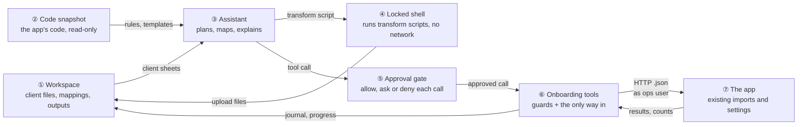
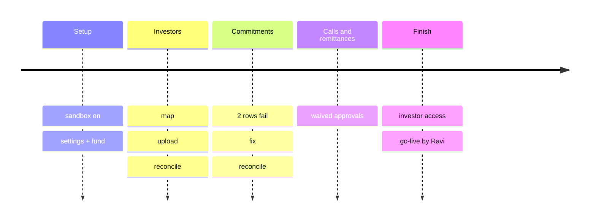
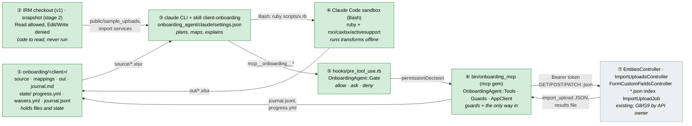
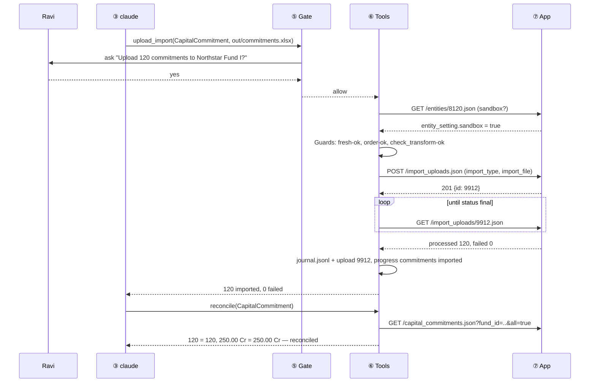
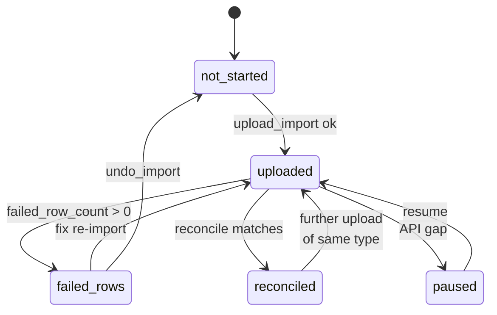
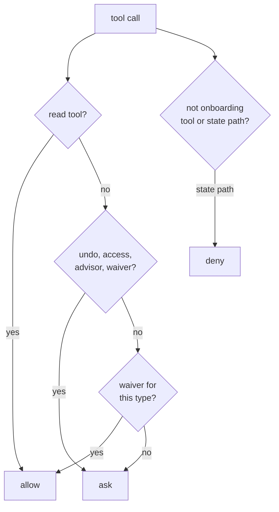
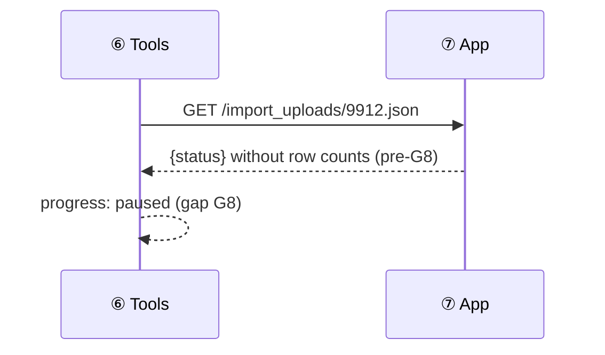
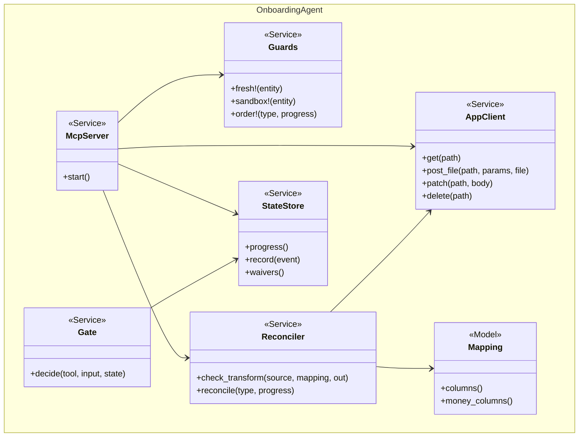

# Client Onboarding Agent — Design

> **Audience:** Engineering team.
> **Companion documents:** [Proposal](proposal.md) · [Spec](specs/client-onboarding-agent/spec.md) ·
> [LLD](lld.md) · [QA checklist](qa-checklist.md) · Skill: [.claude/skills/client-onboarding](../../../.claude/skills/client-onboarding/SKILL.md)

> **Planning phase — no code changes.** This document explains HOW the proposal will be built.

> **Zoom one picture.** ①–⑦ mean the same box everywhere.

---

## Contents

- [1. The idea](#1-the-idea)
  - [What this adds](#what-this-adds) · [Delivery stages](#delivery-stages) · [The idea in one picture](#the-idea-in-one-picture) · [Walkthrough](#walkthrough-one-example-start-to-finish) · [Key ideas](#key-ideas)
- [2. The same picture with real names](#2-the-same-picture-with-real-names)
  - [Picture](#picture) · [What each box does](#what-each-box-does) · [One run, end to end](#one-run-end-to-end) · [Lifecycles](#lifecycles) · [What users see](#what-users-see) · [Design decisions](#design-decisions)
- [3. One card per box](#3-one-card-per-box)
  - [① Workspace](#①-workspace) · [② Code snapshot](#②-code-snapshot) · [③ Assistant](#③-assistant) · [④ Locked shell](#④-locked-shell) · [⑤ Approval gate](#⑤-approval-gate) · [⑥ Onboarding tools](#⑥-onboarding-tools) · [⑦ The app](#⑦-the-app)
- [4. Reference](#4-reference)
  - [Class diagram](#class-diagram) · [Data model](#data-model-and-schema-changes) · [Component contracts](#component-contracts) · [Cross-cutting concerns](#cross-cutting-concerns) · [Notifications](#notifications) · [Worked examples](#worked-examples) · [Testing](#testing) · [Risks and open questions](#risks-and-open-questions)

---

## 1. The idea

### What this adds

A Claude Code session, run locally under Claude Code's own sandbox (v1; a Docker container is stage 2 —
see [Delivery stages](#delivery-stages)), that onboards a fresh entity by
calling a small set of onboarding tools (an MCP server). The tools are the **only** path to the app:
they hold the ops user's token, enforce the guards (fresh entity, sandbox, import order) and call the
app's existing `.json` endpoints. It follows the Support Console's pattern — Claude Code + a
read-only code bundle + an MCP server that owns the dangerous capability — with writes instead of
read-only SQL. **No application code changes.**

### Delivery stages

| | **v1 — local (now)** | **Stage 2 — container (later)** |
|---|---|---|
| Model | Ravi's own Claude Code login on the dev box | decided then (API key or Bedrock) |
| ② Code | the IRM checkout itself, read-only to Claude (Edit/Write denied, secrets' Read denied) | `git archive` snapshot mounted `:ro` |
| ④ Shell | Claude Code Bash sandbox (bubblewrap + socat): no network, writes only in the workspace — **fails on this box (spike, see Risks)**; alternative: a PreToolUse hook wrapping each Bash command in our own `bwrap` (`updatedInput`), not yet proven | same, inside a container with no DB route |
| Settings | `--settings onboarding_agent/claude/settings.json`, Edit/Write on it denied | managed settings, read-only mount |
| Test of X5–X7 | Cucumber asserts the settings; QA checks the behaviour | `@container` self-check |

Why v1 is still safe without a container: the only processes with network are Claude Code itself and
the onboarding tools (⑥). Shell commands have none, so the root credentials in `config/database.yml`
are readable but unusable, and `curl` to the app fails.

### The idea in one picture



### Walkthrough: one example, start to finish

Ravi (ops) onboards **Northstar Capital** (entity 8120): one fund *Northstar Fund I* (classes A, B,
C), 120 investors, 120 commitments (₹250.00 Cr), 2 calls. Legend: ✓ done · ● we are here (waiting
on this, not done yet) · ○ not started · ↺ redoing.



**Phase 1 — setup**

| # | When | What happens | Behind the scenes | Result&nbsp;&nbsp;&nbsp;&nbsp;&nbsp;&nbsp;&nbsp;&nbsp;&nbsp;&nbsp; |
|---|---|---|---|---|
| 1 | Day 1, 10:00 | Ravi starts the assistant with entity 8120 and `northstar.xlsx` | the assistant (③) calls `get_entity`; the gate (⑤) allows reads; the tools (⑥) check freshness against the app (⑦) | **●&nbsp;Set&nbsp;up&nbsp;entity**<br>○&nbsp;Import&nbsp;investors<br>○&nbsp;Import&nbsp;commitments |
| 2 | 10:02 | Assistant proposes sandbox + KYC doc lists + one fund | the assistant (③) reads the sheets from the workspace (①) and the fund template from the snapshot (②) | Same as row 1 |
| 3 | 10:05 | Ravi approves; sandbox on, settings written, fund imported | the gate (⑤) asks Ravi; the tools (⑥) PATCH the entity, read sandbox back, upload the Fund file | ✓&nbsp;Set&nbsp;up&nbsp;entity<br>**●&nbsp;Import&nbsp;investors**<br>○&nbsp;Import&nbsp;commitments |

**Phase 2 — investors and commitments (with a failure)**

| # | When | What happens | Behind the scenes | Result&nbsp;&nbsp;&nbsp;&nbsp;&nbsp;&nbsp;&nbsp;&nbsp;&nbsp;&nbsp; |
|---|---|---|---|---|
| 4 | 10:20 | 120 investors mapped, file built, checked, approved, uploaded, 120/120 | the shell (④) runs the transform; the tools (⑥) run `check_transform`, upload, poll, reconcile | ✓&nbsp;Set&nbsp;up&nbsp;entity<br>✓&nbsp;Import&nbsp;investors<br>**●&nbsp;Import&nbsp;commitments** |
| 5 | 10:40 | Commitments upload: 118 imported, **2 failed** "Investor not found" | the tools (⑥) fetch the results file from the app (⑦); the assistant (③) reads the importer's lookup in the snapshot (②) | ✓&nbsp;Set&nbsp;up&nbsp;entity<br>✓&nbsp;Import&nbsp;investors<br>**↺&nbsp;Import&nbsp;commitments** |
| 6 | 10:45 | Assistant proposes matching those 2 rows by PAN; Ravi approves; 2 rows re-imported | the gate (⑤) asks; the tools (⑥) upload a 2-row file | Same as row 4 |
| 7 | 10:50 | Reconcile: 120 = 120, ₹250.00 Cr = ₹250.00 Cr | the tools (⑥) compare the approved mapping's totals, the file and CapHive | ✓&nbsp;Set&nbsp;up&nbsp;entity<br>✓&nbsp;Import&nbsp;investors<br>✓&nbsp;Import&nbsp;commitments<br>**●&nbsp;Import&nbsp;calls** |

**Phase 3 — stall, waivers, finish**

| # | When | What happens | Behind the scenes | Result&nbsp;&nbsp;&nbsp;&nbsp;&nbsp;&nbsp;&nbsp;&nbsp;&nbsp;&nbsp; |
|---|---|---|---|---|
| 8 | 11:10 | Remittance upload result lacks row counts (G8 not yet live) | the tools (⑥) refuse to guess; the assistant (③) records an API gap | **●&nbsp;Import&nbsp;remittances&nbsp;(paused)** |
| 9 | Day 3 | G8 deployed; Ravi restarts; "remittances: all, no asking" | the tools (⑥) resume from progress; `grant_waiver` is asked once by the gate (⑤) | ✓&nbsp;Import&nbsp;remittances<br>**●&nbsp;Grant&nbsp;investor&nbsp;access** |
| 10 | Day 3 | Investor access proposed; Ravi approves (never waivable); 31 rows | the tools (⑥) check every type reconciled, upload InvestorAccess | ✓&nbsp;Grant&nbsp;investor&nbsp;access<br>**●&nbsp;Go&nbsp;live&nbsp;(Ravi,&nbsp;in&nbsp;the&nbsp;UI)** |

Key moment (row 5):

```
Commitments upload 9912 — 118 imported, 2 failed
  Row 37  "Mehta Family Trust "  Investor not found
          cause: trailing space; importer matches Investor Name exactly
          fix:   match by PAN AAATM1234K (present in both sheets)
  Row 88  "A. Rao"               Investor not found
          cause: investor sheet has "Anil Rao"; PAN ABCPR5678D matches
          fix:   match by PAN
Fix both and re-import 2 rows, or undo upload 9912?
```

**What to notice**
- The assistant never talks to the app; every write passes the gate (⑤) and the tools (⑥).
- Reconciliation is computed by the tools (⑥), not by the assistant, so nobody needs to read the transform script.
- A missing API field pauses the step instead of being worked around.
- Progress lives in the workspace, so a restart days later resumes.

### Key ideas

| # | Idea | In one line | Card |
|---|---|---|---|
| 1 | One way in | Only the onboarding tools hold the token and can reach the app | [⑥](#⑥-onboarding-tools) |
| 2 | Structural, not trust-based | No DB route, read-only code, shell without network, settings Claude cannot edit | [④](#④-locked-shell) |
| 3 | Approve outcomes | The gate shows what will be imported (type, rows, fund), never the code | [⑤](#⑤-approval-gate) |
| 4 | Independent reconcile | Tools verify source → file → CapHive from the approved mapping | [⑥](#⑥-onboarding-tools) |
| 5 | Reuse the app as is | Existing `.json` endpoints and `ImportUploadJob`; gaps reported | [⑦](#⑦-the-app) |

**FAQ**

| Question | Answer |
|---|---|
| Why not let Claude call the API directly with curl? | Then the guards would be advice. The shell has no network and no token, so the tools are the only way in. |
| Why a sandbox and not just hooks? | The dev box's `config/database.yml` has root credentials; any `rails runner` would bypass hooks. The sandboxed shell has no network, so it cannot reach MySQL at all. |
| Does this change the app? | No. G8/G9 are requested from the API owner; until then the affected steps pause. |

---

## 2. The same picture with real names

### Picture



Colour = footprint: **green** new (all under `onboarding_agent/`, outside the Rails app), **grey**
reused unchanged. Exact files: [lld.md File Map](lld.md#file-map).

### What each box does

| # | Box | Real parts | What it does | When it runs | What it decides | Details |
|---|---|---|---|---|---|---|
| ① | Workspace | `onboarding/<client>/` bind mount; `state/` subfolder | Holds client files, mappings, scripts, outputs; state the tools own | Always | — | [card ①](#①-workspace) |
| ② | Code snapshot | v1: the checkout via `--add-dir`, Edit/Write denied; stage 2: `rake onboarding:snapshot` → `/app:ro` | Read-only code for diagnosis and templates | Always | What files exist (secrets excluded) | [card ②](#②-code-snapshot) |
| ③ | Assistant | `claude` CLI, `.claude/skills/client-onboarding`, `onboarding_agent/claude/settings.json` | Plans, maps columns, writes transform scripts, explains failures | Interactive session | What to propose next | [card ③](#③-assistant) |
| ④ | Locked shell | Claude Code sandbox (`sandbox.enabled`, no network, write only workspace minus `state/`) | Runs transform scripts | Each Bash call | — | [card ④](#④-locked-shell) |
| ⑤ | Approval gate | `hooks/pre_tool_use.rb` → `OnboardingAgent::Gate` | allow / ask / deny each tool call; builds the approval summary from the file, not Claude's words | Before each tool call | Ask or not | [card ⑤](#⑤-approval-gate) |
| ⑥ | Onboarding tools | `bin/onboarding_mcp`, `OnboardingAgent::Tools::*`, `Guards`, `AppClient`, `Reconciler`, `StateStore` | The only holder of the token; guards; calls the app; reconciles; writes journal | Each tool call | Refuse or proceed | [card ⑥](#⑥-onboarding-tools) |
| ⑦ | The app | existing controllers and jobs | Imports, settings, results | Per HTTP call | Pundit, validations | [card ⑦](#⑦-the-app) |

### One run, end to end



### Lifecycles

Per import type, stored in `state/progress.yml` (written only by ⑥):



Derived: "investor access allowed" = every type in progress is `reconciled`.

### What users see

N/A for CapHive screens — nothing in the app changes; uploads appear on *Import Uploads* as Ravi's.
The terminal prompts and summaries are in the [proposal](proposal.md#what-you-see).

### Design decisions

1. **Tools hold the token, shell has no network** — Alternative: give Claude the token and rely on hooks. Rejected: a curl in Bash would skip every guard.
2. **Ruby MCP server with the `mcp` gem (1.3, already used by the app)** — Alternative: Node like the Support Console's db-mcp. Rejected: Ruby lets Cucumber drive the tools directly against a real app server (Cucumber-only rule) and shares roo with transforms.
3. **Reconcile via the website's `.json` index endpoints** — Alternative: the app's MCP server (`list_capital_commitments` etc.). Rejected: it needs a separate Doorkeeper OAuth token and `mcp_enabled` governance (`McpController#authenticate_mcp!`); same token + paged JSON is simpler.
4. **Waivers created only by an always-asked tool (`grant_waiver`)** — Alternative: Claude edits `approvals.yml`. Rejected: Claude could waive for itself.
5. **State and journal-of-record written by ⑥, unreadable/unwritable by Claude's tools** — Alternative: Claude keeps `checklist.md`. Kept as narrative only; the guards trust `state/`.
6. **Approval summary built by the gate from the file** — Alternative: show Claude's description. Rejected: the approval must describe what will really be uploaded.
7. **Outside the Rails app (`onboarding_agent/`, not `app/packs`)** — keeps the app unchanged and nothing autoloads it in production.

**FAQ**

| Question | Answer |
|---|---|
| Why not reuse the Support Console relay? | v1 is a terminal session; no relay is needed. The tools are an MCP server so the console can attach later. |
| Why two journals? | `journal.jsonl` (⑥) is the tamper-resistant record; `journal.md` (③) is Claude's narrative for humans. |
| Can Claude still read app code? | Yes, all of it, from ②. It cannot run it: no gems, no secrets, no DB route. |

---

## 3. One card per box

### ① Workspace

A per-client folder, written `/work` below: v1 `~/work/onboarding/<client>/` on the dev box (outside the IRM repo); stage 2 a bind mount at `/work`. `state/` inside it is owned by the tools.

| Owns | Reads / receives | Produces |
|---|---|---|
| `source/`, `mappings/*.yml`, `scripts/`, `out/`, `journal.md`, `state/{progress.yml,waivers.yml,journal.jsonl,token}` | client xlsx (copied in by Ravi) | resumable state |

| Path | Writer | Claude's tools |
|---|---|---|
| `source/` | Ravi | read |
| `mappings/`, `scripts/`, `out/`, `journal.md` | Claude | read + write |
| `state/` | ⑥ only | **deny** Read/Edit/Write; outside sandbox write paths |

A mapping file declares per column: `target`, or `custom_field: {type}`, or `drop: reason`; and per
money column a `scale` (e.g. `10000000` for Cr). ⑥ reads it for `check_transform` and reconcile.

**Worked examples:** H8, E9, E10, X9.

**FAQ**

| Question | Answer |
|---|---|
| Why is the token in `state/`? | So only ⑥ (spawned outside the sandbox) can read it; Claude's Read is denied there. |
| What if Ravi deletes `state/`? | Progress is lost; ⑥ refuses writes because the entity is no longer fresh (E2). |

### ② Code snapshot

**v1:** Claude reads the IRM checkout directly (`--add-dir`); `Edit/Write(<checkout>/**)` are denied and
`Read` is denied for `config/credentials/*.key`, `config/master.key`, `.env*`. **Stage 2:**
`rake onboarding:snapshot` runs `git archive HEAD` with excludes and unpacks to a folder mounted `/app:ro`.

| Owns | Reads / receives | Produces |
|---|---|---|
| the tarball | the repo at HEAD | `/app` read-only |

Excluded: `config/database.yml`, `config/credentials/*.key`, `config/master.key`, `.env*`,
`.claude/worktrees`, `log/`, `tmp/` (stage 2). No `bundle install` for Claude's use.

**Worked examples:** E11, X7.

**FAQ**

| Question | Answer |
|---|---|
| Why not mount the checkout? | Branch switches and edits would change what Claude reads mid-run; and the checkout holds secrets. |
| Reuse `SupportConsoleCodeArchive`? | It lives on the unmerged `support-assistant-brainstorm` branch; if merged first, the rake task calls it. |

### ③ Assistant

`claude` started in `/work` by `onboarding_agent/bin/start` with `--settings onboarding_agent/claude/settings.json`,
`--add-dir <IRM checkout>` and the skill (v1). Edit/Write on the settings file are denied; stage 2 moves
them to read-only managed settings.

| Owns | Reads / receives | Produces |
|---|---|---|
| the conversation, mappings, scripts | ①, ②, tool results | tool calls, `journal.md` |

Settings: MCP server `onboarding` only (`--strict-mcp-config`); `permissions.deny` for `Read/Edit/Write(/work/state/**)`;
the PreToolUse hook; sandbox (see ④); `--permission-mode default`. Model: Ravi's own Claude Code login (v1, resolved open question 1).

**Worked examples:** H1, H9, E12.

**FAQ**

| Question | Answer |
|---|---|
| Can Claude change its own settings? | v1: Edit/Write on the settings file and `.claude/` are denied and the shell cannot write outside the workspace; stage 2: read-only managed settings. |

### ④ Locked shell

Claude Code's Bash sandbox: network denied, writes allowed only under `/work` excluding `/work/state`.

| Owns | Reads / receives | Produces |
|---|---|---|
| transform runs | `source/`, `mappings/` | `out/*.xlsx` |

Uses the box's Ruby with a workspace Gemfile (`roo`, `caxlsx`, `activesupport`), installed once by
`bin/start` before the sandbox applies. Network for shell commands: none (sandbox `network` with no
allowed hosts), so neither the app nor MySQL (3306/33066) is reachable. Needs `bwrap` (present) and
`socat` (to install).

**Worked examples:** X5, X6, X7.

**FAQ**

| Question | Answer |
|---|---|
| Is the sandbox enough without a container (v1)? | For shell commands, yes: no network at all. Claude Code itself and ⑥ keep network; ⑥ is our code and only calls the app. Stage 2 adds the container so even a sandbox bug cannot reach MySQL. |

### ⑤ Approval gate

A PreToolUse command hook calling `OnboardingAgent::Gate.decide(tool, input, state)`.

| Owns | Reads / receives | Produces |
|---|---|---|
| the decision table | hook JSON, `state/waivers.yml`, the upload file | `permissionDecision` + reason (the summary Ravi sees) |



**Worked examples:** H5, E5, E6, E7, X8.

**FAQ**

| Question | Answer |
|---|---|
| What if Ravi clicks "don't ask again"? | The hook runs first and returns `ask` for non-waived writes every time. To verify in task 1.2. |

### ⑥ Onboarding tools

A stdio MCP server spawned by Claude Code (outside the sandbox). Holds the token, enforces guards,
calls ⑦, writes state.

| Owns | Reads / receives | Produces |
|---|---|---|
| token, guards, `progress.yml`, `journal.jsonl`, `waivers.yml` | tool args, mapping files, app JSON | tool results, refusals |

| Tool | Kind | Guards |
|---|---|---|
| `get_entity`, `list_form_types`, `list_custom_fields`, `get_template`, `list_imports`, `get_import_result`, `reconcile` | read | — |
| `check_transform(source, mapping, out)` | read | — |
| `update_entity_settings` | write | Fresh; refuses `sandbox: false`; first write must set sandbox |
| `upload_import(type, file)` | write | Fresh-or-ours, Sandbox, Order, `check_transform` passed |
| `undo_import(upload_id)` | write | upload belongs to this onboarding |
| `grant_waiver(type)` | write | type not in never-waive list |
| `create_fund` | write | `POST /funds.json` — the Fund import fails every row until P3 ships |
| `create_form_type(name, tag, fields)` | write | `POST /form_types.json` — commitment form type, typed custom fields |
| `approve_call(id)` / `approve_distribution(id)` | write | `POST /capital_calls|capital_distributions/:id/approve.json` |
| `bulk_verify(call_id)` | write | `POST /capital_remittances/bulk_actions.json?bulk_action=Verify…`; refused while the payment import's recount is pending (P6) |
| `allocate_units(call_id)` / `redeem_units(distribution_id)` | write | `PATCH …/allocate_units`, `…/redeem_units`; redemption needs `unit_prices` first |
| `update_record(path, attrs)` | write | `PATCH` of a call / distribution (e.g. unit prices, a corrected header) |
| `recompute_totals(fund_id)` | write | `PATCH /funds/:id/recompute_totals` once funds-json-api-hardening ships |

The Orios trial (2026-10-18) needed every row above; the first four were the original design.

"Fresh-or-ours": no investors/funds/users before the first write; afterwards only records from
uploads in `journal.jsonl`.



**Worked examples:** H2–H7, H10, E1–E4, E8, E13–E17, X1–X4, X10–X12.

**FAQ**

| Question | Answer |
|---|---|
| Why does `upload_import` re-read sandbox every time? | Someone may switch it off in the UI mid-run (X2). |
| How is "reconciled" decided? | Rows and per-class money totals match across mapping-derived source totals, the file, and CapHive. |

### ⑦ The app

Reused unchanged.

| Owns | Reads / receives | Produces |
|---|---|---|
| data, Pundit, audits, jobs | bearer-token `.json` calls | JSON, results files |

| Verb and path | Used for |
|---|---|
| `GET/PATCH /entities/:id.json` | settings, sandbox (read needs G9) |
| `POST /import_uploads.json`, `GET /import_uploads(/:id).json` | uploads, status (counts need G8) |
| `DELETE /import_uploads/:id/delete_data` | undo (JSON reply G10) |
| `GET /form_types.json`, `GET /form_custom_fields.json?form_type_id=` | custom fields |
| `GET /investors.json`, `/capital_commitments.json`, … `?all=true` | reconcile |

**Worked examples:** H2, H4, X3, X4.

**FAQ**

| Question | Answer |
|---|---|
| Who appears in `audits`? | Ravi's user (G6); `journal.jsonl` attributes to the agent. |

---

## 4. Reference

### Class diagram



### Data model and schema changes

N/A — no tables or columns change. State is files in `state/` (see card ①).

### Component contracts

| From → To | Contract | Direction rule |
|---|---|---|
| ① → ③ | xlsx files | Claude reads `source/` only |
| ② → ③ | read-only files | never executed |
| ③ → ④ | Bash commands | no network, no `state/` |
| ④ → ① | `out/*.xlsx` | written under `/work` only |
| ③ → ⑤ | hook JSON (`tool_name`, `tool_input`) | every MCP call passes the gate |
| ⑤ → ⑥ | allow/ask/deny | deny ends the call |
| ⑥ → ⑦ | bearer-token HTTP `.json` | only ⑥ holds the token |
| ⑦ → ⑥ | JSON, results file | missing fields → paused (gap) |
| ⑥ → ① | `state/*` | only ⑥ writes |

### Cross-cutting concerns

#### Transactions and queries

N/A — no app code; each import is the app's own transaction behaviour. Reconcile pages large index
endpoints (`account_entries`) by fund and date to respect the large-table rules.

#### Exception handling and monitoring

| Failure | Who learns | Detail |
|---|---|---|
| App 4xx/5xx | Ravi in the terminal | tool returns status + body; journal records |
| Upload stuck | Ravi | poll timeout 15 min → paused |
| Gate/hook crash | Ravi | Claude Code treats hook error as block |

#### Performance and security

- Volume: up to ~90k account-entry rows per client (Fireside); uploads are split per fund/period.
- Security: token only in `state/`; shell without network; settings file not editable by Claude; secrets' Read denied; Pundit scopes to Ravi's entity.

### Notifications

| Notification | Trigger | Recipients | Channel | Customisable | Default | Sent once? |
|---|---|---|---|---|---|---|
| Whatever the importers already send (e.g. access invites on InvestorAccess import, KYC requests) | an upload | **Redirected to `sandbox_emails` (Ravi)** by `ApplicationMailer#sandbox_email` because sandbox is forced on | email / WhatsApp | unchanged | unchanged | as the app does today |
| Import completion notices to the uploader | `ImportUploadJob` | Ravi (the uploader) | in-app/email | no | on | per upload |

Investors and advisors receive nothing during onboarding; task 2.4 verifies every notifier an
import can trigger honours sandbox. This change adds no new notification.

### Worked examples

**ID legend:** **H** = Happy path · **E** = Edge case · **X** = Error case.

**Shared setup:**

| Record | Name | Key data |
|---|---|---|
| Entity | Northstar Capital | fresh, sandbox off initially |
| User | Ravi | company_admin on Northstar, devise-api token |
| Fund | Northstar Fund I | classes A, B, C (in workbook) |
| Workbook | northstar.xlsx | 120 investors, 120 commitments ₹250 Cr (A 180, B 50, C 20), 2 calls |

#### Happy Path

| # | Scenario | Given | When | Then | Spec scenario | Feature |
|---|---|---|---|---|---|---|
| H1 | Fresh entity accepted | Northstar fresh | `get_entity` | "fresh" | Fresh entity accepted | entity_guards.feature |
| H2 | Sandbox first | fresh | first `update_entity_settings` | sandbox on, emails = Ravi, read back | Sandbox set first | sandbox.feature |
| H3 | Fund imported | sandbox on | `upload_import Fund` | 1 fund, progress uploaded | Write asks | imports.feature |
| H4 | Investors imported + reconciled | fund done | upload + `reconcile` | 120 = 120 | Totals match | reconcile.feature |
| H5 | Approval asked | no waiver | gate on `upload_import` | ask, summary "120 CapitalCommitment rows → Northstar Fund I" | Write asks | gate.feature |
| H6 | Typed custom field | sheet has "Lock-in Till" dates | FormCustomField upload then commitments | DateField exists before commitments | Typed custom field before import | custom_fields.feature |
| H7 | Commitments reconcile per class | uploaded | `reconcile` | A 180, B 50, C 20, total 250 | Totals match | reconcile.feature |
| H8 | Column accounting | 9-column sheet | `check_transform` | 9 = 5 + 2 + 2 | Column accounting shown | check_transform.feature |
| H9 | Resume | investors + KYCs reconciled | new session `list_imports`/progress | next = commitments | Resume next day | resume.feature |
| H10 | Investor access last | all reconciled | `upload_import InvestorAccess` approved | uploaded | Investor access allowed last | imports.feature |

#### Edge Cases

| # | Scenario | Given | When | Then | Spec scenario | Feature |
|---|---|---|---|---|---|---|
| E1 | Entity in use | 14 investors | any write | refused, nothing written | Entity in use refused | entity_guards.feature |
| E2 | Only own uploads count as ours | 120 investors from journal uploads + 1 created in UI | write | refused (not ours) | Entity in use refused | entity_guards.feature |
| E3 | Out-of-order | no investors | upload commitments | refused naming investors | Out-of-order upload refused | import_order.feature |
| E4 | Access early | remittances uploaded, not reconciled | upload InvestorAccess | refused | Investor access refused early | import_order.feature |
| E5 | Waived type | waiver KYC | upload KYC | allow, journal "waived" | Waived type does not ask | gate.feature |
| E6 | Waiver for undo | — | `grant_waiver undo` | refused | Undo and access never waived | gate.feature |
| E7 | Waiver for access | — | `grant_waiver InvestorAccess` | refused | Undo and access never waived | gate.feature |
| E8 | Custom-field upload any time | investors not done | upload FormCustomField | allowed by order guard | Typed custom field before import | import_order.feature |
| E9 | Column count mismatch | mapping misses 1 column | `check_transform` | fails "9 ≠ 8" | Column accounting shown | check_transform.feature |
| E10 | Missing required template column | out file lacks "Folio No" | `check_transform` | fails, no upload | Problem caught before upload | check_transform.feature |
| E11 | Secrets not readable | settings loaded | Read `config/master.key` | denied by deny rule | Token not visible | isolation.feature |
| E12 | Failed rows explained | 2 of 120 fail | `get_import_result` | both rows with error text | Failed rows explained | failures.feature |
| E13 | Undo one upload | upload 9912 + another | `undo_import 9912` | only 9912's records gone | Undo one upload | failures.feature |
| E14 | Totals differ by ₹0.50 Cr | CapHive 249.50 | `reconcile` | not reconciled, differing rows | Totals differ | reconcile.feature |
| E15 | Totals equal after rounding to paise | 1/3 splits | `reconcile` | compared at paise | Totals match | reconcile.feature |
| E16 | Re-import fixes failed rows | 2 failed | upload 2-row file | progress uploaded → reconciled | Failed rows explained | failures.feature |
| E17 | Same upload approved twice (double call) | upload done | identical `upload_import` again | refused as duplicate (same file digest) | Write asks | imports.feature |

#### Error Cases

| # | Scenario | Given | When | Then (what the user sees, who is alerted) | Spec scenario | Feature |
|---|---|---|---|---|---|---|
| X1 | Sandbox off request | — | `update_entity_settings sandbox:false` | refused, unchanged | Turning sandbox off is impossible | sandbox.feature |
| X2 | Sandbox found off | turned off in UI | any write | "Sandbox is off — stopping" | Sandbox found off | sandbox.feature |
| X3 | Entity JSON lacks settings (pre-G9) | app without G9 | any write | refused, gap G9 recorded | Missing API data pauses | api_gaps.feature |
| X4 | Upload JSON lacks counts (pre-G8) | app without G8 | poll | paused, gap G8 recorded | Missing API data pauses | api_gaps.feature |
| X5 | Shell reaches app | local sandbox settings | `curl app:3000` in Bash | connection refused | Shell cannot reach the app or the database | isolation.feature |
| X6 | Shell reaches DB | local sandbox settings | connect DB port | refused | Shell cannot reach the app or the database | isolation.feature |
| X7 | Write into app code | local sandbox settings | Edit or `touch` in the checkout | denied | App code is read-only | isolation.feature |
| X8 | Read token / self-waive | — | Read `state/token`, Edit `state/waivers.yml` | denied by gate | Token not visible; Waiver cannot be self-granted | gate.feature |
| X9 | Upload file outside `out/` | — | `upload_import` with `/app/...` | refused | Problem caught before upload | imports.feature |
| X10 | App 422 on upload | bad params | `upload_import` | error body shown, journal records | Write asks | imports.feature |
| X11 | Undo of foreign upload | upload not in journal | `undo_import` | refused | Undo one upload | failures.feature |
| X12 | Poll timeout | job never finishes | 15 min | paused, Ravi told | Missing API data pauses | imports.feature |

### Testing

Cucumber only, under `features/client_onboarding/`. Steps call `OnboardingAgent` tools in-process
with `AppClient` pointed at a Capybara-booted app server and a real devise-api token for Ravi; jobs
run with `ImportUploadJob.perform_now` as existing import features do. The gate is tested by feeding
hook JSON to `hooks/pre_tool_use.rb`. X5–X7 assert the sandbox and deny settings Claude Code is started with (behaviour is checked by QA;
the container self-check comes with stage 2). Every scenario carries `# H1 — …` style comments; code comments
name the IDs of the paths they implement.

### Risks and open questions

- G8/G9 not delivered → affected steps pause by design (X3, X4); tests stub the fields via a tagged step until they land.
- **Spike results (task 1.2, 2026-10-18):** proven — `permissions.deny` on Read/Write/Edit blocks `state/`, secrets and the
  checkout; a PreToolUse hook `ask` overrides a `permissions.allow` rule (refused in `-p`). **Failed** — Claude Code's
  Bash sandbox on this Ubuntu: every sandboxed command dies with `apply-seccomp: … nested userns is
  capability-restricted` (AppArmor `kernel.apparmor_restrict_unprivileged_userns=1`; `unpriv_bwrap` has
  `audit deny capability`). Plain `bwrap --unshare-net` works. Options: (a) a Bash PreToolUse hook that rewrites each
  command to run inside our own `bwrap` (`updatedInput`) — unproven; (b) the AppArmor profile from Claude Code's docs
  (root, loosens hardening); (c) the container (stage 2). **v1's shell isolation is unproven until one is chosen.**
- **Reconcile over the API is unproven:** in the trial the JSON lists were broken (P4) or lacked fields (G8/G9), so
  reconciliation used read-only DB queries. Re-test against funds-json-api-hardening once merged.
- **Where the Orios trial departed from this design (dev only):** the entity + ops user were created with
  `rails runner` (the manual step); results were checked with read-only MySQL queries (G8/G9); the drifted totals
  were repaired by running `CapitalRemittancesCountersJob` locally (no API until P6's endpoint ships). Every client
  data write otherwise went through the JSON API.
- JSON index endpoints may not include amounts for some types → reconcile records a gap for that type.
- Notifiers that ignore sandbox → task 2.4 audit; any found is reported as an app bug.

| # | Open question | Current thinking | Status |
|---|---|---|---|
| 1 | Model access | **Resolved 2026-10-18:** v1 uses Ravi's own Claude Code login locally; revisit for the container stage | Resolved |

**FAQ**

| Question | Answer |
|---|---|
| Where do I start reviewing? | Card ⑥ (guards) and ⑤ (gate): they carry every safety rule. |
| What is out of scope? | See the proposal's exclusions; no app changes at all. |
