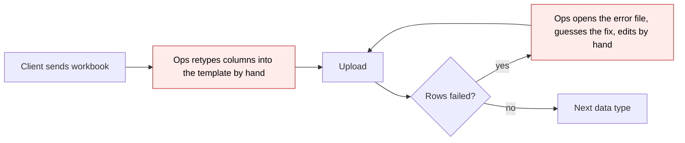
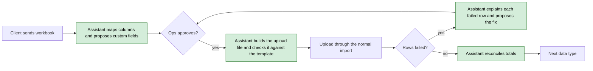
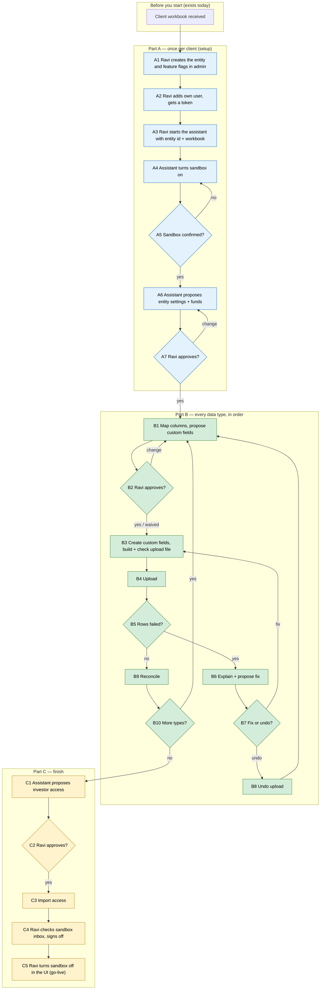

# Client Onboarding Agent — Proposal

> **Audience:** Business team, product, QA, support — non-technical.
> **Companion document:** [Design](design.md)
> **New to this? Start with the [Workflow Journey](#workflow-journey)** — every action, in order, from start to the outcome.

> **Planning phase — no code changes.** This document proposes and explains the change. Do not
> edit application code while writing it; implementation happens later, in the tasks phase.

---

## Why

Onboarding a new fund client means turning the client's own spreadsheets into CapHive's upload
templates and importing them in the right order. Today ops does this by hand and by trial and
error: on the most recent onboarding (June 2026) ops made **64 KYC uploads for 74 rows** (35 rows
failed) and **52 commitment uploads for 56 rows**; on a larger client **8,115 of 30,003
remittance rows** failed at least once. A semi-autonomous assistant that maps, transforms, checks
and imports the data — always through the application's own upload screens' logic, never by
editing the database — removes most of that rework.

## What Changes

- Ops gets an **onboarding assistant** (Claude Code, run from a terminal on the dev box for v1)
  that takes a fresh client entity and the client's workbook and drives the onboarding:
  entity settings, funds, custom fields, every data import in order, a final reconciliation, and
  investor access last.
- The assistant **imports only through the existing bulk-upload feature** (the same path as
  *Import Uploads › New*). It cannot write to the database and cannot change the application.
- The entity is **always in sandbox** while the assistant works, so every notification goes to
  the ops inbox, not to real investors.
- Ops **approves every write** (or waives approval for a whole data type, e.g. "all KYCs");
  reads happen without asking. Investor access always needs approval.
- When rows fail, the assistant **reads the error file, explains each failure and proposes the
  fix**; ops chooses fix-and-reimport or undo.
- Nothing changes for clients, investors or existing screens.

### Flow Diagram

Onboarding one data type (e.g. commitments) — before:



After:



---

## Workflow Journey

### Who is involved

| Person | Role | What they do in the journey |
|---|---|---|
| Ravi | CapHive ops (a user added to the new client entity) | Creates the entity, starts the assistant, approves each step, signs off and goes live |
| The assistant | Claude Code running as Ravi's user, in a locked-down container | Reads the workbook and the app's code, maps, transforms, uploads, reconciles, explains failures |
| Northstar Capital | The new client | Sent the workbook; sees nothing until go-live |

### The journey on one page



### Before you start

| Needed | Why | Where it comes from |
|---|---|---|
| The client's workbook (xlsx) | The data to onboard | The client |
| A fresh entity with no data or other users | The assistant refuses entities already in use | Ravi creates it in admin (A1) |
| Ravi's user on that entity, and a token | The assistant acts as that user | Ravi (A2) |
| The onboarding container on the dev box | Where the assistant runs | Built once by engineering |

### Part A — once per client (setup)

| Step | Who | Where | Action | What the system does | What you see |
|---|---|---|---|---|---|
| A1 | Ravi | Admin › Entities › New | Creates "Northstar Capital", type Investment Fund, INR; ticks feature flags (assistant's default list in the runbook) | Normal entity creation | Entity page |
| A2 | Ravi | Entity › Users | Adds own user to the entity; signs in for a token | Normal user add | Token for the next step |
| A3 | Ravi | Terminal | Starts the assistant with the entity id and the workbook path | Assistant checks the entity is fresh | "Northstar Capital (8120): fresh entity, 0 investors, 0 funds" |
| A4 | Assistant | — | Turns sandbox on, sandbox email = Ravi's | Entity settings update | "Sandbox on — all emails go to ravi@caphive.com" |
| A5 | Assistant | — | Reads the setting back | Refuses to continue if it is off | Confirmation line |
| A6 | Assistant | Terminal | Proposes KYC document lists and the fund(s) found in the workbook | Nothing written yet | A setup summary (mockup below) |
| A7 | Ravi | Terminal | Approves or asks for changes | Writes settings, imports funds | "Fund 'Northstar Fund I' created" |

### Part B — every data type, in order

Order: investors → KYCs → commitments → calls → remittances → remittance payments →
distributions → distribution payments → account entries / documents.

| Step | Who | Where | Action | What the system does | What you see |
|---|---|---|---|---|---|
| B1 | Assistant | Terminal | Maps each workbook column to a template column, a new custom field, or "dropped" | Nothing written | Mapping summary |
| B2 | Ravi | Terminal | Approves, edits, or says "approve all KYCs" | Waiver recorded for this client | — |
| B3 | Assistant | — | Creates typed custom fields; builds the upload file; checks it against the template | Custom-field upload; file checked | "120 rows ready, 0 problems found" |
| B4 | Assistant | — | Uploads | Normal import runs | Upload id and status |
| B5 | Assistant | — | Reads the result | — | "118 imported, 2 failed" |
| B6 | Assistant | Terminal | Explains each failed row from the error file and the app's rules | — | Failed-row list with proposed fix |
| B7 | Ravi | Terminal | Chooses fix (re-import the failed rows) or undo the whole upload | — | — |
| B8 | Assistant | — | Undo (always needs Ravi's approval) | Deletes that upload's data via the app | "Upload 9912 undone" |
| B9 | Assistant | Terminal | Reconciles workbook vs CapHive | Reads counts and totals | Reconciliation (mockup below) |

### Part C — finish

| Step | Who | Where | Action | What the system does | What you see |
|---|---|---|---|---|---|
| C1 | Assistant | Terminal | Proposes investor access + advisors | Refuses unless every earlier step is reconciled | Access summary |
| C2 | Ravi | Terminal | Approves (cannot be waived) | — | — |
| C3 | Assistant | — | Imports access | Logins created; emails go to the sandbox inbox | "31 access rows imported" |
| C4 | Ravi | Email inbox, CapHive | Checks sample emails and screens | — | — |
| C5 | Ravi | Entity › Edit › Sandbox | Turns sandbox off (the assistant cannot) | Client is live | — |

### What you see

Setup proposal (A6):

```
Northstar Capital (entity 8120) — setup proposal
  Sandbox            ON  → ravi@caphive.com
  Individual KYC docs: PAN, Address proof, Passport, FATCA
  Non-individual KYC docs: PAN, Incorporation, Board resolution, Beneficial ownership
  Funds found in workbook: 1
    Northstar Fund I · Category II · INR · 3 unit classes (A, B, C)
Approve? [yes / change]
```

Mapping summary (B1), commitments sheet "Commitments" with 9 columns:

```
Template column          ← Workbook column
Investor Name            ← "LP Name"
Folio No                 ← "Folio"        (kept as text: leading zeros)
Commitment Amount        ← "Commitment (Rs Cr)" × 1,00,00,000
Commitment Date          ← "Date of CA"   (dd-mm-yyyy)
Unit Type                ← "Class"
New custom fields        : "Distributor" (select: 4 values), "Lock-in Till" (date)
Dropped on purpose       : "S.No" (row number), "Remarks" (empty in all rows)
Every column accounted for: 9 = 5 mapped + 2 custom + 2 dropped
```

Reconciliation (B9), commitments:

```
                       Workbook        CapHive        Match
Rows                   120             120            ✓
Total commitment       ₹250.00 Cr      ₹250.00 Cr     ✓
  Class A              ₹180.00 Cr      ₹180.00 Cr     ✓
  Class B               ₹50.00 Cr       ₹50.00 Cr     ✓
  Class C               ₹20.00 Cr       ₹20.00 Cr     ✓   (180 + 50 + 20 = 250)
```

### What goes wrong

Two of 120 commitment rows fail: *"Investor not found"*. The assistant reads the error file and the
importer's rule, and finds the workbook spells the names "Mehta Family Trust " (trailing space) and
"A. Rao" while the investor sheet has "Mehta Family Trust" and "Anil Rao". It proposes matching on
PAN instead of name for these two. Ravi approves; the assistant re-imports just the two rows; the
reconciliation then shows 120 = 120.

### Summary: the minimum actions

| # | Action | Who | How often |
|---|---|---|---|
| 1 | Create the entity and flags, add own user | Ravi | Once per client |
| 2 | Start the assistant | Ravi | Once per client (or to resume) |
| 3 | Approve setup | Ravi | Once |
| 4 | Approve each data type's mapping (or waive the type) | Ravi | Once per type |
| 5 | Choose fix or undo on failures | Ravi | Only when rows fail |
| 6 | Approve investor access | Ravi | Once |
| 7 | Check the sandbox inbox and go live | Ravi | Once |

---

## User Stories

### US-1: Onboard from the client's own workbook

**As** Ravi (ops), **I want** the assistant to map the client's columns to our templates,
**so that** I don't retype spreadsheets.

**Acceptance criteria:**
- Every workbook column ends as exactly one of: mapped, new custom field, dropped (with a reason).
- The mapping summary shows the count check ("9 = 5 + 2 + 2").

### US-2: Never touch real investors before go-live

**As** Ravi, **I want** sandbox forced on, **so that** no investor gets an email mid-onboarding.
- The first write is sandbox on; the assistant re-checks before every write and stops if it is off.
- The assistant has no way to turn sandbox off.

### US-3: Approve writes, not keystrokes

**As** Ravi, **I want** to approve each write, or a whole type at once, **so that** I stay in control
without babysitting.
- Reads never ask. Writes ask unless the type is waived. Undo and investor access always ask.

### US-4: Understand failures

**As** Ravi, **I want** each failed row explained with a proposed fix.
- Each failed row shows the app's error, the cause, and the change the assistant would make.

### US-5: Investor access last

- Investor access and advisors are refused until every earlier type is imported and reconciled.

### US-6: Resume next day

- Stopping and restarting the assistant continues from the recorded checklist, not from scratch.

### US-7: Report app problems, don't patch them

- When a failure's cause is in the app, the assistant writes it up (where, why, suggested fix) and
  pauses that step.

---

## UI Behavior

### Terminal approval prompt

```
┌──────────────────────────────────────────────────────────────┐
│ Upload 120 commitments to Northstar Fund I?                  │
│   Custom fields first: Distributor (select), Lock-in Till    │
│   File checked: 0 problems                                   │
│ [yes] [no] [yes to all commitments for this client]          │
└──────────────────────────────────────────────────────────────┘
```

**Behavior notes:**
- "Yes to all" is recorded per client and per type; it is never offered for undo or investor access.
- Uploads also appear on the normal *Import Uploads* screen, as uploads by Ravi.

---

## What This Feature Does NOT Cover

| Excluded | Covered In |
|---|---|
| Creating the entity and its feature flags | Ops, in admin (A1) |
| The client's own team users and roles | Ops, manually |
| Fund documents, document templates, approvals and reports setup | Later phase |
| A chat screen inside CapHive | Later phase (Support Console) |
| A shared audit table of agent actions | Later phase |
| Onboarding into a client that is already live | Out of scope (fresh entities only) |
| Changing any app screen, API or import rule | Out of scope; gaps are reported |

---

## Validation Rules

| Field | Rule | Default |
|---|---|---|
| Entity | No investors, funds or users other than ops | Refused otherwise |
| Sandbox | Must be on before every write | Set on as the first write |
| Import order | Each type only after the ones before it | Order above |
| Investor access | Only after every other type is reconciled | — |
| Waiver | Per client, per type; never for undo or investor access | None |

---

## Behavior Rules

| Scenario | What User Sees |
|---|---|
| Sandbox found off mid-onboarding | "Sandbox is off for Northstar Capital — stopping. Turn it back on to continue." |
| Entity already has data | "Entity 8120 is not fresh (14 investors) — refusing." |
| Investor access requested early | "Investor access waits until remittances are reconciled." |
| Rows fail | Failed-row list with causes and a proposed fix; choice of fix or undo |
| Cause is an app bug | Write-up with where and why; step paused |
| App does not return what the assistant needs | Reported as an API gap; step paused |

---

## Resolved Design Decisions

| # | Decision | Resolution |
|---|---|---|
| 1 | Who runs it | CapHive ops |
| 2 | How it writes | Only through the app's existing import and settings screens' logic, over the app's API |
| 3 | Who transforms the data | The assistant, checked by reconciliation, not by reading its code |
| 4 | Where | Terminal on the dev box now; a CapHive chat screen later |
| 5 | Approvals | Reads free; writes approved; waivable per type; undo and investor access never |
| 6 | Failures | Ops chooses fix or undo |
| 7 | Target | Fresh entities only |
| 8 | Emails | Sandbox forced on |
| 9 | Entity creation | Ops |
| 10 | Investor access | Always last |
| 11 | Custom fields | From the data, per type, before each import |
| 12 | Identity | Ops' own user on the client entity |
| 13 | Isolation | Container with no database access; app code readable, not changeable |
| 14 | App API changes | None by this change; gaps go to the API owner |

Full list with reasons: [.claude/skills/client-onboarding/design-decisions.md](../../../.claude/skills/client-onboarding/design-decisions.md).

---

## Capabilities

### New Capabilities

- `client-onboarding-agent`: an ops-run assistant that onboards a fresh entity from a client
  workbook via the existing import pipeline, with sandbox, ordering, approval and reconciliation
  guarantees.

### Modified Capabilities

None.

---

## Impact

- **New, outside the app:** the onboarding container, the assistant's tools, its instructions
  (the `client-onboarding` skill), and a per-client working folder.
- **App:** unchanged. It depends on two additions the API owner has been asked for (upload row
  counts and error file; entity settings in the entity's data) —
  [api_requests_for_funds_api.md](../../../docs/modules/ai/client_onboarding/api_requests_for_funds_api.md).
- **Uploads** made by the assistant appear on the *Import Uploads* screen as Ravi's.

---

## Benefits

1. Far fewer failed uploads: files are checked before upload, failures are explained.
2. No retyping of client spreadsheets.
3. No accidental investor emails before go-live.
4. Every client column is accounted for — nothing silently dropped.
5. Onboarding can stop and resume across days.

---

## FAQ

| Question | Answer |
|---|---|
| Who can use this? | CapHive ops, from the dev box, in v1. |
| Can it damage client data? | It works only on a fresh entity, only through the normal import, and every upload can be undone. |
| Can it email investors? | No — sandbox stays on; emails reach the ops inbox. Go-live is a human step. |
| Can it change the app? | No. It can read the app's code to diagnose problems, not change it. |
| What if it is wrong? | Reconciliation catches count and total mismatches; ops approves each write. |
| Does it cost money? | Model usage per onboarding; to be measured in the trial. |
| Who appears in the audit trail? | Ravi's user; the assistant's own journal records which actions it took and who approved them. |

---

## Design Principle for the Next Phase

- **Reuse, don't build:** the existing import pipeline, its templates, the existing read-only MCP
  tools for reconciliation, the Support Console's harness ideas. No new app code.
- **Risk of complexity:** the approval/waiver rules and the import-order guard — keep them in one
  small place (the assistant's tool layer), not spread across hooks and prompts.
- **Risk of blocking:** two app API additions (G8, G9) are owned by another workstream; design the
  tools so v1 can be built and tested against stubs until they land.
