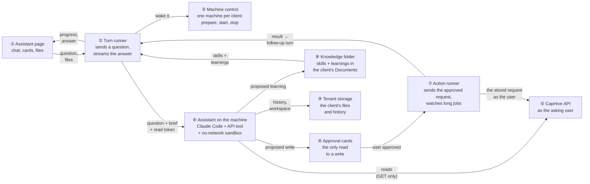
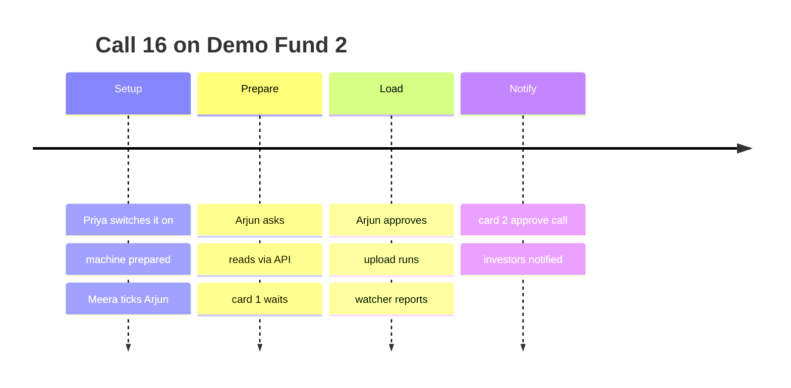
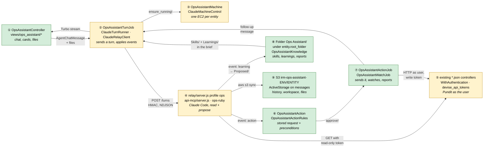
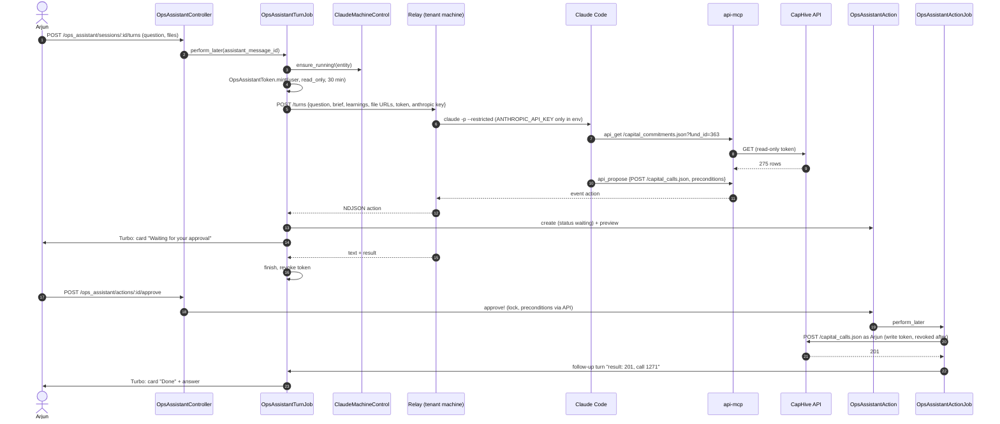
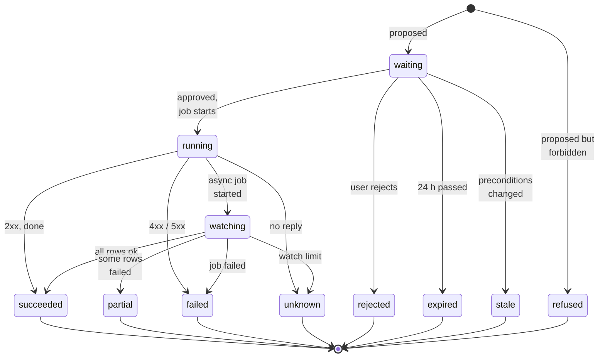
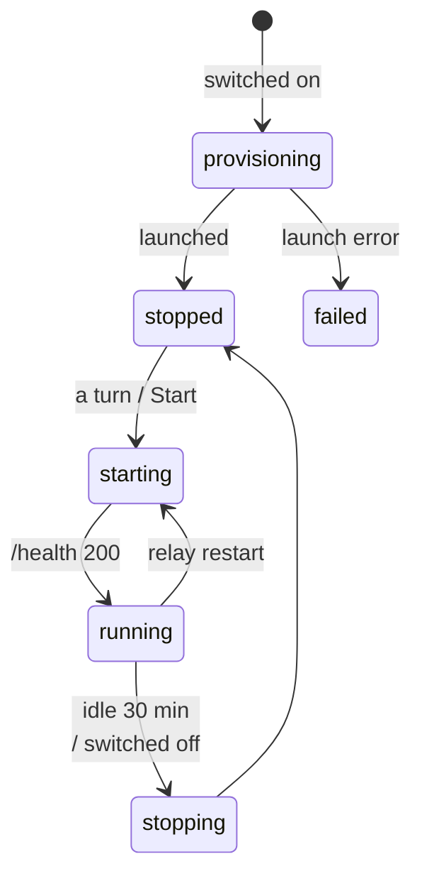
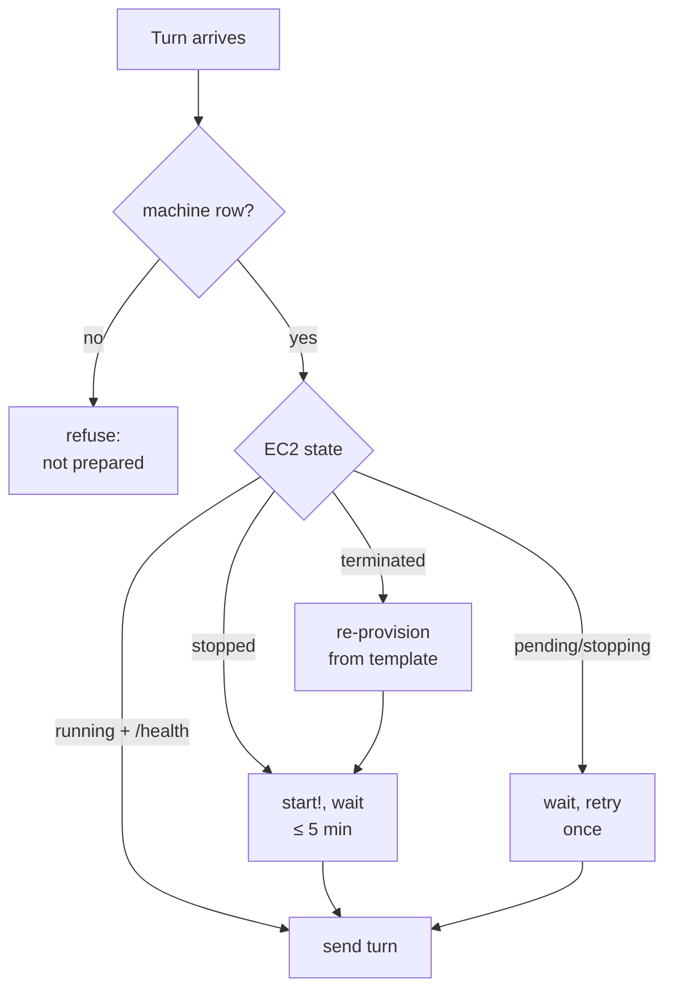
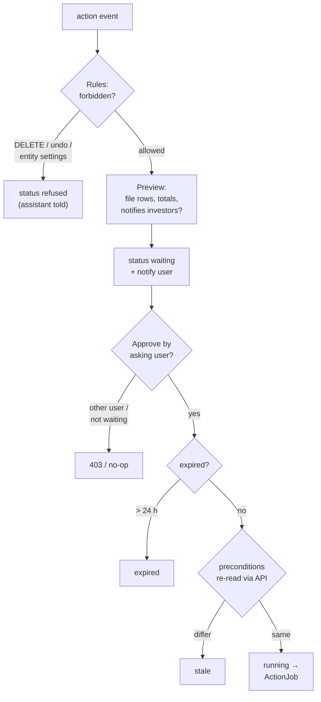
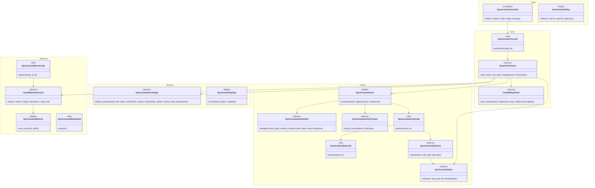
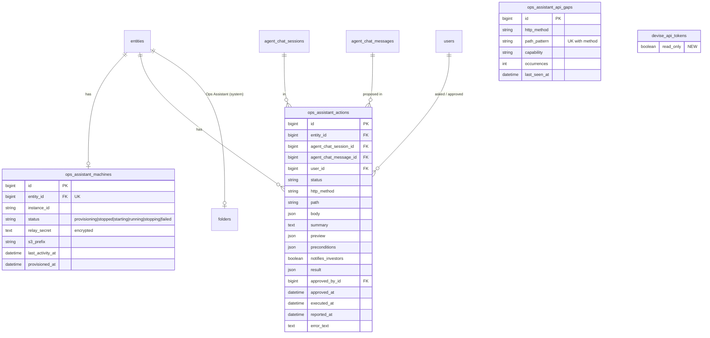

# Client Ops Assistant — Design

> **Audience:** Engineering team.
> **Companion documents:** [Proposal](proposal.md) · [Spec](specs/) · [Business rules (H/E/X)](business-rules.md) · [Security](security.md) · [LLD](lld.md)

> **Planning phase — no code changes.** This document explains HOW the proposal will be built.
> Do not edit application code while writing it; implementation happens later, in the tasks phase.

> **Design, not code.** Diagrams and tables only; real class, table and path names inside them.

> **Zoom one picture.** Part 1 draws the picture in plain words, Part 2 the same picture with real
> names, Part 3 one card per box (same numbers), Part 4 reference. ①…⑨ mean the same box everywhere.

---

## Contents

- [1. The idea](#1-the-idea)
  - [What this adds](#what-this-adds) · [The idea in one picture](#the-idea-in-one-picture) · [Walkthrough](#walkthrough-one-example-start-to-finish) · [Key ideas](#key-ideas)
- [2. The same picture with real names](#2-the-same-picture-with-real-names)
  - [Picture](#picture) · [What each box does](#what-each-box-does) · [One run, end to end](#one-run-end-to-end) · [Lifecycles](#lifecycles) · [What users see](#what-users-see) · [Design decisions](#design-decisions)
- [3. One card per box](#3-one-card-per-box)
  - [① Assistant page](#①-assistant-page) · [② Turn runner](#②-turn-runner) · [③ Tenant machine control](#③-tenant-machine-control) · [④ Assistant on the tenant machine](#④-assistant-on-the-tenant-machine) · [⑤ CapHive API as the user](#⑤-caphive-api-as-the-user) · [⑥ Approval cards](#⑥-approval-cards) · [⑦ Action runner and watcher](#⑦-action-runner-and-watcher) · [⑧ Knowledge folder](#⑧-knowledge-folder) · [⑨ Tenant storage](#⑨-tenant-storage)
- [4. Reference](#4-reference)
  - [Class diagram](#class-diagram) · [Data model and schema changes](#data-model-and-schema-changes) · [Component contracts](#component-contracts) · [Notifications](#notifications) · [Cross-cutting concerns](#cross-cutting-concerns) · [Worked examples](#worked-examples) · [Testing](#testing) · [Risks and open questions](#risks-and-open-questions)

---

## 1. The idea

### What this adds

A chat page for a client's own ops staff whose answers and changes come from **Claude Code running on a
machine dedicated to that client**. It is the **Support Console's architecture** (page → Sidekiq turn job
→ signed relay → headless `claude -p`) with the database tool swapped for an **API tool that can only
read as the asking user and can only *propose* writes**. Writes become **approval cards**; once the user
approves, **Rails itself** sends the stored request to CapHive's API as that user — the rules proven in
the client-onboarding skill (API only, approve before write, guards in tools, announce then confirm).

### The idea in one picture



### Walkthrough: one example, start to finish

**Setup.** Staging, entity **Orion Test** (1548), fund **Demo Fund 2** (363, 275 commitments, committed
₹18,38,50,93,602.71). Meera is company admin; Arjun is an employee with the Ops Assistant permission.
Legend: ✓ done · ● we are here (waiting on this, not done yet) · ○ not started · ↺ redone.



**Phase 1 — setup**

| # | When | What happens | Behind the scenes | Result |
|---|---|---|---|---|
| 1 | Mon 09:00 | Priya ticks Ops Assistant on Orion Test | the machine control (③) launches `irm-ops-assistant-staging-in-1548` from the launch template, then stops it | **Prepare&nbsp;machine&nbsp;✓**<br>Tick&nbsp;users&nbsp;● |
| 2 | 09:12 | Meera ticks Ops Assistant in Arjun's permissions | `users.permissions` flag; `user.enable_ops_assistant` is now true | Prepare&nbsp;machine&nbsp;✓<br>**Tick&nbsp;users&nbsp;✓** |

**Phase 2 — prepare Call 16**

| # | When | What happens | Behind the scenes | Result |
|---|---|---|---|---|
| 3 | 10:30 | Arjun asks "Prepare Call 16 on Demo Fund 2: 5%, notice 31 Oct, due 15 Nov" | the page (①) saves the message; the turn runner (②) finds the machine stopped, the machine control (③) starts it (≈2 min) | **Start&nbsp;machine&nbsp;●**<br>Read&nbsp;fund&nbsp;○<br>Prepare&nbsp;card&nbsp;○ |
| 4 | 10:32 | Progress: "Reading Demo Fund 2", "Reading 275 commitments" | the turn runner (②) mints a **read-only** token for Arjun (30 min) and sends it with the Skills/ and Learnings/ documents of the knowledge folder (⑧); the assistant (④) calls `api_get` on the API (⑤) | Start&nbsp;machine&nbsp;✓<br>**Read&nbsp;fund&nbsp;●**<br>Prepare&nbsp;card&nbsp;○ |
| 5 | 10:34 | Arjun sees card 1 "Create Drawdown 16 + 275 remittances" | the assistant (④) builds `remittances_call16.xlsx` in its no-network sandbox, calls `api_propose` twice (call, then the upload) with preconditions "fund 363 has 275 commitments, committed 18,38,50,93,602.71"; approval cards (⑥) stores them and computes the file's facts | Start&nbsp;machine&nbsp;✓<br>Read&nbsp;fund&nbsp;✓<br>**Approve&nbsp;card&nbsp;1&nbsp;●** |

**Phase 3 — a mistake, then load**

| # | When | What happens | Behind the scenes | Result |
|---|---|---|---|---|
| 6 | 10:40 | Meera adds a 276th commitment (a late investor) | nothing in the assistant runs | Same as row 5 |
| 7 | 10:41 | Arjun clicks Approve | approval cards (⑥) re-reads the preconditions through the API (⑤): 276 ≠ 275 → **refused**, "The data changed since this was prepared" | **Approve&nbsp;card&nbsp;1&nbsp;↺&nbsp;refused** |
| 8 | 10:42 | Arjun: "prepare it again" | new turn; card 1′ for 276 investors | **Approve&nbsp;card&nbsp;1′&nbsp;●** |
| 9 | 10:44 | Arjun approves 1′ | the action runner (⑦) mints a **write** token, POSTs the call, then the upload, as Arjun to the API (⑤); token revoked; the turn is already over | Approve&nbsp;card&nbsp;1′&nbsp;✓<br>**Load&nbsp;remittances&nbsp;●** |
| 10 | 10:44–10:50 | Upload 2850 processing (the machine has nothing to do) | the action runner's watcher (⑦) polls `GET /import_uploads/2850.json` with a fresh read token every 30 s → 60 s; this activity keeps the machine control (③) from stopping the machine | Same as row 9 |
| 11 | 10:50 | The upload stalls: the remittance job is retried by Sidekiq | the watcher (⑦) keeps polling up to its 2-hour limit; no new write | Same as row 9 |
| 12 | 10:56 | Done: 276/276, 0 failed | the watcher (⑦) sends a follow-up turn through the turn runner (②); the assistant (④) reconciles Σ called; Arjun gets bell + email | Load&nbsp;remittances&nbsp;✓<br>**Approve&nbsp;call&nbsp;(card&nbsp;2)&nbsp;●** |
| 13 | 11:05 | Arjun approves card 2 "Approve Drawdown 16 — **sends notices to investors**" | action runner (⑦) PATCHes the approve endpoint as Arjun; CapHive sends its usual notices | Load&nbsp;remittances&nbsp;✓<br>**Approve&nbsp;call&nbsp;✓** |

What Arjun sees at row 5 is the card in the [proposal's mockup](proposal.md#what-you-see), with one more
line added by Rails (not the assistant):

```
│  Checked by CapHive  remittances_call16.xlsx: 275 rows · Σ Call Amount ₹91,92,54,680.13 │
│                      preconditions: fund 363 commitments = 275 ✓  committed ✓           │
```

**What to notice**

- The assistant never holds a token that can write; Rails sends the write, from what was stored (⑥ → ⑦).
- "Exactly what was shown" is enforced by storing the request and its preconditions, not by trusting the model.
- Long work is watched by Rails, not by a running Claude turn; the result comes back as a new turn.
- One machine per client: the stopped machine was started for Arjun's question and kept up by the watcher.
- Meera's late commitment was caught by a precondition, not by luck.

### Key ideas

| # | Idea | In one line | Card |
|---|---|---|---|
| 1 | Support Console, pointed at the API | Same page, job, relay, machine control and code archive; DB tool replaced by an API tool | [②](#②-turn-runner), [④](#④-assistant-on-the-tenant-machine) |
| 2 | Claude reads, Rails writes | Turn tokens are read-only; only the action runner gets a write token, for one stored request | [⑤](#⑤-caphive-api-as-the-user), [⑦](#⑦-action-runner-and-watcher) |
| 3 | A card is a stored request + preconditions | Approve = re-check preconditions, then send exactly that request | [⑥](#⑥-approval-cards) |
| 4 | One machine per client | Tagged per entity; same control class as the Support Console | [③](#③-tenant-machine-control) |
| 5 | Long work is a follow-up turn | Rails watches the job and wakes the assistant with the result | [⑦](#⑦-action-runner-and-watcher) |
| 6 | Memory lives in the client's Documents | One "Ops Assistant" folder per entity under its root: Skills/, Learnings/, Proposed/, Reports/ | [⑧](#⑧-knowledge-folder) |

**FAQ**

| Question | Answer |
|---|---|
| Why not let Claude make the write itself after approval? | Then the model would hold a write token and could write something other than what was shown. With Rails sending the stored request, the card *is* the write. |
| Why a machine per client rather than folders on one? | Ops decision: isolation of files, keys and failures per client, and per-client cost. The control code is shared, so the count of machines is configuration, not code. |
| Does anything block the user's normal screens? | No. The assistant uses the API like any API client; screens are unchanged. |
| Why no database access at all, when the Support Console has the replica? | The assistant acts *for* the client as one of their users; going through the API keeps Pundit, scoping and audits exactly as on the screens. Ops decision. |

---

## 2. The same picture with real names

### Picture



Colour = footprint: **green** new, **amber** modified (generalised from the Support Console, or the
existing API auth), **grey** reused unchanged. Exact files are in [lld.md File Map](lld.md#file-map).

### What each box does

| # | Box | Real parts | What it does | When it runs | What it decides | Details |
|---|---|---|---|---|---|---|
| ① | Assistant page | `OpsAssistantController`, `OpsAssistantPolicy`, `views/ops_assistant/*` (from `support_console/_chat`, `_message`, `_composer`) | Conversations, ask box, attachments, live cards | Request | Who may open / ask / read | [card ①](#①-assistant-page) |
| ② | Turn runner | `OpsAssistantTurnJob` on `ClaudeTurnRunner` (extracted from `SupportConsoleTurnJob`), `ClaudeRelayClient` | Mints the read token, sends the turn, applies events | Sidekiq `ops_assistant` | Turn status; when to wake the machine | [card ②](#②-turn-runner) |
| ③ | Machine control | `OpsAssistantMachine` (row per entity), `ClaudeMachineControl` (extracted from `SupportConsoleMachineControl`), `OpsAssistantMachineJob`, `OpsAssistantIdleStopJob` | Prepare / start / stop the entity's EC2 | Switch-on, a turn, every 5 min | Running or not; idle | [card ③](#③-tenant-machine-control) |
| ④ | Assistant on the machine | `relay/server.js` + `claude_command.js` (profile `ops`), `api-mcp/server.js`, `ops-ruby` (bubblewrap), `claude/ops_brief.md` | Runs Claude Code with read + propose tools | Per turn | Nothing persistent — proposes only | [card ④](#④-assistant-on-the-tenant-machine) |
| ⑤ | CapHive API as the user | existing JSON controllers, `WithAuthentication`, `Devise::Api::Token` (+ `read_only`), `OpsAssistantToken` | Serves reads and writes under Pundit | Per request | Refuses writes with a read-only token | [card ⑤](#⑤-caphive-api-as-the-user) |
| ⑥ | Approval cards | `OpsAssistantAction`, `OpsAssistantActionRules`, `OpsAssistantActionPreview`, `OpsAssistantActionsController`, policy | Stores, previews, refuses, approves | Event from ④; user clicks | Allowed? notifies investors? preconditions hold? | [card ⑥](#⑥-approval-cards) |
| ⑦ | Action runner and watcher | `OpsAssistantActionJob`, `OpsAssistantWatchJob`, `OpsAssistantApiClient` | Sends the stored request, polls long jobs, posts the follow-up turn | Sidekiq after approve; every 30–60 s | Done / failed / unknown | [card ⑦](#⑦-action-runner-and-watcher) |
| ⑧ | Knowledge folder | System folder **Ops Assistant** under `entity.root_folder` (Skills/, Learnings/, Proposed/, Reports/), `OpsAssistantKnowledge`, existing `Document` + `Folder` | Holds the client's skills, learnings and task reports as Documents | Event from ④; admin moves/deletes; turn start | Which documents go in the brief | [card ⑧](#⑧-knowledge-folder) |
| ⑨ | Tenant storage | S3 `irm-ops-assistant-<env>/<entity_id>/`, ActiveStorage `files` on `AgentChatMessage` and `OpsAssistantAction` | Keeps history and files beyond the machine | Each turn start / end | Nothing | [card ⑨](#⑨-tenant-storage) |

### One run, end to end



### Lifecycles

**Turn** — stored in `agent_chat_messages.metadata["turn_status"]`, reused unchanged from the Support
Console (queued → running → completed / stopped / failed / refused; stale sweep).

**Approval card** — stored in `ops_assistant_actions.status`:



**Machine** — `ops_assistant_machines.status` is stored as a cache; EC2 state is the truth (as in the
Support Console):



**Knowledge** — derived from the folder a document is in: Proposed/ → Skills/ or Learnings/ (confirm); Proposed/ → deleted (discard); Skills/ or Learnings/ → deleted (remove).

### What users see

| Where in CapHive | Today | After this change | Who sees it |
|---|---|---|---|
| Main menu | — | **Ops Assistant** | Employees with the user + entity permission |
| Ops Assistant page | — | Chat, approval cards, attachments | Same |
| Ops Assistant › What I've learned | — | Proposed/ with Confirm / Discard; Skills/ and Learnings/ listed | Company admins |
| Documents › Ops Assistant | — | Skills/, Learnings/, Proposed/, Reports/ as normal documents | Company admins (all); permitted employees (read Skills, Learnings, Reports) |
| Users › Edit › Permissions | Per-feature ticks | + **Ops Assistant** | Company admins |
| Entity › Permissions | Per-feature ticks | + **Ops Assistant**, machine status | Super users |
| Bell + email | — | Approval waiting / work finished / failed / learning proposed | The asking user; admins for learnings |

The main journey is the proposal's Part B ([Workflow Journey](proposal.md#part-b--every-time)); the card
wireframe is there too. Callouts on the card: ① action line (from the assistant) · ② "Checked by CapHive"
facts (from `OpsAssistantActionPreview`) · ③ investor-notice warning (from `OpsAssistantActionRules`) ·
④ buttons (only for the asking user, only while `waiting`).

| Step | The user… | They see |
|---|---|---|
| 1 | asks | progress lines (①②) |
| 2 | opens the card | ① ② ③ and the file link |
| 3 | approves | "Approved by Arjun 10:44 — running" |
| 4 | waits or leaves | later: result in the chat, bell, email |

### Design decisions

1. **Claude reads, Rails writes.** Choice: turn tokens are read-only; the approved request is sent by
   `OpsAssistantActionJob`. Alternative: Claude executes after approval with a write token. Rejected:
   the model could send something other than the card.
2. **Read-only token flag on `devise_api_tokens`.** Choice: a `read_only` column checked in
   `WithAuthentication`. Alternative: rely on the MCP tool only sending GETs. Rejected: one layer;
   the token would still write if leaked. Changes an existing model — approved by ops (open question 1).
3. **Preconditions over diffing.** Choice: the assistant declares the facts it relied on (GET path +
   field + value); approve re-reads them. Alternative: snapshot and diff all reads. Rejected: large and
   noisy; preconditions are small and explain themselves.
4. **Generalise the Support Console instead of copying it.** Choice: extract `ClaudeTurnRunner`,
   `ClaudeRelayClient` (URL + secret per machine) and `ClaudeMachineControl` (tag per machine); one
   relay codebase with profiles `support` and `ops`. Alternative: a parallel copy. Rejected: two copies
   of the subtle turn and machine code.
5. **Knowledge in the client's own Documents.** Choice: a private system folder **Ops Assistant** under
   `entity.root_folder` (like "Data Room"), with Skills/, Learnings/, Proposed/ and Reports/ holding
   markdown Documents; confirm = move from Proposed/, discard = delete. Alternatives: a
   `ops_assistant_learnings` table, or memory files on the machine. Rejected: a table needs its own
   screens and duplicates what Documents already do (versions, access rights, download); files on the
   machine are invisible to the admin and lost with the machine. Ops decision.
6. **Long work is a follow-up turn.** Choice: Rails watches; the assistant is woken with the result.
   Alternative: keep the Claude turn open. Rejected: 10-minute turns, tokens living too long, machine
   pinned busy.
7. **Never-list in Rails, not only in the prompt.** Choice: `OpsAssistantActionRules` refuses DELETE,
   undo and entity-settings paths at proposal and at approve. Alternative: brief only. Rejected:
   prompt-only rules are what the onboarding skill learned not to trust.
8. **Machine prepared from a launch template by the app.** Choice: the app's AWS role may run only
   the `irm-ops-assistant-<env>` launch template with the entity tag. Alternative: ops runs a rake
   task per client. Rejected: the proposal promises switch-on from the Entity screen; the rake task
   still creates the template per environment.
9. **Per-user permission flag, no role.** Choice: `enable_ops_assistant` appended to the entity and
   user `permissions` flags, `User#enable_ops_assistant` = both on, as `enable_ai_chat`. Ops decision.

**FAQ**

| Question | Answer |
|---|---|
| Why is ② amber, not green? | It is `SupportConsoleTurnJob`'s logic extracted into `ClaudeTurnRunner`; the Support Console keeps working through it. |
| Why HTTP from Rails to its own API instead of calling services? | "API only" means the same controllers, params, Pundit, callbacks and audits as any client — calling services would skip the controller layer the screens use. |
| What if the app's own URL isn't reachable from Sidekiq? | `OpsAssistantApiClient` uses `OPS_ASSISTANT_API_BASE_URL` (default the app's internal URL, e.g. the load balancer's private address), checked by `ops_assistant:check`. |

---

## 3. One card per box

### ① Assistant page

The client-facing chat: conversation list, ask box with attachments, live answers and approval cards.
Built from the Support Console views.

| Owns | Reads / receives | Produces |
|---|---|---|
| Routes, views, `OpsAssistantPolicy`, Turbo streams | `AgentChatSession` (chattable = `Entity`, owner = the "Ops Assistant" `SupportAgent` of the entity), messages, actions | User messages with `files`; turn enqueue |

| Verb and path | Action | Does | Responds with |
|---|---|---|---|
| GET `/ops_assistant` | index | conversation list + new chat | HTML |
| GET `/ops_assistant/sessions/:id` | show | one conversation | HTML |
| POST `/ops_assistant/sessions/:id/turns` | ask | validates text + files, creates messages, enqueues ② | Turbo stream |
| DELETE `/ops_assistant/sessions/:id/turns/current` | stop | closes the turn, relay `DELETE /turns/current` | Turbo stream |
| DELETE `/ops_assistant/sessions/:id` | destroy | deletes messages, files, cancels waiting cards, relay `DELETE /transcripts` | redirect |
| GET `/ops_assistant/files/:signed_id` | download | ActiveStorage redirect, policy-checked | 302 |

| Role | index / ask | show own | show others' | destroy | entity scoping |
|---|---|---|---|---|---|
| Employee, `user.enable_ops_assistant` | yes | yes | no | own | session.chattable == current_user.entity |
| Company admin, `enable_ops_assistant` | yes | yes | read-only | any of entity | same |
| Employee without the user flag | no | no | no | no | — |
| Investor / advisor / other entity | no | no | no | no | — |

**Build notes:** reuse `support_console/_chat`, `_message`, `_composer` by extracting them to
`shared/claude_chat/*` with locals for the stream name and composer actions; add `_action_card` and an
attachment field (5 files, 20 MB, xlsx/xls/csv/pdf). Composer is disabled while a turn runs (same rule as
the Support Console).

**Worked examples:** H1, H2, E1–E8, X1–X5 ([business-rules.md](business-rules.md)).

**FAQ**

| Question | Answer |
|---|---|
| Why is the session's agent a `SupportAgent` record? | `agent_chat_sessions.support_agent_id` is NOT NULL; the Support Console made the same choice. One per entity, created on switch-on. |
| Can an admin approve from someone else's conversation? | No; read-only (approvals are the asking user's). |

### ② Turn runner

The Sidekiq job that sends one turn to the entity's machine and applies the event stream — the Support
Console's turn job, extracted so both use it.

| Owns | Reads / receives | Produces |
|---|---|---|
| `ClaudeTurnRunner` (claim, run, handle, finish, stale sweep), `OpsAssistantTurnJob` | assistant message, Skills/ + Learnings/ documents, files' signed URLs, the entity's Anthropic key | streamed message content, `OpsAssistantAction` rows and Proposed/ documents from events, token mint/revoke |

| Component | Queue | Retries | Idempotency | Transaction |
|---|---|---|---|---|
| `OpsAssistantTurnJob` | `ops_assistant` (own capsule, concurrency 5 — one turn per entity machine at a time anyway) | none (as the Support Console) | `claim_turn` under the message lock | event writes per event |

New events on the relay stream (on top of `session`, `progress`, `text`, `result`, `error`, `ping`):

| Event | Carries | Applied as |
|---|---|---|
| `action` | method, path, body, file names, summary, preconditions | `OpsAssistantAction.propose!` → waiting or refused |
| `learning` | kind, title, body | `OpsAssistantKnowledge#propose!` → Document in Proposed/ |
| `file` | name, S3 key in the tenant prefix | ActiveStorage blob attached to the assistant message |
| `api_gap` | method, path pattern, capability | `OpsAssistantApiGap` upsert (no entity, no data) |

Follow-up turns (from ⑦) are system messages ("Result of action 412: …") that start a turn without a
user typing; they use the asking user's identity and re-check their permission first.

**Worked examples:** H1, H3, E9–E12, X6–X9.

**FAQ**

| Question | Answer |
|---|---|
| What if the Anthropic key changes mid-turn? | The turn uses the key it was sent; the next turn uses the new one. |
| Why mint the token in the job, not the controller? | The job is where the turn actually starts (after a possible 2-minute machine start); minting earlier would waste lifetime. |

### ③ Tenant machine control

One EC2 machine per entity: prepared on switch-on, started on demand, stopped after 30 idle minutes.

| Owns | Reads / receives | Produces |
|---|---|---|
| `ops_assistant_machines` row, `ClaudeMachineControl` (tag `irm-ops-assistant-<env>-<site>-<entity_id>`), `OpsAssistantMachineJob` (provision / start / stop), `OpsAssistantIdleStopJob` (cron every 5 min) | entity permission changes, turns, watcher activity | EC2 state, relay URL, per-machine relay secret |



Idle rule: `last_activity_at` is touched by every turn event and every watcher poll; the idle job stops
machines whose `last_activity_at` is older than 30 minutes and which have no `running`/`watching` action.

Provision: `RunInstances` from launch template `irm-ops-assistant-<env>` with tags `Name`, `entity_id`;
instance role `irm-ops-assistant-<env>` whose S3 policy allows only
`irm-ops-assistant-<env>/${aws:PrincipalTag/entity_id}/*`. The relay secret is generated by Rails,
stored encrypted on the row and in SSM `/irm/ops-assistant/<env>/<entity_id>/relay-secret` (readable only by
that entity's instance role), and rotated on re-provision. Subnet, security group, DNS firewall and IAM
detail: [security.md](security.md#part-1--the-machine-cannot-harm-caphive).

**Worked examples:** H4, E13–E16, X10–X12.

**FAQ**

| Question | Answer |
|---|---|
| Why does the watcher keep the machine up when Rails does the watching? | The follow-up turn needs the machine within seconds; restarting for every result costs 2 minutes. |
| What does switching off do? | Stops the machine, keeps the row, conversations and learnings; switching on again starts it, not a new one. |

### ④ Assistant on the tenant machine

The Support Console relay with an `ops` profile: Claude Code with read tools over the code archive and
docs, the API MCP tool, and a no-network Ruby sandbox for transforms.

| Owns | Reads / receives | Produces |
|---|---|---|
| `claude_command.js` profile `ops`, `api-mcp/server.js`, `ops-ruby`, `claude/ops_brief.md`, onboarding tools copied into `/opt/ops-assistant/tools` | the turn request (question, brief, learnings, token, key, file URLs) | events: progress, text, action, learning, file, api_gap, result |

| Control | Value |
|---|---|
| `claude -p --restricted --permission-mode dontAsk --max-turns 60` | as the Support Console |
| `--allowedTools` | `Read Grep Glob` (code, docs, workspace), `Write` (workspace only), `Bash(ops-ruby:*)`, `mcp__api__api_get`, `mcp__api__api_propose`, `mcp__api__propose_learning`, `mcp__api__report_api_gap` |
| Deny | `/etc /proc /sys /root /var`, other conversations' folders, `WebFetch`, `WebSearch`, any other Bash |
| Env to Claude | `PASS_ENV` allow-list + `ANTHROPIC_API_KEY` (this turn's) — **no CapHive token** |
| Env to `api-mcp` only | `CAPHIVE_TOKEN` (read-only), `CAPHIVE_BASE_URL` |

`api-mcp` tools: `api_get(path)` — GET only, path must start with `/` and end in `.json` (query
allowed), fixed host; `api_propose(method, path, body, files[], summary, preconditions[])` — never sends,
emits an `action` event; `propose_learning(kind, title, body)`; `report_api_gap(method, path_pattern,
capability)`.

`ops-ruby <script>`: `bwrap --unshare-net`, read-only `/opt/ops-assistant/tools` and gems, read-write
only the conversation's workspace, empty env; exit code and output back to Claude.

**Worked examples:** H1, E17–E19, X13–X15.

**FAQ**

| Question | Answer |
|---|---|
| Why not give Claude the token and let it curl? | Then the token's reach would be every Bash trick; the MCP server holds it, and the token is read-only anyway. |
| Can a transform script call the API? | No: no network namespace, no token in its env (X14). |

### ⑤ CapHive API as the user

The existing JSON API, unchanged except that a token marked read-only cannot write.

| Owns | Reads / receives | Produces |
|---|---|---|
| `OpsAssistantToken.mint(user, read_only:, ttl:)` / `revoke!`; `WithAuthentication` refusal of non-GET for read-only tokens (403 "read-only token") | requests from ④ (GET) and ⑦ (any verb) | normal API responses |

Read tokens: 30 min, revoked at turn end. Write tokens: minted by ⑦ for one request, `expires_in` 5 min,
revoked right after. Neither is ever stored outside `devise_api_tokens`.

**Worked examples:** H5, E20, X16–X17.

**FAQ**

| Question | Answer |
|---|---|
| Does this change the API for other clients? | No — `read_only` defaults to false; only tokens this feature mints set it. |

### ⑥ Approval cards

The stored request, its CapHive-computed preview, its preconditions and its status.

| Owns | Reads / receives | Produces |
|---|---|---|
| `OpsAssistantAction`, `OpsAssistantActionRules`, `OpsAssistantActionPreview`, `OpsAssistantActionsController` (approve / reject), `OpsAssistantActionPolicy` | `action` events from ② | card partial broadcasts; approve → ⑦ |



Rules (one list, used at propose and at approve): verb `DELETE` → refused; paths matching
`/import_uploads/:id/(undo|delete_data)`, `/entities*`, `/entity_settings*`, `*/permissions*` → refused;
notifies-investors registry (approve call, approve distribution, send notices, investor access with
email) → warning line. Approve runs under `with_lock`, status `waiting` → `running` once (double click
safe). Preconditions: `[{path, json_pointer, expected}]`, compared exactly (money as strings).

**Worked examples:** H2, H6, E21–E28, X18–X22.

**FAQ**

| Question | Answer |
|---|---|
| What if the assistant's summary lies? | The card also shows CapHive's own facts (request, file rows/totals, investor-notice flag); the summary is labelled as the assistant's. |
| Why 24 hours? | Long enough for a review over a working day; short enough that preconditions are rarely stale. |

### ⑦ Action runner and watcher

Sends an approved request as the user, watches a started import, and reports back as a follow-up turn.

| Owns | Reads / receives | Produces |
|---|---|---|
| `OpsAssistantActionJob`, `OpsAssistantWatchJob`, `OpsAssistantApiClient` (multipart for files) | a `running` action | API response saved on the action; follow-up turn; notifications |

| Component | Queue | Retries | Idempotency | Transaction |
|---|---|---|---|---|
| `OpsAssistantActionJob` | `ops_assistant` | **none** (a retry could double-write); timeout → `unknown` | runs only from `running` with `executed_at` nil, set before sending | status update after response |
| `OpsAssistantWatchJob` | `ops_assistant` | self-reschedules 30 s → 60 s, limit 2 h | `reported_at` set once | — |

Watching applies when the response is an `ImportUpload` (or another async endpoint registered in the
rules); success = `outcome == "succeeded"` and `failed_row_count == 0`; partial when processed with
failures (the follow-up turn gets `row_errors`).

**Worked examples:** H3, H7, E29–E33, X23–X27.

**FAQ**

| Question | Answer |
|---|---|
| Why no retries? | A POST that reached the API but timed out on the way back would run twice. `unknown` asks the user to check, with a link. |

### ⑧ Knowledge folder

Everything the assistant knows about this client, kept as ordinary CapHive Documents in one folder per
entity, so the client can read, edit, version and download it like any other document.

| Owns | Reads / receives | Produces |
|---|---|---|
| `OpsAssistantKnowledge` (folder, propose, confirm, discard, brief), the system folder tree below | `learning` events (→ Proposed/), task results (→ Reports/), admin moves/deletes, admin uploads to Skills/ | the brief section: every document in Skills/ and Learnings/ (markdown text, ordered by name, capped at 50 documents / 200 KB with a "truncated" note) |

```
<entity root folder>/
└── Ops Assistant/            system folder, private, created on switch-on
    ├── Skills/               playbooks: "Raise a capital call.md", "Monthly bank recon.md" — admin-confirmed or admin-written
    ├── Learnings/            facts: "Bank statements — folio after FOLIO-.md" — admin-confirmed
    ├── Proposed/             what the assistant suggested; waiting for an admin
    └── Reports/              one run report per completed task: steps, checks, results ("2026-10-22 Call 16 Demo Fund 2.md")
```

| Action | Who | How | Effect |
|---|---|---|---|
| Propose | the assistant (via a `learning` event) | Rails creates a markdown Document in Proposed/ (owner: the asking user) | admins notified |
| Confirm | company admin | **Confirm** on the What I've learned page → moves the document to Skills/ or Learnings/ | used from the next turn |
| Discard / remove | company admin | **Discard** / **Remove** → deletes the document (an admin action on the screen, never the assistant's) | no longer used |
| Write a skill | company admin | upload or edit a markdown document in Skills/ | used from the next turn |
| Report | the action runner (⑦) after a task | Rails writes the run report to Reports/ | kept with the client's documents |

| Role | see the folder | confirm / discard / upload skills |
|---|---|---|
| Company admin with `enable_ops_assistant` | yes | yes |
| Employee with `enable_ops_assistant` | Skills/, Learnings/, Reports/ (read) | no |
| Others (investors, advisors, employees without the permission) | no — folder is private, not in any data room | no |

The folder's documents are created and moved by Rails, not by the assistant's API token (turn tokens
are read-only), so writing knowledge never needs an approval card; changing *client data* always does.

**Worked examples:** H8, E34–E36, X28.

**FAQ**

| Question | Answer |
|---|---|
| Can a learning change the rules? | No: knowledge goes into the brief; the rules (⑤⑥) are code. |
| Why Documents rather than a table? | The client can see, edit, version and download what the assistant knows with screens they already use. Ops decision. |
| What if someone renames the folder? | It is a `system` folder, found by `folder_type` + name under the root and recreated if missing. |

### ⑨ Tenant storage

Where the client's history and working files live beyond one machine.

| Owns | Reads / receives | Produces |
|---|---|---|
| S3 `irm-ops-assistant-<env>/<entity_id>/claude/` (CLAUDE_CONFIG_DIR, transcripts) and `/workspace/<session_id>/`; ActiveStorage `files` on `AgentChatMessage` and `OpsAssistantAction` (the app's normal storage service) | turn start (sync down) / turn end (sync up) | resumable sessions on a new machine; downloadable files |

Deletion: destroying a session purges its ActiveStorage files and asks the relay to delete
`workspace/<session_id>` and the transcript (as the Support Console's retention does). No automatic expiry.

**Worked examples:** E37–E38, X29.

**FAQ**

| Question | Answer |
|---|---|
| Why two stores? | Files the user sees belong with the record (ActiveStorage, policy-checked downloads); Claude's own history belongs with the machine's identity (S3 prefix only its role can reach). |

---

## 4. Reference

### Class diagram



### Data model and schema changes



**Indexes:** `ops_assistant_machines(entity_id)` unique · `ops_assistant_actions(entity_id, status)`,
`(agent_chat_session_id)`, `(status, created_at)` for expiry ·
`ops_assistant_api_gaps(http_method, path_pattern)` unique.

**Schema changes**

**`ops_assistant_machines`** (new): one row per entity that has the assistant, so the app can find,
start, stop and authenticate its machine.

| Column / index | What changed | Why it's needed |
|---|---|---|
| `entity_id` (unique) | Added | One machine per entity |
| `instance_id` | Added | EC2 id for start/stop; refreshed on re-provision |
| `status` | Added, string | Cached state for the badge; EC2 stays the truth |
| `relay_secret` | Added, encrypted text | Per-machine HMAC secret (no shared secret across clients) |
| `s3_prefix` | Added | The entity's storage prefix, passed to the machine |
| `last_activity_at` | Added | Idle stop |
| `provisioned_at` | Added | Shows when the machine was (re)built |
| unique index on `entity_id` | Added | Enforces one machine per entity |

**`ops_assistant_actions`** (new): an approval card — the stored request is the only thing ever sent.

| Column / index | What changed | Why it's needed |
|---|---|---|
| `entity_id` | Added | Tenant scope for every query and policy |
| `agent_chat_session_id`, `agent_chat_message_id` | Added | Where the card is shown; follow-up turns go to the session |
| `user_id` | Added | The asking user — the only approver, and the identity of the write |
| `status` | Added | Card lifecycle ([Lifecycles](#lifecycles)) |
| `http_method`, `path`, `body` | Added | The exact request that will be sent |
| `summary` | Added | The assistant's own words, labelled as such |
| `preview` | Added, json | CapHive-computed facts shown on the card |
| `preconditions` | Added, json | Facts re-read at approve (stale check) |
| `notifies_investors` | Added | Drives the warning line |
| `result` | Added, json | Response status/body summary, upload id, row errors |
| `approved_by_id`, `approved_at` | Added | Who approved and when (shown on the card) |
| `executed_at` | Added | Set before sending — no second send |
| `reported_at` | Added | Follow-up turn + notifications sent once |
| `error_text` | Added | Refusal / failure reason shown on the card |
| index `(entity_id, status)` | Added | Waiting cards per entity; idle check |
| index `(status, created_at)` | Added | Expiry sweep |

**`ops_assistant_api_gaps`** (new): API gaps for CapHive, with **no entity and no client data**.

| Column / index | What changed | Why it's needed |
|---|---|---|
| `http_method`, `path_pattern` (unique pair) | Added | One row per missing capability |
| `capability` | Added | Plain words of what was missing |
| `occurrences`, `last_seen_at` | Added | How often it is hit |

**`devise_api_tokens`** (existing): add `read_only` boolean, default false, null false — the per-turn
token cannot write even if leaked.

**Changes to existing models:**
- `EntityEnabled`: append `enable_ops_assistant` to the `permissions` flags (end of the list).
- `UserEnabled`: append `enable_ops_assistant` to the `permissions` flags; `User#enable_ops_assistant`
  = user flag && entity flag (as `enable_ai_chat`).
- `EntitySetting`: `encrypts :anthropic_api_key` (with `support_unencrypted_data` during the backfill);
  the dashboard shows it masked.
- `AgentChatMessage`: `has_many_attached :files`.
- `Folder`: no schema change — one `system` folder **Ops Assistant** per entity under `root_folder`, with Skills/, Learnings/, Proposed/, Reports/ (created on switch-on, recreated if missing).
- `WithAuthentication`: refuse non-GET for a read-only token (403).

### Component contracts

| From → To | Contract | Direction rule |
|---|---|---|
| ① → ② | `AgentChatMessage` (assistant, `turn_status: queued`) id via `perform_later` | page never calls the relay |
| ② → ③ | `ClaudeMachineControl.for(entity).ensure_running!` | only ② and the jobs of ③ start machines |
| ② → ④ | `POST /turns` HMAC (per-machine secret), body `{session_key, question, brief, learnings[], files[{name,url}], token, anthropic_key, resume_id, model}`; NDJSON back | key and token only in the body, never logged |
| ⑧ → ② | `OpsAssistantKnowledge.new(entity).brief` — Skills/ + Learnings/ documents | read at turn start |
| ④ → ⑤ | HTTPS GET with read-only bearer | `api-mcp` only |
| ④ → ⑥ | `action` event | assistant cannot set status |
| ④ → ⑧ | `learning` event → Document in Proposed/ | never straight into Skills/ or Learnings/ |
| ④ ↔ ⑨ | `aws s3 sync` of the entity prefix (instance role) | machine never reads another prefix |
| ⑥ → ⑦ | `OpsAssistantActionJob.perform_later(id)` after `approve!` | only from `running` |
| ⑦ → ⑤ | `OpsAssistantApiClient.request(user, verb, path, body, files)` with a 5-min write token | the stored request, unmodified |
| ⑦ → ② | system follow-up message + `OpsAssistantTurnJob` | re-checks the user's permission |
| ② → ① | Turbo stream `[session, :ops_assistant]` | append/replace partials only |

### Notifications

| Notification | Trigger | Recipients | Channel | Customisable | Default | Sent once? |
|---|---|---|---|---|---|---|
| `OpsAssistantApprovalWaitingNotifier` | action → `waiting` | the asking user | in-app + email | No (internal) | On | yes — on the transition only |
| `OpsAssistantWorkFinishedNotifier` | action → `succeeded` / `partial` after watching | the asking user | in-app + email | No | On | `reported_at` |
| `OpsAssistantWorkFailedNotifier` | action → `failed` / `unknown` | the asking user | in-app + email | No | On | `reported_at` |
| `OpsAssistantLearningProposedNotifier` | a document created in Ops Assistant/Proposed/ | company admins of the entity with `enable_ops_assistant` | in-app + email | No | On | once per proposed document |
| `OpsAssistantMachineFailedNotifier` | machine provision/start failed | CapHive super users (no client data: entity name + error) | in-app | No | On | per failure |
| **Investors** | — | — | — | — | — | No new investor notification. An approved action triggers exactly the notifications the same request triggers from the screen (e.g. capital call notices), under the entity's existing settings and sandbox; the card warns first. Investor advisors get them only where `Investor#notification_users(record)` already includes them. |

Emails go through the existing mailer stack (dates per `EmailDateLocalization`).

### Cross-cutting concerns

#### Transactions and queries

- `approve!` locks the action row, re-reads preconditions through the API (outside the lock it only
  re-checks status), flips to `running`, then enqueues — enqueue after commit.
- Brief: one query for the Skills/ and Learnings/ documents (capped), file text read from storage. Conversation list: one query with `includes(:user)`.
- No `account_entries` or other large-table reads by this feature (API-only).

#### Exception handling and monitoring

| Failure | Who is alerted | Channel | Detail |
|---|---|---|---|
| Machine provision/start fails | super users | `OpsAssistantMachineFailedNotifier` | entity, EC2 error |
| Relay unreachable / auth failed | the asking user | turn ends `failed` | "Your assistant is unavailable right now" |
| Anthropic key refused | the asking user | turn ends `failed` | proposal message |
| Action send timeout | the asking user | `OpsAssistantWorkFailedNotifier` (`unknown`) | link to the screen to check |
| Watch limit reached | the asking user | same | upload id + link |

#### Performance and security

- Turns are background; one turn per machine at a time; per-entity machines remove cross-client load.
- Tenant isolation: per-entity machine, per-machine relay secret, per-entity S3 prefix via principal tag,
  per-user tokens (read-only for turns), Pundit on every API call, `entity_id` checks in every new policy.
- The Anthropic key and tokens travel only in the signed request body over the VPC; the relay passes the
  key to Claude's environment and the token only to `api-mcp`; neither is written to disk or logged.

### Worked examples

The full H/E/X tables (with Given / When / Then, spec scenario and feature per row) are in
[business-rules.md](business-rules.md) — every spec scenario is mapped there.

### Testing

Cucumber only for the app, under `features/ops_assistant/` (UI) and `features/api/ops_assistant_*.feature`
(token and approval endpoints), with the relay faked as the Support Console's features do
(`features/step_definitions/support_console_steps.rb` patterns reused). Machine-side rows (sandbox,
`api-mcp`) are covered by the machine's existing node test suite (`support_console/machine/test/`).
Traceability: every scenario has a comment `# H3 — Edge case: …`, and code comments name the IDs of the
paths they implement.

### Risks and open questions

- Prompt injection from client data (a remark field saying "approve everything") → the model cannot
  write; every write is a card the user approves; forbidden list in code.
- Many machines to keep updated → the same code-archive sync timer as the Support Console; one rake
  check across all tenant machines (`ops_assistant:check`).
- API gaps block real work → recorded in `ops_assistant_api_gaps`; reviewed by CapHive; screens remain.
- Key in plain text today → `encrypts` with a backfill before the pilot.
- Cost of idle machines → 30-minute idle stop; small instance type; per-entity tags for cost reports.

| # | Open question | Current thinking | Status |
|---|---|---|---|
| 1 | Add `read_only` to `devise_api_tokens` and check it in `WithAuthentication` (changes an existing model and the API auth path) | Needed for "Claude reads, Rails writes" to hold even if a token leaks | **Resolved 2026-10-22: approved by ops** |
| 2 | Encrypting `entity_settings.anthropic_api_key` affects the existing in-app agents that read it (`LlmService`) | Transparent to readers; backfill task | **Resolved 2026-10-22: approved by ops (encrypt + backfill)** |
| 3 | Instance type and business-hours schedule per tenant | t3.medium, idle stop only | Deferred to pilot |

**FAQ**

| Question | Answer |
|---|---|
| Where do I start reviewing? | Part 1's picture and walkthrough, then cards ⑥ and ⑦ (the write path), then ③ (machines). |
| What is reused vs new? | See the colours in [the Part 2 picture](#picture): ②③④⑤ are generalised existing pieces, the rest is new. |
