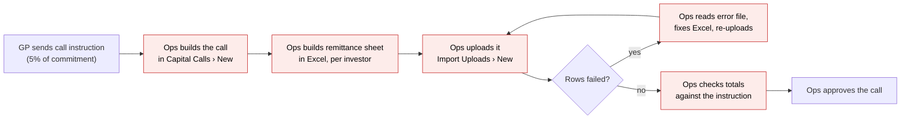
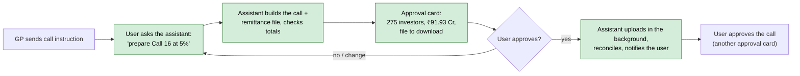
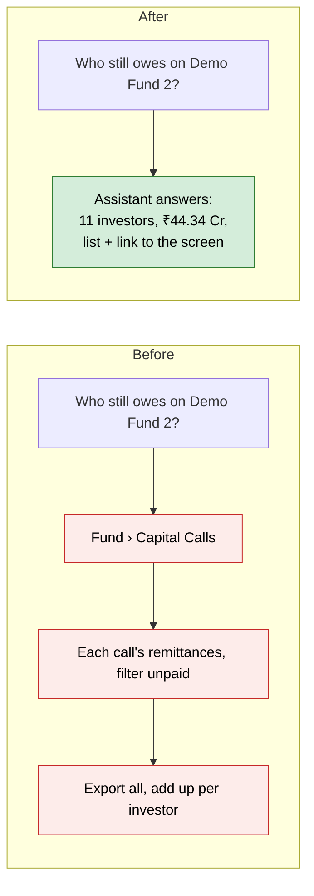
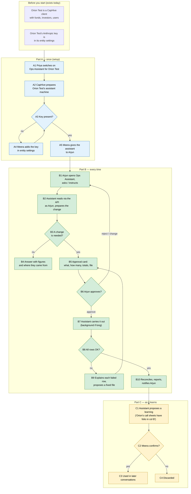

# Client Ops Assistant — Proposal

> **Audience:** Business team, product, QA, support — non-technical.
> **Companion document:** [Design](design.md)
> **New to this? Start with the [Workflow Journey](#workflow-journey)** — every action, in order, from start to the outcome.

> **Planning phase — no code changes.** This document proposes and explains the change. Do not
> edit application code while writing it; implementation happens later, in the tasks phase.

---

## Why

A fund's ops team spends most of its week on the same jobs in CapHive: preparing a capital call from a
spreadsheet, uploading remittances and payments, chasing KYC, answering "who still owes money on this fund?",
reconciling a bank statement. Each is many screens and a lot of re-keying. Onboarding Demo Fund 2
(October 2026) showed that an assistant built on Claude Code can do this kind of work **reliably and
safely through CapHive's own API** — 10 uploads, 0 failed rows, every figure reconciled — when the
rules are enforced by its tools rather than trusted to the model. This change gives that capability to
the client's own ops staff, inside CapHive, for their day-to-day work.

## What Changes

- Client staff get an **Ops Assistant** page in CapHive: a chat (the same look as CapHive's internal
  Support Console) where they ask questions or give instructions in plain English — "prepare Call 16 at
  5% of commitment", "which investors haven't finished KYC?", "reconcile this bank statement".
- The assistant works **only through CapHive's API, as the person asking**. It can never see or do more
  than that person can in the normal screens; it has **no database access**.
- **Every change needs the user's approval.** Before anything is written, the assistant shows an
  **approval card**: what will change, how many records, the totals, who will be notified, and the file
  it built (to download and check). Nothing is written until the user clicks **Approve**.
- Some actions are **never** done by the assistant, even with approval: deleting records, undoing an
  upload, and changing entity settings. The user does those in the normal screens.
- Long work (an upload of 4,000 rows) carries on **in the background**; the user is told in CapHive and
  by email when it finishes or when an approval is waiting.
- The assistant **learns the client's ways** (their sheet formats, naming, recurring jobs). Everything it
  knows lives in one **Ops Assistant** folder in the client's own Documents (Skills, Learnings, Proposed,
  Reports). It proposes each learning into Proposed; a client admin confirms it before it is used, and can
  write skills of their own.
- Each client gets **its own assistant machine** and uses **its own Anthropic key** (already in the
  entity's settings). Without a key the assistant is not available.
- CapHive switches the assistant on per client; the client's admin ticks it in each chosen user's permissions, as for any other feature. No new role.
- Nothing changes for investors or for existing screens and AI features.

### Flow Diagram

Preparing a capital call from the GP's instruction — **before** (every step by hand):



**After** — the assistant prepares and checks; the user reviews and approves:



Answering a question — **before**: open several screens, filter, export, add up in Excel.
**After**: ask in the chat; the answer shows the figures and where they came from.



---

## Workflow Journey

One worked example: **Orion Test** (a fund manager on CapHive) gets the assistant and uses it to raise
Call 16 on **Demo Fund 2** (275 investors, committed ₹18,38,50,93,602.71).

### Who is involved

| Person | Role | What they do in the journey |
|---|---|---|
| Priya | CapHive super user | Switches the assistant on for Orion Test (once) |
| Meera | Orion Test's admin (company admin) | Checks the Anthropic key, gives the assistant to her team, confirms what it learns |
| Arjun | Orion Test fund ops (employee) | Uses the assistant every day: questions, calls, KYC, reconciliations |
| The assistant | Claude Code on Orion Test's own machine | Reads through the API as Arjun, prepares changes, waits for approval, carries them out |

### The journey on one page



### Before you start

| Needed | Why | Where it comes from |
|---|---|---|
| A CapHive client entity with its funds and users | The assistant works on this data | Exists today |
| The client's **Anthropic API key** in its entity settings | The assistant runs on the client's own Claude account; without it, it is unavailable | Entity settings (existing field); the client obtains a key from Anthropic |
| A CapHive super user | Switches the assistant on | Exists today |
| A company admin at the client | Grants the assistant to users and confirms learnings | Exists today |

### Part A — once (setup)

| Step | Who | Where | Action | What the system does | What you see |
|---|---|---|---|---|---|
| A1 | Priya | Entity › Orion Test › Permissions | Ticks **Ops Assistant** | Records the permission; asks CapHive's infrastructure to prepare Orion Test's assistant machine | "Ops Assistant switched on. The assistant machine is being prepared (about 10 minutes)." |
| A2 | — | (background) | — | Prepares the machine for Orion Test only; it starts stopped | Ops Assistant status for Orion Test: **Ready (stopped)** |
| A3 | — | Ops Assistant page (Meera) | Meera opens it | Checks that the entity has an Anthropic key | If missing: "Add your Anthropic API key in Entity Settings to use the Ops Assistant." with a link |
| A4 | Meera | Entity Settings › AI › Anthropic API key | Pastes the key, saves | Stores the key | Ops Assistant page now opens |
| A5 | Meera | Users › Arjun › Edit › Permissions | Ticks **Ops Assistant** for Arjun (the same per-user permission list as Documents, Funds, AI Chat…) | Records the user permission; Arjun has the assistant only while both his permission and Orion Test's are on | Arjun sees **Ops Assistant** in his menu |

### Part B — every time

| Step | Who | Where | Action | What the system does | What you see |
|---|---|---|---|---|---|
| B1 | Arjun | Menu › Ops Assistant | Types "Prepare Call 16 on Demo Fund 2: 5% of commitment, due 15 Nov, notice 31 Oct" and presses Enter | Starts the machine if stopped; sends the question | "Starting your assistant (about 2 minutes)" then live progress: "Reading Demo Fund 2", "Reading 275 commitments" |
| B2 | Assistant | (machine) | — | Reads fund, commitments, existing calls through the API **as Arjun**; computes 5% per investor; builds the call and the remittance file; checks the totals | Progress lines |
| B3/B5 | Assistant | Chat | — | Files a **pending action**; nothing is written yet | The **approval card** (mockup below) |
| B6 | Arjun | Approval card › **Download file** / **Approve** | Downloads the file, checks it, clicks **Approve** | Re-checks Arjun may do this; carries out the action exactly as previewed | Card turns to "Approved by Arjun 10:42 — running" |
| B7 | Assistant | (background) | — | Creates the call, uploads 275 remittances; the turn ends while the upload runs | "Uploading 275 remittances — I'll tell you when it's done." Arjun can close the page |
| B10 | Assistant | Chat + notification + email | — | Reads back: 275 / 275 created, Σ called = the instruction | Bell + email: "Ops Assistant: Call 16 is ready to approve." Chat shows the check table |
| B5–B7 again | Arjun | Second approval card | **Approve call** (this sends notices to investors) | Approves the call through the API as Arjun | "Call 16 approved — 275 investors notified." |
| B4 | Arjun | Chat | "Who still owes money on Demo Fund 2?" | Reads the fund's remittances through the API | Answer: 11 investors, ₹44,33,53,987.54 due across the 15 calls, a table per investor, a link to the fund's remittances screen |

### Part C — as it learns

| Step | Who | Where | Action | What the system does | What you see |
|---|---|---|---|---|---|
| C1 | Assistant | Chat | — | Notices something reusable ("Orion's bank statements put the folio in the narration, after 'FOLIO-'") and saves it as a document in Documents › Ops Assistant › Proposed | "I've suggested this to your admin for next time" |
| C2 | Meera | Ops Assistant › What I've learned (or Documents › Ops Assistant) | **Confirm** (moves it to Learnings or Skills) or **Discard** (deletes it); she can also upload her own playbook into Skills | Every document in Skills and Learnings goes into later conversations for Orion Test | The proposed, learned and skills documents, who confirmed, when |

### What you see

The approval card for B5 (Demo Fund 2, Call 16 at 5%):

```
┌──────────────────────────────────────────────────────────────────────────┐
│ Ops Assistant · Demo Fund 2                                   Arjun ▾   │
├──────────────────────────────────────────────────────────────────────────┤
│ You: Prepare Call 16 on Demo Fund 2: 5% of commitment, due 15 Nov,       │
│      notice 31 Oct                                                        │
│                                                                           │
│ Assistant: I've prepared Call 16. Please check and approve.               │
│ ┌────────────────────────────────────────────────────────────────────┐  │
│ │ ⏳ Waiting for your approval                                        │  │
│ │ Create capital call "Drawdown 16" and 275 remittances               │  │
│ │                                                                     │  │
│ │  Investors               275                                        │  │
│ │  Committed       ₹18,38,50,93,602.71                                │  │
│ │  Called at 5%     ₹91,92,54,680.14   = 18,38,50,93,602.71 × 5%      │  │
│ │  Σ of 275 rows    ₹91,92,54,680.13   each row rounded to the paisa  │  │
│ │  Notice / due      31 Oct 2026 / 15 Nov 2026                        │  │
│ │  Notifies         nobody yet — investors are notified only when     │  │
│ │                   you approve the call (a separate card)            │  │
│ │  File             remittances_call16.xlsx (275 rows) ⬇ Download     │  │
│ │                                                                     │  │
│ │  [ Approve ]   [ Reject ]   [ Ask for a change ]                    │  │
│ └────────────────────────────────────────────────────────────────────┘  │
├──────────────────────────────────────────────────────────────────────────┤
│ Ask anything about your funds…                          Sonnet ▾   ➤    │
└──────────────────────────────────────────────────────────────────────────┘
```

The two called figures differ by one paisa because each investor's amount is rounded to the paisa
before it is added up (Demo Fund 2's real commitments); the card shows both so the user can see why.

### What goes wrong

**Rows fail on upload.** Three remittance rows fail ("Folio IN417 not found in Demo Fund 2"). The
assistant does not retry on its own. It posts: "272 of 275 created. 3 failed — IN417, IN418, IN419 have
no commitment in Demo Fund 2 (they are in Fund I). I can leave them out, or you can add their
commitments first." Arjun says "leave them out"; the assistant shows a new approval card for the
corrected total, and nothing more is written until he approves it. If Arjun instead wants the 272
removed, the assistant tells him to undo the upload on the Import Uploads screen — undo is never done by
the assistant.

**No key.** Meera's key expires. Arjun's next question shows: "Your Anthropic key was refused. Ask your
admin to update it in Entity Settings." No CapHive key is used instead.

### Summary: the minimum actions

| # | Action | Who | How often |
|---|---|---|---|
| 1 | Switch on Ops Assistant for the client | Priya (CapHive) | Once |
| 2 | Add the Anthropic key | Meera | Once (and on renewal) |
| 3 | Tick the Ops Assistant permission for each user | Meera | Once per user |
| 4 | Ask / instruct | Arjun | Every time |
| 5 | Approve each change | Arjun | Every change |
| 6 | Confirm learnings | Meera | When proposed |

---

## User Stories

### US-1: Ask about my funds in plain English

**As** Arjun (fund ops), **I want** to ask questions about my funds and investors, **so that** I don't
have to open and export several screens.

**Acceptance criteria:**
- The answer gives the figures, how they were worked out, and a link to the CapHive screen that shows them.
- The answer uses only data Arjun can see in CapHive; a question about a fund he cannot access gets
  "You don't have access to that fund."
- No change is made by a question; no approval card appears unless something would be written.

### US-2: Prepare a change, approve it myself

**As** Arjun, **I want** the assistant to prepare calls, distributions, investor and KYC updates and
uploads, **so that** I review instead of retyping.

**Acceptance criteria:**
- Every write is shown first as an approval card with: action, record counts, money totals, dates,
  who will be notified, and any file (downloadable).
- Nothing is written before **Approve**; **Reject** discards it; **Ask for a change** returns to the chat.
- Approval runs exactly what the card showed; if the data changed since (e.g. someone added an
  investor), the card is refused with "The data changed since this was prepared — ask me to prepare it again."
- Only the user who asked can approve their own card; another user sees it read-only.

### US-3: Never more than I could do myself

**As** Meera (admin), **I want** the assistant limited to each user's own CapHive permissions,
**so that** giving it to someone does not widen their access.

**Acceptance criteria:**
- Every read and write is made as the asking user; CapHive's normal history shows that user.
- A user without rights for an action gets the same refusal the screen would give.

### US-4: Some things stay manual

**As** Meera, **I want** deletes, upload undo and entity settings never done by the assistant, **so
that** irreversible or configuration changes always go through the normal screens.

**Acceptance criteria:**
- Asking for one of these gets: "I can't do that — please use <screen>. Here's what to do: …"
- No approval card is ever shown for them.

### US-5: Long work in the background

**As** Arjun, **I want** long uploads to continue after I close the page, **so that** I'm not stuck waiting.

**Acceptance criteria:**
- The chat says the work started; the result is posted into the same conversation when done.
- Arjun gets an in-app notification and an email when it finishes, fails, or needs his approval.

### US-6: It learns our way, with our say-so

**As** Meera, **I want** to confirm what the assistant learns, **so that** it never acts on a wrong lesson.

**Acceptance criteria:**
- Proposed learnings are listed under **What I've learned** as pending until confirmed or discarded.
- Only confirmed learnings are used; Meera can remove any at any time.

### US-7: Our assistant, our key, our machine

**As** Meera, **I want** our assistant to run on our own key and machine, **so that** our data and
costs are separate from other CapHive clients.

**Acceptance criteria:**
- Without a key the page explains how to add one; no other key is used.
- Conversations, files and learnings of one client are never visible to another client or to CapHive staff.

---

## UI Behavior

### Ops Assistant page

```
┌───────────────────────┬──────────────────────────────────────────────────┐
│ Ops Assistant         │ Demo Fund 2 · Call 16                    ● Ready │
│ [+ New chat]          │                                                   │
│ Search chats          │  (conversation, as in the mockup above)           │
│                       │                                                   │
│ Today                 │                                                   │
│  Call 16 on Demo F2   │                                                   │
│  KYC pending list     │                                                   │
│ Yesterday             │                                                   │
│  Bank recon Oct       │                                                   │
│                       │                                                   │
│ What I've learned (2) │  📎  Ask anything about your funds…  Sonnet ▾  ➤ │
└───────────────────────┴──────────────────────────────────────────────────┘
```

**Behavior notes:**
- Same layout as CapHive's Support Console: conversation list grouped Today / Yesterday / Previous 7
  days / Older, search once there are more than five, live progress while working, **Stop** while running.
- 📎 attaches files (xlsx, csv, pdf) to the question; files the assistant produces appear as download
  links in its answer and in approval cards.
- Status dot: **Ready**, **Starting…** (about 2 minutes after idle), **Working**, **Unavailable** (with the reason).
- Approval cards update live (Waiting → Approved/Rejected → Running → Done / Failed) without reloading.

### What I've learned (admins)

Shows the entity's **Documents › Ops Assistant** folder: Proposed (to confirm), Learnings and Skills.

```
┌──────────────────────────────────────────────────────────────────────┐
│ What I've learned                                                    │
│ Pending (1)                                                          │
│  Bank statements put the folio after "FOLIO-" in the narration       │
│  proposed in "Bank recon Oct" · 21 Oct     [ Confirm ] [ Discard ]   │
│ Confirmed (1)                                                        │
│  Call sheets: folio in column B, amount in column F                  │
│  confirmed by Meera · 18 Oct                            [ Remove ]   │
└──────────────────────────────────────────────────────────────────────┘
```

---

## What This Feature Does NOT Cover

| Excluded | Covered In |
|---|---|
| Deleting records, undoing uploads, entity settings | Done by users in the normal screens (by design) |
| Investors using the assistant | LP Assistant (existing) |
| CapHive's internal support investigations | Support Console (existing) |
| Replacing the existing in-app AI agents | They stay; a later change may decide |
| Database queries of any kind | By design: API only |
| CapHive staff reading client conversations | By design: not visible to CapHive |
| WhatsApp / email as a way to talk to the assistant | A later phase |

---

## Validation Rules

| Field | Rule | Default |
|---|---|---|
| Question | 1–4,000 characters; "Please type a question." when empty | — |
| Attachment | xlsx, xls, csv, pdf; up to 20 MB each, 5 per question | — |
| Anthropic key | Must be present in entity settings to open the page | none |
| Model | Sonnet or Opus | Sonnet |
| Approval | Only the asking user; only while the card is "Waiting"; data unchanged since prepared | — |

---

## Behavior Rules

| Scenario | What User Sees |
|---|---|
| User without the Ops Assistant permission | No menu item; direct link → "Not authorized." |
| Client not switched on by CapHive | No menu item for anyone at that client |
| No Anthropic key | "Add your Anthropic API key in Entity Settings to use the Ops Assistant." |
| Key refused by Anthropic | "Your Anthropic key was refused. Ask your admin to update it." |
| Machine stopped | "Starting your assistant (about 2 minutes)", then the answer |
| Asks to delete / undo / change settings | "I can't do that — please use <screen>." and the steps |
| Asks about a fund they can't access | "You don't have access to that fund." |
| CapHive's API cannot do it | "CapHive doesn't let me do this through its API yet — here's how to do it on <screen>." (recorded for CapHive as a gap) |
| Approves a card after the data changed | "The data changed since this was prepared — ask me to prepare it again." |
| Long job finishes | Result in the chat + bell notification + email |
| Rows fail on upload | Per-row explanation and a proposed fix, as a new approval card |
| Second question while one is running | Ask box disabled until the answer finishes or Stop is pressed |

---

## Resolved Design Decisions

| # | Decision | Resolution |
|---|---|---|
| 1 | Who uses it | The client's own staff whose user permissions include Ops Assistant — a per-user permission mirroring the entity permission, like the other features; no new role |
| 2 | How data is reached | CapHive's API only, as the asking user. No database access, not even read-only |
| 3 | Control of writes | Each write approved by the asking user on an approval card |
| 4 | Never done, even with approval | Deletes, upload undo, entity settings |
| 5 | Where Claude runs | A separate assistant machine, **one per client**, started on demand and stopped when idle — the Support Console's design |
| 6 | Claude account | The client's own Anthropic key from entity settings; **no fallback** to CapHive's key |
| 7 | What it can read besides the API | Product documentation and a copy of CapHive's code (to explain how figures are worked out); never quoted to the user |
| 8 | Learning | Kept as documents in one **Ops Assistant** folder under the client's Documents root (Skills, Learnings, Proposed, Reports); proposed by the assistant, confirmed by a client admin, who can also write skills |
| 9 | Access | CapHive switches the entity permission on; the client admin ticks the same permission per user (no new role) |
| 10 | Files | Kept with the conversation; saved into Documents only when the user approves |
| 11 | CapHive visibility | None — CapHive sees only machine health and cost |
| 12 | Retention | Kept until the client admin deletes them |
| 13 | Existing AI agents | Unchanged; separate page |
| 14 | Rollout | Staging pilot on one entity, then one production client, then others |

---

## Capabilities

### New Capabilities

- `client-ops-assistant/access`: switching on per client, the per-user permission, the key requirement, who sees the page.
- `client-ops-assistant/conversations`: asking, live progress, stop, background work, notifications, files, retention.
- `client-ops-assistant/actions`: reads and writes through the API as the asking user, approval cards, never-allowed actions, API gaps.
- `client-ops-assistant/learning`: the per-client Ops Assistant folder (skills, learnings, proposals, reports) — proposing, confirming and using them.
- `client-ops-assistant/tenant-machine`: one assistant machine per client — prepare, start, stop, isolation, key handling.

### Modified Capabilities

None.

---

## Impact

- **New page** "Ops Assistant" in the client's CapHive, and an admin page "What I've learned".
- **Permissions**: a new Ops Assistant permission on the entity (switched on by CapHive) and the same permission on each user (ticked by the client admin), following the existing per-feature permissions. No new role.
- **Notifications**: new in-app and email notifications for "approval waiting", "finished", "failed".
- **Entity settings**: the existing Anthropic key field is used; it will be stored encrypted.
- **Infrastructure**: one small assistant machine per client that switches it on, plus per-client file
  storage in S3; the same code-copy publishing the Support Console already uses after each deploy.
- **CapHive's API**: used as-is; where it lacks something, the gap is recorded rather than worked around.
- **Existing features**: Support Console, LP Assistant and the in-app AI agents are unchanged.

---

## Benefits

1. A capital call, distribution or bulk update goes from hours of screens and Excel to a request, a
   check and an approval.
2. Fewer failed uploads: the assistant checks files against the fund before uploading and explains any
   failure row by row.
3. Answers in seconds, with the figures and the screen to verify them.
4. No loss of control: nothing changes without the user's approval, and never beyond their own rights.
5. Gets better for each client over time, with the client deciding what it remembers.
6. Each client's data and costs stay separate.

---

## FAQ

| Question | Answer |
|---|---|
| Who can use it? | Users at a client where CapHive has switched it on, and whose admin has ticked Ops Assistant in their user permissions. |
| Can it do more than I can? | No. It acts as you, through CapHive's API, with your permissions. |
| Will it send emails to investors without asking? | No. Anything that notifies investors (e.g. approving a call) is its own approval card that says so. |
| Can it delete things? | No, never — nor undo uploads or change entity settings. |
| Does it read our database? | No. Only CapHive's API, as the person asking. |
| Who pays for it? | The client's own Anthropic key is used; without it the assistant is unavailable. Machine cost is CapHive's. |
| Can CapHive staff read our conversations? | No. CapHive sees only whether your assistant machine is running and its cost. |
| Can other clients see our data? | No. Each client has its own machine, storage and conversations. |
| How long are conversations kept? | Until your admin deletes them. |
| What if it learns something wrong? | Learnings are only used after your admin confirms them, and can be removed at any time. |
| Where does it keep what it knows about us? | In one **Ops Assistant** folder in your own Documents: Skills (how to do recurring jobs), Learnings (facts about how you work), Proposed (waiting for your admin) and Reports (a report of each task it carried out). Your admin can read, edit, download or delete them like any document. |
| What happens to the existing AI features? | Nothing; they stay as they are. |
| What if CapHive's API can't do something I ask? | It tells you how to do it on the screen, and the gap is recorded for CapHive. |
| How does it roll out? | A staging pilot, then one production client, then others. See [design.md](design.md). |

---

## Design Principle for the Next Phase

Keep it DRY and simple: **this is the Support Console's architecture pointed at the API instead of the
database**, plus the onboarding skill's write rules. Reuse the Support Console's chat page, turn job,
relay, event stream, machine control and code archive; reuse the onboarding tools' API client, review
gate and step reporting. Areas that risk complexity and need explicit design:

- **One machine per client** — preparing, naming, starting/stopping and updating many machines must be
  one rake task and one control class, not per-client scripts.
- **Approval cards** — the "pending action" must be the only path to a write, enforced by the tool on
  the machine *and* by Rails; executing exactly what was shown (and refusing if the data changed) needs a
  simple, testable rule.
- **Acting as the user** — a short-lived token per turn; it must not outlive the turn or reach Claude's
  own view.
- **Background work** — a job that outlives the chat turn must have one clear owner and one way to
  report back.
- **The Ruby sandbox** for transforms — the narrowest possible door (only vetted tools, only the
  conversation's folder).
- **Knowledge** — one per-client folder in Documents, not a second memory system.
