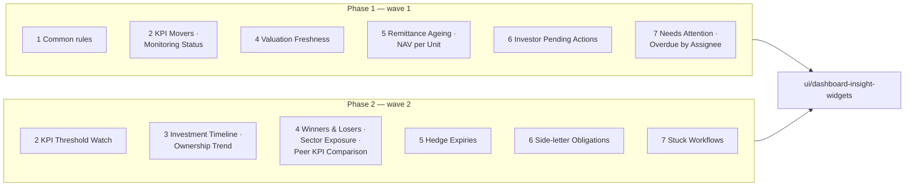

# Dashboard Insight Widgets — Business Rules (H/E/X)

> **Audience:** Product, QA, developers. Every row becomes exactly one Cucumber scenario.
> **Companions:** [Proposal](proposal.md) · [Design](design.md) · [Specs](specs/) · [Recommendations](../../../docs/modules/dashboards/widget_recommendations.md)

---

## Contents

- [How to read this](#how-to-read-this)
- [Shared setup](#shared-setup)
- [1. Rules every widget follows — Phase 1](#1-rules-every-widget-follows--phase-1)
- [2. Company monitoring widgets — Phase 1](#2-company-monitoring-widgets--phase-1)
- [3. Company holdings widgets — Phase 2](#3-company-holdings-widgets--phase-2)
- [4. Fund portfolio widgets — Phase 1 and 2](#4-fund-portfolio-widgets--phase-1-and-2)
- [5. Fund capital widgets — Phase 1 and 2](#5-fund-capital-widgets--phase-1-and-2)
- [6. Investor widgets — Phase 1 and 2](#6-investor-widgets--phase-1-and-2)
- [7. Ops widgets — Phase 1 and 2](#7-ops-widgets--phase-1-and-2)
- [Coverage](#coverage)

---

## How to read this

- **ID legend:** **H** = happy path · **E** = edge case · **X** = error (exception) case. IDs run across the whole
  file and never restart per section.
- **Spec scenario** column: `DIW: <scenario name>` (DIW = `ui/dashboard-insight-widgets`).
- **Feature** column: the Cucumber file under `features/` that holds the scenario.
- Every scenario carries a comment above it: `# E12 — Edge case: …`.
- **Build log:** rules settled during the build (extra empty states, module gates) are in
  [lld.md › Changed during the build](lld.md#changed-during-the-build) (B1–B15).
- **Numbers:** money is shown in the owner's currency (fund currency for fund widgets, the firm's currency for
  company widgets), with the app's money formatter. Percentages are shown to 2 decimals, as stored.
- **Dates:** "today" is frozen with the `today is "<date>"` step. Every date on screen goes through `l(...)`, so
  under the `en` locale it reads `30/09/2026`.

---

## Shared setup

| Record | Name | Key data |
|---|---|---|
| Firm | Demo Capital | Investment Fund, INR, KPI module on |
| Other firm | Other Capital | Investment Fund, for isolation rows |
| Fund manager | Meera | `company_admin` at Demo Capital |
| Fund employee | Ravi | Employee at Demo Capital, access to Growth Fund I only |
| LP user | Lena | `investor` role, user of Asha Family Office |
| Closed-end fund | Growth Fund I | INR, due-date calls |
| Evergreen fund | Evergreen Income Fund | INR, unit classes A and B, approved monthly NAVs |
| Portfolio company | Zeta Foods | Sector Consumer, held by Growth Fund I |
| Portfolio company | Orbit Pay | Sector Fintech, held by Growth Fund I |
| Portfolio company | Kite Robotics | Sector blank, held by Growth Fund I |
| LP | Asha Family Office | Commitment ₹5,00,00,000 in Growth Fund I |
| Today | 30 Sep 2026 | Frozen unless a row says otherwise |

---

## 1. Rules every widget follows — Phase 1

The 17 widgets are: KPI Movers, KPI Threshold Watch, Monitoring Status, Investment Timeline, Ownership Trend,
Valuation Freshness, Winners & Losers, Sector Exposure, Peer KPI Comparison, Remittance Ageing, NAV per Unit
Trend, Hedge Expiries, Investor Pending Actions, Side-letter Obligations, Needs Attention, Overdue Tasks by
Assignee and Stuck Workflows.

### Happy path

| # | Scenario | Given | When | Then | Spec scenario | Feature |
|---|---|---|---|---|---|---|
| H1 | Each new widget is offered on its dashboard | Meera on New Widget | She picks each dashboard | The widget-type list holds that dashboard's new widgets (outline over the 20 dashboard/widget pairs) | DIW: New widgets are offered on their dashboards | `features/core/dashboard_insight_widgets_common.feature` |
| H2 | Every setting has a label and help | Each new widget with settings | Meera opens its edit page | Each setting shows its label and its one-line help (outline over the settings) | DIW: Every setting is labelled and explained | same |

### Edge cases

| # | Scenario | Given | When | Then | Spec scenario | Feature |
|---|---|---|---|---|---|---|
| E1 | Bad setting value falls back to the default | KPI Movers with `{top_n: 0}` | Company page opens | Up to 5 rows show (default) | DIW: Invalid settings fall back to defaults | same |
| E2 | Text where a number is expected | Valuation Freshness with `{current_days: 'abc'}` | Portfolio tab opens | 90-day default used, no error | DIW: Invalid settings fall back to defaults | same |

### Error cases

| # | Scenario | Given | When | Then | Spec scenario | Feature |
|---|---|---|---|---|---|---|
| X1 | New widgets cannot go in an LP layout | Meera adds KPI Movers to layout "LP" | She saves | Refused with the "isn't safe to show LPs" message | DIW: New widgets are never shown to LPs | same |
| X2 | Investor-role user never sees internal widgets | Lena opens Growth Fund I's Portfolio tab, which has Valuation Freshness | Page renders | Widget body not rendered | DIW: New widgets are never shown to LPs | same |
| X3 | Other firm's data never appears | Other Capital has an overdue task | Meera opens Ops Dashboard | Needs Attention counts only Demo Capital tasks | DIW: Counts respect the viewer's access | `features/security/dashboard_insight_ops_isolation.feature` |

---

## 2. Company monitoring widgets — Phase 1

Portfolio Company Dashboard (owner: the company).

### Happy path

| # | Scenario | Given | When | Then | Spec scenario | Feature |
|---|---|---|---|---|---|---|
| H3 | KPI Movers ranks by size of change | Zeta Foods, Actual Quarter report 30 Jun 2026: Revenue +12.50, EBITDA −30.00, Headcount +2.00, Churn +8.00 | Company page | Rows: EBITDA -30.0 %, Revenue 12.5 %, Churn 8.0 %, Headcount 2.0 % (the KPI grid's format, lld B1) | DIW: KPI Movers lists the biggest changes | `features/startup/dashboard_insight_company_widgets.feature` |
| H4 | KPI Movers honours top_n | Same, `{top_n: 2}` | Company page | Only EBITDA and Revenue | DIW: KPI Movers lists the biggest changes | same |
| H5 | Monitoring Status shows the latest agent result | Portco agent report for Zeta Foods: KPI "Q2 2026 KPIs not submitted" (blocking), valuation OK | Company page | KPI card "1 Issues", Valuations "✓ Compliant", "Checked on" date | DIW: Monitoring Status shows the agent's latest check | same |
| H6 | KPI Threshold Watch flags breaches | Revenue mapping lower 10 / upper 25; Revenue change 5.00; EBITDA RAG red; Churn change 30.00 with upper 25 | Company page | EBITDA "Red", Revenue "Below 10 % threshold", Churn "Above 25 % threshold" in that order | DIW: KPI Threshold Watch flags KPIs outside their limits | same |

### Edge cases

| # | Scenario | Given | When | Then | Spec scenario | Feature |
|---|---|---|---|---|---|---|
| E3 | Only the latest report is used | Reports 31 Mar 2026 (Revenue +50) and 30 Jun 2026 (Revenue +12.5) | Company page | KPI Movers shows 12.50 % and the 30/06/2026 date | DIW: KPI Movers lists the biggest changes | same |
| E4 | KPIs with no change are left out | Latest report: Revenue +12.5, NewKPI no change | Company page | Only Revenue listed | DIW: KPI Movers lists the biggest changes | same |
| E5 | Equal changes sort by name | Revenue +10, Margin −10 | Company page | Margin then Revenue | DIW: KPI Movers lists the biggest changes | same |
| E6 | Tag and period settings pick the report | Actual and Budget Quarter reports; `{tag_list: 'Budget'}` | Company page | Budget report's KPIs shown | DIW: KPI Movers lists the biggest changes | same |
| E7 | No matching report | Zeta Foods has only Month reports | Company page | "No Actual Quarter KPI report for this company yet." | DIW: Empty widgets explain why | same |
| E8 | KPI module off | Firm without KPI module, KPI Movers enabled | Company page | KPI Movers and KPI Threshold Watch not rendered | DIW: KPI widgets need the KPI module | same |
| E9 | Threshold exactly equal is not a breach | Lower 10, change 10.00 | Company page | Revenue not listed | DIW: KPI Threshold Watch flags KPIs outside their limits | same |
| E10 | Zero or blank threshold is ignored | Lower 0, change −40 | Company page | Not listed by threshold | DIW: KPI Threshold Watch flags KPIs outside their limits | same |
| E11 | Nothing breached | All within limits, no RAG red/amber | Company page | "No KPI is outside its limits on the 30/06/2026 report." | DIW: Empty widgets explain why | same |
| E12 | Green RAG is not flagged | Revenue RAG green | Company page | Revenue not listed | DIW: KPI Threshold Watch flags KPIs outside their limits | same |
| E13 | Company not yet checked | Agent exists, no report for Orbit Pay | Orbit Pay page | "Not checked yet. The portfolio company agent checks each company once a period." | DIW: Empty widgets explain why | same |
| E14 | Only the latest report counts | Two reports, older blocked, latest ready | Company page | Shows the latest | DIW: Monitoring Status shows the agent's latest check | same |

### Error cases

| # | Scenario | Given | When | Then | Spec scenario | Feature |
|---|---|---|---|---|---|---|
| X4 | No portco agent for the firm | Monitoring Status enabled, no agent | Company page | Widget body not rendered, page still loads | DIW: Monitoring Status shows the agent's latest check | same |
| X5 | Reports from another firm's agent are ignored | Other Capital agent report on a same-named company | Zeta Foods page | Not shown | DIW: Counts respect the viewer's access | `features/security/dashboard_insight_company_isolation.feature` |

---

## 3. Company holdings widgets — Phase 2

Portfolio Company Dashboard (owner: the company).

### Happy path

| # | Scenario | Given | When | Then | Spec scenario | Feature |
|---|---|---|---|---|---|---|
| H7 | Investment Timeline by quarter | Zeta Foods: bought ₹1,00,00,000 on 15 Feb 2025, ₹50,00,000 on 10 Aug 2025, sold ₹30,00,000 on 5 Sep 2026 | Company page | Bars: Q1 2025 Bought 1,00,00,000 · Q3 2025 Bought 50,00,000 · Q3 2026 Sold −30,00,000 | DIW: Investment Timeline shows buys and sells per period | `features/startup/dashboard_insight_company_widgets.feature` |
| H8 | Ownership Trend by holder group | Positions 31 Mar 2025 Self 12.00 %, Founder 60.00 %; 30 Sep 2025 Self 10.50 %, Founder 55.00 % | Company page | Lines Self and Founder over two dates with those values | DIW: Ownership Trend shows fully diluted % over time | same |

### Edge cases

| # | Scenario | Given | When | Then | Spec scenario | Feature |
|---|---|---|---|---|---|---|
| E15 | Two funds in different currencies | Growth Fund I (INR) and a USD fund both buy Zeta Foods | Company page | Amounts totalled in the firm's currency (INR) | DIW: Investment Timeline shows buys and sells per period | same |
| E16 | Year setting | `{period: 'year'}` | Company page | Bars 2025 and 2026 | DIW: Investment Timeline shows buys and sells per period | same |
| E17 | No transactions | Kite Robotics has none | Kite page | "No investments recorded for this company yet." | DIW: Empty widgets explain why | same |
| E18 | Positions without a date or % are skipped | One position with blank date, one with blank % | Company page | Only dated rows with % plotted | DIW: Ownership Trend shows fully diluted % over time | same |
| E19 | No usable positions | None dated | Company page | "No dated cap-table positions with a fully diluted % yet." | DIW: Empty widgets explain why | same |

### Error cases

| # | Scenario | Given | When | Then | Spec scenario | Feature |
|---|---|---|---|---|---|---|
| X6 | Holdings of a fund the employee can't access are hidden | Ravi (Growth Fund I only); a second fund also holds Zeta Foods | Ravi opens Zeta Foods | Timeline totals only Growth Fund I rows | DIW: Counts respect the viewer's access | `features/security/dashboard_insight_company_isolation.feature` |

---

## 4. Fund portfolio widgets — Phase 1 and 2

Portfolio Dashboard (owner: the fund) and Aggregated Portfolio Dashboard (all companies, fund filter).

### Happy path

| # | Scenario | Given | When | Then | Spec scenario | Feature |
|---|---|---|---|---|---|---|
| H9 | Valuation Freshness buckets the holdings | Last valuations: Zeta 30 Jun 2026 (92 days), Orbit 31 Dec 2025 (273), Kite none | Growth Fund I Portfolio tab | Counts Current 0 · Due 1 · Stale 1 · Never 1; rows Kite (Never), Orbit (Stale, 273), Zeta (Due, 92) | DIW: Valuation Freshness shows how old each holding's valuation is | `features/fund/dashboard_insight_portfolio_widgets.feature` |
| H10 | Valuation Freshness on the aggregated dashboard | Same companies | Portfolio Companies › Portfolio Dashboard | Same rows, across all funds | DIW: Valuation Freshness shows how old each holding's valuation is | same |
| H11 | Winners & Losers | Unrealised gain: Zeta +₹40,00,000, Orbit −₹15,00,000, Kite +₹5,00,000 | Portfolio tab | Gains: Zeta, Kite · Losses: Orbit | DIW: Winners & Losers ranks unrealised gains and losses | same |
| H12 | Sector Exposure | FMV: Zeta ₹6 Cr (Consumer), Orbit ₹3 Cr (Fintech), Kite ₹1 Cr (blank) | Portfolio tab | Consumer 60.00 %, Fintech 30.00 %, Unassigned 10.00 % | DIW: Sector Exposure splits FMV by sector | same |
| H13 | Peer KPI Comparison | Latest Actual Quarter Revenue change: Zeta +12.5, Orbit −4.0 | Aggregated dashboard, `{kpi_name: 'Revenue'}` | Bars Zeta 12.50 %, Orbit −4.00 %, with values in a table | DIW: Peer KPI Comparison compares one KPI across companies | `features/fund/dashboard_insight_peer_kpi.feature` |

### Edge cases

| # | Scenario | Given | When | Then | Spec scenario | Feature |
|---|---|---|---|---|---|---|
| E20 | Exactly 90 days is Current | Zeta valued 2 Jul 2026 (90 days) | Portfolio tab | Zeta Current | DIW: Valuation Freshness shows how old each holding's valuation is | same |
| E21 | 91 days is Due, 180 is Due, 181 is Stale | Three companies valued 91, 180, 181 days ago | Portfolio tab | Due, Due, Stale | same | same |
| E22 | Custom limits | `{current_days: 30, due_days: 60}`, Zeta 45 days | Portfolio tab | Zeta Due | same | same |
| E23 | Exited holding is left out | Growth Fund I sold all of Kite | Portfolio tab | Kite not listed | same | same |
| E24 | Limit caps the rows | 4 companies, `{limit: 2}` | Portfolio tab | 2 stalest rows, "Showing 2 of 4" | same | same |
| E25 | Future-dated valuation is Current | Zeta valued 31 Dec 2026 | Portfolio tab | Zeta Current, 0 days | same | same |
| E64 | Age reads in days, months, years | Zeta 29 days, Orbit 273 days, Kite 1,369 days | Portfolio tab | "29 days", "9 months", "3 years 9 months"; exact days on hover | same | same |
| E26 | Zero gain is in neither list | Kite gain 0 | Portfolio tab | Kite absent | DIW: Winners & Losers ranks unrealised gains and losses | same |
| E27 | No losses | All gains positive | Portfolio tab | Losses list says "No holding is below cost." | DIW: Empty widgets explain why | same |
| E28 | Gains summed across instruments | Zeta equity +30 L, Zeta CCPS +10 L | Portfolio tab | Zeta +₹40,00,000 | DIW: Winners & Losers ranks unrealised gains and losses | same |
| E29 | Cost measure | `{measure: 'cost'}` | Portfolio tab | Split by cost of remaining | DIW: Sector Exposure splits FMV by sector | same |
| E30 | No FMV | All FMV zero | Portfolio tab | "No holding has a fair value yet." | DIW: Empty widgets explain why | same |
| E31 | Mapped standard name matches | Orbit reports "Net Revenue" mapped to standard "Revenue" | Aggregated, `{kpi_name: 'Revenue'}` | Orbit included | DIW: Peer KPI Comparison compares one KPI across companies | `features/fund/dashboard_insight_peer_kpi.feature` |
| E32 | Company without the KPI is left out | Kite has no Revenue | Aggregated | Kite absent | same | `features/fund/dashboard_insight_peer_kpi.feature` |

### Error cases

| # | Scenario | Given | When | Then | Spec scenario | Feature |
|---|---|---|---|---|---|---|
| X7 | Other firm's valuations ignored | Other Capital values a same-named company yesterday | Portfolio tab | Zeta still Due | DIW: Counts respect the viewer's access | `features/security/dashboard_insight_fund_isolation.feature` |
| X8 | KPI name missing | Peer KPI Comparison with `{kpi_name: ''}` | Aggregated | "Set the KPI name in this widget's settings." | DIW: Empty widgets explain why | `features/fund/dashboard_insight_peer_kpi.feature` |

---

## 5. Fund capital widgets — Phase 1 and 2

Fund Dashboard (owner: the fund).

### Happy path

| # | Scenario | Given | When | Then | Spec scenario | Feature |
|---|---|---|---|---|---|---|
| H14 | Remittance Ageing buckets unpaid amounts | Calls due 15 Oct 2026, 15 Sep 2026, 1 Aug 2026, 15 Jun 2026; one open remittance each, due ₹10 L, ₹20 L, ₹5 L, ₹2 L | Fund Dashboard | Not yet due ₹10,00,000 (1) · 0–30 days ₹20,00,000 (1) · 31–60 days ₹5,00,000 (1) · 61–90 days 0 · Over 90 days ₹2,00,000 (1) | DIW: Remittance Ageing groups unpaid amounts by days overdue | `features/fund/dashboard_insight_fund_widgets.feature` |
| H15 | NAV per Unit Trend per class | Evergreen Income Fund approved NAVs Jul–Sep 2026: A 101.20, 102.10, 103.00; B 100.50, 101.00, 101.60 | Fund Dashboard | Two lines A and B with those points | DIW: NAV per Unit Trend charts approved NAV per unit by class | same |
| H16 | Hedge Expiries | Open forward "USD/INR Fwd Dec" expiring 15 Oct 2026, notional $5,00,000 | Fund Dashboard | Row with expiry 15/10/2026, "15 days" | DIW: Hedge Expiries lists open contracts nearing expiry | same |

### Edge cases

| # | Scenario | Given | When | Then | Spec scenario | Feature |
|---|---|---|---|---|---|---|
| E33 | Due today is 0–30 days | Call due 30 Sep 2026 | Fund Dashboard | In 0–30 days | DIW: Remittance Ageing groups unpaid amounts by days overdue | same |
| E34 | 30/31, 60/61, 90/91 boundaries | Calls due 31, 30, 61, 60, 91, 90 days ago | Fund Dashboard | 0–30: 30 · 31–60: 31, 60 · 61–90: 61, 90 · Over 90: 91 | same | same |
| E35 | Paid and overpaid are left out | One Paid, one Overpaid remittance | Fund Dashboard | Not counted | same | same |
| E36 | Fees are part of the due | Call ₹10 L + other fee ₹50,000, collected ₹4 L | Fund Dashboard | Due ₹6,50,000 | same | same |
| E37 | Totals match the linked grid | Widget shows 4 open remittances | Click "View open remittances" | Remittances grid lists the same 4 | DIW: Remittance Ageing groups unpaid amounts by days overdue | same |
| E38 | Nothing unpaid | All paid | Fund Dashboard | "No unpaid remittances in this fund." | DIW: Empty widgets explain why | same |
| E39 | Draft NAVs are left out | One draft NAV for Oct 2026 | Fund Dashboard | Oct not plotted | DIW: NAV per Unit Trend charts approved NAV per unit by class | same |
| E40 | Months setting | 18 months of NAVs, `{months: 6}` | Fund Dashboard | Last 6 months from the latest NAV | same | same |
| E41 | Closed-end fund | Growth Fund I, no NAVs | Fund Dashboard | "This fund has no approved NAVs. NAV per unit is kept for evergreen funds." | DIW: Empty widgets explain why | same |
| E42 | Already-expired contract still open | Open contract expired 20 Sep 2026 | Fund Dashboard | Listed, "Expired 10 days ago", at the top | DIW: Hedge Expiries lists open contracts nearing expiry | same |
| E43 | Beyond the window / closed | Open expiring 31 Mar 2027 (182 days), closed expiring 10 Oct 2026 | Fund Dashboard | Neither listed (default 90 days) | same | same |
| E44 | No derivatives | None | Fund Dashboard | "No open contracts expire in the next 90 days." | DIW: Empty widgets explain why | same |

### Error cases

| # | Scenario | Given | When | Then | Spec scenario | Feature |
|---|---|---|---|---|---|---|
| X9 | Investor role on the fund dashboard | Lena requests Growth Fund I's dashboard with Remittance Ageing | Page renders | Widget body not rendered | DIW: New widgets are never shown to LPs | `features/security/dashboard_insight_fund_isolation.feature` |

---

## 6. Investor widgets — Phase 1 and 2

Investor Dashboard (owner: an LP). Side-letter Obligations is also on the Ops Dashboard (section 7).

### Happy path

| # | Scenario | Given | When | Then | Spec scenario | Feature |
|---|---|---|---|---|---|---|
| H17 | Investor Pending Actions lists what is outstanding | Asha: 1 Overdue remittance due ₹20 L (call "Call 3", due 15 Sep 2026); KYC not verified; 1 approval awaiting reply due 10 Oct 2026; 1 commitment agreement awaiting e-sign | Asha's dashboard | Four sections with counts 1, 1, 1, 1 and the rows | DIW: Investor Pending Actions lists what is outstanding with an LP | `features/core/dashboard_insight_investor_widgets.feature` |
| H18 | Side-letter Obligations on the Investor Dashboard | Asha has an active obligation "Quarterly ESG report" due 15 Oct 2026 | Asha's dashboard | Row with due 15/10/2026 | DIW: Side-letter Obligations lists obligations falling due | same |

### Edge cases

| # | Scenario | Given | When | Then | Spec scenario | Feature |
|---|---|---|---|---|---|---|
| E45 | KYC expiring within 60 days is listed | Verified KYC expiring 20 Nov 2026 | Dashboard | KYC row "Expires 20/11/2026" | DIW: Investor Pending Actions lists what is outstanding with an LP | same |
| E46 | KYC expiring later is not | Verified KYC expiring 31 Dec 2026 (92 days) | Dashboard | No KYC row | same | same |
| E47 | Closed or unpublished approvals are left out | Approval past due; another not yet published | Dashboard | No approval rows | same | same |
| E48 | Completed e-sign left out | Document esign completed | Dashboard | No e-sign row | same | same |
| E49 | Nothing outstanding | All clear | Dashboard | "Nothing outstanding with Asha Family Office." | DIW: Empty widgets explain why | same |
| E50 | Another LP's items are not shown | Bharat LP has an overdue remittance | Asha's dashboard | Not listed | DIW: Investor Pending Actions lists what is outstanding with an LP | same |
| E51 | Obligation due window | Active obligations due in 30 and 31 days, `{days: 30}` | Dashboard | Only the 30-day one | DIW: Side-letter Obligations lists obligations falling due | same |
| E52 | Overdue obligation listed first | Active obligation due 1 Sep 2026 | Dashboard | Listed first, "Overdue" | same | same |
| E53 | Fulfilled / waived / unreviewed left out | One fulfilled, one waived, one pending review | Dashboard | None listed | same | same |

### Error cases

| # | Scenario | Given | When | Then | Spec scenario | Feature |
|---|---|---|---|---|---|---|
| X10 | Employee without fund access | Ravi; Asha's overdue remittance is in a fund Ravi can't access | Ravi opens Asha's dashboard | That remittance is not listed | DIW: Counts respect the viewer's access | `features/security/dashboard_insight_ops_isolation.feature` |

---

## 7. Ops widgets — Phase 1 and 2

Ops Dashboard (no owner). Needs Attention is also on the FM Landing Page.

### Happy path

| # | Scenario | Given | When | Then | Spec scenario | Feature |
|---|---|---|---|---|---|---|
| H19 | Needs Attention counts what is stuck | 3 overdue open tasks, 2 KYCs submitted not verified, 4 Overdue remittances, 1 open e-sign request | Ops Dashboard | Cards 3 · 2 · 4 · 1 | DIW: Needs Attention counts stuck work with links | `features/core/dashboard_insight_ops_widgets.feature` |
| H20 | Needs Attention on the FM Landing Page | Same | Meera's home page | Same four cards | DIW: Needs Attention counts stuck work with links | same |
| H21 | Each card opens the matching list | Same | Click "Overdue remittances" | Remittances list with the same 4 rows | DIW: Needs Attention counts stuck work with links | same |
| H22 | Overdue Tasks by Assignee | Meera 3 overdue, Ravi 1, unassigned 2 | Ops Dashboard | Bars Meera 3, Unassigned 2, Ravi 1 | DIW: Overdue Tasks by Assignee shows who is behind | same |
| H23 | Stuck Workflows | Capital call journey on "Call 3" at step "Approve notice" since 15 Sep 2026 | Ops Dashboard | Row: Call 3 · Approve notice · 15 days | DIW: Stuck Workflows lists journeys waiting too long on a step | same |
| H24 | Side-letter Obligations on Ops | Asha's "Quarterly ESG report" due 15 Oct 2026 | Ops Dashboard | Row with investor Asha Family Office | DIW: Side-letter Obligations lists obligations falling due | same |

### Edge cases

| # | Scenario | Given | When | Then | Spec scenario | Feature |
|---|---|---|---|---|---|---|
| E54 | Task due today is not overdue | Open task due 30 Sep 2026 | Ops Dashboard | Not counted | DIW: Needs Attention counts stuck work with links | same |
| E55 | KYC not yet submitted is not "to verify" | KYC not sent / link sent | Ops Dashboard | Not counted | same | same |
| E57 | Failed / cancelled e-sign not "open" | One failed, one cancelled | Ops Dashboard | Not counted | same | same |
| E58 | All zero | Nothing stuck | Ops Dashboard | All four cards show 0 | same | same |
| E59 | top_n groups the rest | 12 assignees, `{top_n: 10}` | Ops Dashboard | 10 bars plus "Others" | DIW: Overdue Tasks by Assignee shows who is behind | same |
| E60 | No overdue tasks | None | Ops Dashboard | "No overdue tasks." | DIW: Empty widgets explain why | same |
| E61 | Exactly the day limit | Step since 23 Sep 2026 (7 days), `{days: 7}` | Ops Dashboard | Listed (7 days counts) | DIW: Stuck Workflows lists journeys waiting too long on a step | same |
| E62 | Complete / archived journeys left out | One complete, one archived, both old | Ops Dashboard | Not listed | same | same |
| E63 | Six days is not stuck | Step since 24 Sep 2026 | Ops Dashboard | Not listed | same | same |

### Error cases

| # | Scenario | Given | When | Then | Spec scenario | Feature |
|---|---|---|---|---|---|---|
| X11 | Employee sees only their tasks' scope | Ravi (not admin) | Ravi opens Ops Dashboard | Overdue count = tasks Ravi's task policy lets him see | DIW: Counts respect the viewer's access | `features/security/dashboard_insight_ops_isolation.feature` |

---

## Coverage

| Section | H | E | X | Total |
|---|---|---|---|---|
| 1 Common | 2 | 2 | 3 | 7 |
| 2 Company monitoring | 4 | 12 | 2 | 18 |
| 3 Company holdings | 2 | 5 | 1 | 8 |
| 4 Fund portfolio | 5 | 13 | 2 | 20 |
| 5 Fund capital | 3 | 12 | 1 | 16 |
| 6 Investor | 2 | 9 | 1 | 12 |
| 7 Ops | 6 | 10 | 1 | 17 |
| **Total** | **24** | **63** | **11** | **98** |

- Feature files (10): `core/dashboard_insight_widgets_common`, `startup/dashboard_insight_company_widgets`,
  `fund/dashboard_insight_portfolio_widgets`, `fund/dashboard_insight_peer_kpi`, `fund/dashboard_insight_fund_widgets`,
  `core/dashboard_insight_investor_widgets`, `core/dashboard_insight_ops_widgets`,
  `security/dashboard_insight_company_isolation`, `security/dashboard_insight_fund_isolation`,
  `security/dashboard_insight_ops_isolation`.
- A row whose Feature cell says "same" uses the file named in the row above it in the same table.
- Every DIW spec scenario appears in at least one row.
