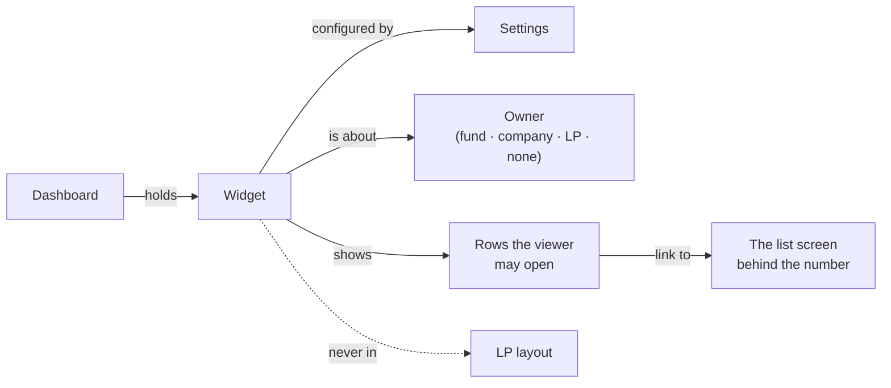
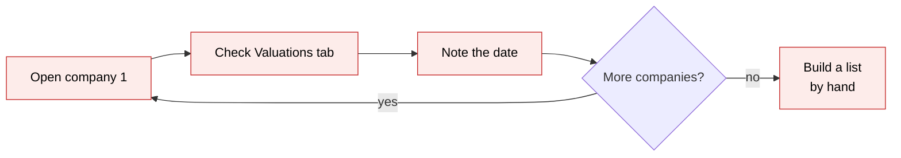
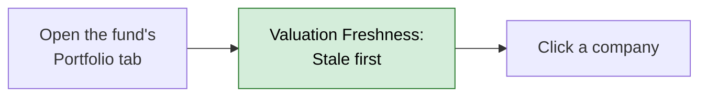
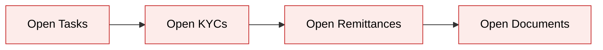
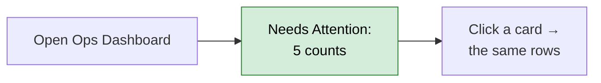
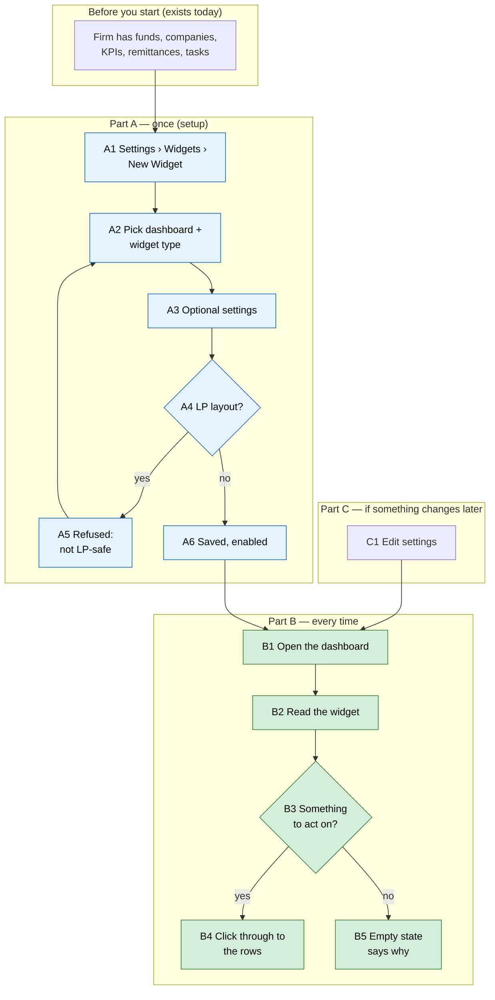

# Dashboard Insight Widgets — Proposal

> **Audience:** Business team, product, QA, support — non-technical.
> **Companion documents:** [Design](design.md) · [Business rules](business-rules.md) · [Recommendations review](../../../docs/modules/dashboards/widget_recommendations.md)
> **New to this? Start with the [Workflow Journey](#workflow-journey)** — every action, in order, from start to the outcome.

> **Written while the user was away.** Every judgement call is listed in the recommendations doc's
> [Assumptions](../../../docs/modules/dashboards/widget_recommendations.md#assumptions-for-review) table.

---

## Why

- Fund teams already see *levels* (KPI values, holdings, totals). They have no single place that tells them what
  **changed**, what is **stale**, what is **overdue** or what is **stuck**.
- The answers exist in the data but are spread over many screens. For example: "which companies carry a 6-month-old
  valuation into this quarter's NAV" takes one company page at a time today (41 of 67 valued companies in
  the demo firm are older than 180 days).
- Ops leads have 4 widgets on their dashboard, and none of them counts stuck work (unverified KYCs, overdue
  remittances, open e-signs).
- The dashboards are configurable, so new answers can be added as widgets without changing any existing screen.

## What Changes

- 17 new read-only widgets, offered on 7 dashboards (20 placements):
  - **Company monitoring:** KPI Movers, KPI Threshold Watch, Monitoring Status, Valuation Freshness, Peer KPI Comparison.
  - **Holdings & allocation:** Investment Timeline, Ownership Trend, Winners & Losers, Sector Exposure.
  - **Capital & performance:** Remittance Ageing, NAV per Unit Trend, Hedge Expiries.
  - **Work & compliance:** Investor Pending Actions, Side-letter Obligations, Needs Attention, Overdue Tasks by
    Assignee, Stuck Workflows.
- Each widget has an ⓘ tooltip, labelled settings with help, an empty state that says why, and links to the rows behind
  its numbers.
- None of them is shown to LPs.
- Nothing existing changes. **No breaking changes.** No new data is stored.

### Key concepts



| Concept | What it means for you | Example |
|---|---|---|
| Dashboard | A page whose cards you choose at Settings › Widgets | Fund Dashboard of Growth Fund I |
| Widget | One card on a dashboard | Remittance Ageing |
| Owner | What the dashboard is about | The fund, the company, the LP, or nothing (Ops) |
| Settings | Optional knobs per widget, each with help text | `top_n: 5`, `days: 30` |
| Empty state | One sentence when a widget has nothing to show | "No unpaid remittances in this fund." |
| LP layout | A company dashboard layout shown to LPs | Layout named "LP" |
| Ageing bucket | Days an unpaid amount is past its due date | 0–30, 31–60, 61–90, Over 90 |
| Freshness status | How old a company's latest valuation is | Current ≤ 90 days · Due ≤ 180 · Stale · Never |
| Portco agent | The automatic monthly check of each company's KPIs, documents and valuation | "Q2 2026 KPIs not submitted" |

**Freshness status**
- **What:** each held company's last valuation date, sorted into four statuses.
- **Why:** quarter-end NAVs must not carry old marks silently.
- **Not covered:** it does not judge whether the valuation is *right*, only how old it is.
- **Example:** today 30 Sep 2026, Zeta Foods last valued 30 Jun 2026 → 92 days → **Due**.

**Ageing bucket**
- **What:** an unpaid remittance's due amount (call + fees − collected), put in a bucket by days past the call's
  due date.
- **Why:** follow-up depends on how *late* money is, not only on how much is owed.
- **Not covered:** paid and overpaid remittances, and remittances whose call is not yet due (those get their own
  "Not yet due" bucket).
- **Example:** call due 15 Sep 2026, ₹20 L unpaid on 30 Sep → 15 days → **0–30 days**.

### Flow Diagram

Finding stale valuations before quarter-end:





Knowing what is stuck (ops lead):





---

## Workflow Journey

### Who is involved

| Person | Role | What they do in the journey |
|---|---|---|
| Meera | Fund manager (company admin) | Adds the widgets once; reads them every week |
| Ravi | Fund employee, Growth Fund I only | Reads the same dashboards; sees only his funds' rows |
| Lena | LP user of Asha Family Office | Never sees these widgets |

### The journey on one page



### Before you start

| Needed | Why | Where it comes from |
|---|---|---|
| KPI module and KPI reports | KPI Movers, Threshold Watch, Peer Comparison | KPI reports per company |
| Valuations | Valuation Freshness | Company › Valuations |
| Portco agent enabled | Monitoring Status | Settings › Support Agents |
| Approved NAVs | NAV per Unit Trend | Evergreen funds only |
| Derivative contracts | Hedge Expiries | Fund › Derivatives |
| Side letters with reviewed obligations | Side-letter Obligations | Fund › Side letters |
| Journeys launched | Stuck Workflows | Any record's journey |

### Part A — once (setup)

| Step | Who | Where | Action | What the system does | What you see |
|---|---|---|---|---|---|
| A1 | Meera | Settings › Widgets › New | Opens the form | Lists dashboards | Dashboard drop-down |
| A2 | Meera | Same | Picks "Fund Dashboard", type "Remittance Ageing" | Shows its settings with help | Settings fields with labels |
| A3 | Meera | Same | Leaves settings blank | Defaults apply | — |
| A4/A5 | Meera | Same | Tries layout "LP" with KPI Movers | Refuses | "This widget can't be added to an LP layout: it isn't safe to show LPs." |
| A6 | Meera | Same | Saves on layout "Default" | Stores it enabled | Widget list shows it |

### Part B — every time

| Step | Who | Where | Action | What the system does | What you see |
|---|---|---|---|---|---|
| B1 | Meera | Growth Fund I › Dashboard | Opens | Groups open remittances by days overdue | Remittance Ageing chart + table |
| B2 | Meera | Same | Reads "Over 90 days ₹2,00,000 (1)" | — | — |
| B4 | Meera | Same › "View open remittances" | Clicks | Opens remittances filtered to Pending + Overdue | Same 4 rows the widget counted |
| B1 | Ravi | Ops Dashboard | Opens | Counts only what Ravi may see | Needs Attention with Ravi's numbers |
| B1 | Lena | Any of these dashboards | Opens via a URL | Hides the widget body | Nothing from these widgets |
| B5 | Meera | Evergreen fund dashboard of a closed-end fund | Opens | No NAVs | "This fund has no approved NAVs. NAV per unit is kept for evergreen funds." |

### What you see

```
┌ Remittance Ageing ⓘ ─────────────────────────────────────────┐
│  ▇▇▇▇                                                       │
│  ▇▇▇▇  ▇▇▇▇▇▇▇▇                                             │
│  ▇▇▇▇  ▇▇▇▇▇▇▇▇  ▇▇▇                    ▇                   │
│  Not   0–30      31–60      61–90       Over 90             │
│  due                                                        │
│ ─────────────────────────────────────────────────────────── │
│  Bucket          Remittances   Due                          │
│  Not yet due     1             ₹10,00,000                   │
│  0–30 days       1             ₹20,00,000                   │
│  31–60 days      1             ₹5,00,000                    │
│  61–90 days      0             ₹0                           │
│  Over 90 days    1             ₹2,00,000                    │
│  Total           4             ₹37,00,000  = 10+20+5+0+2 L  │
│                                    [ View open remittances ]│
└─────────────────────────────────────────────────────────────┘

┌ Needs Attention ⓘ ───────────────────────────────────────────────────────────┐
│ ┌──────────┐ ┌──────────┐ ┌──────────────┐ ┌──────────┐                       │
│ │ 3        │ │ 2        │ │ 4            │ │ 1        │                       │
│ │ Overdue  │ │ KYCs to  │ │ Overdue      │ │ Open     │                       │
│ │ tasks    │ │ verify   │ │ remittances  │ │ e-signs  │                       │
│ └──────────┘ └──────────┘ └──────────────┘ └──────────┘                       │
└──────────────────────────────────────────────────────────────────────────────┘
```

### What goes wrong

- **A KPI widget is blank.** The firm has no KPI module, so KPI Movers is not rendered at all (E8).
  Fix: enable the KPI module, or remove the widget.
- **Peer KPI Comparison says "Set the KPI name in this widget's settings."** The KPI name setting is blank (X8).
  Fix: edit the widget and set `kpi_name`.
- **Monitoring Status is missing.** The firm has no portco agent (X4). Fix: enable the agent at Settings ›
  Support Agents.

### Summary: the minimum actions

| # | Action | Who | How often |
|---|---|---|---|
| 1 | Add each wanted widget to its dashboard | Meera | Once |
| 2 | Open the dashboard | Anyone in the firm | Every time |

---

## User Stories

### US-1: See what moved at a company
**As an** analyst, **I want** the biggest KPI changes on the latest report, **so that** I know what to ask management.
- Top 5 by size of change, value + coloured change + report date (H3–H4, E3–E8).

### US-2: See KPIs outside their limits
**As an** analyst, **I want** RAG red/amber and threshold breaches listed, **so that** I catch problems early (H6, E9–E12).

### US-3: See the agent's verdict on the company page
**As an** analyst, **I want** the portco agent's latest result on the company page (H5, E13–E14, X4).

### US-4: Find stale valuations before quarter-end
**As a** fund manager, **I want** every held company with its valuation age, stalest first (H9–H10, E20–E25).

### US-5: Know how late unpaid capital is
**As a** fund manager, **I want** unpaid call amounts grouped by days overdue, and a link to the same rows
(H14, E33–E38).

### US-6: Prepare for an LP call
**As** IR, **I want** one card listing the LP's unpaid calls, KYC gaps, pending approvals and unsigned documents
(H17, E45–E50).

### US-7: Know what is stuck across the firm
**As an** ops lead, **I want** four counts that each open the list they count (H19–H21, E54–E58).

### US-8: Know who is behind / which journeys stalled
**As an** ops lead, **I want** overdue tasks per person and journeys waiting too long (H22–H23, E59–E63).

### US-9: Portfolio views — movers, exposure, timeline, ownership, NAV, hedges, obligations
**As a** fund manager, **I want** Winners & Losers, Sector Exposure, Investment Timeline, Ownership Trend, Peer KPI
Comparison, NAV per Unit Trend, Hedge Expiries and Side-letter Obligations (H7–H8, H11–H13, H15–H16, H18, H24).

### US-10: LPs never see internal widgets
**As a** fund manager, **I want** none of these widgets reachable by LPs (X1, X2, X9).

---

## UI Behavior

### Every new widget
- A card like every other widget: title, ⓘ tooltip from the widget's help, body.
- An empty state is a single muted sentence, centred.
- Links open the existing list screens, already filtered. No new screens.
- Charts are the app's existing chart style and theme colours.

### Valuation Freshness

```
┌ Valuation Freshness ⓘ ───────────────────────────────────────┐
│ ┌ 0 Current ┐ ┌ 1 Due ┐ ┌ 1 Stale ┐ ┌ 1 Never ┐               │
│  Company         Last valuation   Days   Status              │
│  Kite Robotics   —                —      Never               │
│  Orbit Pay       31/12/2025       273    Stale               │
│  Zeta Foods      30/06/2026       92     Due                 │
│  Showing 3 of 3                                               │
└──────────────────────────────────────────────────────────────┘
```
- Company names link to the company dashboard.

### KPI Movers

```
┌ KPI Movers ⓘ ──────────── Actual · Quarter · 30/06/2026 ┐
│  KPI          Value          Change                     │
│  EBITDA       ₹3,50,00,000   -30.00 %                   │
│  Revenue      ₹12,00,00,000  12.50 %                    │
│  Churn        4.20 %         8.00 %                     │
└─────────────────────────────────────────────────────────┘
```

---

## What This Feature Does NOT Cover

| Excluded | Covered In |
|---|---|
| LP Pending Actions on the LP landing page | Later change, after a privacy review |
| Showing any new widget to LPs | — (by design) |
| New list screens or new filters on existing lists | — |
| Sending notifications about what the widgets show | — |
| Recomputing KPI changes or RAG | Existing KPI jobs |

---

## Validation Rules

| Field | Rule | Default |
|---|---|---|
| Any whole-number setting (`top_n`, `days`, `limit`, `months`, `current_days`, `due_days`, `kyc_expiry_days`) | Must be 1 or more; anything else uses the default | Per widget (see help) |
| `period` (KPI widgets) | Month, Quarter, Year, YTD | Quarter |
| `tag_list` (KPI widgets) | Any KPI report tag | Actual |
| `period` (Investment Timeline) | quarter or year | quarter |
| `measure` (Sector Exposure) | fmv or cost | fmv |
| `kpi_name` (Peer KPI Comparison) | Required to show data; blank or missing shows "Set the KPI name in this widget's settings." | — (help suggests Revenue) |
| Layout | Not an LP layout | Default |

---

## Behavior Rules

| Scenario | What User Sees |
|---|---|
| Investor-role user opens any dashboard holding a new widget | The widget body is not rendered |
| Employee without access to a fund | That fund's rows are left out of every count |
| No data | The widget's empty-state sentence |
| KPI module off | KPI widgets are not rendered |
| Card count vs. linked list | Always equal |

---

## Resolved Design Decisions

| # | Decision | Resolution |
|---|---|---|
| 1 | Which candidates to build | 17 — wave 1 + wave 2 of the review; duplicates cut, LP Pending Actions deferred |
| 2 | LP-safe? | None |
| 3 | Overdue basis | The capital call's due date |
| 4 | Freshness limits | 90 / 180 days, configurable |
| 5 | Needs Attention cards | Only filters the target lists can show (no approvals card, no e-sign age) |

---

## Capabilities

### New Capabilities

- `ui/dashboard-insight-widgets`: the 17 insight widgets — where they are offered, what each shows, settings,
  empty states, access and LP exclusion.

### Modified Capabilities

<!-- None: ui/dashboard-widgets' rules (page/menu selection, labelled settings) apply unchanged; the new widgets comply. -->

---

## Impact

- Widget catalogue (Settings › Widgets): 20 new entries.
- Company, fund, portfolio, investor, ops and home dashboards: new optional cards.
- Entities with **no** widgets configured on a dashboard see its whole catalogue (existing rule), so the new cards appear
  there without setup.
- No data changes, no migrations, no new background jobs, no notifications.

---

## Benefits

1. Quarter-end: stale valuations found in one view, not one company at a time.
2. Collections: unpaid capital ranked by lateness, one click from the rows.
3. Ops: four numbers say what is stuck, each opening its list.
4. IR: one card to read before calling an LP.
5. Analysts: what moved, and what breached its limits, on every company page.

---

## FAQ

| Question | Answer |
|---|---|
| Who can use this? | Fund-manager staff. LP users never see these widgets. |
| Do I have to set anything up? | Add the widget to the dashboard once. Settings are optional. |
| What happens to existing data? | Nothing. The widgets only read. |
| Does this send emails? | No. |
| Why is a widget empty? | It says why in one sentence (no data, module off, agent not run). |
| Why doesn't Needs Attention show approvals? | Its count would not match the approvals list, which cannot filter that way. See design D5. |
| Pricing? | No change. |

---

## Design Principle for the Next Phase

- Seventeen widgets must not mean seventeen patterns. Use one shared helper for visibility, settings and empty states,
  and the existing card, chart and stat-card markup.
- Risk: queries over large tables (remittances, documents). Design must keep every widget to a fixed number of
  grouped SQL queries.
- Risk: LP exposure through dashboard URLs that investors can reach. Design must hide every new widget for the investor role.
