# Document Checks — Design

> **Audience:** Engineering team.
> **Companion documents:** [Proposal](proposal.md) · [Spec](specs/documents/document-checks/spec.md) · [LLD](lld.md) · [QA checklist](qa-checklist.md)

> **Planning phase — no code changes.** This document explains HOW the proposal will be built.
> Do not edit application code while writing it; implementation happens later, in the tasks phase.

> **Design, not code.** Real class, method, table and path names appear inside diagrams and tables.
> Exact files are in [lld.md File Map](lld.md#file-map).

> **Zoom one picture.** The whole design hangs off ONE numbered picture. Part 1 draws it in plain
> words, Part 2 redraws it with real names, Part 3 has one card per box, Part 4 is reference.

---

## Contents

- [1. The idea](#1-the-idea)
  - [What this adds](#what-this-adds)
  - [The idea in one picture](#the-idea-in-one-picture)
  - [Walkthrough: one example, start to finish](#walkthrough-one-example-start-to-finish)
  - [Key ideas](#key-ideas)
- [2. The same picture with real names](#2-the-same-picture-with-real-names)
  - [Picture](#picture)
  - [What each box does](#what-each-box-does)
  - [One run, end to end](#one-run-end-to-end)
  - [Lifecycles](#lifecycles)
  - [What users see](#what-users-see)
  - [Design decisions](#design-decisions)
- [3. One card per box](#3-one-card-per-box)
  - [① Setup](#①-setup)
  - [② Registry](#②-registry)
  - [③ Triggers](#③-triggers)
  - [④ Run](#④-run)
  - [⑤ Reader](#⑤-reader)
  - [⑥ Judge](#⑥-judge)
  - [⑦ Results](#⑦-results)
  - [⑧ Screens and journey](#⑧-screens-and-journey)
- [4. Reference](#4-reference)
  - [Class diagram](#class-diagram)
  - [Data model and schema changes](#data-model-and-schema-changes)
  - [Component contracts](#component-contracts)
  - [Cross-cutting concerns](#cross-cutting-concerns)
  - [Worked examples](#worked-examples)
  - [Testing](#testing)
  - [Risks and open questions](#risks-and-open-questions)
  - [Legacy removal and conversion](#legacy-removal-and-conversion)

---

## 1. The idea

### What this adds

Document Checks replace Doc Questions with four tables (sets, checks, runs, results) and a small
engine. An admin configures **what to read** from each document. The AI **only reads**. CapHive
**judges** each value (fill a field, compare with the record, or test a rule) and stores one result
row per check.

It follows two existing patterns:

- the evaluated workflow's "checks are data, the engine decides" split
  (`workflows/evaluated-workflow-steps`);
- the existing `DocLlmBase` plumbing for the provider and file-to-image conversion.

### The idea in one picture

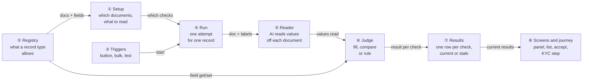

### Walkthrough: one example, start to finish

**Setup.** Fireside Ventures uses KYCs. Its individual KYC document list is "CML, PAN Card,
Passport", and its KYC form has custom fields `dp` and `client`. Priya Shah is the fund admin.
Asha Rao is an individual investor whose KYC is on the journey step **Validate documents**. Data
is from the [shared setup](#worked-examples).

**Legend.** ✓ all checks passed or accepted · ✗ a check failed · ? needs review · ⚠ error ·
— not uploaded · ⟳ out of date (document changed after the run). In journey rows, **● bold** means
"we are here: waiting on this task, not done yet", and ✓ means done.

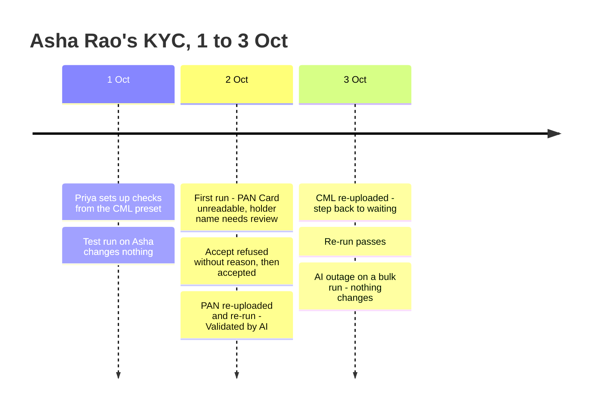

**Phase A: setup**

| # | When | What happens | Behind the scenes | Result&nbsp;&nbsp;&nbsp;&nbsp;&nbsp;&nbsp;&nbsp;&nbsp;&nbsp;&nbsp;&nbsp;&nbsp;&nbsp;&nbsp;&nbsp;&nbsp;&nbsp;&nbsp;&nbsp;&nbsp; |
|---|---|---|---|---|
| 1 | 1 Oct 10:00 | Priya creates "Investor KYC — Individual", adds CML and applies the CML preset | Setup (①) asks the registry (②) for the document list and fields. The preset maps DP ID → `dp`, Client ID → `client`, PAN → `PAN`. Email and Mobile get no field | CML:&nbsp;9&nbsp;checks,&nbsp;2&nbsp;without&nbsp;a&nbsp;field |
| 2 | 10:05 | She deletes Email and Mobile, adds the rule "Signed by holder?", then adds PAN Card (Match Name) and Passport (Match Name, Extract Expiry date) | Setup (①) validates each field against the registry (②) | CML:&nbsp;8&nbsp;checks<br>PAN&nbsp;Card:&nbsp;1&nbsp;check<br>Passport:&nbsp;2&nbsp;checks |
| 3 | 10:10 | *Test on a KYC* → Asha Rao | A trigger (③) starts a test run (④). The reader (⑤) and judge (⑥) run, but nothing is written to the KYC, and the results (⑦) are not current | Panel with "Test run — nothing was saved to this KYC"; "Filled DP ID" shown, Asha's `dp` still empty |

**Phase B: first real run, with a failure**

| # | When | What happens | Behind the scenes | Result&nbsp;&nbsp;&nbsp;&nbsp;&nbsp;&nbsp;&nbsp;&nbsp;&nbsp;&nbsp;&nbsp;&nbsp;&nbsp;&nbsp;&nbsp;&nbsp;&nbsp;&nbsp;&nbsp;&nbsp; |
|---|---|---|---|---|
| 4 | 2 Oct 14:09 | Priya clicks *Run Document Checks* on Asha's KYC | The trigger (③) creates a queued run (④) and the panel shows "Running…" | Panel:&nbsp;Running…<br>**●&nbsp;Validate&nbsp;documents** |
| 5 | 14:10 | The AI reads CML and Passport. The PAN Card is a `.doc` | The reader (⑤) makes 2 AI calls. The PAN Card fails conversion and is recorded as an error. The judge (⑥) fills `dp` and `client`; First holder "A. Rao" vs "Asha Rao" → needs review | CML:&nbsp;?&nbsp;7&nbsp;/&nbsp;8<br>PAN&nbsp;Card:&nbsp;⚠&nbsp;error<br>Passport:&nbsp;✓&nbsp;2&nbsp;/&nbsp;2<br>**●&nbsp;Validate&nbsp;documents**&nbsp;—&nbsp;"found&nbsp;2&nbsp;problems" |
| 6 | 14:10 | Priya gets "Document Checks finished for Asha Rao: 9 passed, 1 needs review, 1 error" | The run (④) finishes as `done_with_errors`, becomes current (⑦), and the journey is re-evaluated (⑧) | Same as row 5 |

**Phase C: a mistake, then the fix**

| # | When | What happens | Behind the scenes | Result&nbsp;&nbsp;&nbsp;&nbsp;&nbsp;&nbsp;&nbsp;&nbsp;&nbsp;&nbsp;&nbsp;&nbsp;&nbsp;&nbsp;&nbsp;&nbsp;&nbsp;&nbsp;&nbsp;&nbsp; |
|---|---|---|---|---|
| 7 | 14:15 | Priya clicks Accept on First holder without typing a reason | Screens (⑧) refuse it with "Give a reason for accepting" | Same as row 5 |
| 8 | 14:16 | She accepts with "Initial matches passport" | The result (⑦) is stamped accepted. Its assessment is re-run, and the journey (⑧) re-evaluated | CML:&nbsp;✓&nbsp;8&nbsp;/&nbsp;8<br>PAN&nbsp;Card:&nbsp;⚠&nbsp;error<br>Passport:&nbsp;✓&nbsp;2&nbsp;/&nbsp;2<br>**●&nbsp;Validate&nbsp;documents**&nbsp;—&nbsp;"found&nbsp;1&nbsp;problem" |
| 9 | 15:00 | Asha re-uploads her PAN as a PDF | The existing document hook invalidates the step. The results (⑦) see a new file for PAN Card | CML:&nbsp;✓&nbsp;8&nbsp;/&nbsp;8<br>PAN&nbsp;Card:&nbsp;⟳&nbsp;out&nbsp;of&nbsp;date<br>Passport:&nbsp;✓&nbsp;2&nbsp;/&nbsp;2<br>**●&nbsp;Validate&nbsp;documents** |
| 10 | 15:05 | Priya re-runs | A new run (④) replaces the current results (⑦). The accepted First holder is passed again only if its values are unchanged (see card ⑦) | CML:&nbsp;✓&nbsp;8&nbsp;/&nbsp;8<br>PAN&nbsp;Card:&nbsp;✓&nbsp;1&nbsp;/&nbsp;1<br>Passport:&nbsp;✓&nbsp;2&nbsp;/&nbsp;2<br>✓&nbsp;Validate&nbsp;documents&nbsp;—&nbsp;"Validated&nbsp;by&nbsp;AI"<br>**●&nbsp;Run&nbsp;AML&nbsp;screening** |

**Phase D: undo by a re-upload**

| # | When | What happens | Behind the scenes | Result&nbsp;&nbsp;&nbsp;&nbsp;&nbsp;&nbsp;&nbsp;&nbsp;&nbsp;&nbsp;&nbsp;&nbsp;&nbsp;&nbsp;&nbsp;&nbsp;&nbsp;&nbsp;&nbsp;&nbsp; |
|---|---|---|---|---|
| 11 | 3 Oct 09:00 | Asha replaces her CML | The document hook resets the step. The results (⑦) mark CML out of date, and `all_docs_valid` is re-assessed to false | CML:&nbsp;⟳&nbsp;out&nbsp;of&nbsp;date<br>PAN&nbsp;Card:&nbsp;✓&nbsp;1&nbsp;/&nbsp;1<br>Passport:&nbsp;✓&nbsp;2&nbsp;/&nbsp;2<br>**●&nbsp;Validate&nbsp;documents** |
| 12 | 09:30 | Priya re-runs; everything passes | Same path as row 10 | Same as row 10 |

**Phase E: stall**

| # | When | What happens | Behind the scenes | Result&nbsp;&nbsp;&nbsp;&nbsp;&nbsp;&nbsp;&nbsp;&nbsp;&nbsp;&nbsp;&nbsp;&nbsp;&nbsp;&nbsp;&nbsp;&nbsp;&nbsp;&nbsp;&nbsp;&nbsp; |
|---|---|---|---|---|
| 13 | 10:02 | Priya bulk-runs 3 KYCs while the AI provider is down | Each run (④) fails on the first reader (⑤) call. No field is written, and the previous runs stay current (⑦) | Asha's&nbsp;panel&nbsp;header:&nbsp;"Last&nbsp;attempt&nbsp;failed&nbsp;3&nbsp;Oct&nbsp;10:02:&nbsp;the&nbsp;AI&nbsp;service&nbsp;is&nbsp;unavailable"<br>Results&nbsp;below:&nbsp;same&nbsp;as&nbsp;row&nbsp;12 |

**The key moment (row 5):**

```
┌ Document Checks   Last run 2 Oct 2026 14:10 · 9 passed · 1 needs review · 1 error ┐
│ CML                                                        ? 7 / 8              │
│   ✓ DP ID          IN303622                     Filled DP ID                    │
│   ? First holder   Document A. Rao · KYC Asha Rao          [Accept] [Fix]       │
│ PAN Card                                                   ⚠ error              │
│   Can't read this file type — upload a PDF or image        [Retry]              │
│ Passport                                                   ✓ 2 / 2              │
└──────────────────────────────────────────────────────────────────────────────────┘
```

**What to notice**

- The AI never saw "Asha Rao" or her PAN. It read values, and the judge (⑥) compared them. That
  is why the panel can show both sides.
- The unreadable PAN Card became an *error row*, not a missing answer. The run said "1 error",
  not "completed".
- A re-upload makes results out of date without anyone deleting anything (rows 9 and 11), and a
  new run replaces them wholesale.
- A failed run (row 13) never replaces good results and never writes a field.
- Accept is a stamp on a result, so it is visible, attributed, and re-assessed.

### Key ideas

| # | Idea | In one line | Card |
|---|---|---|---|
| 1 | Read, don't ask | The AI returns values keyed by check id; it never sees record values or picks field names | [⑤](#⑤-reader) |
| 2 | CapHive judges | Fill / compare / rule is Ruby, with two comparison modes only | [⑥](#⑥-judge) |
| 3 | Allowlisted fields | Every field read or written goes through the record type's registry entry | [②](#②-registry) |
| 4 | Runs replace, results remember | The latest finished non-test run is *current*; each result holds the document file id it read, so staleness is derived | [⑦](#⑦-results) |
| 5 | Errors are rows | Missing, unreadable and unparseable documents produce result rows; a run that can't start is `failed` and changes nothing | [④](#④-run) |
| 6 | One settled rule | "All documents valid" = current results exist, all passed or accepted, none stale. The KYC column and the journey step both use it | [⑦](#⑦-results) |

**FAQ**

| Question | Answer |
|---|---|
| Why not keep asking the AI "Is the PAN X?" like Doc Questions did? | That needs record values in the prompt (the `$var` mechanism and its `send` hole), and the answer is a bare yes/no that can't be explained. Reading the value and comparing it ourselves is safer, deterministic, and shows both sides. |
| Does anything block users? | No. Results feed the journey's acknowledge step, which a person can still mark reviewed. |
| Why is Extract "kept existing value" a pass? | Extract's job is to fill blanks. Comparing against an existing value is what Match is for, and an admin who wants both adds both. |
| Is this KYC-only? | The engine is record-type neutral. Only the registry entry (②) is KYC-specific, and it's the only one in phase 1. |

---

## 2. The same picture with real names

### Picture

```mermaid
flowchart LR
    classDef new fill:#d4edda,stroke:#2e7d32,color:#000
    classDef mod fill:#fff3cd,stroke:#b8860b,color:#000
    classDef reuse fill:#eceff1,stroke:#90a4ae,color:#000
    S["① DocCheckSet + DocCheck<br/>DocCheckSetsController<br/>DocChecks::Presets<br/><i>stores what to read</i>"]:::new
    R["② DocChecks::Registry<br/>DocChecks::Kyc<br/><i>docs, fields, variants</i>"]:::new
    T["③ DocCheckRunsController<br/>InvestorKycsBulkActionJob<br/><i>starts runs</i>"]:::mod
    N["④ DocChecks::StartRun<br/>DocChecks::RunJob<br/>DocCheckRun<br/><i>one attempt per record</i>"]:::new
    A["⑤ DocChecks::DocumentReader<br/>&lt; DocLlmBase<br/><i>one AI call per doc</i>"]:::new
    J["⑥ DocChecks::Judge<br/><i>fill, compare, rule</i>"]:::new
    D["⑦ DocCheckResult<br/>DocChecks::Assessment<br/><i>current, stale, settled</i>"]:::new
    U["⑧ doc_check_runs/_panel<br/>DocCheckResultsController<br/>ValidateDocuments check<br/><i>shows and acts</i>"]:::mod
    R -- "documents_for /<br/>fields_for" --> S
    S -- "set_for(record)" --> N
    T -- "StartRun.call" --> N
    N -- "document,<br/>checks" --> A
    A -- "{check_id:<br/>value}" --> J
    R -- "read / write<br/>field" --> J
    J -- "result attrs" --> D
    D -- "Assessment" --> U
    click S "#①-setup" "Open card ①"
    click R "#②-registry" "Open card ②"
    click T "#③-triggers" "Open card ③"
    click N "#④-run" "Open card ④"
    click A "#⑤-reader" "Open card ⑤"
    click J "#⑥-judge" "Open card ⑥"
    click D "#⑦-results" "Open card ⑦"
    click U "#⑧-screens-and-journey" "Open card ⑧"
```

Colour = footprint: **green** new, **amber** modified, **grey** reused unchanged. Reused, unchanged
parts (`DocLlmBase`, `DocUtils.convert_file_to_image`, `InvestorKycConcern#missing_required_document_names`
matching, the journey hooks) are named in the cards.

### What each box does

| # | Box | Real parts | What it does | When it runs | What it decides | Details |
|---|---|---|---|---|---|---|
| ① | Setup | `DocCheckSet`, `DocCheck`, `DocCheckSetsController`, `DocChecks::Presets` (`config/doc_check_presets.yml`) | CRUD for sets and checks, preset apply, test-run entry | Request | Valid document, kind, field; set for a record's variant | [card ① →](#①-setup) |
| ② | Registry | `DocChecks::Registry`, `DocChecks::Kyc` | Per record type: variants, document names, allowed fields, field read/write, assessment hook | Called by ①, ⑥, ⑦ | Which fields exist and may be written | [card ② →](#②-registry) |
| ③ | Triggers | `DocCheckRunsController#create`, `InvestorKycsBulkActionJob#validate_docs_with_ai`, `DocCheckSetsController#test_run`, `DocCheckResultsController#rerun` | Starts a run for a record | Request / bulk job | Authorisation; verified KYC refused in bulk | [card ③ →](#③-triggers) |
| ④ | Run | `DocChecks::StartRun`, `DocChecks::RunJob`, `DocCheckRun` | Guards one active run, finds documents, loops per document, writes once, finishes | Job (`:default` queue) | Run status and counts | [card ④ →](#④-run) |
| ⑤ | Reader | `DocChecks::DocumentReader < DocLlmBase` | Image + labels/hints → JSON keyed by check id | Inside ④, once per document | Nothing: it only reads | [card ⑤ →](#⑤-reader) |
| ⑥ | Judge | `DocChecks::Judge` | Turns a read value into a result: fill, compare, rule | Inside ④ | pass / fail / review; whether to write | [card ⑥ →](#⑥-judge) |
| ⑦ | Results | `DocCheckResult`, `DocChecks::Assessment` | Stores results; derives current, stale, settled, counts | Read on every display; assessment after run/accept | `all_docs_valid`, problem count | [card ⑦ →](#⑦-results) |
| ⑧ | Screens and journey | `doc_check_runs/_panel`, `DocCheckResultsController` (index, accept, rerun), `WorkflowChecks::InvestorKyc::ValidateDocuments` | Panel on the KYC, entity list, Accept, journey step | Request / Turbo broadcast / evaluator | Journey result for Validate documents | [card ⑧ →](#⑧-screens-and-journey) |

### One run, end to end

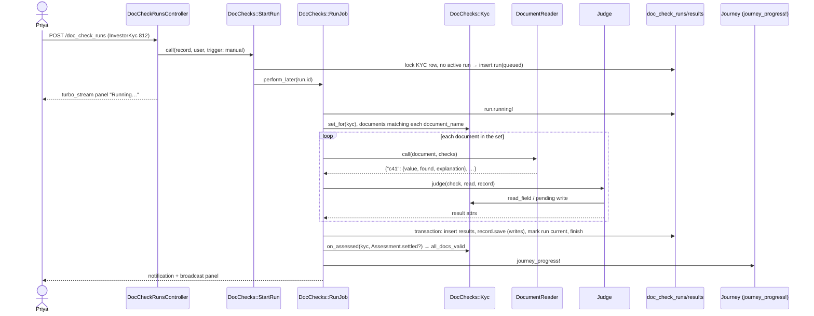

### Lifecycles

**`DocCheckRun.status`** (stored):

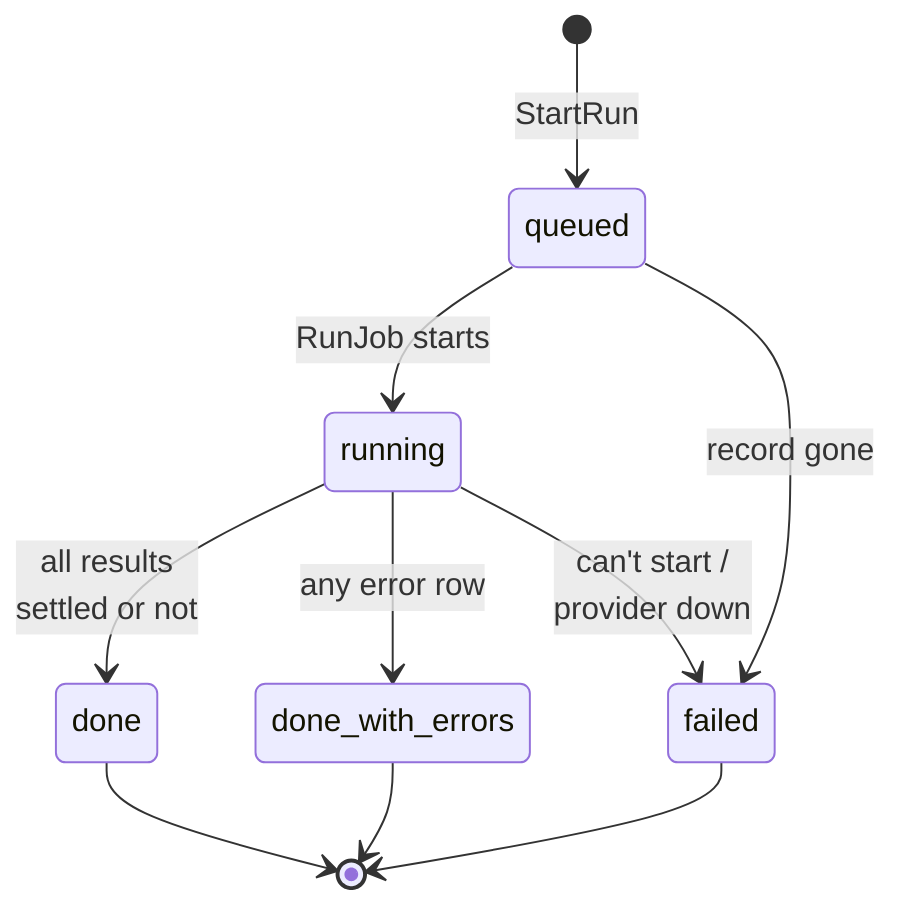

`done` and `done_with_errors` runs become **current** (stored flag `current`), unless they're test
runs. A `failed` run is never current.

**Result display state** (derived from the stored `status` plus stamps):

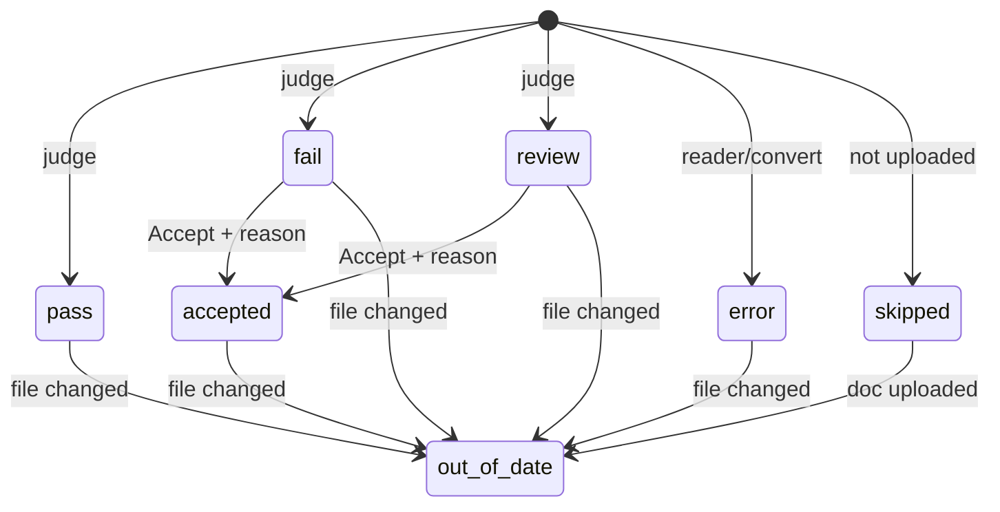

`status` is stored (pass / fail / review / error / skipped). `accepted` is stored as stamps
(`accepted_by_id`, `accepted_at`, `accept_reason`). `out_of_date` is derived, never stored.

### What users see

**At a glance**

| Where in CapHive | Today | After this change | Who sees it |
|---|---|---|---|
| Settings → Doc Questions | Free-text questions, Excel import | Removed | — |
| Settings → Document Checks | — | Sets per record type/variant; checks with dropdowns; presets; Test on a KYC | Fund users with "Doc LLM validation" |
| KYC → Docs Validation tab | Raw JSON table | **Document Checks** tab: grouped results panel, Accept/Fix/Retry, "Earlier AI answers" | Fund users who can view the KYC |
| KYC → Validate Document Data button | Starts `DocLlmValidationJob` | "Run Document Checks" starts a run (same button id) | Same as today |
| KYC list → bulk Validate Document Data | Runs old job per KYC | "Run Document Checks" per KYC | Same as today |
| Document Check results | — | Entity-wide list with filters and Re-run selected | Fund users with "Doc LLM validation" |
| KYC journey → Validate documents | Reads `doc_question_answers` | Reads Document Checks assessment | Fund users |

**Main journey: reviewing a KYC's results**

```
┌ KYC: Asha Rao ── [Details] [Documents] [Document Checks ①] ─────────────────────┐
│ Document Checks  Last run 2 Oct 14:10 · 9 passed · 1 review · 1 error  [Run ②]  │
│ CML                                                        ? 7 / 8   ③         │
│   ? First holder   Document A. Rao · KYC Asha Rao     [Accept ④] [Fix ⑤]       │
│ PAN Card                                                   ⚠ error             │
│   Can't read this file type — upload a PDF or image   [Retry ⑥]               │
│ ▸ Earlier AI answers ⑦                                                          │
└─────────────────────────────────────────────────────────────────────────────────┘
```

| Step | The user… | They see |
|---|---|---|
| ① | opens the Document Checks tab | The panel for the current run, or "Not checked yet" with the Run button |
| ② | clicks Run Document Checks | Header "Running… started 14:09", button disabled; panel replaced in place when done |
| ③ | scans group headers | ✓ N / M, ✗, ?, ⚠, —, ⟳ per document |
| ④ | clicks Accept, types a reason, confirms | Row shows "Accepted by Priya Shah — 'Initial matches passport'"; header counts update |
| ⑤ | clicks Fix | The KYC edit form |
| ⑥ | clicks Retry | Same as ②: a full new run |
| ⑦ | expands Earlier AI answers | The legacy `doc_question_answers` table, read-only |

Settings and entity-list journeys are in [card ①](#①-setup) and [card ⑧](#⑧-screens-and-journey).

### Design decisions

1. **The AI reads and CapHive compares.** Alternative considered: keep yes/no questions with
   interpolated values. Rejected: it needs record values in the prompt (and an evaluator for them),
   and it can't show why something failed.
2. **Reply keyed by check id (`c<id>`).** Alternative considered: key by label or "the key from the
   response hint". Rejected: the old code parameterised the AI's own key into a field name, which
   is how values went missing or landed in the wrong place.
3. **Allowlist registry per record type.** Alternative considered: any column or custom field.
   Rejected: `verified`, `entity_id` and other control columns must never be AI-writable.
4. **Runs replace results; staleness is derived from the Shrine file id.** Alternative
   considered: update results in place per document. Rejected: that's the old "never cleared"
   bug. A stored `stale` flag was also rejected, because it would need an upload hook just to
   flip it.
5. **Two comparison modes, chosen by the field.** The registry marks fields exact (identifiers)
   or loose (names, addresses). Alternative considered: a similarity score with a threshold.
   Rejected: hard to explain and tune. Loose mismatches go to review, so a person decides.
6. **One set per record type and variant, with "All" as fallback.** Alternative considered:
   arbitrary conditions (fund, form type). Rejected for phase 1. KYC variants cover today's
   split, and the conversion needs only "All".
7. **Reuse `DocLlmBase`** for provider/model selection (`DOCUMENT_VALIDATION_PROVIDER` /
   `_MODEL`), conversion and cleanup. Alternative considered: a new LLM client. Rejected as not
   DRY.
8. **Reuse the existing permission `enable_doc_llm_validation`.** Alternative considered: a new
   flag. Rejected: the same customers, and one less switch.
9. **Bulk keeps the existing bulk job and its pacing.** It calls `DocChecks::RunJob.perform_now`
   per KYC, as the old code did. Alternative considered: fan out jobs with delays. Rejected: it
   changes rate-limit behaviour for no gain.
10. **Writes happen once per run, at the end, in one transaction with the results.** Alternative
    considered: write per document. Rejected: a crash midway would leave fields written with no
    results to explain them.

**FAQ**

| Question | Answer |
|---|---|
| Why a `current` flag instead of "latest run" queries? | The entity-wide list needs "current results across all records" in one indexed query. Without a stored flag that's a groupwise-max over runs. |
| Why not store `out_of_date`? | It changes when a document changes, not when we run. Deriving it from `document_file_id` vs the document's current file id costs one small query per panel and can't drift. |
| Why does a failed run not become current? | It has no trustworthy results. Showing nothing would hide the last good state. |
| Why one transaction for writes and results? | So a reader never sees a field the AI filled without the result that explains it. |

---

## 3. One card per box

> Same order and numbers as the picture.

### ① Setup

A check set belongs to an entity, a record type and a variant, and holds ordered checks grouped by
document name. Presets are app-level YAML applied into a set.

| Owns | Reads / receives | Produces |
|---|---|---|
| `doc_check_sets`, `doc_checks`, `config/doc_check_presets.yml` | Registry document names and fields (②) | `DocCheckSet.set_for(record)` for the run (④) |

**Set resolution**

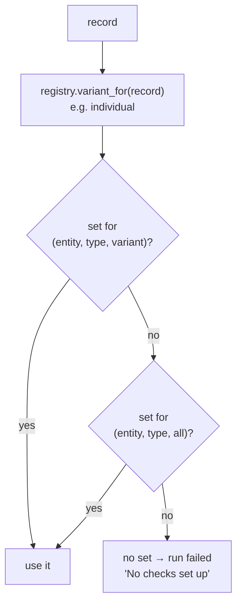

**Validation** (model level, messages in the [proposal](proposal.md#validation-rules)):

- `document_name` must be in `registry.documents_for(entity, variant)`. For "all", that's the
  union of both lists.
- `field_name` must be in `registry.fields_for(entity, variant)` for Extract/Match.
- An existing check whose field has disappeared is *not* invalid on load. The edit page flags it,
  and the judge errors it at run time (E12).

**Preset apply.** `DocChecks::Presets.apply(set, document_name, key)` reads the YAML entries
(label, hint, kind, field candidates). For each entry it picks the first candidate present in
`fields_for`, otherwise leaves it nil, and skips labels already on that document.

**Routes**

| Verb and path | Action | Does | Responds with |
|---|---|---|---|
| GET `/doc_check_sets` | index | Sets for the entity, plus "Add set" per missing variant | HTML |
| GET/POST `/doc_check_sets/new`, `/doc_check_sets` | new/create | Create a set (record type + variant) | redirect to edit |
| GET/PATCH `/doc_check_sets/:id/edit`, `/doc_check_sets/:id` | edit/update | Nested checks (`accepts_nested_attributes_for :doc_checks, allow_destroy: true`) | redirect / 422 |
| DELETE `/doc_check_sets/:id` | destroy | Deletes set and checks; runs/results keep snapshots | redirect |
| POST `/doc_check_sets/:id/apply_preset` | apply_preset | `document_name`, `preset` | turbo_stream: document group |
| POST `/doc_check_sets/:id/test_run` | test_run | `record_id` → `StartRun` with `test_run: true` | turbo_stream: panel placeholder |

**Build notes.** Use a nested form with a small Stimulus controller, `doc-check-row`, that only
shows or hides Field / Fill / Expect by Kind. The field dropdown is server-rendered from
`fields_for` (label → name). The KYC picker for test run reuses the existing investor KYC search
select.

**Access**

| Role | index/edit/apply/test | Notes |
|---|---|---|
| Fund user, entity has `enable_doc_llm_validation` | ✓ | `belongs_to_entity?(user, set)` |
| Fund user, permission off | ✗ | |
| Investor / advisor user | ✗ | `user.entity_id != set.entity_id` |
| Other entity | ✗ | `policy_scope` = `where(entity_id: user.entity_id)` |

**Worked examples:** H1, H10, E11, E12, X4, X10

**FAQ**

| Question | Answer |
|---|---|
| Why YAML presets, not DB rows? | Presets are product content shared by all entities and change with releases. A DB copy per entity would drift. |
| What if two documents in the set both have a "Name" check? | Labels are unique per document, not per set, and the reply is keyed by check id, so there's no clash. |
| Can an admin set checks for a document not on the list? | No. The list is the single source. Add the name to Settings → KYC documents first. |
| What does deleting a set do to history? | Results keep snapshots (`document_name`, `check_label`, `kind`), so past runs still render. |

### ② Registry

A plain Ruby lookup: one entry per record type, describing what Document Checks may touch on it.
It has no table.

| Owns | Reads / receives | Produces |
|---|---|---|
| `DocChecks::Registry` (map `"InvestorKyc" → DocChecks::Kyc`) | Entity settings (doc lists), `FormCustomField` for the KYC's form | variants, documents, fields, `read`/`write`, `on_assessed` |

**`DocChecks::Kyc` entry**

| Member | KYC behaviour |
|---|---|
| `variants` | `individual`, `non_individual`, `all` |
| `variant_for(kyc)` | `kyc.individual? ? "individual" : "non_individual"` |
| `documents_for(entity, variant)` | `individual_kyc_doc_list` / `non_individual_kyc_doc_list` split on commas, plus required File custom-field labels (as `Support#required_document_names`, extracted to share) |
| `fields_for(entity, variant)` | Allowlisted columns: `full_name`, `PAN`, `address`, `corr_address`, `birth_date`, `expiry_date`, `bank_name`, `bank_branch`, `bank_account_number`, `bank_account_type`, `ifsc_code`, `esign_emails`, `residency`. Plus non-File, non-calculated `FormCustomField`s of the entity's KYC form types. Each field carries `label`, `storage` (column/json), `compare` (exact/loose) |
| `compare` | loose: `full_name`, `address`, `corr_address`, and custom fields whose name contains `name` or `address`. Exact: everything else |
| `read(kyc, field)` / `write(kyc, field, value)` | Column → attribute; custom → `json_fields[name]`. Dates parsed with `Date.parse` and errored if unparseable |
| `record_documents(kyc)` | `kyc.documents.not_generated` |
| `on_assessed(kyc, settled)` | Sets `all_docs_valid = settled` and saves with `save(validate: false)` (audited, so the change is traceable), only when the value changes |
| `can_view?(user, kyc)` / `can_update?` | Delegate to `InvestorKycPolicy#show?` / `update?`, plus `user.entity_id == kyc.entity_id` (no investors) |

**Worked examples:** H1, E12, X4, X5

**FAQ**

| Question | Answer |
|---|---|
| Why a hand-written column allowlist? | Columns like `verified`, `submission_status` and `entity_id` must never be AI-writable. An explicit list fails safe when columns are added. |
| Why not reuse the MCP ontology YAML? | It describes queryable attributes for read tools (there is no `investor_kyc.yml`), not writable fields. Mixing the two would couple unrelated contracts. |
| How does phase 3 add Investors? | One new entry class plus a line in the registry map. No engine change. |

### ③ Triggers

Every entry point calls `DocChecks::StartRun.call(record:, user:, trigger:, test_run:)`.

| Owns | Reads / receives | Produces |
|---|---|---|
| Buttons and actions that start runs | User, record, trigger | A queued `DocCheckRun` or a refusal message |

| Trigger | Where | Authorisation | Notes |
|---|---|---|---|
| `manual` | `DocCheckRunsController#create` (`record_type`, `record_id`) | `DocCheckRunPolicy#create?` → registry `can_update?` + permission | Button keeps id `investor_kyc_validate_docs_with_ai_btn` so the journey's action target still works |
| `bulk` | `InvestorKycsBulkActionJob#validate_docs_with_ai` | Existing `InvestorKycPolicy#validate_docs_with_ai?`; verified KYCs refused as today | Calls `StartRun` then `RunJob.perform_now`, keeping `sleep(2)` pacing |
| `rerun` | `DocCheckResultsController#rerun` (selected record ids) | Same as manual, per record | Enqueues `RunJob` per record |
| `test` | `DocCheckSetsController#test_run` | `DocCheckSetPolicy#test_run?` | `test_run: true`; uses the given set, not `set_for` |

`InvestorKycsController#validate_docs_with_ai` is removed. Its route is replaced by the generic
`POST /doc_check_runs`.

**Worked examples:** H2, H3, H6, H7, E10

**FAQ**

| Question | Answer |
|---|---|
| Why a generic runs controller instead of one per record type? | Phase 3 record types get the button for free. Authorisation goes through the registry. |
| Why keep `perform_now` in bulk? | The bulk job is already a background job with pacing and error collection, and this matches today's rate behaviour. |

### ④ Run

`StartRun` guards and enqueues. `RunJob` does the work and is the only writer of results and
fields.

| Owns | Reads / receives | Produces |
|---|---|---|
| `doc_check_runs`, `DocChecks::StartRun`, `DocChecks::RunJob` | Set (①), documents (②), reader (⑤), judge (⑥) | Results (⑦), field writes, notifications, broadcast |

**Responsibilities**

| Concern | Decision |
|---|---|
| One active run per record | `StartRun` takes `record.with_lock`, then refuses if a non-test run for the record is `queued`/`running` ("already running"). Test runs don't block and aren't blocked |
| Queue / retry | `RunJob` on `:default`, `sidekiq_options retry: 0`. LLM retries would re-bill, and the user can Retry |
| Stuck runs | A run `running` for more than 30 min is treated as not active by `StartRun`, and marked `failed` "Timed out" when found |
| Per-document isolation | Each document's convert/read/judge sits in its own rescue. Failures become error rows for that document's checks |
| Run-level failure | No set, no LLM client, or a provider connection/auth error (`Faraday::Error`, `Langchain` errors, `OpenAI::Error`) → `failed` with message, no writes, previous current run untouched |
| Finish | One transaction: insert results, apply pending writes via registry and `record.save(validate: false)` (skipped for test runs), clear `current` on the previous run, set `current` and status/counts/`finished_at` |
| After commit | `registry.on_assessed(record, Assessment.new(record).settled?)`, then `journey_progress!` if the record responds to it, then a notification and a Turbo broadcast of the panel |

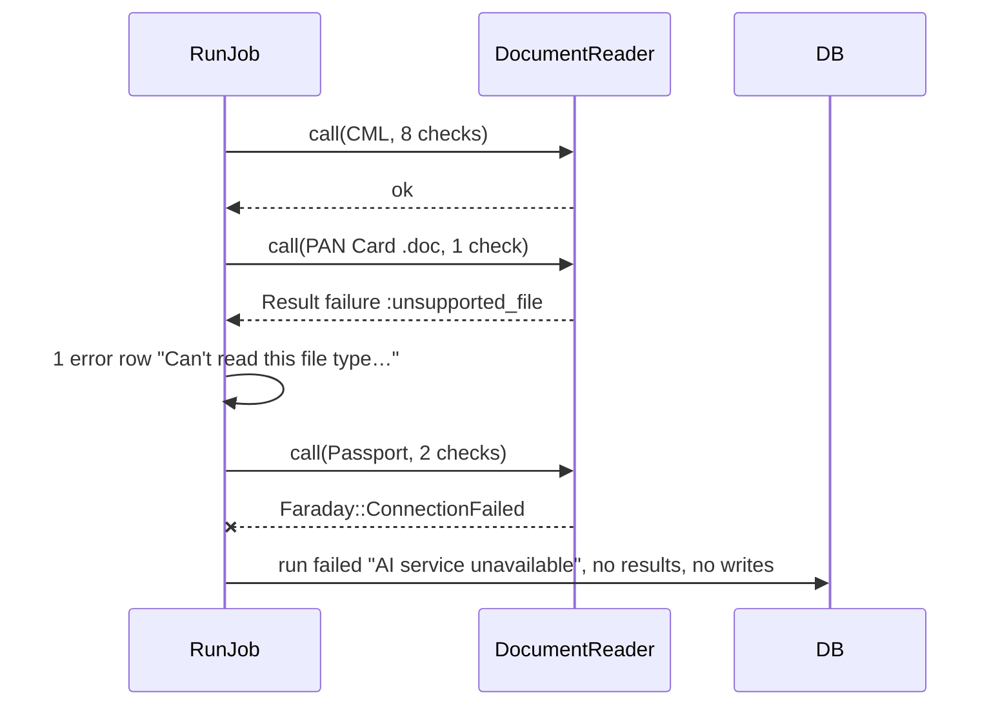

A provider error *mid-run* fails the whole run. Partial results from a run that lost the provider
would look current but be incomplete (X3).

**Worked examples:** H2, E1, E2, E8, E10, E13, X1, X2, X3

**FAQ**

| Question | Answer |
|---|---|
| Why fail the whole run on a mid-run provider error but not on a bad file? | A bad file is a property of that document and the result is true ("can't read it"). An outage says nothing about the document, so storing it as a result would be false. |
| Why `retry: 0`? | Retries would repeat AI calls and costs. A visible failed run with Retry is clearer. |
| What does the record's journey see during a run? | Nothing changes until finish. The step reflects the previous current run. |

### ⑤ Reader

A Trailblazer operation subclassing `DocLlmBase`. It turns one document plus its checks into a map
keyed by check id. It knows nothing about the record.

| Owns | Reads / receives | Produces |
|---|---|---|
| Prompt and reply parsing | Document (via `DocUtils.convert_file_to_image`), checks' `id`, `kind`, `label`, `hint` | `{ "c41" => { "value" => "IN303622", "found" => true, "explanation" => "…" } }` or a failure reason |

| Step | Decision |
|---|---|
| `init` | `super(provider: ENV DOCUMENT_VALIDATION_PROVIDER, llm_model: ENV DOCUMENT_VALIDATION_MODEL, temperature: 0.1)`; no client → failure `:no_llm` (run-level) |
| `convert_file_to_image` | Reused. A false result or nil (the `.doc` branch) → failure `:unsupported_file` (document-level) |
| `read_with_llm` | Prompt: fixed instructions + one line per check, `c<id> (<Extract/Match: "read the value of"; Rule: "answer yes or no">): <label>. <hint>`, then the image. Ask for a JSON object with exactly those keys. OpenAI gets `response_format: { type: "json_object" }`; Gemini keeps `response_mime_type` |
| `parse` | `JSON.parse`, after stripping a ```` ```json ```` fence. Keep only known `c<id>` keys; a missing key → `found: false`. A parse error → failure `:unreadable_reply` (document-level) |
| `cleanup` | Reused |

Labels and hints are inserted as text only. No `$` processing exists (X5).

**Worked examples:** H2, X1, X2, X5

**FAQ**

| Question | Answer |
|---|---|
| Why one call per document, not per check? | It costs the same as today and is faster. Check ids keep answers separate. |
| Multi-page PDFs? | Unchanged from today: `ImageService.pdf_to_image` decides the pages. See Risks. |
| Why not send record values to help the AI find the right field? | That brings back the injection and bias problems. Hints say what to look for. |

### ⑥ Judge

Pure function: (check, read value, record via registry) → result attributes plus an optional pending
write.

| Owns | Reads / receives | Produces |
|---|---|---|
| Outcome rules and normalisation | Check, reader entry, `registry.read`, field meta (`compare`) | `{status, doc_value, record_value, outcome_note, write: [field, value] or nil}` |

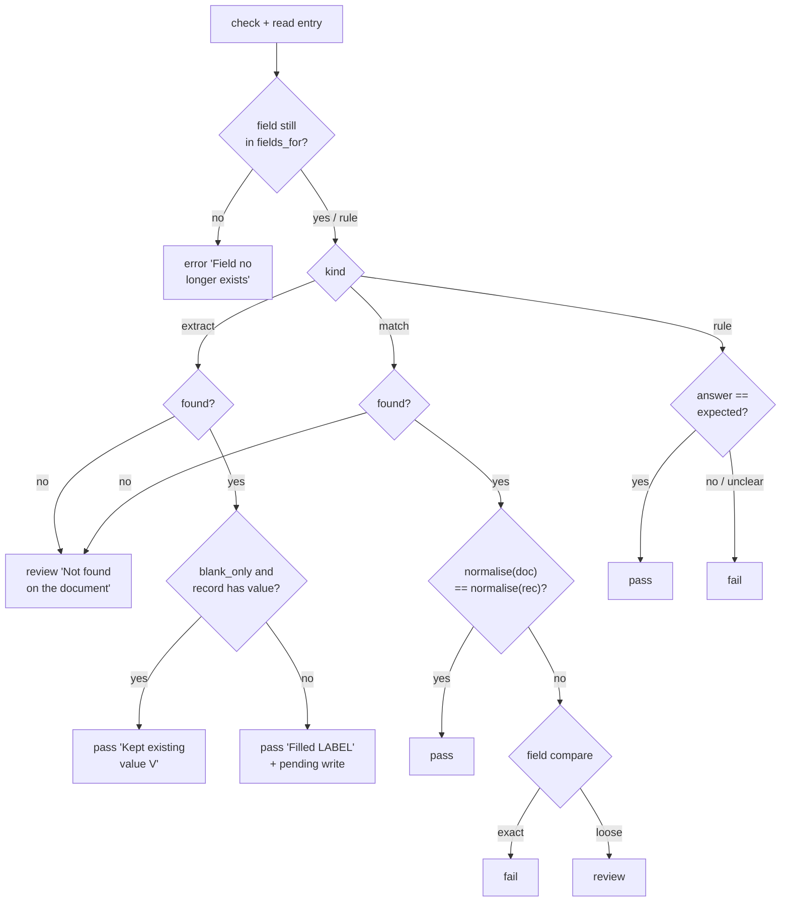

**Normalise:** downcase, then strip whitespace and `. , - / ( ) '`. For loose fields, also sort
the tokens (so "Rao Asha" equals "Asha Rao"). Dates are compared as `Date`, after parsing both
sides.

A Rule answer is "yes" if it's one of `yes`/`true`; anything else is "no", so an unclear answer
fails, with the explanation.

**Worked examples:** H2, E4, E5, E6, E7, E12, E17, E18

**FAQ**

| Question | Answer |
|---|---|
| Why does a loose mismatch go to review, not fail? | "A. Rao" vs "Asha Rao" is often legitimate. A person decides with Accept. This is open question 1. |
| Why sort tokens only for loose fields? | Order matters for identifiers (an account number with swapped groups is a different number). |
| Does the judge write anything? | No. It returns a pending write, and the run (④) applies all writes at the end. |

### ⑦ Results

Stored rows plus a read-model, `DocChecks::Assessment`, that answers everything the screens and
journey need.

| Owns | Reads / receives | Produces |
|---|---|---|
| `doc_check_results`, `DocChecks::Assessment` | Current run, its results, record's current documents | `groups`, `counts`, `problems`, `stale?(group)`, `settled?`, `last_failed_attempt` |

| Assessment member | Rule |
|---|---|
| `current_run` | `DocCheckRun.where(record:, current: true).first` |
| `groups` | Results grouped by `document_name`, in the set's order |
| `stale?(group)` | The document now matched for that name (via `missing_required_document_names`-style matching) has a different `file.id` from the result's `document_file_id`. Or it was skipped and a matching document now exists. Or it had a document that's now gone |
| `problems` | Results that are fail/review/error/skipped and not accepted, plus every result in stale groups |
| `settled?` | `current_run` present and `problems` empty |
| `last_failed_attempt` | Newest `failed` non-test run newer than `current_run` (for the header) |

**Accept.** `DocCheckResultsController#accept` requires a reason and stamps
`accepted_by_id`/`accepted_at`/`accept_reason` on a fail/review result of the current run. It then
calls `registry.on_assessed` and `journey_progress!`, and broadcasts the panel.

**Accept across re-runs.** A new run copies acceptance onto the new result *only if* the same check
yields the same `doc_value` and `record_value` as the accepted one. Otherwise the person must look
again (walkthrough row 10).

**Worked examples:** H4, E8, E9, E13, E14

**FAQ**

| Question | Answer |
|---|---|
| Why carry acceptance forward at all? | Without it, every re-run (e.g. after an unrelated re-upload) would re-open problems someone already resolved. Matching on both values keeps it honest. |
| How big does this get? | About 10 results per run and a few runs per KYC. Old runs are kept for history (see Performance). |
| Why is skipped a problem? | A document the set expects is missing, and "all documents valid" must not be true without it. |

### ⑧ Screens and journey

The panel partial, the entity-wide list, and the KYC journey check.

| Owns | Reads / receives | Produces |
|---|---|---|
| `doc_check_runs/_panel`, `doc_check_results/index`, `ValidateDocuments` (rewritten), `investor_kycs/_details` tab | `DocChecks::Assessment` | HTML/Turbo streams; `WorkflowChecks::Result` |

**Panel.** It's rendered in the KYC `_details` tab `#docs-validation-tab`. The id is kept so
`Support::VALIDATION_TAB` still works, and the tab title becomes "Document Checks". It subscribes
with `turbo_stream_from [record, :doc_checks]`. `RunJob` and accept broadcast
`replace` of `dom_id(record, :doc_checks)`. "Earlier AI answers" renders the old
`Json2table` output collapsed, when `doc_question_answers` has content.

**Journey check** (`WorkflowChecks::InvestorKyc::ValidateDocuments`, replacing its body):

| Condition | Result |
|---|---|
| `settled?` | `Result.confirmed("Validated by AI", passed_since: fresh_at, fresh_since: fresh_at)`, with `fresh_at` = max(`current_run.finished_at`, newest `accepted_at`) |
| current run with problems | `review("Document Checks found N problems — check them and mark reviewed", action → VALIDATION_TAB)` |
| a set applies, no current run | `review("Documents not checked yet — run Document Checks or check them and mark reviewed", action → VALIDATE_AI_BTN)` |
| no set applies | `review("Check the documents and mark reviewed", action → DOCS_TAB)` (unchanged) |

`Support#ai_answer_counts` and `#ai_validated_at` are deleted. The existing document-upload
invalidation (`journey_invalidate(validate_documents, only_if_passed:)`) is unchanged, and it is
what resets the step on a re-upload (E9).

**Entity list** (`GET /doc_check_results`): current results joined to current runs for the
entity. Ransack on `status`, `document_name`, `doc_check_runs.doc_check_set_id` and
`doc_check_runs.finished_at`. "Out of date" is a filter applied after the query, and only when it
is selected (see LLD Queries). Pagy pagination. `POST /doc_check_results/rerun` with
`record_ids[]`.

| Verb and path | Action | Does | Responds with |
|---|---|---|---|
| GET `/doc_check_runs/:id` | show | A test run's panel (for the test-run frame) | HTML frame |
| GET `/doc_check_results` | index | Entity list with filters | HTML |
| PATCH `/doc_check_results/:id/accept` | accept | `accept_reason` | turbo_stream panel / 422 |
| POST `/doc_check_results/rerun` | rerun | `record_type`, `record_ids[]` | redirect with notice "Document Checks queued for 3 KYCs" |

**Access**

| Role | Panel | Accept | Entity list / rerun |
|---|---|---|---|
| Fund user who can view the KYC | ✓ | if `InvestorKycPolicy#update?` | ✓ with permission |
| Investor user (own KYC) | ✗ (tab not rendered) | ✗ | ✗ |
| Other entity | ✗ | ✗ | ✗ (scope `entity_id: user.entity_id`) |

**Secondary journey: entity list**

| Step | The user… | They see |
|---|---|---|
| 1 | opens Document Check results from the KYC menu | Problems (failed, review, error, skipped, out of date) for current runs, newest first |
| 2 | filters Document = CML | Only CML rows |
| 3 | selects 3 rows, clicks Re-run selected | "Document Checks queued for 3 KYCs"; each KYC's panel updates when done |

**Worked examples:** H3, H4, H5, H6, H7, E9, E14, E15, E19, X6, X7, X8

**FAQ**

| Question | Answer |
|---|---|
| Why keep the old tab id? | The journey's action target and any bookmarks keep working. |
| Why does "found N problems" count out-of-date results? | They no longer describe the document on file, so a person must re-run or review. |
| Does the journey move on its own after Accept? | Yes. Accept calls `journey_progress!`, and if the assessment is now settled the step is confirmed. |

---

## 4. Reference

> Whole-system material that spans several boxes.

### Class diagram

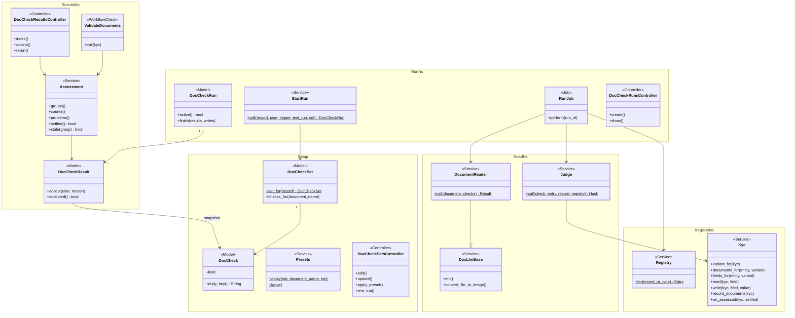

Method names drop Ruby's `?`/`!` suffixes for mermaid (`settled` is `settled?`, `accept` is `accept!`).

### Data model and schema changes

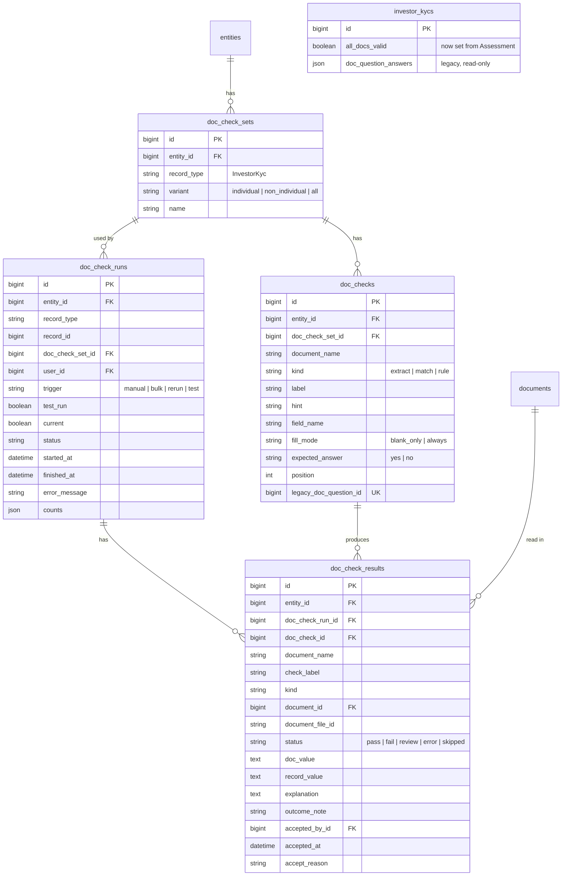

**Indexes:** `doc_check_sets [entity_id, record_type, variant]` UK ·
`doc_checks [doc_check_set_id, document_name, label]` UK · `doc_checks [legacy_doc_question_id]` UK ·
`doc_check_runs [record_type, record_id, current]` · `doc_check_runs [record_type, record_id, status]` ·
`doc_check_runs [entity_id, current, finished_at]` · `doc_check_results [doc_check_run_id]` ·
`doc_check_results [entity_id, status]` · `doc_check_results [doc_check_id]`

**Schema changes**

**`doc_check_sets`** (new): one row per entity, record type and variant, so set resolution is a
unique lookup.

| Column / index | What changed | Why it's needed |
|---|---|---|
| `entity_id` | Added, FK | Tenant scope |
| `record_type` | Added | Registry key. The engine is record-type neutral |
| `variant` | Added, not null, default "all" | KYC Individual / Non-individual split. "all" is a real value, because MySQL unique indexes allow repeated NULLs |
| `name` | Added | Display name ("Investor KYC — Individual"), editable |
| UK `[entity_id, record_type, variant]` | New | At most one set per variant (spec: Duplicate set refused) |

**`doc_checks`** (new): what to read from one document.

| Column / index | What changed | Why it's needed |
|---|---|---|
| `entity_id` | Added | Scoping without a join |
| `doc_check_set_id` | Added, FK | Parent set |
| `document_name` | Added | Which document, from the registry list |
| `kind` | Added | extract / match / rule decide the judge path |
| `label` | Added | What to read, shown in results |
| `hint` | Added, nullable | Extra guidance for the AI |
| `field_name` | Added, nullable | Target/compare field (null for rule) |
| `fill_mode` | Added, default "blank_only" | Extract overwrite behaviour |
| `expected_answer` | Added, default "yes" | Rule expectation |
| `position` | Added | Display and prompt order |
| `legacy_doc_question_id` | Added, nullable | Conversion idempotency |
| UK `[doc_check_set_id, document_name, label]` | New | Labels unique per document; presets skip existing |
| UK `[legacy_doc_question_id]` | New | Re-running the conversion doesn't duplicate |

**`doc_check_runs`** (new): one attempt for one record.

| Column / index | What changed | Why it's needed |
|---|---|---|
| `entity_id` | Added | Scoping for the list and policies |
| `record_type`, `record_id` | Added (polymorphic) | Any registered record type |
| `doc_check_set_id` | Added, nullable | The set used. Null when failed before a set was found |
| `user_id` | Added | Who started it (notifications) |
| `trigger` | Added | Audit and "test run" banner |
| `test_run` | Added, default false | Excludes from current and journey |
| `current` | Added, default false | The one run whose results are the record's current results |
| `status` | Added | Lifecycle (Part 2) |
| `started_at`, `finished_at` | Added | Header "Last run …"; journey freshness; stuck-run detection |
| `error_message` | Added | Run-level failure reason |
| `counts` | Added, json | Header counts without counting rows |
| idx `[record_type, record_id, current]` | New | Panel lookup |
| idx `[record_type, record_id, status]` | New | Active-run guard |
| idx `[entity_id, current, finished_at]` | New | Entity list |

**`doc_check_results`** (new): one per check per run.

| Column / index | What changed | Why it's needed |
|---|---|---|
| `entity_id` | Added | List filter without join; scoping |
| `doc_check_run_id` | Added, FK | Parent run |
| `doc_check_id` | Added, FK nullable (nullify) | Link to live check, for acceptance carry-over |
| `document_name`, `check_label`, `kind` | Added (snapshot) | History renders after a check is edited or deleted |
| `document_id` | Added, nullable | Which document was read (null when skipped) |
| `document_file_id` | Added, nullable | Shrine file id read, for staleness |
| `status` | Added | pass / fail / review / error / skipped |
| `doc_value`, `record_value` | Added, text | Both sides shown; addresses can be long |
| `explanation` | Added, text | AI's reason |
| `outcome_note` | Added | "Filled DP ID", "Kept existing value …", error text |
| `accepted_by_id`, `accepted_at`, `accept_reason` | Added | Accept stamp |
| idx `[doc_check_run_id]`, `[entity_id, status]`, `[doc_check_id]` | New | Panel, list, carry-over |

**Changes to existing models**

- `InvestorKyc`: `has_many :doc_check_runs, as: :record`. Remove `include WithDocQuestions` and
  `#doc_questions`. Keep the `doc_question_answers` json attribute (legacy display).
  `all_docs_valid` is now written only by `DocChecks::Kyc#on_assessed`.
- `Investor`, `AggregatePortfolioInvestment`: remove `include WithDocQuestions`.
- `Entity`: `has_many :doc_check_sets, dependent: :destroy`. Keep `has_many :doc_questions` until
  phase 2 cleanup.

### Component contracts

| From → To | Contract | Direction rule |
|---|---|---|
| ② → ① | `documents_for(entity, variant) → [String]`, `fields_for(entity, variant) → [Field(name,label,storage,compare)]` | Setup never reads columns directly |
| ① → ④ | `DocCheckSet.set_for(record) → DocCheckSet or nil`, `set.doc_checks.order(:position)` | Run never queries checks of another entity |
| ③ → ④ | `StartRun.call(record:, user:, trigger:, test_run: false, set: nil) → DocCheckRun` or raises `DocChecks::AlreadyRunning` | Triggers never create runs directly |
| ④ → ⑤ | `DocumentReader.call(document:, checks:) → ctx[:readings]` or `ctx[:failure] ∈ {:unsupported_file, :unreadable_reply, :no_llm}`; provider errors raise | Reader never sees the record |
| ⑤ → ⑥ | `{ "c<id>" => {value, found, explanation} }` | Judge looks up by `check.reply_key` only |
| ② → ⑥ | `read(record, field)`, `field_meta(field).compare` | Judge returns writes, never performs them |
| ⑥ → ⑦ | `{status, doc_value, record_value, outcome_note, explanation, write}` | Only `RunJob` persists |
| ⑦ → ⑧ | `DocChecks::Assessment.new(record)` | Screens and journey never query results directly |

### Cross-cutting concerns

#### Transactions and queries

- **Run finish:** one transaction covers the results insert (`insert_all`), the record save with
  writes, flipping `current` on the old run off and this one on, and the status update. The AI
  calls happen *before* it, never inside.
- **Accept:** a single-row update, then the assessment and journey run outside a transaction.
- **Panel:** one query for the current run plus results, and one for the record's documents
  (`select(:id, :name, :owner_tag, :file_data)`). No N+1, because results carry snapshots.
- **Entity list:** the query is scoped to the entity and to `current = true`, paginated. Out of date
  is a filter applied after the query, page by page (LLD).

#### Exception handling and monitoring

| Failure | Who is alerted | Channel | Detail |
|---|---|---|---|
| Run failed (no set / no LLM / provider error / timeout) | Starting user | `ApplicationJob#send_notification` → `UserAlert#broadcast` (toast), danger | "Document Checks could not run for <record>: <reason>"; `Rails.logger.error` with run id |
| Document error rows | Starting user | Warning notification with counts | Error rows visible on the panel |
| Unexpected exception in `RunJob` | Starting user + logs | Danger notification; run marked failed in `ensure` | Re-raised after marking, so Sentry/logs capture it |

#### Performance and security

- **Volume:** about 10 results per run. KYCs in prod are in the low thousands per entity, with
  2–3 AI calls per run (same as today). Runs are kept; LLD sets an index plan and a phase-2
  retention option.
- **Background:** all AI work happens in `RunJob`. Requests only create runs or stamp acceptances.
- **Tenant isolation:** every model has `entity_id`, and policies use `belongs_to_entity?`.
  `StartRun` asserts `set.entity_id == record.entity_id`.
- **Injection:** no interpolation or `send` on user-authored text. Field writes go only through
  the registry allowlist. The AI's reply keys are filtered to known check ids.
- **Output:** values and explanations are rendered escaped (no `html_safe`).

### Worked examples

**ID legend:** **H** = Happy path · **E** = Edge case · **X** = Error (exception) case.

**Shared setup:**

| Record | Name | Key data |
|---|---|---|
| Entity | Fireside Ventures | `enable_doc_llm_validation` on; individual KYC docs "CML, PAN Card, Passport" |
| KYC form | IndividualKyc | custom fields `dp` (DP ID), `client` (Client ID) |
| User | Priya Shah | fund admin, Fireside |
| User | Olu Bello | fund user, Northwind Capital (other entity) |
| Investor user | Asha Rao | owns the KYC |
| KYC | Asha Rao (individual) | full_name "Asha Rao", PAN "ABCPK1234F", address "D109, MW", ifsc_code / bank_account_number / expiry_date empty, dp/client empty; journey at Validate documents |
| Set | Investor KYC — Individual | CML: DP ID (E→dp), Client ID (E→client), Address (E→address), IFSC (E→ifsc_code), Bank account no (E→bank_account_number), PAN (M→PAN), First holder (M→full_name), Signed by holder? (R, Yes). PAN Card: Name (M→full_name). Passport: Name (M→full_name), Expiry date (E→expiry_date). 11 checks |
| Documents | CML.pdf, PAN Card.png, Passport.pdf | as uploaded by Asha |
| AI (stubbed) | default readings | CML: DP ID IN303622, Client 86478611, Address "D109, MW", IFSC HDFC0000123, account 50100012345678, PAN ABCPK1234F, First holder "ASHA RAO", Signed yes. PAN Card: Name "Asha Rao". Passport: Name "ASHA RAO", Expiry 2031-05-14 |

#### Happy Path

| # | Scenario | Given | When | Then | Spec scenario | Feature |
|---|---|---|---|---|---|---|
| H1 | Apply CML preset | Empty Individual set, form has `dp`, `client` | Priya adds CML and applies preset CML | 9 checks; DP ID→dp, Client ID→client, PAN→PAN, First holder→full_name; Email and Mobile show "Pick a field before saving" | CML preset applied | doc_check_setup |
| H2 | Run, everything passes | Shared setup | Priya clicks Run Document Checks | Run `done`; 11 pass; dp "IN303622", client "86478611", ifsc_code "HDFC0000123" filled; address kept; exactly 3 AI calls; notified "Document Checks finished for Asha Rao: 11 passed" | Extract fills an empty field; One AI call per document | doc_check_runs |
| H3 | Test run changes nothing | Shared setup | Priya tests the set on Asha's KYC | Banner "Test run — nothing was saved to this KYC"; "Filled DP ID" shown; Asha's dp empty; KYC has no current run; journey unchanged | Test run on a KYC | doc_check_results |
| H4 | Accept a review result | First holder reads "A. Rao" → review; journey shows "found 1 problem" | Priya accepts with "Initial matches passport" | Row "Accepted by Priya Shah — 'Initial matches passport'"; `all_docs_valid` true; step "Validated by AI" | Accept a mismatch; Accepted result counts; Problems ask for review | doc_check_results |
| H5 | Journey completes from data | KYC at Validate documents | Run finishes with 11 pass | Step done "Validated by AI" with no click; next step current | All passed completes the step | kyc_doc_checks_journey |
| H6 | Bulk run from KYC list | 2 unverified KYCs + 1 verified | Bulk "Run Document Checks" | 2 runs done; verified KYC: "Cannot modify verified KYC" | Bulk re-run | doc_check_results |
| H7 | Entity list filter and re-run | 3 KYCs: one failed, one error, one pass | Filter Failed + Error, select both, Re-run selected | List shows 2 rows; "Document Checks queued for 2 KYCs"; 2 new runs | Filter to problems; Bulk re-run | doc_check_results |
| H8 | Conversion dry run | Pravega has 12 CML extraction questions | Support runs conversion without EXECUTE | Report lists each with field or reason; no checks created | Dry run report | doc_checks_conversion |
| H9 | Conversion execute, twice | As H8 | Run with EXECUTE=1 twice | Checks exist once in "Investor KYC — All" | Execute converts once | doc_checks_conversion |
| H10 | Add document from list | Set has CML | Priya opens Add document | Choices PAN Card, Passport only | Document picked from list | doc_check_setup |

#### Edge Cases

| # | Scenario | Given | When | Then | Spec scenario | Feature |
|---|---|---|---|---|---|---|
| E1 | Variant set wins | Individual set and All set exist | Run on Asha (individual) | Only Individual set's checks have results | Variant-specific set wins | doc_check_runs |
| E2 | Fallback to All | Only All set; non-individual KYC "Rao Holdings" | Run | All set's checks ran | Fallback to All | doc_check_runs |
| E3 | Name differs in case/prefix | PAN document named "Upload pan card" | Run | PAN Card check has a result from that document | Uploaded name differs in case and prefix | doc_check_runs |
| E4 | PAN normalised | CML PAN reads "abcpk 1234-f" | Run | PAN result pass | Identifier matches after normalising | doc_check_runs |
| E5 | Loose mismatch | First holder reads "A. Rao" | Run | First holder review "Document A. Rao · KYC Asha Rao" | Name mismatch needs review | doc_check_runs |
| E6 | Keep existing | KYC client "86478612", fill Only if empty | Run | Client pass "Kept existing value 86478612"; client unchanged | Extract keeps an existing value | doc_check_runs |
| E7 | Not found | AI reports DP ID not found | Run | DP ID review "Not found on the document" | Extract value not found | doc_check_runs |
| E8 | Not uploaded | No passport | Run | Passport group "not uploaded", 2 skipped; `all_docs_valid` false | Document not uploaded; Skipped document blocks validation | doc_check_runs |
| E9 | Re-upload makes out of date | Step "Validated by AI" (H5) | Asha replaces CML | CML group "Out of date — document changed after this run"; others not; step back to review | Re-uploaded document is out of date; Re-upload resets the step | kyc_doc_checks_journey |
| E10 | Second run refused | A run is running | Priya clicks Run again | "Document Checks are already running for Asha Rao"; one run | Second run refused | doc_check_runs |
| E11 | Preset twice | H1 done | Apply CML again | Still 9 checks | Preset applied twice | doc_check_setup |
| E12 | Field removed | DP ID → dp; `dp` custom field deleted | Open set edit; then run | Edit row "This field no longer exists — pick another"; run: DP ID error "Field no longer exists" | Field removed after setup | doc_check_setup |
| E13 | Removed document leaves no result | Last run had Passport; passport deleted | Run | Current results have no Passport results except "not uploaded" skips | New run replaces old results | doc_check_runs |
| E14 | Legacy answers shown | KYC has `doc_question_answers` for CML | Open Document Checks tab | "Earlier AI answers" collapsed section with the old table | — (proposal UI) | kyc_doc_checks_journey |
| E15 | Not checked yet | Set exists, no run | Open journey | "Documents not checked yet — run Document Checks or check them and mark reviewed" | — (journey requirement) | kyc_doc_checks_journey |
| E17 | Rule fails | AI answers "no" to Signed by holder? | Run | Rule fail with explanation | Rule failed | doc_check_runs |
| E18 | Identifier mismatch | KYC PAN "ABCPK1243F" | Run | PAN fail "Document ABCPK1234F · KYC ABCPK1243F" | Identifier mismatch fails | doc_check_runs |
| E19 | Problems count in journey | Run with 1 fail and 1 error | Open journey | "Document Checks found 2 problems — check them and mark reviewed" | Problems ask for review | kyc_doc_checks_journey |

#### Error Cases

| # | Scenario | Given | When | Then (what the user sees, who is alerted) | Spec scenario | Feature |
|---|---|---|---|---|---|---|
| X1 | Unsupported file, other docs continue | PAN Card is a .doc; CML PAN reads "ABCPK1243F"… KYC PAN "ABCPK1234F" | Run | PAN Card error "Can't read this file type — upload a PDF or image"; CML and Passport checked; run `done_with_errors`; Priya notified "Document Checks finished for Asha Rao: 9 passed, 1 failed, 1 error" | Unsupported file; Run summary notification | doc_check_runs |
| X2 | Unreadable reply | AI returns "Sorry, I can't" for CML | Run | CML checks error "The AI's reply couldn't be read — try again"; others checked | — (errors requirement) | doc_check_runs |
| X3 | AI unavailable | Reader raises `Faraday::ConnectionFailed` | Run | Run `failed`; panel header "Last attempt failed …: the AI service is unavailable"; previous results still current; no field changed; Priya notified (danger) | AI unavailable | doc_check_runs |
| X4 | Disallowed field | — | Priya saves an Extract check with field "verified" (crafted param) | "Choose a field from the list"; not saved | Field outside the allowed list refused | doc_check_setup |
| X5 | Inert placeholder | DP ID hint "$destroy the record" | Run | Hint sent verbatim; KYC still exists; DP ID result normal | Placeholder text is inert | doc_check_runs |
| X6 | Other entity | Olu (Northwind) | Opens Fireside's set edit URL and a run URL | Access denied for both | Other entity blocked | doc_check_results |
| X7 | Investor view | Asha signs in | Opens her KYC | No Document Checks tab, no results | Investor never sees results | doc_check_results |
| X8 | Accept without reason | Review result | Priya clicks Accept with empty reason | "Give a reason for accepting"; not accepted | Accept without reason | doc_check_results |
| X9 | Unresolvable field in conversion | 6051 hint "Extract to field mobil_contact" | Dry run | Listed unconverted "Field mobil_contact not found" | Unresolvable field reported | doc_checks_conversion |
| X10 | Duplicate set | Individual set exists | Priya creates another Individual set | Refused "Investor KYC — Individual already exists" | Duplicate set refused | doc_check_setup |

### Testing

Cucumber only. A `@doc_checks_fake_ai` tag swaps the reader's LLM call for
`DocChecks::FakeReader`, whose readings are set by a step ("the AI reads from "CML": DP ID=IN303622;
…") and which records the call count. It can also be told to raise or return garbage (X2, X3). It
reuses the existing KYC, entity, document and journey steps (`investor_kyc_journey_steps.rb`). New
steps go in `features/step_definitions/doc_checks_steps.rb`. The features `kyc_validation.feature`
and `doc_question_import.feature` are deleted with the legacy code.

### Risks and open questions

- Multi-page PDFs: today only the pages `ImageService.pdf_to_image` renders are seen, so a CML
  value on page 2 may be "not found" → it shows as review, not silent. Measure in QA, and widen in
  phase 2 if needed.
- The AI reads the wrong value for a label (e.g. the second holder's PAN) → Match shows both
  sides. Hints and presets are written to disambiguate.
- Run history grows without bound → indexes keep it cheap. A phase-2 retention option (keep the
  last 10 runs per record) is noted in the LLD.
- The AI filling fields bypasses the KYC journey's "details changed after review" invalidation
  (that lives in `InvestorKycAction`) → Extract defaults to filling blanks only. Runs normally
  happen before review, and the audit records each write with a "Document Checks run #id" comment.
- Removing Doc Questions screens surprises the 6 entities → conversion runs before deploy of the
  removal, and Support tells them (task in phase 7).

| # | Open question | Current thinking | Status |
|---|---|---|---|
| 1 | Names/addresses that differ: fail or needs review? | Needs review (person decides with Accept); identifiers fail | **Open — default chosen, confirm with product** |

### Legacy removal and conversion

**Conversion** (`rake doc_checks:convert_doc_questions [ENTITY_ID=] [EXECUTE=1]`,
`DocChecks::LegacyConverter`):

| Old | New |
|---|---|
| Entity's `doc_questions` with `for_class = InvestorKyc` | Checks in that entity's "Investor KYC — All" set (created if missing) |
| `document_name` | `document_name` if in `documents_for(entity, "all")` (case-insensitive), else unconverted "Document X is not on the KYC document list" |
| `qtype` extraction; validation/general whose question starts with "Extract" | `kind: extract`; other validation → `kind: rule` |
| `question` | `label` = question with a leading "Extract (the) (field)" removed, truncated to 100; `hint` = full question (255) |
| `response_hint` "…field X…" (regex `/field\s+([\w ]+)/i`) or the label | `field_name` resolved by `parameterize.underscore` (the old rule) case-insensitively against `fields_for`; unresolved → unconverted "Field X not found" |
| `id` | `legacy_doc_question_id` (idempotent) |

The output is a table per entity on stdout: converted (label → field), unconverted (question →
reason). Nothing is written without `EXECUTE=1`.

**Removed:**

- `DocQuestionsController` and its views and routes;
- `DocLlmValidationJob`, `DocLlmValidator`, `DocLlmQnaJob`, `VariableInterpolation`;
- `ImportDocQuestion` / `ImportDocQuestionService`, and the import-upload type;
- `WithDocQuestions`;
- the menu link;
- `features/ai/kyc_validation.feature`, `features/core/doc_question_import.feature` and their steps.

The `DocQuestion` model and table stay until phase 2, for conversion and audit.

**FAQ**

| Question | Answer |
|---|---|
| Where do I start reviewing? | The Part 2 picture, then card ④ (run guarantees) and card ⑥ (outcomes), then [lld.md Review Summary](lld.md#review-summary). |
| Why convert into "All" rather than by KYC type? | Old questions had no KYC type, so "All" preserves today's behaviour exactly. |
| What if conversion runs after the removal deploys? | It only needs the `DocQuestion` model and table, which stay. Order is still conversion first, so Support can show the report. |
| Is phase 2 (extractor agent) blocked by anything here? | No. Extract checks already write through the registry. Phase 2 adds an `upload` trigger and maps the agent's rules to checks. |
