# Document Checks — Design

> **Audience:** Engineering team.
> **Companion documents:** [Proposal](proposal.md) · [Spec](specs/documents/document-checks/spec.md) · [Journey delta](specs/kyc/investor-kyc-journey/spec.md) · [LLD](lld.md) · [QA checklist](qa-checklist.md)

> **Planning phase — no code changes.** This document explains HOW the proposal will be built.
> Do not edit application code while writing it; implementation happens later, in the tasks phase.

> **Design, not code.** Real class, method, table and path names appear inside diagrams and tables.
> Exact files are in [lld.md File Map](lld.md#file-map).

> **Zoom one picture.** The whole design hangs off ONE numbered picture. Part 1 draws it in plain
> words, Part 2 redraws it with real names, Part 3 has one card per box, Part 4 is reference.

---

## Contents

- [1. The idea](#1-the-idea)
  - [What this adds](#what-this-adds)
  - [The idea in one picture](#the-idea-in-one-picture)
  - [Walkthrough: one example, start to finish](#walkthrough-one-example-start-to-finish)
  - [Key ideas](#key-ideas)
- [2. The same picture with real names](#2-the-same-picture-with-real-names)
  - [Picture](#picture)
  - [What each box does](#what-each-box-does)
  - [One run, end to end](#one-run-end-to-end)
  - [Lifecycles](#lifecycles)
  - [What users see](#what-users-see)
  - [Design decisions](#design-decisions)
- [3. One card per box](#3-one-card-per-box)
  - [① Setup](#①-setup)
  - [② Registry](#②-registry)
  - [③ Triggers](#③-triggers)
  - [④ Run](#④-run)
  - [⑤ Reader](#⑤-reader)
  - [⑥ Judge](#⑥-judge)
  - [⑦ Results](#⑦-results)
  - [⑧ Screens and journey](#⑧-screens-and-journey)
- [4. Reference](#4-reference)
  - [Class diagram](#class-diagram)
  - [Data model and schema changes](#data-model-and-schema-changes)
  - [Component contracts](#component-contracts)
  - [Cross-cutting concerns](#cross-cutting-concerns)
  - [Worked examples](#worked-examples)
  - [Testing](#testing)
  - [Risks and open questions](#risks-and-open-questions)
  - [Retirement: what will not exist afterwards](#retirement-what-will-not-exist-afterwards)
  - [Converting the legacy questions](#converting-the-legacy-questions)

---

## 1. The idea

### What this adds

Document Checks replace Doc Questions with three tables (checks, runs, results) and a small engine.
An admin picks, per document, which KYC field to **fill in** or **compare**, or asks a **yes-no
question**. The AI **only reads** values. CapHive **judges** each one and stores one result per item:
**OK** or **Needs attention**, with a reason code that the screens turn into one plain sentence and the
action that resolves it. The old Doc Questions UI, code, table and dead columns are then
[retired](#retirement-what-will-not-exist-afterwards).

It follows two existing patterns:

- the evaluated workflow's "checks are data, the engine decides" split
  (`workflows/evaluated-workflow-steps`);
- the existing `DocLlmBase` plumbing for provider selection and file-to-image conversion.

### The idea in one picture

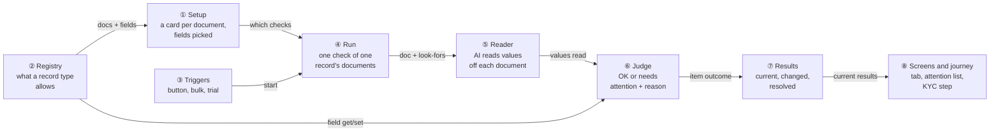

### Walkthrough: one example, start to finish

**Setup.** Fireside Ventures collects "CML, PAN Card, Passport" from individuals and "PAN Card, Board
Resolution" from companies. Its KYC form has custom fields DP ID (`dp`) and Client ID (`client`). Priya
Shah is the fund admin. Asha Rao is an individual investor whose KYC is on the journey task **Validate
documents**. Data is from the [shared setup](#worked-examples).

**Legend.** ✓ OK · ⚠ needs attention · ⟳ document changed after the check. In journey lines,
**● bold** means "we are here: waiting on this task, not done yet", and ✓ means done. A number in
brackets after a document is the count of its items needing attention.

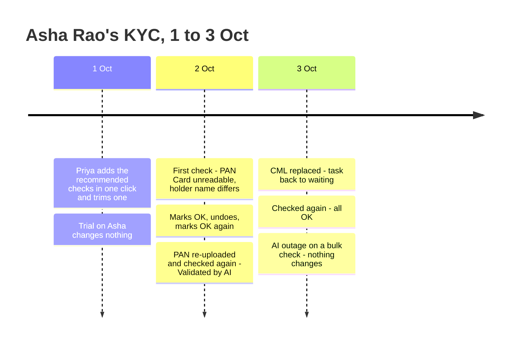

**Phase A: setup**

| # | When | What happens | Behind the scenes | Result&nbsp;&nbsp;&nbsp;&nbsp;&nbsp;&nbsp;&nbsp;&nbsp;&nbsp;&nbsp;&nbsp;&nbsp;&nbsp;&nbsp;&nbsp;&nbsp;&nbsp;&nbsp;&nbsp;&nbsp; |
|---|---|---|---|---|
| 1 | 1 Oct 10:00 | Priya opens Settings → Document Checks → Investor KYC | Setup (①) asks the registry (②) for the document names: both lists merged, PAN Card once | Cards:&nbsp;CML,&nbsp;PAN&nbsp;Card,&nbsp;Passport,&nbsp;Board&nbsp;Resolution,&nbsp;all&nbsp;"No&nbsp;checks&nbsp;yet" |
| 2 | 10:02 | Under Recommended checks she leaves everything ticked and clicks Add 12 checks | Setup (①) matches presets to every document and maps entries to fields from the registry (②); all picked rows are saved in one go. Email and Mobile have no field, so they're listed as not available | CML&nbsp;·&nbsp;8&nbsp;checks<br>PAN&nbsp;Card&nbsp;·&nbsp;2&nbsp;checks<br>Passport&nbsp;·&nbsp;2&nbsp;checks<br>"Not&nbsp;available:&nbsp;CML&nbsp;·&nbsp;Email,&nbsp;CML&nbsp;·&nbsp;Mobile" |
| 3 | 10:05 | Under Your checks she removes PAN Card's "PAN" row (the CML already compares the PAN) and clicks Save all | Setup (①) validates every card, then saves them all in one transaction | CML&nbsp;·&nbsp;8&nbsp;checks<br>PAN&nbsp;Card&nbsp;·&nbsp;1&nbsp;check<br>Passport&nbsp;·&nbsp;2&nbsp;checks |
| 4 | 10:10 | Try on a KYC → Asha Rao | A trigger (③) starts a trial run (④). The reader (⑤) and judge (⑥) run, nothing is written, and the results (⑦) are not current | "Trial&nbsp;run&nbsp;—&nbsp;nothing&nbsp;on&nbsp;this&nbsp;KYC&nbsp;was&nbsp;changed";&nbsp;"DP&nbsp;ID&nbsp;—&nbsp;filled&nbsp;in:&nbsp;IN303622"&nbsp;shown;&nbsp;Asha's&nbsp;DP&nbsp;ID&nbsp;still&nbsp;empty |

**Phase B: first real check, with problems**

| # | When | What happens | Behind the scenes | Result&nbsp;&nbsp;&nbsp;&nbsp;&nbsp;&nbsp;&nbsp;&nbsp;&nbsp;&nbsp;&nbsp;&nbsp;&nbsp;&nbsp;&nbsp;&nbsp;&nbsp;&nbsp;&nbsp;&nbsp; |
|---|---|---|---|---|
| 5 | 2 Oct 14:09 | Priya clicks Check documents on Asha's KYC | A trigger (③) queues a run (④). After each document, the run updates its progress and the tab refreshes | Tab:&nbsp;"Checking&nbsp;CML&nbsp;(1&nbsp;of&nbsp;3)…"<br>**●&nbsp;Validate&nbsp;documents** |
| 6 | 14:10 | The PAN Card is a `.doc`. The CML says the holder is "A. RAO" | The reader (⑤) makes 2 AI calls (PAN Card fails conversion first). The judge (⑥) fills DP ID, Client ID, IFSC and Bank account; holder name → `mismatch`. The run (④) becomes current (⑦), and the journey is re-evaluated (⑧) | CML&nbsp;(1)<br>PAN&nbsp;Card&nbsp;(1)<br>Passport&nbsp;✓<br>Toast&nbsp;"Documents&nbsp;checked&nbsp;for&nbsp;Asha&nbsp;Rao&nbsp;—&nbsp;2&nbsp;need&nbsp;attention"<br>**●&nbsp;Validate&nbsp;documents**&nbsp;—&nbsp;"2&nbsp;document&nbsp;items&nbsp;need&nbsp;attention" |

**Phase C: resolving, a mistake, and undo**

| # | When | What happens | Behind the scenes | Result&nbsp;&nbsp;&nbsp;&nbsp;&nbsp;&nbsp;&nbsp;&nbsp;&nbsp;&nbsp;&nbsp;&nbsp;&nbsp;&nbsp;&nbsp;&nbsp;&nbsp;&nbsp;&nbsp;&nbsp; |
|---|---|---|---|---|
| 7 | 14:12 | Priya clicks Mark as OK on the holder name and saves with no reason | Screens (⑧) refuse it: "Say why this is OK" | Same as row 6 |
| 8 | 14:13 | She types "Initial matches passport" and saves, then realises she hasn't opened the passport yet and clicks Undo | The result (⑦) is stamped, then the stamp is cleared. Each time the record is re-assessed | Same as row 6 |
| 9 | 14:15 | She opens the Passport group (✓ name matches "ASHA RAO") and marks the CML holder name OK with the same reason | The result (⑦) is stamped `marked_ok`, and the journey (⑧) is re-evaluated | CML&nbsp;✓<br>PAN&nbsp;Card&nbsp;(1)<br>Passport&nbsp;✓<br>**●&nbsp;Validate&nbsp;documents**&nbsp;—&nbsp;"1&nbsp;document&nbsp;item&nbsp;needs&nbsp;attention" |
| 10 | 15:00 | Asha re-uploads her PAN as a PDF | The existing document hook invalidates the task. The results (⑦) see a new file for PAN Card | CML&nbsp;✓<br>PAN&nbsp;Card&nbsp;⟳&nbsp;changed<br>Passport&nbsp;✓<br>**●&nbsp;Validate&nbsp;documents** |
| 11 | 15:05 | Priya clicks Check again | A new run (④) replaces the current results (⑦). The holder name still differs with the same two values, so the mark-OK carries over (card ⑦) | CML&nbsp;✓<br>PAN&nbsp;Card&nbsp;✓<br>Passport&nbsp;✓<br>✓&nbsp;Validate&nbsp;documents&nbsp;—&nbsp;"Validated&nbsp;by&nbsp;AI"<br>**●&nbsp;Run&nbsp;AML&nbsp;screening** |

**Phase D: undo by a replaced document**

| # | When | What happens | Behind the scenes | Result&nbsp;&nbsp;&nbsp;&nbsp;&nbsp;&nbsp;&nbsp;&nbsp;&nbsp;&nbsp;&nbsp;&nbsp;&nbsp;&nbsp;&nbsp;&nbsp;&nbsp;&nbsp;&nbsp;&nbsp; |
|---|---|---|---|---|
| 12 | 3 Oct 09:00 | Asha replaces her CML with a clearer scan | The document hook moves the journey back. The results (⑦) mark CML changed, and `all_docs_valid` is re-assessed to false | CML&nbsp;⟳&nbsp;changed<br>PAN&nbsp;Card&nbsp;✓<br>Passport&nbsp;✓<br>**●&nbsp;Validate&nbsp;documents** |
| 13 | 09:30 | Priya clicks Check again. The new scan reads "ASHA RAO" | The judge (⑥) finds the name matches (word order and case ignored); nothing needs attention | Same as row 11 |

**Phase E: stall**

| # | When | What happens | Behind the scenes | Result&nbsp;&nbsp;&nbsp;&nbsp;&nbsp;&nbsp;&nbsp;&nbsp;&nbsp;&nbsp;&nbsp;&nbsp;&nbsp;&nbsp;&nbsp;&nbsp;&nbsp;&nbsp;&nbsp;&nbsp; |
|---|---|---|---|---|
| 14 | 10:02 | Priya bulk-checks 3 KYCs while the AI provider is down | Each run (④) fails on the first reader (⑤) call. Nothing is written, and the previous runs stay current (⑦) | Asha's&nbsp;tab:&nbsp;"Couldn't&nbsp;check&nbsp;documents&nbsp;on&nbsp;3&nbsp;Oct,&nbsp;10:02&nbsp;—&nbsp;the&nbsp;AI&nbsp;service&nbsp;is&nbsp;unavailable.&nbsp;Your&nbsp;earlier&nbsp;results&nbsp;are&nbsp;below."<br>Results:&nbsp;same&nbsp;as&nbsp;row&nbsp;13 |

**The key moment (row 6):**

```
┌ Document checks (2) ─────────────────────────────────────────────────────────────┐
│ Checked 2 Oct 2026, 14:10 — 2 need attention                   [Check documents]  │
│ ▾ CML · ⚠ 1 needs attention                                                       │
│   ✓ DP ID — filled in: IN303622                                                   │
│   ⚠ Full name — doesn't match                                                     │
│       Document: A. RAO · KYC: Asha Rao        [Use document value] [Mark as OK]   │
│ ▾ PAN Card · ⚠ 1 needs attention                                                  │
│   ⚠ Couldn't read this file — upload it as a PDF or image       [Check again]     │
│ ▸ Passport · ✓ All OK                                                             │
└───────────────────────────────────────────────────────────────────────────────────┘
```

**What to notice**

- The AI never saw "Asha Rao". It read "A. RAO", and the judge (⑥) compared it. That is why the row
  can show both sides and offer *Use document value*.
- There are only two outcomes. The `.doc` and the name difference are both "needs attention", each
  with its own sentence and its own action.
- A mistake is cheap: Undo (row 8) puts the item straight back.
- A replaced document is flagged without anyone deleting anything (rows 10 and 12), and the next
  check replaces the results wholesale.
- A run that couldn't run (row 14) never replaces good results and never writes a field.

### Key ideas

| # | Idea | In one line | Card |
|---|---|---|---|
| 1 | Read, don't ask | The AI returns values keyed by check id; it never sees record values or picks field names | [⑤](#⑤-reader) |
| 2 | Two outcomes, one reason code | The judge returns `ok` or an attention reason; screens map each code to one sentence and one action | [⑥](#⑥-judge) |
| 3 | The record's own list decides | Checks hang off document names. A record sees only the documents on *its* list, so there are no variants or sets | [②](#②-registry) |
| 4 | Runs replace, results remember | The latest completed non-trial run is current; each result holds the file id it read, so "changed" is derived | [⑦](#⑦-results) |
| 5 | Resolve where you look | Use document value and Mark as OK (with Undo) are stamps on the result, carried to the next run when the values are unchanged | [⑦](#⑦-results) |
| 6 | One settled rule | "All documents valid" = current results exist and nothing needs attention. The KYC column and the journey task both use it | [⑦](#⑦-results) |
| 7 | Leave nothing behind | Every Doc Questions screen, class, route, table and dead column is listed with how and when it goes | [Retirement](#retirement-what-will-not-exist-afterwards) |

**FAQ**

| Question | Answer |
|---|---|
| Why not keep asking the AI "Is the PAN X?" like Doc Questions did? | That needs record values in the prompt (the `$var` mechanism and its `send` hole), and the answer is a bare yes/no that can't be explained or fixed in one click. |
| Why no "fail" vs "review"? | Users act the same way on both: look, then fix or accept. Two outcomes are easier to learn, and the reason sentence carries the detail. |
| Why no per-KYC-type sets? | The type-specific document lists already say which documents a KYC has. A check on "Passport" only ever appears where Passport is collected. |
| Is this KYC-only? | The engine is record-type neutral. Only the registry entry (②) is KYC-specific, and it's the only one in phase 1. |

---

## 2. The same picture with real names

### Picture

```mermaid
flowchart LR
    classDef new fill:#d4edda,stroke:#2e7d32,color:#000
    classDef mod fill:#fff3cd,stroke:#b8860b,color:#000
    classDef reuse fill:#eceff1,stroke:#90a4ae,color:#000
    S["① DocCheck<br/>DocChecksController<br/>DocChecks::CardForm, Presets<br/><i>a card per document</i>"]:::new
    R["② DocChecks::Registry<br/>DocChecks::Kyc<br/><i>docs, fields, writes</i>"]:::new
    T["③ DocCheckRunsController<br/>InvestorKycsBulkActionJob<br/><i>starts runs</i>"]:::mod
    N["④ DocChecks::StartRun<br/>DocChecks::RunJob<br/>DocCheckRun<br/><i>one check per record</i>"]:::new
    A["⑤ DocChecks::DocumentReader<br/>&lt; DocLlmBase<br/><i>one AI call per doc</i>"]:::new
    J["⑥ DocChecks::Judge<br/><i>outcome + note</i>"]:::new
    D["⑦ DocCheckResult<br/>DocChecks::Assessment<br/><i>current, changed, resolved</i>"]:::new
    U["⑧ doc_check_runs/_panel<br/>DocCheckResultsController<br/>ValidateDocuments check<br/><i>shows and resolves</i>"]:::mod
    R -- "document_names /<br/>fields_for" --> S
    S -- "for_record" --> N
    T -- "StartRun.call" --> N
    N -- "document,<br/>checks" --> A
    A -- "{c_id:<br/>value}" --> J
    R -- "read / write<br/>field" --> J
    J -- "outcome,<br/>note" --> D
    D -- "Assessment" --> U
    click S "#①-setup" "Open card ①"
    click R "#②-registry" "Open card ②"
    click T "#③-triggers" "Open card ③"
    click N "#④-run" "Open card ④"
    click A "#⑤-reader" "Open card ⑤"
    click J "#⑥-judge" "Open card ⑥"
    click D "#⑦-results" "Open card ⑦"
    click U "#⑧-screens-and-journey" "Open card ⑧"
```

Colour = footprint: **green** new, **amber** modified, **grey** reused unchanged. Reused, unchanged
parts (`DocLlmBase`, `DocUtils.convert_file_to_image`, the required-document name matching, and the
journey hooks) are named in the cards. What is *removed* is in
[Retirement](#retirement-what-will-not-exist-afterwards).

### What each box does

| # | Box | Real parts | What it does | When it runs | What it decides | Details |
|---|---|---|---|---|---|---|
| ① | Setup | `DocCheck`, `DocChecksController`, `DocChecks::CardForm`, `DocChecks::Presets` (`config/doc_check_presets.yml`) | The cards page, per-card save, presets, the trial entry point | Request | Valid rows; what a preset can add | [card ① →](#①-setup) |
| ② | Registry | `DocChecks::Registry`, `DocChecks::Kyc` | Per record type: all document names, a record's own names, allowed fields, field read/write, details-changed hook, assessment hook | Called by ①, ④, ⑥, ⑦ | Which fields exist and may be written; which documents a record has | [card ② →](#②-registry) |
| ③ | Triggers | `DocCheckRunsController#create`, `InvestorKycsBulkActionJob#validate_docs_with_ai`, `DocChecksController#try`, `DocCheckResultsController#check_again` | Starts a run for a record | Request / bulk job | Authorisation; verified KYC refused in bulk | [card ③ →](#③-triggers) |
| ④ | Run | `DocChecks::StartRun`, `DocChecks::RunJob`, `DocCheckRun` | Guards one active run, reads each document, records progress, writes once, finishes | Job (`:default`) | Run status; progress | [card ④ →](#④-run) |
| ⑤ | Reader | `DocChecks::DocumentReader < DocLlmBase` | Image + look-fors/tips → JSON keyed by check id | Inside ④, once per document; also called by `AiDataManager#validate_document` | Nothing: it only reads | [card ⑤ →](#⑤-reader) |
| ⑥ | Judge | `DocChecks::Judge` | Turns a read value into an outcome code, a note and an optional write | Inside ④ | `ok` or the attention reason | [card ⑥ →](#⑥-judge) |
| ⑦ | Results | `DocCheckResult`, `DocChecks::Assessment` | Stores results and resolutions; derives current, changed, attention count, settled | On every display; after run/resolve | `all_docs_valid`, attention count | [card ⑦ →](#⑦-results) |
| ⑧ | Screens and journey | `doc_check_runs/_panel`, `DocCheckResultsController` (index, use_document_value, mark_ok, undo, check_again), `WorkflowChecks::InvestorKyc::ValidateDocuments` | KYC tab, attention list, resolve actions, journey task | Request / Turbo broadcast / evaluator | Journey result for Validate documents | [card ⑧ →](#⑧-screens-and-journey) |

### One run, end to end

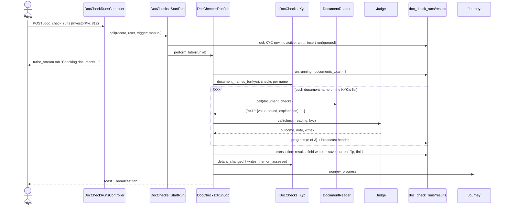

### Lifecycles

**`DocCheckRun.status`** (stored):

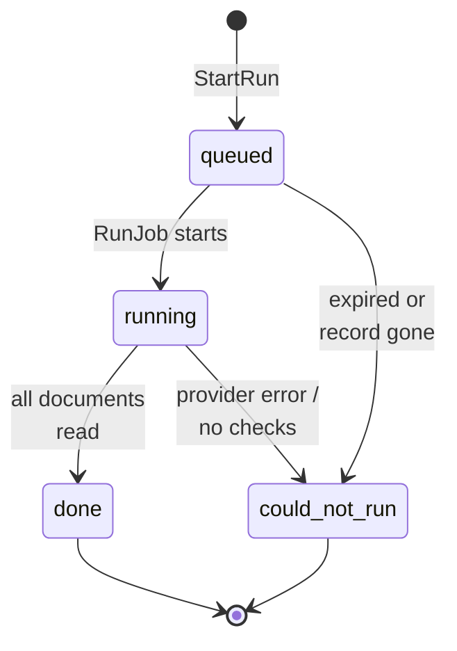

A `done` non-trial run becomes **current** (stored flag `current`). A `could_not_run` run is never
current. The tab shows it as the "Couldn't check documents…" banner when it's newer than the current
run.

**Result, as the user sees it** (derived from the stored `outcome` and resolution stamps):

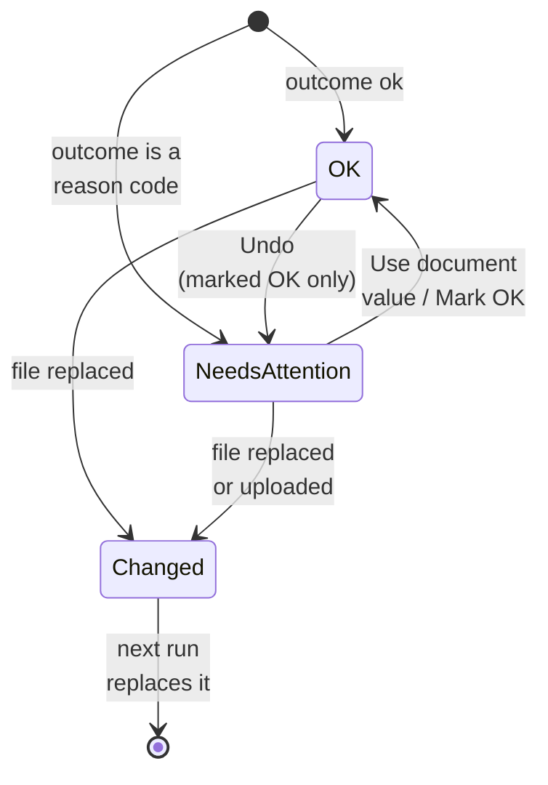

Stored: `outcome` (`ok` or one reason code) and `resolution` (`nil`, `marked_ok` or
`used_document_value`, with who, when and why). Derived: `ok?` = `outcome == ok` or resolution
present; `changed?` = the document's current file differs from the one read.

### What users see

**At a glance**

| Where in CapHive | Today | After this change | Who sees it |
|---|---|---|---|
| Settings → Doc Questions (list, new, edit, show, Excel export) | Free-text questions | **Gone** (route returns 404) | — |
| Import uploads → "DocQuestion" import type and sample file | Excel import of questions | **Gone** from the type list | — |
| Settings → Document Checks → Investor KYC | — | A card per KYC document; rows with dropdowns; presets; Try on a KYC | Fund users with "Doc LLM validation" |
| KYC → Docs Validation tab | Raw JSON table | **Document checks (n)** tab: progress, OK / Needs attention per document, Use document value / Mark as OK / Undo / Check again, Earlier AI answers | Fund users who can view the KYC |
| KYC → Validate Document Data button | Starts `DocLlmValidationJob` | **Check documents** (same button id) | Same as today |
| KYC list → bulk Validate Document Data | Runs the old job per KYC | **Check documents** per KYC | Same as today |
| KYC menu → Documents needing attention | — | Entity-wide attention list with filters and Check again | Fund users with "Doc LLM validation" |
| KYC journey → Validate documents | Reads `doc_question_answers` | Reads the Document Checks assessment | Fund users |
| Document page → "QnA" tab | Shown only when `documents.qna` is set (never, in prod) | **Gone** | — |

**Main journey: resolving a KYC's items**

```
┌ KYC: Asha Rao ── [Details] [Documents] [Document checks (2) ①] ──────────────────┐
│ Checked 2 Oct 2026, 14:10 — 2 need attention            [Check documents ②]      │
│ ▾ CML · ⚠ 1 needs attention ③                                                    │
│   ⚠ Full name — doesn't match                                                    │
│       Document: A. RAO · KYC: Asha Rao   [Use document value ④] [Mark as OK ⑤]   │
│ ▾ PAN Card · ⚠ 1 needs attention                                                 │
│   ⚠ Couldn't read this file — upload it as a PDF or image    [Check again ⑥]     │
│ ▸ Earlier AI answers ⑦                                                            │
└──────────────────────────────────────────────────────────────────────────────────┘
```

| Step | The user… | They see |
|---|---|---|
| ① | opens the Document checks tab | Attention documents open, OK documents collapsed; or "These documents haven't been checked yet." with Check documents |
| ② | clicks Check documents | "Checking CML (1 of 3)…", then the next document, then the new results in place; earlier results dimmed meanwhile |
| ③ | scans the group headers | "✓ All OK", "⚠ n needs attention" or "⟳ Document changed after this check" |
| ④ | clicks Use document value and confirms "Change Full name from Asha Rao to A. RAO?" | Row "✓ Full name — updated from the document by Priya Shah"; count drops |
| ⑤ | clicks Mark as OK, types a reason, saves | Row "✓ Marked OK by Priya Shah: Initial matches passport" with Undo; count drops |
| ⑥ | clicks Check again | Same as ② |
| ⑦ | expands Earlier AI answers | The legacy `doc_question_answers` table, read-only |

The setup journey is in [card ①](#①-setup) and the attention list in [card ⑧](#⑧-screens-and-journey).

### Design decisions

1. **The AI reads and CapHive compares.** Alternative considered: keep yes/no questions with
   interpolated values. Rejected: it needs record values in the prompt, it can't show why something
   failed, and it can't offer *Use document value*.
2. **Reply keyed by check id (`c<id>`).** Alternative considered: key by label. Rejected: the old code
   parameterised the AI's own key into a field name, which is how values went missing.
3. **No sets or variants: checks hang off (entity, record type, document name).** A record's own
   document list decides which apply. Alternative considered: Individual / Non-individual / All sets
   with a fallback rule. Rejected: an extra concept, an extra screen and a "which set wins" rule, for
   a need (different checks on the same document per KYC type) nobody has today.
4. **Two user-facing outcomes with one reason code.** Alternative considered: pass / fail / review /
   error / skipped. Rejected: users act the same on all non-OK states. The reason code keeps the
   precision for filters and messages.
5. **Resolutions are stamps on the result, not new statuses.** Undo is just clearing the stamp, and
   carry-over copies it when the values are unchanged. Alternative considered: a separate
   overrides table. Rejected: more joins for no gain.
6. **Allowlist registry per record type.** Alternative considered: any column or custom field.
   Rejected: `verified`, `entity_id` and other control columns must never be AI- or click-writable.
7. **Runs replace results; "changed" is derived from the Shrine file id.** Alternative considered:
   update results in place, or store a stale flag. Rejected: that's the old "never cleared" bug, and a
   flag would need an upload hook just to flip it.
8. **Per-card save.** Alternative considered: one big form for the page. Rejected: one bad row would
   block every card. Small saves keep errors local and give a clear "Unsaved changes" state.
9. **Presets add only what they can map.** Alternative considered: add every preset entry, leaving a
   blank field. Rejected: it creates an error state the user didn't cause.
10. **Reuse `DocLlmBase`, the `enable_doc_llm_validation` permission and the bulk job's pacing.**
    Alternative considered: new client, new flag, fan-out with delays. Rejected as not DRY and as
    changing rate behaviour.
11. **Field writes from a run or from Use document value go through the KYC's details-changed hook.**
    So the journey's "KYC details changed after review" behaves exactly as for a manual edit.
    Alternative considered: silent `save`. Rejected: it would bypass the review reset.
12. **Writes happen once per run, at the end, in one transaction with the results.** Alternative
    considered: write per document. Rejected: a crash midway would leave fields written with no
    results to explain them.
13. **Retire in two deploys: build, convert, then remove.** Alternative considered: one deploy that
    adds and removes together. Rejected: Support must run and review the conversion against
    production `doc_questions` before the screens and the table go.

**FAQ**

| Question | Answer |
|---|---|
| Why a `current` flag instead of "latest run" queries? | The attention list needs "current results across all records" in one indexed query. Without a stored flag that's a groupwise-max over runs. |
| Why not store "changed"? | It changes when a document changes, not when we run. Deriving it from `document_file_id` vs the document's current file id is one small query per tab and can't drift. |
| Why does a run that couldn't run not become current? | It has no trustworthy results. Showing nothing would hide the last good state. |
| What if two KYC types need different checks on the same document later? | Add an optional "only for" (individual / non-individual) column on `doc_checks`. The model allows it without a redesign. |

---

## 3. One card per box

> Same order and numbers as the picture.

### ① Setup

A check is one row: entity, record type, document name, action, field or question, tip and options.
The page lists every document name from the registry: **Recommended checks** at the top (presets for
all recognised documents, added in one click) and **Your checks** below (every document's rows, saved
together with one **Save all**). Presets are app-level YAML.

| Owns | Reads / receives | Produces |
|---|---|---|
| `doc_checks`, `config/doc_check_presets.yml`, `DocChecks::SetupForm`, `DocChecks::CardForm`, `DocChecks::Presets` | `registry.document_names(entity)`, `registry.fields_for(entity)` (②) | `DocCheck.for_record(record)` for the run (④) |

**Save all** (`DocChecks::SetupForm` → one `DocChecks::CardForm` per document): every card's rows are
posted together. Within a card, rows with an id are updated, rows without one are created, and saved
rows missing from the post are deleted. Every card is validated first, so all errors show at once;
then every card is written in one transaction. A new row nobody filled in (no field, no look-for,
still Fill in) is ignored rather than refused.

**Row validation** (messages in the [proposal](proposal.md#validation-rules)):

| Rule | Error on the row |
|---|---|
| Fill in / Compare need a field in `fields_for` | "Pick a KYC field" |
| A field at most once per card | "Already used on this document" |
| `look_for` present, ≤ 100 | "Say what to look for" |
| `tip` ≤ 255 | "Keep the tip under 255 characters" |
| Saved check whose field disappeared | Not a save error. The page banner and the row say "This field no longer exists — pick another" (E16) |

**Recommended checks** (`DocChecks::Presets.recommendations` / `.add_recommended`): for each document
name, `Presets.key_for` picks a preset by pattern (CML, PAN, Aadhaar, Passport, Address proof, ID proof,
Incorporation). `rows_for` takes, per YAML entry, the first field candidate in `fields_for` not
already used on that document, skips entries whose look-for is already there, and reports the rest
as not available. The page shows the rows ticked; the post carries only "pick keys"
(`document|look_for`), and the server recomputes the rows from them, so only genuine preset checks
can be saved. All picked rows are saved in one transaction.

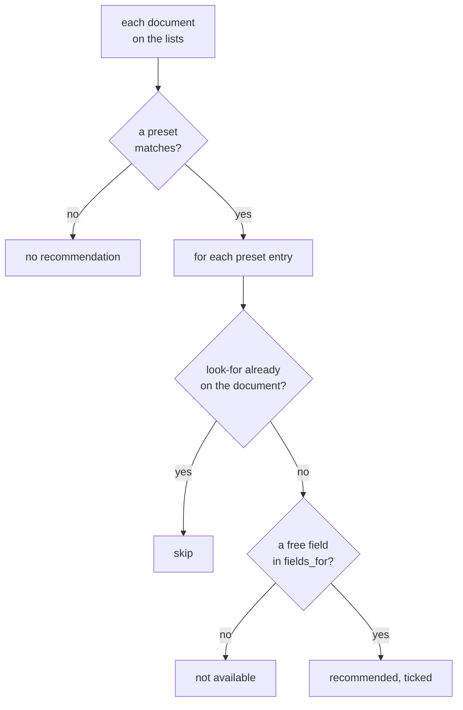

**Routes**

| Verb and path | Action | Does | Responds with |
|---|---|---|---|
| GET `/doc_checks?record_type=InvestorKyc` | index | Recommended checks + every document's rows | HTML |
| PATCH `/doc_checks/save_all` | save_all | `cards[<key>][document_name]`, `cards[<key>][rows][<row>][…]` → `SetupForm#save` | redirect "Document checks saved" / 422 page with row errors |
| POST `/doc_checks/add_recommended` | add_recommended | `picks[]` → `Presets.add_recommended` | redirect "Added 11 checks" |
| POST `/doc_checks/trial` | trial | `record_id` → `StartRun(trial: true)` | redirect to the page with the trial frame |

**Build notes.** One Stimulus controller, `doc-check-page`, covers the page: recommendation ticks (a
document's tick toggles its rows, the Add button counts), row behaviour (swap inputs by action, fill
`look_for` from the field's label unless typed, grey out fields used elsewhere on the same card),
opening a document from the "Other documents" line, the sticky "Unsaved changes / Save all" bar with
a `beforeunload` guard, and keeping **Try on a KYC** disabled until a KYC is picked (the picker is a
select2, so it also listens to jQuery `change`). Column labels are shown once, above the cards. The
KYC list header has a **Document checks** menu (Documents needing attention, Set up checks).

**Access**

| Role | View/edit/preset/try | Notes |
|---|---|---|
| Fund user, entity has `enable_doc_llm_validation` | ✓ | `belongs_to_entity?`; Try also needs registry `can_view?` on the KYC |
| Fund user, permission off | ✗ | |
| Investor / advisor user | ✗ | `user.entity_id` differs |
| Other entity | ✗ | `policy_scope` = `where(entity_id: user.entity_id)` |

**Worked examples:** H1, H2, E1, E2, E3, E4, E5, E16, X4

**Export and import**

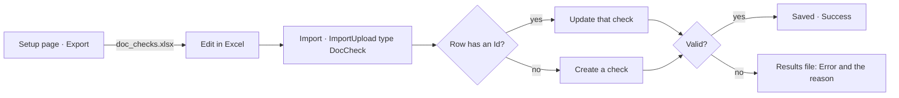

| Piece | What it is | Why |
|---|---|---|
| Export | `DocChecksController#index` as `.xlsx` → `doc_checks/index.xlsx.axlsx`; columns Id, Document, What To Do, Look For, KYC Field (the label), Tip, Replace Existing, Expected Answer | The export *is* the upload format, so a downloaded sheet can be edited and sent back |
| Import | `ImportUpload` type `DocCheck` → `ImportDocCheckService` → `ImportDocCheck < ImportUtil`; sample `public/sample_uploads/doc_checks.xlsx` | Uses the platform's import page, results file and Delete Imported Data instead of a second upload flow |
| Id | Present → update that check (scoped to the user's entity); blank → create | An edited row updates instead of duplicating; another entity's Id is refused |
| Validation | `DocCheck` validations (field allowed, one field / look-for per document) plus: the document is on the KYC list; "What To Do" is Fill in / Compare / Question; KYC Field matches a field's name or label (a shared label must be given by name) | The same rules as a save on the setup page; errors name the column ("KYC Field: Already used on this document") |
| `doc_checks.import_upload_id` | Set on checks an upload created; left alone on checks it updated | `ImportUpload#imported_data` and Delete Imported Data act on what an upload *created*, never on edited rows |
| Nothing deleted | Checks missing from the file stay | An import is additive; removing checks stays an explicit action on the setup page |

**Worked examples:** H14, H15, E24, E25, X11, X12


**FAQ**

| Question | Answer |
|---|---|
| Why YAML presets, not DB rows? | Presets are product content shared by all entities and change with releases. Copies per entity would drift. |
| Why can't a card have the same field twice? | Two Fill-ins would race and two Compares are redundant. One field per card also makes the reply and the result unambiguous to read. |
| Can an admin add a document that isn't on the lists? | No. The lists are the single source; add the name in Settings → KYC documents. |
| What happens to results when a check is deleted? | Results keep snapshots (`document_name`, `look_for`, `action`), so past runs still render. |

### ② Registry

A plain Ruby lookup: one entry per record type, describing what Document Checks may touch. It has no
table.

| Owns | Reads / receives | Produces |
|---|---|---|
| `DocChecks::Registry` (map `"InvestorKyc" → DocChecks::Kyc`) | Entity settings (doc lists), `FormCustomField` for the entity's KYC forms | names, fields, reads/writes, hooks |

**`DocChecks::Kyc` entry**

| Member | KYC behaviour |
|---|---|
| `document_names(entity)` | Union, in order, of `individual_kyc_doc_list`, `non_individual_kyc_doc_list` and the required File custom-field labels of the entity's KYC forms, de-duplicated case-insensitively (setup page) |
| `document_names_for(kyc)` | The KYC's own list: the list for its type plus its form's required file fields. This is the existing `required_document_names`, extracted to share with `WorkflowChecks::InvestorKyc::Support` |
| `fields_for(entity)` | Allowlisted columns: `full_name`, `PAN`, `address`, `corr_address`, `birth_date`, `expiry_date`, `bank_name`, `bank_branch`, `bank_account_number`, `bank_account_type`, `ifsc_code`, `esign_emails`, `residency`. Plus non-File, non-calculated `FormCustomField`s of the entity's KYC forms. Each is a `Field(name, label, storage :column/:json, loose?, date?)` |
| `loose?` | `full_name`, `address`, `corr_address`, and custom fields whose name contains `name` or `address` |
| `find_document(kyc, name)` | Newest of `kyc.documents.not_generated` whose name or owner tag matches (existing matcher) |
| `read(kyc, field)` / `write(kyc, field, value)` | Column → attribute; custom → `json_fields[name]`. Dates parsed with `Date.parse`; failure raises `DocChecks::BadValue` |
| `details_changed!(kyc, user:)` | Saves with `save(validate: false)` (audited, comment "Document checks"), then `kyc.journey_details_changed!(actor: user)`, the same journey hook `InvestorKycAction` runs for a details change |
| `on_assessed(kyc, settled)` | Sets `all_docs_valid` when it changes |
| `can_view?(user, kyc)` / `can_edit?(user, kyc)` | `InvestorKycPolicy#show?` / `update?`, plus `user.entity_id == kyc.entity_id` |

**Worked examples:** E1, E6, E7, E16, X4, X5

**FAQ**

| Question | Answer |
|---|---|
| Why a hand-written column allowlist? | Columns like `verified`, `submission_status` and `entity_id` must never be writable here. An explicit list fails safe when columns are added. |
| Why not reuse the MCP ontology YAML? | It describes queryable attributes for read tools (there's no `investor_kyc.yml`), not writable fields. |
| How does phase 3 add Investors? | One new entry class plus a line in the registry map. No engine change. |

### ③ Triggers

Every entry point calls `DocChecks::StartRun.call(record:, user:, trigger:, trial: false)`.

| Owns | Reads / receives | Produces |
|---|---|---|
| Buttons and actions that start runs | User, record, trigger | A queued `DocCheckRun` or a refusal |

| Trigger | Where | Authorisation | Notes |
|---|---|---|---|
| `manual` | `DocCheckRunsController#create` (`record_type`, `record_id`) | registry `can_edit?` + permission | Button "Check documents" keeps id `investor_kyc_validate_docs_with_ai_btn` for the journey's action target |
| `bulk` | `InvestorKycsBulkActionJob#validate_docs_with_ai` | Existing `ApplicationPolicy#validate_docs_with_ai?`; verified KYCs refused as today | `StartRun(enqueue: false)` then `RunJob.perform_now`, keeping `sleep(2)` |
| `again` | `DocCheckResultsController#check_again` (selected record ids), and the tab's Check again / Try again | Per record `can_edit?`; unauthorised ones skipped | Enqueues per record |
| `trial` | `DocChecksController#try` | Setup policy + registry `can_view?` | `trial: true` |

`InvestorKycsController#validate_docs_with_ai` and its member route are removed, replaced by the
generic `POST /doc_check_runs`. The policy predicate `validate_docs_with_ai?` stays as the
authorisation for both. It's an internal name, so renaming it would only churn the policies.

**Worked examples:** H3, H4, H8, H9, E14

**FAQ**

| Question | Answer |
|---|---|
| Why a generic runs controller? | Phase 3 record types get the button for free, with authorisation through the registry. |
| Why keep `perform_now` in bulk? | The bulk job is already a background job with pacing and error collection, so today's rate behaviour is kept. |

### ④ Run

`StartRun` guards and enqueues. `RunJob` does the work and is the only writer of results, and of
fields during a run.

| Owns | Reads / receives | Produces |
|---|---|---|
| `doc_check_runs`, `DocChecks::StartRun`, `DocChecks::RunJob` | Checks (①), names/documents (②), reader (⑤), judge (⑥) | Results (⑦), field writes, progress, toasts, broadcasts |

| Concern | Decision |
|---|---|
| Which checks | `DocCheck.for_record(record)`: entity, record type and `registry.document_names_for(record)`, matched case-insensitively. None → `could_not_run` "No document checks are set up for this KYC's documents" |
| One active run per record | `StartRun` locks the record row and refuses if a non-trial run for it is `queued`/`running`: `AlreadyRunning`. Trials neither block nor are blocked |
| Progress | `documents_total` is set at start; `documents_done` and `current_document` are updated after each document, then the tab header is broadcast |
| Queue / retry | `:default`, `retry: 0`. Retries would re-bill, and the user has Check again |
| Expiry | A run `queued`/`running` for more than 30 min is set `could_not_run` "Timed out" when `StartRun` or `Assessment` sees it |
| Per-document isolation | Each document's find/convert/read/judge sits in its own rescue for document-level failures (card ⑤) |
| Run-level failure | No checks, no LLM client, or `DocChecks::ProviderError` → `could_not_run` with the reason, no writes, previous current run untouched |
| Finish | One transaction: insert results, apply pending writes via `registry.write`, then `details_changed!` if any write (skipped for trials), flip `current`, set status `done` and counts |
| After commit | `on_assessed(record, Assessment.new(record).settled?)`, `journey_progress!`, a toast to the starter, and a broadcast of the tab |

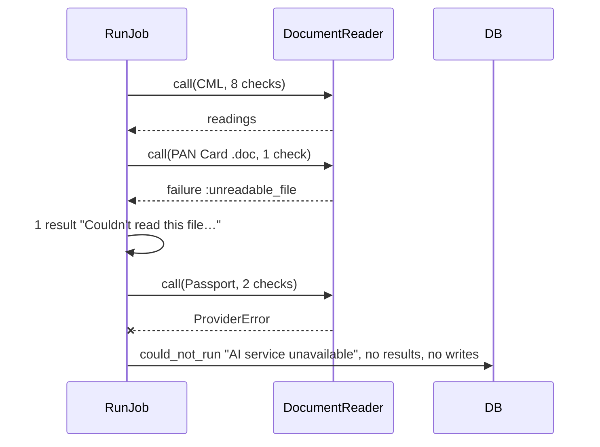

A provider error mid-run stops the whole run: partial results would look current but be incomplete
(X3).

**Worked examples:** H3, E6, E12, E14, E15, X1, X2, X3

**FAQ**

| Question | Answer |
|---|---|
| Why stop on a provider error but not on a bad file? | A bad file is a fact about that document ("can't read it"). An outage says nothing about the document, so storing it as a result would be false. |
| What does the journey see during a run? | Nothing changes until finish. The task reflects the previous current run. |
| Why `details_changed!` for run writes? | So a Fill in after review resets "Review KYC" exactly as a manual edit would. |

### ⑤ Reader

A Trailblazer operation subclassing `DocLlmBase`. It turns one document plus its checks into a map keyed
by check id, and knows nothing about the record. It replaces `DocLlmValidator` everywhere, including
the AI rules tool `AiDataManager#validate_document`, which now passes one unsaved question check.

| Owns | Reads / receives | Produces |
|---|---|---|
| Prompt and reply parsing | Document image (via `DocUtils.convert_file_to_image`), checks' `id` (or a temporary key for unsaved checks), `action`, `look_for`, `tip` | `{ "c41" => { "value" => "IN303622", "found" => true, "explanation" => "…" } }` or a failure |

| Step | Decision |
|---|---|
| `init` | `super(provider: ENV DOCUMENT_VALIDATION_PROVIDER, llm_model: ENV DOCUMENT_VALIDATION_MODEL, temperature: 0.1)`; no client → run-level `:no_llm` |
| `convert_file_to_image` | Reused; false or nil (the `.doc` branch) → document-level `:unreadable_file` |
| `read_with_llm` | Fixed instructions + one line per check: `c<id>: read the value of "<look_for>". <tip>` or `c<id>: answer yes or no: "<look_for>". <tip>`, then the image. JSON object with exactly those keys. OpenAI `response_format: { type: "json_object" }`; Gemini `response_mime_type` |
| `parse` | `JSON.parse` after stripping a ```` ```json ```` fence. Keep only known keys; a missing key → `found: false`. A parse error → document-level `:unreadable_reply` |
| `cleanup` | Reused |

Look-fors and tips are inserted as text only. There is no `$` processing (X5).

**Worked examples:** H3, X1, X2, X5

**FAQ**

| Question | Answer |
|---|---|
| Why one call per document? | Same cost as today, faster, and check ids keep the answers separate. |
| Multi-page PDFs? | Unchanged from today: `ImageService.pdf_to_image` decides the pages. See Risks. |
| Why port `AiDataManager` instead of keeping `DocLlmValidator` for it? | Keeping the old validator alive for one caller would keep the `$var` interpolation alive too. The AI rules tool only needs "answer this question about this document", which is a question check. |

### ⑥ Judge

A pure function: (check, reading, record via registry) → `{outcome, note, doc_value, record_value,
explanation, write}`.

| Owns | Reads / receives | Produces |
|---|---|---|
| Outcome codes and normalisation | Check, reading, `registry.read`, `Field#loose?` / `#date?` | Result attributes and an optional pending write |

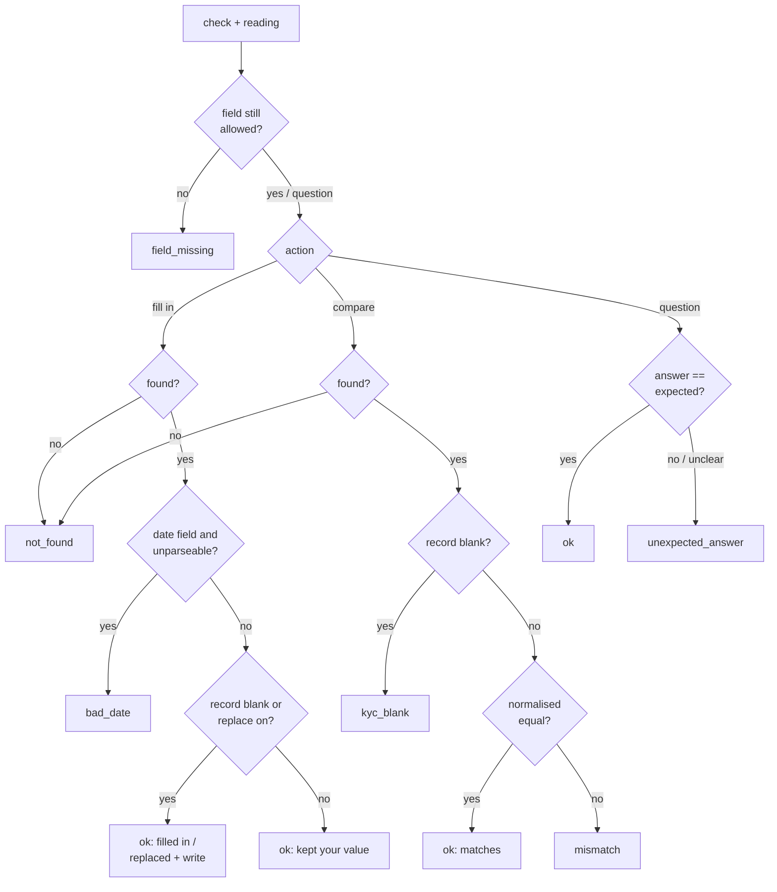

**Normalise:** downcase, strip whitespace and `. , - / ( ) '`, and for `loose?` fields sort the tokens
first ("RAO ASHA" = "Asha Rao"). Dates are compared as `Date` after parsing both sides. A question's
answer is "yes" if it's one of `yes`/`true`; anything else counts as no, so an unclear answer needs
attention with the explanation.

**Outcome codes → sentence → actions** (sentences live in `config/locales/doc_checks.en.yml`; the
proposal's Behavior Rules are the source):

| `outcome` | Shown as | Actions |
|---|---|---|
| `ok` (note: filled / kept / replaced / matches / yes) | ✓ "<field> — filled in: V" etc. | — |
| `mismatch` | ⚠ "doesn't match" + both values | Use document value, Mark as OK |
| `kyc_blank` | ⚠ "the KYC has no value (document says V)" | Use document value, Mark as OK |
| `not_found` | ⚠ "not found on this document" | Mark as OK |
| `bad_date` | ⚠ "couldn't read a date from 'V'" | Mark as OK |
| `unexpected_answer` | ⚠ "answered No: '<reason>'" | Mark as OK |
| `not_uploaded` | ⚠ "Not uploaded yet" (one line per document) | — |
| `unreadable_file` | ⚠ "Couldn't read this file — upload it as a PDF or image" | Check again |
| `unreadable_reply` | ⚠ "Couldn't read the AI's answer for this document" | Check again |
| `field_missing` | ⚠ "this check's KYC field no longer exists" | (fix in settings) |

**Worked examples:** H3, E8, E9, E10, E11, E16, E17, E18

**FAQ**

| Question | Answer |
|---|---|
| Why does a name in a different order match? | Documents often print SURNAME GIVEN. Order-free comparison is only for name and address fields; identifiers keep strict order. |
| Why can't "not uploaded" be marked OK? | The fix is to upload, and the journey's own Mark reviewed covers the "we don't need it" case. |
| Does the judge write anything? | No. It returns a pending write, and the run (④) applies all writes at the end. |

### ⑦ Results

Stored rows plus `DocChecks::Assessment`, a read-model answering everything the screens and journey
need.

| Owns | Reads / receives | Produces |
|---|---|---|
| `doc_check_results`, `DocChecks::Assessment` | Current run, its results, the record's document names and current documents | `groups`, `attention_count`, `changed?(name)`, `settled?`, `could_not_run`, `fresh_at` |

| Assessment member | Rule |
|---|---|
| `current_run` | `DocCheckRun.find_by(record:, current: true)` |
| `groups` | Results grouped by `document_name`, limited to `registry.document_names_for(record)`, in the setup order; each group `ok` / `attention n` / `changed` |
| `changed?(name)` | The document now matched for the name has a different `file.id` from the result's `document_file_id`, or a `not_uploaded` name now has a document, or a read document is gone |
| `attention_count` | Items where `outcome != ok` and there's no resolution, plus every item in changed groups |
| `settled?` | `current_run` present and `attention_count == 0` |
| `could_not_run` | The newest `could_not_run` non-trial run newer than `current_run` (for the banner) |
| `fresh_at` | max(`current_run.finished_at`, newest `resolved_at`) — journey freshness |

**Resolutions** (`DocCheckResultsController`). Each one locks the result, writes, re-assesses
(`on_assessed`, `journey_progress!`) and broadcasts the tab:

| Action | Allowed when | Writes |
|---|---|---|
| `use_document_value` | current run; `outcome` ∈ `mismatch`, `kyc_blank`; `can_edit?` | `registry.write(record, field, doc_value)` + `details_changed!`; result `resolution: used_document_value`, by/at |
| `mark_ok` | current run; `outcome` ∈ `mismatch`, `kyc_blank`, `not_found`, `bad_date`, `unexpected_answer`; reason present | `resolution: marked_ok`, by/at/reason |
| `undo` | `resolution == marked_ok` | Clears the stamps |

**Carry-over:** a new run copies a `marked_ok` resolution to the new result for the same check *only
if* `outcome`, `doc_value` and `record_value` are unchanged. `used_document_value` needs no carry-over:
the next run compares equal and is `ok`.

**Worked examples:** H5, H6, E12, E13, E15, E19

**FAQ**

| Question | Answer |
|---|---|
| Why carry Mark as OK forward at all? | Otherwise every re-check (e.g. after an unrelated re-upload) would re-open things someone already settled. Matching all three values keeps it honest. |
| Why can't Use document value be undone? | It's an ordinary audited field edit. The previous value is in the audit and in the confirmation the user saw. Editing the KYC reverses it. |
| Why are changed documents counted as needing attention? | Their results no longer describe the document on file. |

### ⑧ Screens and journey

| Owns | Reads / receives | Produces |
|---|---|---|
| `doc_check_runs/_panel` (tab), `doc_check_results/index` (attention list), resolve actions, `ValidateDocuments` | `DocChecks::Assessment` | HTML / Turbo streams; `WorkflowChecks::Result` |

**Tab.** It's rendered in the KYC `_details` tab `#docs-validation-tab`. The id is kept, so
`Support::VALIDATION_TAB` still works. The title is "Document checks (n)". It subscribes with
`turbo_stream_from [record, :doc_checks]`, and `RunJob` / resolutions broadcast `replace` of
`dom_id(record, :doc_checks)`, plus `update` of the header during progress. Investor users don't get
the tab. "Earlier AI answers" renders the old `Json2table` output collapsed when
`doc_question_answers` has content. Sentences come from `config/locales/doc_checks.en.yml`.

**Journey task** (`WorkflowChecks::InvestorKyc::ValidateDocuments`, new body; messages are in the
[journey delta spec](specs/kyc/investor-kyc-journey/spec.md)):

| Condition | Result |
|---|---|
| `settled?` | `confirmed("Validated by AI", passed_since: fresh_at, fresh_since: fresh_at)` |
| current run, `attention_count > 0` | `review("<n> document items need attention — resolve them or mark reviewed", "Open document checks" → VALIDATION_TAB)` |
| checks exist for the KYC's documents, no current run | `review("Documents not checked yet — check documents or mark reviewed", "Check documents" → VALIDATE_AI_BTN)` |
| no checks for the KYC's documents | `review("Check the documents and mark reviewed", "Open documents" → DOCS_TAB)` |

`Support#ai_answer_counts` and `#ai_validated_at` are deleted. The existing document-change
invalidation is unchanged, and it is what moves the task back on a replace (E13).

**Attention list** (`GET /doc_check_results`): results of current runs for the entity where there's no
resolution and `outcome != ok`, plus a "Document changed" filter derived per page. Filters: reason
(maps to outcome codes: Doesn't match = `mismatch`/`kyc_blank`; Not found = `not_found`/`bad_date`;
Unexpected answer; Couldn't read = `unreadable_*`/`field_missing`; Not uploaded; Document changed),
document, and checked date. Pagy. Each row links to the KYC's tab. `POST /doc_check_results/check_again`
takes `record_ids[]`.

| Verb and path | Action | Does | Responds with |
|---|---|---|---|
| GET `/doc_check_runs/:id` | show | Trial run panel (frame) | HTML frame |
| GET `/doc_check_results` | index | Attention list | HTML |
| PATCH `/doc_check_results/:id/use_document_value` | use_document_value | — | turbo_stream tab / flash |
| PATCH `/doc_check_results/:id/mark_ok` | mark_ok | `reason` | turbo_stream tab / 422 row "Say why this is OK" |
| PATCH `/doc_check_results/:id/undo` | undo | — | turbo_stream tab |
| POST `/doc_check_results/check_again` | check_again | `record_type`, `record_ids[]` | redirect "Checking documents for 3 KYCs" |

**Access**

| Role | Tab | Resolve / Check | Attention list |
|---|---|---|---|
| Fund user who can view the KYC | ✓ | if `InvestorKycPolicy#update?` | ✓ with permission |
| Investor user (own KYC) | ✗ (not rendered) | ✗ | ✗ |
| Other entity | ✗ | ✗ | ✗ (scope `entity_id: user.entity_id`) |

**Secondary journey: attention list**

| Step | The user… | They see |
|---|---|---|
| 1 | opens Documents needing attention from the KYC menu | Items needing attention, newest first; or "Nothing needs attention." |
| 2 | picks Reason = Doesn't match | Only mismatch rows |
| 3 | ticks 3 rows | "Check again (3)" enabled |
| 4 | clicks Check again | "Checking documents for 3 KYCs"; each KYC's tab updates when done |

**Worked examples:** H4, H5, H6, H7, H9, H12, E13, E19, E20, E21, E22, E23, X6, X7, X8, X10

**FAQ**

| Question | Answer |
|---|---|
| Why keep the old tab id? | The journey's action target and any bookmarks keep working. |
| Does the journey move on its own after a resolution? | Yes. Resolutions call `journey_progress!`, and if the assessment is now settled the task is confirmed. |
| Why one locale file for the sentences? | One place to tune wording, and the QA checklist checks them verbatim. |

---

## 4. Reference

> Whole-system material that spans several boxes.

### Class diagram

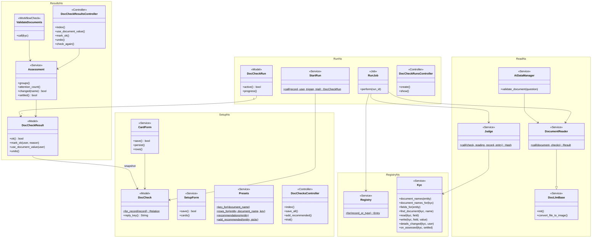

Method names drop Ruby's `?`/`!` suffixes for mermaid (`settled` is `settled?`, `mark_ok` is
`mark_ok!`). `AiDataManager` is modified: it now calls `DocumentReader` instead of `DocLlmValidator`.

### Data model and schema changes

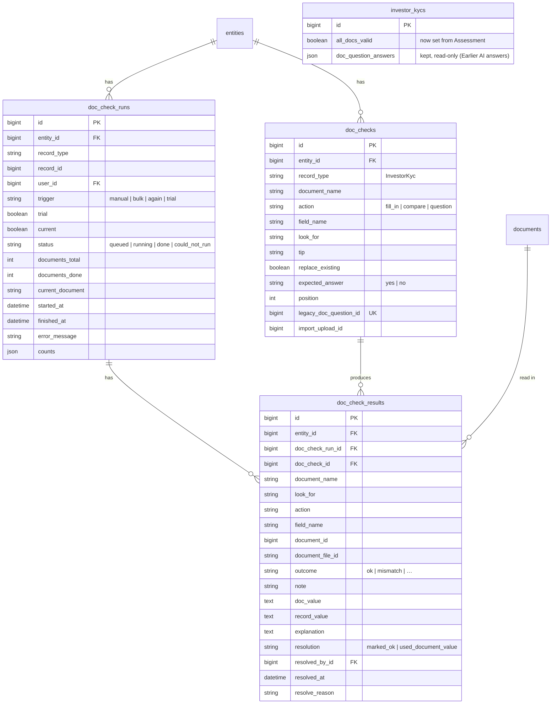

**Indexes:** `doc_checks [entity_id, record_type, document_name, field_name]` UK ·
`doc_checks [entity_id, record_type, document_name, look_for]` UK · `doc_checks [legacy_doc_question_id]` UK ·
`doc_check_runs [record_type, record_id, current]` · `doc_check_runs [record_type, record_id, status]` ·
`doc_check_runs [entity_id, current, finished_at]` · `doc_check_results [doc_check_run_id]` ·
`doc_check_results [entity_id, outcome]` · `doc_check_results [doc_check_id]`

**Schema changes**

**`doc_checks`** (new): one row per thing to read from one document, for one record type.

| Column / index | What changed | Why it's needed |
|---|---|---|
| `entity_id` | Added, FK | Tenant scope |
| `record_type` | Added | Registry key; the engine is record-type neutral |
| `document_name` | Added | Which card/document, from the registry's names |
| `action` | Added | fill_in / compare / question decide the judge path |
| `field_name` | Added, nullable | Target or compare field (null for question) |
| `look_for` | Added | What the AI looks for (or the question); shown in results |
| `tip` | Added, nullable | Optional extra guidance for the AI |
| `replace_existing` | Added, default false | Fill in overwrite option |
| `expected_answer` | Added, default "yes" | Question expectation |
| `position` | Added | Card and prompt order |
| `legacy_doc_question_id` | Added, nullable, no FK | Conversion idempotency. No FK, because `doc_questions` is dropped in the retirement deploy |
| `import_upload_id` | Added, nullable, indexed, no FK | Which ImportUpload created the check — what Delete Imported Data removes. Separate migration `20261004100000_add_import_upload_to_doc_checks` |
| UK `[entity_id, record_type, document_name, field_name]` | New | A field once per card (questions have NULL field and are exempt) |
| UK `[entity_id, record_type, document_name, look_for]` | New | No two identical items on a card; presets skip existing |
| UK `[legacy_doc_question_id]` | New | Re-running the conversion doesn't duplicate |

**`doc_check_runs`** (new): one check of one record's documents.

| Column / index | What changed | Why it's needed |
|---|---|---|
| `entity_id` | Added | Scoping for the list and policies |
| `record_type`, `record_id` | Added (polymorphic) | Any registered record type |
| `user_id` | Added | Who started it (toasts) |
| `trigger` | Added | manual / bulk / again / trial |
| `trial` | Added, default false | Excluded from current, journey and the list |
| `current` | Added, default false | The one run whose results are the record's current results |
| `status` | Added | Lifecycle (Part 2) |
| `documents_total`, `documents_done`, `current_document` | Added | Progress "Checking PAN Card (2 of 3)…" |
| `started_at`, `finished_at` | Added | Header "Checked …"; journey freshness; expiry |
| `error_message` | Added | Reason shown when it couldn't run |
| `counts` | Added, json | Header and toast counts without counting rows |
| idx `[record_type, record_id, current]` | New | Tab lookup |
| idx `[record_type, record_id, status]` | New | Active-run guard |
| idx `[entity_id, current, finished_at]` | New | Attention list |

**`doc_check_results`** (new): one per check per run.

| Column / index | What changed | Why it's needed |
|---|---|---|
| `entity_id` | Added | List filter without a join; scoping |
| `doc_check_run_id` | Added, FK | Parent run |
| `doc_check_id` | Added, FK nullable (nullify) | Carry-over of Mark as OK; settings link |
| `document_name`, `look_for`, `action`, `field_name` | Added (snapshot) | History renders after a check is edited or deleted; Use document value knows the field |
| `document_id` | Added, nullable | Which document was read (null when not uploaded) |
| `document_file_id` | Added, nullable | Shrine file id read, for "changed" |
| `outcome` | Added | `ok` or reason code |
| `note` | Added | OK sub-kind (filled / kept / replaced / matches / yes) or detail |
| `doc_value`, `record_value` | Added, text | Both sides shown; addresses can be long |
| `explanation` | Added, text | The AI's reason |
| `resolution`, `resolved_by_id`, `resolved_at`, `resolve_reason` | Added | Use document value / Mark as OK stamp |
| idx `[doc_check_run_id]`, `[entity_id, outcome]`, `[doc_check_id]` | New | Tab, list, carry-over |

**Removed tables and columns** are listed in [Retirement](#retirement-what-will-not-exist-afterwards).

**Changes to existing models**

- `InvestorKyc`: `has_many :doc_check_runs, as: :record`. Remove `include WithDocQuestions` and
  `#doc_questions`. Keep `attribute :doc_question_answers, :json` (legacy display). `all_docs_valid` is
  now written only by `DocChecks::Kyc#on_assessed`.
- `InvestorKycConcern` / `Support`: `required_document_names` moves to the concern, so the registry and
  the journey share it.
- `InvestorKycAction`: the details-changed journey hook is exposed as
  `InvestorKyc#journey_details_changed!(actor:)` (no behaviour change), so the registry can call it.
- `Investor`, `AggregatePortfolioInvestment`: remove `include WithDocQuestions`.
- `Entity`: `has_many :doc_checks, dependent: :destroy`, replacing `has_many :doc_questions` and its
  `really_destroy!` loop in the retirement deploy.
- `Document`: `self.ignored_columns += ["qna"]` from the first deploy, so dropping the column later is
  safe.

### Component contracts

| From → To | Contract | Direction rule |
|---|---|---|
| ② → ① | `document_names(entity) → [String]`, `fields_for(entity) → [Field]` | Setup never reads columns directly |
| ① → ④ | `DocCheck.for_record(record)` (entity, record type, the record's names) ordered by `position` | Run never sees another entity's checks |
| ③ → ④ | `StartRun.call(record:, user:, trigger:, trial: false, enqueue: true) → DocCheckRun` or raises `DocChecks::AlreadyRunning` | Triggers never create runs directly |
| ④ → ⑤ | `DocumentReader.call(document:, checks:) → ctx[:readings]` or `ctx[:failure] ∈ {:unreadable_file, :unreadable_reply, :no_llm}`; provider errors raise `DocChecks::ProviderError` | Reader never sees the record |
| ⑤ → ⑥ | `{ "c<id>" => {value, found, explanation} }` | Judge looks up by `check.reply_key` only |
| ② → ⑥ | `read(record, field)`, `Field#loose?`, `Field#date?` | Judge returns writes, never performs them |
| ⑥ → ⑦ | `{outcome, note, doc_value, record_value, explanation, write}` | Only `RunJob` persists results |
| ⑦ → ⑧ | `DocChecks::Assessment.new(record)` | Screens and journey never query results directly |

### Cross-cutting concerns

#### Transactions and queries

- **Run finish:** one transaction covers the results insert, the record writes and save, the `current`
  flip and the status. The AI calls happen before it, never inside. Progress updates are single-row
  `update_columns`, outside it.
- **Resolutions:** the result row is locked; Use document value saves the record in the same
  transaction. Re-assessment and journey run after commit.
- **Tab:** one query for the current run plus its results, and one for the record's documents
  (selected columns). No N+1, because results carry snapshots.
- **Attention list:** scoped to the entity and to `current = true`, paginated. "Document changed" is
  derived per page (LLD).

#### Exception handling and monitoring

| Failure | Who is alerted | Channel | Detail |
|---|---|---|---|
| Couldn't run (no checks / no LLM / provider error / timeout) | Starting user | `ApplicationJob#send_notification` → `UserAlert#broadcast` (toast), danger | "Couldn't check documents for <record> — <reason>. Try again later."; `Rails.logger.error` with run id |
| Items needing attention | Starting user | Warning toast with count | Items visible on the tab and the list |
| Unexpected exception in `RunJob` | Starting user + logs | Danger toast; run set `could_not_run` "Something went wrong" in `ensure` | Re-raised after marking, so the error tracker captures it |

#### Performance and security

- **Volume:** about 10 results per run. KYCs per entity are in the low thousands, with 2–3 AI calls per
  run (same as today). Runs are kept; the LLD sets the index plan and a phase-2 retention option.
- **Background:** all AI work happens in `RunJob`. Requests only queue runs, save cards or stamp
  results.
- **Tenant isolation:** every table has `entity_id`, and policies use `belongs_to_entity?`. `StartRun`
  only loads checks for `record.entity_id`.
- **Injection:** no interpolation or `send` on user- or AI-authored text. Field writes go only through
  the registry allowlist, re-checked at write time. The AI's reply keys are filtered to known check
  ids. Retiring `VariableInterpolation` removes the last `send` on user text.
- **Output:** values, explanations and reasons are rendered escaped (no `html_safe`).

### Worked examples

**ID legend:** **H** = Happy path · **E** = Edge case · **X** = Error (exception) case · **R** =
Retirement.

**Shared setup:**

| Record | Name | Key data |
|---|---|---|
| Entity | Fireside Ventures | `enable_doc_llm_validation` on; individual list "CML, PAN Card, Passport"; non-individual list "PAN Card, Board Resolution"; no required file custom fields |
| KYC form | IndividualKyc | custom fields `dp` (DP ID), `client` (Client ID) |
| User | Priya Shah | fund admin, Fireside |
| User | Ken Mori | fund user, Fireside, can view but not edit KYCs |
| User | Olu Bello | fund admin, Northwind Capital (other entity) |
| Investor user | Asha Rao | owns the KYC |
| KYC | Asha Rao (individual) | full_name "Asha Rao", PAN "ABCPK1234F", address "D109, MW"; ifsc_code, bank_account_number, expiry_date, dp, client empty; journey at Validate documents |
| KYC | Rao Holdings (non-individual) | PAN "AAACR1234K"; PAN Card uploaded |
| Checks | Investor KYC | CML: Fill in DP ID→dp, Fill in Client ID→client, Fill in Address→address, Fill in Bank account number→bank_account_number, Fill in IFSC code→ifsc_code, Compare PAN→PAN, Compare First holder name→full_name, Question "Is it signed by the holder?" (Yes). PAN Card: Compare Name→full_name. Passport: Compare Name→full_name, Fill in Expiry date→expiry_date. 11 checks |
| Documents | CML.pdf, PAN Card.png, Passport.pdf | on Asha's KYC |
| AI (stubbed) | default readings | CML: DP ID IN303622, Client ID 86478611, Address "D109, MW", Bank account 50100012345678, IFSC HDFC0000123, PAN ABCPK1234F, First holder "ASHA RAO", signed yes. PAN Card: Name "Asha Rao". Passport: Name "ASHA RAO", Expiry 2031-05-14 |

#### Happy Path

| # | Scenario | Given | When | Then | Spec scenario | Feature |
|---|---|---|---|---|---|---|
| H1 | Recommended checks in one click | No checks; form has `dp`, `client`, no email/mobile field | Priya unticks Passport · Expiry date and clicks Add 11 checks | "Added 11 checks": CML 8 (DP ID, Client ID, Address, Bank account number, IFSC code, PAN, Full name, signed question), PAN Card 2, Passport 1; "Not available on your KYC form: CML · Email, CML · Mobile"; "No recommended checks for Board Resolution" | CML preset with missing fields | doc_check_setup |
| H2 | Add a check, look-for fills | PAN Card card empty | Add a check → Compare → Full name; Save | Look for shows "Full name"; saved; card header "PAN Card · 1 check" | Look for fills itself | doc_check_setup |
| H3 | Check, all OK | Shared setup | Priya clicks Check documents | Run `done`; 11 OK; DP ID "IN303622", Client ID "86478611", IFSC, bank account, expiry date filled; Address "kept your value"; exactly 3 AI calls; toast "Documents checked for Asha Rao — all OK" | Fill in an empty field; One AI call per document | doc_check_runs |
| H4 | Trial changes nothing | Shared setup | Try on a KYC → Asha | Banner "Trial run — nothing on this KYC was changed"; "DP ID — filled in: IN303622"; Asha's DP ID empty; no current run; journey unchanged | Trial run on a KYC | doc_check_results |
| H5 | Use document value | KYC PAN "ABCPK1243F" → mismatch | Use document value, confirm "Change PAN from ABCPK1243F to ABCPK1234F?" | KYC PAN "ABCPK1234F"; row "✓ PAN — updated from the document by Priya Shah"; audit records the change | Use document value | doc_check_results |
| H6 | Mark as OK | CML holder "A. RAO" → mismatch (only attention item) | Mark as OK "Initial matches passport" | Row "✓ Marked OK by Priya Shah: Initial matches passport" + Undo; `all_docs_valid` true; journey "Validated by AI" | Mark as OK; Resolved items count as OK; Resolving the last item completes the task | doc_check_results |
| H7 | Journey completes by itself | KYC at Validate documents | Run ends all OK | Task ✓ "Validated by AI", no click; next task current | AI full pass | kyc_doc_checks_journey |
| H8 | Bulk check | Asha, Rao Holdings (unverified), Kiran Iyer (verified) | Bulk Check documents | 2 runs done; Kiran: "Cannot modify verified KYC" | — (bulk trigger) | doc_check_results |
| H9 | Attention list | 3 KYCs: mismatch, unreadable file, all OK | Reason = Doesn't match; tick the row; Check again | One row; "Checking documents for 1 KYC"; a new run for that KYC | Filter by reason; Check again in bulk | doc_check_results |
| H10 | Conversion dry run | Pravega has 12 CML questions | Dry run | Report per question (field or reason); no checks created | Dry run report | doc_checks_conversion |
| H11 | Conversion execute twice | As H10 | EXECUTE=1 twice | Checks exist once | Execute converts once | doc_checks_conversion |
| H12 | Progress | 3 documents; reader slowed in test | Check documents | Tab shows "Checking CML (1 of 3)…", then "Checking PAN Card (2 of 3)…" | Progress shown | doc_check_results |
| H13 | AI rules tool still answers | An AI rule calls `validate_document(question: "Is the PAN visible?")` on a KYC document | The rule runs | Returns the reader's answer for that question; no `DocQuestion` or `DocLlmValidator` involved | — (retirement, AI rules port) | doc_check_runs |
| H14 | Export | The 11 sample checks | Export on the setup page | `doc_checks.xlsx`: header Id, Document, What To Do, Look For, KYC Field, Tip, Replace Existing, Expected Answer; 11 rows, e.g. "CML · Fill in · DP ID · DP ID · 8 chars, starts with IN · No" | Round trip | doc_check_import |
| H15 | Round trip | As H14 | Change DP ID's tip, add "PAN Card · Compare · PAN · PAN", import | 12 saved, 0 failed; DP ID has the new tip; the PAN Card check is new and carries the upload's id; DP ID's `import_upload_id` stays empty | Round trip | doc_check_import |

#### Edge Cases

| # | Scenario | Given | When | Then | Spec scenario | Feature |
|---|---|---|---|---|---|---|
| E1 | Cards from both lists | Shared lists | Open the setup page | Cards CML, PAN Card, Passport, Board Resolution; PAN Card once | Cards from the KYC lists | doc_check_setup |
| E2 | No documents | Entity with empty lists | Open the setup page | "Add the documents you collect in Settings → KYC documents. They'll appear here." | No documents yet | doc_check_setup |
| E3 | Same field twice | CML has PAN | Add Compare PAN again; Save | Not saved; row "Already used on this document" | Same field twice refused | doc_check_setup |
| E4 | Nothing recommended twice | The sample checks are saved | Open the page | CML and Passport aren't recommended; only PAN Card · Compare PAN is | Preset used twice | doc_check_setup |
| E5 | No preset | — | Look at Board Resolution | No preset button | No preset for other documents | doc_check_setup |
| E6 | Company ignores individual docs | Rao Holdings | Check documents | Only PAN Card items; no CML or Passport | Company KYC ignores individual-only documents | doc_check_runs |
| E7 | Name with prefix | PAN document named "Upload pan card" | Check | PAN Card items read from it | Uploaded name differs in case and prefix | doc_check_runs |
| E8 | PAN punctuation | CML PAN reads "abcpk 1234-f" | Check | PAN ✓ matches | Compare ignores case and punctuation | doc_check_runs |
| E9 | Name order | Passport name "RAO ASHA" | Check | Name ✓ matches | Compare ignores word order for names | doc_check_runs |
| E10 | Keep existing | KYC Client ID "86478612", Replace off | Check | "kept your value 86478612 (document says 86478611)"; unchanged | Fill in keeps an existing value | doc_check_runs |
| E11 | Not found | AI reports no DP ID | Check | DP ID ⚠ "not found on this document" + Mark as OK | Value not found | doc_check_runs |
| E12 | Not uploaded | No passport | Check | Passport ⚠ "Not uploaded yet"; `all_docs_valid` false | Not uploaded; Not uploaded blocks validity | doc_check_runs |
| E13 | Replaced document | H7 done | Asha replaces CML | CML "Document changed after this check" + Check again; others unaffected; task back to waiting | Replaced document flagged; Document replaced after validation | kyc_doc_checks_journey |
| E14 | Second check refused | A run is running | Check documents again | "Documents are already being checked for Asha Rao"; one run | Second check refused | doc_check_runs |
| E15 | Removed from list | Last run had Passport; Passport removed from the individual list | Check | No Passport items | New check replaces old results | doc_check_runs |
| E16 | Field removed | DP ID → dp; `dp` deleted from the form | Open settings; then check | Banner "1 check uses a field that no longer exists — Show me"; row "This field no longer exists — pick another"; run item ⚠ "this check's KYC field no longer exists" | Field removed after setup | doc_check_setup |
| E17 | Yes-no unexpected | AI answers no to the signed question | Check | ⚠ "answered No" with the reason + Mark as OK | Yes-no not as expected | doc_check_runs |
| E18 | Mismatch shown | KYC PAN "ABCPK1243F" | Check | ⚠ "doesn't match" "Document: ABCPK1234F · KYC: ABCPK1243F" + both actions | Compare mismatch | doc_check_runs |
| E19 | Undo | H6 done | Undo | Row back to ⚠ "doesn't match"; `all_docs_valid` false; journey "1 document item needs attention" | Undo | doc_check_results |
| E20 | Earlier AI answers | KYC with `doc_question_answers` | Open tab | Collapsed "Earlier AI answers (before Document Checks)" | Earlier AI answers shown | kyc_doc_checks_journey |
| E21 | Not checked yet | Checks exist; KYC never checked | Journey | "Documents not checked yet — check documents or mark reviewed" | Not checked yet | kyc_doc_checks_journey |
| E22 | Attention in journey | Run with 2 items needing attention | Journey | "2 document items need attention — resolve them or mark reviewed"; Mark reviewed → "Reviewed by Priya Shah" | AI could not validate; Summary toast | kyc_doc_checks_journey |
| E23 | No checks for the KYC's docs | Entity with no checks | Journey | "Check the documents and mark reviewed" | No document questions | kyc_doc_checks_journey |
| E24 | Import duplicate without an Id | CML already has DP ID | Import "CML · Fill in · DP ID · DP ID" with no Id | Row fails: "KYC Field: Already used on this document. Look For: Already on this document. Include its Id to update it instead" | Duplicate without an Id | doc_check_import |
| E25 | Import document not on the list | List is CML, PAN Card, Passport | Import a "Board Resolution" row | Row fails: "Document 'Board Resolution' is not on your KYC document list. Use one of: CML, PAN Card, Passport"; a "passport" row in the same file saves as "Passport" | Document not on the list | doc_check_import |

#### Error Cases

| # | Scenario | Given | When | Then (what the user sees, who is alerted) | Spec scenario | Feature |
|---|---|---|---|---|---|---|
| X1 | Unreadable file, others continue | PAN Card is a .doc; KYC PAN "ABCPK1243F" | Check | PAN Card ⚠ "Couldn't read this file — upload it as a PDF or image" + Check again; CML and Passport read; warning toast "Documents checked for Asha Rao — 2 need attention" | Unsupported file | doc_check_runs |
| X2 | Unreadable reply | AI returns "Sorry, I can't" for CML | Check | CML items ⚠ "Couldn't read the AI's answer for this document"; others read | — (problems requirement) | doc_check_runs |
| X3 | AI unavailable | Reader raises a connection error | Check | Run `could_not_run`; banner "Couldn't check documents on … — the AI service is unavailable. Your earlier results are below."; earlier results current; no field changed; danger toast to Priya | AI unavailable | doc_check_runs |
| X4 | Disallowed field | — | Crafted save of Fill in → "verified" | "Pick a KYC field"; not saved | Field outside the allowed list refused | doc_check_setup |
| X5 | Inert placeholder | DP ID tip "$destroy the record" | Check | Tip sent verbatim; KYC exists; DP ID outcome normal | Placeholder text is inert | doc_check_runs |
| X6 | Other entity | Olu (Northwind) | Opens Fireside's setup page and a result's mark_ok URL | Access denied for both | Other entity blocked | doc_check_results |
| X7 | Investor | Asha signs in | Opens her KYC | No Document checks tab | Investor never sees results | doc_check_results |
| X8 | Mark OK without reason | An attention row | Mark as OK with an empty reason | "Say why this is OK"; not resolved | Mark as OK needs a reason | doc_check_results |
| X9 | Unresolvable field (conversion) | 6051 hint "Extract to field mobil_contact" | Dry run | Not converted: "Field mobil_contact not found" | Unresolvable field reported | doc_checks_conversion |
| X10 | View-only user can't resolve | Ken Mori | Opens Asha's tab | Sees results; no Use document value / Mark as OK / Check documents buttons; a direct PATCH is denied | — (access requirement) | doc_check_results |
| X11 | Import another entity's Id | Northwind has check 9001 | Import a row with Id 9001 | Row fails: "No check found with Id 9001. Leave Id blank to create a new check."; Northwind's check unchanged | Another entity's Id | doc_check_import |
| X12 | Import unknown field | No Aadhaar field on the KYC form | Import "Passport · Compare · Aadhaar · Aadhaar" | Row fails: "KYC Field 'Aadhaar' is not on your KYC form"; the file's other rows still save | Unknown field | doc_check_import |

#### Retirement

| # | Scenario | Given | When | Then | Spec scenario | Feature |
|---|---|---|---|---|---|---|
| R1 | Old screens gone | Retirement deployed | Priya opens `/doc_questions` and `/doc_questions/new` | 404 for both; no "Doc Questions" menu entry; Settings shows "Document Checks" | Old settings pages gone | doc_checks_retirement |
| R2 | Old import type gone | Retirement deployed | Priya opens Import uploads → New | "DocQuestion" isn't an import type; old DocQuestion upload records still open read-only | Old import type gone | doc_checks_retirement |
| R3 | Old KYC action gone | Retirement deployed | POST `/investor_kycs/:id/validate_docs_with_ai` | 404; the KYC page button posts to Document Checks instead | Old KYC action gone | doc_checks_retirement |
| R4 | Old data gone, history kept | Retirement migration ran | Inspect the DB | No `doc_questions` table and no `documents.qna` column; `investor_kycs.doc_question_answers` still present and shown under Earlier AI answers | Data removed, history kept | doc_checks_retirement |
| R5 | Retirement refuses to drop unconverted questions | `doc_questions` has rows with no matching `doc_checks.legacy_doc_question_id` | The drop migration runs | The migration aborts with "N Doc Questions are not converted — run doc_checks:convert_doc_questions first" | Unconverted questions block removal | doc_checks_retirement |

### Testing

Cucumber only. A `@doc_checks_fake_ai` tag swaps the reader's LLM call for `DocChecks::FakeReader`.
Its readings are set per document by a step ("the AI reads from "CML": DP ID=IN303622; …"). It records
the call count, and it can raise a provider error, return garbage, or wait per document (H12). It reuses
the existing KYC, entity, document and journey steps (`investor_kyc_journey_steps.rb`, whose
`DocQuestion`-creating steps are rewritten to create `DocCheck`s). New steps go in
`features/step_definitions/doc_checks_steps.rb`. R4 and R5 check the schema and the migration guard
from a step, using the migration's guard method directly.

### Risks and open questions

- Multi-page PDFs: only the pages `ImageService.pdf_to_image` renders are seen, so a value on page 2
  shows as "not found" (visible, never silent). Measure in QA, and widen in phase 2 if needed.
- The AI reads the wrong value (e.g. the second holder's PAN) → Compare shows both sides. Presets
  carry disambiguating tips.
- Use document value with a bad AI read overwrites a correct KYC value → it always asks for
  confirmation, showing both values, and the change is audited.
- Run history grows → indexes keep it cheap. A phase-2 retention option (keep the last 10 runs per
  record) is noted in the LLD.
- Dropping data that hasn't been converted → the drop migration refuses while any `doc_questions` row
  lacks a converted check or an explicit "skipped" mark in the conversion log (R5). The US environment
  is converted and checked separately from IN.
- Dropping `documents.qna` on a large table → `ignored_columns` ships in deploy 1, and the drop uses
  `ALGORITHM=INSTANT` (MySQL ≥ 8.0.29; the LLD records the check), so there's no table rebuild.
- Removing the Doc Questions screens surprises the 6 entities → the conversion runs before the
  removal deploys, and Support tells them (task in phase 6).

No open questions remain. Name/address differences are "needs attention" like any other mismatch
(proposal decision 5).

### Retirement: what will not exist afterwards

The retirement happens in **two deploys**, so nothing is removed before its data has been carried
over:

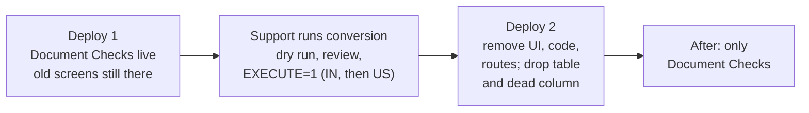

**UI: gone after deploy 2**

| What | Where today | After | How |
|---|---|---|---|
| Doc Questions list / new / edit / show / delete / Excel export | Settings → Doc Questions (`/doc_questions*`) | Gone; URLs 404 | Delete `DocQuestionsController`, its 11 views and the `resources :doc_questions` route; the menu entry now points to Document Checks (deploy 1) |
| Doc Questions Excel import | Import uploads → type "DocQuestion", sample `doc_questions.xlsx` | Gone from the type list; old upload records still viewable | Remove from `ImportUpload::TYPES` and the sample map; delete `public/sample_uploads/doc_questions.xlsx`; keep the `import_uploads` rows (history) |
| "Docs Validation" tab with raw JSON | KYC page | Replaced in deploy 1 by "Document checks (n)", which keeps "Earlier AI answers" | `_details.html.erb` |
| "Validate Document Data" (single, bulk) | KYC page, KYC list | Renamed "Check documents" in deploy 1, posting to `/doc_check_runs` | `show.html.erb`, `_show.html.erb`, `_bulk_actions.html.erb` |
| QnA tab on a document | Document page (only when `qna` set; 0 such documents in prod) | Gone | Remove the tab from `documents/_document_details.html.erb` (deploy 1) |
| Help link for `doc_questions` | `UserGuideHelper` map | Points to the Document Checks guide | Replace the key in deploy 1 |

**Code: gone after deploy 2**

| What | Why it can go | How |
|---|---|---|
| `DocLlmValidator` | Replaced by `DocumentReader` + `Judge` | Delete; port its one other caller, `AiDataManager#validate_document`, to `DocumentReader` (deploy 1) |
| `DocLlmValidationJob` | Replaced by `DocChecks::RunJob` | Delete |
| `DocLlmQnaJob` | Never called (dead code that shells out to `fabric`) | Delete |
| `VariableInterpolation` | Only `DocLlmValidator` used it; it is the `send`-on-user-text hole | Delete |
| `WithDocQuestions` | Replaced by the registry | Delete; remove the include from `InvestorKyc`, `Investor` and `AggregatePortfolioInvestment` |
| `DocQuestion` model, `DocQuestionPolicy` | Table dropped | Delete in deploy 2, with the table |
| `ImportDocQuestion`, `ImportDocQuestionService` | Import retired | Delete |
| `InvestorKyc#doc_questions`, `InvestorKycsController#validate_docs_with_ai`, member route `validate_docs_with_ai` | Replaced by the registry and `/doc_check_runs` | Delete (deploy 1, together with the button change) |
| `WorkflowChecks::InvestorKyc::Support#ai_answer_counts`, `#ai_validated_at` | The journey reads `Assessment` | Delete (deploy 1) |
| `Entity has_many :doc_questions` and the `doc_questions.each(&:really_destroy!)` loop | Table dropped | Replace with `has_many :doc_checks, dependent: :destroy` |
| `AiDataManager#extract_info`'s unused `DocQuestion.new(question:)` line | Dead | Delete |
| Features `ai/kyc_validation.feature`, `core/doc_question_import.feature`; steps `kyc_validation.rb`, `doc_question_import_steps.rb`; fixture `public/sample_uploads/kyc_validation_rules.xlsx`; the `DocQuestion` / `doc_question_answers` steps in `investor_kyc_journey_steps.rb` | Legacy tests | Delete, and rewrite the journey steps onto `DocCheck` |
| Documentation: the Doc Questions sections of `document_management_user_guide.md`, `ai_features_user_guide.md`, `investor_kyc_user_guide.md` and `documents_module_prd.md` | Feature gone | Rewrite to point to `document_checks_user_guide.md`. GTM decks under `docs/gtm` are left to marketing |

**DB: gone after deploy 2**

| What | Rows in prod (IN dump) | After | How |
|---|---|---|---|
| Table `doc_questions` | 72 | **Dropped** | Migration `drop_table :doc_questions`, guarded: it aborts unless every row has a `doc_checks.legacy_doc_question_id` or a "not converted" entry in `doc_check_conversion_log` (R5). Reversible by re-creating the table from `schema.rb` (data comes back from backup only) |
| Column `documents.qna` | 0 | **Dropped** | `ignored_columns` in deploy 1; `remove_column … algorithm: :instant` in deploy 2 |
| Column `investor_kycs.doc_question_answers` | 172 with content | **Kept**, read-only | Shown under "Earlier AI answers". Nothing writes it any more. Dropping it is a later, separate decision |
| Column `investor_kycs.all_docs_valid` | — | **Kept** | Now written only by `DocChecks::Kyc#on_assessed` |
| `import_uploads` rows of type DocQuestion | historical | **Kept** | History; the type can no longer be chosen |
| Entity permission `enable_doc_llm_validation` | — | **Kept** | Reused as the Document Checks switch; the label reads "Document checks (AI)" |
| Env `DOCUMENT_VALIDATION_PROVIDER`, `DOCUMENT_VALIDATION_MODEL` | — | **Kept** | Read by `DocumentReader` |

**What still references the old names, on purpose:** the policy predicate `validate_docs_with_ai?`
(internal; renaming churns every policy), the KYC button DOM id `investor_kyc_validate_docs_with_ai_btn`
(the journey's action target), the bulk action key `ValidateDocsWithAi` (saved in bulk-action URLs),
and the `doc_question_answers` column (history). The check task 6.x lists these as the only allowed
grep hits.

### Converting the legacy questions

**Conversion** (`rake doc_checks:convert_doc_questions [ENTITY_ID=] [EXECUTE=1]`,
`DocChecks::LegacyConverter`):

| Old | New |
|---|---|
| Entity's `doc_questions` with `for_class = InvestorKyc` | `doc_checks` with `record_type: "InvestorKyc"` |
| `document_name` | Same, if in `document_names(entity)` (case-insensitive); else not converted "Document X is not on the KYC document lists" |
| `qtype` extraction; validation/general starting "Extract" | `action: fill_in`; other validation → `action: question` |
| Question text with a `$placeholder` (e.g. "Is $full_name present") | Not converted: "Uses a $placeholder — set it up as a Compare check instead" (none in production; found in dev data) |
| `question` | `look_for` = question minus a leading "Extract (the) (field)", ≤ 100; `tip` = full question, ≤ 255 |
| "…field X…" in `response_hint` (`/field\s+([\w ]+)/i`) or else the look-for | `field_name` resolved by `parameterize.underscore` (the old rule), case-insensitively, against `fields_for`; unresolved → "Field X not found"; already used on the card → "Field X is already used on this document" |
| `id` | `legacy_doc_question_id` (idempotent) |

The output is a table per entity on stdout, converted (look-for → field) and not converted (question →
reason). With `EXECUTE=1` the not-converted rows are also written to `doc_check_conversion_log`
(question id, entity, reason, timestamp, a small table created in deploy 1 and dropped with
`doc_questions` in deploy 2). That way the drop guard can tell "reviewed and skipped" from "never
looked at". Nothing is written without `EXECUTE=1`.

**FAQ**

| Question | Answer |
|---|---|
| Where do I start reviewing? | The Part 2 picture, then card ⑥ (outcomes), card ⑦ (resolutions) and card ④ (run guarantees), then [Retirement](#retirement-what-will-not-exist-afterwards) and [lld.md Review Summary](lld.md#review-summary). |
| Why keep `doc_question_answers` but drop `doc_questions`? | The answers are per-KYC history users may need to see. The questions are configuration, fully represented by the converted checks plus the conversion log. |
| What if the conversion was never run on US? | The deploy-2 migration's guard refuses to drop the table on that environment until it is. |
| Is phase 2 (extractor agent, auto-check on upload) blocked by anything here? | No. It adds an `upload` trigger and maps the agent's rules to Fill in checks. |
