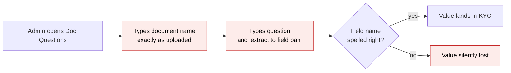
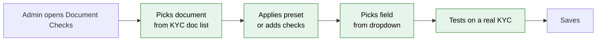
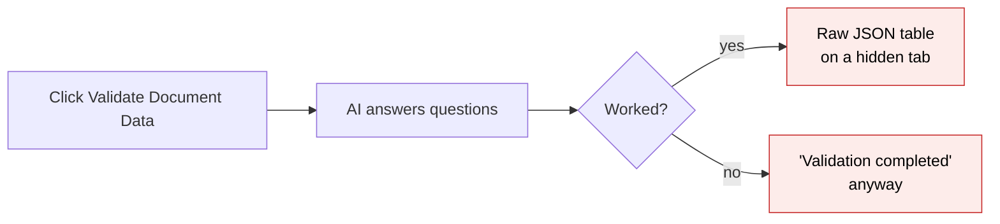
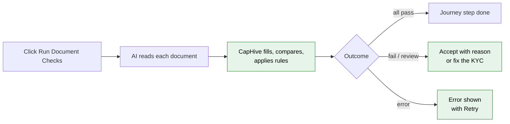

# Document Checks — Proposal

> **Audience:** Business team, product, QA, support — non-technical.
> **Companion document:** [Design](design.md)

> **Planning phase — no code changes.** This document proposes and explains the change. Do not
> edit application code while writing it; implementation happens later, in the tasks phase.

---

## Why

Fund teams want the AI to read the documents investors upload (CML, PAN card, passport) and either
fill KYC fields from them or confirm that the KYC matches them. Today's tool for this, **Doc
Questions**, is hard to set up and hard to trust:

- The target field is typed as free English inside a hint ("extract to field pan"). Of the 72
  questions live in production, many name fields that don't exist (`PANB`, `mobil_contact`,
  "Bank Name"), so values silently go nowhere.
- Document names are free text and must match the uploaded file's name exactly.
- Results are a raw table of JSON on a hidden tab. Failures (unreadable file, AI unavailable) are
  reported as "validation completed".
- Old answers are never cleared, so a KYC can stay "invalid" forever because of a document that
  was deleted months ago.
- Question text can reference KYC values as `$field`, a mechanism that can run unintended code
  on the KYC.

Production usage is light: 6 funds, 72 questions, 172 KYCs with stored answers. Almost all of it
is *extraction* from one document type (CML). That makes now a cheap moment to replace it with
something people can set up in minutes and whose results they can read.

## What Changes

**Document Checks** replace Doc Questions. Think of it as a checklist the AI fills in for each
document. The admin says *which document* and *what to read from it* by choosing from lists. The
AI only reads values off the page. CapHive itself decides whether a value fills a field, matches
the KYC, or breaks a rule, and shows every outcome on the KYC.

- **New:** a *Document Checks* settings page. For each record type (KYC first), pick documents
  from the entity's existing KYC document list and add checks of three kinds:
  - **Extract**: read a value and fill a KYC field.
  - **Match**: read a value and compare it with a KYC field.
  - **Rule**: answer a yes/no question about the document.
- **New:** fields are picked from a dropdown of the KYC's real fields and custom fields. Nothing
  is typed.
- **New:** ready-made **presets** for CML, PAN card, Aadhaar and Passport add the standard checks
  in one click.
- **New:** **Test on a KYC**: see what the checks would do to one real KYC without changing it.
- **New:** a **Document Checks panel** on each KYC. Every check shows its result, the value read
  from the document, the KYC's value, and a reason. A failed check can be **Accepted** with a
  reason, or fixed.
- **New:** an entity-wide **Document Check results** page listing every failure, error and
  out-of-date result, with filters and bulk re-run.
- **Changed:** "Validate Document Data" (single and bulk) now runs Document Checks.
- **Changed:** the KYC journey's *Validate documents* step reads Document Check results. A
  re-uploaded document marks its results out of date, and the step goes back to waiting.
- **Changed:** errors are reported as errors. A run that couldn't read a file says so on the KYC
  and in the notification.
- **BREAKING:** the *Doc Questions* screens and their import are removed. A one-off conversion
  turns each fund's existing questions into Document Checks (see FAQ). Old stored answers stay
  visible on the KYC under "Earlier AI answers".
- **Unchanged in this phase:** the documents-first KYC form's AI pre-fill (the *KYC Document
  Extractor* support agent). It moves onto Document Checks in phase 2.

### Flow Diagram

**Setting up what the AI reads.** Before: free-text questions with the field name typed in a hint.
After: pick a document, pick a field.





**Running and reading results.** Before: answers in a JSON table, errors reported as success.
After: a checklist per document, with errors and stale results shown.





---

## User Stories

### US-1: Set up checks for a document in minutes

**As a** fund admin,
**I want** to pick a document and choose which KYC fields the AI should fill or compare,
**So that** I don't have to know field names or write prompts.

**Acceptance criteria:**
- Settings → *Document Checks* lists one check set per record type and KYC type, e.g.
  "Investor KYC — Individual", "Investor KYC — Non-individual" and "Investor KYC — All".
- *Add document* offers only names from the entity's individual / non-individual KYC document
  list, plus the KYC form's required file fields.
- Each check row has: Kind (Extract / Match / Rule), Label, Hint (optional), Field (dropdown;
  Extract and Match only), and for Extract, *Fill when* (Only if empty / Always). Rules also have
  an *Expect* (Yes / No).
- The Field dropdown lists the KYC's standard fields and the custom fields of its form, by their
  on-screen labels.
- Saving a check whose field no longer exists is refused with "Choose a field from the list".

### US-2: Start from a preset

**As a** fund admin,
**I want** to apply a "CML" preset,
**So that** the standard depository fields are set up without my typing them.

**Acceptance criteria:**
- *Apply preset* offers CML, PAN card, Aadhaar and Passport.
- Applying CML adds checks for DP ID, Client ID, First holder name, PAN, Address, Bank account
  number, IFSC code, Email and Mobile.
- Each preset check is mapped to the KYC field with the same name when one exists. Otherwise its
  Field is left empty and the row shows "Pick a field before saving".
- Applying a preset twice doesn't duplicate checks that are already there.

### US-3: Try checks on a real KYC before using them

**As a** fund admin,
**I want** to run my checks against one KYC and see what would happen,
**So that** I can tune labels and hints without changing any investor's data.

**Acceptance criteria:**
- *Test on a KYC* lets me search for and pick a KYC, then shows the results panel for it, marked
  "Test run — nothing was saved to this KYC".
- No KYC field is changed, and the KYC's own results and journey are unaffected.

### US-4: Run checks and read the results on a KYC

**As a** fund user reviewing a KYC,
**I want** each document's checks listed with what the AI read and what the KYC says,
**So that** I can see at a glance what passed, what failed and why.

**Acceptance criteria:**
- *Run Document Checks* (formerly *Validate Document Data*) starts a run. The panel immediately
  shows "Running…", then updates without a page reload.
- Each document group shows "✓ N / M passed", "✗ N failed", "⚠ error" or "— not uploaded".
- Each check row shows its status icon, label, value read from the document, KYC value (Match),
  and what happened ("Filled DP ID", "Kept existing value 86478611", "Not found on the document").
- The panel header shows the last run's time and counts, e.g. "Last run 2 Oct 2026 14:10 ·
  9 passed · 1 failed · 1 error".

### US-5: Resolve a failed check

**As a** fund user,
**I want** to accept a mismatch I've verified myself, or fix the KYC,
**So that** a legitimate difference doesn't block the KYC.

**Acceptance criteria:**
- A failed or needs-review row has **Accept** and **Fix** buttons.
- Accept asks for a reason (required) and marks the row "Accepted by Priya Shah — 'Initial
  matches passport'". The KYC is then re-assessed.
- Fix opens the KYC's edit form.

### US-6: See problems across all KYCs

**As a** compliance lead,
**I want** one list of failed, errored and out-of-date checks across the entity,
**So that** I can spot patterns (e.g. a CML format the AI can't read) and re-run in bulk.

**Acceptance criteria:**
- *Document Check results* lists rows with KYC, document, check, status and last run date.
- Filters: status, document, check set, date range.
- *Re-run selected* starts runs for the selected KYCs.

### US-7: Keep my existing questions

**As a** fund that used Doc Questions,
**I want** my questions turned into Document Checks,
**So that** I don't have to set everything up again.

**Acceptance criteria:**
- Support runs a conversion that first produces a report per fund: converted checks, the field
  each one maps to, and anything it couldn't map.
- Unmapped items are listed for a person to decide on. Nothing is guessed.
- After conversion the fund's checks appear in its *Investor KYC — All* check set.

---

## UI Behavior

### Settings → Document Checks → Investor KYC — Individual

```
┌──────────────────────────────────────────────────────────────────────────────┐
│ Document Checks › Investor KYC — Individual                                    │
│ [Apply preset ▾]   [Test on a KYC]                         [Save]  [Cancel]   │
│                                                                               │
│ CML                                                         [+ Add check] [🗑] │
│ ┌──────────┬───────────────────┬──────────────────────┬─────────────┬───────┐ │
│ │ Kind     │ Label             │ Hint                 │ Field       │ Fill  │ │
│ ├──────────┼───────────────────┼──────────────────────┼─────────────┼───────┤ │
│ │ Extract ▾│ DP ID             │ 8 chars, alphanumeric│ DP ID     ▾ │ Empty▾│ │
│ │ Extract ▾│ Client ID         │ 8 digits             │ Client ID ▾ │ Empty▾│ │
│ │ Match   ▾│ PAN               │                      │ PAN       ▾ │       │ │
│ │ Match   ▾│ First holder name │                      │ Full name ▾ │       │ │
│ │ Rule    ▾│ Signed by holder? │                      │ Expect: Yes▾│       │ │
│ └──────────┴───────────────────┴──────────────────────┴─────────────┴───────┘ │
│                                                                               │
│ PAN Card                                                    [+ Add check] [🗑] │
│ │ Match   ▾│ Name              │                      │ Full name ▾ │       │ │
│                                                                               │
│ [+ Add document ▾]   ← CML, PAN Card, Passport, Address Proof …               │
└──────────────────────────────────────────────────────────────────────────────┘
```

**Behavior notes:**
- Changing Kind to Rule hides Field and Fill and shows Expect. Changing to Match hides Fill.
- *Add document* lists only document names not already in the set.
- *Test on a KYC* opens a picker. The test result appears below the form in the same panel used
  on KYCs, with the "Test run" banner.

### KYC → Document Checks tab (replaces "Docs Validation")

```
┌──────────────────────────────────────────────────────────────────────────────┐
│ Document Checks   Last run 2 Oct 2026 14:10 · 9 passed · 1 failed · 1 error    │
│                                                      [Run Document Checks]    │
│ CML                                                          ✓ 6 / 7 passed   │
│   ✓ DP ID          IN303622                       Filled DP ID                │
│   ✓ Client ID      86478611                       Kept existing value         │
│   ✗ PAN            Document ABCPK1234F  ·  KYC ABCPK1243F   [Accept] [Fix]    │
│   ? First holder   Document R. Kumar  ·  KYC Ravi Kumar     [Accept] [Fix]    │
│ PAN Card                                                     ⚠ error          │
│   Can't read this file type — upload a PDF or image           [Retry]         │
│ Passport                                                     — not uploaded   │
│                                                                               │
│ ▸ Earlier AI answers (before Document Checks)                                 │
└──────────────────────────────────────────────────────────────────────────────┘
```

**Behavior notes:**
- While a run is in progress the header reads "Running… started 14:09" and the button is
  disabled.
- A document re-uploaded after the last run shows "⟳ Out of date — document changed after this
  run" on its group.
- "Earlier AI answers" appears only on KYCs that have Doc Questions answers, and is collapsed.
- Investor users never see this tab.

### Document Check results (entity-wide)

```
┌──────────────────────────────────────────────────────────────────────────────┐
│ Document Check results         Status [Failed, Error, Out of date ▾]          │
│                                Document [Any ▾]  Set [Any ▾]  Date [Last 30d] │
│ ☐ KYC            Document   Check        Status        Last run               │
│ ☐ Asha Rao       CML        PAN          ✗ Failed      02/10/2026             │
│ ☐ R. Mehta       PAN Card   —            ⚠ Error       01/10/2026             │
│ ☐ Kiran Iyer     CML        DP ID        ⟳ Out of date 28/09/2026             │
│                                                       [Re-run selected]       │
└──────────────────────────────────────────────────────────────────────────────┘
```

---

## What This Feature Does NOT Cover

| Excluded | Covered In |
|---|---|
| Moving the documents-first KYC form's AI pre-fill (KYC Document Extractor agent) onto Document Checks | Phase 2 |
| Re-running checks automatically when a document is uploaded | Phase 2 |
| Document Checks for investors, offers, commitments, deals | Phase 3 (the design is record-type neutral) |
| Reading Word (.doc/.docx) files | Not planned; shown as an error asking for a PDF or image |
| Free-form AI questions with answers that don't fill or check anything ("General" questions) | Dropped; none exist in production |

---

## Validation Rules

| Field | Rule | Default |
|---|---|---|
| Check set | One set per record type and KYC type (Individual / Non-individual / All) per entity | — |
| Document | Required; must be on the entity's KYC document list or a required file field | — |
| Kind | Extract, Match or Rule | Extract |
| Label | Required, up to 100 characters, unique within the document | — |
| Hint | Optional, up to 255 characters | empty |
| Field | Required for Extract and Match; must be one of the listed fields. Error: "Choose a field from the list" | — |
| Fill when | Extract only: Only if empty / Always | Only if empty |
| Expect | Rule only: Yes / No | Yes |
| Accept reason | Required, up to 255 characters. Error: "Give a reason for accepting" | — |

---

## Behavior Rules

| Scenario | What User Sees |
|---|---|
| Run started | Notification "Document Checks started for Asha Rao"; panel shows "Running…" |
| Run finished, no problems | Notification "Document Checks finished for Asha Rao: 11 passed" |
| Run finished with problems | Notification "Document Checks finished for Asha Rao: 9 passed, 1 failed, 1 error" (shown as a warning) |
| Run couldn't start (AI service unavailable) | Notification "Document Checks could not run for Asha Rao: the AI service is unavailable. Try again later." Panel shows the same text |
| Document type not uploaded | Group shows "— not uploaded"; its checks are skipped; the KYC is not counted as validated |
| File type can't be read | Group shows "⚠ Can't read this file type — upload a PDF or image" with Retry |
| AI reply couldn't be understood | Group shows "⚠ The AI's reply couldn't be read — try again" with Retry; other documents still checked |
| Extract value found, field empty | "Filled <field label>" |
| Extract value found, field already set (Only if empty) | "Kept existing value <value>" — passes |
| Extract value not on document | "? Not found on the document" — needs review |
| Match: identifier differs (PAN, IFSC, account no.) | "✗ Document X · KYC Y" — failed |
| Match: same after ignoring case, spaces, punctuation | ✓ passed |
| Match: name or address differs | "? Document X · KYC Y" — needs review |
| Rule answered as expected / not | ✓ passed / ✗ failed, with the AI's reason |
| Run requested while one is running | "Document Checks are already running for Asha Rao" — no second run |
| Document re-uploaded after a run | "⟳ Out of date — document changed after this run"; journey step back to waiting |
| Field removed from the KYC form after setup | Settings row shows "This field no longer exists — pick another"; at run time the check is an error "Field no longer exists" |
| Run on a verified KYC (bulk) | Skipped with "Cannot modify verified KYC" (as today) |
| No check sets yet | Settings page: "No Document Checks set up yet — Add set" |
| KYC never checked | Panel: "Not checked yet" with the Run Document Checks button |
| Results list with nothing to show | "No problems found" |
| Accept refused | "Give a reason for accepting" |

---

## Resolved Design Decisions

| # | Decision | Resolution |
|---|---|---|
| 1 | Who decides if a value matches: the AI or CapHive? | CapHive. The AI only reads values; comparison happens in CapHive, so both values can be shown |
| 2 | Free-text or picked fields? | Picked from a list of the record's fields and custom fields only |
| 3 | Where document names come from | The entity's existing KYC document lists and required file fields, the same source the journey's *Upload documents* step uses |
| 4 | What happens to Doc Questions | Screens removed. Existing questions are converted by a support-run task with a review report. Old answers stay viewable |
| 5 | KYC Document Extractor agent | Kept unchanged now; folded into Document Checks in phase 2 |
| 6 | Name/address mismatch | Needs review (not failed). See design open question 1 |
| 7 | Who sees results | Fund users who can view the KYC. Never investors |
| 8 | Which setting turns it on | The existing "Doc LLM validation" entity permission |

---

## Capabilities

### New Capabilities

- `documents/document-checks`: configuring per-document AI checks (extract, match, rule) for a
  record type, running them, storing per-check results, resolving failures, the KYC journey's
  use of them, and converting legacy Doc Questions.

### Modified Capabilities

None. The KYC journey (`kyc/investor-kyc-journey`) is still an open change. Its *Validate
documents* requirement is restated inside `documents/document-checks`.

---

## Impact

- **New:** Document Checks settings page, results panel on the KYC page, entity-wide results page.
- **Changed:** KYC page (*Docs Validation* tab becomes *Document Checks*), KYC bulk actions
  (*Validate Document Data* becomes *Run Document Checks*), KYC journey *Validate documents*
  step, notifications for validation runs.
- **Removed:** Doc Questions settings, its import from Excel, and the old AI validation code.
- **Data:** four new tables. Doc Questions data stays in place, read-only, for conversion and
  history.
- **AI usage:** about the same as today, one AI call per document per run.

---

## Benefits

1. Setup in minutes: choose a document, apply a preset, pick fields. No prompt-writing or field
   names to remember.
2. Values always land in the field chosen, and a broken mapping is flagged instead of silently
   dropped.
3. Results anyone can read: what the document says, what the KYC says, and why it passed or
   failed.
4. Errors are visible and retryable, never reported as success.
5. Results stay current: a re-uploaded document marks its checks out of date automatically.
6. One place to see problems across all KYCs, with bulk re-run.
7. Built once for any record type, so future investor, offer or deal checks need no new tool.

---

## FAQ

| Question | Answer |
|---|---|
| Who can set up checks? | Fund users of an entity with the "Doc LLM validation" permission turned on, the same permission that shows Doc Questions today |
| Who sees the results? | Fund users who can view the KYC. Investors never see them |
| What happens to our existing Doc Questions? | Support runs a conversion. It first shows a report (what converts, which field each maps to, what can't be mapped). Once approved, the questions become checks in your "Investor KYC — All" set. Items that couldn't be mapped are listed for you to finish by hand |
| Will our KYCs' current AI answers disappear? | No. They stay visible under "Earlier AI answers" on each KYC |
| Does a check ever overwrite data the investor typed? | Only if the Extract check is set to "Always". The default, "Only if empty", never overwrites |
| Does "Test on a KYC" change anything? | No. It shows what would happen; nothing is saved to the KYC |
| Do checks run on their own when an investor uploads a document? | Not in this phase. Results are marked out of date and someone clicks Run. Automatic runs come in phase 2 |
| Does this cost more AI usage? | About the same: one AI call per document per run, as today |
| What if the AI service is down? | The run says it couldn't run and why. Nothing on the KYC changes. Retry later |
| Can we use this for investors or deals? | Not yet. KYC comes first; the setup works for other record types in a later phase |
| Does the KYC documents-first form still pre-fill? | Yes, unchanged. It moves onto Document Checks in phase 2 |

---

## Design Principle for the Next Phase

- **Reuse, don't rebuild:**
  - the existing AI plumbing (provider selection and file-to-image conversion used by today's
    validator);
  - the existing document-name matching used by the journey's *Upload documents* step;
  - the existing journey hooks;
  - the existing bulk-action job.
- **Risk: a generic "any record type" engine growing into a framework.** Keep it to one small
  registry entry per record type (its fields, its document names, its variants). KYC is the
  only entry in phase 1.
- **Risk: matching rules growing.** Two comparison modes only (exact-after-normalising, and
  names/addresses → needs review). No similarity scores.
- **Risk: field writes bypassing safety.** Writes go only to fields on the registry's allowlist,
  never to a name taken from the AI's reply.
