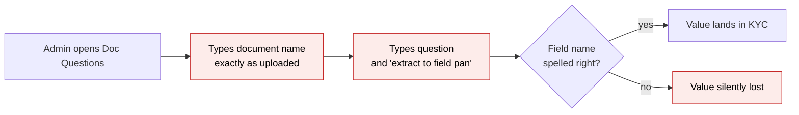
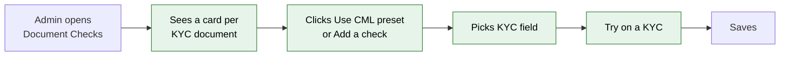
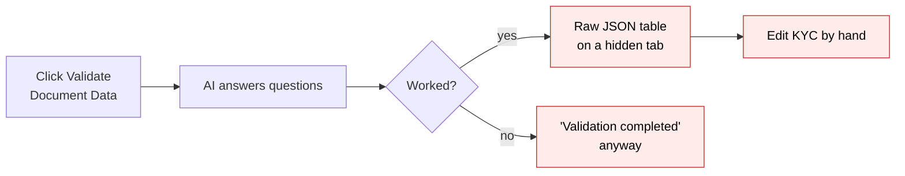
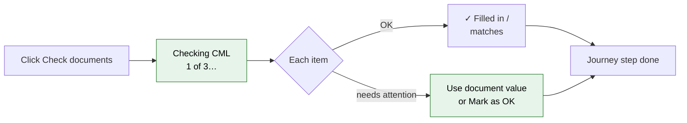

# Document Checks — Proposal

> **Audience:** Business team, product, QA, support — non-technical.
> **Companion document:** [Design](design.md)

> **Planning phase — no code changes.** This document proposes and explains the change. Do not
> edit application code while writing it; implementation happens later, in the tasks phase.

---

## Why

Fund teams want the AI to read the documents investors upload (CML, PAN card, passport) and either
fill KYC fields from them or confirm that the KYC matches them. Today's tool for this, **Doc
Questions**, is hard to set up and hard to trust:

- The target field is typed as free English inside a hint ("extract to field pan"). Of the 72
  questions live in production, many name fields that don't exist (`PANB`, `mobil_contact`,
  "Bank Name"), so values silently go nowhere.
- Document names are free text and must match the uploaded file's name exactly.
- Results are a raw table of JSON on a hidden tab. Failures (unreadable file, AI unavailable) are
  reported as "validation completed".
- Old answers are never cleared, so a KYC can stay "invalid" forever because of a document that
  was deleted months ago.
- Question text can reference KYC values as `$field`, a mechanism that can run unintended code on
  the KYC.

Production usage is light: 6 funds, 72 questions, 172 KYCs with stored answers. Almost all of it is
*filling fields* from one document type (CML). That makes now a cheap moment to replace it with
something people can set up in minutes and whose results anyone can act on.

## What Changes

**Document Checks** replace Doc Questions. Think of it as a checklist the AI fills in for each
document. The admin picks a document and a KYC field. The AI reads the value off the page.
CapHive fills the field, or compares it with what the KYC says. Each item ends up either
**✓ OK** or **⚠ Needs attention**, with a plain reason and a one-click way to resolve it.

**Usability rules this design follows**

1. **Nothing to type that could be wrong.** Documents and fields are picked from lists, and the
   text to look for fills itself in.
2. **Never an error state you didn't cause.** Presets only add what they can map, and saving
   refuses anything incomplete, on the row itself.
3. **Two outcomes only.** ✓ OK or ⚠ Needs attention, always with a one-line reason in plain
   words.
4. **Fix where you see it.** *Use document value* and *Mark as OK* sit on the row, and Mark as OK
   can be undone.
5. **Always say what is happening.** Progress while checking, the time of the last check, and a
   clear message when something couldn't run, with the earlier results still shown.

**Changes**

- **New:** Settings → *Document Checks* → *Investor KYC*. Every document on the entity's KYC
  document lists (individual, non-individual, and the KYC form's required file fields) is shown as
  a card. Each card has its checks, or "No checks yet" with **Use <preset> preset** (CML, PAN
  card, Aadhaar, Passport) and **Add a check**.
- **New:** a check is one row:
  - **What to do**: *Fill in* / *Compare* / *Yes-no question*.
  - **KYC field**: picked from the KYC's fields and custom fields.
  - **Look for**: filled in from the field's label, editable.
  - **Tip for the AI**: optional.

  *Fill in* has **Replace existing values**, off by default. A *Yes-no question* has **Expected
  answer** in place of the KYC field.
- **New:** **Try on a KYC**: see exactly what would happen on one real KYC, with nothing changed.
- **New:** a **Document checks** tab on each KYC, with a count of items needing attention. Each
  document lists its items as ✓ OK or ⚠ Needs attention, with the reason and the actions **Use
  document value**, **Mark as OK** and **Check again**.
- **New:** **Documents needing attention**, an entity-wide list with filters and *Check again* for
  selected KYCs.
- **Changed:** *Validate Document Data* (single and bulk) becomes **Check documents**.
- **Changed:** the KYC journey's *Validate documents* step reads Document Checks. A re-uploaded
  document marks its items "Document changed — check again", and the step goes back to waiting.
- **BREAKING:** the *Doc Questions* screens and their Excel import are removed. A one-off
  conversion turns each fund's existing questions into Document Checks (see FAQ). Old stored
  answers stay visible on the KYC under "Earlier AI answers".
- **Unchanged in this phase:** the documents-first KYC form's AI pre-fill (the *KYC Document
  Extractor* support agent). It moves onto Document Checks in phase 2.

### Flow Diagram

**Setting up what the AI reads.** Before: free-text questions with the field name typed in a hint.
After: pick a field on a document card.





**Running and resolving.** Before: answers in a JSON table, errors reported as success. After:
OK / Needs attention per item, resolved on the spot.





### What this retires

Once each fund's questions have been converted, Doc Questions is removed completely. It goes in two
steps: Document Checks goes live first, Support converts and reviews, and only then is the old
feature removed.

| Area | No longer present afterwards | What replaces it |
|---|---|---|
| Screens | Settings → **Doc Questions** (list, add, edit, delete, Excel export) | Settings → **Document Checks** |
| Screens | **DocQuestion** as an import type, and its sample Excel file | Presets and the conversion (earlier import records stay viewable) |
| Screens | KYC **Docs Validation** tab with the raw answers table | **Document checks** tab (earlier answers kept under "Earlier AI answers") |
| Screens | **Validate Document Data** button / bulk action name | **Check documents** |
| Screens | The unused **QnA** tab on a document page | — |
| Data | The stored Doc Questions (72 in production) | Document Checks, after conversion. Removal is blocked until every question is converted or reviewed |
| Data | The unused document QnA field (empty in production) | — |
| Data | *Kept:* each KYC's earlier AI answers, the "Doc LLM validation" permission, and earlier import records | — |
| Behind the scenes | The old AI validator, its background job, the unused QnA job, the `$field` placeholder mechanism, and the Excel importer | The Document Checks engine. The AI rules tool that used the old validator is moved onto it |

---

## User Stories

### US-1: Set up checks in minutes

**As a** fund admin,
**I want** to see each KYC document and choose which KYC fields the AI should fill in or compare,
**So that** I don't have to know field names or write prompts.

**Acceptance criteria:**
- Settings → *Document Checks* → *Investor KYC* shows one card per document on the entity's
  individual and non-individual KYC document lists and the KYC form's required file fields. Each
  name appears once.
- Cards with checks come first, with the number of checks in the header. Cards without checks are
  listed below under "Other documents" with "No checks yet".
- *Add a check* adds a row: What to do = Fill in, with KYC field empty and focused.
- Picking a KYC field fills *Look for* with the field's on-screen label, e.g. "DP ID". Changing it
  is allowed.
- Choosing *Yes-no question* replaces the KYC field with *Expected answer* (Yes / No, default Yes),
  and *Look for* becomes *Question*.
- *Replace existing values* is shown only for Fill in, and is off by default.
- Each card has its own **Save**. Incomplete rows are marked on the row and the card isn't saved
  until they're fixed.

### US-2: Start from a preset

**As a** fund admin,
**I want** one click to add the standard checks for a CML,
**So that** I don't have to set them up one by one.

**Acceptance criteria:**
- A card whose document name contains "CML", "PAN", "Aadhaar" or "Passport" (any case) offers
  **Use <name> preset**. Other cards don't show the button.
- The CML preset adds Fill in rows for DP ID, Client ID, Address, Bank account number and IFSC code,
  Compare rows for PAN and Full name, and the question "Is it signed by the holder?". It only adds
  the ones whose field exists on the KYC.
- Items it could not add are listed under the card: "Not added: Email, Mobile — your KYC form has
  no matching field. Add a custom field to the KYC form, then use the preset again."
- Items already on the card aren't added again.
- The added rows are unsaved until *Save*. Cancel removes them.

### US-3: Try before using

**As a** fund admin,
**I want** to run my checks on one real KYC and see what would happen,
**So that** I can adjust them without changing any investor's data.

**Acceptance criteria:**
- **Try on a KYC** (page header) asks for a KYC (search by name). It shows the same results view
  used on KYCs, with a banner: "Trial run — nothing on this KYC was changed."
- No field on the KYC changes. The KYC's own tab, journey and the attention list are unaffected.

### US-4: Check a KYC's documents and see the outcome

**As a** fund user reviewing a KYC,
**I want** each document's items marked OK or needing attention, with the reason,
**So that** I can see at a glance what needs me.

**Acceptance criteria:**
- **Check documents** starts a check. The tab shows "Checking CML (1 of 3)…" and moves on
  document by document, without a page reload.
- The tab title shows the number of items needing attention, e.g. "Document checks (2)", or no
  number when all are OK.
- The header shows "Checked 2 Oct 2026, 14:10 — all OK" or "— 2 need attention".
- Each document shows "✓ All OK" or "⚠ 1 needs attention". OK documents are collapsed by default,
  and attention documents are open.
- OK rows read e.g. "✓ DP ID — filled in: IN303622", "✓ PAN — matches",
  "✓ Client ID — kept your value 86478612 (document says 86478611)".
- Only documents on *this KYC's* document list are shown, so a company's KYC never shows a missing
  Passport.

### US-5: Resolve an item on the spot

**As a** fund user,
**I want** to fix a mismatch with one click, or mark it OK with a reason,
**So that** a legitimate difference doesn't hold the KYC up, and a typo is fixed immediately.

**Acceptance criteria:**
- A *doesn't match* row shows "Document: ABCPK1234F · KYC: ABCPK1243F" with **Use document value**
  and **Mark as OK**.
- *Use document value* asks "Change PAN from ABCPK1243F to ABCPK1234F?". On confirm the KYC is
  updated and the row reads "✓ PAN — updated from the document by Priya Shah".
- *Mark as OK* opens a reason box: "Why is this OK?", placeholder "e.g. Initial matches passport".
  Saving shows "✓ Marked OK by Priya Shah: Initial matches passport" with **Undo**.
- *Undo* puts the row back to Needs attention.
- Rows that can't be resolved by a click (document not uploaded, couldn't read the file, document
  changed) show the action that helps: **Check again**, or the upload hint.

### US-6: See everything needing attention

**As a** compliance lead,
**I want** one list of items needing attention across all KYCs,
**So that** I can work through them and spot patterns.

**Acceptance criteria:**
- *Documents needing attention* (KYC menu) lists KYC, document, item, reason and checked date,
  newest first.
- Filters: reason (Doesn't match, Not found, Unexpected answer, Couldn't read, Not uploaded,
  Document changed), document, and checked date.
- Selecting rows and clicking **Check again** queues a check for each selected KYC.
- With nothing needing attention, the list says "Nothing needs attention."

### US-7: Keep my existing questions

**As a** fund that used Doc Questions,
**I want** my questions turned into Document Checks,
**So that** I don't have to set everything up again.

**Acceptance criteria:**
- Support runs a conversion that first produces a report per fund: what converts (document, field)
  and what can't (with the reason). Nothing changes until support confirms.
- After conversion the fund's checks appear on the Investor KYC Document Checks page.
- Items that can't be converted are listed for a person to decide on. Nothing is guessed.

---

## UI Behavior

### Settings → Document Checks → Investor KYC

```
┌──────────────────────────────────────────────────────────────────────────────────┐
│ Document Checks · Investor KYC                                    [Try on a KYC]  │
│ The AI reads these from each KYC's documents. You decide what happens.            │
│                                                                                   │
│ ┌ CML · 8 checks ──────────────────────────────────────────────────────────────┐ │
│ │ What to do      KYC field          Look for            Tip for the AI         │ │
│ │ [Fill in    ▾]  [DP ID          ▾] [DP ID            ] [8 chars, starts IN ]  │ │
│ │                 ☐ Replace existing values                                 [✕] │ │
│ │ [Fill in    ▾]  [Client ID      ▾] [Client ID        ] [8 digits           ]  │ │
│ │ [Compare    ▾]  [PAN            ▾] [PAN              ] [                   ]  │ │
│ │ [Compare    ▾]  [Full name      ▾] [First holder name] [                   ]  │ │
│ │ [Yes-no     ▾]  Expected [Yes ▾]   [Is it signed by the holder?            ]  │ │
│ │ [+ Add a check]                                          [Cancel]  [Save]     │ │
│ └──────────────────────────────────────────────────────────────────────────────┘ │
│                                                                                   │
│ Other documents                                                                   │
│ ┌ PAN Card · No checks yet ──────────── [Use PAN card preset] [+ Add a check] ──┐ │
│ ┌ Passport · No checks yet ──────────── [Use Passport preset] [+ Add a check] ──┐ │
│ ┌ Address Proof · No checks yet ───────────────────────────── [+ Add a check] ──┐ │
└──────────────────────────────────────────────────────────────────────────────────┘
```

**Behavior notes:**
- Changing *What to do* changes the row in place. Yes-no shows Expected + Question. Compare hides
  *Replace existing values*.
- The KYC field dropdown lists fields by their on-screen label, standard fields first, then custom
  fields. A field already used on this card is greyed out ("already used on this card").
- Each card saves on its own, with no page reload. Unsaved changes show "Unsaved changes" next to
  Save, and leaving the page asks for confirmation.
- If a check uses a field that was later removed from the KYC form, a banner at the top says "1
  check uses a field that no longer exists — Show me". The row itself is outlined with "This field
  no longer exists — pick another".
- With no documents on the KYC lists: "Add the documents you collect in Settings → KYC documents.
  They'll appear here."

### KYC → Document checks tab (replaces "Docs Validation")

```
┌──────────────────────────────────────────────────────────────────────────────────┐
│ Document checks (2)                                                               │
│ Checked 2 Oct 2026, 14:10 — 2 need attention                  [Check documents]   │
│                                                                                   │
│ ▾ CML · ⚠ 1 needs attention                                                       │
│   ✓ DP ID — filled in: IN303622                                                   │
│   ✓ Client ID — kept your value 86478612 (document says 86478611)                 │
│   ⚠ PAN — doesn't match                                                           │
│       Document: ABCPK1234F · KYC: ABCPK1243F   [Use document value] [Mark as OK]  │
│   ✓ Is it signed by the holder? — Yes                                             │
│ ▾ PAN Card · ⚠ 1 needs attention                                                  │
│   ⚠ Couldn't read this file — upload it as a PDF or image        [Check again]    │
│ ▸ Passport · ✓ All OK                                                             │
│                                                                                   │
│ ▸ Earlier AI answers (before Document Checks)                                     │
└──────────────────────────────────────────────────────────────────────────────────┘
```

**Behavior notes:**
- While checking: header "Checking PAN Card (2 of 3)…", Check documents disabled, earlier results
  still shown, dimmed.
- If the last attempt couldn't run, a banner above the results says: "Couldn't check documents on
  3 Oct, 10:02 — the AI service is unavailable. Your earlier results are below." with **Try
  again**.
- A document replaced after the check shows "⚠ Document changed after this check" with **Check
  again** in place of its items.
- Never checked: "These documents haven't been checked yet." with **Check documents**. Entity has no
  checks: "No document checks are set up — Set up checks" (link shown to users who can set up).
- Investor users never see this tab.

### Documents needing attention (entity-wide)

```
┌──────────────────────────────────────────────────────────────────────────────────┐
│ Documents needing attention                                                       │
│ Reason [Any ▾]   Document [Any ▾]   Checked [Last 30 days ▾]                      │
│ ☐ KYC          Document   Item        Reason              Checked                 │
│ ☐ Asha Rao     CML        PAN         Doesn't match       02/10/2026              │
│ ☐ R. Mehta     PAN Card   —           Couldn't read file  01/10/2026              │
│ ☐ Kiran Iyer   CML        —           Document changed    28/09/2026              │
│                                                         [Check again (0)]        │
└──────────────────────────────────────────────────────────────────────────────────┘
```

**Behavior notes:** clicking a row opens that KYC's Document checks tab. The Check again button shows
the number selected and is disabled at 0.

---

## What This Feature Does NOT Cover

| Excluded | Covered In |
|---|---|
| Moving the documents-first KYC form's AI pre-fill (KYC Document Extractor agent) onto Document Checks | Phase 2 |
| Checking automatically when a document is uploaded | Phase 2 |
| Document Checks for investors, offers, commitments, deals | Phase 3 (the design is record-type neutral) |
| Different checks for the same document on individual vs non-individual KYCs | Not needed today. A document's checks apply wherever that document is on the KYC's list |
| Reading Word (.doc/.docx) files | Not planned. Shown as "Couldn't read this file — upload it as a PDF or image" |
| Free-form AI questions whose answer fills or checks nothing | Dropped; none exist in production |

---

## Validation Rules

| Field | Rule | Default |
|---|---|---|
| What to do | Fill in, Compare or Yes-no question | Fill in |
| KYC field | Required for Fill in and Compare; one of the listed fields; once per document card. Errors: "Pick a KYC field", "Already used on this card" | — |
| Look for / Question | Required, up to 100 characters. Error: "Say what to look for" | Field's label |
| Tip for the AI | Optional, up to 255 characters | empty |
| Replace existing values | Fill in only | Off |
| Expected answer | Yes-no only: Yes / No | Yes |
| Mark as OK reason | Required, up to 255 characters. Error: "Say why this is OK" | — |

---

## Behavior Rules

| Scenario | What User Sees |
|---|---|
| Check started | Toast "Checking documents for Asha Rao…"; tab header "Checking CML (1 of 3)…" |
| Finished, all OK | Toast "Documents checked for Asha Rao — all OK" |
| Finished, some need attention | Toast (warning) "Documents checked for Asha Rao — 2 need attention" |
| Couldn't run (AI service unavailable) | Toast (error) "Couldn't check documents for Asha Rao — the AI service is unavailable. Try again later."; banner on the tab; earlier results still shown; nothing on the KYC changed |
| Check requested while one is running | "Documents are already being checked for Asha Rao" |
| Fill in, field empty | "✓ <field> — filled in: <value>" |
| Fill in, field has a value, Replace off | "✓ <field> — kept your value <value> (document says <doc value>)", or just "— kept your value" when equal |
| Fill in, Replace on | "✓ <field> — replaced <old> with <value>" |
| Value not on the document | "⚠ <field> — not found on this document" + Mark as OK |
| Compare, equal after ignoring case, spaces and punctuation (and word order for names/addresses) | "✓ <field> — matches" |
| Compare, different | "⚠ <field> — doesn't match" + "Document: X · KYC: Y" + Use document value / Mark as OK |
| Compare, KYC field empty | "⚠ <field> — the KYC has no value (document says X)" + Use document value / Mark as OK |
| Yes-no answered as expected | "✓ <question> — Yes" |
| Yes-no not as expected | "⚠ <question> — answered No: '<AI's reason>'" + Mark as OK |
| Document on the KYC's list not uploaded | "⚠ Not uploaded yet" |
| Unreadable file type | "⚠ Couldn't read this file — upload it as a PDF or image" + Check again |
| AI reply not understood | "⚠ Couldn't read the AI's answer for this document" + Check again |
| Field removed from the KYC form after setup | "⚠ <look for> — this check's KYC field no longer exists" (and the settings banner) |
| A date can't be read from the document's value | "⚠ <field> — couldn't read a date from '<value>'" + Mark as OK |
| Document replaced after the check | "⚠ Document changed after this check" + Check again |
| Use document value | Confirm "Change <field> from X to Y?" → "✓ <field> — updated from the document by <user>" |
| Mark as OK without a reason | "Say why this is OK" |
| Undo a Mark as OK | Row back to ⚠ with its original reason |
| Bulk check on a verified KYC | "Cannot modify verified KYC" (as today) |
| No documents on the KYC lists (settings) | "Add the documents you collect in Settings → KYC documents. They'll appear here." |
| KYC never checked | "These documents haven't been checked yet." + Check documents |
| No checks set up (KYC tab) | "No document checks are set up — Set up checks" |
| Attention list empty | "Nothing needs attention." |
| Preset items without a field | "Not added: Email, Mobile — your KYC form has no matching field. Add a custom field to the KYC form, then use the preset again." |

---

## Resolved Design Decisions

| # | Decision | Resolution |
|---|---|---|
| 1 | Who decides if a value matches: the AI or CapHive? | CapHive. The AI only reads values; CapHive compares, so both values can be shown |
| 2 | Free-text or picked fields? | Picked from a list of the KYC's fields and custom fields only |
| 3 | Where document names come from | The entity's existing KYC document lists and the form's required file fields, the same source the journey's *Upload documents* step uses |
| 4 | Different checks per KYC type? | No. A document's checks apply to every KYC that has that document on its list. One page, nothing to choose |
| 5 | How many outcomes? | Two: OK and Needs attention, each with a plain reason. Name/address differences are "Needs attention" like any other mismatch; there's no separate fail vs review |
| 6 | How are items resolved? | On the row: Use document value (Compare), Mark as OK with reason (with Undo), Check again |
| 7 | What happens to Doc Questions | Screens removed. Existing questions converted by a support-run task with a review report. Old answers stay viewable |
| 8 | KYC Document Extractor agent | Kept unchanged now; folded into Document Checks in phase 2 |
| 9 | Who sees results | Fund users who can view the KYC. Never investors |
| 10 | Which setting turns it on | The existing "Doc LLM validation" entity permission |

---

## Capabilities

### New Capabilities

- `documents/document-checks`: configuring per-document AI checks (fill in, compare, yes-no) for a
  record type, running them, storing per-item outcomes, resolving them, and converting legacy Doc
  Questions.

### Modified Capabilities

- `kyc/investor-kyc-journey`: the *Validating documents* requirement now reads Document Checks
  instead of Doc Questions answers.

---

## Impact

- **New:** Document Checks settings page, the Document checks tab on the KYC page, the entity-wide
  Documents needing attention list.
- **Changed:** KYC page (*Docs Validation* tab becomes *Document checks*), KYC bulk actions
  (*Validate Document Data* becomes *Check documents*), the KYC journey *Validate documents* step,
  toasts for document checks.
- **Removed:** Doc Questions settings, its import from Excel, and the old AI validation code.
- **Data:** three new tables. Doc Questions data stays in place, read-only, for conversion and
  history.
- **AI usage:** about the same as today, one AI call per document per check.

---

## Benefits

1. Setup in minutes: documents are already there, presets fill the standard checks, and fields are
   picked, not typed.
2. Values always land in the chosen field, and a removed field is flagged, never silently dropped.
3. Two outcomes anyone understands, each with the reason in plain words.
4. Most problems resolved in one click on the spot (Use document value), and everything else marked
   OK with a reason that's recorded and can be undone.
5. Errors are visible and retryable, never reported as success, and earlier results stay visible.
6. Results stay current: a replaced document is flagged automatically.
7. One list of everything needing attention across all KYCs.
8. Built once for any record type, so future investor, offer or deal checks need no new tool.

---

## FAQ

| Question | Answer |
|---|---|
| Who can set up checks? | Fund users of an entity with the "Doc LLM validation" permission turned on, the same permission that shows Doc Questions today |
| Who sees the results? | Fund users who can view the KYC. Investors never see them |
| Who can use *Use document value* or *Mark as OK*? | Fund users who can edit the KYC |
| Why do I see no checks for some documents on a company's KYC? | Only documents on that KYC's own document list are shown. If Passport is only on the individual list, company KYCs don't show it |
| What happens to our existing Doc Questions? | Support runs a conversion. It first shows a report (what converts, which field each maps to, what can't). Once approved, the questions become checks on the Investor KYC page. Items that couldn't be converted are listed for you to finish by hand |
| Will our KYCs' current AI answers disappear? | No. They stay visible under "Earlier AI answers" on each KYC |
| When do the Doc Questions screens disappear? | In a second release, after Support has converted every fund's questions in that environment. The removal refuses to run while any question is unconverted and unreviewed |
| Do bookmarked Doc Questions links still work? | No. They show "page not found" after the second release. The Settings menu points to Document Checks |
| Does a check ever overwrite data the investor typed? | Only a *Fill in* check with *Replace existing values* turned on, or a person clicking *Use document value* |
| Does "Try on a KYC" change anything? | No. It shows what would happen; nothing on the KYC changes |
| Do checks run on their own when an investor uploads a document? | Not in this phase. The document is flagged "Document changed after this check" and someone clicks Check again. Automatic checks come in phase 2 |
| What if I mark something OK by mistake? | Click Undo on the row |
| Does this cost more AI usage? | About the same: one AI call per document per check, as today |
| What if the AI service is down? | The tab says it couldn't check and why. Earlier results stay, and nothing on the KYC changes. Try again later |
| Can we use this for investors or deals? | Not yet. KYC comes first; the setup works for other record types in a later phase |
| Does the KYC documents-first form still pre-fill? | Yes, unchanged. It moves onto Document Checks in phase 2 |

---

## Design Principle for the Next Phase

- **Reuse, don't rebuild:**
  - the existing AI plumbing (provider selection and file-to-image conversion used by today's
    validator);
  - the existing document-name matching used by the journey's *Upload documents* step;
  - the existing journey hooks;
  - the existing bulk-action job.
- **Keep the model small:** three tables, two user-facing outcomes. Internally, one reason code
  explains each outcome.
- **Risk: a generic "any record type" engine growing into a framework.** Keep it to one small
  registry entry per record type (its fields, its document lists). KYC is the only entry in phase 1.
- **Risk: matching rules growing.** One normalisation rule (case, spaces, punctuation, plus word
  order for name/address fields). No similarity scores. Anything else is Needs attention, and a
  person decides.
- **Risk: field writes bypassing safety.** Writes go only to fields on the registry's allowlist,
  never to a name taken from the AI's reply.
