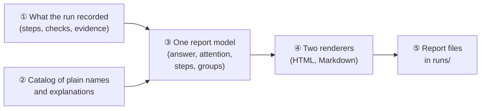
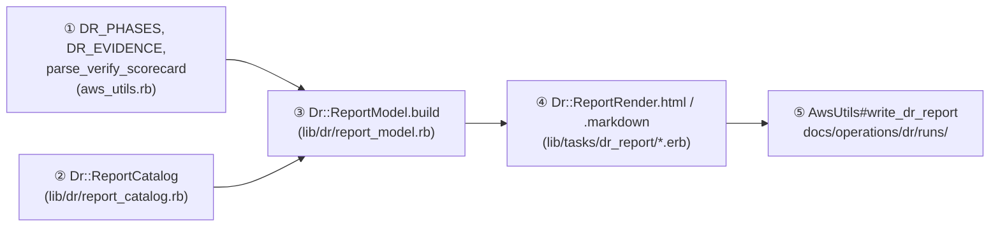
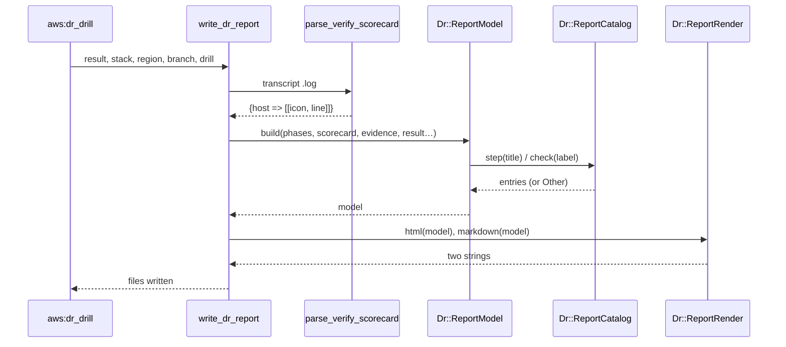
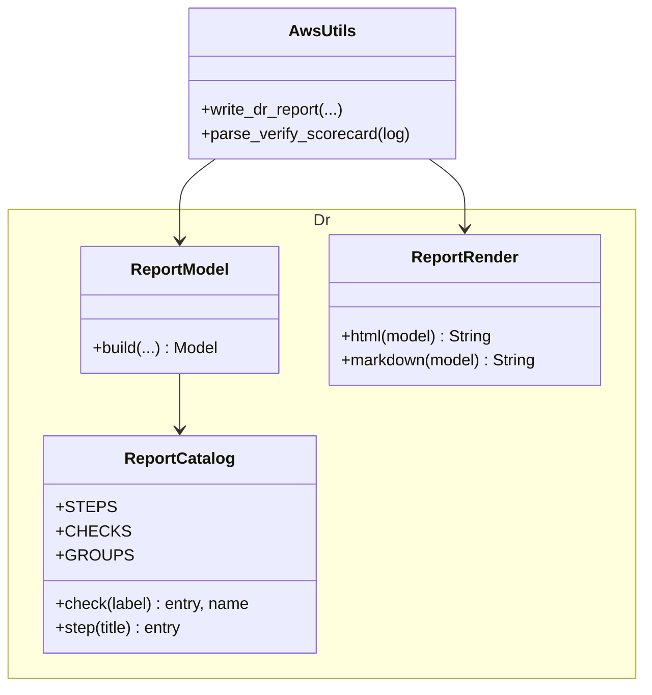

# DR Drill Report Redesign — Design

> **Audience:** Engineers implementing and reviewing the change.
> **Companion documents:** [Proposal](proposal.md) · [Spec](specs/operations/dr-drill-report/spec.md) · [LLD](lld.md) · [Tasks](tasks.md)
> **Approved mock:** `tmp/dr_report_mock/drill_report.html` (2026-11-08).

> **Planning phase — no code changes.**

---

## Contents

- [1. The idea](#1-the-idea)
  - [What this adds](#what-this-adds) · [The idea in one picture](#the-idea-in-one-picture) · [Key concepts](#key-concepts) · [Walkthrough](#walkthrough-one-example-start-to-finish) · [Key ideas](#key-ideas)
- [2. The same picture with real names](#2-the-same-picture-with-real-names)
  - [Picture](#picture) · [What each box does](#what-each-box-does) · [One run, end to end](#one-run-end-to-end) · [Lifecycles](#lifecycles) · [What users see](#what-users-see) · [Design decisions](#design-decisions)
- [3. One card per box](#3-one-card-per-box)
  - [① Run data](#-run-data) · [② Catalog](#-catalog) · [③ Report model](#-report-model) · [④ Renderers](#-renderers) · [⑤ Writer](#-writer)
- [4. Reference](#4-reference)
  - [Class diagram](#class-diagram) · [Data model and schema changes](#data-model-and-schema-changes) · [Component contracts](#component-contracts) · [Notifications](#notifications) · [Cross-cutting concerns](#cross-cutting-concerns) · [Worked examples](#worked-examples) · [Testing](#testing) · [Risks and open questions](#risks-and-open-questions)

---

## 1. The idea

### What this adds

- The DR run report is rebuilt from **one model** that the HTML and Markdown renderers both read. The steps' and checks' explanations live in **one catalog**.
- It follows the pattern of the earlier DR changes: small pure `Dr::` modules in `lib/dr/`, called from the rake/AwsUtils code and tested by Cucumber. Nothing runs inside the app.

### The idea in one picture

### Key concepts

| Concept | What it is | Example |
|---|---|---|
| Run data | What a DR run already records today | 9 timed steps; per-server check lines; evidence rows |
| Catalog entry | Plain name, group and explanation for a step or check, matched by pattern | `/^Primary mysqld/` → "Primary MySQL", Database servers |
| Report model | Everything the report shows, computed once | answer, tiles, attention items, step rows, check groups |
| Attention item | A non-passing check (or the failed step), merged across servers | "Primary backup schedule · both servers" |
| Group | A layer of the system checks are shown under | App servers · Requests · Data · Database servers · Backups · Other |

#### Catalog entry — its rules
- **What:** one entry per step and per check: pattern, plain name, group, "what it proves / does", "if it fails".
- **Why:** both renderers read it, so an explanation is written once.
- **Does NOT:** decide pass or fail. That stays with `dr:verify`.
- **Example:** `/^HTTP elastic_check/` → "Search reachable", group Requests, proves "Elasticsearch answered. It does not prove search has data; see Search index populated."

### Walkthrough: one example, start to finish

- The 2026-11-08 staging drill ends PASSED after 12:04.
- **① Run data:** 9 phases with times, and the scorecard parsed from the transcript: `{"ip-10-0-1-182" => [["✅","Nginx active — active"], …], "ip-10-0-2-46" => […]}` (23 lines each).
- **② Catalog:** each label maps to an entry ("Nginx active" → "Web server (nginx) running", App servers).
- **③ Model:**
  - Tiles: `12:04`, `1:59`, `44 / 46`, `0.4 h` (the oldest "Restored data freshness" reading: later servers see post-restore writes).
  - Attention: "Primary backup schedule" ⚠️ on both servers → **one** item.
  - Groups: 5 groups, 23 rows × 2 server columns.
- **④ Renderers:** HTML (light) and Markdown from that model.
- **⑤ Writer:** writes `runs/dr_drill_in_2026_11_08_1039.{html,md}`, as today.

### Key ideas

| Idea | In one line | Card |
|---|---|---|
| One model, two renderers | Sections and order can't drift between HTML and MD | [③](#-report-model), [④](#-renderers) |
| Catalog, not hard-coding | Explanations written once; unknown checks fall into "Other" | [②](#-catalog) |
| Drift guard | A test fails if `dr:verify` gains a check, or `setup_infra` a step, that the catalog lacks | [②](#-catalog) |
| Same inputs as today | No change to how runs record data | [①](#-run-data) |

#### FAQ

| Question | Answer |
|---|---|
| Why not an HTML template engine like the app's views? | The report is written by a rake task outside a request; stdlib ERB is enough and has no Rails view coupling |
| Why keep Markdown at all? | It renders in GitHub, next to the drill log, without opening a file |

---

## 2. The same picture with real names

### Picture

### What each box does

| # | Box | Real parts | What it does | When it runs | What it reads |
|---|---|---|---|---|---|
| ① | Run data | `DR_PHASES`, `DR_EVIDENCE`, `parse_verify_scorecard` | Records the run (unchanged) | During the run | Transcript `.log` |
| ② | Catalog | `Dr::ReportCatalog` | Plain names, groups, help | At render | Constants |
| ③ | Report model | `Dr::ReportModel` | Computes everything shown | Once per report | ①, ② |
| ④ | Renderers | `Dr::ReportRender`, `report.html.erb`, `report.md.erb` | Turn the model into HTML/MD | Once per report | ③ |
| ⑤ | Writer | `AwsUtils#write_dr_report` | Writes both files, never raises | End of the run | ④ |

### One run, end to end

### Lifecycles

N/A — nothing stored changes state; a report is written once per run.

### What users see

| At a glance | |
|---|---|
| Who | Ops manager, auditor, engineer |
| Where | `docs/operations/dr/runs/<run>.html` (browser), `<run>.md` (GitHub) |
| Look | The approved mock: `tmp/dr_report_mock/drill_report.html` |

- **Screen standards:** not an app screen. A standalone document opened from disk, email or GitHub.

| Screen | Kind | Copies | Breadcrumbs | Tabs | Turbo | Stats cards | Filter + search | Actions | Help | Full width |
|---|---|---|---|---|---|---|---|---|---|---|
| DR run report (.html) | Standalone file | The approved mock | — not in the app | — | — | 4 tiles = scorecard totals | — | — | Collapsible "What this does / proves" notes | Max 1080px, readable |

- Mock rules applied: one type scale, no uppercase or italics, neutral surfaces, Bootstrap success/info/danger/secondary only, inline Bootstrap Icons.

### Design decisions

| # | Decision | Why, in one line |
|---|---|---|
| D1 | One model, two ERB renderers | Sections can't drift; each template is readable |
| D2 | Catalog keyed by regex on the check label | Labels carry host-specific parts (IPs, domains) |
| D3 | Unknown checks go to "Other checks" | A new check can never vanish from the report |
| D4 | Drift guard test over `dr_verify.rake` / `aws_utils.rb` | Catalog gaps fail CI, not an auditor |
| D5 | Light only, inline CSS + icons | User request; report must open offline |

#### D1. One model, two renderers
- **Problem:** today the `.md` and `.html` are built by two separate ~150-line string builders. Fixing one doesn't fix the other.
- **Decision:** `Dr::ReportModel.build` → `Dr::ReportRender.html(model)` / `.markdown(model)`, each from an ERB template in `lib/tasks/dr_report/`.
- **Why:**
  - section order lives in one model;
  - the templates read like the document;
  - Cucumber can compare section lists.
- **Not chosen:** keeping the string builders (they are why the two copies drift); a Rails view (needs a request context).
- **Where:** `lib/dr/report_model.rb`, `lib/dr/report_render.rb`, `lib/tasks/dr_report/report.{html,md}.erb`.

#### D2. Catalog by pattern
- **Problem:** labels like `Primary mysqld (10.0.3.88)` and `HTTP website apex (altconnects.com)` vary per run.
- **Decision:** `Dr::ReportCatalog::CHECKS` is an ordered list of `{match: /…/, group:, name:, proves:, if_fails:}`. The first match wins, and the name keeps the variable part (e.g. `Primary MySQL (10.0.3.88)`).
- **Why:** one entry covers every run; order gives group order.
- **Not chosen:** exact-string keys (break on every IP change).
- **Where:** `lib/dr/report_catalog.rb`.

#### D3. Unknown → Other
- **Problem:** a check added to `dr:verify` later would be silently missing.
- **Decision:** unmatched labels go to group "Other checks", with the raw label and no help.
- **Why:** visible beats perfect. D4 catches the gap in CI anyway.
- **Not chosen:** raising (a report must never fail a recovery).
- **Where:** `Dr::ReportCatalog.check`.

#### D4. Drift guard
- **Problem:** catalogs rot (see the dead `ElasticImporterJob` list).
- **Decision:** a Cucumber scenario reads every `check.call("…")` label in `lib/tasks/dr_verify.rake` and every `dr_phase "…"` in `aws_utils.rb`, and asserts each matches a catalog entry.
- **Why:** a new check or phase without an explanation fails the suite.
- **Not chosen:** a manual review step.
- **Where:** `features/misc/dr_drill_report.feature` X4.

#### D5. Light, self-contained
- **Problem:** the report goes dark on dark-mode machines and loads Google Fonts.
- **Decision:** no `prefers-color-scheme` block; system font stack; CSS and the Bootstrap Icons SVG symbols inline.
- **Why:** user request; prints, emails and opens offline identically.
- **Not chosen:** keeping a dark theme (two palettes to maintain, and the request was light).
- **Where:** `report.html.erb`.

#### FAQ

| Question | Answer |
|---|---|
| Does this change `dr:verify` labels? | No. The catalog maps them as they are |
| What if the transcript is missing? | The scorecard is `{}`, so the checks section says "Not reached", as today |

---

## 3. One card per box

### ① Run data

- Unchanged: `DR_PHASES` (`[title, started, ended]`), `DR_EVIDENCE` (`claim → [evidence, how]`), `parse_verify_scorecard(log)`.
- One addition: the drill flag and `TEARDOWN` reach the writer, so the plain-words text can say "rebuilt servers were deleted afterwards" only when true.

| Question | Answer |
|---|---|
| Why not parse more from the transcript? | Everything shown is already in these three, plus the restored-data detail line |

### ② Catalog

- `STEPS`: `[{match: /Refresh Pulumi/, name: "Prepare the infrastructure settings", does:, if_fails:}, …]`, 9 entries.
- `CHECKS`: ordered entries per group: App servers (nginx, puma, sidekiq, prometheus), Requests (db/redis/elastic/disk/xirr/website), Data (migrations, freshness, search index, S3), Database servers (mysqld, containers, replica, replication), Backups (armed / not armed (drill), schedule, replica writer).
- `check(label)` → `[entry, display_name]`. `step(title)` → entry, or a generic "Step" entry.

| Question | Answer |
|---|---|
| Where do the help texts come from? | The approved mock, reviewed 2026-11-08 |
| Why does the "Cache" entry mention MySQL? | `redis_check` exercises `Rails.cache`, which is `solid_cache` (MySQL). The report must not overclaim |

### ③ Report model

- `Dr::ReportModel.build(phases:, scorecard:, evidence:, result:, stack:, region:, env_variant:, branch:, started_at:, finished:, drill:, teardown:)` → `Data` with:
  - `headline`;
  - `tiles` (rebuild, DB restore, checks, data age);
  - `plain_words` (bullets);
  - `attention` (items);
  - `steps`;
  - `groups` (`[group, rows]`, each row `{name, help, cells: {host => [status, value]}}`);
  - `scope`, `evidence`, `glossary`, `generated`.
- **Attention:** group check results by `(display_name, status)` across hosts → one item listing the hosts. Failed step first, then ❌, then ⚠️.
- **Data age:** the maximum hours parsed from "Restored data freshness" details (`([\d.]+)h old`): the earliest reading, before post-restore writes.

| Question | Answer |
|---|---|
| Why merge by name and status, not name only? | ✅ on one server and ⚠️ on the other is two facts; only the ⚠️ needs attention |

### ④ Renderers

- `Dr::ReportRender.html(model)` / `.markdown(model)` → `ERB.new(template, trim_mode: "-").result_with_hash(m: model, h: …)`.
- **HTML:** every text value passes through `ERB::Util.html_escape`. Collapsible `
` help.
- **Markdown:** tables; help as a bullet list under each table; `|` in values escaped.

| Question | Answer |
|---|---|
| Why not share one template? | The formats differ (tables, `
`). The model is what is shared |

### ⑤ Writer

- `write_dr_report` keeps its signature and paths and its `rescue` (a report never fails a recovery).
- It builds the model once, renders both, and writes both.
- `write_dr_report_html` and `DR_REPORT_CSS` are deleted.

| Question | Answer |
|---|---|
| Do existing callers change? | No. `setup_infra` and `aws:dr_drill` call the same method |

---

## 4. Reference

### Class diagram

### Data model and schema changes

N/A — no tables or columns; the report is a file.

### Component contracts

| From → To | Contract | Direction rule |
|---|---|---|
| AwsUtils → ReportModel | Plain Ruby values (arrays, hashes, Times) | Model never reads files or globals |
| ReportModel → ReportCatalog | Label / title strings | Catalog is pure constants |
| AwsUtils → ReportRender | A model | Renderers never compute; they only format |

### Notifications

- **Sends nothing**, to either audience.
  - Investors: the report is an internal operations file; no investor ever receives it.
  - Internal users: no email or alert is added or changed. The engineer sees the file paths printed in the terminal, as today.

| Notification | Trigger | Recipients | Channel | Customisable | Default | Sent once? |
|---|---|---|---|---|---|---|
| — none — | — | — | — | — | — | — |

### Cross-cutting concerns

#### Transactions and queries
N/A — no database access; inputs are in memory plus one log file.

#### Exception handling and monitoring
- `write_dr_report`'s existing `rescue StandardError` stays: a report failure prints a warning and never fails the recovery.

#### Architecture and design patterns

| # | Pattern | How this design applies it | Existing example reused | Where |
|---|---|---|---|---|
| 1 | Pack boundaries | Not needed: operator tooling in `lib/`, not app code | `lib/dr/*` from the earlier DR changes | ②③④ |
| 2 | Thin controllers | Not needed: no controller | — | — |
| 3 | Deep modules | Catalog / model / render each have one job and a tiny interface | `Dr::BackupSchedule` | ②③④ |
| 4 | Reuse before you add | Reuses `parse_verify_scorecard`, `DR_PHASES`, `DR_EVIDENCE`, `hms`, Bootstrap palette and icons | aws_utils helpers | ①⑤ |
| 5 | Configuration as data | Catalog is data (constants) | `Dr::SearchIndexes::EXCLUDED` | ② |
| 6 | Explicit state machines | Not needed: no states | — | — |
| 7 | Append-only audit | Reports are new files per run; never rewritten | `runs/` | ⑤ |
| 8 | Background work | Not needed: runs at the end of the rake task | — | — |
| 9 | Notifications | None sent | — | — |
| 10 | UI | Approved mock; one type scale; Bootstrap colours | mock | ④ |
| 11 | Queries and data | None | — | — |
| 12 | AI | Not used | — | — |
| 13 | Rollout | Applies to the next run's report; old reports untouched | — | ⑤ |
| 14 | YAGNI / DRY | One model, one catalog; no history or dashboard | — | ②③ |

#### Performance
- Rendering is O(checks × hosts), about 50 cells, in milliseconds.

| Page / frame / job | Rows | Queries budget | Preloads | Per-row lookups avoided |
|---|---|---|---|---|
| Report generation (rake) | ~50 cells | 0 | — | Catalog lookups are in-memory regex |

#### Security

| # | Item | How this design meets it | Where | Test |
|---|---|---|---|---|
| 1 | Authorization (Pundit) | No controller or action; run by an operator with AWS access | — | — |
| 2 | Tenant isolation | No tenant data: infrastructure facts only (IPs, instance ids, timings) | ③ | — |
| 3 | Mass assignment | No params | — | — |
| 4 | No code from data | The catalog uses regex match only; no `constantize`/`send` on labels | ② | — |
| 5 | Injection | All transcript-derived text HTML-escaped; MD pipes escaped | ④ | X3 |
| 6 | Background jobs | None | — | — |
| 7 | Files and documents | Writes only under `docs/operations/dr/runs/`; filename from the branch name the drill generates | ⑤ | — |
| 8 | AI / LLM | None | — | — |
| 9 | Webhooks, tokens, links | No external links; no remote fonts (the old report loaded Google Fonts) | ④ | H4 |
| 10 | Rate limiting and cost | Not applicable: local file write | — | — |
| 11 | Audit and logging | The existing transcript credential scrub (`with_dr_transcript`) still applies; the report shows no secrets | ①⑤ | — |
| 12 | Verification | Cucumber feature below; drift guard X4 | — | all |

### Worked examples

#### Happy Path

| # | Example | Given | Then |
|---|---|---|---|
| H1 | Passed drill, one warning on both servers | 1039 scorecard (23 checks × 2, one ⚠️ each) | Tiles `44 / 46`; Needs attention has 1 item, "both servers" |
| H2 | Checks grouped once | same | 5 groups; 23 rows; 2 server columns; group order App → Requests → Data → DB servers → Backups |
| H3 | Steps explained | 9 phases | 9 rows with plain names and help; bar widths ∝ duration |
| H4 | Light, self-contained HTML | same | No `prefers-color-scheme: dark`; no `fonts.googleapis`; badge "Passed" |
| H5 | Markdown matches | same | Same section headings, same order |

#### Edge Cases

| # | Example | Given | Then |
|---|---|---|---|
| E1 | Check on one server only | label only on host A | Host B cell shows "—" |
| E2 | Unknown check | `Frobnicator ready — yes` | Group "Other checks", raw label |
| E3 | Variable label | `Primary mysqld (10.0.3.88)` | "Primary MySQL (10.0.3.88)", Database servers |
| E4 | Real recovery | `drill: false` | Plain words say "real recovery"; no "deleted afterwards" |
| E5 | Mixed results | ✅ on A, ⚠️ on B | Attention item names only B |
| E6 | Nothing needs attention | all ✅ | "Nothing needs attention" |

#### Error Cases

| # | Example | Given | Then |
|---|---|---|---|
| X1 | Failed before verify | result FAILED, last phase "Deploy…", empty scorecard | Badge "Failed"; headline "Recovery stopped at step 5 · Install the app on both servers"; attention item 1 is that step with its "if it fails"; checks "Not reached" |
| X2 | Failure and warning | one ❌, one ⚠️ | ❌ listed first; tile "… · 1 failed" |
| X3 | Markup in output | detail `` | HTML shows `&lt;script&gt;` |
| X4 | Catalog drift | every `check.call` label in `dr_verify.rake`, every `dr_phase` in `aws_utils.rb` | each matches a catalog entry (fails today: no catalog) |

### Testing

- Cucumber only: `features/misc/dr_drill_report.feature` + `dr_drill_report_steps.rb`. Fixtures are built in memory from the 1039 run's figures. No AWS.
- The real proof is the batch staging drill's report, compared side by side with the mock.

### Risks and open questions

- **Help text goes stale when a check changes meaning** → the drift guard covers new labels only; the catalog sits next to `dr_verify`'s labels in review.
- **Markdown tables with long help** → help goes in bullets under the table, not in cells.
- No open questions: the mock is approved.

#### FAQ

| Question | Answer |
|---|---|
| Will old run reports be regenerated? | No; they stay as written (append-only evidence) |
| What if a check label contains " — "? | The split is on the **first** " — " (the verify output format) |
