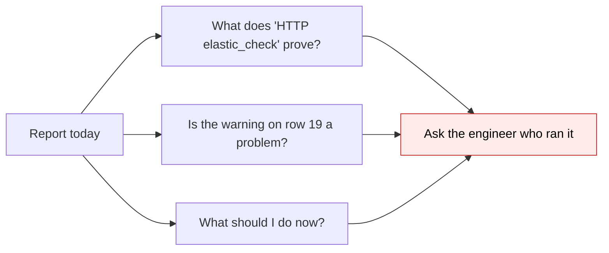
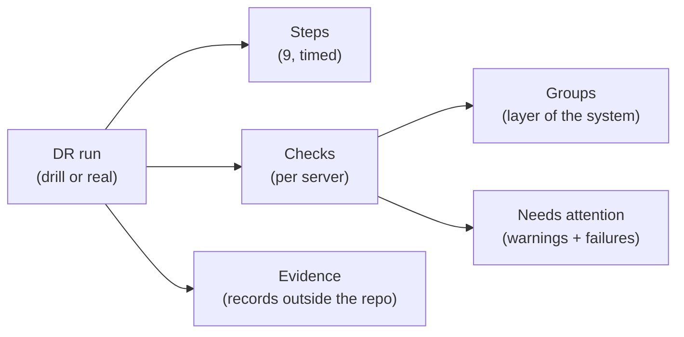
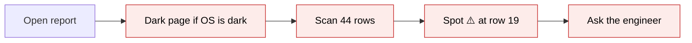
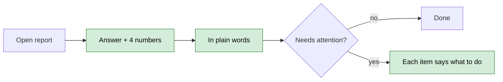
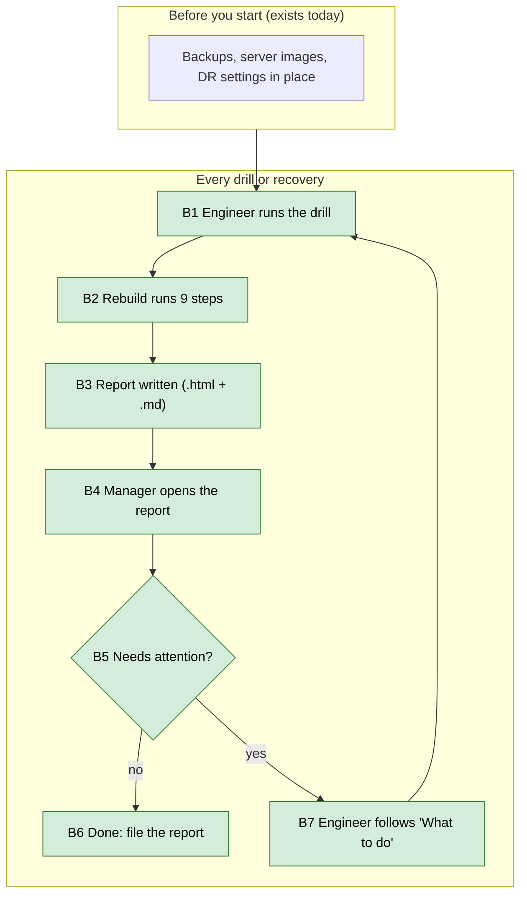

# DR Drill Report Redesign — Proposal

> **Audience:** Business team, product, QA, support — non-technical.
> **Companion document:** [Design](design.md)
> **New to this? Start with the [Workflow Journey](#workflow-journey)** — every action, in order, from start to the outcome.

> **Planning phase — no code changes.** Approved mock: `tmp/dr_report_mock/drill_report.html` (2026-11-08).

---

## Why

- Every disaster-recovery run (drill or real) writes a report. It is the evidence that we can recover, and it's what an auditor or a client reads.
- Today it is hard to read:
  - it turns **dark** whenever the reader's computer is in dark mode;
  - it lists 22 technical checks **twice** (once per server) with no explanation;
  - the one warning sat at row 19 of 22;
  - nothing tells the reader what to do next.
- The person reading it is often not the person who ran it: a manager, an auditor, a client's due-diligence team. It has to explain itself.



## What Changes

- The report always renders **light**, in the app's own colours and font sizes, with clear icons.
- It opens with **the answer**: passed or failed, how long the rebuild took, how much data a real recovery would have lost.
- An **"In plain words"** section says what happened in four sentences.
- **"Needs attention"** lifts every warning and failure to the top, each with what it means and what to do.
- Every **step** has a plain name and a short "What this does / if it fails" note.
- **Checks** are grouped (App servers, Requests, Data, Database servers, Backups), shown once with one column per server, and each has a "What it proves" note.
- The **Markdown copy** carries the same sections, so it reads the same in GitHub.
- Nothing about *how* a recovery runs changes. Only how its result is written up.

### Key concepts



| Concept | What it means for you | Example |
|---|---|---|
| DR run | One rebuild of an environment in the backup region | Staging drill, 8 Nov 2026, 12:04 |
| Drill | A rehearsal: same steps, live site untouched, rebuilt servers deleted afterwards | `dr_drill_in_2026_11_08_1039` |
| Step | One stage of the rebuild, timed | "Restore the database from backups: 1:59" |
| Check | One thing proven on a rebuilt server | "Background jobs (sidekiq): 2 workers" |
| Group | Checks about the same layer, shown together | "Backups": armed, schedule, replica writer |
| Needs attention | A warning or failure, with its meaning and next action | "Primary backup schedule: missing" |
| Data loss (RPO) | How old the newest restored record is | 0.4 hours |

**Needs attention: its rules**
- **What:** every check that isn't ✅, listed once even if it appears on both servers ("seen on: both servers").
- **Why:** the reader's first question is "is anything wrong?"
- **Does NOT:** hide the check from its group below. It appears in both places.
- **Example:** "Primary backup schedule · both servers · The rebuilt database had no backup timetable… · What to do: …"

### Flow Diagram

*Reading a report: before*



*Reading a report: after*



---

## Workflow Journey

### Who is involved

| Person | Role | What they do in the journey |
|---|---|---|
| Thimmaiah | Engineer, AWS access | Runs the drill; fixes anything flagged |
| Meera | Ops manager | Reads the report; decides if follow-up is needed |
| Auditor | External, read-only | Reads the report and the evidence |

### The journey on one page



### Before you start

| Needed | Why | Where it comes from |
|---|---|---|
| A DR run | The report describes one | `rake aws:dr_drill` or `rake aws:setup_infra` |
| A browser or GitHub | To read the `.html` or `.md` | Any |

### Part B — every run

| Step | Who | Where | Action | What the system does | What you see |
|---|---|---|---|---|---|
| B1 | Engineer | Terminal | Runs the drill | Rebuilds the stack | Progress per step |
| B3 | — | `docs/operations/dr/runs/` | — | Writes `<run>.html` and `<run>.md` | "Auditor report (HTML) written to …" |
| B4 | Manager | Browser | Opens the `.html` | — | Answer, tiles, plain words |
| B5 | Manager | Report › Needs attention | Reads | — | Each warning with "What to do" |
| B7 | Engineer | Terminal | Follows the advice | — | Next run shows ✅ |

### What the user sees

```
┌──────────────────────────────────────────────────────────────┐
│ Staging recovered in ap-south-2 and verified: 12:04  [Passed]│
│ DR drill · staging (in) → ap-south-2 · 8 Nov 2026            │
│ ┌────────┐ ┌────────┐ ┌──────────┐ ┌────────┐               │
│ │ 12:04  │ │ 1:59   │ │ 44 / 46  │ │ 0.4 h  │               │
│ │rebuild │ │DB rest.│ │checks    │ │data age│               │
│ └────────┘ └────────┘ └──────────┘ └────────┘               │
├──────────────────────────────────────────────────────────────┤
│ ⚠ Needs attention: 1 check, seen on both servers             │
│ Primary backup schedule │ both │ No backup timetable… │ Fix… │
└──────────────────────────────────────────────────────────────┘
```

- `44 / 46` = 23 checks × 2 servers = 46. 44 ✅, plus the same ⚠️ check on each server (2).

### What goes wrong

- **A failed run.** The badge reads **Failed**, and the title names the step that stopped it: "Recovery stopped at step 5 · Install the app".
  - Needs attention lists the failing check (or the step's error) first, with that step's "if it fails" advice.
  - The scorecard section says "Not reached: the run stopped before verification".

### Summary: the minimum actions

| # | Action | Who | How often |
|---|---|---|---|
| 1 | Run a drill | Engineer | Quarterly, or after DR changes |
| 2 | Read the report's top section | Manager | Every run |
| 3 | Follow "What to do" | Engineer | Only when something needs attention |

---

## User Stories

- As an **ops manager**, I want the answer and any problems at the top, so I don't read 46 rows to learn whether we can recover.
- As an **auditor**, I want each check explained and each claim tied to an outside record, so I can trust the report without the engineer.
- As an **engineer**, I want each failure to say where to look, so I fix it on the first try.

## UI Behavior

- Light theme always, even when the OS is in dark mode.
- Badge: **Passed** (green) or **Failed** (red).
- Help notes are collapsed by default and open on click ("What this does", "What it proves").
- Phone width: the four tiles wrap to 2×2; no sideways scrolling.

## What This Feature Does NOT Cover

- How a recovery runs, or which checks exist.
- A dashboard or history across runs (the drill log `dr_drills.md` is unchanged).
- Sending the report anywhere.

## Validation Rules

- Every check a run can produce has a plain name, a group and a "What it proves" note. An unknown check still shows, under "Other checks".
- Every step has a plain name and help.

## Behavior Rules

- A check that appears on several servers with the same result is listed once in Needs attention, with the servers named.
- Failures are listed before warnings.
- A drill says "drill: the live site was not touched". A real recovery says "real recovery".

## Resolved Design Decisions

- **Light only.** Your request, plus the app's rule of one neutral, light look.
- **Colours: Bootstrap status colours only.** Warnings use the "info" tone (no new colours).
- **Icons inlined.** The report must open offline, from email, or printed to PDF.

## Capabilities

### New Capabilities
- `operations/dr-drill-report`: what a DR run's report must show, and how.

### Modified Capabilities
- None.

## Impact

- The DR run reports (`.html` and `.md`) from the next run on. Old reports stay as they are.
- No app screens, users, data or emails are affected.

## Benefits

- A manager can judge a run in under a minute.
- Fewer "what does this mean?" questions to the engineer.
- Audit-ready: explained checks plus outside evidence.

## FAQ

- **Do old reports change?** No. Only reports written after this ships.
- **Does it change what is checked?** No. Only how results are shown.
- **Can it be printed?** Yes. It is self-contained (light, no external files).

## Design Principle for the Next Phase

- Keep the check and step explanations in **one** place, shared by the HTML and Markdown renderers. Don't hand-write them twice.
- Make sure a new check added to verification can never silently vanish from the report.
