# Embedded eSigning with Digio — Design

> **Audience:** Engineering team.
> **Companion documents:** [Proposal](proposal.md) · [Spec](specs/) · [LLD](lld.md)

> **Planning phase — no code changes.** This document explains HOW the proposal will be built.

---

## Contents

- [1. The idea](#1-the-idea)
  - [What this adds](#what-this-adds)
  - [The idea in one picture](#the-idea-in-one-picture)
  - [Walkthrough: one example, start to finish](#walkthrough-one-example-start-to-finish)
  - [Key ideas](#key-ideas)
- [2. The same picture with real names](#2-the-same-picture-with-real-names)
  - [Picture](#picture)
  - [What each box does](#what-each-box-does)
  - [One run, end to end](#one-run-end-to-end)
  - [Lifecycles](#lifecycles)
  - [What users see](#what-users-see)
  - [Design decisions](#design-decisions)
- [3. One card per box](#3-one-card-per-box)
  - [① Document page](#①-document-page)
  - [② Who may sign](#②-who-may-sign)
  - [③ Signing page](#③-signing-page)
  - [④ Digio signing panel](#④-digio-signing-panel)
  - [⑤ Result handler](#⑤-result-handler)
  - [⑥ Status confirmation](#⑥-status-confirmation)
  - [⑦ Webhook reader](#⑦-webhook-reader)
  - [⑧ Signer status record](#⑧-signer-status-record)
  - [⑨ Signer notice](#⑨-signer-notice)
- [4. Reference](#4-reference)
  - [Class diagram](#class-diagram)
  - [Data model and schema changes](#data-model-and-schema-changes)
  - [Component contracts](#component-contracts)
  - [Cross-cutting concerns](#cross-cutting-concerns)
  - [Worked examples](#worked-examples)
  - [Delivery: pull requests](#delivery-pull-requests)
  - [Testing](#testing)
  - [Risks and open questions](#risks-and-open-questions)

---

## 1. The idea

### What this adds

A logged-in signer gets a **Sign now** button for a Digio signature request that already exists, and signs in Digio's
embeddable panel on a CapHive page. It follows the pattern the platform already uses for Digio: the platform sends
the document, Digio holds the truth, and CapHive learns the result by Digio's notification or by asking Digio. The new
part is only the front door (who may sign, the page, the panel) and reading Digio's events by type. A small notifier then tells the next signer it is their turn, through the
platform's existing Noticed pipeline (bell entry and email).

### The idea in one picture

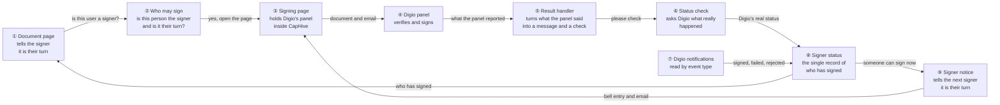

### Walkthrough: one example, start to finish

**Setup.** Meera at Orion Capital has sent the *Subscription Agreement – Priya Family Trust* for eSignature with three
signers in order: Priya (Investor Signatory), Rahul (Fund Signatory), Vikram (Counsel, external). Digio has emailed all
three. Embedded eSigning has just been switched on for Orion Capital. Priya and Rahul have CapHive logins that match
their signer emails; Vikram does not.

**Legend.** Each signer is a step, named as the task they have to do. ✓ done · **●** we are here: waiting on this, not
done yet · ○ not their turn yet.

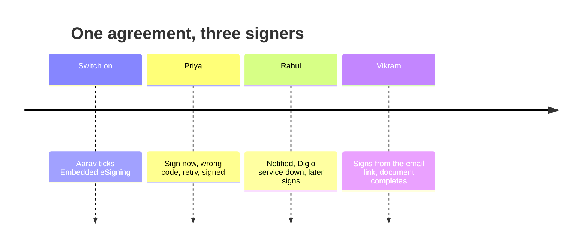

**Phase 1 — Priya signs (with a mistake)**

| # | When | What happens | Behind the scenes | Result |
|---|---|---|---|---|
| 1 | Priya opens the agreement | She sees "Your signature is requested on this document." with **Sign now** | The document page (①) asks who may sign (②): her email matches, it is her turn, the switch is on | Sign (Priya)&nbsp;**●**<br/>Sign (Rahul)&nbsp;○<br/>Sign (Vikram)&nbsp;○ |
| 2 | She clicks **Sign now**, then **Start signing** | Digio's panel opens on the CapHive page | The signing page (③) hands the panel (④) only the Digio document id and her email | Same as row 1 |
| 3 | She types a wrong one-time code | "Signing didn't go through. Please check your details and try again." and **Try again** | The panel (④) reports `OTP_INVALID`; the result handler (⑤) maps it to the retry message and records it | Same as row 1 |
| 4 | She tries again with the right code | "Thank you. Your signature has been submitted and is being confirmed." | The panel (④) reports completion; the result handler (⑤) records it and asks for a status check (⑥) | Same as row 1 |
| 5 | A few seconds later | The agreement shows Priya as Signed; Rahul now sees **Sign now** and gets a bell entry and an email | The status check (⑥) asks Digio, which reports Priya signed; the signer status (⑧) is updated; the signer notice (⑨) finds Rahul can sign now and notifies him once | Sign (Priya)&nbsp;✓<br/>Sign (Rahul)&nbsp;**●**<br/>Sign (Vikram)&nbsp;○ |

**Phase 2 — Rahul hits a stall**

| # | When | What happens | Behind the scenes | Result |
|---|---|---|---|---|
| 6 | Rahul clicks the notification, then **Start signing** | "The signing service is temporarily unavailable. Please try again in a little while." | The notification link opens his signing page (③); the panel (④) reports `ESP_UIDAI_DOWN`; the result handler (⑤) maps it; nothing is stored against the signer | Same as row 5 |
| 7 | Later, Rahul tries again | Thank-you message, then Rahul shows Signed | As rows 4–5 | Sign (Priya)&nbsp;✓<br/>Sign (Rahul)&nbsp;✓<br/>Sign (Vikram)&nbsp;**●** |

**Phase 3 — Vikram uses the email link**

| # | When | What happens | Behind the scenes | Result |
|---|---|---|---|---|
| 8 | Vikram signs on Digio's site | The document completes and the signed copy appears | Digio's notification arrives (⑦) with `doc.signed`; the signer status (⑧) is updated and the completion check runs, exactly as today | Sign (Priya)&nbsp;✓<br/>Sign (Rahul)&nbsp;✓<br/>Sign (Vikram)&nbsp;✓ |

```
Signing page just after row 4
+----------------------------------------------------------------+
| Documents > Subscription Agreement > Sign                       |
|  Signing as: priya@lpfund.com                                   |
|  Signer 1 of 3 - Investor Signatory                             |
|  Thank you. Your signature has been submitted and is being      |
|  confirmed.                                  [ Back to document ]|
+----------------------------------------------------------------+
```

**What to notice**
- The panel's "done" never changes a signer; only Digio's own status does (rows 4–5).
- Errors are explained by CapHive in plain words; the signer never sees a Digio code (rows 3, 6).
- The email route and the in-CapHive route end in the same place (rows 5, 8).
- The next signer is told when it is their turn, once, and a notification problem can never stop a signature (row 5).
- Nothing about sending the document, or completing it, was touched.

### Key ideas

| # | Idea | In one line | Card |
|---|---|---|---|
| 1 | Additive front door | Logged-in signers get a button; everyone else keeps the email | [①](#①-document-page) |
| 2 | Authorization by identity | The signer's login email is the only key — not entity membership | [②](#②-who-may-sign) |
| 3 | No shortcut token | The panel gets a document id and an email only; Digio verifies the signer | [③](#③-signing-page) |
| 4 | Browser is untrusted | A panel result only triggers a status check | [⑤](#⑤-result-handler) |
| 5 | Errors are CapHive's words | One server-side table turns Digio codes into messages | [⑤](#⑤-result-handler) |
| 6 | Events by type | Notifications are read by event, with a safe fallback | [⑦](#⑦-webhook-reader) |
| 7 | Tell the next signer | One notice per signer per request, at send and when a turn arrives | [⑨](#⑨-signer-notice) |

**FAQ**

| Question | Answer |
|---|---|
| Does anything block users who are not eligible? | No. Every ineligible path is today's email flow; nothing is hidden or delayed. |
| Why not just embed the email link in an iframe? | Digio's `authentication_url` can do that but has no event stream, so no error handling; the SDK panel gives events. See [decision 1](#design-decisions). |
| Can a notification problem stop a signature? | No. Notifying runs after the status is saved, is wrapped so a failure is reported to support and ignored, and never changes a status. |

---

## 2. The same picture with real names

### Picture

```mermaid
flowchart LR
    classDef new fill:#d4edda,stroke:#2e7d32,color:#000
    classDef mod fill:#fff3cd,stroke:#b8860b,color:#000
    classDef reuse fill:#eceff1,stroke:#90a4ae,color:#000
    P["① documents/show banner<br/>+ e_signatures/_e_signature<br/><i>tells the signer it is their turn</i>"]:::mod
    W["② ESignaturePolicy.sign?<br/>+ ESignature.signing_state<br/><i>is this user the signer, is it their turn?</i>"]:::new
    S["③ ESignaturesController.sign<br/>+ digio_esign_controller.js<br/>+ DigioSdkConfig<br/><i>hosts the panel in CapHive</i>"]:::new
    D["④ Digio SDK v11<br/><i>verifies the signer and signs</i>"]:::reuse
    R["⑤ ESignaturesController.sign_result<br/>+ DigioSdkErrors<br/><i>maps the result, logs, asks for a check</i>"]:::new
    C["⑥ DocumentEsignUpdateJob<br/>-> EsignUpdateJob<br/>-> DigioEsignHelper.update_esign_status<br/><i>asks Digio for the real status</i>"]:::reuse
    H["⑦ DocumentsController.signature_progress<br/>-> DigioEsignHelper.update_signature_progress<br/><i>reads notifications by event</i>"]:::mod
    T["⑧ ESignature.status<br/>+ Document.esign_status<br/><i>who has signed</i>"]:::mod
    N["⑨ Document.notify_ready_signers<br/>+ EsignSigningNotifier<br/>+ EsignSigningMailer<br/><i>tells the next signer it is their turn</i>"]:::new
    P -- "signable_by?(user)" --> W
    W -- "sign? true" --> S
    S -- "provider_doc_id + email" --> D
    D -- "event_listener / callback" --> R
    R -- "perform_later(document_id, user_id)" --> C
    C -- "signing_parties statuses" --> T
    H -- "update_esign_response" --> T
    T -- "status" --> P
    T -- "signing_state ready" --> N
    N -- "sign_e_signature_path" --> S
    click P "#①-document-page" "Open card ①"
    click W "#②-who-may-sign" "Open card ②"
    click S "#③-signing-page" "Open card ③"
    click D "#④-digio-signing-panel" "Open card ④"
    click R "#⑤-result-handler" "Open card ⑤"
    click C "#⑥-status-confirmation" "Open card ⑥"
    click H "#⑦-webhook-reader" "Open card ⑦"
    click T "#⑧-signer-status-record" "Open card ⑧"
    click N "#⑨-signer-notice" "Open card ⑨"
```

Colour = footprint: **green** new, **amber** modified, **grey** reused unchanged. Exact files are in
[lld.md File Map](lld.md#file-map).

### What each box does

| # | Box | Real parts | What it does | When it runs | What it decides | Details |
|---|---|---|---|---|---|---|
| ① | Document page | `documents/show`, `e_signatures/_e_signature`, new banner partial | Shows the banner and the row action | Every document page load | Whether to show **Sign now** | [card ①](#①-document-page) |
| ② | Who may sign | `ESignaturePolicy#sign?`, `ESignature#signing_state`, `Entity` permission `enable_embedded_esign` | Answers "is this user the signer and is it their turn" | Page load, signing page, result post | Allowed / not their turn / already signed / closed | [card ②](#②-who-may-sign) |
| ③ | Signing page | `ESignaturesController#sign`, `e_signatures/sign.html.erb`, `digio_esign_controller.js`, `DigioSdkConfig` | Renders the page and opens Digio's panel on click | Request | Which SDK host/environment to load | [card ③](#③-signing-page) |
| ④ | Digio panel | Digio SDK v11 (external) | Verifies the signer and captures the signature | In the browser | — (Digio) | [card ④](#④-digio-signing-panel) |
| ⑤ | Result handler | `ESignaturesController#sign_result`, `DigioSdkErrors`, `EsignLog#sdk_events` | Maps the code, records it, asks for a check | Request after the panel reports | Message, action, whether to check, whether to alert | [card ⑤](#⑤-result-handler) |
| ⑥ | Status confirmation | `DocumentEsignUpdateJob`, `EsignUpdateJob`, `DigioEsignHelper#update_esign_status` | Pulls the real status from Digio | Job (queue `low`) | Whether the document is eligible for update | [card ⑥](#⑥-status-confirmation) |
| ⑦ | Webhook reader | `DocumentsController#signature_progress`, `EsignHelper.update_signature_progress`, `DigioEsignHelper#update_signature_progress` | Reads Digio's notification by event | Request from Digio | Signed / failed / rejected / legacy | [card ⑦](#⑦-webhook-reader) |
| ⑧ | Signer status | `ESignature.status`, `Document.esign_status` | Holds who has signed | On update | Sticky rules ("signed" is never undone) | [card ⑧](#⑧-signer-status-record) |
| ⑨ | Signer notice | `Document#notify_ready_signers`, `ESignature#claim_signing_notification!`, `EsignSigningNotifier`, `EsignSigningMailer#signature_requested` | Tells a signer who is a platform user it is their turn, once per request | After send, and after ⑥ or ⑦ applies statuses | Who is ready, who is a platform user, whether it was already claimed | [card ⑨](#⑨-signer-notice) |

### One run, end to end

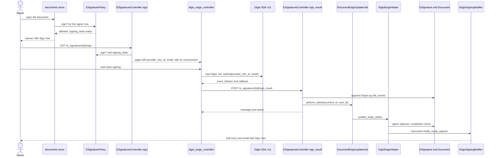

### Lifecycles

Signer status (stored in `e_signatures.status`; only **rejected** is new):

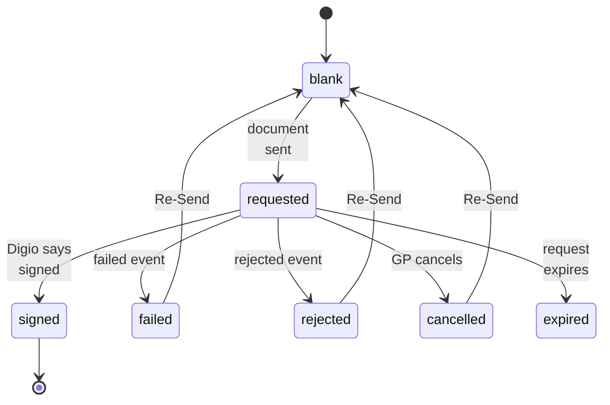

Signing page (derived in the browser, never stored): *idle → panel open → completed | error | cancelled → (completed
only) confirmation pending → document page shows the stored status*.

Notification claim (stored in `e_signatures.signing_notified_at`): blank → set once, atomically, when a signer is first
notified for a request; cleared by **Re-Send** together with the status, so a new request notifies again.

### What users see

| Where in CapHive | Today | After this change | Who sees it |
|---|---|---|---|
| Document page (top) | Nothing about signatures | Banner with **Sign now**, or the "after the previous signer" variant | A logged-in signer who matches |
| Signatures tab, signer row | Show / Edit | Adds **Sign now** on the user's own row; **Rejected** badge available | Employee signers |
| `/e_signatures/{id}/sign` | Does not exist | Signing page with the Digio panel | The matching signer |
| Entity admin | Permission list | Adds **Enable Embedded Esign** | CapHive admins |
| Bell (top bar) and `/notifications` | Nothing about signing | Entry "Your signature is requested: {document} from {entity}" that opens the signing page | A signer who is a platform user, when it is their turn |
| Email inbox | Digio's email only | Adds a CapHive email with **Sign now** to the signing page | Employees of the entity; investors whose access has email on |

Main journey (Priya, first signer) — the wireframe and step table are in the proposal's
[Workflow Journey](proposal.md#workflow-journey) and are not repeated here. Secondary journeys live in cards ③ and ⑤.

### Design decisions

1. **In-page panel on a dedicated page (SDK `is_iframe`)** — chosen. Alternatives: popup (blocked on mobile, so a separate
   mobile flow); the SDK's redirect mode (leaves the app, no event stream so no error handling); Digio's
   `authentication_url` in our own iframe (no events, framing unconfirmed). Rejected for the reasons given.
2. **Identifier-only `submit`, no access token** — chosen. Alternative: `generate_access_token: true`. Rejected because
   Digio's token is document-level in the create response and, with a client-supplied identifier, could let a browser
   skip the first factor for another signer; the regeneration API was not supplied; the token would also land in
   `esign_logs.response_data`. Revisit when that documentation exists.
3. **No separate "session" endpoint** — the signing page itself carries `provider_doc_id`, the signer's email, SDK URL
   and environment as data attributes. None are secrets (no token), so a second authorize-and-fetch round trip adds
   nothing.
4. **One result endpoint** — `sign_result` records, maps and enqueues in one request instead of separate log and sync
   endpoints.
5. **Confirmation reuses the existing job, asynchronously** — `DocumentEsignUpdateJob`. Alternative: pull inline.
   Rejected: a completed document triggers a download and a new `Document` with an attachment, too heavy for a request.
6. **Authorization is identity, not entity membership** — new `ESignaturePolicy#sign?`. The existing `show?` is
   `belongs_to_entity?`, which excludes investors signing another entity's document.
7. **Rollout flag is an Entity `permissions` flag** (`enable_embedded_esign`, appended last). Alternative: an
   `entity_settings` column. Rejected: permissions are the existing admin-managed switch (see `enable_mcp`,
   `enable_workflow_templates`) and need no migration.
8. **SDK host derived from `DIGIO_BASE_URL`** (`ext.digio.in` → sandbox / `https://ext.digio.in`, otherwise
   production / `https://app.digio.in`), with an optional `DIGIO_SDK_BASE_URL` override. Alternative: a new variable in
   every env file. Rejected as churn for a value that follows from one already set.
9. **Webhook routing: by `event`, legacy rule as fallback** — chosen so payloads without or with unknown events behave as
   before. Alternative: strict event-only routing; rejected as a regression risk.
10. **New signer status `rejected`**, not reuse of `failed` — they mean different things to a GP (a person said no vs a
    technical failure) and need different badges.
11. **Error mapping lives on the server** — the browser posts the raw code, the server returns `{message, action}`. One
    source of truth, testable without a browser, and the support alert happens where the code is known.
12. **Banner on the document page in addition to the tab row** — the Signatures tab is shown only to employees of the
    document's entity, so investors would otherwise have no entry point.
13. **Notify through the existing Noticed pipeline** — an `EsignSigningNotifier < BaseNotifier` gives the bell entry for
    free and the email through the existing `email_enabled` and `email_delay`. Alternative: send the email directly with
    `deliver_later`. Rejected: it would bypass the recipient's email permissions and delivery tracking.
14. **One method, three call sites** — `Document#notify_ready_signers` is called from the send path, from
    `process_esign_success` and from `update_esign_status`, so "who is ready now" is computed in one place whichever
    route confirmed the signature.
15. **Claim in the database, not by searching events** — `e_signatures.signing_notified_at` is claimed with an atomic
    `update_all … positive?` (the idiom `new_status?` already uses). Alternative: look for an existing
    `Noticed::Event` by JSON params. Rejected: slow and racy against a webhook and a job landing together.
16. **Failure never propagates** — every call site rescues, reports with `ErrorReport.notify` and continues, so a
    notification problem cannot fail a send or a Digio acknowledgement.
17. **WhatsApp deferred** — see the open questions: the shared investor WhatsApp path needs `CustomNotification#whatsapp`
    and the employee path is employees-only, so a small notifier-text delivery method would be needed.

**FAQ**

| Question | Answer |
|---|---|
| Why not poll Digio from the page until it says signed? | The panel's own event is the signal to check once; the webhook and the daily job are the backstops. Polling adds load and a failure mode for no gain. |
| Why does the page show "being confirmed" instead of "signed"? | Because the browser's word is not proof; the status is stored only after Digio confirms. |
| Does the daily `DocumentEsignUpdateJob` need changing? | No — it is the same job, now also called from the result handler. |
| Why can't Digio's email carry the CapHive link instead? | Digio's notification flags are per request, not per signer, and the link goes to Digio's own page. A separate CapHive notice is the only way to link to the signing page and respect CapHive email settings. |

---

## 3. One card per box

> Same order and numbers as the picture.

### ① Document page

The banner and the row action. It asks ② and renders; it never decides eligibility itself.

| Owns | Reads / receives | Produces |
|---|---|---|
| Banner partial, **Sign now** link, **Rejected** badge | `ESignaturePolicy#sign?`, `ESignature#signing_state` for the viewer's matching signer row | A link to `/e_signatures/{id}/sign` (full page load, `data-turbo=false`) |

- Rendered on `documents/show` for any user who can open the document, above the details card.
- Signatures tab row (`e_signatures/_e_signature`): **Sign now** only on the viewer's own row.
- `ESignature#status_badge` gains `rejected` → `danger`.

**Worked examples:** H1, E1, E2, E7, E8

**FAQ**

| Question | Answer |
|---|---|
| Why a banner and not only the tab? | The tab is employee-only (`document.entity_id == current_user.entity_id`); investors never see it. |
| What if the viewer cannot open the document page? | They cannot see the banner and keep the email link. See [risks](#risks-and-open-questions). |

### ② Who may sign

The single place that decides "may this user sign this request, and is it their turn".

| Owns | Reads / receives | Produces |
|---|---|---|
| `ESignaturePolicy#sign?`, `#sign_result?`; `ESignature#signing_state` | `current_user` (email, `support_user_id`), `ESignature`, its `Document`, `Entity#permissions.enable_embedded_esign?`, `EntitySetting#esign_provider` | `true/false`, and one of `:ready :waiting_turn :signed :closed` |

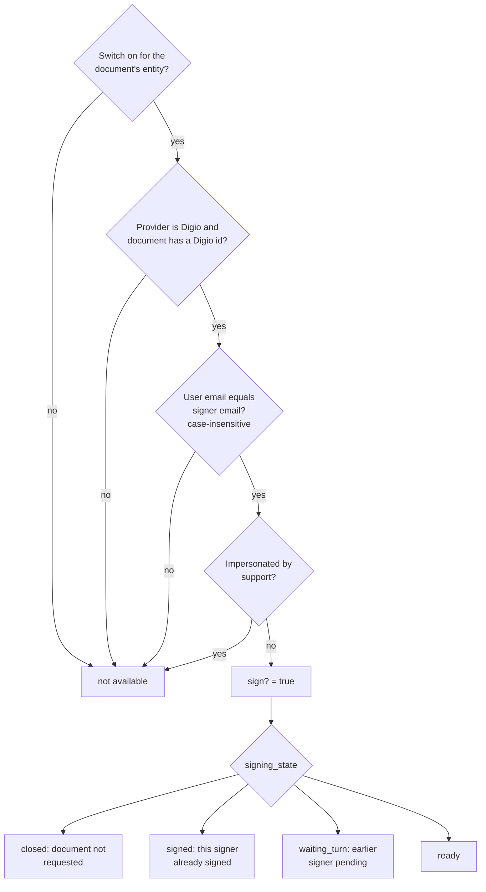

| Role | `sign?` | Notes |
|---|---|---|
| Matching signer (investor or employee) | Yes, subject to state | Identity only; entity membership is irrelevant |
| Other employee of the same entity | No | Even a company admin cannot sign for someone else |
| Support user impersonating the signer | No | `current_user.support_user_id.present?` |
| Anyone else | No | Same refusal text as non-signers (no disclosure) |

Tenant isolation: the record is reached by its id and then authorized; a user who does not match gets the unified refusal
and no document detail. `sign_result?` requires the same identity but not "ready", because the status may already have
moved (webhook) by the time the panel reports.

**Worked examples:** H1, E1, E2, E3, E4, E5, E6, E8, E9, E10, E12

**FAQ**

| Question | Answer |
|---|---|
| Why not require `DocumentPolicy#show?`? | Fund signatories who are employees may not pass `show?` (it depends on role and owner policy); being the designated signer is the grant, and Digio already emailed them the document. |
| Why compare emails and not `e_signatures.user_id`? | `user_id` is unused today; the email is what Digio's request and webhooks are keyed on. |

### ③ Signing page

A normal CapHive page whose only job is to host Digio's panel and start it on a click.

| Owns | Reads / receives | Produces |
|---|---|---|
| `ESignaturesController#sign`, `sign.html.erb`, `digio_esign_controller.js`, `DigioSdkConfig` | `ESignature`, `Document#provider_doc_id`, `signing_state`, `DIGIO_BASE_URL` / `DIGIO_SDK_BASE_URL` | HTML with data attributes: document id, email, SDK script URL, environment, result URL |

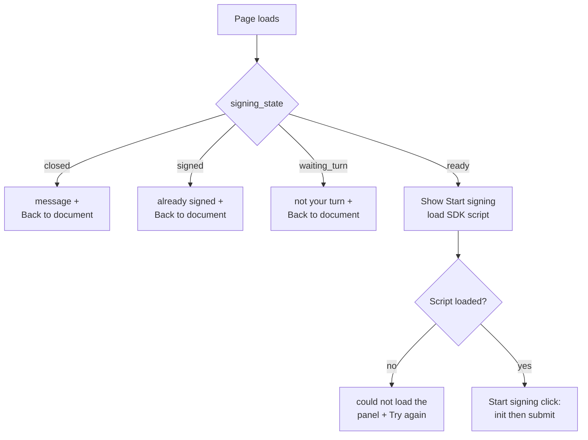

Build notes:
- The SDK script is injected on controller `connect`, **not** on click, so `init()` can run synchronously inside the click
  handler (a Digio requirement: it must be called from a user gesture, not a callback).
- `is_iframe: true`; no `redirect_url`; same options on phone and computer.
- `submit(providerDocId, email)` only — no third argument.
- Controller `disconnect` calls `digio.cancel()` so Turbo navigation does not leave an orphaned panel; the link to this
  page uses `data-turbo="false"` for a clean load.
- `DigioSdkConfig`: `script_url` = `{sdk_base}/sdk/v11/digio.js`; `environment` = `sandbox | production`.

| Verb and path | Action | Does | Responds with |
|---|---|---|---|
| GET `/e_signatures/{id}/sign` | `sign` | authorize `sign?`, compute `signing_state`, render | HTML page, or redirect with the refusal text |

**Worked examples:** H2, H3, E11, E13, E14, E15, E19

**FAQ**

| Question | Answer |
|---|---|
| Why not render the document inside the page too? | The Digio panel shows the document itself; duplicating it adds weight and a second source of truth. |
| What if Digio changes the SDK URL? | The path and version are one constant in `DigioSdkConfig`. |

### ④ Digio signing panel

External. CapHive only configures it and listens to it.

| Owns | Reads / receives | Produces |
|---|---|---|
| Digio (verification, signature capture) | `environment`, `is_iframe`, `logo`, `submit(id, email)` | `event_listener` events (`sign.*.completed`, `sign.*.failed`) and a `callback` |

- `event_listener` is the primary signal (it carries `error.code`); `callback` is the fallback (`error_code`).
- Unsupported events (`sign.doc_review.*`, `nach.*`, `form.*`) are ignored by the page.
- Sandbox-only unknowns to verify before building the page are in [Risks](#risks-and-open-questions).

**Worked examples:** H3 (stubbed)

**FAQ**

| Question | Answer |
|---|---|
| How is this tested without Digio? | A stub `digio.js` is served in tests; see [Testing](#testing). |

### ⑤ Result handler

Takes what the browser says happened and turns it into a message, an audit entry and, where useful, a status check.

| Owns | Reads / receives | Produces |
|---|---|---|
| `ESignaturesController#sign_result`, `DigioSdkErrors` | `event`, `error_code`, `txn_id` posted by the page | `{message, action}` JSON; an `sdk_events` entry; maybe a `DocumentEsignUpdateJob` enqueue; maybe an `ErrorReport` |

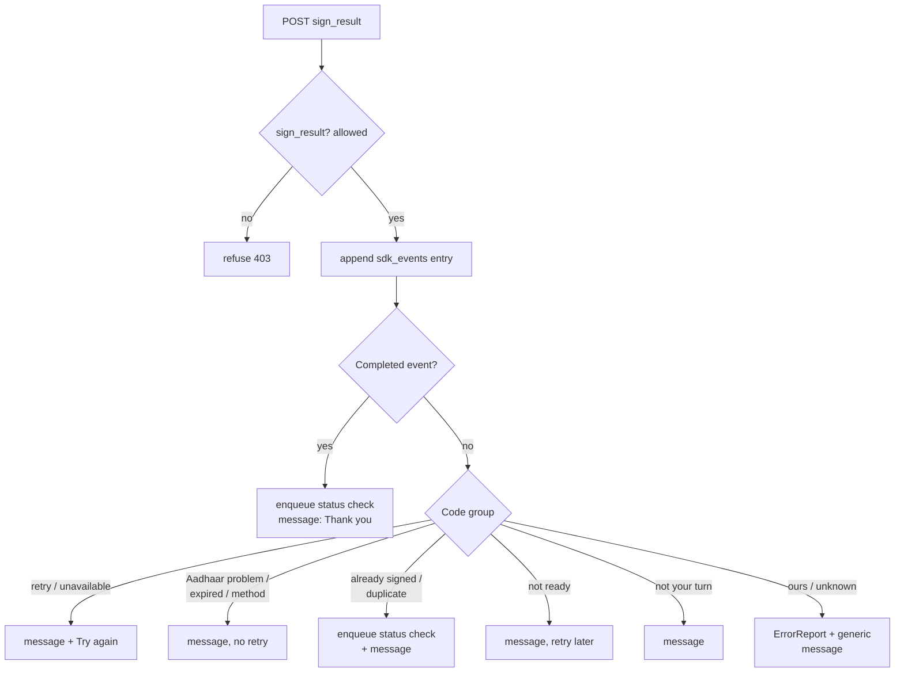

| Code group | Codes | Action field | Check enqueued | Support alerted |
|---|---|---|---|---|
| retry | `OTP_INVALID`, `AUTHENTICATION_FAILED`, `BIOMETRIC_DATA_MISMATCH`, `BIOMETRIC_LOCKED`, `INCORRECT_AADHAAR_ID`, `INVALID_ELECTRONIC_SIGNATURE`, `SIGNING_TIMED_OUT_ON_ESP`, `SIGNING_CANCELLED_ON_ESP` | `retry` | No | No |
| unavailable | `ERROR_FROM_ESP_UIDAI`, `ESP_UIDAI_DOWN`, `AADHAAR_ESIGN_TEMPORARILY_UNAVAILABLE`, `ESIGN_REQUEST_FAILURE` | `retry` | No | No |
| aadhaar | `AADHAAR_HAS_NO_MOBILE`, `AADHAAR_HAS_NO_MOBILE_OR_EMAIL`, `AADHAAR_SUSPENDED`, `AADHAAR_NOT_AUTHENTICABLE`, `AADHAAR_CANCELLED` | `none` | No | No |
| state-moved | `ALREADY_SIGNED`, `DUPLICATE_REQUEST` | `none` | Yes | No |
| platform action | `SIGN_REQUEST_EXPIRED`, `REQUESTED_SIGN_METHOD_DIFFERENT` | `none` | No | No |
| not ready | `DOCUMENT_NOT_READY_FOR_THIS_ACTION`, `DOCUEMNT_NOT_READY_FOR_THIS_ACTION` | `retry` | No | No |
| turn | `SIGNING_NOT_ALLOWED` | `none` | No | No |
| ours | `NOT_SUFFICIENT_ENTITLEMENTS`, `INVALID_SIGNER`, `UNAUTHORIZED_ACCESS`, `SYSTEM_ERROR`, `UNKNOWN_ERROR`, any other | `none` | No | Yes |

The map is a frozen constant keyed by code; both spellings of "not ready" are separate keys pointing at one group, so a
later correction by Digio needs no change.

Two browser-originated pseudo-events use the same table so every message has one home: `client.cancelled` (the panel was
closed without a completion or error) → "Signing was cancelled…", action `retry`; `client.panel_unavailable` (the SDK
script failed to load) → "We couldn't load the signing panel…", action `retry`. Neither enqueues a check nor alerts.

| Verb and path | Action | Does | Responds with |
|---|---|---|---|
| POST `/e_signatures/{id}/sign_result` | `sign_result` | authorize `sign_result?`, log, map, enqueue | JSON `{message, action}` (200); 403 JSON when refused |

**Worked examples:** H4, H5, E16, E17, E18, E20, X1–X11

**FAQ**

| Question | Answer |
|---|---|
| Why is a completed result not trusted? | The endpoint is called from the browser. It can only ask the server to check with Digio (E17). |
| What if the POST fails after a real completion? | The page still shows the thank-you message; Digio's notification and the daily job are the backstops. |
| Could the endpoint be spammed to enqueue checks? | It is authenticated, self-only and enqueues only for completion and state-moved codes. |

### ⑥ Status confirmation

Reused unchanged: the existing "Get eSignatures' updates" path.

| Owns | Reads / receives | Produces |
|---|---|---|
| `DocumentEsignUpdateJob` → `EsignUpdateJob` → `DigioEsignHelper#update_esign_status` (`retrieve_signed`, `signature_completed`) | `document_id`, `user_id` | Updated `ESignature.status`; on all-signed, the signed `Document`; a `UserAlert` toast to the user |

- Eligibility already skips cancelled / completed / expired / voided documents.
- Idempotent against the webhook: `new_status?` ignores statuses already signed, and `signature_completed` only completes
  once.
- One small change in ⑧ (rejected is sticky) — see below.
- After the signer loop in `update_esign_status` it calls `Document#notify_ready_signers` (⑨).

**Worked examples:** H5, H10, E17

**FAQ**

| Question | Answer |
|---|---|
| Is a toast sent to the signer? | Yes — the existing "eSign status updated" `UserAlert` for `user_id`. |

### ⑦ Webhook reader

The existing `signature_progress` endpoint, now routing on the notification's `event`.

| Owns | Reads / receives | Produces |
|---|---|---|
| `DigioEsignHelper#update_signature_progress` and its three handlers | Digio payload: top-level `event`, `payload.document` | Status updates; `EsignLog.webhook_data`; `ErrorReport` for rejections and anomalies; always `200 Ok` |

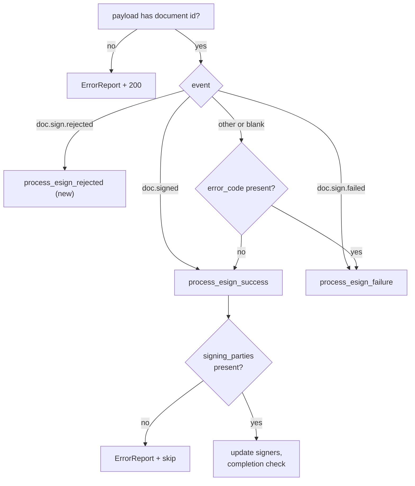

- `process_esign_rejected`: find the document by `provider_doc_id`; find the signer by `signer_identifier` (lower-cased);
  `update_esign_response("rejected", payload)`; append `webhook_data`; `ErrorReport.notify` (always, including when the
  signer is not found).
- `process_esign_success` gains a nil/empty `signing_parties` guard (the bug a rejected payload hits today).
- Webhook error codes (`ESP-###`) are stored and reported; they are **not** translated by the SDK table.
- `process_esign_success` calls `Document#notify_ready_signers` (⑨) after its signer loop.
- `EsignHelper.update_signature_progress` (the dispatcher) used to call the helper on nil after reporting an unsupported
  payload, which would have answered Digio with a 500; it now returns, so every notification is acknowledged. A
  notification for an unknown document is reported to support from the success, failure and rejected handlers alike.

**Worked examples:** H6, H8, H10, E21–E28, E32

**FAQ**

| Question | Answer |
|---|---|
| Why keep the legacy rule at all? | Existing Digio notifications and test fixtures may lack or vary `event`; routing strictly would turn them into silent no-ops. |
| Should an unknown event update signers? | Only through the legacy rule (its content decides), never because of its name. |

### ⑧ Signer status record

`ESignature.status` per signer and `Document.esign_status` for the whole document — existing columns.

| Owns | Reads / receives | Produces |
|---|---|---|
| `ESignature#update_esign_response`, `#new_status?`, `#status_badge` | status strings from ⑥ and ⑦ | The stored signer status shown on ① |

- New value `rejected` (badge `danger`). **Rejected is sticky** against statuses from a status pull other than `signed`
  (Digio's pull does not know "rejected" and could otherwise flip it back to requested). **Re-Send** already resets all
  signer statuses to blank, which is the way out.
- `signed` remains un-overwritable (existing `new_status?` rule), which is what makes the late-notification case safe.

**Worked examples:** H5, H8, E25

**FAQ**

| Question | Answer |
|---|---|
| Does Document-level `esign_status` change on rejection? | No — it stays `requested`; the GP cancels or re-sends. |

### ⑨ Signer notice

Tells a signer who is a platform user that it is their turn — a bell entry and an email — once per signing request.

| Owns | Reads / receives | Produces |
|---|---|---|
| `Document#notify_ready_signers`, `ESignature#claim_signing_notification!`, `EsignSigningNotifier`, `EsignSigningMailer#signature_requested` | The document's signers, each signer's matching `User`, `ESignaturePolicy#sign?`, `ESignature#signing_state` | A Noticed event per newly ready signer (bell entry now, email after `email_delay`); `signing_notified_at` set |

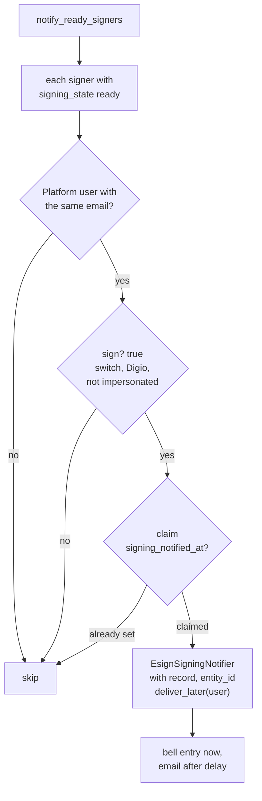

| Trigger | Where | Notifies |
|---|---|---|
| Document sent | `DigioEsignHelper#update_document`, success branch, after the document is saved as requested | Every signer who is ready at send (the first signer when ordered, everyone otherwise) |
| Signature confirmed by Digio's notification | `process_esign_success`, after its signer loop | The signer whose turn just arrived |
| Signature confirmed by the status check | `update_esign_status`, after its signer loop | The same signer, by the pull path |

- Every call site is wrapped (`rescue StandardError` → `ErrorReport.notify`, source `Document notify_ready_signers`) and never re-raises.
- Notifier shape follows `FinancialStatementNotifier`: `record` is the `ESignature`, `entity_id` is the document's entity,
  `notification_methods` gives `message` and `url`; email goes through `EsignSigningMailer#signature_requested` with `email_data`.
- Email gating is the existing `email_enabled` (employees of the document's entity always; investors by investor access)
  plus `email_delay`; the in-app entry is always created.
- No WhatsApp: the notifier defines no `custom_notification`, so the shared `:whats_app` gate stays false and nothing
  extra is built (see [Risks](#risks-and-open-questions)).
- **Re-Send** (`ResendDocumentForEsign`) clears `signing_notified_at` with the statuses; nothing scans existing documents,
  so enabling the switch is never retroactive.

**Worked examples:** H9, H10, E29–E35, X12

**FAQ**

| Question | Answer |
|---|---|
| Why claim in the database instead of looking for an existing notification? | One atomic `update_all … positive?` is race-free when the webhook and the job land together; searching events by JSON params is slow and racy. |
| Why not notify every signer at send on an ordered document? | Later signers would land on "It isn't your turn to sign yet." and the notification would be noise. |
| What if the webhook and the status check both confirm the same signature? | One wins the claim and notifies; the other finds it set and does nothing (E32). |
| What if the entity switch is off when a signature is confirmed? | `sign?` is false, so nothing is claimed or sent; turning the switch on later notifies only on the next transition (E35). |

---

## 4. Reference

### Class diagram

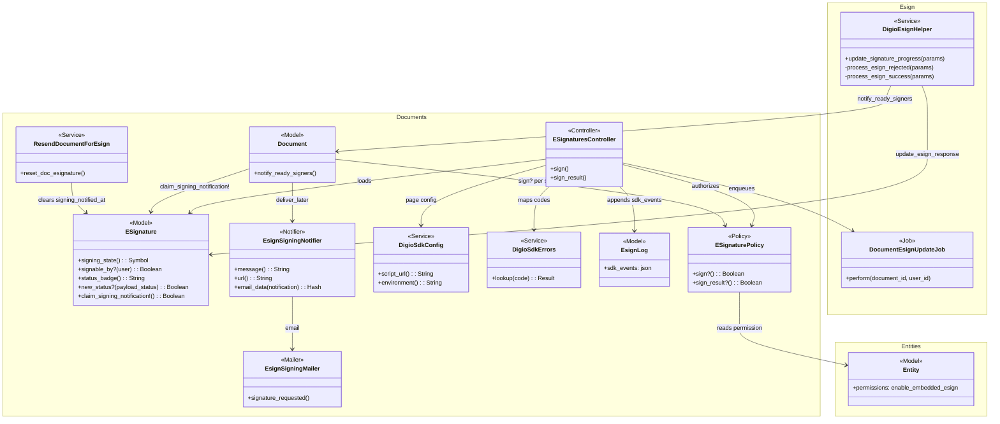

### Data model and schema changes

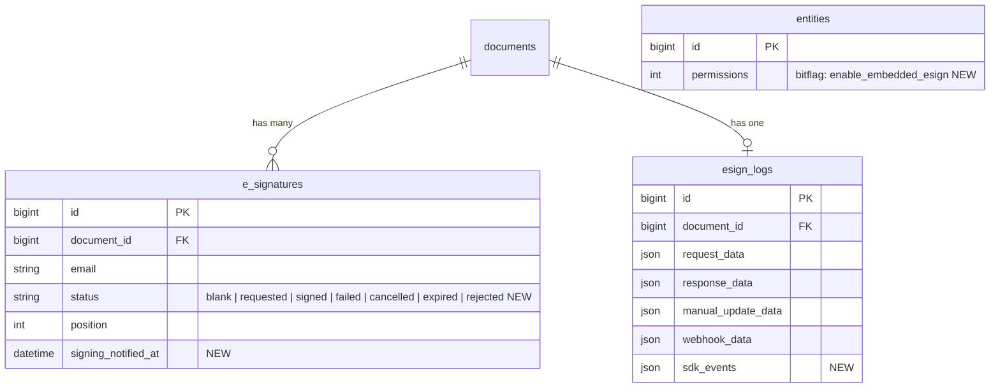

**Indexes:** none added.

**Schema changes**

**`esign_logs`** (changed): holds the audit trail of what was reported from the signing page, kept apart from
server-fetched and webhook data because it is client-reported.

| Column / index | What changed | Why it's needed |
|---|---|---|
| `sdk_events` | Added: `json`, nullable, keyed by timestamp like its siblings | Audit trail of signing-page results (spec: *Signing-page activity is recorded*) without mixing untrusted client reports into `manual_update_data` |

**`e_signatures`** (changed): records that a signer has been notified for the current signing request, so the same
confirmation arriving by two routes (or a retry) notifies once.

| Column / index | What changed | Why it's needed |
|---|---|---|
| `signing_notified_at` | Added: `datetime`, nullable | The atomic claim for "notified once per request" (spec: *Each request notifies a signer once*); cleared on **Re-Send** so a new request notifies again; null means not yet notified |

**`entities.permissions`** (no column change): `enable_embedded_esign` is appended to the end of the `permissions` flag
list in `EntityEnabled`. Appending is safe; inserting would shift existing bits.

**Changes to existing models:**
- `ESignature`: `signing_state`, `signable_by?`; `status_badge` handles `rejected`; `new_status?` makes `rejected` sticky
  against non-`signed` payloads.
- `Entity`: one appended permission flag.
- `ESignaturePolicy`: `sign?`, `sign_result?`.
- `EsignLog`: nothing but the new column.
- `Document`: `notify_ready_signers`.
- `ESignature`: `claim_signing_notification!`.
- `ResendDocumentForEsign`: clears `signing_notified_at` with the statuses.

### Component contracts

| From → To | Contract | Direction rule |
|---|---|---|
| ① → ② | `ESignaturePolicy#sign?` and `ESignature#signing_state` for the viewer | Views never re-derive eligibility |
| ② → ③ | Authorization + `signing_state == :ready` | Page renders the panel only when ready |
| ③ → ④ | `submit(provider_doc_id, email)`; options `environment`, `is_iframe: true` | No token, no other identifiers |
| ④ → ⑤ | `event_listener(event)` / `callback(response)` → POST `{event, error_code, txn_id}` | Browser data is a hint, never a status |
| ⑤ → ⑥ | `DocumentEsignUpdateJob.perform_later(document_id, user_id)` | Only completion and state-moved codes |
| ⑥ → ⑧ | `ESignature#update_esign_response(status, payload)` | Existing; `signed` is not overwritten |
| ⑦ → ⑧ | Same `update_esign_response` | New `"rejected"` value |
| ⑧ → ① | `ESignature#status` / `#status_badge` | Read-only |
| ⑧ → ⑨ | `Document#notify_ready_signers`, called from the send path and after ⑥ and ⑦ apply statuses; reads `ESignature#signing_state` per signer | ⑨ reads state and never writes a status; never inside a status update; failures rescued and reported |
| ⑨ → ③ | Notification `url` and email button = `sign_e_signature_path(e_signature)` | Opens the signing page, which re-checks `sign?` itself |

### Cross-cutting concerns

#### Transactions and queries

Each webhook handler performs single-row updates through the existing `update_esign_response`; no new multi-table
write. The document page adds one query for the viewer's own signer row (`e_signatures` by `document_id` and lower-cased
`email`), served by the existing `document_id` index. `signing_state` loads the document's signers once (ordered by
`position`). `notify_ready_signers` adds one `users` lookup per ready signer (by lower-cased email) and one atomic
`update_all` claim per notified signer; no transaction spans the claim and the delivery.

#### Exception handling and monitoring

| Failure | Who is alerted | Channel | Detail |
|---|---|---|---|
| Rejected notification | Support | `ErrorReport.notify` (source `DigioEsignHelper webhook`) | Document context, signer email, `validation_results` summary |
| "Ours" code or unmapped code from the panel | Support | `ErrorReport.notify` (source `ESignaturesController sign_result`) | Code, document, signer email, `txn_id` |
| `doc.signed` without `signing_parties` | Support | `ErrorReport.notify` | Payload id; processing skipped |
| `sign_result` refused | None | Rails log | Not an error |
| Notification could not be created or delivered | Support | `ErrorReport.notify` (source `Document notify_ready_signers`) | Document, signer email, error; the send or webhook continues |

#### Performance and security

- No new background pipeline; one enqueue per eligible result. The SDK script loads from Digio only on the signing page.
- Authorization is identity-based and checked on every action (`sign`, `sign_result`); refusal text is identical for
  non-signers, impersonation, a disabled switch and an unknown id, to avoid leaking document existence.
- No secrets reach the browser: `provider_doc_id` and the signer's own email only. CSRF applies to `sign_result`
  (`@rails/request.js` sends the token).
- Support impersonation is refused on both actions.
- Notifications go only to the signer's own account; the email carries the document name, the sender's name and a link — no
  token — and the link lands on a page that authorizes again.
- CSP: the app sets none today (`content_security_policy.rb` is commented out); production response headers must still be
  checked for `script-src`/`frame-src` on `*.digio.in`.

### Worked examples

**ID legend:** **H** = Happy path · **E** = Edge case · **X** = Error (exception) case.

**Shared setup:**

| Record | Name | Key data |
|---|---|---|
| Entity | Orion Capital | Investment Fund, `enable_documents`, `enable_embedded_esign` on, provider Digio |
| Investor user | Priya | `priya@lpfund.com`, investor access to the document |
| Employee user | Rahul | `rahul@orioncap.com`, entity employee |
| Document | Subscription Agreement | approved, `sent_for_esign` true, `esign_status` requested, `provider_doc_id` `DID2312191801389959UDGNBWGRGCSC1`, `force_esign_order` true |
| Signers | position 1 / 2 / 3 | priya@lpfund.com (Investor Signatory), rahul@orioncap.com (Fund Signatory), vikram@lawfirm.in (Counsel); all `aadhaar`, `requested` |
| Stubs | Digio | `DigioEsignHelper#retrieve_signed` and `#download` stubbed per scenario; `digio.js` stub for browser scenarios; webhook posted through an in-process integration session (the existing `hit_signature_progress` needs a running browser server); Digio status through a stubbed `#retrieve_signed` response |
| Mail and notifications | Test delivery | `ActionMailer` test deliveries and `Noticed::Notification` rows asserted per recipient; `BaseNotifier` keeps WhatsApp off in test |

#### Happy Path

| # | Scenario | Given | When | Then | Spec scenario | Feature |
|---|---|---|---|---|---|---|
| H1 | Matching signer sees Sign now | Shared setup, Priya logged in | She opens the document | Banner "Your signature is requested on this document." with **Sign now** | Matching logged-in signer is offered Sign now | embedded_esign_eligibility |
| H2 | Signing page shows context | H1 | She clicks **Sign now** | Page shows document name, "Signing as: priya@lpfund.com", "Signer 1 of 3 - Investor Signatory", method, **Start signing**, **Back to document** | Signing page shows the signer's context | embedded_esign_page |
| H3 | Start opens the panel | H2, stub `digio.js` | She clicks **Start signing** | Stub records `submit("DID2312191801389959UDGNBWGRGCSC1", "priya@lpfund.com")` with exactly two arguments | Start signing opens the panel; Panel is opened with document and signer only | embedded_esign_page |
| H4 | Completion asks for a check | H3 | Stub reports `sign.aadhaar.completed` | Page shows "Thank you. Your signature has been submitted and is being confirmed."; a status check is enqueued; Priya still Requested | Completion triggers confirmation | embedded_esign_result |
| H5 | Confirmed signature advances the turn | H4, Digio status stub shows Priya signed | The job runs | Priya Signed; Rahul's document page shows **Sign now** | Confirmed signature updates the document; Turn arrives after the earlier signer signs | embedded_esign_result |
| H6 | Signed webhook | Shared setup | Digio posts `doc.signed` with Priya signed | Priya Signed; Rahul Requested | Signed notification updates signers | esign_webhook_events |
| H7 | Last signature completes the document | Priya and Rahul Signed | Digio posts `doc.signed` with all signed | Document `esign_status` completed; signed copy created | Signed notification updates signers | esign_webhook_events |
| H8 | Rejection marks the signer | Shared setup | Digio posts `doc.sign.rejected` for vikram@lawfirm.in | Vikram's row **Rejected** (danger badge), document still requested, `ErrorReport` raised | Rejection marks the signer Rejected | esign_webhook_events |
| H11 | Audit trail filed | Priya and Rahul signed; agreement belongs to a fund | Vikram's signature is confirmed | Document `completed`; **Signed** copy and "Subscription Agreement - Audit Trail" (tag `Audit Trail`, locked, approved) on the fund | Audit trail filed on completion | esign_audit_trail |
| H9 | Notified at send | Shared setup, but the document is approved and **not yet sent**; Priya and Rahul are platform users, Vikram is not; Digio accepts the send | The send completes | Priya gets the bell entry "Your signature is requested: Subscription Agreement from Orion Capital" and an email with subject "Your signature is requested: Subscription Agreement"; Rahul and Vikram get nothing; Priya's `signing_notified_at` is set | Ready signer is notified when the document is sent; Ordered document notifies only the first signer at send | embedded_esign_notifications |
| H10 | Next signer after confirmation | H9 sent; Digio status stub shows Priya signed | The status check runs | Rahul gets the bell entry and the email; Priya is not notified again; Vikram nothing | Next signer is notified when the earlier signature is confirmed | embedded_esign_notifications |

#### Edge Cases

| # | Scenario | Given | When | Then | Spec scenario | Feature |
|---|---|---|---|---|---|---|
| E1 | Email case | Signer email stored `Priya@LPFund.com`; Priya logged in as `priya@lpfund.com` | She opens the document | **Sign now** shown | Email match ignores letter case | embedded_esign_eligibility |
| E2 | Non-matching user | Another investor user logged in | Opens the document | No banner, no **Sign now** | Non-matching user is not offered Sign now | embedded_esign_eligibility |
| E3 | Switch off | `enable_embedded_esign` off | Priya opens the document | No banner; document otherwise unchanged | Embedded eSigning switched off; Default is off | embedded_esign_eligibility |
| E4 | One entity only | Switch on for Orion, off for another entity with a similar document | Priya opens each | Banner only on Orion's | Switched on for one entity only | embedded_esign_eligibility |
| E5 | Impersonation | Support user impersonating Priya | Opens the document and `/sign` | No banner; `/sign` refused | Support user impersonating a signer cannot sign | embedded_esign_eligibility |
| E6 | Document closed | Document cancelled | Priya opens the document and `/sign` | No banner; `/sign` shows "This document is no longer waiting for signatures." | Document is not waiting for signatures | embedded_esign_eligibility |
| E7 | Employee row action | Rahul (employee, Priya signed) on Signatures tab | Views the tab | **Sign now** on his row only | Employee signer sees Sign now on their own row | embedded_esign_eligibility |
| E8 | Waiting turn banner | Priya not yet signed; Rahul logged in | Opens the document | "...You can sign after the previous signer has signed." and no button | Earlier signer still pending | embedded_esign_eligibility |
| E9 | Out-of-turn page | As E8 | Opens `/e_signatures/{rahul}/sign` | "It isn't your turn to sign yet. ..." and no **Start signing** | Signing page opened out of turn | embedded_esign_eligibility |
| E10 | No signing order | `force_esign_order` false | Priya and Rahul each open the document | Both see **Sign now** | Document without a signing order | embedded_esign_eligibility |
| E11 | Non-signer direct URL | A logged-in non-signer | Opens `/e_signatures/{priya}/sign` | "This signature request is not available for your account." with no document detail | Non-signer opens the signing page directly | embedded_esign_page |
| E12 | Already signed | Priya Signed | Opens her `/sign` | "You have already signed this document." and **Back to document** only | Signer who has already signed opens the page | embedded_esign_page |
| E13 | Panel cannot load | `digio.js` stub returns 404 | Clicks **Start signing** | "We couldn't load the signing panel. ..." and **Try again** | Signing panel cannot be loaded | embedded_esign_page |
| E14 | Phone width | 390 px viewport | Opens document, `/sign`, clicks **Start signing** | Same banner, page and panel start | Same flow on a phone-width screen | embedded_esign_page |
| E15 | No token requested | Send a document for eSign with the switch on | The send runs | Request body has `generate_access_token` false/absent | Signing request carries no access token | embedded_esign_page |
| E16 | Already-sent documents | Switch off at send time, on afterwards | Priya opens the document | **Sign now** shown without re-sending | Documents already sent can be signed | embedded_esign_eligibility |
| E17 | Unconfirmed success | H4, Digio status stub shows Priya still requested | The job runs | Priya Requested; no signed copy | Browser reports success that Digio does not confirm | embedded_esign_result |
| E18 | Panel closed | H3 | Stub reports cancel | "Signing was cancelled. You can start again whenever you are ready." and **Start signing** | Signer closes the panel without finishing | embedded_esign_result |
| E19 | Sandbox | `DIGIO_BASE_URL=https://ext.digio.in:444` | Opens `/sign` | Script URL `https://ext.digio.in/sdk/v11/digio.js`, environment `sandbox` | Sandbox environment | embedded_esign_page |
| E20 | Completion recorded | H4 | The result is posted | `esign_logs.sdk_events` has priya@lpfund.com, event, time | Completion is recorded | embedded_esign_result |
| E21 | Partial signing webhook | Shared setup | `doc.signed` with only Priya signed | Priya Signed; document requested | Partially signed document | esign_webhook_events |
| E22 | Failed webhook | Shared setup | `doc.sign.failed` for Rahul, `error_code` `ESP-101` | Rahul **Failed**; webhook logged | Failed notification marks the signer failed | esign_webhook_events |
| E23 | Unknown event | Shared setup | Payload `event` `doc.expired`, signers listed, no error code | Acknowledged; statuses per content; nothing breaks | Notification with an unknown event type | esign_webhook_events |
| E24 | Legacy payload | Payload with no `event`, signers listed | Posted | Signers updated as before | Legacy notification without an event type | esign_webhook_events |
| E25 | Late rejection | Priya Signed | `doc.sign.rejected` for Priya | Priya stays Signed; entry logged | Late rejection after signing | esign_webhook_events |
| E26 | Rejection without signer list | Shared setup | `doc.sign.rejected` payload as Digio documents it | No exception; Vikram **Rejected** | Rejection without a signer list does not fail processing | esign_webhook_events |
| E27 | Rejection for unknown signer | Shared setup | `doc.sign.rejected` for `ghost@x.com` | `ErrorReport` raised; 200 | Rejection for a signer not on the document | esign_webhook_events |
| E28 | Unmatched document | Payload with an unknown `id` or none | Posted | 200 `Ok`; reported; no data changed | Notification without a document; Notification is always acknowledged | esign_webhook_events |
| E29 | Unordered document | `force_esign_order` false; Priya and Rahul platform users | The document is sent | Both are notified | Unordered document notifies every pending signer at send | embedded_esign_notifications |
| E30 | Not a user, or switch off | Vikram has no account; second run with `enable_embedded_esign` off | The document is sent | No notification or email for Vikram; none for anyone when the switch is off | Non-platform user or switch off gets no notification | embedded_esign_notifications |
| E31 | Notification opens the signing page | H9 | Priya opens the bell entry; the email's **Sign now** link is inspected | She lands on `/e_signatures/{priya}/sign` and the entry is read; the email button points to the same page | Notification opens the signing page | embedded_esign_notifications |
| E32 | Once per request | H10 situation | A `doc.signed` webhook for Priya arrives twice and a status check also runs | Rahul has exactly one bell entry and one email | Each request notifies a signer once | embedded_esign_notifications |
| E33 | Re-send | Priya Signed and notified earlier; Meera uses **Re-Send for eSignatures** | The document is re-sent | `signing_notified_at` is cleared and Priya is notified again for the new request | Re-send notifies again | embedded_esign_notifications |
| E36 | One audit trail | H11 | Digio repeats the completing notification | One audit trail; Digio asked once | Repeated confirmation | esign_audit_trail |
| E37 | Digio not ready | H11, Digio refuses twice with 403 | The job retries | Filed on the third attempt; no alert | Digio is not ready yet | esign_audit_trail |
| E38 | Document with no owner | Agreement has a folder and no owner | Last signature confirmed | `completed`; signed copy and audit trail in the agreement's folder | Document with no owner | esign_audit_trail |
| E39 | Log only | Status check, then `doc.sign.failed` | Both processed | `manual_update_data` and `webhook_data` set; `e_signatures.api_updates` stays blank | Status check and notification | esign_audit_trail |
| E34 | Investor without email access | Priya's investor access has `email_enabled` false | The document is sent | The bell entry exists; no CapHive email is sent | Investor without email access gets the in-app notification only | embedded_esign_notifications |
| E35 | Not retroactive | Document sent with the switch off; the switch is then turned on | Admin ticks the switch; later Priya's signature is confirmed | No notification at tick time; Rahul is notified when his turn arrives | Switching on does not notify for already-sent documents | embedded_esign_notifications |

#### Error Cases

| # | Scenario | Given | When | Then (what the user sees, who is alerted) | Spec scenario | Feature |
|---|---|---|---|---|---|---|
| X1 | Retryable codes | H3 | Stub reports each of the 8 retry codes | "Signing didn't go through. Please check your details and try again." and **Try again**; no alert | Retryable codes | embedded_esign_result |
| X2 | Service unavailable | H3 | `ERROR_FROM_ESP_UIDAI`, `ESP_UIDAI_DOWN`, `AADHAAR_ESIGN_TEMPORARILY_UNAVAILABLE`, `ESIGN_REQUEST_FAILURE` | "The signing service is temporarily unavailable. Please try again in a little while." and **Try again** | Signing service unavailable | embedded_esign_result |
| X3 | Aadhaar unusable | H3 | The 5 Aadhaar-problem codes | "Your Aadhaar can't be used for eSign right now. ..." with no **Try again** | Aadhaar cannot be used | embedded_esign_result |
| X4 | State moved | H3 | `ALREADY_SIGNED`; `DUPLICATE_REQUEST` | "You have already signed this document." / "A signing request is already in progress. ..."; status check enqueued | Request already signed or in progress | embedded_esign_result |
| X5 | Expired / method changed | H3 | `SIGN_REQUEST_EXPIRED`; `REQUESTED_SIGN_METHOD_DIFFERENT` | The two "ask the sender to send it again" messages; no **Try again** | Request expired or method changed | embedded_esign_result |
| X6 | Not ready, both spellings | H3 | `DOCUMENT_NOT_READY_FOR_THIS_ACTION` then `DOCUEMNT_NOT_READY_FOR_THIS_ACTION` | Identical "This document isn't ready to be signed yet. ..." both times | Document not ready, both spellings | embedded_esign_result |
| X7 | Not your turn at Digio | H3 | `SIGNING_NOT_ALLOWED` | "It isn't your turn to sign yet. ..." | Not the signer's turn | embedded_esign_result |
| X8 | Our side | H3 | Each of the 5 codes | Generic "Something went wrong on our side..."; code not shown; `ErrorReport` raised | Problems on our side or Digio's | embedded_esign_result |
| X9 | Unknown code | H3 | `SOMETHING_NEW` | Same as X8 | Unrecognised error code | embedded_esign_result |
| X10 | Failure recorded | H3 | Any error code | `sdk_events` has the signer email, code and time | Failure is recorded | embedded_esign_result |
| X11 | Result posted by someone else | Rahul posts to `/e_signatures/{priya}/sign_result` | Posted | 403; nothing recorded or enqueued | Non-signer opens the signing page directly | embedded_esign_result |
| X13 | Audit trail never arrives | H11, but Digio refuses every attempt | Six attempts fail | Document stays `completed` with its signed copy; no audit trail; `ErrorReport` "Could not download the audit trail" | Digio never hands it over | esign_audit_trail |
| X14 | Signed copy download fails | Priya and Rahul signed; Digio's download answers 502 | `doc.signed` for all three | Digio gets 200; document stays `requested`; no signed copy; `ErrorReport` "Could not download the signed copy"; the next status check completes it | Signed copy cannot be downloaded | esign_audit_trail |
| X12 | Notifier failure | The notifier is forced to raise | The document is sent; separately a `doc.signed` webhook is posted | The document is sent; statuses are updated; the webhook answers 200; `ErrorReport` is raised for the notification | Notification failure does not block sending or webhooks | embedded_esign_notifications |

### Delivery: pull requests

**Budget.** Every pull request changes **at most 15 application files**. Not counted: anything under `openspec/`, and
the `.feature` files and step definitions under `features/` — those ship **in the PR of the code they test**. `docs/`
and `db/schema*.rb` count. If a PR would exceed the budget it is split before it is opened; the budget is not widened.
The openspec change itself goes in a last, docs-only PR.

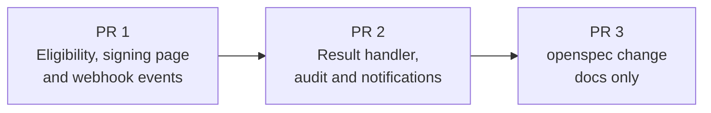

| PR | Scope (boxes) | Application files | Tests that ship with it (not counted) | Depends on | Why it is safe to merge alone |
|---|---|---|---|---|---|
| 1 | Entity flag, `signable_by?` / `signing_state`, `rejected` badge and sticky rule, `sign?` policy, banner and row action; signing page (SDK config, error map, `sign` action, page, Stimulus controller); webhook routing, `process_esign_rejected`, nil guard, dispatcher return (①②③⑦⑧) | 15 | `embedded_esign_eligibility.feature`, `embedded_esign_page.feature`, `esign_webhook_events.feature`, `embedded_esign_steps.rb` (new) | — | The flag is off by default, so nothing renders. The only behaviour outside the flag is webhook routing, which keeps the legacy fallback and is covered by its own feature in the same PR |
| 2 | `esign_logs.sdk_events`, `sign_result` and result posting; `e_signatures.signing_notified_at`, claim, Re-Send reset; notifier, mailer, `Document#notify_ready_signers` and its three call sites; one sentence in the user guide (⑤⑥⑨) | 15 | `embedded_esign_result.feature`, `embedded_esign_notifications.feature`, `embedded_esign_steps.rb` (extended) | 1 | Both columns are nullable and unused until the code in the same PR; `sign_result` is refused unless `sign_result?`; every notification call site is rescued and gated by `sign?` |
| 3 | `openspec/changes/embedded-esign-digio/**` | excluded | — | — | No application code |
| 4 | Digio audit trail with the signed copy; signed-copy download guard; folder for documents with no owner; `api_updates` no longer written for Digio; staging `DIGIO_CLIENT_URL` | 8 | `esign_audit_trail.feature`, `embedded_esign_steps.rb` (extended), `investor.rb` (audit trail stub) | 3 | Applies to every Digio document, not behind the entity switch: nothing changes until a document completes, and the audit trail job never touches the completed document |

**Application files per PR**

| PR | Files |
|---|---|
| 1 (15) | `app/packs/core/entities/models/concerns/entity_enabled.rb` · `app/packs/core/documents/models/e_signature.rb` · `app/packs/core/documents/policies/e_signature_policy.rb` · `config/routes/core.rb` (`get :sign` and `post :sign_result`) · `app/packs/core/documents/views/documents/_embedded_sign_banner.html.erb` · `app/packs/core/documents/views/documents/show.html.erb` · `app/packs/core/documents/views/e_signatures/_e_signature.html.erb` · `app/packs/core/documents/services/digio_sdk_config.rb` · `app/packs/core/documents/services/digio_sdk_errors.rb` · `app/packs/core/documents/controllers/e_signatures_controller.rb` (`sign`) · `app/packs/core/documents/views/e_signatures/sign.html.erb` · `app/javascript/controllers/digio_esign_controller.js` (start signing) · `app/packs/core/investor_kycs/models/concerns/digio_esign_helper.rb` (routing, rejected handler, nil guard, unmatched-document report) · `app/packs/core/investor_kycs/models/helper/esign_helper.rb` (dispatcher returns for an unsupported payload) · `docs/user_guides/esigning_user_guide.md` (signing and notification) |
| 2 (15) | `db/migrate/20261012100000_add_sdk_events_to_esign_logs.rb` · `db/migrate/20261012110000_add_signing_notified_at_to_e_signatures.rb` · `db/schema.rb` · `db/schema_test.rb` · `app/packs/core/documents/models/esign_log.rb` · `app/packs/core/documents/controllers/e_signatures_controller.rb` (`sign_result`) · `app/javascript/controllers/digio_esign_controller.js` (result posting) · `app/packs/core/documents/models/e_signature.rb` (`claim_signing_notification!`) · `app/packs/core/documents/services/resend_document_for_esign.rb` · `app/packs/core/documents/mailers/esign_signing_notifier.rb` · `app/packs/core/documents/mailers/esign_signing_mailer.rb` · `app/packs/core/documents/views/esign_signing_mailer/signature_requested.html.erb` · `app/packs/core/documents/models/document.rb` · `app/packs/core/investor_kycs/models/concerns/digio_esign_helper.rb` (`notify_ready_signers` calls) · `docs/user_guides/esigning_user_guide.md` (Digio's link keeps working) |

**Rules**
- **Count check before opening a PR:** `git diff --name-only origin/main...HEAD -- . ':(exclude)openspec' ':(exclude)features' | wc -l` must print 15 or less. PR 1 and PR 2 are each at 15, the limit (PR 1 took the dispatcher fix in `esign_helper.rb` found while building; PR 2 took one user-guide sentence).
- **Tests ship with their code.** Each phase writes its feature file and runs it green (the phase gate in tasks.md is
  unchanged); the file is committed in the PR that holds that phase's code. Each PR description lists the
  worked-example IDs it was verified against.
- **Flag stays off everywhere** until PR 2 is merged and the QA checklist is signed off. PR 1 is inert without it, and
  PR 2 adds nothing reachable without it.
- **Both routes land in PR 1.** The `post :sign_result` route arrives one PR before its action; until PR 2 it answers
  404, exactly as if it were absent. This keeps PR 2 at 15 files.
- **Migrations deploy before the code that uses them**; both ship in PR 2 with their first writers.
- **PR 1 is the only PR with behaviour outside the flag** (webhook routing). It is isolated in one method group of one
  file, and its feature file ships with it, so it can be reverted by reverting the PR.
- **Per-PR checks:** rubocop on that PR's Ruby files; brakeman on both (controllers and params change in each).
- **Three-way alternative:** the same 24 files could be split 13 / 11 / 6 (page, results, notifications) if smaller
  review units are preferred; with only six files shared between slices, two PRs is the only way to reach 12–15 each.

| PR | Worked examples verified before opening |
|---|---|
| 1 | H1–H3, H6–H8, E1–E16, E19, E21–E28 |
| 2 | H4, H5, H9, H10, E17, E18, E20, E29–E35, X1–X12 |
| 4 | H11, E36–E39, X13, X14 |

### Testing

Cucumber only (no RSpec tier). Browser scenarios use the Playwright driver with a stub `digio.js` routed in place of
Digio's host; server-only scenarios (eligibility, result handler, webhooks) run without JavaScript, posting webhooks
through an in-process integration session, with the Digio payload builders in `features/step_definitions/embedded_esign_steps.rb`
(shapes follow `public/digio docs/webhook.txt`; failed, rejected and no-event variants). Six new feature files under `features/documents/` (`esign_audit_trail` covers the audit trail; the fifth, `embedded_esign_notifications`, asserts Noticed
notifications and `ActionMailer` deliveries per recipient; `BaseNotifier` keeps WhatsApp off in test); new step file
`features/step_definitions/embedded_esign_steps.rb`; reuse the existing "logged in as a user" and document-with-esign steps.
Feature files ship in the PR of the code they test (see [Delivery](#delivery-pull-requests)).

### Risks and open questions

**Sandbox spike outcomes (Digio sandbox `ext.digio.in`, 2026-10-12, embedded page with `is_iframe: true`)**

- (a) **Rendering:** a full-viewport overlay (popup) over the signing page, not an in-container panel. The page behind it
  stays visible and unchanged.
- (b) **Signer verification:** `submit(docId, email)` makes Digio authenticate the signer itself: "Authenticate <email>" with
  *Login with Google* or *Send code to Email*; a security code (valid 10 minutes) arrives at the submitted address. **Gate 1.3
  passed**: identifier-only signing keeps the identity guarantee. The signer authenticates twice (platform login, then Digio).
- (c) **Aadhaar / DSC in the iframe:** not verified. Aadhaar needs Digio credits the staging account does not have; DSC is not
  used. Verify Aadhaar before enabling the switch for an entity that signs with it.
- (d) **Phone width:** works in browser device emulation (430px); not yet tried on a real phone.
- (e) **Events and callback**, as observed:
  - completed: event `sign.electronic.completed` (`{documentId, txnId, identifier, event, entity: "sign"}`), then callback
    `{txn_id, digio_doc_id, message: "Signed Successfully"}`.
  - closed with X, before or after the code is sent: callback `{digio_doc_id, error_code: "CANCELLED", message:
    "Signing Cancelled", last_state: null}`; no event. The two cases look identical. `CANCELLED` is not in Digio's error-code
    list, so it is mapped as `client.cancelled` (never alerts).
  - wrong code: no callback and no event; the panel shows "Something went wrong!" inline and stays open, so the signer can
    retry inside the panel. The browser console shows a 403 from `.../auth/gateway/complete`.
- (f) **Response headers:** checked 2026-10-30 on `app.caphive.com`, `app.caphive.us` and `dev.altconnects.com`: no
  Content-Security-Policy and no Permissions-Policy, and the repo's nginx template sets neither. `X-Frame-Options: SAMEORIGIN`
  only stops others framing CapHive; it does not affect Digio's panel. `https://app.digio.in/sdk/v11/digio.js` answers 200.
- **Audit trail API (sandbox, 2026-10-30, dev account):** `GET /v2/client/document/{id}/v2/audit_log` returns
  `application/pdf` for a completed document; 403 `ACTION_NOT_ALLOWED_IN_CURRENT_STATE` ("available only on flow completion")
  for any other status; 404 `ENTITY_NOT_FOUND` for a document of another Digio account.
- **Webhook:** `doc.signed` from Digio reached the application and moved the next signer to `requested`.

- **Panel rendering mode unknown** (`is_iframe` may inject a full-viewport overlay rather than render in a container) →
  the page is built as a shell either way; verify in sandbox before styling work.
- **Whether `submit(docId, email)` triggers Digio's own email/SMS code in embedded mode** → verify in sandbox; if it
  does not, the identity guarantee changes and the design must be revisited before release.
- **Iframe with Aadhaar and DSC signing, and the phone viewport** → verify in sandbox; DSC may need Digio's local client.
- **A signer who cannot open the document page gets no banner** (no access right) → they keep the email link; a "my
  pending signatures" list is a possible follow-up, not in scope.
- **Documents completed before this ships have no audit trail** → not backfilled; Digio still serves it, so one can be
  fetched on request by running `DigioAuditTrailJob` for that document.
- **The Digio webhook for rejection depends on `signature_verification`** (not sent today) → handler is defensive and
  exercised by fixtures; real-world frequency is expected to be low.
- **Two emails per signer (Digio's and CapHive's)** → the CapHive email says either link works; Digio's cannot be
  suppressed per signer because its flags are per request; revisit if signers complain.
- **Email follows investor access settings** → an investor with email off gets only the bell entry, by design.
- **Every path that changes a signer's status must call `Document#notify_ready_signers`** → it is the single entry point;
  review any future status-changing path for it.
- **`EsignLogCleanupJob` deletes logs 10 days after completion** → the eSign log is a short-lived debugging record, not
  changed here. The lasting record is Digio's audit trail PDF, filed with the signed copy.
- **`e_signatures.api_updates` is no longer written for Digio** → everything it held is in the eSign log. It never was a
  history: `add_api_update` drops every entry after the first, and webhooks never saved it. The column, the `?debug` row on
  the signer page and the writes from Zoho and Docusign stay.

| # | Open question | Current thinking | Status |
|---|---|---|---|
| 1 | Notify the GP (not just support) when a signer rejects? | Out of scope; red badge and support alert only | Deferred |
| 2 | Skip Digio's code with an access token later? | Needs the regeneration API docs and a per-signer binding check | Deferred |
| 3 | WhatsApp when it is a signer's turn | Future update. The shared `DeliveryMethods::WhatsApp` needs `CustomNotification#whatsapp`; `EmployeeWhatsApp` reaches employees only; a small notifier-text delivery method covering both audiences, with the existing `general_notification` template and the same opt-in gates, would be needed | Deferred |
| 4 | Reminders for signers who do not sign | Not planned; `EsignMonitorAgent` already reports stuck documents to the GP | Deferred |

**FAQ**

| Question | Answer |
|---|---|
| Where do I start reviewing? | [Part 2 picture](#picture), then [card ②](#②-who-may-sign) (authorization) and [card ⑦](#⑦-webhook-reader) (the only behaviour change to existing code). |
| What is the only change to existing behaviour? | Webhook routing and the nil-guard in ⑦, `rejected` in ⑧, the guarded `notify_ready_signers` calls after statuses are applied and at send (⑨, rescued and behind the switch), and **Re-Send** clearing `signing_notified_at`; everything else is additive and behind the entity switch. |
