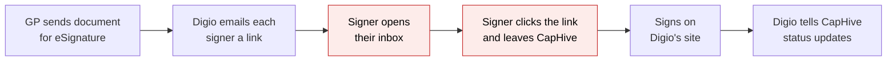
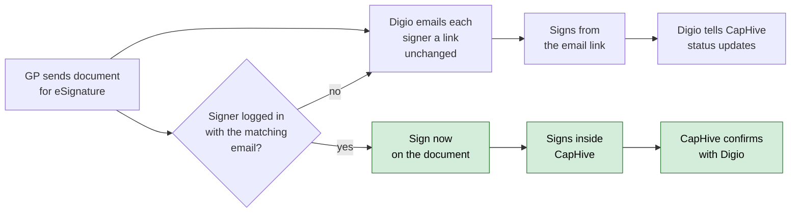
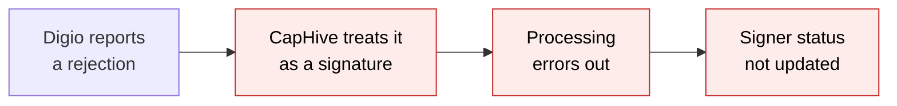
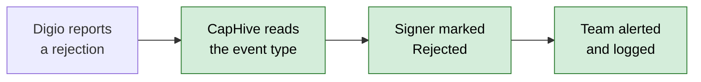
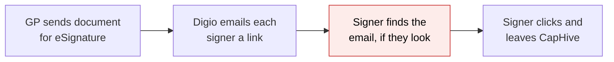
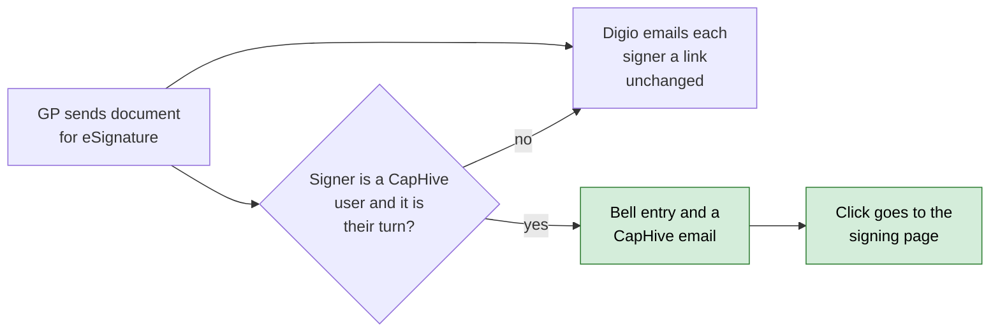
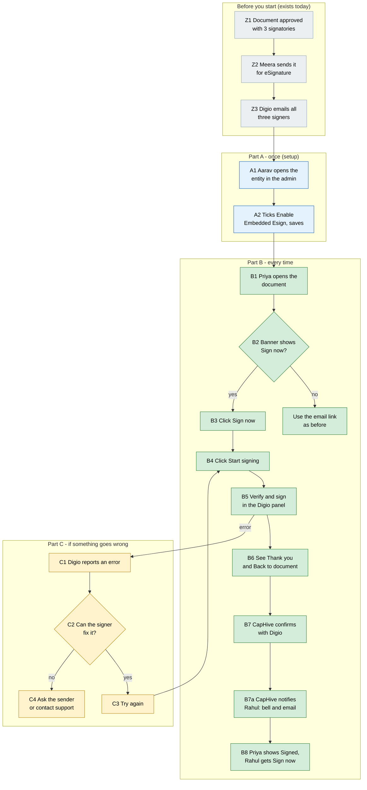

# Embedded eSigning with Digio — Proposal

> **Audience:** Business team, product, QA, support — non-technical.
> **Companion document:** [Design](design.md)
> **New to this? Start with the [Workflow Journey](#workflow-journey)** — every action, in order, from start to the outcome.

> **Planning phase — no code changes.** This document proposes and explains the change. Do not
> edit application code while writing it; implementation happens later, in the tasks phase.

---

## Why

When a document is sent for eSignature today, every signer — even one who is already logged in to
CapHive — has to leave the platform, find an email from Digio, click its link and sign on Digio's
own site. That is several steps and a context switch for the person we most want to finish quickly,
and it is the step where documents stall. Digio offers an embeddable signing experience, so a signer
who is already in CapHive can sign without leaving it.

## What Changes

- A signer who is **logged in to CapHive with the same email address the document was sent to** sees a
  **Sign now** button on the document. It opens a CapHive page that hosts Digio's signing panel, so they
  sign without going to their inbox.
- **The email link keeps working, unchanged.** Embedded signing is an addition, not a replacement:
  signers who are not CapHive users (or not logged in) sign from the email exactly as today.
- The signing order is respected: on a document with a signing order, only the signer whose turn it
  is gets **Sign now**.
- Digio's error codes are turned into plain-language messages with a clear next step (try again,
  ask the sender, wait your turn), including both spellings Digio uses for "document not ready".
- After signing, CapHive confirms the result with Digio itself — the browser's word is never taken
  as proof of signing.
- Digio's server notifications are now read by **event type**. This also fixes a gap: a "signing
  rejected" notification is shown as **Rejected** on the signer, instead of being mishandled.
- A signer who is a platform user is **told when it is their turn**: a notification in CapHive and an email,
  each taking them straight to the signing page. It is sent when the document is sent (to whoever can sign
  now) and again when an earlier signer's signature is confirmed (to the next signer).
- Switched on **per entity** by CapHive admins, default off, so it can be rolled out gradually.

### Flow Diagram

**Signing a document that was sent for eSignature — the signer's experience.**





**Digio telling CapHive that a signer rejected the document.**





**Being told it is your turn.**





---

## Workflow Journey

### Who is involved

| Person | Role | What they do in the journey |
|---|---|---|
| Aarav | CapHive admin (support) | Switches Embedded eSigning on for the fund manager's entity — once. |
| Meera | Company admin at Orion Capital (the fund manager) | Sends the Subscription Agreement for eSignature; watches the Signatures tab. |
| Priya | Investor contact at Priya Family Trust, logs in as priya@lpfund.com | First signer. Signs inside CapHive. |
| Rahul | Employee at Orion Capital, logs in as rahul@orioncap.com | Second signer (fund signatory). Signs inside CapHive after Priya. |
| Vikram | External lawyer, not a CapHive user | Third signer. Keeps using the email link. |

### The journey on one page



### Before you start

| Needed | Why | Where it comes from |
|---|---|---|
| A document with signatories, approved and **sent for eSignature** | Embedded signing opens a request that already exists at Digio | Documents › the document › Signatures tab › **Send For eSignatures** (exists today) |
| The entity's eSign provider is **Digio** | Embedded signing is built on Digio's signing panel | Entity settings (default for every entity) |
| **Enable Embedded Esign** ticked for the entity that owns the document | Rollout switch, off by default | CapHive admin › Entities (Part A) |
| The signer is **logged in** and their login email is the email the document was sent to | That is how CapHive knows the signer is who they say | The signer's CapHive account |

### Part A — once (setup)

| Step | Who | Where | Action | What the system does | What you see |
|---|---|---|---|---|---|
| A1 | Aarav | Admin › Entities › Orion Capital | Open the entity | Shows its permissions | Permission tick-boxes including **Enable Embedded Esign** |
| A2 | Aarav | Same page › **Save** | Tick **Enable Embedded Esign**, save | Turns the feature on for Orion Capital's documents only | Entity saved |

### Part B — every time

Example document: **Subscription Agreement – Priya Family Trust**, three signers in order —
1. Investor Signatory, priya@lpfund.com (Aadhaar)
2. Fund Signatory, rahul@orioncap.com (Aadhaar)
3. Counsel, vikram@lawfirm.in (Aadhaar)

| Step | Who | Where (screen › button) | Action | What the system does | What you see |
|---|---|---|---|---|---|
| B1 | Priya | Documents › the agreement | Open the document | Checks she is a signer, it is her turn, the document is waiting for signatures | Banner: **Your signature is requested on this document.** with **Sign now** |
| B2 | Priya | Banner › **Sign now** | Click | Opens the CapHive signing page for her signature | Signing page with the document name, "Signing as priya@lpfund.com", "Signer 1 of 3 — Investor Signatory" |
| B3 | Priya | Signing page › **Start signing** | Click | Opens Digio's signing panel on the page | The Digio panel, asking her to verify and sign |
| B4 | Priya | Digio panel | Enter the one-time code and sign with Aadhaar | Digio completes the signature | Panel closes, the page says **Thank you. Your signature has been submitted and is being confirmed.** |
| B5 | System | (background) | — | Asks Digio for the document's status; Digio's own notification may arrive too — either way is enough | — |
| B5a | System | (background) | — | Priya's signature is confirmed, so it is Rahul's turn; Rahul is a CapHive user and the switch is on | Rahul gets a bell entry **Your signature is requested: Subscription Agreement from Orion Capital** and an email with **Sign now** |
| B6 | Priya | Signing page › **Back to document** | Click | — | Document page; her row on the Signatures tab (if she can see it) and the banner update once confirmed |
| B7 | Rahul | Bell entry or email › **Sign now** (or Documents › the agreement) | Open the signing page, or the document | His turn has now come | Banner with **Sign now** (before Priya signed, he saw the banner without a button) |
| B8 | Vikram | His email | Use the email link | Unchanged | Signs on Digio's site as today |

**About the example.** Embedded eSigning was switched on *after* Meera sent the agreement, so Priya was not
notified at send — switching on is not retroactive — and found it from the Digio email or the document page.
Had it been on when Meera sent, Priya would have been notified at that moment, and Rahul and Vikram would
have waited for their turn.

### Part C — if something goes wrong

| Step | Who | Where | What happens | What you see | Fix |
|---|---|---|---|---|---|
| C1 | Priya | Digio panel | Types a wrong one-time code | **Signing didn't go through. Please check your details and try again.** | Click **Try again** |
| C2 | Rahul | Signing page | Digio's Aadhaar service is down | **The signing service is temporarily unavailable. Please try again in a little while.** | Try again later |
| C3 | Rahul | Signing page | Request expired (90 days) | **This signing request has expired. Please ask the sender to send it again.** | Meera re-sends the document |
| C4 | Vikram | — | Rejects the document at Digio | His row shows **Rejected** (red) on the Signatures tab; support is alerted | Meera cancels and re-sends, or contacts Vikram |

### What you see

```
Document page (Priya)
+----------------------------------------------------------------+
| Subscription Agreement - Priya Family Trust                     |
| +------------------------------------------------------------+ |
| | Your signature is requested on this document.   [Sign now]  | |
| +------------------------------------------------------------+ |
+----------------------------------------------------------------+

Signing page
+----------------------------------------------------------------+
| Documents > Subscription Agreement > Sign                       |
|                                                                |
|  Subscription Agreement - Priya Family Trust                    |
|  Signing as: priya@lpfund.com                                   |
|  Signer 1 of 3 - Investor Signatory     Method: Aadhaar eSign   |
|                                                                |
|  [ Start signing ]                          Back to document    |
+----------------------------------------------------------------+

Document page (Rahul, before Priya has signed)
+----------------------------------------------------------------+
| Your signature is requested on this document. You can sign      |
| after the previous signer has signed.                           |
+----------------------------------------------------------------+
```

Signers progress: Priya **Signed** → Rahul **Requested** (can now sign) → Vikram **Requested**.
Document is complete only when all three show **Signed**, exactly as today.

### What goes wrong

Priya clicks **Start signing** and Digio answers that her request has expired (`SIGN_REQUEST_EXPIRED`). The
page shows **This signing request has expired. Please ask the sender to send it again.** with
**Back to document**. Nothing is changed on the document. Meera sees the document is still
"requested", uses **Re-Send for eSignatures**, and Priya gets a fresh request (and a fresh
**Sign now**).

### Summary: the minimum actions

| # | Action | Who | How often |
|---|---|---|---|
| 1 | Tick **Enable Embedded Esign** for the entity | CapHive admin | Once per entity |
| 2 | Send the document for eSignature | GP (Meera) | Once per document — unchanged |
| 3 | Click **Sign now**, then **Start signing**, then sign in the Digio panel | Each logged-in signer | Once per signer per document |

---

## User Stories

### US-1: Sign without leaving CapHive

**As a** signer who is logged in to CapHive,
**I want** to sign a document I was asked to sign from the document itself,
**So that** I do not have to find and follow an email.

**Acceptance criteria:**
- On a document waiting for my signature, with Embedded eSigning on for the document's entity and my login email equal to the signer email (ignoring upper/lower case), I see **Sign now**.
- **Sign now** opens the signing page; **Start signing** opens Digio's panel on that page.
- The same flow, with the same screens, is used on a phone and on a computer.
- Signers who do not match (different email, not logged in, not a user) see no **Sign now** and are not affected.

### US-2: Respect the signing order

**As a** signer on an ordered document,
**I want** to be told when it is not yet my turn,
**So that** I am not sent into a signing attempt that is bound to fail.

**Acceptance criteria:**
- When "force signing order" is on and an earlier signer has not signed, I see **Your signature is requested on this document. You can sign after the previous signer has signed.** and no **Sign now**.
- Opening the signing page directly in that state shows **It isn't your turn to sign yet. You'll be able to sign after the previous signer has signed.**
- On a document without a signing order, every pending signer can sign at once.

### US-3: Understand what went wrong

**As a** signer,
**I want** a clear message and next step when signing fails,
**So that** I know whether to retry, wait, or ask the sender.

**Acceptance criteria:**
- Each Digio error code maps to one of the messages in [Behavior Rules](#behavior-rules).
- Both `DOCUEMNT_NOT_READY_FOR_THIS_ACTION` and `DOCUMENT_NOT_READY_FOR_THIS_ACTION` show the same message.
- Errors on our side or Digio's (system, credits, invalid signer, unknown) show a generic message, and the support team is alerted with the details; the signer never sees a code.
- A code we do not recognise is treated like a system error.

### US-4: Trust the result

**As a** GP user,
**I want** a document to count as signed only when Digio says so,
**So that** a signature cannot be faked from the browser.

**Acceptance criteria:**
- Finishing in the panel does not by itself mark the signer **Signed**; CapHive confirms with Digio first.
- If the confirmation is slow, the signing page says the signature is "being confirmed" and the document updates when it arrives (by Digio's notification or CapHive's own check, whichever comes first).
- A browser that claims success for a signer who has not signed at Digio leaves the signer **Requested**.

### US-5: See rejections

**As a** GP user,
**I want** a signer who rejects the document to show as **Rejected**,
**So that** I know the document is stuck and why.

**Acceptance criteria:**
- A Digio "signing rejected" notification sets that signer's status to **Rejected** (red badge).
- The document is not cancelled automatically; the signer's row and the document's history show what happened.
- Support is alerted; no error is returned to Digio (it will not keep retrying the notification).

### US-6: Control the rollout

**As a** CapHive admin,
**I want** to switch Embedded eSigning on per entity,
**So that** it can be rolled out gradually and switched off if needed.

**Acceptance criteria:**
- Default is off. With it off, nothing about eSigning changes for that entity's documents.
- Switching it off hides **Sign now** immediately; requests already sent are unaffected and still sign from email.

### US-7: Be told when it is my turn

**As a** signer who uses CapHive,
**I want** a notification in CapHive and an email when I can sign,
**So that** I find out without watching the document or my Digio email.

**Acceptance criteria:**
- When a document is sent for eSignature, each signer who can sign now, and who is a CapHive user for an entity with Embedded eSigning on, gets a bell entry and an email.
- On a document with a signing order, only the first signer is told at send; each next signer is told when the previous signature is confirmed.
- Clicking the bell entry, or **Sign now** in the email, opens that signer's signing page (after login if needed).
- A signer is told once per signing request; **Re-Send for eSignatures** starts a new request and tells them again.
- A signer whose access for the entity has email turned off gets the bell entry only.
- Documents already sent when the switch is turned on are not notified until the next signer's turn arrives.
- If a notification cannot be created or delivered, sending the document and processing Digio's updates are not affected.

---

## UI Behavior

### Document page — signature banner

```
+----------------------------------------------------------------+
| Your signature is requested on this document.      [ Sign now ] |
+----------------------------------------------------------------+
```

**Behavior notes:**
- Shown only to a logged-in user whose login email matches a signer on this document that has not signed, when the document is waiting for signatures, Digio is the provider and Embedded eSigning is on for the document's entity.
- When an earlier signer still has to sign, the banner text becomes **Your signature is requested on this document. You can sign after the previous signer has signed.** and the button is not shown.
- Shown to investors and employees alike (employees also see **Sign now** on their own row of the Signatures tab).
- **Sign now** opens the signing page as a normal page load, not inside another panel.

### Signatures tab (employees) — row action

```
| Email                 | Label            | Type    | Status    |                       |
| rahul@orioncap.com    | Fund Signatory   | aadhaar | Requested | [Show] [Sign now]     |
| vikram@lawfirm.in     | Counsel          | aadhaar | Requested | [Show]                |
```

**Behavior notes:**
- **Sign now** appears on a row only for the logged-in user's own row, under the same conditions as the banner.
- A new **Rejected** badge (red) is available for the Status column.

### Signing page

```
+----------------------------------------------------------------+
| Documents > Subscription Agreement > Sign                       |
|                                                                |
|  Subscription Agreement - Priya Family Trust                    |
|  Signing as: priya@lpfund.com                                   |
|  Signer 1 of 3 - Investor Signatory     Method: Aadhaar eSign   |
|                                                                |
|  [ Start signing ]                          Back to document    |
|                                                                |
|  +----------------------------------------------------------+  |
|  |  Digio signing panel appears here after Start signing     |  |
|  +----------------------------------------------------------+  |
+----------------------------------------------------------------+
```

**Behavior notes:**
- Same layout on phone and computer; the page uses CapHive's normal header and navigation.
- **Start signing** is an explicit click (the signing panel can only be opened from a click).
- After a result, **Start signing** is replaced by **Try again** (retryable failures) or hidden (terminal states), and **Back to document** is always available.
- Method label: **Aadhaar eSign**, **Electronic signature** or **Digital signature (DSC)**, from the signer's signature type.
- If the page is opened for a signer who has already signed, it shows **You have already signed this document.** and **Back to document**.

### Entity admin

An **Enable Embedded Esign** tick-box among the entity's permissions in the CapHive admin (Entities). No change to the
entity-owner screens.

### Notification (bell and email)

```
Bell (top bar) and Notifications page
+----------------------------------------------------------------+
| (1) Your signature is requested: Subscription Agreement from    |
|     Orion Capital                                    2 min ago  |
+----------------------------------------------------------------+

Email from CapHive
+----------------------------------------------------------------+
| Subject: Your signature is requested: Subscription Agreement    |
|                                                                |
| Orion Capital has asked you to sign Subscription Agreement.     |
|                                                                |
|                        [ Sign now ]                             |
|                                                                |
| You have also received a link from Digio by email. Either link  |
| works.                                                         |
+----------------------------------------------------------------+
```

**Behavior notes:**
- The bell entry and the email both open the signing page for the recipient's own signature.
- The bell entry is marked read when it is opened, as for other CapHive notifications.
- The email follows the existing email settings: employees of the document's entity always receive it; investors and other users receive it only if their access for the entity has email turned on.
- The Digio email is unchanged and still arrives.

---

## What This Feature Does NOT Cover

| Excluded | Covered In |
|---|---|
| Signers who are not logged in to CapHive, or have no account (they keep the email link) | Not planned for this change |
| Skipping Digio's one-time-code step for a logged-in signer (access token) | Future — needs Digio's token-regeneration documentation and a security design |
| Docusign | Not planned — the signing page is Digio-only |
| Bank-mandate (NACH) and form events from Digio | Not planned |
| Sending the signer-facing "document review" step through CapHive | Not planned |
| Automatically cancelling or re-sending a document after a rejection | Not planned — GP decides |
| A GP-facing notification when a signer rejects (beyond the red badge and support alert) | Future |
| Changing how documents are sent, how signed copies are created, or how the 90-day expiry works | Unchanged |
| WhatsApp message to signers when it is their turn | Future update — see [design open questions](design.md#risks-and-open-questions) |
| Reminders to signers who have not signed | Not planned — the eSign monitor already reports stuck documents to the GP |
| Notifying signers retroactively when the switch is turned on | Not planned |

---

## Validation Rules

| Field | Rule | Default |
|---|---|---|
| Who may open the signing page | Logged in; login email equals the signer email, ignoring upper/lower case; not a support user impersonating someone | — |
| Document | Sent for eSignature, status "requested", provider Digio, and has a Digio document id | — |
| Entity switch | **Embedded eSigning** is on for the entity that owns the document | Off |
| Signer | Has not signed yet; signer status is not Signed, Cancelled, Expired or Rejected | — |
| Signing order | When "force signing order" is on, every earlier signer is Signed | Order not enforced |
| Signer identifier | The signer's email (mobile numbers are not used) | — |
| Notification recipient | A platform user whose login email equals the signer email (ignoring upper/lower case) and who passes the same checks as **Sign now** | — |
| Notification timing | Only when the signer can sign now: at send, or when the previous signature is confirmed | — |
| Notification count | At most one per signer per signing request; **Re-Send** starts a new request | — |
| Email recipient | Employees of the document's entity: always. Investors and others: only if their access for the entity has email turned on | — |

---

## Behavior Rules

| Scenario | What User Sees |
|---|---|
| Signer matches and it is their turn | Document banner **Your signature is requested on this document.** with **Sign now** |
| Signer matches, earlier signer pending (ordered document) | **Your signature is requested on this document. You can sign after the previous signer has signed.** (no button) |
| Signing page opened by someone who is not a signer, is impersonated, or the feature is off | **This signature request is not available for your account.** |
| Signing page opened for a document that is cancelled, expired, completed or failed | **This document is no longer waiting for signatures.** |
| Signing page opened by a signer who already signed (or Digio says `ALREADY_SIGNED`) | **You have already signed this document.** |
| Signing page opened, not yet their turn (or Digio says `SIGNING_NOT_ALLOWED`) | **It isn't your turn to sign yet. You'll be able to sign after the previous signer has signed.** |
| Signing completed in the panel | **Thank you. Your signature has been submitted and is being confirmed.** and **Back to document** |
| Signer closes the panel without finishing | **Signing was cancelled. You can start again whenever you are ready.** and **Start signing** |
| Digio's signing panel cannot be loaded (blocked network, Digio unreachable) | **We couldn't load the signing panel. Please check your connection and try again, or use the link in the email from Digio.** and **Try again** |
| Retryable: `OTP_INVALID`, `AUTHENTICATION_FAILED`, `BIOMETRIC_DATA_MISMATCH`, `BIOMETRIC_LOCKED`, `INCORRECT_AADHAAR_ID`, `INVALID_ELECTRONIC_SIGNATURE`, `SIGNING_TIMED_OUT_ON_ESP`, `SIGNING_CANCELLED_ON_ESP` | **Signing didn't go through. Please check your details and try again.** and **Try again** |
| Service unavailable: `ERROR_FROM_ESP_UIDAI`, `ESP_UIDAI_DOWN`, `AADHAAR_ESIGN_TEMPORARILY_UNAVAILABLE`, `ESIGN_REQUEST_FAILURE` | **The signing service is temporarily unavailable. Please try again in a little while.** and **Try again** |
| Aadhaar cannot be used: `AADHAAR_HAS_NO_MOBILE`, `AADHAAR_HAS_NO_MOBILE_OR_EMAIL`, `AADHAAR_SUSPENDED`, `AADHAAR_NOT_AUTHENTICABLE`, `AADHAAR_CANCELLED` | **Your Aadhaar can't be used for eSign right now. Please contact UIDAI, or ask the sender to arrange a different signing method.** |
| Already in progress: `DUPLICATE_REQUEST` | **A signing request is already in progress. Please wait a moment and check the status again.** |
| Expired: `SIGN_REQUEST_EXPIRED` | **This signing request has expired. Please ask the sender to send it again.** |
| Method changed: `REQUESTED_SIGN_METHOD_DIFFERENT` | **The signing method for this document has changed. Please ask the sender to send it again.** |
| Not ready: `DOCUMENT_NOT_READY_FOR_THIS_ACTION` or `DOCUEMNT_NOT_READY_FOR_THIS_ACTION` | **This document isn't ready to be signed yet. Please try again in a few minutes.** |
| Our side: `NOT_SUFFICIENT_ENTITLEMENTS`, `INVALID_SIGNER`, `UNAUTHORIZED_ACCESS`, `SYSTEM_ERROR`, `UNKNOWN_ERROR`, or any code not listed | **Something went wrong on our side and the team has been notified. Please try again later or contact support.** Support is alerted with the code and the document. |
| Digio notifies "signed" | Signer row **Signed**; document completes when all signers are Signed (unchanged) |
| Digio notifies "failed" | Signer row **Failed** (unchanged) |
| Digio notifies "rejected" | Signer row **Rejected** (red); document stays as is; support alerted |
| Digio sends a notification type CapHive does not know | Handled as today — never an error back to Digio |
| A signer who can sign now is a CapHive user, with the switch on (document sent, or earlier signature confirmed) | Bell entry **Your signature is requested: {document name} from {entity name}** and an email with subject **Your signature is requested: {document name}** |
| The email body | **{entity name} has asked you to sign {document name}.** then a **Sign now** button, then **You have also received a link from Digio by email. Either link works.** |
| Ordered document, signer who is not yet next | Nothing until their turn |
| Same confirmation arrives twice (notification and status check) | One notification per signer per request |
| Document re-sent | Signers who can sign now are notified again |
| Investor whose access has email off | Bell entry only; no CapHive email |
| Signer is not a CapHive user, or the switch is off | No notification from this feature; the Digio email is unchanged |
| Switch turned on while documents are already out | No notification now; the next signer is notified when their turn arrives |
| A notification fails to be created or delivered | Sending the document and Digio's updates still succeed; support is alerted |

---

## Resolved Design Decisions

| # | Decision | Resolution |
|---|---|---|
| 1 | Who can sign inside CapHive? | Logged-in platform users only, matched on login email. External signers keep the email link. |
| 2 | Does the email still go out? | Yes. Embedded signing is additive; nothing about sending changes. |
| 3 | How is the signer verified at Digio? | By Digio, as it does today (a one-time code to the signer's email/mobile). No shortcut token in this version: it would let a signer's browser skip that step, and Digio's regeneration documentation was not available. |
| 4 | Popup, in-page panel or leaving the site? | An in-page panel on a dedicated CapHive page, identical on phone and computer. Leaving the site would lose Digio's live error codes. |
| 5 | Is the browser's "done" trusted? | Never. CapHive confirms with Digio (and Digio's own notification stays the backstop). |
| 6 | Can documents already sent be signed this way? | Yes, as soon as the entity switch is on — no re-send needed. |
| 7 | Support impersonation | Cannot sign — a signature must come from the person's own login. |
| 8 | Which notification types are handled? | "Signed", "failed" and "rejected". Anything else behaves as before. |
| 9 | Rejection effect | Signer marked **Rejected**; no automatic cancel, no automatic resend. |
| 10 | Rollout | Per-entity switch managed by CapHive admins; default off. |
| 11 | Both "not ready" spellings | Both are handled identically (Digio's documentation spells the code in two ways). |
| 12 | Which channels tell the signer it is their turn? | A bell entry and an email, through the platform's existing notification delivery and email permissions. |
| 13 | WhatsApp? | Deferred to a future update; it needs a small delivery addition because the existing WhatsApp paths either need custom-notification text or reach employees only. |
| 14 | When is a signer told? | When they can sign: at send, and when the previous signer's signature is confirmed — not before their turn. |
| 15 | Notify documents already out when the switch is turned on? | No. Only the next transition notifies, so switching on never produces a burst. |
| 16 | Can a notification problem hurt signing? | No. Delivery failures are reported to support and never block sending or Digio's updates. |

---

## Capabilities

### New Capabilities

- `documents/embedded-esign`: A logged-in signer signs a Digio eSign request from inside CapHive — who may sign, the signing page, ordering, error-code messages, confirmation with Digio, audit trail, telling the signer when it is their turn, and the entity switch.
- `documents/esign-webhook-events`: How CapHive reads Digio's server notifications by event type (signed, failed, rejected), including the rejected-signer handling and unchanged behaviour for unknown events.

### Modified Capabilities

None — no existing capability covers eSigning (`openspec/specs` has no eSign spec).

---

## Impact

- **Documents** — document page (new signature banner), Signatures tab (row action, new **Rejected** badge), a new signing page.
- **eSign processing** — how Digio's notifications are interpreted; a new confirmation check after the browser reports a result; an audit trail of signing-page events.
- **Entity admin** — one new permission, **Enable Embedded Esign**.
- **Environments** — the Digio signing panel is loaded from Digio's website (sandbox vs production), which is a different address from the API address already configured.
- **Notifications** — a new signer notification (bell entry and email) when it is the signer's turn.
- **Signed documents** — Digio's audit trail is filed beside every signed copy. A document is no longer marked Completed if its signed copy could not be downloaded, and a document with no owner now gets its signed copy.
- **Not touched** — sending documents, Docusign, KYC and NDA flows.

---

## Benefits

1. Signers who are already in CapHive sign in a few clicks, without hunting for an email.
2. Fewer stalled documents, since the signer is prompted where they already are.
3. Clear, human messages instead of a dead end on a third-party page when something fails.
4. A rejected signature is visible to the GP instead of silently breaking processing.
5. Safe to roll out entity by entity and to switch off instantly.
6. Signers are told the moment it is their turn, in the place they already look.

---

## FAQ

| Question | Answer |
|---|---|
| Who can use Sign now? | A logged-in CapHive user whose login email is the email the document was sent to, on a document waiting for their signature, for an entity with Embedded eSigning switched on. |
| What if I am not logged in or not a CapHive user? | Nothing changes — use the link in the email Digio sent. |
| Does the email still arrive for signers who can sign in CapHive? | Yes. Either route works; whichever is used first signs the document. |
| Will I be asked for a one-time code again? | Yes — Digio verifies the signer itself, same as the email link (this is confirmed in the sandbox before the page is built). Skipping that step is a possible later improvement. |
| What happens to documents already sent? | They can be signed in CapHive as soon as the entity switch is on; no re-send is needed. |
| Does a signed document look different? | No. The signed copy, completion, and download behave exactly as today. |
| Is the signing order enforced? | Yes, using the document's existing "force signing order" setting. |
| What if I close the Digio panel midway? | You see "Signing was cancelled" and can click **Start signing** again. |
| Does this change pricing or notifications? | No pricing change. Signers who are CapHive users now get a bell entry and an email when it is their turn; support receives alerts for rejections and unexpected errors. |
| Can support sign on someone's behalf? | No — impersonating support users cannot sign. |
| Does it work on a phone? | Yes, the same page and flow, no separate mobile mode. |
| Do I get two emails now? | Yes, for documents where you can sign in CapHive: Digio's email as before and a CapHive email with **Sign now**. Either link works; the CapHive email says so. |
| What if I have email turned off? | Investors whose access has email turned off still get the bell entry. Employees of the document's entity always get the email. |
| Will I be reminded if I do not sign? | Not by this feature. The eSign monitor still reports stuck documents to the GP. |
| Is there a WhatsApp message? | Not yet — it is planned as a later update. |
| How is it built? | See [design.md](design.md). |

---

## Design Principle for the Next Phase

Keep the design DRY and simple. Reuse the existing Digio helper, the existing status check (`fetch_esign_updates` / `EsignUpdateJob`), the existing webhook endpoint and the existing audit log; add no new background pipeline. Things that risk complexity and need explicit treatment in the design:

- **The browser is untrusted.** The signing page's result must only trigger the existing server-side status pull; nothing in the browser can mark a signer signed.
- **Authorization is not entity membership.** Investors sign documents that belong to another entity, so the new "may this user sign" rule cannot reuse the existing entity-based policy checks.
- **Webhook routing must not regress.** Event-type routing needs a fallback so payloads without an event, or with an event we do not know, behave exactly as before.
- **Sandbox-only unknowns** (panel rendering mode, phone layout, whether Digio sends its one-time code in this mode) must be recorded as verify-before-build items, with the page degrading gracefully if the panel behaves differently from expectation.
- **Notifications must be once-only and non-blocking.** The same confirmation arrives by two routes (Digio's notification and CapHive's own check), so "notify once per request" needs one claim point, and a delivery problem must never stop a send or a Digio acknowledgement.
