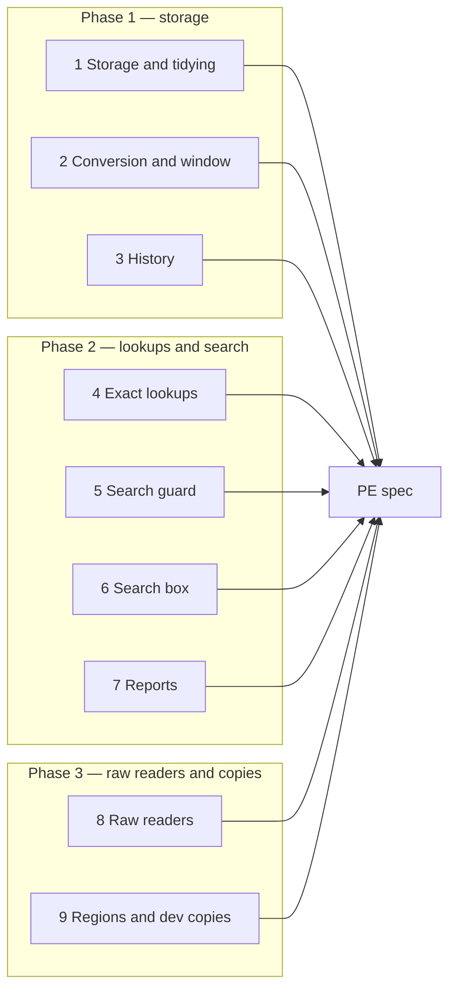
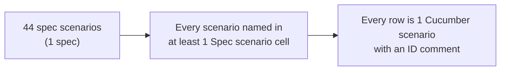

# Encrypt investor PII at rest — Business Rules (H/E/X)

> **Audience:** Product, QA, developers. Every row becomes exactly one Cucumber scenario.
> **Companions:** [Proposal](proposal.md) · [Design](design.md) · [Spec](specs/security/investor-pii-encryption/spec.md)

---

## Contents

- [How to read this](#how-to-read-this)
- [Shared setup](#shared-setup)
- [1. Storage and tidying — Phase 1](#1-storage-and-tidying--phase-1)
- [2. Conversion, transition window, way back — Phase 1](#2-conversion-transition-window-way-back--phase-1)
- [3. History — Phase 1](#3-history--phase-1)
- [4. Exact lookups — Phase 2](#4-exact-lookups--phase-2)
- [5. Search guard — Phase 2](#5-search-guard--phase-2)
- [6. Search box fingerprints — Phase 2](#6-search-box-fingerprints--phase-2)
- [7. Reports — Phase 2](#7-reports--phase-2)
- [8. Raw database readers — Phase 3](#8-raw-database-readers--phase-3)
- [9. Regions and developer copies — Phase 3](#9-regions-and-developer-copies--phase-3)
- [Coverage](#coverage)

---

## How to read this

- **ID legend:** **H** = happy path · **E** = edge case · **X** = error (exception) case. IDs run
  across the whole file.
- **Spec scenario** column: `PE: <scenario name>`, PE = `security/investor-pii-encryption`.
- **Feature** column:
  - F1 = `features/security/investor_pii_encryption.feature`
  - F2 = `features/core/investor_kyc_pii_lookups.feature`
  - F3 = `features/core/report_builder/encrypted_columns.feature`
  - F4 = `features/security/investor_pii_raw_readers.feature`
- Every scenario carries a comment above it: `# E12 — Edge case: …`.
- "Raw value" = the column read with SQL, bypassing the model.
- "Window open" = `support_unencrypted_data` + `extend_queries` on (design [Transition window](design.md#transition-window)).

---

## Shared setup

| Record | Name | Key data |
|---|---|---|
| Tenant A | Kestrel Capital | Investment Fund, India, fund "Kestrel Growth Fund I" |
| Company admin | Meera Iyer | Kestrel, company_admin |
| Fund ops | Rohan Shah | Kestrel, employee with KYC rights |
| CapHive ops | Vikram | Runs rake tasks |
| KYC 1 | Anil Mehta (Individual) | PAN `ABCPM1234K`, bank `50100234567812`, IFSC `HDFC0001234`, bank HDFC Bank |
| KYC 2 | Priya Nair (Individual) | PAN `AQZPN5521L`, bank `918020045671234`, IFSC `ICIC0000456` |
| KYC 3 | Orchid Holdings LLC (Non-individual) | Tax ID typed `us-84-1234567` |
| KYC 4 | Sunil Rao | PAN `AGHPR7742M`, bank blank `""` |
| KYC 5 | Anil Mehta (second, joint account) | PAN `ABCPM1234K`, bank `50100234567812` |
| Commitment | KGF-001 | Anil, KYC 1, ₹50,00,000 |
| Distribution | Q3 2026 payout | Payments to KYC 1, 2, 4 |
| Secondary sale | Kestrel Secondary 2026 | Offer by Anil (PAN `ABCPM1234K`, bank `50100234567812`); interest by Banyan Buyers (PAN `AAACB7781Q`, bank `00112233445566`) |
| Fee | Ledger Advisors | bank `12345678`, IFSC `SBIN0000123` |
| CKYC lookup | Anil, source ckyc | PAN `ABCPM1234K`, response JSON with name and address |
| AML report | Anil | PAN `ABCPM1234K`, DOB 1975-01-01 |
| Custom notification | Quarterly statement | password field `investor_kyc.PAN` |
| Saved report | LP bank list | Investors report, related KYC `bank_account_number` as "List" |
| Tenant B | Banyan Partners | Own KYC for Anil Mehta, PAN `ABCPM1234K`; user Kabir |

---

## 1. Storage and tidying — Phase 1

### Happy path

| # | Scenario | Given | When | Then | Spec scenario | Feature |
|---|---|---|---|---|---|---|
| H1 | KYC values stored encrypted, shown plain | Rohan signed in | He saves KYC 1 | Raw PAN and bank contain neither `ABCPM1234K` nor `50100234567812`; KYC page shows both | PE: Stored value is unreadable | F1 |
| H2 | KYC spreadsheet shows plain values | KYC 1 saved | Rohan downloads KYCs › Individual xlsx | Row shows `ABCPM1234K`, `50100234567812`, `HDFC0001234` | PE: Screens and exports show the real value | F1 |
| H3 | Template and PDF password use plain PAN | KYC 1 on KGF-001; "Quarterly statement" protects PDFs | A statement is generated and emailed | Document prints `ABCPM1234K`; the PDF opens with `ABCPM1234K` | PE: Generated documents and PDF passwords use the real value | F1 |
| H4 | Every in-scope table stores ciphertext | Offer, interest, fee, CKYC lookup, AML report created | Raw columns read | No raw PAN / bank / IFSC / reply column holds its plain value | PE: Stored value is unreadable | F1 |
| H5 | Same PAN same raw, same bank different raw | KYC 1 and KYC 5 saved | Raw values compared | Raw PANs equal; raw bank values differ | PE: Same PAN stored the same way, bank numbers never | F1 |

### Edge cases

| # | Scenario | Given | When | Then | Spec scenario | Feature |
|---|---|---|---|---|---|---|
| E1 | Lowercase PAN with spaces | Rohan edits KYC 2 | PAN ` aqzpn5521l ` saved | KYC shows `AQZPN5521L` | PE: Lowercase PAN with spaces is tidied | F1 |
| E2 | Blank bank counts as missing | KYC 4 bank `""` | Q3 2026 payout warnings evaluated | Distribution warning "1 KYC has no bank account number" (KYC 4) | PE: Blank bank account is stored as no value | F1 |
| E3 | Foreign tax ID upper-cased | KYC 3 | Saved | Shows `US-84-1234567` | PE: Lowercase PAN with spaces is tidied | F1 |
| E4 | PAN at the 15-character limit | KYC 2 | PAN `ABCDEFGHIJ12345` saved | Saves; shows the same 15 characters | PE: Stored value is unreadable | F1 |
| E5 | Bank account at the 40-character limit | KYC 2 | 40-digit account saved | Saves; shows the same 40 digits | PE: Stored value is unreadable | F1 |
| E6 | Verification replies round-trip | Bank verification stubbed: beneficiary "ANIL MEHTA" | Verify bank job runs on KYC 1 | `bank_verified` true; reply hash readable on the page; raw reply holds no "ANIL MEHTA" | PE: Stored value is unreadable | F1 |
| E7 | CKYC reply JSON round-trips | CKYC lookup for Anil | Comparison page opened | Name and address fields from the reply shown; raw response holds no name | PE: Stored value is unreadable | F1 |
| E8 | Investor fills KYC by emailed link | Anil opens his KYC link | He saves PAN `abcpm1234k` | KYC shows `ABCPM1234K`; raw PAN not plain | PE: Stored value is unreadable | F1 |
| E9 | IFSC tidied | KYC 2 | IFSC ` icic0000456` saved | Shows `ICIC0000456` | PE: Lowercase PAN with spaces is tidied | F1 |
| E10 | Blank PAN stays blank | KYC saved with `validate: false` and PAN `""` (WithFolder path) | Raw PAN read | NULL; KYC saved | PE: Blank bank account is stored as no value | F1 |

### Error cases

| # | Scenario | Given | When | Then (what the user sees, who is alerted) | Spec scenario | Feature |
|---|---|---|---|---|---|---|
| X1 | PAN over 15 characters | KYC 2 | PAN of 16 characters saved | "PAN is too long (maximum is 15 characters)" — unchanged message | PE: Lowercase PAN with spaces is tidied | F1 |

---

## 2. Conversion, transition window, way back — Phase 1

### Happy path

| # | Scenario | Given | When | Then | Spec scenario | Feature |
|---|---|---|---|---|---|---|
| H6 | Dry run | KYC 1, 2, 4 plain (written without encryption) | `pii_encryption:encrypt[test]` without EXECUTE | Reports `investor_kycs: PAN 3, bank 2…`; raw values unchanged | PE: Dry run changes nothing | F1 |
| H7 | Conversion | Same | Run with EXECUTE=1 | Raw values encrypted; KYC 2 lowercase PAN upper-cased; `updated_at` unchanged; 0 new audits; 0 emails | PE: Conversion encrypts, tidies and keeps timestamps | F1 |
| H8 | Verify | After H7 | `pii_encryption:verify[test]` | `0 plain values left` | PE: Interrupted conversion is re-run | F1 |
| H9 | Reverse | After H7 | `pii_encryption:decrypt[test]` EXECUTE=1, then verify | Raw values plain again; verify `0 encrypted values` | PE: Reverse conversion | F1 |

### Edge cases

| # | Scenario | Given | When | Then | Spec scenario | Feature |
|---|---|---|---|---|---|---|
| E11 | Interrupted run resumes | Batch size 1; run stops after KYC 1 | Run again | KYC 2 and 4 converted, KYC 1 skipped; verify 0 | PE: Interrupted conversion is re-run | F1 |
| E12 | Soft-deleted rows converted | KYC 2 soft-deleted, plain | Conversion runs | KYC 2 raw PAN encrypted | PE: Conversion encrypts, tidies and keeps timestamps | F1 |
| E13 | Lookup finds plain and encrypted rows | Window open; KYC 1 plain, KYC 5 encrypted | "PAN equals ABCPM1234K" | Both listed | PE: Lookup during the window | F1 |
| E14 | Editing a plain row encrypts it | Window open; KYC 2 plain | Rohan changes KYC 2 address | Raw PAN now encrypted | PE: Lookup during the window | F1 |
| E15 | Re-run with nothing to do | After H7 | Conversion again | `0 to encrypt`; no writes | PE: Interrupted conversion is re-run | F1 |
| E16 | Restore of pre-conversion data | Window closed; KYC 2 restored plain | Conversion re-run, then KYC 2 opened | Page shows `AQZPN5521L` | PE: Interrupted conversion is re-run | F1 |
| E17 | Search index not touched by conversion | After H7 | Index update count read | 0 index updates during the run (reindex is a separate step) | PE: Conversion encrypts, tidies and keeps timestamps | F1 |

### Error cases

| # | Scenario | Given | When | Then (what the user sees, who is alerted) | Spec scenario | Feature |
|---|---|---|---|---|---|---|
| X2 | Plain value after window closed | Window closed; KYC 2 plain | Rohan opens KYC 2 | Standard error page; error email to the developer list with `ActiveRecord::Encryption::Errors::Decryption` | PE: Plain value after the window closes | F1 |

---

## 3. History — Phase 1

### Happy path

| # | Scenario | Given | When | Then | Spec scenario | Feature |
|---|---|---|---|---|---|---|
| H10 | New bank change hidden in history | KYC 1 | Rohan changes bank to `60200987654331` and bank name to ICICI Bank | History: Rohan, time, "Bank Account Number changed (value hidden)", "Bank Name HDFC Bank → ICICI Bank"; raw audit row has neither number | PE: New bank account change | F1 |
| H11 | Old entries rewritten | Audit row on KYC 1: PAN `ABCPM1234K` → `ABCPM1234L` (written before encryption) | `pii_encryption:scrub_audits[test]` EXECUTE=1 | Row keeps user and time; neither PAN in the row | PE: Old history entry rewritten | F1 |

### Edge cases

| # | Scenario | Given | When | Then | Spec scenario | Feature |
|---|---|---|---|---|---|---|
| E18 | Clean-up dry run | Same as H11 | Without EXECUTE | Reports `InvestorKyc: 1 entry`; row unchanged | PE: Old history entry rewritten | F1 |
| E19 | Other fields kept | Old row also has `bank_name` HDFC → ICICI | Clean-up runs | `bank_name` change kept; bank number hidden | PE: Old history entry rewritten | F1 |
| E20 | Clean-up re-run | After H11 | Run again | `0 entries to update` | PE: Old history entry rewritten | F1 |
| E21 | Offer and interest history hidden | Anil's offer | Rohan changes its PAN | Offer history: "PAN changed (value hidden)" | PE: New bank account change | F1 |
| E22 | Create entry hidden | — | Rohan creates KYC 2 | Create audit row shows PAN, bank, IFSC as "(value hidden)" | PE: New bank account change | F1 |

### Error cases

| # | Scenario | Given | When | Then (what the user sees, who is alerted) | Spec scenario | Feature |
|---|---|---|---|---|---|---|
| — | None | The clean-up only rewrites values; a row it cannot parse is reported by id and left as is (see E-rows) | — | — | — | — |

---

## 4. Exact lookups — Phase 2

### Happy path

| # | Scenario | Given | When | Then | Spec scenario | Feature |
|---|---|---|---|---|---|---|
| H12 | Import updates by PAN typed differently | KYC 1 encrypted | KYC import row "Pan/Tax Id" `abcpm1234k `, "Update Only" Yes, address changed | KYC 1 updated; KYC count unchanged | PE: Import updates the KYC with a differently typed PAN | F2 |
| H13 | KYC document import matches PAN | KYC 1 | Document import row "PAN/Tax ID" `ABCPM1234K` | Document attached to KYC 1 | PE: Import updates the KYC with a differently typed PAN | F2 |
| H14 | Filter PAN equals | KYC 1, 2 | KYC list "PAN equals ABCPM1234K" | KYC 1 and KYC 5 listed, KYC 2 not | PE: Filter PAN equals | F2 |
| H15 | Filter through related KYC | KGF-001 on KYC 1 | Commitments "Investor Kyc PAN equals ABCPM1234K" | KGF-001 listed | PE: Filter through a related KYC | F2 |
| H16 | CKYC comparison uses lookup | CKYC lookup for Anil | Rohan opens CKYC/KRA comparison on KYC 1 | The lookup's name and address shown | PE: CKYC/KRA lookup found by PAN | F2 |
| H17 | AML report reused | AML report for Anil | AML screening runs again on KYC 1 | Same report updated; count unchanged | PE: AML report reused for the same PAN | F2 |

### Edge cases

| # | Scenario | Given | When | Then | Spec scenario | Feature |
|---|---|---|---|---|---|---|
| E23 | KYC PAN change updates its CKYC lookups | CKYC lookup for `ABCPM1234K` | KYC update service runs on KYC 1 | Lookup found and refreshed | PE: CKYC/KRA lookup found by PAN | F2 |
| E24 | Duplicate CKYC lookup | Lookup exists | Second ckyc lookup for KYC 1, PAN `ABCPM1234K` | "should be unique for the same source and KYC" | PE: Duplicate CKYC lookup refused | F2 |
| E25 | PAN is blank | KYC with no PAN exists | "PAN is blank" | Only that KYC listed | PE: Is blank lists records without a value | F2 |
| E26 | Bank is blank | KYC 4 | "Bank Account Number is blank" | KYC 4 listed only | PE: Is blank lists records without a value | F2 |
| E27 | IFSC equals in lowercase | KYC 1 | "IFSC Code equals hdfc0001234" | KYC 1 and KYC 5 listed | PE: Filter PAN equals | F2 |
| E28 | PAN not equals | KYC 1, 2, 4 | "PAN not equals ABCPM1234K" | KYC 2, 4 listed (blank-PAN KYCs follow today's not-equals rule) | PE: Filter PAN equals | F2 |
| E29 | Import "Update Only = No" with existing PAN | KYC 1 | Import row PAN `ABCPM1234K`, Update Only No | Row error "Skipping: a KYC already exists for Anil Mehta (Anil Mehta, PAN ABCPM1234K). Set Update Only to Yes to update it" | PE: Import updates the KYC with a differently typed PAN | F2 |
| E30 | Import matches a KYC with blank PAN | KYC for Priya with PAN blank | Import Update Only Yes, "Pan/Tax Id" `AQZPN5521L`, name Priya Nair | That KYC updated with the PAN | PE: Import updates the KYC with a differently typed PAN | F2 |

### Error cases

| # | Scenario | Given | When | Then (what the user sees, who is alerted) | Spec scenario | Feature |
|---|---|---|---|---|---|---|
| X3 | Import, Update Only, no match | No KYC with `ZZZPM0000Z` | Import row with that PAN | Row error "Skipping: no KYC found to update for Anil Mehta (…, PAN ZZZPM0000Z)" — unchanged | PE: Import updates the KYC with a differently typed PAN | F2 |

---

## 5. Search guard — Phase 2

### Happy path

| # | Scenario | Given | When | Then | Spec scenario | Feature |
|---|---|---|---|---|---|---|
| H18 | PAN contains refused | Meera on KYCs | Filter "PAN contains ABCPM" | PAN message shown; all 5 KYCs listed | PE: PAN contains is refused | F2 |
| H19 | Bank equals refused | Meera on KYCs | "Bank Account Number equals 50100234567812" | Bank message; filter not applied | PE: Bank account equals is refused | F2 |
| H20 | Picker offers supported conditions | Meera opens Filter | Picks PAN, then Bank Account Number | PAN: equals, not equals, is blank, is present; Bank: is blank, is present | PE: Filter picker offers only supported conditions | F2 |

### Edge cases

| # | Scenario | Given | When | Then | Spec scenario | Feature |
|---|---|---|---|---|---|---|
| E31 | Related condition in a URL | — | GET commitments with `q[investor_kyc_PAN_cont]=ABCPM` | PAN message; KGF-001 listed (condition not applied) | PE: Refused through a related record and a direct link | F2 |
| E32 | Saved report link | Saved report URL with `q[PAN_start]=ABC` | Meera opens it | PAN message | PE: Refused through a related record and a direct link | F2 |
| E33 | AI report assistant link | Assistant returns a URL with `PAN_cont` (stubbed) | Meera follows it | PAN message | PE: Refused through a related record and a direct link | F2 |
| E34 | Sort by PAN | — | GET KYCs with `q[s]=PAN asc` | Default order; 5 KYCs | PE: Sort by PAN leaves default order | F2 |
| E35 | Unrelated filters untouched | — | "Investing Entity contains Anil" | KYC 1 and KYC 5 listed, no message | PE: Filter picker offers only supported conditions | F2 |
| E36 | Mixed conditions | — | "Investing Entity contains Anil" AND "PAN contains ABC" | PAN message; no condition applied (the whole filter is refused) | PE: PAN contains is refused | F2 |
| E37 | Deleted-records list | Company admin on deleted KYCs | "PAN contains ABC" | PAN message | PE: Refused through a related record and a direct link | F2 |

### Error cases

| # | Scenario | Given | When | Then (what the user sees, who is alerted) | Spec scenario | Feature |
|---|---|---|---|---|---|---|
| X4 | JSON request refused | — | GET `/investor_kycs.json?q[PAN_cont]=ABC` | 422 with `{"error": "\"PAN\" is stored encrypted, …"}` | PE: PAN contains is refused | F2 |
| X5 | IFSC greater than | — | "IFSC Code > HDFC" | IFSC message | PE: PAN contains is refused | F2 |

---

## 6. Search box fingerprints — Phase 2

### Happy path

| # | Scenario | Given | When | Then | Spec scenario | Feature |
|---|---|---|---|---|---|---|
| H21 | Full PAN, lowercase | Index rebuilt | Search `abcpm1234k` | KYC 1 and KYC 5 | PE: Full PAN finds the KYC | F2 |
| H22 | Full bank account | Index rebuilt | Search `50100234567812` | KYC 1 and KYC 5 | PE: Full bank account finds the KYC | F2 |
| H23 | Offer search by full PAN | Offer index rebuilt | Offers › search `ABCPM1234K` | Anil's offer | PE: Full PAN finds the KYC | F2 |

### Edge cases

| # | Scenario | Given | When | Then | Spec scenario | Feature |
|---|---|---|---|---|---|---|
| E38 | Part of a PAN | — | Search `ABCPM` | No KYC listed; ⓘ hint on the box | PE: Part of a PAN does not match on PAN | F2 |
| E39 | Name prefix still works | — | Search `Ani` | KYC 1 and KYC 5 | PE: Part of a PAN does not match on PAN | F2 |
| E40 | Index holds no values | Index rebuilt | Index documents read | No `ABCPM1234K`, no `50100234567812` in any document | PE: The index holds no PAN or bank account | F2 |
| E41 | PAN edited | KYC 2 PAN changed to `AQZPN5521M` | Search old, then new | Old: none; new: KYC 2 | PE: Full PAN finds the KYC | F2 |
| E42 | PAN with spaces typed | — | Search ` ABCPM1234K ` | KYC 1 and KYC 5 | PE: Full PAN finds the KYC | F2 |

### Error cases

| # | Scenario | Given | When | Then (what the user sees, who is alerted) | Spec scenario | Feature |
|---|---|---|---|---|---|---|
| X6 | Other firm, same PAN | Kabir (Banyan) | Searches `ABCPM1234K` | Only Banyan's KYC; never Kestrel's | PE: Search stays within the firm | F2 |

---

## 7. Reports — Phase 2

### Happy path

| # | Scenario | Given | When | Then | Spec scenario | Feature |
|---|---|---|---|---|---|---|
| H24 | Related PAN as Value | Commitments report | Column "Investor Kyc › PAN" as Value | KGF-001 row shows `ABCPM1234K` | PE: Related PAN value is readable | F3 |
| H25 | Related bank as Latest | Investors report | "Investor Kycs › Bank Account Number" as Latest | Anil row shows the latest KYC's bank number | PE: Related PAN value is readable | F3 |

### Edge cases

| # | Scenario | Given | When | Then | Spec scenario | Feature |
|---|---|---|---|---|---|---|
| E43 | Saved report using List | "LP bank list" | Meera opens it | Column shows Value per investor + tooltip; no encrypted text | PE: Saved report with list on bank account | F3 |
| E44 | Pivot categories | Investors report with related KYCs | Pivot form opened | PAN, bank, IFSC not offered | PE: Pivot by PAN not offered | F3 |
| E45 | Sort by PAN | KYC report | Sort by PAN requested | Default order | PE: Sort by PAN leaves default order | F3 |
| E46 | Count | Investors report | Related bank as Count | Anil: 2 (KYC 1, KYC 5) | PE: Related PAN value is readable | F3 |
| E47 | Report download | Commitments report with related PAN | Download xlsx | `ABCPM1234K` in the cell | PE: Related PAN value is readable | F3 |
| E48 | Root KYC report column | KYC report | PAN column on root rows | `ABCPM1234K` | PE: Related PAN value is readable | F3 |

### Error cases

| # | Scenario | Given | When | Then (what the user sees, who is alerted) | Spec scenario | Feature |
|---|---|---|---|---|---|---|
| X7 | Min requested through a crafted save | Report save posting aggregate `min` for related PAN | Report rendered | Shown as Value with the tooltip; never ciphertext | PE: Saved report with list on bank account | F3 |

---

## 8. Raw database readers — Phase 3

### Happy path

| # | Scenario | Given | When | Then | Spec scenario | Feature |
|---|---|---|---|---|---|---|
| H26 | Chatbot count still works | FM support chatbot for Kestrel | Query `SELECT COUNT(*) FROM investor_kycs WHERE verified = 1 AND entity_id IN ({ENTITY_ID})` | Count returned | PE: Chatbot query without PAN still works | F4 |
| H27 | Database download readable | Kestrel | Meera generates the database download | KYC table: `ABCPM1234K`, `50100234567812`; offers and fees readable | PE: Database download is readable | F4 |
| H28 | Admin search by name | Super admin | /admin offers search `Anil` | Anil's offer | PE: Admin search by name still works | F4 |

### Edge cases

| # | Scenario | Given | When | Then | Spec scenario | Feature |
|---|---|---|---|---|---|---|
| E49 | Chatbot SELECT * | — | `SELECT * FROM investor_kycs WHERE entity_id IN ({ENTITY_ID}) LIMIT 5` | Rows returned without PAN, bank, IFSC, reply columns | PE: Chatbot cannot read PAN | F4 |
| E50 | Download: every encrypted column decrypted | Offer, interest, fee, CKYC, AML rows | Download generated | Every in-scope column plain in the file; soft-deleted rows still left out as today | PE: Database download is readable | F4 |
| E51 | Admin search by PAN | Super admin | /admin offers search `ABCPM1234K` | No offer matched on PAN; no error | PE: Admin search by name still works | F4 |

### Error cases

| # | Scenario | Given | When | Then (what the user sees, who is alerted) | Spec scenario | Feature |
|---|---|---|---|---|---|---|
| X8 | Chatbot names PAN | — | `SELECT investor_name, PAN FROM investor_kycs WHERE entity_id IN ({ENTITY_ID})` | Refused: "PAN, bank account number and IFSC code are not available to the assistant — open the KYC page." | PE: Chatbot cannot read PAN | F4 |
| X9 | Chatbot filters on bank number | — | `… WHERE bank_account_number = '50100234567812'` | Same refusal | PE: Chatbot cannot read PAN | F4 |

---

## 9. Regions and developer copies — Phase 3

### Happy path

| # | Scenario | Given | When | Then | Spec scenario | Feature |
|---|---|---|---|---|---|---|
| H29 | Pre-flight | Test keys present | `pii_encryption:preflight[test]` | "Keys present, fingerprint …"; counts per table and field; no writes | PE: Pre-flight reports keys and counts | F4 |
| H30 | Developer scrub | Encrypted rows written with a different ("production") key | `pii_encryption:scrub_dev_copy` EXECUTE=1 in development | KYC 1 page opens with a fake PAN; KYC 1 and KYC 5 share one fake PAN; bank numbers fake | PE: Scrubbed copy shows fake values | F4 |

### Edge cases

| # | Scenario | Given | When | Then | Spec scenario | Feature |
|---|---|---|---|---|---|---|
| E52 | Keys missing | Credentials without keys (stubbed) | Pre-flight | "Encryption keys missing for production.in — stop" | PE: Pre-flight with missing keys | F4 |
| E53 | Scrub dry run | As H30 | Without EXECUTE | Reports counts; no change | PE: Scrubbed copy shows fake values | F4 |

### Error cases

| # | Scenario | Given | When | Then (what the user sees, who is alerted) | Spec scenario | Feature |
|---|---|---|---|---|---|---|
| X10 | Same fingerprint as other region | `OTHER_REGION_FP` (from production.us's pre-flight) equals the current fingerprint | Pre-flight for production.in | "Fingerprint matches the value recorded for production.us — stop" | PE: Pre-flight on matching fingerprints | F4 |
| X11 | Wrong region | Running as production.in | `pii_encryption:encrypt[production.us]` | "This machine is production.in, not production.us — refusing"; no writes | PE: Task run against the wrong region | F4 |
| X12 | Scrub outside development | RAILS_ENV staging (stubbed) | Scrub | "scrub_dev_copy runs only on a development database — refusing" | PE: Scrub refuses production | F4 |

---

## Coverage

| Group | H | E | X | Total |
|---|---|---|---|---|
| 1 Storage and tidying | 5 | 10 | 1 | 16 |
| 2 Conversion and window | 4 | 7 | 1 | 12 |
| 3 History | 2 | 5 | 0 | 7 |
| 4 Exact lookups | 6 | 8 | 1 | 15 |
| 5 Search guard | 3 | 7 | 2 | 12 |
| 6 Search box | 3 | 5 | 1 | 9 |
| 7 Reports | 2 | 6 | 1 | 9 |
| 8 Raw readers | 3 | 3 | 2 | 8 |
| 9 Regions and dev copies | 2 | 2 | 3 | 7 |
| **Total** | **30** | **53** | **12** | **95** |

- Refusal rows (other firm X6, wrong region X11, outside development X12, chatbot X8–X9) live in the
  `features/security/` files F1 and F4, except X6 which needs the search fixtures of F2.
- An edge case found during apply gets a new row here **and** a scenario, never a scenario alone.
