# Encrypt investor PII at rest — Design

> **Audience:** Engineering team.
> **Companion documents:** [Proposal](proposal.md) · [Spec](specs/security/investor-pii-encryption/spec.md) · [Business rules](business-rules.md) · [LLD](lld.md) · [QA checklist](qa-checklist.md) · [Tasks](tasks.md)

> **Planning phase — no code changes.** This document explains HOW the proposal will be built.
> Do not edit application code while writing it; implementation happens later, in the tasks phase.

> **Design, not code.** Diagrams and tables only; real class, method, table and path names live
> inside them. Every claim about current code cites `file:line` as read on branch
> `fix/owasp-top10-2026-11` (uncommitted fixes included) on 9 Nov 2026.

> **Zoom one picture.** Part 1 draws the picture in plain words, Part 2 redraws it with real names,
> Part 3 has one card per box (same numbers ①–⑧), Part 4 is reference material.

---

## Contents

- [1. The idea](#1-the-idea)
  - [What this adds](#what-this-adds)
  - [The idea in one picture](#the-idea-in-one-picture)
  - [Key concepts](#key-concepts)
  - [Walkthrough: one example, start to finish](#walkthrough-one-example-start-to-finish)
  - [Key ideas](#key-ideas)
- [2. The same picture with real names](#2-the-same-picture-with-real-names)
  - [Picture](#picture)
  - [What each box does](#what-each-box-does)
  - [Every reader of these columns](#every-reader-of-these-columns)
  - [One run, end to end](#one-run-end-to-end)
  - [Lifecycles](#lifecycles)
  - [What users see](#what-users-see)
  - [Design decisions](#design-decisions)
- [3. One card per box](#3-one-card-per-box)
  - [① Encrypted columns and region keys](#-encrypted-columns-and-region-keys)
  - [② Model layer](#-model-layer)
  - [③ Conversion and clean-up tasks](#-conversion-and-clean-up-tasks)
  - [④ Exact lookups](#-exact-lookups)
  - [⑤ Search fingerprints](#-search-fingerprints)
  - [⑥ Search guard](#-search-guard)
  - [⑦ Raw database readers](#-raw-database-readers)
  - [⑧ Copies outside the live tables](#-copies-outside-the-live-tables)
- [4. Reference](#4-reference)
  - [Class diagram](#class-diagram)
  - [Data model and schema changes](#data-model-and-schema-changes)
  - [Component contracts](#component-contracts)
  - [Notifications](#notifications)
  - [Cross-cutting concerns](#cross-cutting-concerns)
  - [Worked examples](#worked-examples)
  - [Testing](#testing)
  - [Rollout per region](#rollout-per-region)
  - [Risks and open questions](#risks-and-open-questions)

---

## 1. The idea

### What this adds

Rails' built-in ActiveRecord encryption — already configured per region for `otp_secret` and
`ZohoSignConnection` (`config/application.rb:172-201`, `zoho_sign_connection.rb:12`) — is declared on
the investor PII columns of six models. PAN and IFSC use the deterministic mode so every existing
exact lookup keeps working; everything else uses the randomized mode. The rest of the design deals
with the readers that **bypass the model** (search index, raw SQL, history, dumps, laptops) and with a
safe per-region conversion.

### The idea in one picture

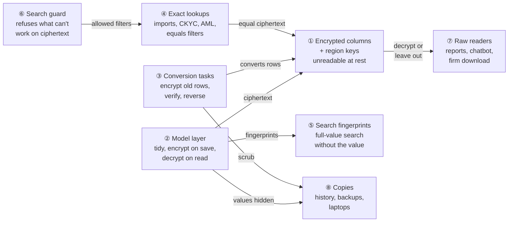

### Key concepts

**How the concepts fit together**

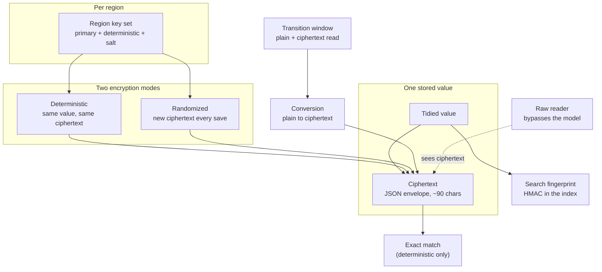

- The top is configuration: one key set per region, two modes.
- The middle is what happens to one value: tidied, then encrypted into a ciphertext.
- The bottom is how the rest of the app copes: exact match, fingerprints, the transition window and
  raw readers.

**Glossary**

| Concept | What it is, in one line | Example | Stored in |
|---|---|---|---|
| In-scope value | A column this change encrypts | Anil's PAN, bank account, IFSC, verification replies | 6 tables, see [schema](#data-model-and-schema-changes) |
| Ciphertext | The stored, unreadable form: a JSON envelope with payload, IV and auth tag | `{"p":"…","h":{"iv":"…","at":"…"}}`, 90 bytes for a 15-char PAN | The same column |
| Deterministic mode | IV derived from the value, so equal values give equal ciphertext | Both of Anil's KYCs store the same PAN ciphertext | — |
| Randomized mode | Random IV, so ciphertext differs every save | Anil's two bank ciphertexts differ | — |
| Exact match | SQL equality on ciphertext; only deterministic | `PAN = <ciphertext of ABCPM1234K>` | — |
| Tidying | Trim, upper-case PAN/IFSC, blank → NULL, before encryption and before queries | ` abcpm1234k ` → `ABCPM1234K` | Rails `normalizes` |
| Search fingerprint | HMAC-SHA256 of the tidied value, keyed per region, kept in Elasticsearch instead of the value | `pan_fp: "b41f…"` | KYC / Offer search indexes |
| Region key set | `primary_key`, `deterministic_key`, `key_derivation_salt` from that region's credentials | production.in ≠ production.us | `config/credentials/<env>.yml.enc` |
| Key fingerprint | First 8 hex characters of SHA-256 over the key set, to compare regions without showing keys | `7c1e09ab` | Printed by pre-flight only |
| Transition window | `support_unencrypted_data` + `extend_queries` on: plain values read, queries match both forms | India, deploy 1 → deploy 2 | Rails config |
| Conversion | Rake task rewriting plain values as ciphertext through the model | `pii_encryption:encrypt[production.in]` | — |
| Raw reader | Code that reads a column with SQL instead of the model, so it sees ciphertext | Report builder `select_all`, chatbot CTEs, the SQLite dump script | — |
| Hidden history value | audited's built-in `[FILTERED]` placeholder for encrypted attributes | `bank_account_number: ["[FILTERED]","[FILTERED]"]` | `audits.audited_changes` |
| Search guard | One check on every Ransack search that refuses predicates ciphertext cannot answer | "PAN contains" refused | — |
| Scrubbed copy | A production copy on a laptop with every in-scope value replaced by a fake | Fake PAN `ZZQXA4821K` | Developer DB |

#### Deterministic vs randomized

- **What:** two Rails modes. Deterministic derives the IV from the value, so equal plaintexts give
  equal ciphertexts and SQL equality works. Randomized uses a fresh IV.
- **Why:** PAN is a lookup key (imports, CKYC/KRA, AML, filters); a bank account number is never
  looked up by value in SQL.

| Kind | Columns | What still works in SQL | Example |
|---|---|---|---|
| Deterministic | `PAN` (5 tables), `ifsc_code` (4 tables) | `=`, `IN`, `IS NULL`, uniqueness | `where(PAN: "ABCPM1234K")` |
| Randomized | `bank_account_number`, `*_verification_response`, CKYC / AML JSON | `IS NULL` only | `where(bank_account_number: nil)` |

**What it does NOT cover:** `LIKE`, ranges, `ORDER BY`, `GROUP BY`, `MIN/MAX`, `GROUP_CONCAT` — on
either mode they run on ciphertext and give meaningless or empty results.

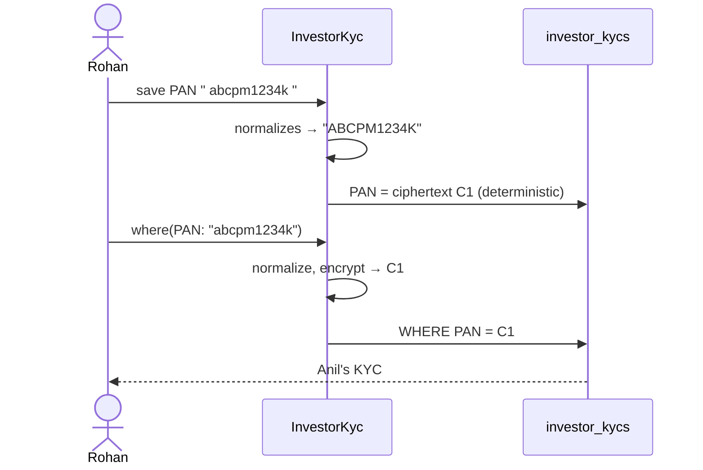

**Rules**
- Deterministic leaks equality (two KYCs share a PAN) — accepted; it is how matching works today.
- Case: deterministic is byte-exact, while MySQL today compares `utf8mb4_0900_ai_ci` (case-insensitive)
  — tidying restores case-insensitive matching ([D3](#d3-tidy-before-encrypting)).
- Randomized `""` encrypts to a ciphertext (`encrypted_attribute_type.rb:130-133` only skips `nil`), so
  blanks become NULL first.

#### Transition window

- **What:** the period, per region, when each encrypted attribute is declared with
  `support_unencrypted_data: true` and `config.active_record.encryption.extend_queries = true`.
- **Why:** rows are converted while the site is up; until all are converted a read must accept plain
  text and a lookup must match both forms.

| Setting | Effect | Source |
|---|---|---|
| `support_unencrypted_data: true` | A decryption error on a plain value returns the value as is | `encrypted_attribute_type.rb:113-118` |
| `extend_queries = true` | `where(PAN: x)` also matches plain `x` (adds the clean-text type to `previous_types`) | `railtie.rb:376-378`, `encrypted_attribute_type.rb:55-67`, `extended_deterministic_queries.rb` |

**What it does NOT cover:** a region after deploy 2 — any plain value is then a Decryption error
(design wants that loud, [X2](business-rules.md#2-conversion-transition-window-way-back--phase-1)).

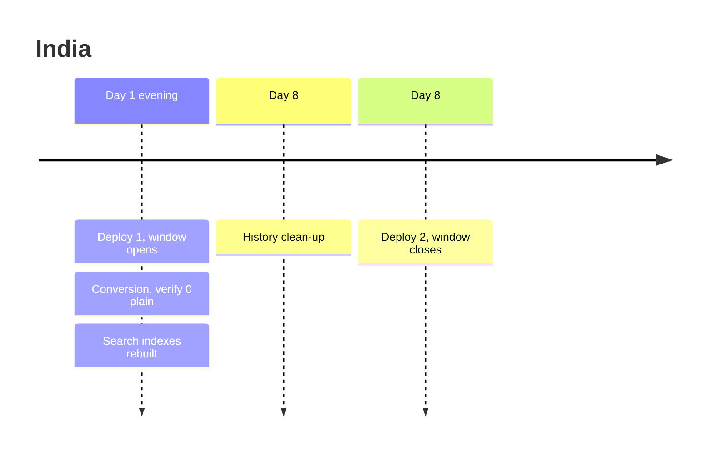

**Rules**
- Defaults are off (`config.rb:51-62`), so both settings are explicit and removed in deploy 2.
- The window is per attribute (`support_unencrypted_data:` on `encrypts`), so `otp_secret` and Zoho
  secrets are not affected.
- Undo inside the window: run the reverse task, then roll back the code ([③](#-conversion-and-clean-up-tasks)).

#### Search fingerprint

- **What:** `OpenSSL::HMAC.hexdigest("SHA256", key, tidied_value)` where `key =
  Rails.application.key_generator.generate_key("pii_search_fingerprint", 32)` — per region because
  `secret_key_base` is per region.
- **Why:** Elasticsearch holds `PAN` and `bank_account_number` in plain text today
  (`investor_kyc_index.rb:7-8`, `offer_index.rb:10`); a fingerprint keeps full-value search without
  storing the value.

| Typed in search box | Fingerprint query | Result |
|---|---|---|
| `abcpm1234k` | `term pan_fp = fp("ABCPM1234K")` | KYC 1, KYC 5 |
| `50100234567812` | `term bank_fp = fp("50100234567812")` | KYC 1, KYC 5 |
| `ABCPM` | `term pan_fp = fp("ABCPM")` | nothing on PAN |

**What it does NOT cover:** prefixes, suffixes, fuzzy matches.

### Walkthrough: one example, start to finish

Kestrel Capital (India) through the rollout and a normal week afterwards. Data from the
[shared setup](business-rules.md#shared-setup).

**Legend:** ✓ done · ● we are here: waiting on this, not done yet · ○ not started · ↺ redone.
Tasks: Pre-flight, Deploy window, Convert rows, Verify, Rebuild index, Hide history, Close window.

**Phase 1 — rollout**

| # | When | What happens | Behind the scenes | Result |
|---|---|---|---|---|
| 1 | Day 1 21:50 | Vikram runs pre-flight for production.in | the conversion tasks (③) read the region key set from the encrypted columns' credentials (①), print fingerprint `7c1e09ab`, count 7,381 PANs | Pre-flight&nbsp;✓<br>**Deploy&nbsp;window&nbsp;●**<br>Convert&nbsp;rows&nbsp;○<br>Verify&nbsp;○<br>Rebuild&nbsp;index&nbsp;○<br>Hide&nbsp;history&nbsp;○<br>Close&nbsp;window&nbsp;○ |
| 2 | Day 1 22:00 | Deploy 1 | the model layer (②) now encrypts on save; columns (①) widened; window open | Pre-flight&nbsp;✓<br>Deploy&nbsp;window&nbsp;✓<br>**Convert&nbsp;rows&nbsp;●**<br>Verify&nbsp;○<br>Rebuild&nbsp;index&nbsp;○<br>Hide&nbsp;history&nbsp;○<br>Close&nbsp;window&nbsp;○ |
| 3 | Day 1 22:03 | Conversion stops at batch 9 of 17 (deploy restart) | the conversion task (③) had committed 8 batches; screens still read both forms (②) | Same as row 2 |
| 4 | Day 1 22:06 | Vikram re-runs it | the conversion task (③) skips encrypted rows, converts the rest | Pre-flight&nbsp;✓<br>Deploy&nbsp;window&nbsp;✓<br>Convert&nbsp;rows&nbsp;↺<br>**Verify&nbsp;●**<br>Rebuild&nbsp;index&nbsp;○<br>Hide&nbsp;history&nbsp;○<br>Close&nbsp;window&nbsp;○ |
| 5 | Day 1 22:10 | Verify | the conversion task (③) counts plain values in ① → 0 | Pre-flight&nbsp;✓<br>Deploy&nbsp;window&nbsp;✓<br>Convert&nbsp;rows&nbsp;✓<br>Verify&nbsp;✓<br>**Rebuild&nbsp;index&nbsp;●**<br>Hide&nbsp;history&nbsp;○<br>Close&nbsp;window&nbsp;○ |
| 6 | Day 1 22:20 | Indexes rebuilt | search fingerprints (⑤) written for 8,103 KYCs and 342 offers | Pre-flight&nbsp;✓<br>Deploy&nbsp;window&nbsp;✓<br>Convert&nbsp;rows&nbsp;✓<br>Verify&nbsp;✓<br>Rebuild&nbsp;index&nbsp;✓<br>**Hide&nbsp;history&nbsp;●**<br>Close&nbsp;window&nbsp;○ |

**Phase 2 — a normal week**

| # | When | What happens | Behind the scenes | Result |
|---|---|---|---|---|
| 7 | Day 2 | Rohan imports "Pan/Tax Id = abcpm1234k " | the model layer (②) tidies; exact lookups (④) match ciphertext in ① | Same as row 6 |
| 8 | Day 3 | Meera filters "PAN contains ABCPM" (mistake) | the search guard (⑥) refuses with the PAN message | Same as row 6 |
| 9 | Day 3 | She changes it to "PAN equals ABCPM1234K" | the guard (⑥) allows; exact lookups (④) list KYC 1 and 5 | Same as row 6 |
| 10 | Day 4 | Rohan changes Anil's bank account | the model layer (②) stores ciphertext; history (⑧) records `[FILTERED]` | Same as row 6 |
| 11 | Day 5 | Meera opens the commitments report with related PAN | raw readers (⑦): the aggregator decrypts the related value | Same as row 6 |

**Phase 3 — clean-up**

| # | When | What happens | Behind the scenes | Result |
|---|---|---|---|---|
| 12 | Day 8 | History clean-up, dry run then EXECUTE=1 | the conversion tasks (③) rewrite ~9,300 audit rows in copies (⑧) | Pre-flight&nbsp;✓<br>Deploy&nbsp;window&nbsp;✓<br>Convert&nbsp;rows&nbsp;✓<br>Verify&nbsp;✓<br>Rebuild&nbsp;index&nbsp;✓<br>Hide&nbsp;history&nbsp;✓<br>**Close&nbsp;window&nbsp;●** |
| 13 | Day 8 | Deploy 2 | the model layer (②) stops accepting plain values | Pre-flight&nbsp;✓<br>Deploy&nbsp;window&nbsp;✓<br>Convert&nbsp;rows&nbsp;✓<br>Verify&nbsp;✓<br>Rebuild&nbsp;index&nbsp;✓<br>Hide&nbsp;history&nbsp;✓<br>Close&nbsp;window&nbsp;✓ |
| 14 | Day 40 | DR drill restores a Day-0 backup | restored rows are plain; the conversion task (③) re-run is a DR runbook step | Close&nbsp;window&nbsp;✓ (Convert&nbsp;rows&nbsp;↺ on the restored copy) |

The key moment, row 8:

```
KYCs                                          [Filter] [Download] [+ New KYC]
! "PAN" is stored encrypted, so it can only be matched exactly. Use "equals"
  with the full value, or "is blank" / "is present".
[PAN v] [contains v] [ABCPM      ]
Investor      Investing Entity   Type          Verified
Anil Mehta    Anil Mehta         Individual    Yes        (filter not applied)
```

**What to notice**
- Only ② changed how values are written; every reader either goes through ② or is handled in ⑤–⑧.
- The window (row 3-4) makes the conversion interruptible with no user impact.
- A refusal (row 8) replaces a silently empty list.
- History keeps who/when (row 10) while losing the values.
- A DR restore (row 14) is a known path, not an outage.

### Key ideas

| # | Idea | In one line | Card |
|---|---|---|---|
| 1 | Use Rails encryption with the existing region keys | No new library, key service or secret | [①](#-encrypted-columns-and-region-keys) |
| 2 | Deterministic for lookup keys only | PAN and IFSC keep `=`; bank numbers get randomized | [②](#-model-layer) |
| 3 | Tidy before encrypting | Restores today's case-insensitive matching | [②](#-model-layer) |
| 4 | Refuse instead of silently failing | One guard on `ApplicationRecord.ransack` | [⑥](#-search-guard) |
| 5 | Every raw reader decided one by one | Decrypt, leave out, or refuse | [⑦](#-raw-database-readers) |
| 6 | Copies count as much as the table | History, index, dumps, laptops, backups | [⑧](#-copies-outside-the-live-tables) |

**FAQ**

| Question | Answer |
|---|---|
| Does anything block users? | No screen changes; only partial-match filters and search are refused or narrowed ([proposal](proposal.md#what-this-changes-for-users)). |
| Why not encrypt at the database (MySQL TDE)? | TDE protects files only; backups taken logically, dumps, replicas' queries, ES and history would still be plain. The finding is about copies. |
| Why not a gem such as Lockbox? | Rails encryption is already configured and used (`zoho_sign_connection.rb:12`); one mechanism is simpler. |
| What does a DBA running `SELECT PAN FROM investor_kycs` see? | Ciphertext. That is the point. |
| Is encryption per tenant? | No — per region. Tenant isolation stays in Pundit; per-tenant keys are out of scope. |

---

## 2. The same picture with real names

### Picture

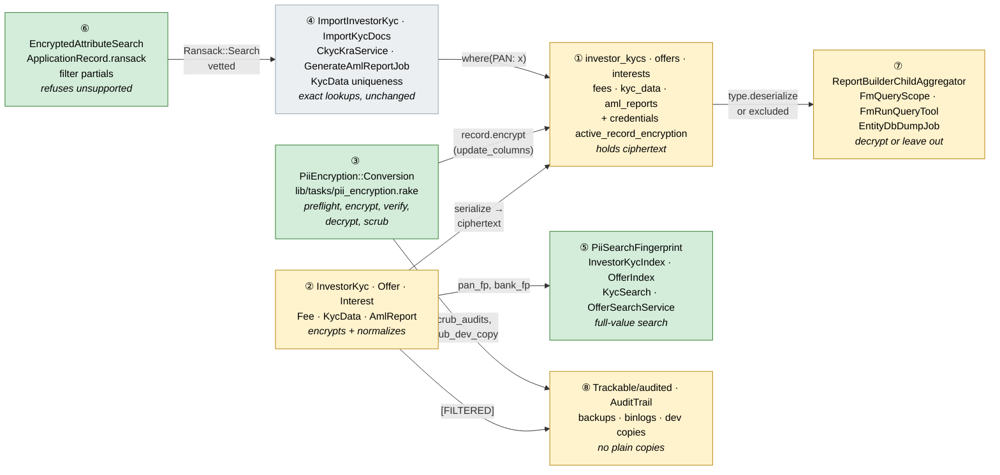

Colour = footprint: **green** new, **amber** modified, **grey** reused unchanged. Exact files are in
[lld.md File Map](lld.md#file-map).

### What each box does

| # | Box | Real parts | What it does | When it runs | What it decides | Details |
|---|---|---|---|---|---|---|
| ① | Encrypted columns and region keys | 6 tables, `credentials.active_record_encryption` | Hold ciphertext; keys per region | Always | Column widths, JSON → text | [card ① →](#-encrypted-columns-and-region-keys) |
| ② | Model layer | `encrypts`, `normalizes` on 6 models | Encrypt on save, decrypt on read, tidy | Every save / read | Deterministic or randomized per column | [card ② →](#-model-layer) |
| ③ | Conversion and clean-up tasks | `PiiEncryption::Conversion`, `pii_encryption.rake` | Convert, verify, reverse, scrub | By hand, per region | Dry run unless `EXECUTE=1`; refuses wrong region | [card ③ →](#-conversion-and-clean-up-tasks) |
| ④ | Exact lookups | imports, CKYC/KRA, AML, uniqueness, Ransack `eq` | Keep finding by full PAN / IFSC | Request / job | Nothing new — unchanged code | [card ④ →](#-exact-lookups) |
| ⑤ | Search fingerprints | `PiiSearchFingerprint`, two Chewy indexes, two search services | Full-value search without plain values in ES | Index update / search request | Which fingerprint fields a query adds | [card ⑤ →](#-search-fingerprints) |
| ⑥ | Search guard | `EncryptedAttributeSearch`, `ApplicationRecord.ransack`, filter partials, Administrate dashboards | Refuse predicates and sorts ciphertext can't answer | Every Ransack search | Allowed predicates per mode | [card ⑥ →](#-search-guard) |
| ⑦ | Raw database readers | report builder aggregators, FM chatbot scope, DB dump | Decrypt, leave out or refuse | Report / chat / dump job | Per reader, see table | [card ⑦ →](#-raw-database-readers) |
| ⑧ | Copies outside the live tables | audits, AuditTrail, ES, backups, binlogs, dev copies, DR runbook | No plain copies left behind | Save / rollout / restore | What is scrubbed vs aged out | [card ⑧ →](#-copies-outside-the-live-tables) |

### Every reader of these columns

The hard part. Every reader found, what it does today, and what happens to it. "Through the model"
means it reads an attribute on a loaded record, so it gets plaintext after ② with no change.

| # | Reader | Where (file:line) | How it reads | Outcome | Box |
|---|---|---|---|---|---|
| 1 | KYC form, show, approval, jbuilder views | `investor_kycs/views/*`, `_investor_kyc.json.jbuilder`, `_kyc_in_approval.html.erb` | Through the model | Keeps working | ② |
| 2 | Commitment / distribution payment JSON `pan` | `_capital_commitment.json.jbuilder:29`, `_capital_distribution_payment.json.jbuilder:40` | Through the model | Keeps working | ② |
| 3 | KYC xlsx export | `investor_kycs/views/investor_kycs/index.xlsx.axlsx:19,40` | Through the model | Keeps working | ② |
| 4 | Fund xlsx (PAN, bank, IFSC columns) | `fund_xl.rb:15,23` | Through the model | Keeps working | ② |
| 5 | Sablon templates `«=i.PAN»` | `sablon_safe_lookup.rb:6`, `TemplateDecorator` | Model method | Keeps working | ② |
| 6 | PDF password `investor_kyc.PAN` | `application_mailer.rb:368-383`, `custom_notification.rb:26-30`; 2 notifications in prod | `SafeAttributePath.read!` on the model | Keeps working | ② |
| 7 | PAN / bank verification jobs and replies | `verify_pan_job.rb:56-69`, `verify_bank_job.rb:38-39,58,70`; `serialize … type: Hash` `investor_kyc.rb:239-240`, `offer.rb:61-62,87-88`, `interest.rb:97-98` | Model + serialized Hash | Keeps working; reply columns randomized | ② |
| 8 | Verify-on-change callbacks | `investor_kyc_concern.rb:5,17`, `offer.rb:150-167`, `interest.rb:220-241` | `saved_change_to_PAN?` on decrypted values | Keeps working | ② |
| 9 | Doc checks compare / fill | `doc_checks/kyc.rb:11-20`, `doc_check_presets.yml:12-23`, `kyc_doc_extractor_agent.rb:166,175` | `public_send` on the model | Keeps working | ② |
| 10 | Remittance reconciliation, distribution readiness, statement generator | `remittance_reconciliation_agent.rb:474,490,577`, `distribution_readiness_agent.rb:286`, `lib/remittance_reconciliation_statement_generator.rb:186` | Ruby comparison of decrypted values | Keeps working | ② |
| 11 | CKYC / KRA / AML services | `kyc_verify.rb:31-36,87,127-130`, `aml_api_response_service.rb:7-34`, `kyc_data.rb:46` | Model + JSON | Keeps working; JSON columns become text ([D4](#d4-widen-columns-json-becomes-text)) | ② |
| 12 | KYC import match by "Pan/Tax Id" | `import_investor_kyc.rb:24,29,37` | `where(PAN: pan)`, `PAN: [pan, nil, ""]` | Exact (deterministic + tidy) | ④ |
| 13 | KYC document import match | `import_kyc_docs.rb:96` | `query[:PAN] =` → `where` | Exact | ④ |
| 14 | CKYC / KRA data for a KYC | `investor_kyc.rb:525-531`, `ckyc_kra_service.rb:6,30`, `investor_kyc_update.rb:17` | `kyc_datas.where(PAN: self.PAN)` | Exact | ④ |
| 15 | AML report reuse | `generate_aml_report_job.rb:54` | `find_or_create_by(…, PAN: pan)` | Exact (`aml_reports.PAN` deterministic) | ④ |
| 16 | CKYC lookup uniqueness | `kyc_data.rb:28` | uniqueness validator | Exact (Rails deterministic uniqueness) | ④ |
| 17 | Missing-bank warning | `capital_distribution_warnings.rb:42` | `where(bank_account_number: [nil, ""])` | Works: `""` tidied to NULL in query and data ([D3](#d3-tidy-before-encrypting)) | ④ |
| 18 | KYC list Ransack (filter panel, URLs) | `investor_kyc.rb:490-492` (PAN, bank, IFSC ransackable), `investor_kyc_list.rb:20`, `_condition_fields.html.erb:18` (cont, gt, lt…) | Ransack predicates | `eq` kept; others refused | ⑥ |
| 19 | Lists filtering through a KYC | `capital_commitment.rb:321` (`investor_kyc` ransackable association), `with_filter_params.rb:44` | `investor_kyc_PAN_cont` | Same rule | ⑥ |
| 20 | Deleted-records list, generate-all-docs, report builder reader filters, audits list | `application_controller.rb:70`, `investor_kycs_controller.rb:647`, `report_builder_controller.rb:155`, `audits_controller.rb:5` | `Model.ransack` | Same rule (one hook) | ⑥ |
| 21 | AI report-link assistant | `report_prompt.rb:17,45-48` lists ransackable attributes | URLs with any predicate | Hint "(exact match only)"; guard refuses | ⑥ |
| 22 | Workflow rule conditions | `investor_kyc.rb:9` excludes PAN, bank, IFSC | — | Not affected | — |
| 23 | Offers / interests Ransack | `offer.rb:251-258`, `interest.rb:253-261` (H11 removed PII) | — | Not affected | — |
| 24 | Super-admin search | `admin/application_controller.rb:31` `Administrate::Search`; `offer_dashboard.rb:23-26`, `interest_dashboard.rb:26-29` (`Field::String`, searchable unless marked — cf. `offer_dashboard.rb:19` `searchable: false`) | SQL `LIKE` | Mark `searchable: false` | ⑥ |
| 25 | KYC search box | `investor_kyc_index.rb:2,7-8`, `kyc_search.rb:21-25` (prefix `*` query) | ES plain fields | Fingerprint fields; full value only | ⑤ |
| 26 | Offer search box | `offer_index.rb:2,10`, `offers_controller.rb:58-61`, `offer_search_service.rb:26-28` | ES plain field | Fingerprint field | ⑤ |
| 27 | Report builder root sort | `report_builder_query_engine.rb:304-313` `arel_table[key].asc` | SQL `ORDER BY` | Not offered for encrypted columns | ⑦ |
| 28 | Report builder related aggregates | `report_builder_child_aggregator.rb:12-26` (`MIN/MAX/GROUP_CONCAT`), `:189-198` `select_all`, `:226-233`, `:294-304` `type.cast(raw)` (does not decrypt) | Raw SQL rows | value/latest → `type.deserialize`; min/max/sum/avg/list not offered | ⑦ |
| 29 | Report builder pivot | `report_builder_pivot_aggregator.rb:1-3,25-29` (`CASE WHEN` on distinct values) | Raw SQL | Encrypted columns not offered | ⑦ |
| 30 | FM support chatbot SQL | `fm_run_query_tool.rb:37-42` (`investor_kycs` allowed), `fm_query_scope.rb:53-56` (`SELECT investor_kycs.*`) | Raw SQL | Encrypted columns left out of the CTE; naming them refused | ⑦ |
| 31 | LP assistant SQL | `run_query_tool.rb:48-63` (no KYC tables), `lp_query_scope.rb:31,72` (investors without `pan`) | — | Not affected | — |
| 32 | MCP tools | `app/packs/ai/mcp_server/ontology/` has no KYC / offer / interest / fee entity | — | Not affected | — |
| 33 | Firm DB download | `entity_db_dump_job.rb:83-123` → `script/load_entity_sqlite3.sh:53-63,68` raw `mysql` SELECT; KYC cols `:1182-1183`, fees `:752-753`, interests `:985-986`, kyc_data `:1364-1365`, offers `:1409-1410` | Raw SQL | Ruby decrypt pass on the SQLite file | ⑦ |
| 34 | Allocation SQLite shadow models | `application_record_sqlite.rb:29`; shadow models exist for investors, commitments, remittances… none for KYC / offer / interest / fee | — | Not affected | — |
| 35 | History (audited) | `trackable.rb:28`; audited 5.8 `filter_encrypted_attrs` (`auditor.rb:192-193,277-278,308-313`) | Writes `[FILTERED]` for encrypted attrs automatically | Accept; show "(value hidden)"; scrub old rows | ⑧ |
| 36 | History screens / audit search | `audit_trail.rb:13-14`, `audit.rb:2-4` (`audited_changes` ransackable) | Reads audit rows | Shows "changed (value hidden)" | ⑧ |
| 37 | Request logs, error mail, `#inspect` | `filter_parameter_logging.rb:29-33`; Rails also auto-adds encrypted attrs (`add_to_filter_parameters` default true, `config.rb:57`) | Filters | Unchanged | ⑧ |
| 38 | Backups and binlogs | `backup_db_xtra.rake:240` (180-day retention), `config/schedule.rb:81` `db:purge_binlogs` | Files | Age out; purge binlogs after conversion | ⑧ |
| 39 | Prod copy on laptops | `docs/operations/prod_restore.md` steps 1-6; dev keys hardcoded `application.rb:192-195` | Restored DB | Scrub step | ⑧ |
| 40 | Data lake / exporters | none: `lib/data_box_exporters.rb` exports host metrics only; no warehouse code in app/lib/config | — | Not affected | — |
| 41 | Seeds / demo tasks | `lib/tasks/support/portco_demo.rb:1021-1023`, `evergreen_demo_fund.rb:238-240`, `ops_demo_entity.rb:223-225` | Through the model | Keep working (encrypted) | ② |

Out of scope and untouched: `investors.pan` (5,047 values; `investor.rb:124-125`, `investor_index.rb:10`),
`entities.pan` (`entity.rb:34,45-47`, `update_investor.rb:256`), `offers.pan_card_data` (85 rows, all
Shrine file JSON, no reader), custom fields (`json_fields`), addresses, birth dates — see
[D15](#d15-scope-boundary).

### One run, end to end

The conversion of one region, the main path.

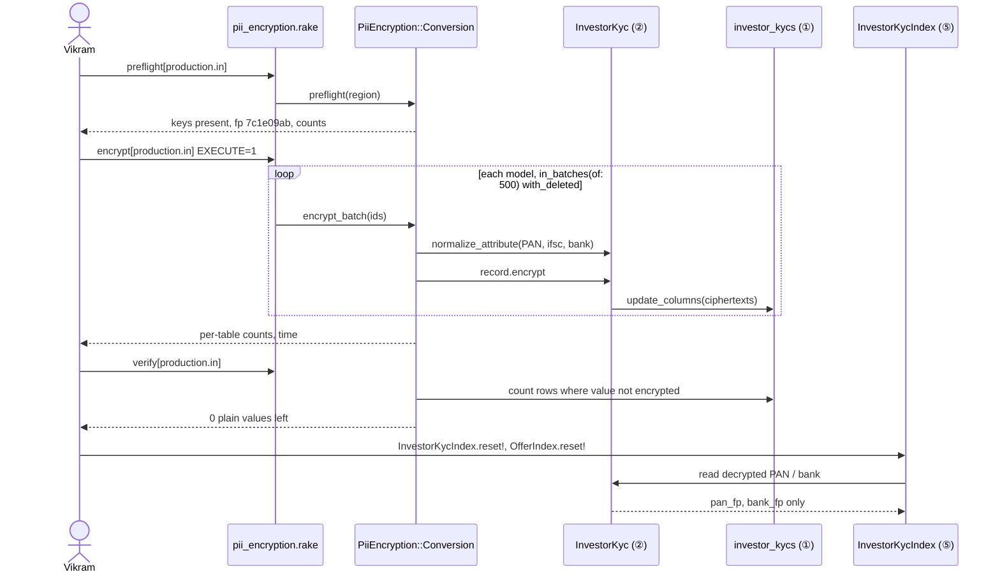

### Lifecycles

**One stored value** (derived per value: `type.encrypted?(raw)`)

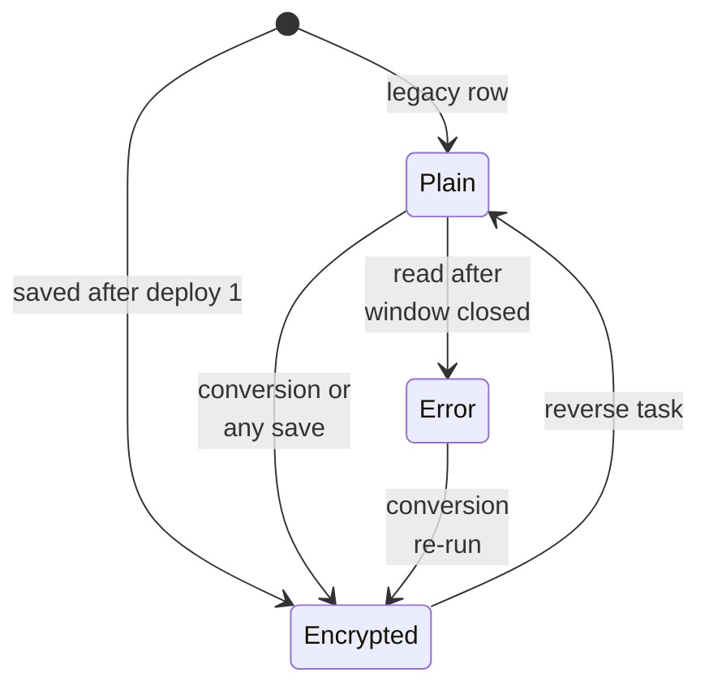

**One region** (stored nowhere; known from the deployed config and the verify task)

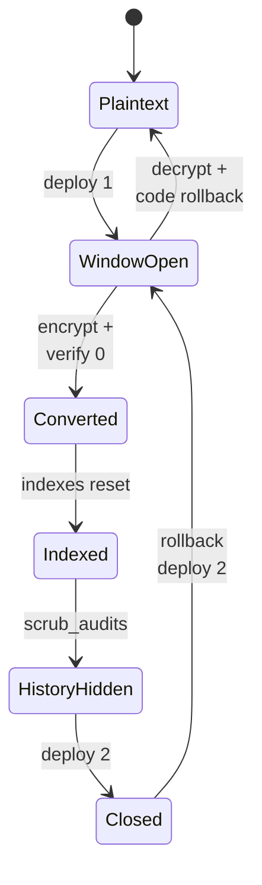

### What users see

**At a glance**

| Where in CapHive | Today | After this change | Who sees it |
|---|---|---|---|
| KYC form / page / exports / documents | Plain values | Same | Fund users, investors |
| Filter panel (any list) on PAN / IFSC | All conditions | equals, not equals, is blank, is present | Fund users |
| Filter panel on Bank Account Number | All conditions | is blank, is present | Fund users |
| URL / saved report with an unsupported condition | Applied | Refused, flash message, condition dropped | Fund users |
| KYC / Offers search box | Prefix match on PAN / bank | Full value; ⓘ hint | Fund users |
| Report builder related PAN / bank / IFSC | All aggregates | Value, Latest, Count; tooltip | Report builders |
| History | Old → new values | "changed (value hidden)" | Admins, support |
| Support chatbot | Can read PAN | Refuses | Fund users |
| /admin offers / interests search | Includes PAN / bank | Excludes them | CapHive staff |

**Main journey — filtering the KYC list**

```
KYCs                                            [Filter] [Download] [+ New KYC]
 ① ! "PAN" is stored encrypted, so it can only be matched exactly. …
 ② [PAN v] [equals v ▾ equals / not equals / is blank / is present] [ABCPM1234K]
 ③ Search (i) _____________   ← tooltip "PAN and bank account numbers match only when typed in full."
   Investor     Investing Entity   Type         Verified
   Anil Mehta   Anil Mehta         Individual   Yes
```

| Step | The user… | They see |
|---|---|---|
| 1 | Picks PAN in the filter panel | ② only the four supported conditions |
| 2 | Submits a bookmarked URL with `PAN_cont` | ① the flash, all rows, condition removed from the panel |
| 3 | Types the full PAN with equals | Anil's KYCs |
| 4 | Hovers the search box ⓘ | ③ the hint |

**Screen standards**

No screen is added. Changed partials keep their current layout; the reference screen is the screen
itself.

| Screen | Kind | Copies | Breadcrumbs | Tabs (lazy pills) | Turbo (frames / streams per action) | Stats cards (= grid totals) | Filter + search | Actions (header + Actions dropdown) | Help (title ⓘ intro, field tooltips, empty state, What's next) | Full width |
|---|---|---|---|---|---|---|---|---|---|---|
| KYC list (filter panel) | index | `investor_kycs/index` as is (`layouts/_filter`, `_condition_fields`) | KYCs (existing) | none | refusal = flash via existing flash partial; no frame change | unchanged | predicate list narrowed per attribute | unchanged | ⓘ tooltip on search box; refusal is a `alert-warning` flash (needs attention) | unchanged |
| Offers list search | index | `offers/index` as is | unchanged | none | unchanged | unchanged | ⓘ tooltip on search | unchanged | tooltip | unchanged |
| Report builder column settings | modal | existing column-settings modal | — | — | existing frame | — | — | — | tooltip on the aggregate radio | — |
| History panel | component | `AuditTrail` component as is | — | — | — | — | — | — | "(value hidden)" text, no new box | — |

- No action changes one row, so no new Turbo streams.
- Help text is a tooltip; the only coloured box is the refusal flash.

### Design decisions

**At a glance**

| # | Decision | Why, in one line |
|---|---|---|
| D1 | Rails ActiveRecord encryption with the existing region keys | Already configured and in use; no new secret |
| D2 | Deterministic for PAN and IFSC, randomized for everything else | Only lookup keys need equality |
| D3 | Tidy before encrypting | Restores case/space-insensitive matching and makes blanks NULL |
| D4 | Widen columns; JSON becomes text | Ciphertext is 70-126 bytes; it is not JSON for MySQL |
| D5 | Two deploys with a transition window | Convert while the site is up; interruptible |
| D6 | Convert with `record.encrypt` in batches | No callbacks, audits, index updates or timestamps |
| D7 | HMAC fingerprints in Elasticsearch | Full-value search without plain values in ES |
| D8 | One search guard on `ApplicationRecord.ransack` | Every list, URL and saved report in one place; no silent empties |
| D9 | Report builder decrypts related values, offers no SQL maths on them | `select_all` returns ciphertext today |
| D10 | Chatbot never sees encrypted columns | Raw SQL can't decrypt; PII shouldn't reach the LLM |
| D11 | Firm DB download decrypts after the SQLite build | Keeps the feature; the shell script reads raw rows |
| D12 | Accept audited's `[FILTERED]`, scrub old rows | Built in; history keeps who/when |
| D13 | Developer copies scrubbed with fakes | Laptops stop holding PII; app still opens |
| D14 | Per-region rollout tasks with pre-flight and fingerprint check | IN and US never share keys or steps |
| D15 | Scope boundary | Finding's columns + their echoes; investor/entity PAN later |

#### D1. Rails encryption with existing region keys

- **Problem:** we need encryption keys and a cipher; e.g. production.us and production.in must not
  be able to read each other's data.
- **Decision:** `encrypts` on the six models, using `config.active_record.encryption.*` already set
  from `Rails.application.credentials.active_record_encryption` in each non-local env
  (`application.rb:196-200`); local/test use the hardcoded dev keys (`application.rb:192-195`).
- **Why:**
  - Already used by `ZohoSignConnection` and devise-two-factor's `otp_secret`.
  - Production cannot boot without these keys (`enc.fetch` raises), so they exist in both regions.
  - AES-256-GCM, authenticated; key rotation built in (`primary_key` arrays, `previous:` schemes).
- **Not chosen:** a dedicated PII key per region (decision Q9) — more secrets to manage and no
  separation benefit while the same people hold both; Lockbox / KMS envelope — new dependency.
- **Where:** `config/application.rb`, the six models.

#### D2. Deterministic for PAN and IFSC only

- **Problem:** PAN is matched by value (readers 12-16); bank numbers never are (readers 10, 17 compare
  in Ruby or test NULL).
- **Decision:** `encrypts :PAN, deterministic: true` on InvestorKyc, Offer, Interest, KycData,
  AmlReport; `encrypts :ifsc_code, deterministic: true` on InvestorKyc, Offer, Interest, Fee; all other
  columns randomized.
- **Why:**
  - Keeps every exact lookup with no code change in ④.
  - IFSC identifies a bank branch (public directory data); equality leakage is harmless and keeps the
    "IFSC equals" filter.
  - Bank number, replies and CKYC/AML JSON get the strongest mode.
- **Not chosen:** randomized PAN + a separate blind-index column — new columns on five tables and
  every lookup rewritten, for no gain over deterministic here.
- **Where:** six models; [schema](#data-model-and-schema-changes).

#### D3. Tidy before encrypting

- **Problem:** MySQL matches `abcpm1234k` = `ABCPM1234K` today (`utf8mb4_0900_ai_ci`); deterministic
  ciphertext is byte-exact. 154 KYC PANs are lower/mixed case and 14 have spaces (India copy);
  KYC 2's import would stop matching. 673 KYC bank numbers are `""`, and randomized `""` is a
  ciphertext that `where(bank_account_number: "")` cannot match.
- **Decision:** `normalizes :PAN, :ifsc_code` with strip + upcase + `presence`;
  `normalizes :bank_account_number` with strip + `presence`. Rails applies `normalizes` to `where`
  and `find_by` arguments too (`activemodel …/attributes/normalization.rb:56-67`).
- **Why:**
  - Restores today's case-insensitive matching for imports, CKYC/KRA and filters.
  - `where(bank_account_number: [nil, ""])` (`capital_distribution_warnings.rb:42`) keeps working
    because `""` becomes `nil` in the query too.
  - PAN is upper-case by definition; `KycData` already requires `[A-Z]{5}[0-9]{4}[A-Z]`
    (`kyc_data.rb:27`).
- **Not chosen:** `ignore_case: true` — keeps the typed case but needs an `original_PAN` column on five
  tables (`encryptable_record.rb:98-106`) (decision Q6 option B).
- **Where:** six models; the conversion applies `normalize_attribute` before encrypting.

#### D4. Widen columns, JSON becomes text

- **Problem:** ciphertext of a 15-char PAN is 90 bytes, a 40-char bank number 126 bytes, an empty
  string 70 bytes (measured with Rails 8.1.4's encryptor); `PAN` is `limit: 15`
  (`schema.rb:3485`), `kyc_data.PAN` `limit: 10` (`schema.rb:3798`). MySQL `json` columns would
  re-serialize the envelope.
- **Decision:** change in-scope `string` columns to `string, limit: 255`; change `kyc_data.response`,
  `request_data`, `response_data` and `aml_reports.request_data`, `response_data` from `json` to
  `mediumtext` and declare `attribute …, :json` on the models so readers still get a Hash.
- **Why:**
  - 255 leaves room for the envelope plus `store_key_references` if turned on later.
  - Model validations keep the plaintext limits (`investor_kyc.rb:173-175`, `offer.rb:76-78`,
    `interest.rb:50-52`, `fee.rb:8-9`); Rails' automatic column-size check moves to 255
    (`encryptable_record.rb:132-143`).
  - mediumtext: AML JSON is up to 35,505 bytes today and grows per screening run.
- **Not chosen:** keep `json` and rely on MySQL keeping the envelope intact — it parses and re-orders
  keys; not worth the risk for 5,877 rows.
- **Where:** one migration; `schema.rb` and `schema_test.rb`.

#### D5. Two deploys with a transition window

- **Problem:** converting 8,103 KYCs while users edit them; a partial conversion must not break
  pages or lookups.
- **Decision:** deploy 1 declares `support_unencrypted_data: true` on each `encrypts` and sets
  `config.active_record.encryption.extend_queries = true`; deploy 2 removes both.
- **Why:**
  - Plain rows read normally and lookups match both forms while the conversion runs.
  - After deploy 2 a plain value raises `ActiveRecord::Encryption::Errors::Decryption` — loud, caught
    by the existing exception email — instead of being silently accepted forever.
- **Not chosen:** a maintenance window with one deploy — downtime for no benefit; keeping the window
  open permanently — a raw-SQL write of plain text would then go unnoticed.
- **Where:** six models, `config/application.rb`.

#### D6. Convert with `record.encrypt` in batches

- **Problem:** a save would run callbacks (verification jobs, audits, index updates, journeys,
  `updated_at`).
- **Decision:** `PiiEncryption::Conversion` iterates `Model.with_deleted.in_batches(of: 500)` (ids
  are AUTO_INCREMENT), selects only `id` + in-scope columns, calls `normalize_attribute` then
  `record.encrypt` — `update_columns` under the hood (`encryptable_record.rb:165-168,187-190`).
  `record.decrypt` is the reverse (`:170-172,193-198`).
- **Why:**
  - No callbacks, audits, ES updates, emails or timestamp changes.
  - Idempotent: a row whose values are already ciphertext is skipped (`type.encrypted?`).
  - Small tables (≤ 8,625 rows) — minutes, not hours.
- **Not chosen:** raw SQL `UPDATE … SET PAN = <ciphertext>` — duplicates Rails' envelope logic.
- **Where:** `PiiEncryption::Conversion`, `lib/tasks/pii_encryption.rake`.

#### D7. HMAC fingerprints in Elasticsearch

- **Problem:** KYC and Offer search boxes query ES fields `PAN` and `bank_account_number` with a
  prefix query (`kyc_search.rb:21-25`); ES would otherwise keep plain copies.
- **Decision:** `PiiSearchFingerprint.for(value)` = HMAC-SHA256 of the tidied value, key from
  `Rails.application.key_generator.generate_key("pii_search_fingerprint", 32)`. Indexes store
  `pan_fp` / `bank_fp` (keyword) instead of `PAN` / `bank_account_number`. Search services add a
  `bool.should` of `term` on both fingerprints of the tidied whole query next to the existing
  `simple_query_string` on the remaining fields.
- **Why:**
  - One mechanism for deterministic and randomized columns.
  - Per region (secret_key_base differs per env); ES is fully rebuildable, so a key change is a reindex.
- **Not chosen:** deterministic ciphertext as the ES token — no equivalent for bank numbers;
  plain values in ES — ES has no auth/TLS today (finding L3) (decision Q1 option B).
- **Where:** `PiiSearchFingerprint`, `InvestorKycIndex`, `OfferIndex`, `KycSearch`,
  `OfferSearchService`, `OffersController#search`.

#### D8. One search guard on `ApplicationRecord.ransack`

- **Problem:** Ransack turns `PAN_cont` into `LIKE <ciphertext of "%ABCPM%">` (Arel's `Casted` node
  serializes the value through the attribute type, which now encrypts it) and silently returns nothing; the same for sorts and every list
  that filters through a KYC. The project already treats silent-success filters as bugs (CLAUDE.md,
  Ransack `ignore_unknown_conditions`).
- **Decision:** `ApplicationRecord.ransack` (and `ransack!`) builds the search, then
  `EncryptedAttributeSearch.vet!(search)` walks its conditions and sorts, resolves each attribute's
  model (`Ransack::Nodes::Bindable#klass`, ransack-6.0.0 `nodes/bindable.rb:16-17`), and raises `EncryptedAttributeSearch::Refused` (with the
  user message) on a disallowed predicate; drops sorts on encrypted columns.
  `ApplicationController` `rescue_from` it: HTML → redirect to the same path without `q`, flash alert;
  JSON → 422. The filter panel gets the allowed predicates from `ransack_filter_attribute_types`
  (`application_helper.rb:121`) and hides the rest.

| Mode | Allowed predicates |
|---|---|
| Deterministic | `eq`, `not_eq`, `in`, `not_in`, `null`, `not_null`, `blank`, `present` |
| Randomized | `null`, `not_null`, `blank`, `present` |

- **Why:**
  - Every caller of `Model.ransack` (readers 18-21) is covered by one hook, now and later.
  - Generic: uses `encrypted_attributes` / `deterministic_encrypted_attributes`, so
    `ZohoSignConnection` and future encrypted columns are covered too.
- **Not chosen:** removing PAN/bank/IFSC from `ransackable_attributes` — "PAN equals" and "is blank"
  would be lost, and Ransack would silently ignore old URLs (decision Q2 option A keeps them);
  a blind-index column per field (Q2 option B).
- **Where:** `EncryptedAttributeSearch`, `ApplicationRecord`, `ApplicationController`,
  `ApplicationHelper#ransack_filter_attribute_types`, filter Stimulus controller,
  `ReportPrompt.all_ransackable_attributes`, Administrate dashboards.

#### D9. Report builder decrypts, no SQL maths

- **Problem:** related columns are read with `select_all` (`report_builder_child_aggregator.rb:197-198`)
  and cast with `type.cast(raw)` (`:301`), which does not decrypt; `MIN/MAX/GROUP_CONCAT` and pivot
  `CASE WHEN` work on ciphertext.
- **Decision:** `read_value` uses `type.deserialize(raw)` for encrypted attributes on `value` /
  `latest`; the column catalog offers only Value / Latest / Count for encrypted columns, is not
  pivotable and not sortable; a saved aggregate outside that set is rendered as Value.
- **Why:** keeps reports readable; GROUP_CONCAT of ciphertext can't be split (the envelope contains
  commas).
- **Not chosen:** computing min/max/list in Ruby — no real use for "min of bank account numbers".
- **Where:** `ReportBuilderChildAggregator`, `ReportBuilderPivotAggregator`,
  `ReportBuilderQueryEngine#apply_sort`, `ReportBuilderColumnType`.

#### D10. Chatbot never sees encrypted columns

- **Problem:** `FmQueryScope#body_for` is `SELECT investor_kycs.* …` (`fm_query_scope.rb:53-56`); the
  LLM would receive ciphertext and a `WHERE PAN = '…'` would silently match nothing.
- **Decision:** for any allowed table whose model has `encrypted_attributes`, the CTE lists every
  column except those; `FmRunQueryTool#validate` refuses SQL naming an encrypted column with the
  not-available message.
- **Why:** follows `LpQueryScope`'s explicit-column pattern (`lp_query_scope.rb:72`); sends the
  minimum PII to the AI provider (Security item 8).
- **Not chosen:** decrypting result cells by column name — aliases make it unreliable and PII would
  reach the LLM (decision Q4).
- **Where:** `FmQueryScope`, `FmRunQueryTool`, `FmCsChatProvider` prompt line.

#### D11. Firm DB download decrypts after the SQLite build

- **Problem:** `script/load_entity_sqlite3.sh` exports with `mysql` (`:53-63`) — the file would hold
  ciphertext the firm can't read.
- **Decision:** after the script, `EntityDbDumpJob` runs `PiiEncryption::SqliteDecryptor` over the
  file: for each in-scope table/column, read `id, column` from SQLite, `type.deserialize`, write
  back, in one SQLite transaction per table.
- **Why:** keeps the feature exactly as today (decision Q5 A); delivery hardening is finding M5.
- **Not chosen:** exporting through ActiveRecord — rewrites a 2,130-line script for six tables.
- **Where:** `EntityDbDumpJob#process_entity_dump`, `PiiEncryption::SqliteDecryptor`.

#### D12. Accept audited's `[FILTERED]`, scrub old rows

- **Problem:** audited 5.8 already replaces encrypted attributes with `[FILTERED]`
  (`auditor.rb:192-193,277-278,308-313`), so history loses the values automatically; ~9,300 existing
  rows still hold them.
- **Decision:** accept the built-in behaviour; `AuditTrail` renders a `[FILTERED]` pair as
  "changed (value hidden)"; `pii_encryption:scrub_audits` rewrites existing rows for the six
  auditable types by id range.
- **Why:** zero custom auditing code; who/when kept for M14's bank-change review.
- **Not chosen:** last-4 masking (Q3 option B) — overrides audited internals for a small gain.
- **Where:** `AuditTrail`, `PiiEncryption::AuditScrubber`.

#### D13. Developer copies scrubbed with fakes

- **Problem:** a production copy on a laptop can't be decrypted with dev keys
  (`application.rb:192-195`) — KYC pages would raise; and today's copies hold plain PII.
- **Decision:** `pii_encryption:scrub_dev_copy` (development DB only) replaces every in-scope value:
  PAN → fake from SHA-256 of the raw ciphertext (equal PANs stay equal), others → random fakes,
  written through the model so they encrypt with dev keys. Added as step 4b of
  `docs/operations/prod_restore.md`.
- **Why:** laptops hold no real PII; KYC pages open; PAN-based matching still reproducible.
- **Not chosen:** sharing production keys with developers — defeats the point.
- **Where:** `PiiEncryption::DevCopyScrubber`, the rake task, `prod_restore.md`.

#### D14. Per-region rollout with pre-flight and fingerprint check

- **Problem:** IN and US are independent; a key copied between them, or a task run against the wrong
  one, must be caught.
- **Decision:** every task takes the region (`[production.in]`) and refuses if it is not
  `Rails.env` + the deployed region; pre-flight prints the key fingerprint and compares it with the
  other region's fingerprint that the operator passes as `OTHER_REGION_FP=` (copied from that
  region's own pre-flight output and recorded in the rollout log, never in either region's config);
  dry run unless `EXECUTE=1`.
- **Why:** same pattern as the ops rake tasks (dry-run + EXECUTE, per-env credentials).
- **Not chosen:** one task for both regions — would load both regions' credentials on one machine.
- **Where:** `lib/tasks/pii_encryption.rake`, `PiiEncryption::Preflight`.

#### D15. Scope boundary

- **Problem:** PII also lives in `investors.pan`, `entities.pan`, custom fields, addresses, birth dates.
- **Decision:** this change covers the finding's columns plus the replies that echo them
  (`*_verification_response`, CKYC/KRA and AML JSON, `aml_reports.PAN`). `offers.pan_card_data` is not
  encrypted: all 85 values are Shrine file pointers and nothing reads it.
- **Why:** `entities.pan` drives `Entity.where(pan:)` matching and uniqueness
  (`update_investor.rb:256`, `entity.rb:34`) across firms — a separate design (decision Q7).
- **Not chosen:** everything at once — doubles the reader inventory and the risk.
- **Where:** —

**FAQ**

| Question | Answer |
|---|---|
| Why not randomized PAN? | Every import and CKYC/KRA lookup would need a blind-index column; deterministic gives the same with no new columns. |
| Doesn't deterministic leak? | Only equality (two rows share a PAN) — the same information matching uses today. |
| Why not drop PAN from Ransack entirely? | "PAN equals" and "is blank" are useful and safe; Ransack would also silently ignore old URLs. |
| Why raise instead of ignoring a bad filter? | An ignored filter shows every row as if it matched — the silent-success class CLAUDE.md warns about. |
| What if a new encrypted column is added later? | The guard, report builder, chatbot scope and conversion read `encrypted_attributes`, so they pick it up. |

---

## 3. One card per box

> Same order and numbers as the picture.

### ① Encrypted columns and region keys

The six tables' in-scope columns and each region's key set.

| Owns | Reads / receives | Produces |
|---|---|---|
| Column types / widths; credentials key set | Ciphertext from ② and ③ | Stored ciphertext |

- Columns and widths: [Data model](#data-model-and-schema-changes).
- Keys per environment, never shared ([D14](#d14-per-region-rollout-with-pre-flight-and-fingerprint-check)):

| Environment | Key source | Notes |
|---|---|---|
| development, test | hardcoded `application.rb:192-195` | Dev copies need [scrub](#-copies-outside-the-live-tables) |
| staging.in | `staging.in.yml.enc` | Rehearsal |
| production.in | `production.in.yml.enc` | Key file gitignored (`.gitignore:79`) |
| production.us | `production.us.yml.enc` | Own keys |

- Rotation (not done in this change; documented in [lld](lld.md#configuration-and-rollout)): append a
  new `primary_key` (array), re-run the conversion (re-encrypts with the newest); deterministic
  rotation uses `previous:` + `extend_queries` during the re-run.

**Worked examples:** H1, H4, E4, E5 ([§1](business-rules.md#1-storage-and-tidying--phase-1)).

**FAQ**

| Question | Answer |
|---|---|
| Why 255 and not exact sizes? | Envelope sizes vary with options (key references, compression); 255 is cheap on tables of ≤ 8,625 rows. |
| Does widening lock the table? | MySQL 8.4 `ALTER … MODIFY` on 8k rows takes seconds; tables are small ([LLD](lld.md#schema-detail)). |
| The comment says "never rotate these keys" (`application.rb:190-191`) — true? | Only without `previous` schemes; Rails supports rotation. This change does not rotate. |

### ② Model layer

Declarations on six models; the only place values are encrypted, decrypted and tidied.

| Owns | Reads / receives | Produces |
|---|---|---|
| `encrypts` + `normalizes` per column | User input, imports, API params | Ciphertext to ①, plaintext to readers, fingerprints to ⑤, `[FILTERED]` to ⑧ |

| Model | Deterministic | Randomized | Tidied |
|---|---|---|---|
| `InvestorKyc` (+ STI `IndividualKyc`, `NonIndividualKyc`) | PAN, ifsc_code | bank_account_number, pan_verification_response, bank_verification_response | PAN, ifsc_code, bank_account_number |
| `Offer` | PAN, ifsc_code | bank_account_number, pan_verification_response, bank_verification_response | same |
| `Interest` | PAN, ifsc_code | bank_account_number, pan_verification_response, bank_verification_response | same |
| `Fee` | ifsc_code | bank_account_number | ifsc_code, bank_account_number |
| `KycData` | PAN | response, request_data, response_data | PAN |
| `AmlReport` | PAN | request_data, response_data | PAN |

- Serialized columns: `serialize … type: Hash` is declared **before** `encrypts` (Rails requirement
  for serialized + encrypted).
- `KycData#response` etc.: `attribute :response, :json` replaces the column's JSON type (D4).
- `InvestorKyc#pan=` (`investor_kyc.rb:537-543`) keeps its strip; tidying makes it redundant but harmless.

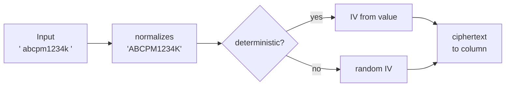

**Worked examples:** H1–H5, E1–E10, X1 ([§1](business-rules.md#1-storage-and-tidying--phase-1)).

**FAQ**

| Question | Answer |
|---|---|
| Is decryption slow on the 8,103-row KYC export? | AES-GCM decryption is microseconds and lazy per attribute; ≈ 5 attributes × 8k rows adds well under a second. |
| Do STI subclasses inherit `encrypts`? | Yes, declared on `InvestorKyc`. |
| Why tidy bank numbers but not upper-case them? | They are digits; trimming and blank → NULL is enough. |

### ③ Conversion and clean-up tasks

Operations tasks, dry run by default, one region at a time.

| Owns | Reads / receives | Produces |
|---|---|---|
| `pii_encryption:{preflight,encrypt,verify,decrypt,scrub_audits,scrub_dev_copy}` | Region argument, `EXECUTE`, `BATCH` | Converted rows, reports |

| Task | Does | Writes | Idempotent |
|---|---|---|---|
| `preflight[region]` | keys present, fingerprint, other-region check, counts | nothing | yes |
| `encrypt[region]` | tidy + `record.encrypt` per batch, `with_deleted` | `update_columns` | yes (skips ciphertext) |
| `verify[region]` | counts values not `encrypted?` per column | nothing | yes |
| `decrypt[region]` | `record.decrypt` per batch | `update_columns` | yes |
| `scrub_audits[region]` | `[FILTERED]` into old audit rows of the six types | `audits.audited_changes` | yes |
| `scrub_dev_copy` | fakes into every in-scope value | development DB | yes |

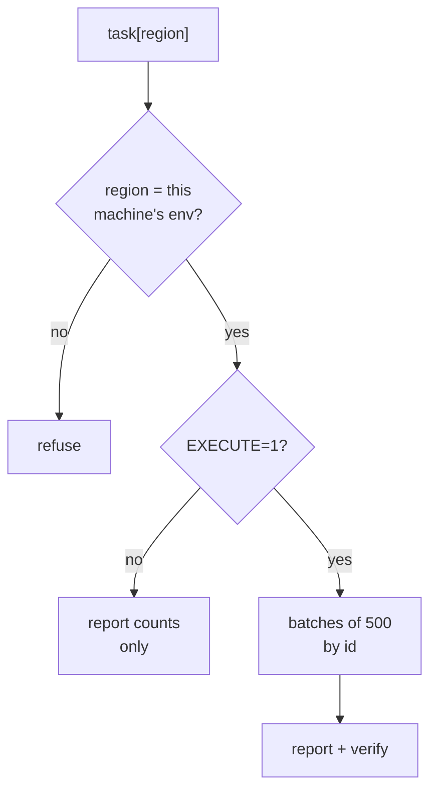

**Worked examples:** H6–H9, E11–E17, X2 ([§2](business-rules.md#2-conversion-transition-window-way-back--phase-1)); H11, E18–E20 ([§3](business-rules.md#3-history--phase-1)); H29–H30, E52–E53, X10–X12 ([§9](business-rules.md#9-regions-and-developer-copies--phase-3)).

**FAQ**

| Question | Answer |
|---|---|
| Why not a migration? | Data migrations can't be dry-run, can't be re-run, and would run in every environment including dev copies. |
| What if it stops half-way? | Re-run; encrypted rows are skipped (E11). |
| Does it touch `updated_at`? | No — `update_columns` (H7). |

### ④ Exact lookups

Existing code that finds records by full PAN / IFSC. No code change; it keeps working because of
D2 + D3 (and D5 during the window).

| Owns | Reads / receives | Produces |
|---|---|---|
| Nothing new | `where(PAN:)`, `find_or_create_by(PAN:)`, uniqueness, Ransack `eq` | Same records as today |

- Readers 12-17 in [Every reader](#every-reader-of-these-columns).
- Uniqueness on `KycData#PAN` (`kyc_data.rb:28`): Rails builds the query through the attribute type,
  so it compares ciphertext; during the window `extend_queries` installs
  `ExtendedDeterministicUniquenessValidator` (`railtie.rb:378`).

**Worked examples:** H12–H17, E23–E30, X3 ([§4](business-rules.md#4-exact-lookups--phase-2)); E13 ([§2](business-rules.md#2-conversion-transition-window-way-back--phase-1)).

**FAQ**

| Question | Answer |
|---|---|
| `PAN: [pan, nil, ""]` in the import — does the array work? | Yes: each value is tidied (`""` → nil) and encrypted; nil stays `IS NULL`. |
| Does `investor_kyc.PAN == self.PAN` (`kyc_data.rb:145`) still work? | Yes, Ruby comparison of decrypted values. |

### ⑤ Search fingerprints

| Owns | Reads / receives | Produces |
|---|---|---|
| `PiiSearchFingerprint`, `pan_fp` / `bank_fp` index fields | Decrypted values at index time; the typed query | ES `term` clauses |

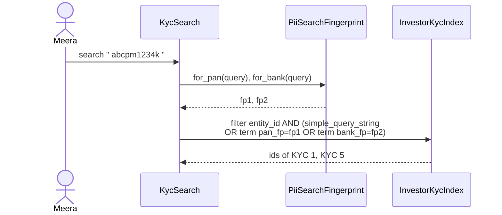

- `SEARCH_FIELDS` loses `PAN` / `bank_account_number`; prefix `*` stays for names.
- Firm scoping unchanged (`filter(terms: {entity_id:})`, `PolicyScopedSearch.restrict` in
  `offers_controller.rb:61`).
- Indexes are reset per region after the conversion (`ElasticImporterJob` / `dr:reindex`).

**Worked examples:** H21–H23, E38–E42, X6 ([§6](business-rules.md#6-search-box-fingerprints--phase-2)).

**FAQ**

| Question | Answer |
|---|---|
| Can someone reverse a fingerprint? | Not without the region's `secret_key_base`; a PAN has ~4.6e9 values, so an unkeyed hash would be brute-forced — hence HMAC. |
| Why `bool.should` and not one query string? | Fingerprints are exact `term`s; names stay `simple_query_string` with prefix. |

### ⑥ Search guard

| Owns | Reads / receives | Produces |
|---|---|---|
| `EncryptedAttributeSearch` | every `Ransack::Search` built through `ApplicationRecord.ransack` | `Refused` or the vetted search |

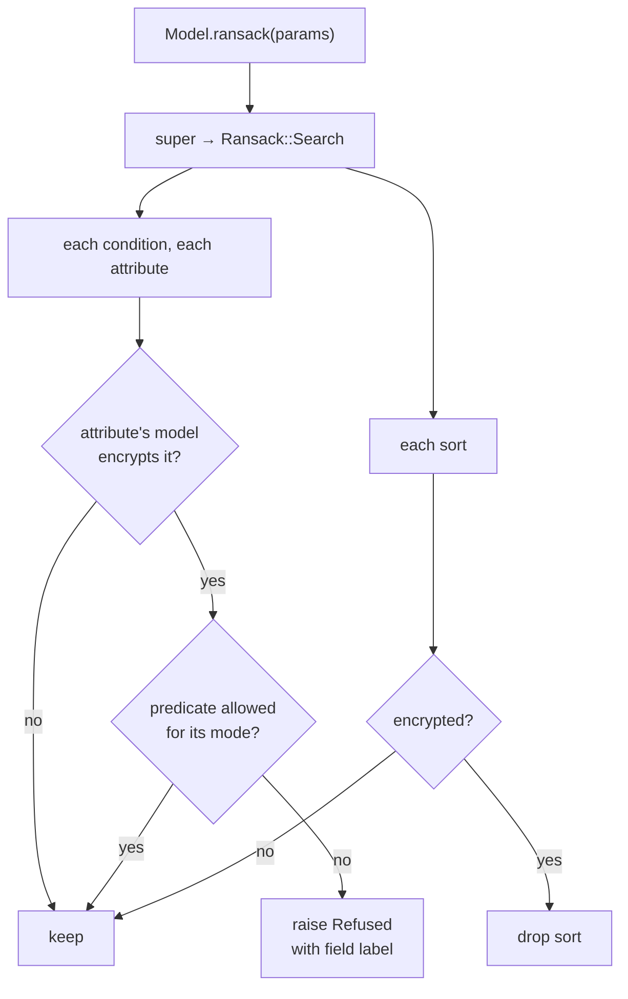

| Caller | Response to `Refused` |
|---|---|
| HTML list (`InvestorKycList`, `ransack_with_snapshot`, deleted list) | redirect to the path without `q`, `flash[:alert]` = message |
| JSON / turbo frame | 422 `{error: message}` / flash stream |
| Report builder reader filters | same flash on the report page |
| `generate_all_docs` | redirect with the message instead of generating |
| Administrate | not Ransack — dashboards mark the fields `searchable: false` |

- Filter panel: `ransack_filter_attribute_types` returns `:encrypted_exact` / `:encrypted_presence`
  for these attributes; the existing filter Stimulus controller limits the predicate options.
- `ReportPrompt.all_ransackable_attributes` appends "(exact match only)" to encrypted attributes.

**Worked examples:** H18–H20, E31–E37, X4–X5 ([§5](business-rules.md#5-search-guard--phase-2)); E51 ([§8](business-rules.md#8-raw-database-readers--phase-3)).

**FAQ**

| Question | Answer |
|---|---|
| Why refuse the whole filter, not just one condition (E36)? | A partly-applied filter would show rows that don't meet what the user asked for. |
| Does it slow every search? | It walks a handful of condition nodes in memory; no queries. |
| Why at `ransack`, not in each controller? | 7+ call sites today (readers 18-21); one hook can't be forgotten. |

### ⑦ Raw database readers

| Owns | Reads / receives | Produces |
|---|---|---|
| Per-reader handling | Raw rows / SQL | Plaintext, an omission, or a refusal |

| Reader | Today | After |
|---|---|---|
| Report builder related `value` / `latest` | `type.cast(raw)` → ciphertext | `type.deserialize(raw)` → plaintext |
| Report builder `min/max/sum/avg/list`, pivot, sort | SQL on column | Not offered; saved ones render as Value |
| FM chatbot CTE | `SELECT investor_kycs.*` | Explicit columns minus encrypted |
| FM chatbot SQL naming PAN / bank / IFSC | Runs | Refused with message |
| Firm DB download | Raw `mysql` export | + `SqliteDecryptor` pass |

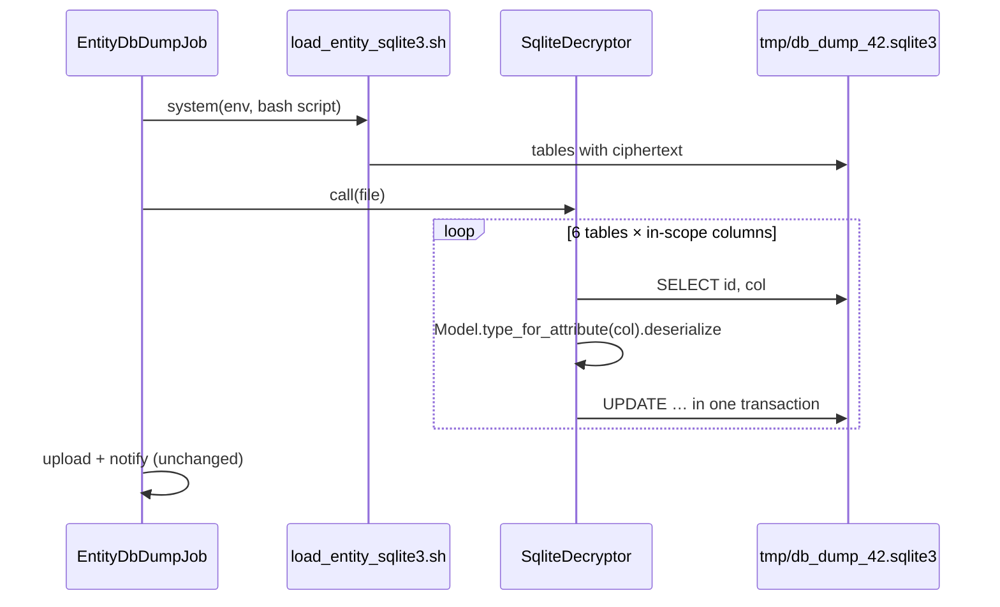

**Worked examples:** H24–H25, E43–E48, X7 ([§7](business-rules.md#7-reports--phase-2)); H26–H28, E49–E51, X8–X9 ([§8](business-rules.md#8-raw-database-readers--phase-3)).

**FAQ**

| Question | Answer |
|---|---|
| Doesn't the firm download then contain plain PII? | Yes, as today, by design (Q5); its delivery is M5. |
| Why not let the chatbot see PAN? | It would only see ciphertext; decrypting would send PII to the LLM provider. |

### ⑧ Copies outside the live tables

| Owns | Reads / receives | Produces |
|---|---|---|
| Handling of every copy | Saves, rollout steps, restores | No new plain copies; old ones scrubbed or aged out |

| Copy | Today | After | How |
|---|---|---|---|
| History (`audits`, 2.3 M rows) | ~9,300 rows with values | `[FILTERED]` | audited built-in + `scrub_audits` by id range |
| Search index | plain PAN / bank | fingerprints | reset after conversion |
| Nightly xtrabackups | plain | plain until aged out (180 days) | retention (Q8) |
| MySQL binlogs | conversion writes before-images | purged | run `db:purge_binlogs` after verify |
| Replicas | replicate | replicate the conversion | nothing extra |
| Prod copy on laptops | plain | scrubbed fakes | `scrub_dev_copy`, `prod_restore.md` step 4b; delete old copies |
| DR restore of an old backup | — | plain rows → error after window | DR runbook: re-run `encrypt` after restore |
| Logs / exception mail | filtered | filtered | unchanged |

**Worked examples:** H10–H11, E18–E22 ([§3](business-rules.md#3-history--phase-1)); E16 ([§2](business-rules.md#2-conversion-transition-window-way-back--phase-1)); H30, E53, X12 ([§9](business-rules.md#9-regions-and-developer-copies--phase-3)).

**FAQ**

| Question | Answer |
|---|---|
| Why wait 7 days before scrubbing history? | It is the one irreversible step; a rollback in that week keeps history intact. |
| Can old backups be decrypted later? | They are plain; nothing to decrypt. They age out. |
| Does the audits scrub load 2.3 M rows? | No — `auditable_type IN (6 types)` on the audited index, by id range, selecting `id, audited_changes` only. |

---

## 4. Reference

### Class diagram

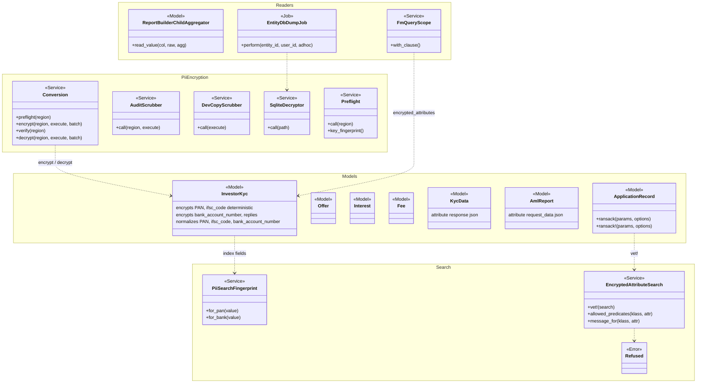

### Data model and schema changes

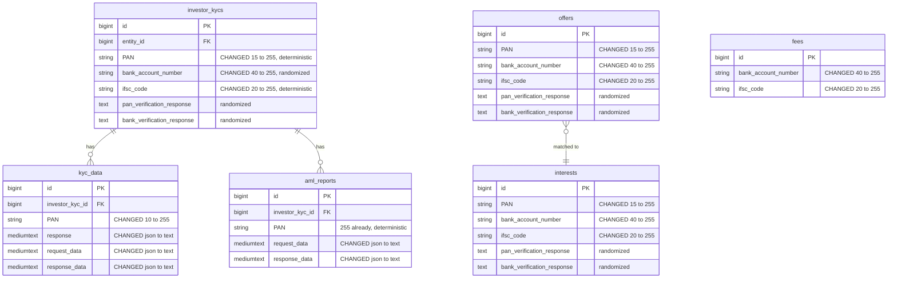

**Indexes:** none added or changed (no in-scope column is indexed today).

**Schema changes**

**`investor_kycs`, `offers`, `interests`** (existing): ciphertext is longer than the plaintext limits.

| Column / index | What changed | Why it's needed |
|---|---|---|
| `PAN` | `limit 15` → `255` | 15-char PAN → 90-byte ciphertext |
| `bank_account_number` | `limit 40` → `255` | 40 chars → 126 bytes |
| `ifsc_code` | `limit 20` → `255` | 20 chars → 98 bytes |
| `pan_verification_response`, `bank_verification_response` | none (text) | Already text; content becomes ciphertext |

**`fees`** (existing): same reason.

| Column / index | What changed | Why it's needed |
|---|---|---|
| `bank_account_number` | `limit 40` → `255` | Ciphertext length |
| `ifsc_code` | `limit 20` → `255` | Ciphertext length |

**`kyc_data`** (existing): ciphertext length and type.

| Column / index | What changed | Why it's needed |
|---|---|---|
| `PAN` | `limit 10` → `255` | Ciphertext length |
| `response`, `request_data`, `response_data` | `json` → `mediumtext` | Envelope is not the model's JSON; avoid MySQL re-serialising it |

**`aml_reports`** (existing):

| Column / index | What changed | Why it's needed |
|---|---|---|
| `PAN` | none (string 255) | Fits; content becomes ciphertext |
| `request_data`, `response_data` | `json` → `mediumtext` | As above; up to 35,505 bytes today |

**Changes to existing models:** (each listed in the proposal's
[Key changes needing approval](proposal.md#key-changes-needing-approval))
- `InvestorKyc`, `Offer`, `Interest`, `Fee`, `KycData`, `AmlReport`: `encrypts` + `normalizes`.
- `KycData`, `AmlReport`: `attribute :<col>, :json` for the converted columns.
- `ApplicationRecord`: `ransack` / `ransack!` wrapper.
- `InvestorKycIndex`, `OfferIndex`: fingerprint fields replace plain fields.

### Component contracts

| From → To | Contract | Direction rule |
|---|---|---|
| ② → ① | `EncryptedAttributeType#serialize(value)` → ciphertext string or NULL | Only ② and ③ write in-scope columns |
| ③ → ① | `record.encrypt` / `record.decrypt` → `update_columns` | Only with `EXECUTE=1` and the matching region |
| ⑥ → ④ | `ApplicationRecord.ransack` returns a vetted `Ransack::Search` or raises `Refused` | No caller sees an unvetted search |
| ④ → ① | `where(col: plaintext)` → tidied, encrypted equality | Deterministic columns only |
| ② → ⑤ | Chewy `field :pan_fp, value: ->(r) { PiiSearchFingerprint.for_pan(r.PAN) }` | ES never receives a plain in-scope value |
| ① → ⑦ | raw rows → `Model.type_for_attribute(col).deserialize(raw)` or column excluded | Raw readers never show ciphertext |
| ② → ⑧ | audited `filter_encrypted_attrs` → `[FILTERED]` | History never stores in-scope values |
| ③ → ⑧ | `AuditScrubber`, `DevCopyScrubber` rewrite copies | Irreversible steps only after verify + 7 days |

### Notifications

This change sends, adds, changes and suppresses **no** notification:

| Audience | Considered | Result |
|---|---|---|
| Investors | KYC emails, PDF statements with a PAN password, CKYC OTP SMS | Unchanged — they read decrypted values through the model |
| Internal users | Distribution "no bank account" warning, verification-failed warnings, import results | Unchanged texts and triggers (E2, X3) |
| CapHive ops | Conversion progress | Rake output only, no email |
| Developers | Decryption error after the window closes | The existing exception email (`config/initializers/exception_notification.rb`) — no new notifier |

### Cross-cutting concerns

#### Transactions and queries

- Conversion: one transaction per batch of 500 (`update_columns` per row inside); a crash loses at
  most one uncommitted batch, which the re-run converts.
- Audit scrub: one transaction per 1,000 audit ids; `SELECT id, audited_changes` only.
- Dump decryptor: one SQLite transaction per table.
- No multi-table writes in request paths.

#### Exception handling and monitoring

| Failure | Who is alerted | Channel | Detail |
|---|---|---|---|
| `EncryptedAttributeSearch::Refused` | The user | Flash / 422 | Expected; not an error |
| `ActiveRecord::Encryption::Errors::Decryption` after window | Developers | Existing exception email | Means a plain or foreign-key value; run `verify`, then `encrypt` |
| Missing / wrong keys | Ops | Pre-flight output | Stop before deploy 1 |
| Dump decrypt failure | Requesting user | Existing dump failure notice (`send_notification`) | Job fails, no file delivered |

#### Architecture and design patterns

| # | Pattern | How this design applies it | Existing example reused | Where |
|---|---|---|---|---|
| 1 | Pack boundaries | Encryption services in `core/base/services/pii_encryption/`; models stay in their packs; report builder / AI changes inside their packs | `SafeAttributePath` in core/base | ③ ⑤ ⑥ |
| 2 | Thin controllers, skinny models | Models only declare `encrypts`/`normalizes`; logic in services; one `rescue_from` | `with_authentication.rb:19-23` `rescue_from` | ② ⑥ |
| 3 | Single responsibility | One service per job: conversion, scrubbers, guard, fingerprint, decryptor | — | ③ ⑤ ⑥ ⑦ |
| 4 | Reuse before you add | Rails encryption, audited's filter, `Trackable`, `encrypted_attributes`, `LpQueryScope` column pattern, `ElasticImporterJob` | `ZohoSignConnection` `encrypts` | all |
| 5 | Configuration as data | Not needed — encryption is not per-entity behaviour | — | — |
| 6 | Explicit state machines | Region / value lifecycles drawn; state is derived, not stored | — | [Lifecycles](#lifecycles) |
| 7 | Append-only audit records | Exception: `scrub_audits` rewrites old audit rows once — the purpose is to remove PII; flagged for approval | — | ⑧ |
| 8 | Background work | Conversion is a rake task (ops, by hand); dump decrypt inside the existing `EntityDbDumpJob` | `aws_ebs.rake` dry-run pattern | ③ ⑦ |
| 9 | Notifications | None added | — | [Notifications](#notifications) |
| 10 | UI | No new screens; filter Stimulus controller extended; tooltips | `_condition_fields`, `AuditTrail` | ⑥ ⑧ |
| 11 | Queries and data | Ransack allowlist kept + guard; `in_batches` by id; select only needed columns; audits by `auditable_type` + id range | CLAUDE.md large-table rules | ③ ⑥ |
| 12 | AI | Chatbot gets less PII; report assistant prompt hint | `LpQueryScope` | ⑥ ⑦ |
| 13 | Rollout | Per region, two deploys, dry run, verify, reverse | ops rake conventions | ③ |
| 14 | YAGNI / DRY | No blind-index columns, no key service, no per-tenant keys; generic guard via `encrypted_attributes` | — | — |

#### Performance

- Volumes (India): ≤ 8,625 rows per table; conversion ≈ 1-2 minutes; audit scrub ~9,300 of 2.3 M rows.
- Decryption is lazy per attribute; list pages that don't render PAN never decrypt it.
- The guard is in-memory; fingerprints are one HMAC per search.

**Query budget**

| Page / frame / job | Rows shown or processed | Queries (budget, independent of rows) | Preloads / grouped queries | Per-row lookups avoided |
|---|---|---|---|---|
| KYC list with refused filter | 0 (redirect) | 0 extra | — | — |
| KYC search with fingerprint | ≤ 100 ids from ES | same as today (+0) | ES `terms` | — |
| Report builder related PAN column | ≤ 1,000 roots | same as today | grouped `select_all` | decrypt in Ruby, no per-row query |
| FM chatbot query | ≤ 100 rows | same as today | CTE | — |
| `pii_encryption:encrypt` | 8,103 KYCs | 2 per batch (select + update tx) + 1 per row `update_columns` | `in_batches(of: 500)`, `select(id, cols)` | no association loads |
| `pii_encryption:verify` | all rows | 1 select per batch | `pluck(:id, cols)` | — |
| `scrub_audits` | ~9,300 audits | 1 select + 1 update per changed row, per 1,000 | `where(auditable_type:, id: range)` | — |
| `EntityDbDumpJob` decrypt pass | ≤ 8k rows per table | 0 MySQL; SQLite 2 per table | — | — |

#### Security

| # | Item | How this design meets it | Where | Test |
|---|---|---|---|---|
| 1 | Authorization | No new controller actions; Pundit scopes unchanged; refusal happens after `policy_scope` callers build the search | ⑥ | H18, E31 |
| 2 | Tenant isolation | ES search keeps `entity_id` filter + `PolicyScopedSearch`; fingerprints are per region not per firm, so a match outside the firm is filtered out before display | ⑤ | X6 |
| 3 | Mass assignment | No new params; existing permits (`investor_kyc_policy.rb:103-104`, `offer_policy.rb:4-5`, `interest_policy.rb:5`, `kyc_datas_controller.rb:284`) unchanged | ② | — |
| 4 | No code from data | Guard resolves attributes through Ransack's context; no `constantize` on params | ⑥ | E31 |
| 5 | Injection | Chatbot refusal is an extra check on top of `statement_error`; dump decryptor uses bound SQLite parameters; Ransack allowlist unchanged | ⑥ ⑦ | X8, X9 |
| 6 | Background jobs | `EntityDbDumpJob` unchanged scoping by `entity_id` | ⑦ | H27 |
| 7 | Files and documents | Firm download content unchanged (Q5); delivery is M5 | ⑦ | H27 |
| 8 | AI / LLM | Chatbot no longer receives PAN / bank / IFSC; report assistant only gets a hint | ⑦ ⑥ | X8, E49, E33 |
| 9 | Webhooks, tokens, links | Not applicable — none added | — | — |
| 10 | Rate limiting and cost | Not applicable — no new endpoints | — | — |
| 11 | Audit and logging | History keeps who/when, hides values; logs keep filters; keys never printed (fingerprint only) | ⑧ ③ | H10, H29 |
| 12 | Verification | Brakeman + bundler-audit clean; scenarios in `features/security/investor_pii_encryption.feature` and `investor_pii_raw_readers.feature` | — | F1, F4 |

### Worked examples

Every H/E/X row — shared setup, happy path, edge and error cases, with their spec scenario and
feature — lives in [business-rules.md](business-rules.md) (H1–H30, E1–E53, X1–X12). The cards above
cite the IDs; the QA checklist and tasks reuse them.

### Testing

- Cucumber only. Four features (F1–F4 in business-rules). "Plain legacy rows" are written with
  `ActiveRecord::Encryption.without_encryption { … }`; "raw value" steps read with
  `connection.select_value`.
- ES steps reuse the existing Chewy test strategy; chatbot steps reuse
  `features/customer_support_agent/fm_user_chat.feature` stubs; dump steps reuse
  `entity_db_dump_steps.rb`.
- Every scenario carries `# <ID> — <path>`; code comments name the IDs of the branches they implement.

### Rollout per region

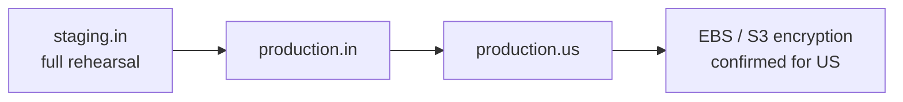

| Step | Command (per region) | Gate |
|---|---|---|
| 0 | `aws:ebs_status[<env>]` (read-only), S3 bucket encryption check | Report; US disks unencrypted at the 1 Sep 2026 audit (`aws_ebs.rake:22-25`) — tracked, not blocking |
| 1 | `pii_encryption:preflight[<env>]` | keys present, fingerprint differs |
| 2 | Deploy 1 (migration + window) | screens unchanged |
| 3 | `encrypt[<env>]` dry run, then `EXECUTE=1` | counts match pre-flight |
| 4 | `verify[<env>]` | 0 plain |
| 5 | `db:purge_binlogs`; reindex KYC + Offer | index counts |
| 6 | +7 days: `scrub_audits[<env>]` dry run, then `EXECUTE=1` | — |
| 7 | Deploy 2 (window closed) | no Decryption errors for 24 h |
| Back | `decrypt[<env>] EXECUTE=1` → verify → roll back code → reindex | before step 6 history is intact |

### Risks and open questions

- A raw-SQL reader not found here shows ciphertext → mitigated by the reader inventory, the
  transition window, and `verify`; after deploy 2 any raw-SQL *writer* of plain text raises loudly.
- `normalizes` + `encrypts` interaction on `where` → covered by E1, E27, H12 before phase 2 starts.
- DR restore of a pre-conversion backup → runbook step (E16).
- US disks unencrypted → separate ops task; this change does not depend on it.
- Old backups hold plaintext for up to ~180 days → accepted (Q8).
- Production copies already on laptops → delete after rollout (user action).

| # | Open question | Current thinking | Status |
|---|---|---|---|
| Q1 | Partial PAN / bank search in the search box | Full value only | Awaiting approval |
| Q2 | "Contains" filters | Refuse with message | Awaiting approval |
| Q3 | History values | `[FILTERED]` → "changed (value hidden)" | Awaiting approval |
| Q4 | Chatbot and PAN | Not available | Awaiting approval |
| Q5 | Firm DB download | Decrypted as today | Awaiting approval |
| Q6 | Upper-casing foreign tax IDs | Yes | Awaiting approval |
| Q7 | `investors.pan`, `entities.pan` | Follow-up change | Awaiting approval |
| Q8 | Pre-conversion backups | Age out | Awaiting approval |
| Q9 | Keys | Reuse region keys | Awaiting approval |

**FAQ**

| Question | Answer |
|---|---|
| Where do I start reviewing? | [Every reader of these columns](#every-reader-of-these-columns), then D8 and D5. |
| What is the riskiest step? | `scrub_audits` (irreversible) — last, after a quiet week. |
| What if US keys are found equal to IN keys? | Pre-flight stops (X10); generate new US keys before deploy 1 — nothing is encrypted yet. |
| Can we skip the window and convert in a migration? | It would run on dev copies and tests, can't be dry-run and can't be interrupted safely. |
