# Encrypt investor PII at rest — Proposal

> **Audience:** Business team, product, QA, support — non-technical.
> **Companion documents:** [Design](design.md) · [Business rules](business-rules.md) · [Spec](specs/security/investor-pii-encryption/spec.md)
> **New to this? Start with the [Workflow Journey](#workflow-journey)** — every action, in order, from start to the outcome.

> **Planning phase — no code changes.** This document proposes and explains the change. Do not
> edit application code while writing it; implementation happens later, in the tasks phase.

> **Source:** security finding **M4** (A04 Cryptographic Failures) in
> `docs/security/owasp_top10_review_2026_11.md`.

---

## Why

- Investors' **PAN, bank account number and IFSC code** — plus the raw replies from PAN/bank
  verification, CKYC/KRA and AML screening — are stored as plain text in the database.
- Today the only protection is the encrypted disk under the database. Anyone who gets a copy of the
  data itself (a backup file, a database dump on a laptop, a read-only SQL query, a search-index
  copy) reads every investor's PAN and bank account directly.
- Copies are already spread around: a full production copy sits on developer machines for
  troubleshooting, nightly backups are kept for ~180 days, and the search index holds PAN and bank
  numbers too.
- Size today (production India copy, 2 Nov 2026, counts only):

| Where | Rows | With a PAN | With a bank account |
|---|---|---|---|
| Investor KYCs | 8,103 | 7,381 | 6,253 |
| Secondary sale offers | 342 | 319 | 318 |
| Secondary sale interests | 204 | 46 | 46 |
| Advisor fees | 2 | — | 2 |
| CKYC / KRA lookups | 4 | 0 | — |
| AML screening reports | 5,873 | 535 | — |
| History (audit) entries holding PAN or bank values | ~9,300 | | |

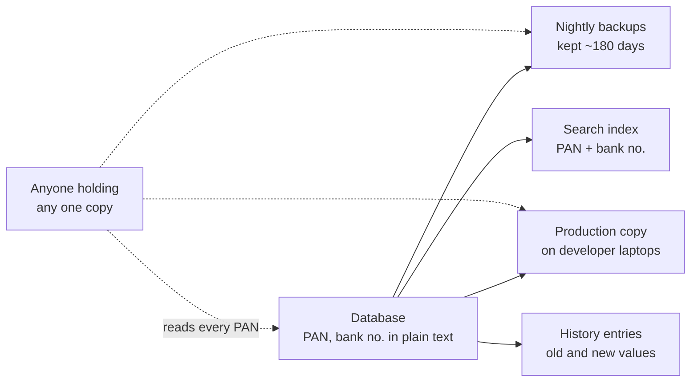

## What Changes

- PAN, bank account number, IFSC code and the verification / CKYC / AML replies are stored
  **encrypted**. Screens, forms, exports, documents and emails show them exactly as today.
- Existing records are converted once, per region, by CapHive operations. Nobody at a fund needs to
  do anything.
- Looking up by the **full** PAN keeps working everywhere it works today: imports that match on
  "Pan/Tax Id", CKYC/KRA, AML, the KYC list filter "PAN equals", the search box.
- **BREAKING (small, needs your approval):** a few ways of searching *part of* a PAN or bank number
  stop working, because an encrypted value can't be searched by its parts. Each one is listed in
  [What this changes for users](#what-this-changes-for-users) with the replacement.
- The search index, history entries and developer copies stop holding readable PAN / bank numbers.
- Nothing changes in pricing, roles or notifications.

### Key concepts

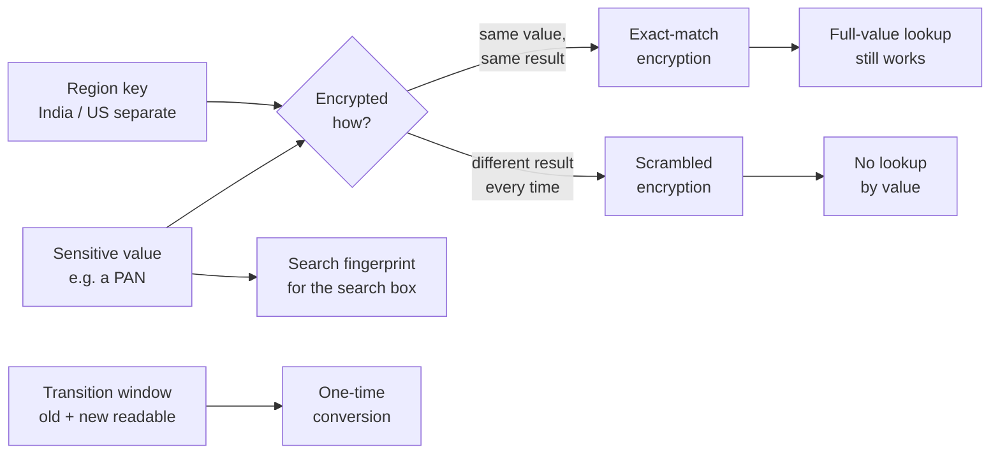

| Concept | What it means for you | Example |
|---|---|---|
| Encrypted at rest | The value is unreadable in the database and its copies; CapHive screens show it normally | PAN `ABCPM1234K` is stored as a 90-character scramble |
| Exact-match encryption | The same PAN always encrypts the same way, so "find the KYC with this exact PAN" still works | Import row "Pan/Tax Id = ABCPM1234K" finds Anil's KYC |
| Scrambled encryption | Encrypts differently every time — strongest, but no lookup by value | Bank account `50100234567812` |
| Full-value match | You must type the whole value; part of it finds nothing | `ABCPM1234K` ✓, `ABCPM` ✗ |
| Search fingerprint | A one-way code of the full value, kept in the search index instead of the value | Searching `50100234567812` finds the KYC; the index never holds the number |
| Region key | The secret that locks the data; India and US each have their own, never shared | India data cannot be read with the US key |
| Transition window | The days between "new code live" and "every old record converted"; both forms are readable | Day 1 → day 2 of the India rollout |
| One-time conversion | CapHive ops converts existing records, with a dry run first | "8,103 KYCs: 7,381 PANs to encrypt" |
| Hidden history value | History still says *who* changed PAN or bank details and *when*, but not the old/new values | "Bank Account Number changed (value hidden)" |

#### Exact-match vs scrambled encryption

- **What:** two ways to encrypt. Exact-match gives the same result for the same value; scrambled
  never does.
- **Why:** PAN is how investors are matched (imports, CKYC/KRA, AML), so it must still be findable
  by its full value. A bank account number is never looked up by value, so it gets the stronger kind.

| Field | Kind | Why |
|---|---|---|
| PAN (KYCs, offers, interests, CKYC/KRA, AML) | Exact-match | Imports and CKYC/KRA find records by PAN |
| IFSC code | Exact-match | "IFSC equals" filter keeps working; it identifies a branch, not a person |
| Bank account number | Scrambled | Never looked up by value in CapHive |
| Verification / CKYC / AML replies | Scrambled | Only ever shown on the record's own page |

- **Does NOT cover:** partial matches ("contains", "starts with"), ranges and sorting — no kind of
  encryption allows those.
- **Example:** Meera filters KYCs by "PAN equals ABCPM1234K" → Anil's KYC is found. "PAN contains
  ABCPM" → refused with a message (see [Behavior Rules](#behavior-rules)).

#### The transition window

- **What:** the time between deploying the new code and finishing the one-time conversion in a
  region.
- **Why:** records are converted while the site is up; during the window CapHive reads both plain
  and encrypted values and finds a PAN in either form.
- **Does NOT cover:** a region where the window has closed — any record still in plain text there
  is an error that operations fixes by re-running the conversion.
- **Example:** India — deploy on day 1 at 22:00, conversion runs ~2 minutes, verify, window closed
  with the second deploy a week later.

### Flow Diagram

**1. Saving and reading a KYC** — same screens, value stored encrypted.

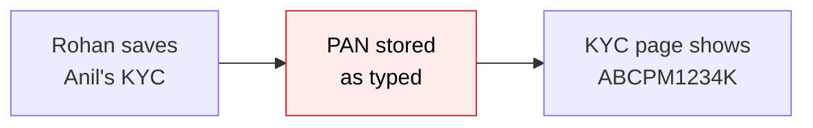

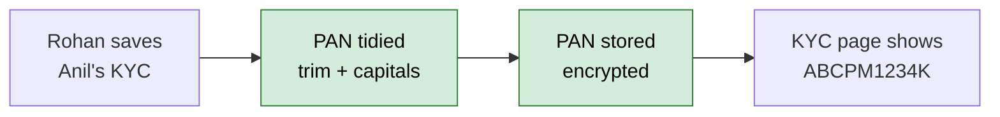

**2. Searching the KYC list by PAN or bank number** — full values only.

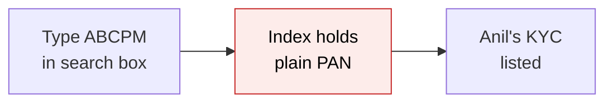

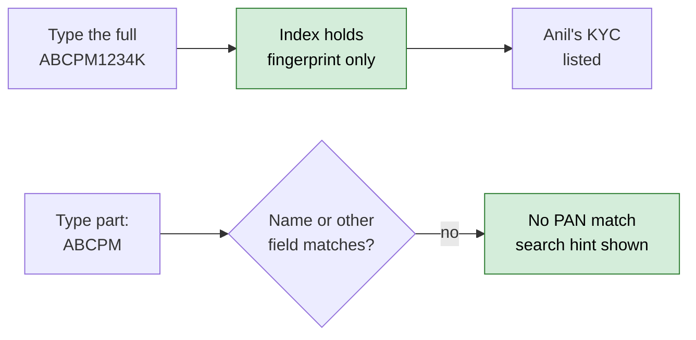

**3. Filtering the KYC list** — "equals" stays, "contains" is refused instead of silently empty.

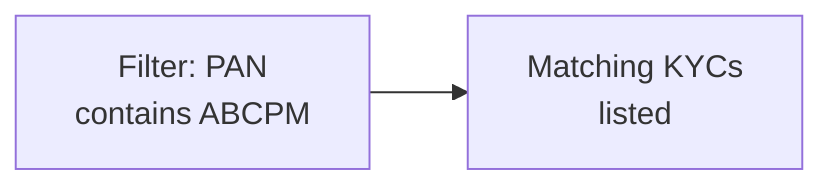

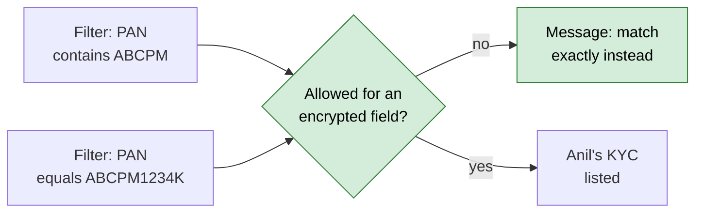

**4. History of a KYC** — who and when stay; the values are hidden.

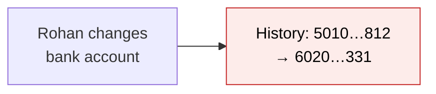

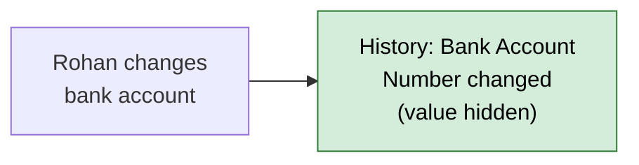

### What this changes for users

Every capability that changes. Everything not listed keeps working exactly as today.

| # | Capability | Today | After | Who notices |
|---|---|---|---|---|
| 1 | Search box on KYCs and Offers, part of a PAN / bank number | `ABCPM` finds Anil | Only the full value finds him | Fund ops |
| 2 | KYC (and Commitment) filter "PAN / IFSC contains, >, <" | Works | Refused with a message; "equals", "not equals", "is blank" work | Fund ops |
| 3 | Filter on Bank Account Number | Any condition | Only "is blank" / "is present" | Fund ops |
| 4 | Sort a list or report by PAN / bank / IFSC | Sorted | Order not changed | Fund ops |
| 5 | Report builder: related PAN / bank column as min / max / list / pivot | Offered | Not offered; "value" / "latest" shown | Report builders |
| 6 | History shows old → new PAN / bank values | Yes | "changed (value hidden)" with who/when | Admins, support |
| 7 | Fund-manager support chatbot answering "what is X's PAN / bank number?" | Answers | Says to open the KYC page | Fund ops |
| 8 | CapHive super-admin search of offers / interests by PAN or bank | Works | Matches other fields only | CapHive staff |
| 9 | Foreign tax IDs with lowercase letters | Shown as typed | Shown in capitals | ~154 KYCs (India) |
| 10 | Developer copies of production | Real PAN / bank | Fake values | CapHive engineers |

- Rows 1-3 and 7 are the ones that need your decision — see
  [Decisions awaiting approval](#decisions-awaiting-approval).
- Production evidence: no saved report, grid layout or saved filter uses PAN, bank account or IFSC
  today (India copy, 2 Nov 2026); two custom notifications use `investor_kyc.PAN` as a PDF password,
  which keeps working.

---

## Workflow Journey

### Who is involved

| Person | Role | What they do in the journey |
|---|---|---|
| Vikram | CapHive operations engineer | Runs the per-region rollout: checks, conversion, clean-up |
| Meera | Company admin, Kestrel Capital (India) | Uses KYC lists, filters and reports as usual |
| Rohan | Fund operations, Kestrel Capital | Edits KYCs, imports KYC updates, searches by PAN |
| Anil Mehta | Investor (LP) | Fills his KYC form — sees no difference |
| Asha | CapHive support | Answers "why can't I search part of a PAN?" |

### The journey on one page

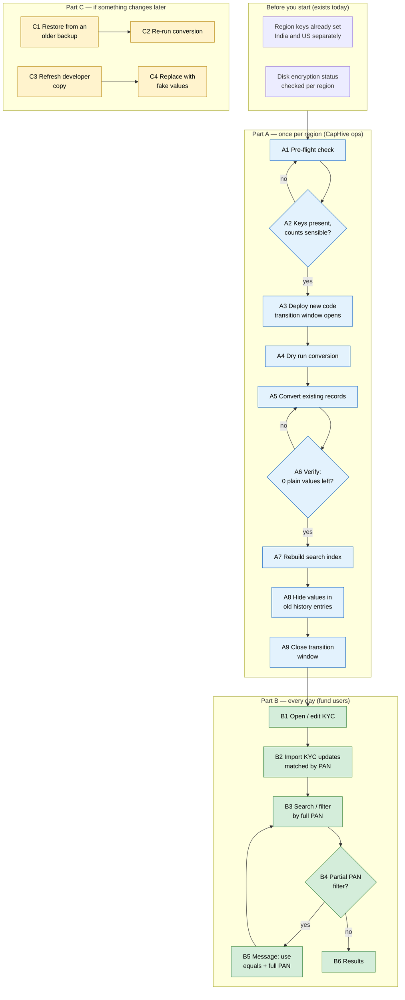

### Before you start

| Needed | Why | Where it comes from |
|---|---|---|
| Region encryption keys | Lock and unlock the values | Already in each region's credentials (production cannot start without them) |
| Disk + backup encryption status | Defence in depth; US disks were not encrypted at the 1 Sep 2026 audit | The existing disk-audit task, run read-only per region |
| A maintenance note | Conversion runs while the site is up; no downtime expected | Ops calendar |
| Staging first | Prove the steps on staging India before production | Staging India |

### Part A — once per region (CapHive ops)

| Step | Who | Where | Action | What the system does | What you see |
|---|---|---|---|---|---|
| A1 | Vikram | Ops terminal | Run the pre-flight check for `production.in` | Confirms keys are present, prints their short fingerprint, counts rows per table | `Keys present (fingerprint 7c1e…); investor_kycs 8,103 rows, 7,381 PAN…` |
| A2 | Vikram | — | Compare the fingerprint with the other region's last report | Different regions must have different fingerprints | Stop if they match |
| A3 | Vikram | Deploy | Deploy the new code | New and edited values are stored encrypted; old plain values still read | Screens unchanged |
| A4 | Vikram | Ops terminal | Run the conversion **dry run** | Counts what it would convert, changes nothing | `Would encrypt 7,381 PAN, 6,253 bank…` |
| A5 | Vikram | Ops terminal | Run the conversion with EXECUTE=1 | Converts in batches of 500, tidies PAN, turns blanks into empty | Progress per table, total time |
| A6 | Vikram | Ops terminal | Run the verify step | Counts values still in plain text | `0 plain values left` |
| A7 | Vikram | Ops terminal | Rebuild the KYC and Offer search indexes | Index holds fingerprints, no PAN / bank numbers | Index counts match |
| A8 | Vikram | Ops terminal | After 7 quiet days: hide values in old history entries (dry run, then EXECUTE=1) | Replaces old/new PAN / bank values in history with "hidden" | `~9,300 history entries updated` |
| A9 | Vikram | Deploy | Deploy the "close window" setting | A plain value found later is an error, not silently read | — |

### Part B — every day (fund users)

| Step | Who | Where | Action | What the system does | What you see |
|---|---|---|---|---|---|
| B1 | Rohan | KYCs › Anil Mehta › Edit | Changes the bank account | Stores it encrypted; history records "changed (value hidden)" | New account shown on the KYC page |
| B2 | Rohan | Import › Investor KYCs | Imports a sheet with "Pan/Tax Id = abcpm1234k" | Tidies to `ABCPM1234K`, finds Anil's KYC, updates it | "1 row updated" |
| B3 | Meera | KYCs › search box | Types `ABCPM1234K` | Matches the fingerprint | Anil's KYC |
| B4 | Meera | KYCs › Filter | Adds "PAN contains ABCPM" | Refuses the condition | The message in [Behavior Rules](#behavior-rules) |
| B5 | Meera | KYCs › Filter | Changes it to "PAN equals ABCPM1234K" | Exact encrypted match | Anil's KYC |
| B6 | Anil | Emailed KYC form | Fills his PAN | Same as B1 | Nothing new |

### Part C — if something changes later

| Step | Who | Where | Action | What the system does | What you see |
|---|---|---|---|---|---|
| C1 | Vikram | DR restore | Restores from a backup taken before the conversion | Restored records hold plain values | KYC pages show an error until C2 |
| C2 | Vikram | Ops terminal | Re-runs the conversion (same command) | Converts only the plain values; already-encrypted ones are skipped | `Encrypted 7,381; skipped 0` |
| C3 | Engineer | Laptop | Restores a fresh production copy | Values can't be read without the production key | — |
| C4 | Engineer | Laptop | Runs the developer-copy scrub | Replaces every encrypted value with a fake one (same PAN → same fake) | Fake `ZZQXA4821K` on screens |

### What you see

The KYC list filter after Meera adds "PAN contains ABCPM" (India, Kestrel Capital, 1,214 KYCs):

```
+--------------------------------------------------------------------------------+
| KYCs                                       [Filter] [Download] [+ New KYC]      |
|--------------------------------------------------------------------------------|
| ! "PAN" is stored encrypted, so it can only be matched exactly. Use "equals"   |
|   with the full value, or "is blank" / "is present".                           |
|--------------------------------------------------------------------------------|
| [PAN v] [contains v] [ABCPM          ]   [x]                                    |
|--------------------------------------------------------------------------------|
| Search (i) PAN and bank account numbers match only when typed in full          |
|--------------------------------------------------------------------------------|
| Investor        Investing Entity   Type        Verified   AML                  |
| (filter not applied — 1,214 KYCs)                                              |
+--------------------------------------------------------------------------------+
```

The conversion report Vikram reads at step A5 (India copy figures):

```
investor_kycs   8,103 rows   PAN 7,381  bank 6,253  IFSC 6,200  replies 1,788   41 s
offers            342 rows   PAN   319  bank   318  IFSC   316  replies    65    2 s
interests         204 rows   PAN    46  bank    46  IFSC    46  replies     3    1 s
fees                2 rows              bank     2  IFSC     2                  0 s
kyc_data            4 rows   PAN     0              replies     4               0 s
aml_reports     5,873 rows   PAN   535              replies  7,243             20 s
tidied: 154 PANs upper-cased, 14 trimmed, ~1,650 blank values emptied
verify: 0 plain values left
```

- Replies = non-empty reply columns: KYCs 456 PAN + 1,332 bank = 1,788; AML 5,871 responses + 1,372 requests = 7,243.
- Row counts are the India copy of 2 Nov 2026; times are estimates.

### What goes wrong

- **The conversion stops half-way** (deploy restart at batch 9 of 17 on `investor_kycs`):
  - What is shown: the task exits with the last finished batch; screens keep working because the
    transition window reads both forms.
  - Fix: run the same command again — encrypted rows are skipped, the rest are converted; verify
    reports `0 plain values left`.
- **Pre-flight shows the same key fingerprint as the US** (keys copied between regions by mistake):
  - What is shown: `Fingerprint 7c1e… matches the value recorded for production.us — stop`.
  - Fix: generate a new key set for the region before step A3; nothing has been encrypted yet.

### Summary: the minimum actions

| # | Action | Who | How often |
|---|---|---|---|
| 1 | Pre-flight, deploy, convert, verify, reindex | Vikram | Once per region |
| 2 | Hide values in old history entries | Vikram | Once per region, 7 days after #1 |
| 3 | Close the transition window | Vikram | Once per region |
| 4 | Re-run the conversion | Vikram | Only after restoring an older backup |
| 5 | Scrub a developer copy | Engineer | Every time a production copy is restored on a laptop |
| — | Fund users and investors | — | Nothing new |

---

## User Stories

### US-1: Investor bank and tax details are unreadable in copies of the data

**As a** fund's compliance officer,
**I want** PAN, bank account and IFSC stored encrypted,
**So that** a leaked backup, dump or query result does not expose my investors.

**Acceptance criteria:**
- Reading the KYC, offer, interest, fee, CKYC/KRA and AML tables directly shows no readable PAN, bank
  account number, IFSC code or verification / CKYC / AML reply.
- Every CapHive screen, export, generated document and email shows the same values as before.

### US-2: Imports still match investors by PAN

**As** fund operations,
**I want** a KYC import with "Pan/Tax Id" to find the existing KYC as it does today,
**So that** updates don't create duplicates.

**Acceptance criteria:**
- "Pan/Tax Id" `abcpm1234k ` (lowercase, trailing space) updates the KYC whose PAN is `ABCPM1234K`.
- KYC document import matching on "PAN/Tax ID" behaves the same way.
- With "Update Only = Yes" and no match, the existing message is shown unchanged.

### US-3: Exact PAN lookups keep working

**As** fund operations,
**I want** "PAN equals", the search box with a full PAN, CKYC/KRA and AML to keep finding records,
**So that** my daily work is unchanged.

**Acceptance criteria:**
- KYC list filter "PAN equals ABCPM1234K" lists Anil's KYC.
- Commitments filter "Investor Kyc PAN equals ABCPM1234K" lists Anil's commitments.
- The search box with `ABCPM1234K` or `50100234567812` lists Anil's KYC.
- CKYC/KRA fetch on Anil's KYC finds the lookup stored for his PAN.

### US-4: Unsupported searches are refused, never silently empty

**As** fund operations,
**I want** a clear message when I filter an encrypted field in a way that can't work,
**So that** I don't conclude "no investor has this PAN" from an empty list.

**Acceptance criteria:**
- "PAN contains", "starts with", ">" and "<" show the PAN message from [Behavior Rules](#behavior-rules)
  and do not apply the filter.
- Any condition other than "is blank" / "is present" on Bank Account Number shows the bank message.
- The same rule applies on every list that can filter through a KYC (e.g. commitments), in saved
  reports and in report links built by the AI report assistant.

### US-5: History keeps who and when

**As** a company admin,
**I want** to see who changed an investor's bank account and when,
**So that** I can review bank-detail changes without the numbers being stored again in history.

**Acceptance criteria:**
- A bank-account change adds a history entry with user and time, shown as "Bank Account Number
  changed (value hidden)".
- History entries from before the rollout show the same text after step A8.

### US-6: Reports still show the values

**As** a report builder user,
**I want** a commitments report with the related KYC's PAN column to show real PANs,
**So that** reports keep working.

**Acceptance criteria:**
- A related PAN / bank / IFSC column shows the decrypted value with "Value" or "Latest".
- "Min", "Max", "List" and pivot are not offered for these columns; a saved report that used them
  shows "Value" instead and says so in a tooltip.
- Sorting a report by these columns is not offered.

### US-7: The firm's database download keeps the values

**As** a company admin who downloads the firm's database file,
**I want** PAN and bank details in it to be readable as today,
**So that** my offline analysis keeps working.

**Acceptance criteria:**
- The downloaded file shows `ABCPM1234K` and `50100234567812`, not scrambled text.

### US-8: Rollout per region with a dry run and a way back

**As** CapHive operations,
**I want** a pre-flight, a dry run, a re-runnable conversion, a verify step and a reverse conversion,
**So that** each region is converted safely and can be rolled back.

**Acceptance criteria:**
- Every task is a dry run unless EXECUTE=1; it names the region it runs on and refuses another.
- Re-running the conversion converts only plain values.
- The reverse conversion returns every value to plain text before a code rollback.

---

## UI Behavior

### KYC list (and every list with a filter panel)

```
┌──────────────────────────────────────────────────────────────────────────┐
│  KYCs                                     [Filter] [Download] [+ New KYC] │
│ ┌──────────────────────────────────────────────────────────────────────┐ │
│ │ [PAN               v] [equals v] [ABCPM1234K   ]  [🗑]              │ │
│ │ [Bank Account Number v] [is present v]              [🗑]            │ │
│ │                                           [+]  [💾]  [Search]        │ │
│ └──────────────────────────────────────────────────────────────────────┘ │
│  Search (i) ______________________                                         │
│  Investor      Investing Entity   Type        Verified   AML              │
│  Anil Mehta    Anil Mehta         Individual  Yes        Cleared          │
└──────────────────────────────────────────────────────────────────────────┘
```

**Behavior notes:**
- When PAN or IFSC is picked, the condition list offers only "equals", "not equals", "is blank",
  "is present". For Bank Account Number: "is blank", "is present".
- A condition typed into a URL or a saved report that breaks the rule is refused with the message;
  the list shows all rows the user can see, with the message at the top.
- The search box ⓘ tooltip reads: "PAN and bank account numbers match only when typed in full."

### Report builder › column settings

```
┌───────────────────────────────────────────────┐
│ Investor Kyc › PAN                         ✕  │
│ Show as:  (•) Value   ( ) Latest   ( ) Count  │
│ ⓘ Stored encrypted — shown as is; can't be   │
│   summed, ranged, listed, pivoted or sorted.  │
└───────────────────────────────────────────────┘
```

### KYC page › History

```
┌──────────────────────────────────────────────────────────┐
│ 09/11/2026 14:12  Rohan Shah   updated                    │
│   Bank Account Number   changed (value hidden)            │
│   Bank Name             HDFC Bank → ICICI Bank            │
└──────────────────────────────────────────────────────────┘
```

---

## What This Feature Does NOT Cover

| Excluded | Covered In |
|---|---|
| Investor / company PAN on the investor and entity records (`pan`, 5,047 investor rows) | Follow-up change — decision Q7 |
| Addresses, date of birth, custom KYC fields (539 KYCs hold a PAN in a custom field) | Follow-up change |
| PAN card and other uploaded files | Already in encrypted file storage |
| `pan_card_data` on offers (a pointer to an old uploaded file, unused) | Not personal data itself |
| Disk / backup encryption in the US region | Operations task (`aws:ebs_*`), tracked in the rollout pre-flight |
| PDF passwords built from the PAN (finding L1) | Separate finding |
| How the firm's database download is delivered (finding M5) | Separate change |
| Bank-detail change controls (finding M14) | `bank-detail-change-controls` change |

---

## Validation Rules

| Field | Rule | Default |
|---|---|---|
| PAN (KYC, offer, interest, CKYC/KRA, AML) | Trimmed and upper-cased before saving; blank saved as empty | Empty |
| IFSC code | Trimmed and upper-cased; blank saved as empty | Empty |
| Bank account number | Trimmed; blank saved as empty | Empty |
| Existing length limits | Unchanged (PAN 15, bank 40, IFSC 20) | — |
| Existing PAN format check on CKYC/KRA (`ABCDE1234F`) | Unchanged | — |

---

## Behavior Rules

| Scenario | What User Sees |
|---|---|
| Filter PAN with contains / starts with / > / < | `"PAN" is stored encrypted, so it can only be matched exactly. Use "equals" with the full value, or "is blank" / "is present".` |
| Filter IFSC Code the same way | `"IFSC Code" is stored encrypted, so it can only be matched exactly. Use "equals" with the full value, or "is blank" / "is present".` |
| Filter Bank Account Number with anything but is blank / is present | `"Bank Account Number" is stored encrypted, so it can only be filtered by "is blank" or "is present".` |
| Search box with part of a PAN | Records matching other fields only; tooltip "PAN and bank account numbers match only when typed in full." |
| History entry for a PAN / bank / IFSC change | `<Field> changed (value hidden)` |
| Report builder column on PAN / bank / IFSC | Options Value, Latest, Count; tooltip `Stored encrypted — shown as is; can't be summed, ranged, listed, pivoted or sorted.` |
| Support chatbot asked for a PAN | `PAN, bank account number and IFSC code are not available to the assistant — open the KYC page.` |
| A plain value found after the window closed | Error page; ops alerted by the existing error email |

---

## Resolved Design Decisions

| # | Decision | Resolution |
|---|---|---|
| 1 | Which fields | PAN, bank account number, IFSC code, PAN/bank verification replies on KYCs, offers, interests; bank + IFSC on fees; PAN + replies on CKYC/KRA lookups and AML reports |
| 2 | Encryption kind | Exact-match for PAN and IFSC; scrambled for bank number and all replies |
| 3 | Keys | Reuse each region's existing keys; India and US never share |
| 4 | Rollout | Staging India → production India → production US, each with pre-flight, dry run, verify |
| 5 | Way back | Reverse conversion before any code rollback |
| 6 | Old backups | Age out with the existing ~180-day retention (decision Q8) |

### Decisions awaiting approval

Each has a recommendation; the design follows the recommendation until you say otherwise.

| # | Question | Options | Recommended |
|---|---|---|---|
| Q1 | Part-of-PAN / bank search in the search box | A: full value only · B: keep plain values in the search index · C: A + last-4-digit bank search | **A** |
| Q2 | "Contains" filters on PAN / IFSC / bank | A: refuse with message · B: add extra lookup columns to the database | **A** (no saved report uses them) |
| Q3 | History values | A: "changed (value hidden)" · B: show last 4 characters ("••••7812 → ••••3310") | **A** |
| Q4 | Support chatbot and PAN / bank | A: not available to the assistant · B: keep (sends PII to the AI provider) | **A** |
| Q5 | Firm's database download | A: readable values as today · B: leave encrypted · C: leave the columns out | **A** |
| Q6 | Foreign tax IDs with lowercase letters | A: upper-case all · B: keep the original case (needs extra columns) | **A** |
| Q7 | Investor / entity PAN (`investors.pan`, `entities.pan`) | A: follow-up change · B: include now | **A** |
| Q8 | Backups taken before the conversion | A: age out (~180 days) · B: delete and re-take | **A** |
| Q9 | Keys | A: reuse region keys · B: a separate PII key per region | **A** |

### Key changes needing approval

Changes to existing models, columns and data (project rule: flag before building):

1. Widen `PAN` on `investor_kycs`, `offers`, `interests` (15 → 255) and `kyc_data` (10 → 255);
   `bank_account_number` (40 → 255) and `ifsc_code` (20 → 255) on `investor_kycs`, `offers`,
   `interests`, `fees`.
2. Change `kyc_data.response`, `request_data`, `response_data` and `aml_reports.request_data`,
   `response_data` from JSON to long text (encrypted values are not JSON).
3. Declare encryption on `InvestorKyc`, `Offer`, `Interest`, `Fee`, `KycData`, `AmlReport`.
4. Add PAN / IFSC / bank tidying (upper-case, trim, blank → empty) to those models — rewrites
   ~1,800 existing values in India.
5. Rewrite ~9,300 existing history entries to hide PAN / bank / IFSC values (irreversible).
6. Replace PAN and bank number in the KYC and Offer search indexes with fingerprints.
7. One shared search guard on every list filter (all models), not only KYCs.
8. Report builder: decrypt related values; restrict aggregates, pivot and sort on encrypted columns.
9. Support chatbot's KYC table no longer includes PAN / bank / IFSC.
10. Firm database download decrypts the encrypted columns.
11. Super-admin offer / interest dashboards: PAN / bank / IFSC no longer searchable.
12. New operations tasks; the production-restore guide gains a scrub step; the DR runbook gains a
    re-run of the conversion.

---

## Capabilities

### New Capabilities

- `security/investor-pii-encryption`: investor PAN, bank and verification data are encrypted at rest,
  exact lookups keep working, unsupported searches are refused, and copies (search index, history,
  developer copies, the firm's download) are handled.

### Modified Capabilities

None — `kyc/investor-kyc-journey` requirements are unchanged (its PAN/bank verification warnings read
the decrypted values).

---

## Impact

- **Investor KYC screens, imports, CKYC/KRA, AML, PAN/bank verification** — unchanged for users;
  values stored encrypted.
- **Secondary sale offers and interests, advisor fees** — same.
- **List filters and the search box** on KYCs, offers and lists that filter through a KYC.
- **Report builder** — related PAN / bank / IFSC columns.
- **History (audit trail)** — PAN / bank / IFSC values hidden.
- **Fund-manager support chatbot** — no longer sees PAN / bank / IFSC.
- **Firm database download** — values decrypted into the file.
- **CapHive super-admin screens** — offer / interest search.
- **Operations** — new rollout tasks; production-restore and DR guides updated.
- **Search index** — rebuilt per region.

---

## Benefits

1. A leaked backup, laptop copy or query result no longer exposes investors' PAN and bank accounts.
2. Developer laptops stop holding real investor PII.
3. History and the search index stop being second copies of bank numbers.
4. Filters that can't work say so instead of returning an empty list.
5. Fund users and investors keep every screen, export, document and import they rely on.

---

## FAQ

| Question | Answer |
|---|---|
| Do fund users or investors need to do anything? | No. Screens, forms, exports and documents look the same. |
| Is there downtime? | No. The conversion runs while the site is up (about 2 minutes in India). |
| What happens to existing records? | CapHive ops converts them once per region, after a dry run. |
| Can an investor see another investor's PAN now? | No change — access rules are untouched; this protects the stored data. |
| Why can't I search part of a PAN any more? | An encrypted value can only be compared as a whole. Type the full PAN, or search by name. |
| Does the PDF password "investor_kyc.PAN" still work? | Yes — it reads the decrypted value. |
| Do generated documents and templates still show the PAN? | Yes. |
| Are emails or notifications changed? | No email is added, changed or removed. |
| Does pricing or billing change? | No. |
| What if we need to roll back? | Ops runs the reverse conversion, then rolls back the code. History entries already hidden stay hidden. |
| Are India and US done together? | No. Each region is converted separately with its own keys. See [design](design.md). |
| What about the old backups? | They keep plain values until they age out (~180 days) — decision Q8. |
| Why is my foreign tax ID now in capitals? | Values are tidied so an exact match works regardless of how they were typed (decision Q6). |

---

## Design Principle for the Next Phase

- Use Rails' built-in encryption and the keys already configured — no new key service, no new
  encryption library.
- One search guard for every list, not a fix per screen.
- The risky parts the design must handle head-on:
  - every place that reads these columns **without** going through the model (raw SQL: report
    builder aggregates, support chatbot, firm download, developer copies, search index);
  - the transition window and the way back;
  - copies outside the live database (history, backups, binary logs, laptops);
  - IN and US as fully independent rollouts.
