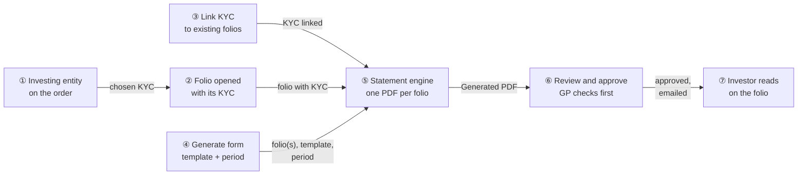
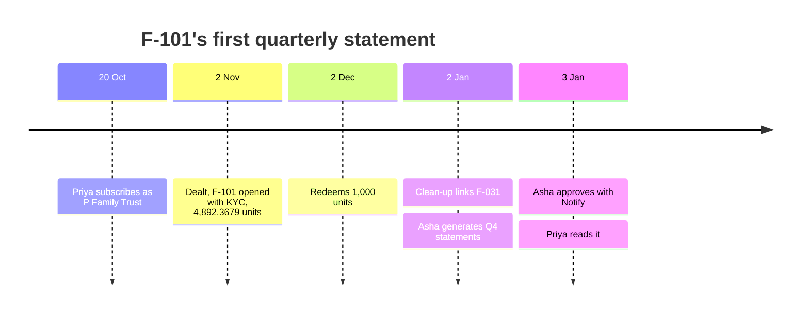
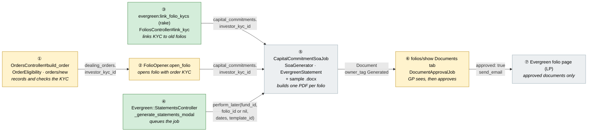
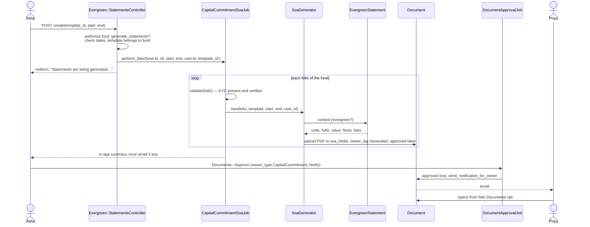
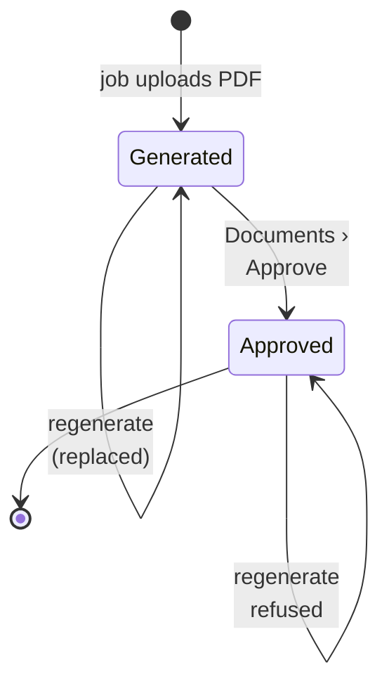
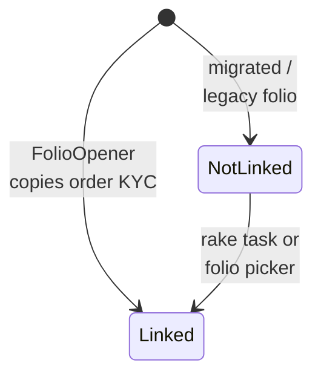
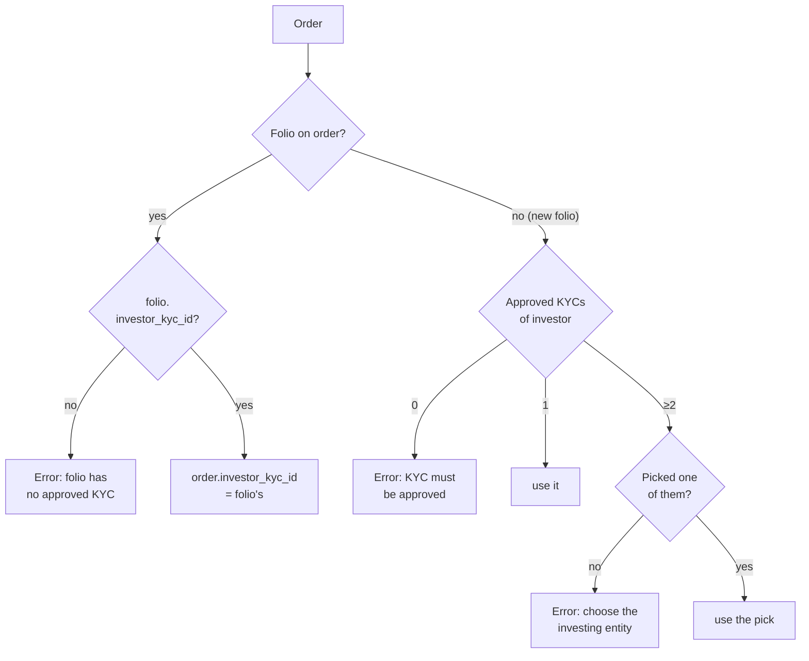
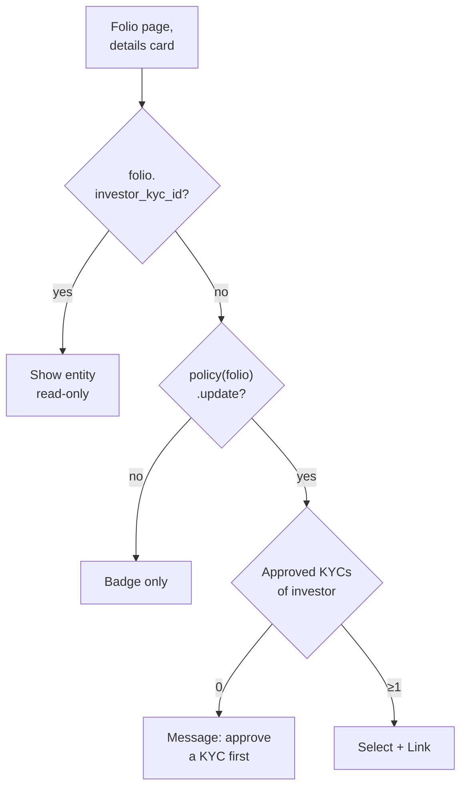
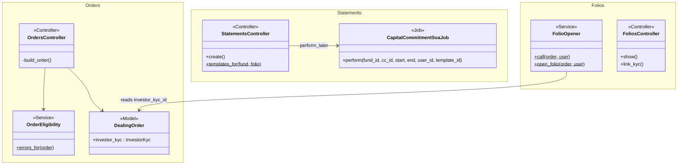
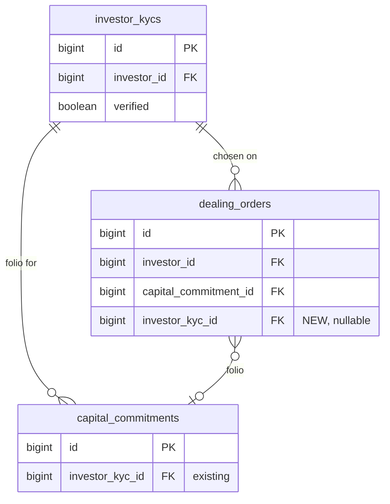

# Evergreen Folio Statements — Design

> **Audience:** Engineering team.
> **Companion documents:** [Proposal](proposal.md) · Spec (deferred — minimal change: proposal + design only)

> **Planning phase — no code changes.** This document explains HOW the proposal will be built.
> Do not edit application code while writing it; implementation happens later, in the tasks phase.

> **Design, not code.** Real class, method, table and path names appear inside diagrams and tables;
> no class bodies, migrations or routes blocks.

> **Zoom one picture.** Part 1 draws the idea in plain words, Part 2 the same picture with real
> names, Part 3 one card per box, Part 4 reference. ①–⑦ mean the same box everywhere.

---

## Contents

- [1. The idea](#1-the-idea)
  - [What this adds](#what-this-adds)
  - [The idea in one picture](#the-idea-in-one-picture)
  - [Walkthrough: one example, start to finish](#walkthrough-one-example-start-to-finish)
  - [Key ideas](#key-ideas)
- [2. The same picture with real names](#2-the-same-picture-with-real-names)
  - [Picture](#picture)
  - [What each box does](#what-each-box-does)
  - [One run, end to end](#one-run-end-to-end)
  - [Lifecycles](#lifecycles)
  - [What users see](#what-users-see)
  - [Design decisions](#design-decisions)
- [3. One card per box](#3-one-card-per-box)
  - [① Investing entity on the order](#①-investing-entity-on-the-order)
  - [② Folio opened with its KYC](#②-folio-opened-with-its-kyc)
  - [③ Link KYC to existing folios](#③-link-kyc-to-existing-folios)
  - [④ Generate form](#④-generate-form)
  - [⑤ Statement engine and template](#⑤-statement-engine-and-template)
  - [⑥ Review and approve](#⑥-review-and-approve)
  - [⑦ Investor reads](#⑦-investor-reads)
- [4. Reference](#4-reference)
  - [Class diagram](#class-diagram)
  - [Data model and schema changes](#data-model-and-schema-changes)
  - [Component contracts](#component-contracts)
  - [Notifications](#notifications)
  - [Cross-cutting concerns](#cross-cutting-concerns)
  - [Worked examples](#worked-examples)
  - [Testing](#testing)
  - [Risks and open questions](#risks-and-open-questions)

---

## 1. The idea

### What this adds

Evergreen folios are `CapitalCommitment`s, so the closed-ended SOA pipeline
(`CapitalCommitmentSoaJob` → `SoaGenerator` → Sablon → PDF), which already adds the evergreen
figures (`EvergreenStatement`), can produce their statements. This change fills the two gaps that
stop it: every folio gets a KYC when it opens, and the evergreen screens get a form that queues the
existing job. Approval and investor visibility reuse the existing document approval.

### The idea in one picture



### Walkthrough: one example, start to finish

Alpha Evergreen Fund (class A, NAV approved monthly). P Family Trust has two approved KYCs:
*P Family Trust* and *P Holdings LLP*. B LLP holds migrated folio F-031 with no KYC linked. Asha is
the fund admin.

Legend: ✓ done · **●** we are here: waiting on this, not done yet · ○ not started · ↺ redone.



**Phase 1 — subscribe**

| # | When | What happens | Behind the scenes | Result&nbsp;&nbsp;&nbsp;&nbsp;&nbsp;&nbsp;&nbsp;&nbsp;&nbsp;&nbsp;&nbsp;&nbsp;&nbsp;&nbsp;&nbsp;&nbsp;&nbsp;&nbsp;&nbsp;&nbsp; |
|---|---|---|---|---|
| 1 | 20 Oct | Priya subscribes ₹5 Cr and doesn't pick an entity | Investing entity on the order (①) sees two approved KYCs and refuses | ○&nbsp;Pick&nbsp;entity → **●&nbsp;Pick&nbsp;entity**<br>○&nbsp;Open&nbsp;folio |
| 2 | 20 Oct | She picks *P Family Trust* and submits | Investing entity on the order (①) stores `investor_kyc_id`. Pay-after fund, so no folio yet | ✓&nbsp;Pick&nbsp;entity<br>**●&nbsp;Open&nbsp;folio** |
| 3 | 2 Nov | Dealing date confirmed | Folio opened with its KYC (②) opens F-101 with the order's KYC | ✓&nbsp;Pick&nbsp;entity<br>✓&nbsp;Open&nbsp;folio |

**Phase 2 — quarter-end statements**

| # | When | What happens | Behind the scenes | Result&nbsp;&nbsp;&nbsp;&nbsp;&nbsp;&nbsp;&nbsp;&nbsp;&nbsp;&nbsp;&nbsp;&nbsp;&nbsp;&nbsp;&nbsp;&nbsp;&nbsp;&nbsp;&nbsp;&nbsp; |
|---|---|---|---|---|
| 4 | 2 Jan | Asha generates Q4 for every folio | Generate form (④) queues the statement engine (⑤) for the fund | **●&nbsp;Generate&nbsp;statements**<br>○&nbsp;Approve&nbsp;statements<br>○&nbsp;Investor&nbsp;reads |
| 5 | 2 Jan | F-031 fails: no KYC (stall) | Statement engine (⑤) `validate` → "No Investor KYC found"; error email | **●&nbsp;Generate&nbsp;statements** (1 failed)<br>○&nbsp;Approve&nbsp;statements<br>○&nbsp;Investor&nbsp;reads |
| 6 | 2 Jan | Asha picks B LLP's KYC in **Investing entity** on F-031 and clicks Link | Link KYC to existing folios (③) saves it; the badge goes | Same as row 5 |
| 7 | 2 Jan | Asha regenerates F-031 from its folio page | Generate form (④) → statement engine (⑤) for one folio | ✓&nbsp;Generate&nbsp;statements<br>**●&nbsp;Approve&nbsp;statements**<br>○&nbsp;Investor&nbsp;reads |
| 8 | 2 Jan | Asha spots a wrong template and regenerates F-101 (mistake → redo) | Statement engine (⑤) `cleanup_previous_docs` replaces the unapproved PDF | ↺&nbsp;Generate&nbsp;statements<br>**●&nbsp;Approve&nbsp;statements**<br>○&nbsp;Investor&nbsp;reads |
| 9 | 3 Jan | Asha approves with Notify | Review and approve (⑥): `DocumentApprovalJob` approves and emails | ✓&nbsp;Generate&nbsp;statements<br>✓&nbsp;Approve&nbsp;statements<br>**●&nbsp;Investor&nbsp;reads** |
| 10 | 3 Jan | Priya opens it | Investor reads (⑦): folio Documents tab, approved only | ✓&nbsp;Generate&nbsp;statements<br>✓&nbsp;Approve&nbsp;statements<br>✓&nbsp;Investor&nbsp;reads |

Snapshot at row 7, F-101's folio page (GP):

```
 F-101 · P Family Trust · Class A          [+ New subscription] [− Redeem] [📄 Generate statement]
 Documents
   Evergreen Statement 01 October,2026 to 31 December,2026 - P Family Trust - F-101
   [Generated · awaiting approval]                                              [View]
```

**What to notice**

- The KYC is decided once, on the order (①). Every later folio opening (pre-funded, pay-after,
  undo/redo) reads it from there (②).
- Nothing new produces the PDF (⑤). The only new code is around it: KYC, form, visibility.
- A missing KYC is a *stall*, not a crash: the existing job skips that folio and reports it.
- Re-generation before approval is safe, and after approval it is refused (existing job guards).

### Key ideas

| # | Idea | In one line | Card |
|---|---|---|---|
| 1 | KYC lives on the order first | `dealing_orders.investor_kyc_id` is set at order time; folios copy it | [①](#①-investing-entity-on-the-order) |
| 2 | One folio-opening path | `FolioOpener` is the only place a folio is created, so linking there covers all three callers | [②](#②-folio-opened-with-its-kyc) |
| 3 | No KYC, no trading | `OrderEligibility` refuses orders on a folio with no KYC | [①](#①-investing-entity-on-the-order) |
| 4 | Reuse the SOA job as is | `CapitalCommitmentSoaJob` with or without a folio id | [⑤](#⑤-statement-engine-and-template) |
| 5 | GP sees before investor | Folio Documents tab shows unapproved generated docs to GP only | [⑥](#⑥-review-and-approve) |

**FAQ**

| Question | Answer |
|---|---|
| Does anything change for closed-ended funds? | No. The new controller, form and checks are under `Evergreen::`. `FolioOpener` and `OrderEligibility` are evergreen-only. `SoaGenerator`, `CapitalCommitmentSoaJob` and `DocumentApprovalJob` are not edited. |
| Why not just pick the investor's latest approved KYC? | With two legal entities that silently addresses the statement, contract notes and payouts to the wrong one. See decision 1. |
| Is there a new approval step? | No — the existing Documents › Approve. |

---

## 2. The same picture with real names

### Picture



Colour = footprint: **green** new, **amber** modified, **grey** reused unchanged. ⑤ adds only a
sample `.docx` file; its code is unchanged.

### What each box does

| # | Box | Real parts | What it does | When it runs | What it decides | Details |
|---|---|---|---|---|---|---|
| ① | Investing entity on the order | `Evergreen::OrdersController#build_order`, `orders/new.html.erb`, `OrderEligibility`, `DealingOrder` | Stores the chosen or only approved KYC; refuses orders without one | Order create (portal, GP, import) | Which KYC; whether the order may be placed | [card ① →](#①-investing-entity-on-the-order) |
| ② | Folio opened with its KYC | `FolioOpener.open_folio`, `FolioOpener.folio_kyc_id` | Copies `order.investor_kyc_id` onto the new folio | Pre-funded create, pay-after settle, undo redo | Order without a KYC (placed before this change): the investor's only approved KYC; else raises | [card ② →](#②-folio-opened-with-its-kyc) |
| ③ | Link KYC to existing folios | `lib/tasks/evergreen_folio_kyc.rake`, `Evergreen::FoliosController#link_kyc`, `folios/_investing_entity` | Rake links the single approved KYC; the folio-page picker links the rest | Rake once, by an operator; picker on request | Unambiguous → link; else a GP picks | [card ③ →](#③-link-kyc-to-existing-folios) |
| ④ | Generate form | `Evergreen::StatementsController#create`, `statements/_generate_modal`, buttons on `folios/show` and `investors/index` | Validates inputs and queues the job | Request | One folio or the whole fund | [card ④ →](#④-generate-form) |
| ⑤ | Statement engine and template | `CapitalCommitmentSoaJob`, `DocGenJob`, `SoaGenerator`, `EvergreenStatement`, `public/sample_uploads/Evergreen Statement Template.docx` | One PDF per folio into "Investor Statements" | `doc_gen` queue | Skip: no or unverified KYC; already approved or signed | [card ⑤ →](#⑤-statement-engine-and-template) |
| ⑥ | Review and approve | `Evergreen::FoliosController#show` (documents query), `DocumentsController#approve`, `DocumentApprovalJob` | GP sees Generated docs, approves in bulk, optionally emails | Request + `low` queue | Who sees unapproved | [card ⑥ →](#⑥-review-and-approve) |
| ⑦ | Investor reads | `Evergreen::FoliosController#show` | Investor sees approved statements | Request | — | [card ⑦ →](#⑦-investor-reads) |

### One run, end to end



### Lifecycles

**Statement document** (stored: `documents.owner_tag`, `approved`):



**Folio KYC** (derived from `capital_commitments.investor_kyc_id` and `investor_kycs.verified`):



`NotLinked`: orders refused, statements skipped, Generate button disabled, picker shown. `Linked`
is final: KYCs are never withdrawn and the picker doesn't change a linked folio.

### What users see

| Where in CapHive | Today | After this change | Who sees it |
|---|---|---|---|
| Evergreen subscription form | No entity choice | **Investing entity** select when ≥ 2 approved KYCs and a new folio | Investor, GP |
| Evergreen folio page | No statement action; no investing entity shown | **Generate statement** button; **Investing entity** shown, or a **No KYC linked** badge with a picker | GP with update (picker); everyone who sees the folio (entity name) |
| Evergreen Investors tab | Download only | **Generate statements** button | GP with update |
| Folio Documents tab | Approved docs only | Plus Generated (unapproved) docs with a badge, GP only | GP |
| Investor folio Documents tab | Contract notes, advices | Plus approved statements | Investor |

Everyday journey (quarter end):

```
 Alpha Evergreen Fund › Investors                    [⬇ Download] [📄 Generate statements] ①
 ┌ Generate statements — Alpha Evergreen Fund ──────────────── ✕ ┐
 │ Template   [ Evergreen Statement ▾ ]  ②                       │
 │ Start      [ 01/10/2026 ]   End [ 31/12/2026 ]  ③             │
 │                                    [Cancel] [Generate] ④      │
 └───────────────────────────────────────────────────────────────┘
```

| Step | The user… | They see |
|---|---|---|
| ① | clicks Generate statements | The modal |
| ② | picks a template | Fund templates tagged SOA / Investor Statement |
| ③ | sets the period | Locale date inputs |
| ④ | clicks Generate | Flash "Statements are being generated — you'll be notified when done.", then in-app progress alerts |

### Design decisions

1. **KYC chosen on the order, stored on `dealing_orders`.** Alternative: `FolioOpener` picks the
   most recently approved KYC. Rejected because an investor with two legal entities would silently
   get the wrong one, and that error is legal, not cosmetic.
2. **Link the KYC in `FolioOpener` only.** Alternative: in each of its three callers
   (`DealingOrderCreate`, `DealingSettlement`, `DealingUndo`). Rejected because one choke point is
   DRY and can't be missed by a fourth caller.
3. **`FolioOpener` requires a KYC on the order and doesn't re-check that it is approved.**
   KYCs are never withdrawn, so a KYC approved at order time (①) is still approved when a
   pay-after folio opens at confirm. A re-check would only add a way for confirm to fail.
4. **Reuse `CapitalCommitmentSoaJob` unchanged.** Alternative: an `EvergreenStatementJob`.
   Rejected because the job already supports one or all commitments, template choice,
   idempotency, KYC validation and error email.
5. **A small evergreen form instead of linking the closed-ended `generate_soa_form`.** The
   closed-ended form offers "Investing Entity" (`KycDocGenJob`, a cross-commitment statement not
   designed for evergreen), and it has no fund-wide variant. The fund-wide path today is the
   allocation screen. One modal for both scopes is ~1 controller with 2 actions.
6. **Approval through the existing Documents › Approve.** Alternative: an "Approve statements"
   button on the evergreen screens. Deferred — the existing bulk approval with Notify does the job,
   and adding a button later is cheap.
7. **Clean-up as a rake task with dry run.** Alternative: a data migration. Rejected because
   ambiguous folios need a human, and a dry run lets ops see the list first.
8. **A link-only picker on the evergreen folio page.** Alternative: send GPs to the closed-ended
   commitment edit form. Rejected because that form sits outside the evergreen screens, edits every
   commitment field, and allows changing a linked KYC. The picker shows only for unlinked folios
   and saves one field.

**FAQ**

| Question | Answer |
|---|---|
| Why not add `investor_kyc_id` only to the folio and ask for it when the folio opens? | Pay-after folios open during confirm, with no user present. The choice has to be captured earlier, on the order. |
| Does the import path (`ImportDealingOrder`) need the column? | Yes. It gets an optional "Investing Entity" column, matched by KYC full name within the investor; blank means the only approved KYC. |
| Why is the Generate button disabled rather than hidden without KYC? | The disabled button with a tooltip tells the admin what to fix; hiding it looks like a missing feature (UI explains itself). |

---

## 3. One card per box

### ① Investing entity on the order

Captures which approved KYC an order is for, and refuses orders that can't have one.

| Owns | Reads / receives | Produces |
|---|---|---|
| `dealing_orders.investor_kyc_id`; the KYC rules in `OrderEligibility`; the select on `orders/new` | Investor's `InvestorKyc` rows (`verified: true`, same `entity_id`); `order.capital_commitment` | A KYC id on the order, or an eligibility error |



- `build_order` permits `investor_kyc_id`. For a portal user it is accepted only if it belongs to
  their own investor (`InvestorKyc.where(investor_id:, entity_id:, verified: true)`).
- The rules sit in `OrderEligibility.errors_for`, so wizard, GP entry and import share them.
  Redemptions on a folio follow the "folio on order" branch.
- `orders/new.html.erb`: the select renders only for subscriptions without a folio when the
  investor has ≥ 2 approved KYCs. It uses existing form-group markup.

**Worked examples:** H1, H2, H3, E1, E2, E3, E4, E5, X1, X2, X3, X4

**FAQ**

| Question | Answer |
|---|---|
| Why a new eligibility rule when the journey already has "Check investor KYC"? | Order journeys are optional per fund (`order_journeys`). Without them nothing checks KYC, and a folio could open without one. |

### ② Folio opened with its KYC

The single place a subscription creates a folio. It now copies the order's KYC.

| Owns | Reads / receives | Produces |
|---|---|---|
| Setting `investor_kyc_id` in `FolioOpener.open_folio` | `order.investor_kyc_id` | `capital_commitments.investor_kyc_id` on the new folio, or `FolioOpener::Error` |

| Caller | Transaction | On error |
|---|---|---|
| `DealingOrderCreate#persist` (pre-funded) | Order's transaction | Order not saved; error shown |
| `DealingSettlement.settle_subscriptions` (pay-after) | Confirm's transaction | Confirm fails with the folio error. Unreachable after ①, kept as a guard |
| `DealingUndo` (redo) | Undo's transaction | Same |

`top_up` is untouched: the folio already carries a KYC (① refuses one without).

**Worked examples:** H1, H2, E6, X5

**FAQ**

| Question | Answer |
|---|---|
| Does `FolioOpener.reverse` need changes? | No. Destroying the folio removes the link with it. |
| Does `CapitalCommitmentCreate` validate the KYC? | It does not today, and this change does not add a model validation, so closed-ended commitments are unaffected. |

### ③ Link KYC to existing folios

Two ways to link a KYC to evergreen folios created before this change (migrated, or opened by
`FolioOpener` before ①). The rake task handles the unambiguous ones in bulk. The picker on the
folio page handles the rest, one by one.

| Owns | Reads / receives | Produces |
|---|---|---|
| `evergreen:link_folio_kycs` in `lib/tasks/evergreen_folio_kyc.rake`; `Evergreen::FoliosController#link_kyc`; partial `folios/_investing_entity` | Evergreen folios with `investor_kyc_id IS NULL`; the folio investor's approved KYCs (`InvestorKyc.where(entity_id:, investor_id:, verified: true)`) | `capital_commitments.investor_kyc_id` set; a dry-run list |

**Rake task**
- Dry run by default; `EXECUTE=1` writes. `FUND_ID=` limits it to one fund.
- Exactly one approved KYC → link with `update!`, so the existing `counter_culture :investor_kyc`
  counters stay right. 0 or ≥ 2 → printed as "F-031 B LLP — 2 approved KYCs" for the picker.
- Idempotent: re-running skips linked folios.

**Picker on the folio page**



| Verb and path | Action | Does | Responds with |
|---|---|---|---|
| PATCH `/funds/:fund_id/evergreen/folios/:id/link_kyc` | `link_kyc` | Finds the folio via `@fund.capital_commitments`; refuses if it already has a KYC; accepts `investor_kyc_id` only from the investor's approved KYCs; saves with `update!` | Redirect to the folio with "Investing entity linked", or alert on refusal |

| Role | Sees | Can link |
|---|---|---|
| Fund employee with update (`CapitalCommitmentPolicy#update?`) | Picker | Yes |
| Read-only employee | Badge, no picker | No (direct PATCH → not authorised) |
| Investor, advisor | Nothing new | No |

Build notes: the field goes into the existing details card grid (`col-md-6`, same label markup),
as a `form-select` plus a `btn btn-outline-primary` "Link". Single-field form, no modal: it is not
destructive, and the folio page already explains the effect through the badge.

**Worked examples:** H6, H8, E6, E7, E8, E9, X12, X13, X14

**FAQ**

| Question | Answer |
|---|---|
| Why not run the rake task automatically on deploy? | Ambiguous folios need a person, and ops want to see the dry run first. |
| Why not reuse the closed-ended folio edit form? | It is a full commitment form outside the evergreen screens, and evergreen hides the commitment pages. One picker in the place where the "No KYC linked" badge shows is simpler and can't change other fields. |
| Why can't a linked KYC be changed? | A folio belongs to one investing entity. Its contract notes and statements are addressed to it, and KYCs are never withdrawn. |

### ④ Generate form

One modal and controller for "this folio" and "every folio of the fund"; it only validates and
queues.

| Owns | Reads / receives | Produces |
|---|---|---|
| `Evergreen::StatementsController`, `statements/_generate_modal` (rendered in the page, opened by the button), the two buttons | `template_id`, `start_date`, `end_date`, optional `capital_commitment_id`; fund/folio templates (`CapitalCommitment#templates`, `fund.documents.templates`) | `CapitalCommitmentSoaJob.perform_later(...)` |

| Verb and path | Action | Does | Responds with |
|---|---|---|---|
| POST `/funds/:fund_id/evergreen/statements` | `create` | Validates dates (`Date.local_parse`, start ≤ end) and that the template belongs to the fund or folio; passes the job the **fund** template of that name (the job looks ids up among the fund's templates and swaps in a folio override by name — E11) and queues it | Redirect to the folio page or Investors tab with a notice, or with the error as an alert |

| Role | Folio button / one folio | Fund button / all folios |
|---|---|---|
| Fund employee with update | `CapitalCommitmentPolicy#generate_soa?` (KYC verified + update) | `FundPolicy#allocate?` (update) — the same right as the allocation screen's "Generate investor statements" |
| Read-only employee, investor, advisor | Hidden; direct POST → not authorised | Same |

Scoping: the folio is found through `@fund.capital_commitments`, and `@fund` comes from
`Evergreen::BaseController` (entity-scoped). Build notes: Bootstrap modal markup copied from the
existing evergreen confirm popups. The button uses `btn btn-outline-primary` with `ti ti-file-text`
next to Redeem. Dates use `f.date_field` (locale input).

**Worked examples:** H4, H5, E10, E11, E12, X6, X7, X8, X9

**FAQ**

| Question | Answer |
|---|---|
| Why `allocate?` for the fund-wide run? | It is what the closed-ended bulk SOA path already requires, so evergreen gets the same rights. |
| Double click on Generate? | Two jobs run. The second replaces the first one's unapproved PDFs (`cleanup_previous_docs` + `upload` destroy same-name docs), so the result is the same. |

### ⑤ Statement engine and template

Existing pipeline, unchanged. This change adds only the sample template.

| Owns | Reads / receives | Produces |
|---|---|---|
| Sample `public/sample_uploads/Evergreen Statement Template.docx` | Job args; folio, its fund units, fills, fee entries, NAVs (`EvergreenStatement#context`) | `Document` (PDF), `owner_tag: "Generated"`, `approved: false`, in `soa_folder` ("Investor Statements", investor access) |

| Concern | Existing behaviour relied on |
|---|---|
| Queue / retry | `doc_gen`, `retry: 1` (`DocGenJob`) |
| Skip rules | `validate`: KYC present and verified; `approved_document_already_exists?`, `signed_document_already_exists?` by name |
| Idempotency | Same-name unapproved docs destroyed before upload |
| Reporting | In-app per document, summary, `email_errors` to the requesting user |

**Context enrichment (the one change inside ⑤).** `SoaGenerator` already added `evergreen` for
evergreen funds, but as a raw hash of BigDecimals (Word prints `0.48923679e4`) built with date
arithmetic that raised on the job's date strings. `EvergreenStatement` now takes dates or strings
(`to_date`), and `#template_context` returns a `TemplateDecorator` over a `Figures` value object, so
templates format with the existing prefixes: `evergreen.format_4_closing_units`,
`evergreen.money_closing_value`, `evergreen.skip_money_closing_nav_per_unit` (blank when no NAV, E14).
It adds `evergreen.transactions` — the period's dealt orders (dealing date, kind, units, NAV per unit,
amount, exit load), which the closed-ended remittance / payout loops don't carry. `#context` (the
plain hash the portal and features read) is unchanged.

The sample template prints the holding block (opening / closing units and NAV per unit, units and
amounts subscribed and redeemed, closing value, fees, queued units) and loops
`evergreen.transactions:each(t)`. It adds `investor_kyc.full_name`, `capital_commitment`, `fund`,
`format_start_date`, `format_end_date`, and deliberately omits `committed_amounts.*` and
`remittance_amounts.uncalled_amount`.

**Worked examples:** H4, H7, E13, E14, E15, E16

**FAQ**

| Question | Answer |
|---|---|
| Will a closed-ended template work on an evergreen fund? | It renders, but shows closed-ended figures ("committed" = total ever subscribed). The sample is the recommended start. |
| Does the statement show units issued after the end date? | No — `EvergreenStatement#units(..end_date)` counts by `issue_date`. |

### ⑥ Review and approve

GP sees generated statements on the folio before approving them with the existing bulk approval.

| Owns | Reads / receives | Produces |
|---|---|---|
| The documents query in `Evergreen::FoliosController#show`; the "Generated · awaiting approval" badge | `policy(@folio).update?` | GP: all folio docs; others: `exclude_generated_unapproved` |

- Approval: the existing **Documents › Approve** (`DocumentsController#approve` →
  `DocumentApprovalJob`) with owner type "Capital Commitment", the date range and Notify. No change.
- Badge markup: `eg_badge(:blue, "clock", …)` (`bg-info-subtle text-info`) — the evergreen badge palette has no
  warning colour, and the theme rule allows success / info / danger / secondary only.

**Worked examples:** H5, H7, E17, X10

**FAQ**

| Question | Answer |
|---|---|
| Could approving statements also approve other generated docs? | Only those matching owner type and date range, same as for closed-ended funds. Dealing-date contract notes are approved by their own step first. |

### ⑦ Investor reads

No change. The investor's folio page already lists approved documents on the folio.

| Owns | Reads / receives | Produces |
|---|---|---|
| — | Approved `Document`s owned by the folio | Rows on the Documents tab |

**Worked examples:** H7, X11

**FAQ**

| Question | Answer |
|---|---|
| Can an investor see another investor's statement? | No — the folio is authorised with `show?` (own investor), and the folder access right is per investor. |

---

## 4. Reference

### Class diagram



### Data model and schema changes



**Indexes:** `dealing_orders(investor_kyc_id)`.

**Schema changes**

**`dealing_orders`** (changed): the order must carry the investing entity so a folio opened later
(pay-after, at confirm) gets it without a user present.

| Column / index | What changed | Why it's needed |
|---|---|---|
| `investor_kyc_id` | Added: bigint, nullable, FK → `investor_kycs` | The KYC the order is for; copied to a new folio by `FolioOpener`. Nullable because existing orders have none |
| index on `investor_kyc_id` | Added | FK lookups; KYC delete checks |

**Changes to existing models:**
- `DealingOrder`: `belongs_to :investor_kyc, optional: true`.
- `CapitalCommitment`, `InvestorKyc`: none (`investor_kyc_id` on commitments already exists).

### Component contracts

| From → To | Contract | Direction rule |
|---|---|---|
| ① → ② | `dealing_orders.investor_kyc_id` (present after eligibility for new-folio subscriptions) | ② reads; never writes the order's KYC |
| ③ → ⑤ | `capital_commitments.investor_kyc_id` | Rake or `link_kyc` writes once (never overwrites a linked KYC); job reads |
| ② → ⑤ | `capital_commitments.investor_kyc_id` | Opener writes once at creation |
| ④ → ⑤ | `CapitalCommitmentSoaJob.perform_later(fund_id, folio_id \| nil, start, end, user_id, template_id:)` | Fire and forget; results reported by the job |
| ⑤ → ⑥ | `Document` with `owner: folio`, `owner_tag: "Generated"`, `approved: false`, `folder: soa_folder` | Job writes; ⑥ reads |
| ⑥ → ⑦ | `approved: true` (+ owner email when Notify) | `DocumentApprovalJob` writes |

### Notifications

| Notification | Trigger | Recipients | Channel | Customisable | Default | Sent once? |
|---|---|---|---|---|---|---|
| "Documentation generation started" / per-doc "Generated…" / summary | Job run (④ → ⑤) | The requesting user only | In-app (existing `send_notification`) | No | On | Per run; a re-run sends again, intended |
| Generation errors email | Job finishes with errors | The requesting user only | Email (existing `DocGenJob#email_errors`) | No | On | Per run |
| Document available | Documents › Approve with Notify ticked (⑥) | The folio investor's users with access to the document, via `Document#send_notification_for_owner` (existing), including advisors approved for the folio | Email (existing document notification) | As today for document notifications | Off unless Notify is ticked | Approval flips `approved`; already-approved docs aren't re-selected by `DocumentApprovalJob` |
| Order refused for KYC | ① | — | On-screen error only, no message | — | — | — |

Nothing new is sent. Internal team alerts (`EvergreenAlerts`) are not triggered by statements.

### Cross-cutting concerns

#### Transactions and queries

- ① adds one `InvestorKyc` count/pluck per order build. ② writes inside the caller's existing
  transaction.
- ⑤ is unchanged. Note that `EvergreenStatement` runs ~8 small aggregate queries per folio, which
  is fine at evergreen volumes (hundreds of folios).
- ⑥ GP query: `Document.where(owner: folio)` without the generated filter, same order and index.

#### Exception handling and monitoring

| Failure | Who is alerted | Channel | Detail |
|---|---|---|---|
| Folio without verified KYC | Requesting user | In-app + error email | Existing `validate` messages |
| Template render error | Requesting user | In-app + error email | Existing `rescue` in `DocGenJob#generate` |
| `FolioOpener::Error` (no KYC on order) | User confirming or placing | Flash on the dealing date / order | Guard only; ① prevents it |

#### Performance and security

- Generation runs in the background on `doc_gen`. The request only enqueues.
- Tenant isolation: folio and template looked up through `@fund` (entity-scoped). A portal user's
  `investor_kyc_id` must belong to their own investor (X3). Policies as in card ④.

### Worked examples

**ID legend:** **H** = Happy path · **E** = Edge case · **X** = Error (exception) case. The spec is
deferred, so the Spec scenario column is omitted. Each row is one Cucumber scenario.

**Shared setup:**

| Record | Name | Key data |
|---|---|---|
| Fund | Alpha Evergreen Fund | Evergreen, class A, pay-after unless stated, journeys off unless stated |
| Investor | P Family Trust | Portal user Priya; approved KYCs *P Family Trust* (and *P Holdings LLP* where stated) |
| Investor | B LLP | Migrated folio F-031, 7,000 units, no KYC linked |
| NAVs | Class A | ₹10,220 (31 Oct), ₹10,300 (30 Nov), ₹10,450 (31 Dec) |
| Template | Evergreen Statement | The sample, tagged SOA Template on the fund |
| User | Asha | Fund admin, update rights |

#### Happy Path

| # | Scenario | Given | When | Then | Feature |
|---|---|---|---|---|---|
| H1 | One KYC, new folio | P has one approved KYC | Priya subscribes ₹5 Cr; dealing date 2 Nov confirmed | F-101 opened with KYC *P Family Trust* | `folio_kyc_orders.feature` |
| H2 | Two KYCs, pick one | P has two approved KYCs | Priya picks *P Holdings LLP*, subscribes; dealt | Folio opened with KYC *P Holdings LLP* | `folio_kyc_orders.feature` |
| H3 | Top-up keeps folio KYC | F-101 with KYC *P Family Trust* | Priya tops up ₹10 L into F-101 | No entity select shown; order KYC = folio's | `folio_kyc_orders.feature` |
| H4 | One folio statement | F-101 allotted 4,892.3679 units on 2 Nov (₹5 Cr ÷ ₹10,220); NAV ₹10,450 on 31 Dec | Asha › F-101 › Generate statement, Oct 1 – Dec 31 | Generated PDF on F-101; opening 0, closing 4,892.3679, closing value ₹5,11,25,244.62; `evergreen.transactions` = one Subscription row (2 Nov, 4,892.3679 @ ₹10,220.00, ₹5,00,00,000.00) | `folio_statements.feature` |
| H5 | Fund-wide run | F-101 and F-102 both with KYC | Asha › Investors › Generate statements | Two Generated docs; GP sees both with "awaiting approval" badge | `folio_statements.feature` |
| H6 | Clean-up links single KYC | F-031 without KYC; B LLP has one approved KYC | `evergreen:link_folio_kycs EXECUTE=1` | F-031 linked; dry run without EXECUTE changes nothing | `folio_kyc_link.feature` |
| H8 | Link KYC with the picker | F-031 without KYC; B LLP has two approved KYCs | Asha picks *B LLP* in Investing entity on F-031, clicks Link | F-031 shows *B LLP* read-only; badge gone; Generate statement enabled; orders on F-031 accepted | `folio_kyc_link.feature` |
| H7 | Approve and read | H4 done | Asha approves (Capital Commitment, Notify) | Priya gets the email and sees the statement on F-101's Documents tab | `folio_statements.feature` |
| H9 | NAV drafted from the real portfolio | Fund buys 10,000 Acme shares; Acme valued ₹1,500 on 30 Sep; cash ₹50 L; 10,000 units | Draft NAV for 31 Oct (no fair-value stub) | Fair value ₹1,50,00,000 (10,000 × ₹1,500); NAV ₹2,00,00,000 = ₹2,000 a unit | `nav_from_portfolio.feature` |

#### Edge Cases

| # | Scenario | Given | When | Then | Feature |
|---|---|---|---|---|---|
| E1 | Pre-funded opens at order time | Fund pre-funded; one KYC | Priya subscribes | Folio opened immediately with KYC | `folio_kyc_orders.feature` |
| E2 | GP enters order for investor with two KYCs | Two approved KYCs | Asha enters subscription without folio | Select shown and required | `folio_kyc_orders.feature` |
| E3 | Unapproved KYC not offered | P has one approved and one pending KYC | Priya subscribes | No select; approved one used | `folio_kyc_orders.feature` |
| E4 | Import with Investing Entity column | Two approved KYCs | Import row names *P Holdings LLP* | Order and folio carry it; blank column with two KYCs → row error | `folio_kyc_orders.feature` |
| E5 | Redemption on linked folio | F-101 linked | Priya redeems 100 units | Order accepted; KYC copied from folio | `folio_kyc_orders.feature` |
| E6 | Picker lists only the folio investor's approved KYCs | B LLP has one approved and one pending KYC; P has approved KYCs | Asha opens F-031 | Picker offers only B LLP's approved KYC | `folio_kyc_link.feature` |
| E7 | Clean-up: two approved KYCs | Folio without KYC; investor has two | Rake dry run | Listed "2 approved KYCs", not linked | `folio_kyc_link.feature` |
| E8 | Clean-up: no approved KYC | Folio without KYC; none approved | Rake | Listed "0 approved KYCs" | `folio_kyc_link.feature` |
| E9 | Clean-up re-run | H6 done | Rake again | Nothing changed; F-031 not listed | `folio_kyc_link.feature` |
| E10 | Start = end date | — | Generate for 31/12/2026 – 31/12/2026 | Accepted; one-day period | `folio_statements.feature` |
| E11 | Folio-level template overrides fund's | F-101 has its own SOA Template | Open F-101's form | Folio template offered (`CapitalCommitment#templates`) | `folio_statements.feature` |
| E12 | Double submit | — | Generate clicked twice | One Generated doc per folio remains | `folio_statements.feature` |
| E13 | Folio with no units ever | Migrated folio F-102 with KYC and 0 units | Generate | Statement with opening = closing = 0 | `folio_statements.feature` |
| E14 | No approved NAV by end date | First NAV approved after end date | Generate | NAV and value fields blank; doc generated | `folio_statements.feature` |
| E15 | Units issued after end date excluded | Allotment issue date 2 Jan | Generate Oct–Dec | Closing units exclude them | `folio_statements.feature` |
| E16 | Regenerate after approval refused | H7 done | Generate same template and period | Skipped; "Approved document already exists…" in errors | `folio_statements.feature` |
| E17 | Investor never sees unapproved | H4 done (not approved) | Priya opens F-101 Documents | Statement not listed | `folio_statements.feature` |
| E18 | Several holdings, later valuation ignored | H9 + Acme ₹1,800 on 15 Nov; 5,000 Beta valued ₹2,000 on 30 Jun | Draft NAV for 31 Oct | ₹1,50,00,000 + ₹1,00,00,000 = ₹2,50,00,000; the 15 Nov valuation is not used | `nav_from_portfolio.feature` |
| E19 | A sale reduces the holding | H9 + 2,000 Acme shares sold on 1 Aug | Draft NAV for 31 Oct | (10,000 − 2,000) × ₹1,500 = ₹1,20,00,000 | `nav_from_portfolio.feature` |
| E20 | Only the purchase valuation | 10,000 Acme bought for ₹1 Cr; next valuation 15 Nov | Draft NAV for 31 Oct | Valued at the cost valuation the purchase records: 10,000 × ₹1,000 = ₹1,00,00,000 (a bought holding always has one, so open-ended-funds X5 stays stub-only) | `nav_from_portfolio.feature` |

#### Error Cases

| # | Scenario | Given | When | Then (what the user sees, who is alerted) | Feature |
|---|---|---|---|---|---|
| X1 | No approved KYC, new folio | P has no approved KYC | Priya subscribes | "P Family Trust has no approved KYC — it must be approved before subscribing." No order, no folio. Replaces open-ended-funds H13 (order waiting on the KYC step), which now asserts the step passes | `folio_kyc_orders.feature` |
| X2 | Two KYCs, none picked | Two approved KYCs | Submit without picking | "Choose the investing entity for this subscription." | `folio_kyc_orders.feature` |
| X3 | Portal user posts another investor's KYC id | Priya | Direct POST with B LLP's KYC id | "Choose one of P Family Trust's approved investing entities."; no order | `folio_kyc_orders.feature` |
| X4 | Order on folio without KYC | F-031 not linked | Asha enters a redemption on F-031 | "Folio F-031 has no approved KYC linked — link one on the folio before placing orders." | `folio_kyc_orders.feature` |
| X5 | FolioOpener guard | Pay-after order with its KYC cleared by hand; P has two approved KYCs | Confirm | Refused: "P Family Trust has no single approved KYC for this order — choose the investing entity on the order"; no folio opened | `folio_kyc_orders.feature` |
| X6 | Start after end | — | 31/12 – 01/10 | Modal re-renders: "Start date must be on or before end date" | `folio_statements.feature` |
| X7 | No template on fund | No SOA template | Open the form | Message + sample link; Generate disabled | `folio_statements.feature` |
| X8 | Read-only user | Employee with read only | Direct POST create | Not authorised; no job queued | `folio_statements.feature` |
| X9 | Template from another fund | — | POST template_id of another fund | "Template not found"; no job | `folio_statements.feature` |
| X10 | Folio without KYC in fund run | F-031 not linked | Fund-wide Generate | F-031 skipped; error email to Asha lists "No Investor KYC found"; folio button disabled with tooltip | `folio_statements.feature` |
| X11 | Investor opens other folio | B LLP user | Opens F-101 URL | Not authorised (existing `show?`) | `folio_statements.feature` |
| X12 | Link a KYC of another investor | F-031 (B LLP) | Direct PATCH `link_kyc` with P's KYC id | "Choose one of B LLP's approved KYCs"; nothing saved | `folio_kyc_link.feature` |
| X13 | Re-link an already linked folio | F-101 linked to *P Family Trust* | Direct PATCH `link_kyc` with *P Holdings LLP* | "This folio already has an investing entity"; unchanged | `folio_kyc_link.feature` |
| X14 | Read-only user links | Employee with read only | Direct PATCH `link_kyc` | Not authorised; picker not shown on the page | `folio_kyc_link.feature` |

### Testing

Cucumber only. One feature per phase: `folio_kyc_orders.feature`, `folio_kyc_link.feature`,
`folio_statements.feature` and `nav_from_portfolio.feature` (H9, E18–E20: the NAV's fair value from real
`PortfolioInvestment`s and `Valuation`s — every older NAV feature stubs it) under `features/fund/evergreen/`, with steps in
`features/step_definitions/evergreen_folio_kyc_steps.rb`. Because orders now need an approved KYC, the
shared evergreen setup steps (investor with portal users, folio holdings, the NAV folio table) give each
investor an approved KYC named after it (`evergreen_approved_kyc`) and link it to the folios they create.
The features reuse the evergreen fund, order,
dealing and NAV steps plus the existing document generation steps. Generated PDFs are asserted on
their stored `EvergreenStatement` figures, as H39 does today. Every scenario carries a
`# H4 — Happy path: …` comment, and code comments name the IDs of the paths they implement.
`regression.feature` still runs unchanged for closed-ended behaviour.

### Risks and open questions

- Test fund 343 (development data) had only uploaded NAVs → `evergreen:seed_demo_portfolio FUND_ID=343`
  gives it three demo holdings, valuations and cash, so its NAV drafts from the portfolio (31 Oct 2026:
  ₹20,07,00,000 + ₹1,20,00,000 cash over 20,964.6365 units = ₹10,145.66). The task refuses to run in production.

- Investors with two legal entities already holding folios opened before this change → the
  rake dry run lists them, and a GP links each with the folio-page picker before the first
  statement run.
- Templates written for closed-ended funds print misleading "committed" figures → the sample and
  the modal's info line point to the evergreen fields.

No open questions. KYCs are never withdrawn, so nothing re-checks a linked folio's KYC.

**FAQ**

| Question | Answer |
|---|---|
| Where do I start reviewing? | Card ① (the only new rule and column), then card ④ (the only new controller). |
| What is the smallest shippable slice? | ① + ② + ④ with the sample template. ③ is needed only where folios already exist without KYC. |
