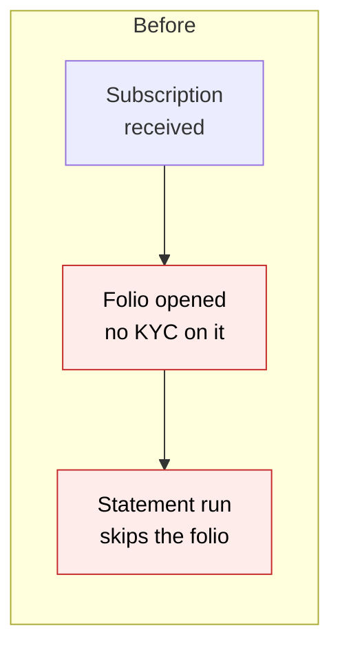
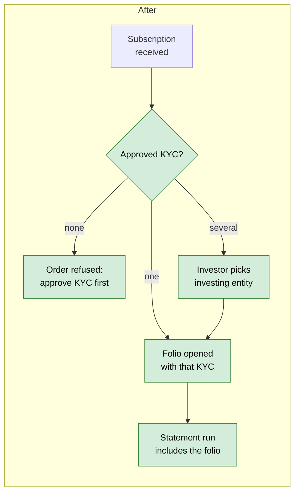
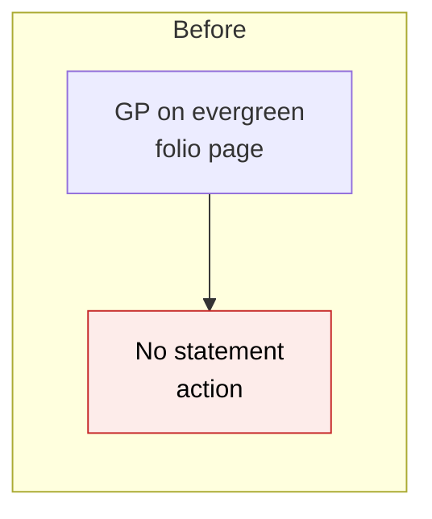
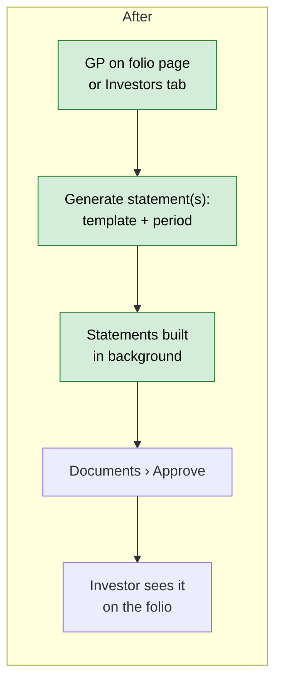
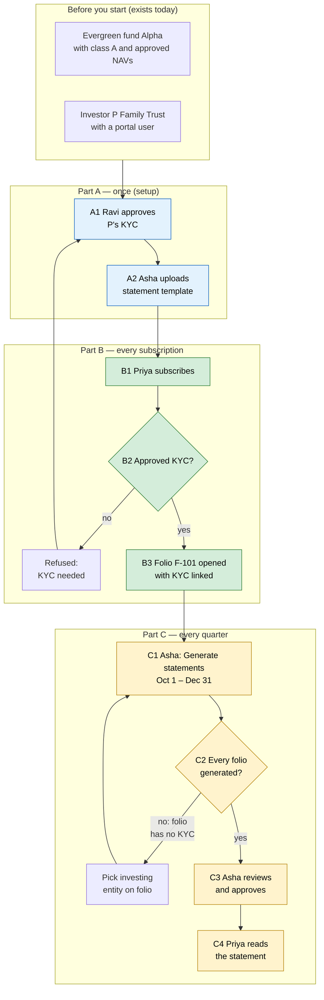

# Evergreen Folio Statements — Proposal

> **Audience:** Business team, product, QA, support — non-technical.
> **Companion document:** [Design](design.md)
> **New to this? Start with the [Workflow Journey](#workflow-journey)** — every action, in order, from start to the outcome.

> **Planning phase — no code changes.** This document proposes and explains the change. Do not
> edit application code while writing it; implementation happens later, in the tasks phase.

> **Minimal change.** By agreement this change carries a proposal and a design only — no spec,
> LLD, QA checklist or task list yet.

---

## Why

Evergreen investors need a periodic Statement of Account (SOA) for each folio: units held, NAV
per unit, value, and the subscriptions, redemptions and fees in the period. CapHive already
generates SOAs for closed-ended commitments, and the statement engine already knows the evergreen
figures. But today an evergreen statement can't actually be produced, for two reasons:

1. **Folios opened by a subscription have no investing entity (KYC) on them.** The statement
   engine skips any folio without an approved KYC, so these folios would get no statement.
   Evergreen folios also shouldn't operate without a KYC in the first place.
2. **There is no way to ask for a statement from the evergreen screens.** The "Generate SOA"
   button lives on the closed-ended commitment page and Commitments tab, and evergreen funds hide
   both.

## What Changes

- **Every evergreen folio carries an approved KYC.** When a subscription opens a new folio, the
  folio takes the investing entity chosen on the order. That's the investor's only approved KYC,
  or the one picked from a new **Investing entity** choice in the subscription form when there are
  several. A subscription that would open a folio is refused while the investor has no approved
  KYC.
- **Orders on a folio without a KYC are refused**, with a message saying how to fix it. A one-off
  clean-up links KYCs to existing folios where the match is unambiguous and lists the rest.
- **Link KYC on the folio page.** A folio with no KYC shows an **Investing entity** picker (the
  investor's approved KYCs) so the GP can link one without leaving the evergreen screens. Once
  linked, the folio shows the investing entity and the picker is gone. KYCs are never withdrawn,
  so a linked folio stays valid.
- **Generate statement** button on the folio page (one folio), and **Generate statements** on the
  Investors tab (every folio in the fund). Both open the same small form: template, period start,
  period end.
- **Statements are produced by the existing SOA engine.** They land in the folio's "Investor
  Statements" folder as *Generated*, are approved with the existing **Documents › Approve** action,
  and then appear on the folio's Documents tab for the GP and the investor.
- **A sample evergreen statement template** (Word) is provided. It uses the evergreen figures
  (units, NAV per unit, value, flows, fees), not the closed-ended "committed / called / uncalled"
  figures. "Committed" on an evergreen folio is the total ever subscribed, not what the investor
  holds.
- **GP sees statements awaiting approval** on the folio's Documents tab, with a "Generated ·
  awaiting approval" badge. Investors still see approved documents only.

### Flow Diagram

Opening a folio from a subscription:





Generating a statement:





---

## Workflow Journey

### Who is involved

| Person | Role | What they do in the journey |
|---|---|---|
| Asha | Fund admin at Alpha AMC (can edit the fund) | Uploads the template, generates and approves statements |
| Ravi | Compliance (approves KYC) | Approves P Family Trust's KYC |
| Priya | Portal user of investor *P Family Trust* | Subscribes; reads her statement |

### The journey on one page



### Before you start

| Needed | Why | Where it comes from |
|---|---|---|
| An evergreen fund with approved NAVs | Opening and closing NAV per unit and value | NAV › Approve (exists today) |
| An approved KYC for the investor | A folio can't open or trade without one; the statement is addressed to it | Compliance, KYC screens (exists today) |
| A Word template tagged **SOA Template** on the fund | What the statement looks like | Fund › Documents › upload; start from the sample |

### Part A — once (setup)

| Step | Who | Where | Action | What the system does | What you see |
|---|---|---|---|---|---|
| A1 | Ravi | Investors › P Family Trust › KYC | Approves the KYC | Marks it approved | KYC shows "Verified" |
| A2 | Asha | Fund › Documents › Upload | Uploads *Evergreen Statement.docx* (from the sample), tag **SOA Template** | Stores it as a fund template | Template listed under the fund's templates |

### Part B — every subscription

| Step | Who | Where | Action | What the system does | What you see |
|---|---|---|---|---|---|
| B1 | Priya | Portal › Alpha › Subscribe | Enters ₹5,00,00,000, class A | Checks the investor's approved KYCs | If P has two approved KYCs: an **Investing entity** list. With one, nothing extra |
| B2 | — | — | — | No approved KYC → refuses the order | "P Family Trust has no approved KYC — it must be approved before subscribing." |
| B3 | — | — | Submits | Opens folio **F-101** with the KYC linked | Folio F-101 on her fund page |

### Part C — every quarter

| Step | Who | Where | Action | What the system does | What you see |
|---|---|---|---|---|---|
| C1 | Asha | Fund › Investors › **Generate statements** | Picks the template, 01/10/2026 – 31/12/2026, Generate | Queues one statement per folio in the background | "Statements are being generated — you'll be notified when done." |
| C1′ | Asha | Folio F-101 › **Generate statement** | Same form, for this folio only | Queues one statement | Same message |
| C2 | — | — | — | Builds each PDF into the folio's *Investor Statements* folder, as Generated. Skips folios with no approved KYC, or with an approved statement for that period | In-app alerts: "1: Generated Evergreen Statement for F-101…", then a summary. Errors by email |
| C3 | Asha | Documents › **Approve** (owner type: Capital Commitment, tick "Notify") | Approves the quarter's generated statements | Marks them approved; emails each investor | Badge on the folio's Documents tab changes from "awaiting approval" to none |
| C4 | Priya | Portal › F-101 › Documents | Opens the statement | — | The PDF below |

### What you see

```
 Statement of Account — F-101 · P Family Trust · Class A
 Alpha Evergreen Fund                      01 Oct 2026 – 31 Dec 2026
 ────────────────────────────────────────────────────────────────────
 Opening units (30 Sep)                               0.0000
 + Subscribed    02 Nov  ₹5,00,00,000 @ ₹10,220   4,892.3679
 − Redeemed      02 Dec  ₹1,03,00,000 @ ₹10,300   1,000.0000
 Closing units (31 Dec)                           3,892.3679
 Closing NAV per unit (31 Dec)                       ₹10,450
 Closing value                                ₹4,06,75,244.56
 Management fees in the period                     ₹1,10,000
 Units in open redemption requests                    0.0000
 ────────────────────────────────────────────────────────────────────
 Units: 0 + 4,892.3679 − 1,000 = 3,892.3679
        (4,892.3679 = 5,00,00,000 ÷ 10,220; 1,000 × 10,300 = 1,03,00,000)
 Value: 3,892.3679 × 10,450 = 4,06,75,244.56
 Fees:  sum of this folio's management-fee ledger entries dated in the period
```

The folio page after generation (GP view):

```
┌ Folio F-101 · P Family Trust · Class A ──────────────────────────────┐
│ [+ New subscription] [− Redeem] [📄 Generate statement]              │
├──────────────────────────────────────────────────────────────────────┤
│ Requests │ Unit History │ Documents                                  │
│ Name                                              Added       Actions│
│ SOA Template 01 October,2026 to 31 December,2026  02/01/2027  [View] │
│   - F-101   [Generated · awaiting approval]                          │
└──────────────────────────────────────────────────────────────────────┘
```

### What goes wrong

**A folio with no KYC.** Folio F-031 (B LLP) was migrated before this change and has no KYC
linked. In C1 the run finishes with "Evergreen Statement… completed with 1 errors" and an error
email listing "No Investor KYC found — F-031". On the folio page F-031 shows a **No KYC linked**
badge and its **Generate statement** button is disabled with the tooltip *"Link an approved KYC to
this folio first"*. In the folio's details card Asha picks B LLP's approved KYC in **Investing
entity** and clicks **Link**. The badge goes, the investing entity shows in its place, and she
generates F-031 again. Orders on F-031 are refused until she does.

### Summary: the minimum actions

| # | Action | Who | How often |
|---|---|---|---|
| 1 | Approve the investor's KYC | Ravi | Once per investing entity |
| 2 | Upload the statement template | Asha | Once per fund |
| 3 | Generate statements for the period | Asha | Every statement period |
| 4 | Approve (and notify) | Asha | Every statement period |

---

## User Stories

### US-1: Folios always carry a KYC

**As a** fund admin, **I want** every evergreen folio linked to an approved investing entity,
**so that** statements, contract notes and payouts are addressed to the right legal entity.

**Acceptance criteria:**
- A subscription that opens a new folio links the investor's approved KYC to it.
- If the investor has more than one approved KYC, the subscription form shows a required
  **Investing entity** list (approved KYCs only).
- If the investor has no approved KYC, the subscription is refused with "P Family Trust has no
  approved KYC — it must be approved before subscribing." (portal and GP alike). An order can no
  longer be placed to wait on the order journey's "Check investor KYC" step.
- A subscription or redemption on an existing folio with no KYC is refused: "Folio F-031 has no
  approved KYC linked — link one on the folio before placing orders."
- A folio with no KYC shows an **Investing entity** picker to users who can edit it, listing only
  the folio investor's approved KYCs. **Link** saves it, and the folio then shows the entity
  read-only. If the investor has no approved KYC, the picker is replaced by "B LLP has no approved
  KYC — approve one in KYC first."

### US-2: Generate a statement for one folio

**As a** fund admin, **I want** a **Generate statement** button on the folio page,
**so that** I can produce or re-produce one investor's statement.

**Acceptance criteria:**
- The button shows to users who can edit the folio. It is disabled, with the tooltip "Link an
  approved KYC to this folio first", when the folio has no approved KYC.
- The form asks for a template (the fund's or the folio's **SOA Template** /
  **Investor Statement Template**), a start date and an end date. Start must be on or before end.
- Submitting queues the statement and returns to the folio with "Statement is being generated —
  you'll be notified when done."

### US-3: Generate statements for every folio

**As a** fund admin, **I want** **Generate statements** on the Investors tab,
**so that** I can produce the whole quarter in one action.

**Acceptance criteria:**
- Same form; one statement per folio of the fund.
- Folios without an approved KYC, or with an approved or signed statement for the same template
  and period, are skipped and listed in the completion email.

### US-4: See and approve statements

**As a** fund admin, **I want** to see generated statements on the folio before investors do.

**Acceptance criteria:**
- The folio's Documents tab lists generated, unapproved statements for GP users, with a
  "Generated · awaiting approval" badge. Investors never see unapproved ones.
- Approving through **Documents › Approve** (with "Notify") makes the statement visible to the
  investor and emails them.

### US-5: Start from a sample

**As a** fund admin, **I want** a sample evergreen statement template, **so that** I don't have to
learn the field names.

**Acceptance criteria:**
- The fund's upload screen for SOA templates offers "Download sample evergreen statement" for
  evergreen funds.
- The sample uses units, NAV per unit, value, subscriptions, redemptions and fees, and no
  committed / called / uncalled amounts.

---

## UI Behavior

### Generate statement(s) form

```
┌─────────────────────────────────────────────────────┐
│  Generate statements — Alpha Evergreen Fund      ✕  │
│  (or: Generate statement — F-101 · P Family Trust)  │
│                                                     │
│  Template     [ Evergreen Statement           ▾ ]   │
│  Start date   [ 01/10/2026 ]                        │
│  End date     [ 31/12/2026 ]                        │
│                                                     │
│  ⓘ Generated statements wait for approval under     │
│    Documents › Approve before investors see them.   │
│                                                     │
│                         [Cancel] [Generate]         │
└─────────────────────────────────────────────────────┘
```

**Behavior notes:**
- A Bootstrap modal, opened from the folio page's action row or the Investors tab's header row.
- Dates use the locale date input. Start is blank, and End defaults to the last day of the previous quarter.
- With no template on the fund the modal shows "Upload a template tagged SOA Template to the
  fund's documents first" and a link to the sample. Generate is disabled.

### Folio page

- A **No KYC linked** badge (danger) next to the folio title when the folio has no approved KYC.
- Details card gets an **Investing entity** field: the KYC name when linked, or the picker when not:

```
┌ F-031 · B LLP · Class A   [No KYC linked] ───────────────────────────┐
│ Investor   B LLP                     Folio            F-031          │
│ Class      A                         Subscribed       ₹70,00,000     │
│ Investing entity  [ B LLP (approved) ▾ ]  [Link]                     │
└──────────────────────────────────────────────────────────────────────┘
```
- **Generate statement** button after **Redeem** in the action row.
- Documents tab: generated, unapproved documents shown to GP users with a
  `badge bg-warning-subtle text-warning` "Generated · awaiting approval".

### Subscription form

- **Investing entity** select, only when the investor has two or more approved KYCs and the order
  opens a new folio. It is hidden for top-ups, where the folio already carries the KYC.

---

## What This Feature Does NOT Cover

| Excluded | Covered In |
|---|---|
| A combined statement across several folios of one investing entity ("Investing Entity" option of the closed-ended form) | Later, if asked |
| Scheduling statements automatically at quarter end | Later; today's allocation run can already "Generate investor statements" |
| Changing the closed-ended SOA form, engine or templates | Unchanged |
| Changing a folio's KYC once linked | Not planned — a folio belongs to one investing entity |
| Withdrawn KYCs | Not applicable — KYCs are never withdrawn |
| A built-in (non-Word) statement layout | Not planned; funds use their own letterhead |

---

## Validation Rules

| Field | Rule | Default |
|---|---|---|
| Template | Required. One of the fund's or folio's SOA / Investor Statement templates | First template |
| Start date | Required, ≤ End date | Blank |
| End date | Required | Last day of the previous quarter |
| Investing entity (subscription) | Required when the investor has ≥ 2 approved KYCs and a new folio opens; must be that investor's approved KYC | — |

---

## Behavior Rules

| Scenario | What User Sees |
|---|---|
| Statement for a period already approved for that folio and template | Not regenerated; listed as "Approved document already exists…" in the completion email |
| Statement regenerated for a period not yet approved | Previous unapproved one replaced |
| Folio with no units ever | Statement generated with zeros (opening = closing = 0) |
| No approved NAV on or before the end date | Statement generated; NAV per unit and value fields blank |
| Folio already has a KYC | Investing entity shown read-only; no picker |

---

## Resolved Design Decisions

| # | Decision | Resolution |
|---|---|---|
| 1 | Which KYC does a new folio take? | The one on the order: the only approved KYC, or the investor's pick when several |
| 2 | What happens to existing folios with no KYC? | A one-off clean-up links the single approved KYC; the rest are linked by hand with the Investing entity picker on the folio page |
| 2a | Can a KYC be withdrawn after a folio uses it? | No — KYCs are never withdrawn, so a linked folio stays valid and nothing re-checks it |
| 3 | New statement engine or the existing one? | Existing SOA engine and job, unchanged |
| 4 | New approval step? | No — existing Documents › Approve |
| 5 | Show "committed amount" on the statement? | Not in the sample. It remains available to custom templates |

---

## Capabilities

### New Capabilities
- `funds/evergreen-folio-statements`: generating, approving and viewing statements for evergreen folios.

### Modified Capabilities
- `funds/open-ended-requests`: a subscription opening a folio needs an approved KYC and records the investing entity; orders on a folio without a KYC are refused.

*(Spec files are deferred — this change is proposal + design only.)*

---

## Impact

- Evergreen subscription form and order checks (portal and GP).
- Evergreen folio page (badge, investing entity picker, button, Documents tab) and Investors tab (button).
- Existing statement generation, unchanged, called from the new buttons.
- A one-off clean-up task for existing evergreen folios.
- A new sample template file.

---

## Benefits

1. Investors get a quarterly statement in the fund's own format, from the same screens GPs use
   for everything else evergreen.
2. Every folio is tied to an approved legal entity from day one, so documents and payouts are
   never addressed to "no one".
3. No new engine or approval step to learn.

---

## FAQ

| Question | Answer |
|---|---|
| Who can generate statements? | Users who can edit the fund's folios (the same rule as closed-ended SOAs). |
| Do investors get an email? | Only when the admin approves with "Notify" ticked — the same email as closed-ended statements. |
| What about folios that already exist without a KYC? | A one-off clean-up links the investor's only approved KYC. Any left over show a "No KYC linked" badge and an Investing entity picker on the folio page; they can't trade or get a statement until one is picked. |
| Can an investor with two legal entities hold two folios in one class? | Yes — one per investing entity; they pick the entity when subscribing. |
| Will closed-ended statements change? | No. |
| Can we keep our existing SOA template? | Closed-ended templates will run but show closed-ended figures; use the evergreen sample as the starting point. |
| Can statements run automatically at quarter end? | Not in this change. The allocation run's "Generate investor statements" option already works for evergreen funds. |

---

## Design Principle for the Next Phase

- **Reuse, don't rebuild:** the SOA job, generator, evergreen statement figures, document folder
  and approval job all exist. The design should add only the KYC link, two buttons, one small form
  and a sample template.
- **Risk to watch:** the "several approved KYCs" choice touches the subscription form and order
  checks. Keep it to one optional field and one eligibility rule, not a new journey step.
