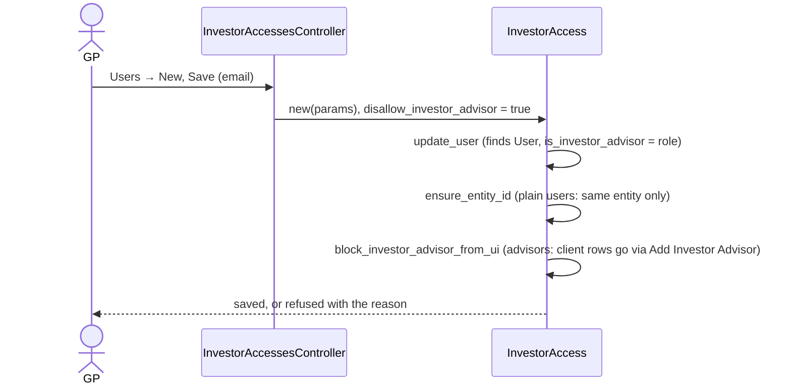
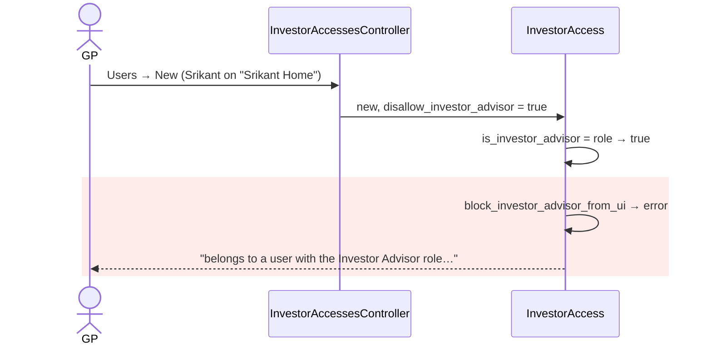
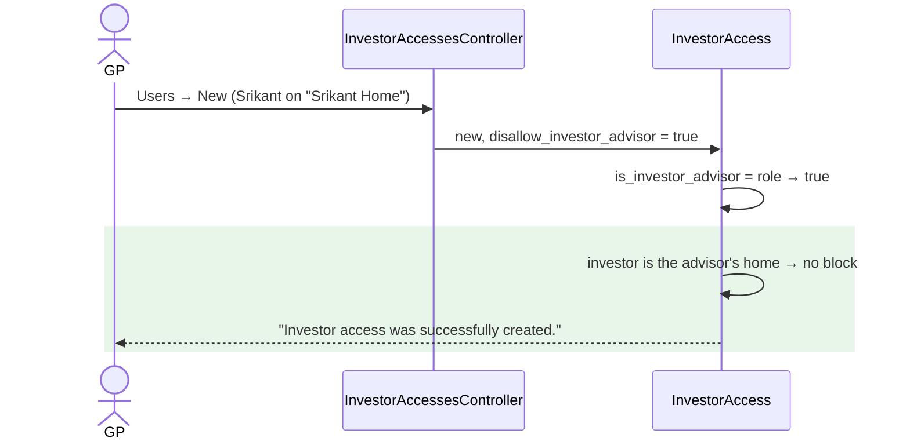

# Users form refuses an advisor on their own firm's LP record — Report

> **Audience:** The developer fixing this, and the reviewer checking the fix.
> **Companion documents:** [Tasks](tasks.md) · [QA checklist](qa-checklist.md)

> **Evidence, not guesses.** Line numbers are **as of `dd657b7a2`**; read them with
> `git show dd657b7a2:<path>`. Related: [fix-advisor-own-investor-access](../fix-advisor-own-investor-access/report.md).

---

## Summary

On a stakeholder's **Users → New** form, the GP can't add a user who holds the `investor_advisor`
role, even when the stakeholder **is that advisor's own firm** (the advisor's entity is an LP).
The block from #1557 checks only the global role, never whether the investor is the advisor's
home, so the advisor can't become a plain contact of their own LP record from the screen.

---

## The Feature — how it is meant to work

### The idea

A **contact row** (`InvestorAccess`) links a user to an investor record. It gives them that
investor's access and notifications. A GP creates contact rows from the stakeholder's **Users**
tab. Rows also come from CSV import, a user's self-service access request, and the **Add Investor
Advisor** flow on a commitment.

An **advisor** acts for clients. Client access must go through **Add Investor Advisor**
(`AddFolioInvestorAdvisor`). That flow creates the contact row **and** the advisor's personal fund
grants, plus the `InvestorAdvisor` grant that lets them switch into the client. A plain Users-tab
row on a client's investor would give a half-set-up advisor: a contact row, but no grant to switch
with. So #1557 made the Users form refuse advisor-role users.

An advisor's **own** firm can also be an LP (a family office, an individual investor, a
fund-of-funds manager). On that LP record the advisor is simply a colleague of the other contacts.
No grant is involved, and since [fix-advisor-own-investor-access](../fix-advisor-own-investor-access/report.md)
the row gives them exactly what a plain contact gets.

### How it fits together

| Part | Responsibility |
|---|---|
| `InvestorAccessesController#create` (`investor_accesses_controller.rb:143`) | Only creation path that sets `disallow_investor_advisor` |
| `InvestorAccess#update_user` (`investor_access.rb:128`) | Finds or creates the user; sets `is_investor_advisor` from the role (`:151`) |
| `InvestorAccess#ensure_entity_id` (`:110`) | A plain user may only join investors of their own entity |
| `InvestorAccess#block_investor_advisor_from_ui` (`:116`) | An advisor may not be added from the form, so client access goes through Add Investor Advisor |

### What it rests on

- **Client access:** a client's investor row for an advisor always comes with their grants (Add Investor Advisor).
- **Own-firm access:** the advisor's own-firm LP row is a plain contact row, and the same rule as for their colleagues applies.
- **Home:** "home" is `users.advisor_entity_id`, or `entity_id` when no home is recorded (legacy advisors). It is **not** the entity they are currently switched into.

---

## Symptom

| | |
|---|---|
| **What the user sees** | "Email belongs to a user with the Investor Advisor role and cannot be added as investor access from this page" |
| **Reproduce** | GP → stakeholder whose entity is the advisor's own firm → Users → New → advisor's email → Save |
| **Who is affected** | Advisors whose own firm is an LP. Prod dump: 47 advisor-role users have their home entity as an LP on 33 records; on 16 of those records the advisor has no contact row |
| **How often** | Every time, on that form only (CSV import and self-request are not blocked) |
| **Since when** | #1557 (`509802ba1`, 2026-07-24) |

---

## Root Cause

`block_investor_advisor_from_ui` (`investor_access.rb:116-118`) refuses whenever
`is_investor_advisor` is true. `update_user` sets that from the **global** role
(`user.has_cached_role?(:investor_advisor)`, `:151`). It never compares the investor with the
user's home entity. The aim was to keep **client** access on the Add Investor Advisor flow; the
advisor's own LP record was never a client.

**Why it was hard to see:** the only test (`features/core/investor_access.feature:148`) uses an
advisor from a separate advisory firm, the case the block is meant for. Other creation paths skip
the flag, so existing rows (like prod row 4097) look as if the form could create them.

---

## Blast Radius

| Also touches this code | Does this fix change it? | Needs checking |
|---|---|---|
| Users form, advisor added to a **client's** or unrelated investor | No, still refused | X1, X2, `investor_access.feature:148` |
| `ensure_entity_id` for plain users | No | X3 |
| `is_investor_advisor` flag and its consumers (Users-tab "Advisor" label, preview buckets, `remove_advisor_fund_access_rights` on destroy) | No, the flag still follows the role | H1, E4 |
| CSV import, self-request, Add Investor Advisor | No (they never set the flag) | `features/core/investor_access.feature`, `features/advisor/` |

**Why the flag is deliberately left alone:** `remove_advisor_fund_access_rights` (`investor_access.rb:186`)
runs only for flagged rows. It deletes the advisor's personal fund grants in that investor's
entity when the row is destroyed. Prod has 26 such grants in advisors' home entities (10
advisors). An unflagged own-firm row would leave them behind, and the advisor would keep seeing
those funds after the GP removed them.

---

## Fix

### How it works today

### How it works after the fix

### What changes

| # | Before | After | Where |
|---|---|---|---|
| 1 | Any advisor-role user refused | Not refused when `investor_entity_id` is the user's home (`advisor_entity_id`, else `entity_id`); all other advisor rows still refused | `investor_access.rb`, `InvestorAccess#block_investor_advisor_from_ui` |

### Matrix after the change

| # | Who is added | To which investor | Users form | Other paths |
|---|---|---|---|---|
| 1 | Plain user | own entity's investor | ✅ | ✅ |
| 2 | Plain user | another entity's investor | ❌ `ensure_entity_id` | ❌ |
| 3 | Advisor, at home | home entity's investor | ✅ **new** | ✅ |
| 4 | Advisor, switched into a client | home entity's investor | ✅ **new** (judged by home) | ✅ |
| 5 | Advisor with a fund-company home | that company's LP record | ✅ **new** | ✅ |
| 6 | Advisor | a client's investor | ❌ use Add Investor Advisor | ✅ |
| 7 | Advisor from another firm | unrelated investor | ❌ | ✅ |

---

## Verification

**ID legend:** **H** = Happy path · **E** = Edge case · **X** = Error (exception) case.
All in `features/core/investor_access_advisor_own_lp.feature`.

### Happy Path

| # | Scenario | Given | When | Then | Feature |
|---|---|---|---|---|---|
| H1 | Users form adds an advisor to their own LP (row 3) | advisor at home; their entity is an LP | GP fills Users → New and saves | "Investor access was successfully created."; row approved, flagged advisor | own_lp |
| H2 | The added advisor gets their LP's call notices | as H1 | row saved | advisor is a capital-call recipient for the LP on the fund | own_lp |

### Edge Cases

| # | Scenario | Given | When | Then | Feature |
|---|---|---|---|---|---|
| E1 | Advisor currently switched into a client (row 4) | entity_id = client, home = own firm | added to own LP | saved | own_lp |
| E2 | Fund-company home (row 5) | advisor's home is a fund company that is an LP | added to that LP record | saved | own_lp |
| E3 | Legacy advisor, no recorded home | `advisor_entity_id` nil; entity = LP's entity | added | saved | own_lp |
| E4 | Delete still cleans up | own-LP row plus a personal fund grant in the home entity | row deleted | personal grant removed | own_lp |

### Error Cases

| # | Scenario | Given | When | Then | Feature |
|---|---|---|---|---|---|
| X1 | Client's investor (row 6) | another investor entity on the fund | advisor added from the form | refused, advisor message | own_lp |
| X2 | Advisor from another firm (row 7) | advisor whose home is a different firm | added to an unrelated LP | refused, advisor message | own_lp |
| X3 | Plain user of another entity (row 2) | plain user elsewhere | added | refused by `ensure_entity_id` | own_lp |

**Fails against current code:** H1, H2, E1, E2, E3, E4. X1–X3 guard what must stay refused.

---

## Risks and Rollout

- **Could the exception let a client row through?** It can't: it applies only when the investor's entity *is* the user's home. Client and unrelated investors are still refused (X1, X2).
- **Could an advisor keep access after removal?** It can't: the flag is unchanged, so the delete cleanup still runs (E4).

| | |
|---|---|
| **Safe to deploy alone?** | Yes |
| **Data backfill needed?** | No |
| **Both regions together?** | No, independent |
| **Rollback** | Revert the commit; rows created meanwhile are ordinary contact rows |

---

## Spec Impact

**None.** The investor-access contract ("a firm's users can be added as contacts of that firm's
LP record") already holds for every other user; the advisor exception was simply too broad.
