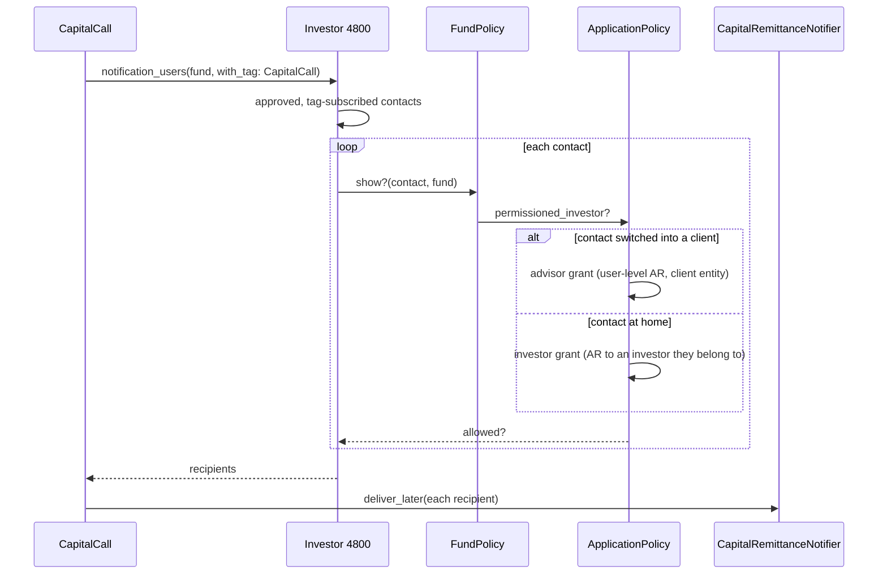
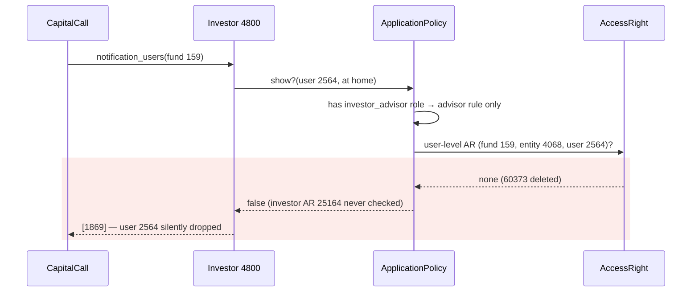
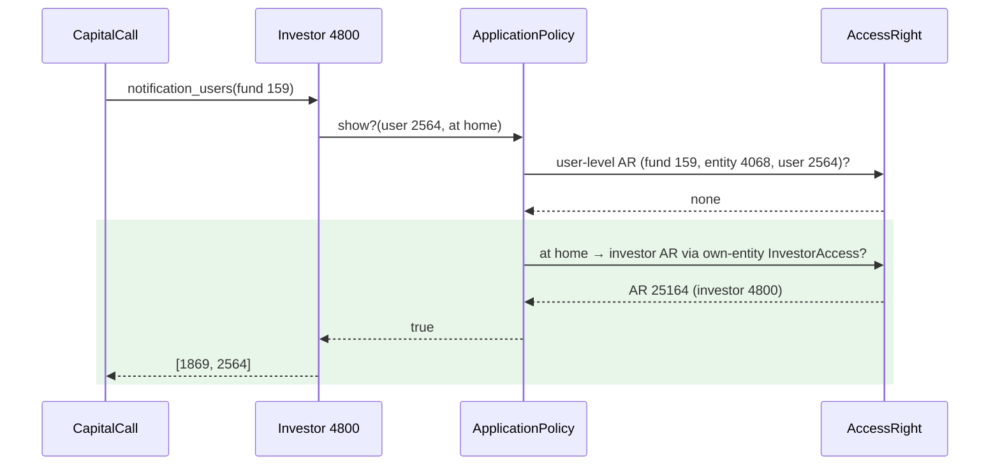

# Investor advisor loses access to their own investor record — Report

> **Audience:** The developer fixing this, and the reviewer checking the fix.
> **Companion document:** [Tasks](tasks.md) · [QA checklist](qa-checklist.md)

> **Planning phase — no code changes.** This document diagnoses the bug and plans the fix.
> Implementation happens later, in the tasks phase.

> **Evidence, not guesses.** Every claim in Root Cause carries a `file.rb:LINE` you have opened.
> Those line numbers are **as of `425c604f0`** — the fix changes the lines they point at, so read
> them with `git show 425c604f0:<path>`.

---

## Summary

A user who holds the `investor_advisor` role is also an ordinary approved contact of their **own**
investor record, but every investor permission check for them goes down the advisor-only branch.
That branch looks only for a user-level access right, so the normal investor grant every other
contact relies on is never consulted. As a result they are dropped from capital-call notices and
reminders (and locked out of the fund screens) for their own investment.

---

## The Feature — how it is meant to work

### The idea

An **investor contact** is a user with an approved `InvestorAccess` row on an `Investor`. The fund
grants access per investor: an `AccessRight` on the fund with `access_to_investor_id = <investor>`.
Every approved contact of that investor inherits it. No grant names the contact personally.

An **investor advisor** is a user who acts *for* other investors (clients). Each client relationship
is an `InvestorAdvisor` row. To act for a client, the advisor **switches**: `InvestorAdvisor#switch`
(`investor_advisor.rb:112`) moves `users.entity_id` to the client's investor entity and swaps the
roles for the grant's `allowed_roles` plus `investor_advisor`. The advisor's own entity is remembered
in `users.advisor_entity_id`, and `InvestorAdvisor.revert` (`investor_advisor.rb:128`) moves them
back. While switched, an advisor sees exactly what the client granted them **personally**: a
user-level `AccessRight` (`user_id = advisor`, `entity_id = client entity`). It is deliberately not
everything the client's investor can see.

An `InvestorAdvisor` grant comes in two kinds, told apart by the entity it belongs to. Both give
the same global `investor_advisor` role:

| Kind | Grant belongs to | Allowed roles | When switched in, the advisor… | Policy path while switched |
|---|---|---|---|---|
| **Investor Advisor** | the client **investor's** entity (added from a commitment) | `investor` | acts as that investor | `permissioned_investor_advisor?` (user-level AR in the client entity) |
| **Fund Advisor** | the **fund manager's** entity (Company menu → Advisors) | `employee` / `company_admin` (+ `approver`…) | acts as staff of the fund company | `permissioned_employee?` |

The advisor's **home** also comes in two shapes, both seen in prod. An `Investor`-type entity (prod
user 2564): after revert the only role is `investor_advisor` and `curr_role = investor`. Or an
`Investor Advisor` firm: `curr_role` = first of `advisor_entity_roles`, which is `investor` for a
family office that invests itself and `employee` for a pure advisory firm.

One person is often both: an advisor for clients and a plain investor in their own right. User 2564
is an example: an advisor for *Harshal Morde* (entity 4006) and an approved contact of their own
investor *Ayinavolu Visva Srikanth* (investor 4800, entity 4068) on fund 159.

The rule is: **when switched into a client, act as the advisor; when at home, act as yourself.** At
home an advisor who is also an investor contact must get exactly what a non-advisor contact of the
same investor gets, and nothing from their clients.

### How it fits together

| Part | Responsibility | Talks to |
|---|---|---|
| `CapitalCall#reminder_capital_call` (`capital_call.rb:157`) / `CapitalRemittance#send_notification` (`capital_remittance.rb:202`) | Fan a call notice/reminder out to the investor's recipients | `Investor#notification_users` |
| `Investor#notification_users` (`investor.rb:364`) | Approved + tag-subscribed contacts, then keep only those the policy allows to see the fund | `Pundit.policy`, `visible_from_home_entity?` |
| `ApplicationPolicy#permissioned_investor?` (`application_policy.rb:236`) | Choose the advisor or the investor rule | the two methods below |
| `#permissioned_investor_advisor?` (`:204`) | User-level AR in the (switched-into) entity | `AccessRight` |
| `#permissioned_investor_non_advisor?` (`:166`) | Investor-level AR through the user's approved `InvestorAccess`es | `InvestorAccess`, `AccessRight` |
| `User#investor_advisor?` (`user.rb:455`) | "Currently switched into a client": `advisor_entity_id != entity_id` | — |
| `User#home_persona` (`user.rb:470`) | In-memory mirror of `InvestorAdvisor.revert`, so a switched advisor's recipients don't depend on where they're switched | `Investor#visible_from_home_entity?` |
| `Fund.for_investor` (`fund_scopes.rb:10`) | List screens: already chooses advisor vs investor filter by **switch state** (`user.investor_advisor?`, `:12`) | `AccessRight` filters |

### What it rests on

- The advisor/investor choice is made by **where the user is**: switched or at home. The list scopes
  already do this (`fund_scopes.rb:12`).
- Fund access for investors is granted **per investor**, never per contact.
- An advisor at home can never see a client's records. Client data is reachable only while switched.
- `home_persona` reproduces what a real `InvestorAdvisor.revert` would leave the user with (entity,
  roles **and** `curr_role`). The privilege bound in `features/advisor/investor_advisor_notifications.feature`
  (NOTIF-2) depends on it.

---

## Symptom

| | |
|---|---|
| **What the user sees** | No capital-call notice or reminder for their own investment, and no in-app notification either. The other contact of the same investor receives it. |
| **Reproduce** | Give a user the `investor_advisor` role (any client), make them an approved contact of their own investor on a fund with an investor-level AR, leave them at home, send a call reminder. |
| **Who is affected** | Every user holding the `investor_advisor` role who is also a contact of an investor whose access comes through an investor-level grant (prod: user 2564 / investor 4800). |
| **How often** | Every time, for every fund-scoped notification and screen. Not intermittent. |
| **Since when** | Since the advisor's personal grant on their own entity was removed (prod: InvestorAdvisor 484 and AR 60373 soft-deleted 2025-05-22). |

Prod evidence (dump on 33066): reminder event 69820 for remittance 96858 (9 Oct 2026) has one
notification, to user 1869. All five capital-remittance notifications for investor 4800 since
21 Aug 2026 went to 1869 only. User 2564 received Harshal Morde's (investor 4736) in the same runs.
`Investor.find(4800).notification_users(Fund.find(159), with_tag: 'CapitalCall')` gives `[1869, 3539]`.
Before the policy filter, the list is `[1869, 2564, 3539]`. With the advisor role removed (in a rolled-back
transaction) user 2564 passes: `show? = true`.

---

## Root Cause

**1. The role, not the switch state, picks the rule.** `permissioned_investor?`
(`application_policy.rb:237`) sends any user with `has_cached_role?(:investor_advisor)` to
`permissioned_investor_advisor?` **only**. That method needs a user-level `AccessRight` for the
user (`:211-216`). User 2564 at home has none on fund 159 for entity 4068: AR 60373 was soft-deleted.
The investor-level grant (AR 25164, fund 159 → investor 4800) is only read by
`permissioned_investor_non_advisor?` (`:177-184`), which is never reached. So `FundPolicy#show?`
(`fund_policy.rb:58`) is false and `Investor#notification_users` (`investor.rb:399-404`) drops them.
The role is global (no resource), so getting it for one client changes the rule for **all** their
investor checks, including their own.

**2. The home-entity fallback can't help.** `visible_from_home_entity?` (`investor.rb:426`) uses
`User#home_persona`, which returns nil unless the user is switched (`user.rb:471`,
`investor_advisor?` at `:455`). User 2564 is at home, so nil. And when an advisor *is* switched,
the persona sets `curr_role = role_names.first` (`user.rb:491`). For a home entity of type
`Investor`, that's `"investor_advisor"`. A real revert's `setup_defaults` sets `curr_role = :investor`
(`user.rb:329-332`). So the persona doesn't mirror revert for this shape, and it would fail the
investor rule's `curr_role` check (`application_policy.rb:168`) even after cause 1 is fixed.

**Why it was hard to see:** the recipient filter drops a contact silently. There's no log line, no
notification row and no skip reason. The screens show the contact as approved and email-enabled,
and the investor still has a recipient (the other contact), so `capital_call_subscribers?`
(`investor.rb:439`) reports nothing wrong. The only trace is an absence.

---

## Blast Radius

`permissioned_investor?` is called by 30 policies (fund, commitment, remittance, remittance payment,
distribution payment, account entry, fund unit/ratio, portfolio*, scenario*, KPI, deal, investment
opportunity/EOI, secondary sale/offer/interest/allocation, approval/response, excused investor). The
fix changes behaviour **only** for users who hold `investor_advisor`, are **at home**, have
`curr_role = investor`, and have an approved `InvestorAccess` on an investor **in their home entity**.
Everyone else follows exactly the same code path as today.

| Also touches this code | Does this fix change it? | Needs checking |
|---|---|---|
| All 30 policies above, for non-advisor users | No (unchanged `else` branch) | `features/core/access_rights*.feature`, `features/fund/fund_access.feature` |
| Same policies, **Investor Advisor** switched into a client | No (fallback skipped while switched) | `features/advisor/investor_advisor.feature`, H4, X4 |
| Same policies, **Fund Advisor** switched into the fund company | No (`permissioned_employee?` decides; fallback skipped while switched) | H6, E10 |
| **Fund Advisor** at home | **Yes**: gains own investor's records, never the fund company's staff view | H5, E11 |
| Same policies, advisor **at home** with own investor access | **Yes**: gains own investor's records | new feature (H1–H3, E1–E6) |
| Advisory-firm user at home (`curr_role` employee, entity type `Investor Advisor`) | No (investor rule needs `curr_role = investor`) | E7 |
| `Investor#notification_users`: every fund-scoped notifier (calls, reminders, payments, distributions, fund documents, commitments) | Yes, for the advisor-at-home shape only | H1, H4 |
| `InvestorKyc#notification_users` (`investor_kyc.rb:283`) | Only through `home_persona` `curr_role` | NOTIF-6 (existing) |
| `FundsHelper` notification preview counts (`funds_helper.rb:230`) | Yes: preview now counts the advisor at home, matching send | E8 |
| `WithAuthentication` "switch persona to view" hint (`with_authentication.rb:102`) | Persona `curr_role` now matches revert | NOTIF-7/8 (existing) |
| `Fund.for_investor` and other list scopes | No (already decide by switch state) | — |
| `User#home_persona` callers | `curr_role` may change from `investor_advisor` to `investor` for non-advisory home entities | NOTIF-2, NOTIF-9, E9 |

---

## Fix

### How it works today

### How it works after the fix

### What changes

| # | Before | After | Where |
|---|---|---|---|
| 1 | Advisor role → advisor rule only | Advisor rule, **or**, when at home (`!user.investor_advisor?`), the investor rule | `application_policy.rb`, `ApplicationPolicy#permissioned_investor?` |
| 2 | Investor rule counts every approved `InvestorAccess` of the user | For an advisor-role user, it counts only accesses on investors in their current (home) entity (`investor_entity_id = user.entity_id`), so a client's grant can't leak into the home view | `application_policy.rb`, `ApplicationPolicy#permissioned_investor_non_advisor?` |
| 3 | Persona `curr_role = role_names.first` | Persona `curr_role` = what `setup_defaults` would set on revert (`investor` for Investor / Investment Advisor / Family Office homes; first home role for an Investor Advisor home; `employee` for company/fund) | `user.rb`, `User#build_home_persona` (shared helper used by both) |
| 4 | Contact silently dropped | `Rails.logger.info` naming the access id, user id (no email), investor and model when an approved, subscribed contact is filtered out by the policy check | `investor.rb`, `Investor#notification_users` |
| 5 | "At home" judged by `!user.investor_advisor?` alone | `advisor_at_home?`: not switched by **either** marker (`investor_advisor?` false **and** `investor_advisor_id` nil). Prod has 1 advisor with nil `advisor_entity_id` (investor_advisor? false even when switched) and 3 switched advisors with nil `investor_advisor_id` | `application_policy.rb`, `ApplicationPolicy#advisor_at_home?` |
| 6 | Advisor contact counted when `policy.show?` passes for the model | `Investor#advisor_notifiable?`: personal grant from this investor's entity, **or** `show?`/`overview?` only when this investor IS the entity they are in now, **or** home persona. Stops an advisor at home (or switched into another client) from receiving a client's notices on a shared fund without a personal grant | `investor.rb`, `Investor#advisor_notifiable?` |
| 7 | Fund preview had its own advisor rule (personal grants looked up in the fund's entity) | Preview calls `Investor#advisor_notifiable?`, the send rule | `funds_helper.rb`, `FundsHelper#calculate_user_access_stats` |
| 8 | Advisor-grant override reversed a contact's email opt-out | The override applies only when the recipient is **not** a named contact on the notification's folio; a named contact's own `email_enabled` decides | `config/initializers/noticed.rb`, `#named_contact_on_folio?` |
| 9 | Advisor branch checked `show?` only, so deal notices (`overview?`) never reached an advisor | `Investor#investor_can_view?` (`show?` or `overview?`) for the advisor branch and the home persona | `investor.rb` |
| 10 | KYC `show?` for an advisor-role user only via `for_investor_advisor` (needs a commitment on a permissioned fund) | Also the plain "own investor's KYC" check when at home | `investor_kyc_policy.rb`, `InvestorKycPolicy#show?` |
| 11 | Advisor account whose stored home roles omit `investor_advisor` loses the role on revert and then counts client contact rows at home | Plain investor rule uses the home-entity limit whenever `advisor_entity_id` is present | `application_policy.rb`, `ApplicationPolicy#permissioned_investor?` |
| 12 | Deleted home entity: persona guessed a `curr_role` | `home_persona` is nil (a real revert would raise) | `user.rb`, `User#build_home_persona` |
| 13 | Access Denied said nothing to an advisor who could see the record by switching to a client / fund company | Names the company and offers **[Switch to …]**, judged by re-running the denied query against `User#switched_persona(grant)` (mirror of `InvestorAdvisor#switch`); plain "Access Denied" when no switch helps | `with_authentication.rb`, `user.rb#switched_persona` |
| 14 | Switch always went back to the referer | `return_to` (same-site paths only) so the button lands on the denied page | `investor_advisors_controller.rb#switch` |

---

## Verification

**ID legend:** **H** = Happy path · **E** = Edge case · **X** = Error (exception) case

Shape used throughout, mirroring prod: fund company *Artha* with fund *F*. Advisor **A**'s home is an
`Investor`-type entity **Home**. Investor **Own** (in Home) has an investor-level AR on F, with A
and plain contact **P** as approved contacts. A advises client entity **Client** (investor
**ClientInv** on F, user-level AR for A in Client). As a **Fund Advisor**, A holds a grant on Artha
(`employee`) plus a personal AR on F in Artha. All scenarios go in
`features/advisor/investor_advisor_own_investor_access.feature`.

### Happy Path

| # | Scenario | Given | When | Then | Feature |
|---|---|---|---|---|---|
| H1 | Advisor at home gets their own call reminder | A at home, no user-level AR for Home | a reminder is sent for Own's remittance | A and P are both notified | own_investor_access |
| H2 | Advisor at home gets their own call notice | as H1 | the call notice is sent for Own's remittance | A and P are both notified | own_investor_access |
| H3 | Advisor at home can open their own fund and remittance | as H1 | A opens F and Own's remittance | both are allowed | own_investor_access |
| H4 | Switched **Investor Advisor** still acts for the client | A switched into Client | a reminder is sent for ClientInv's remittance; A opens it | A is notified and can open it | own_investor_access |
| H5 | **Fund Advisor** at home gets their own reminder | A's only grant is a Fund Advisor grant on Artha (`employee`); A at home | a reminder is sent | A and P are notified | own_investor_access |
| H6 | Switched **Fund Advisor** works as staff | A switched into Artha | A opens F and ClientInv's remittance | both allowed (employee rule, unchanged) | own_investor_access |
| H7 | Family-office home whose home roles start with `investor` | A's home is an `Investor Advisor` entity with home roles `investor,investor_advisor` | a reminder is sent | A is notified | own_investor_access |
| H8 | Access Denied offers the switch | A at home | A opens Harshal's remittance, presses **Switch to Harshal** | message names Harshal; button switches and lands back on the remittance | own_investor_access |

### Edge Cases

| # | Scenario | Given | When | Then | Feature |
|---|---|---|---|---|---|
| E1 | Switched into a client that has no grant on F | A switched into a second client with no AR on F | a reminder is sent for Own's remittance | A is still notified (home persona) | own_investor_access |
| E2 | Switched into a client that also has a grant on F | A switched into Client | a reminder is sent for Own's remittance | A is notified | own_investor_access |
| E3 | Client's records stay hidden at home | A at home, approved contact on ClientInv | A opens ClientInv's remittance | denied; A still receives ClientInv's notices through the personal grant (by design, NOTIF-1..9) | own_investor_access |
| E4 | Fund granted only to the client is hidden at home | fund G with an AR for ClientInv only | A at home opens G | denied, and A is not a recipient for G | own_investor_access |
| E5 | Tag subscription still applies | A's own access tagged `KYC` | a reminder is sent for Own's remittance | A is not notified, P is | own_investor_access |
| E6 | Advisor whose personal grant on Home still exists | user-level AR for A in Home on F | a reminder is sent | A is notified exactly once | own_investor_access |
| E7 | Advisory-firm user at home gains nothing | A2's home is an `Investor Advisor` firm, curr_role employee, approved access on ClientInv | A2 at home opens F | denied | own_investor_access |
| E8 | Send-time and preview agree | as H1 | the fund's notification preview is computed | A is counted as a recipient | own_investor_access |
| E9 | Persona mirrors a real revert for an `Investor`-type home | A switched into Client | compare `home_persona` with the user after `InvestorAdvisor.revert` | same entity, roles and `curr_role` (`investor`) | own_investor_access |
| E10 | Switched **Fund Advisor** still gets their own reminder | A switched into Artha | a reminder is sent | A is notified for Own's remittance | own_investor_access |
| E11 | **Fund Advisor** staff rights don't come home | Fund Advisor grant on Artha; A at home | A opens ClientInv's remittance | denied | own_investor_access |
| E12 | All advisor grants deleted (prod history) | A's grants destroyed; role kept | a reminder is sent; A opens F | A notified and allowed | own_investor_access |
| E13 | Fund Advisor's opt-out on own contact row | Fund Advisor grant; own row `email_enabled` off | reminder sent | in-app notice, **no email**; P emailed | own_investor_access |
| E14 | Deal notice at home | deal granted to Own | recipients computed | A and P | own_investor_access |
| E15 | Own KYC with no commitment, at home | — | A opens it; KYC form recipients | allowed; A is a recipient | own_investor_access |
| E16 | Advisor account without the role at home | stored home roles `investor` | A opens client-only fund G; opens F | G denied; F allowed | own_investor_access |
| E17 | Switched into the wrong client | switched into Mehta | A opens Harshal's remittance | message names Mehta (current) and Harshal (switch to) | own_investor_access |
| E18 | Fund Advisor switch offered | Fund Advisor grant; Rao remittance | A opens it | message names Artha | own_investor_access |

### Error Cases

| # | Scenario | Given | When | Then | Feature |
|---|---|---|---|---|---|
| X1 | Own investor has no grant on the fund | Own's AR on F removed | a reminder is sent | neither A nor P is notified; A is denied F | own_investor_access |
| X2 | Own access unapproved | A's access on Own unapproved | a reminder is sent | A is not notified | own_investor_access |
| X3 | Own access deleted | A's access on Own soft-deleted | a reminder is sent | A is not notified | own_investor_access |
| X4 | Switched advisor can't open own records through the client session | A switched into a client with no AR on F | A opens Own's remittance | denied (fallback is home-only) | own_investor_access |
| X5 | Dropped contact is logged | as X1 | notification recipients are computed | a log line names A's access and F | own_investor_access |
| X6 | Legacy advisor (nil `advisor_entity_id`) switched into a client | client investor has an investor-level grant on F; no personal grant | A opens F | denied (not treated as at home) | own_investor_access |
| X7 | At home, a client sharing F without a personal grant | A approved contact of Rao on F, no personal AR | reminder sent | A not notified for Rao; own reminder still arrives | own_investor_access |
| X8 | Switched into Harshal, another client's notice on F | as X7 plus Harshal grant | reminder sent | A notified for Harshal, not for Rao | own_investor_access |
| X9 | No switch would help | fund G granted only to ClientInv, no personal grant | A opens G | exactly "Access Denied" | own_investor_access |
| X10 | Off-site `return_to` | — | switch posted with `//evil…` / `https://evil…` | no off-site redirect; switch still happens | own_investor_access |
| X11 | Admin-editable client name with markup | client renamed `Client <b>Bold</b> & Co` | A opens the client remittance | name shown escaped in message and button | own_investor_access |

**Fails against current code:** H1, H2, H3, H5, H7, E1, E8, E9, E12 and X5 (seen failing, 2026-10-16). Added after the review: H8, E13 (on top of the first fix), E14, E15, E17, E18, X6, X7, X10 cover behaviour the base code lacks or that the first fix regressed.
The others are regression guards that pass today and must keep passing.

---

## Review findings left out of scope

Three read-only reviews (access paths, notification paths, adversarial diff review) ran on
2026-10-16. Everything they found that this diff introduced or worsened is fixed above (rows 5–8,
12). The same-bug-class gaps are fixed too (rows 9–11). These are **pre-existing** and need a
product decision, so they are listed, not changed:

| Finding | Where | Why not changed here |
|---|---|---|
| At home, list scopes ignore personal (`user_id`) access rights, so a document shared to the advisor personally shows on show? but not in lists | `access_right.rb` `access_filter` (role, not switched) | The `user_id` clause can't tell a GP "specific user" share from an advisor-grant right; adding it back would list clients' records at home |
| `Entity.for_investor` lists fund managers reached only through clients, at home | `entity.rb:221` | Names only; the records behind them are still denied |
| Recipient paths with no model (investment opportunities, EOIs, approvals, secondary-sale buyer/seller lists, NDA signatory auto-tag, KYC reminder) include an advisor's **client** contact rows with no grant check | `investment_opportunity.rb`, `approval_response.rb`, `secondary_sale_notifiers.rb`, `nda_notification_recipients.rb`, `kyc_reminder_job.rb` | Whether client notices must require a personal grant is a product rule, not this bug |
| A GP can't add an advisor as a contact of the advisor's own investor from the Users tab; that row is labelled "Advisor" | `investor_access.rb` `block_investor_advisor_from_ui`, `_investor_access.html.erb` | UX; import / self-request still work |
| A Fund Advisor **switched into** the fund company is emailed despite an opt-out on their own contact row | `noticed.rb` `model.entity_id == recipient.entity_id` | Staff-of-the-entity rule; unchanged by this fix |

---

## Risks and Rollout

- Widens access for advisor-role users → the widening is limited to records an ordinary contact
  of the same investor already sees. Records reachable through clients are blocked by fix 2 and
  the existing per-record investor check (`application_policy.rb:194`) (E3, E4, E7).
- Persona `curr_role` change → NOTIF-1..9 re-run, and E9 pins the persona to the real revert.
- 30 policies share the method → the non-advisor branch is byte-identical; full
  `features/advisor`, `features/core/access_rights*` and `features/fund` regression runs.

| | |
|---|---|
| **Safe to deploy alone?** | Yes |
| **Data backfill needed?** | No. Missed reminders aren't re-sent automatically; the fund can press Reminder again after deploy. |
| **Both regions together?** | No, independent (code-only, no data shape change). |
| **Rollback** | Revert the commit; nothing is persisted. |

---

## Spec Impact

**None.** The investor-access contract ("approved contacts of an investor with a fund grant see
that fund and receive its notices") already holds for every other user. The advisor-at-home path
simply didn't apply it. `skip_specs: true` is set in `.openspec.yaml`.
