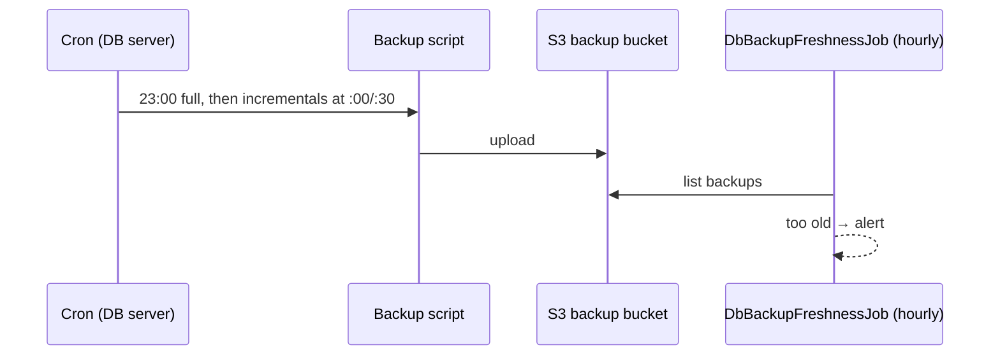
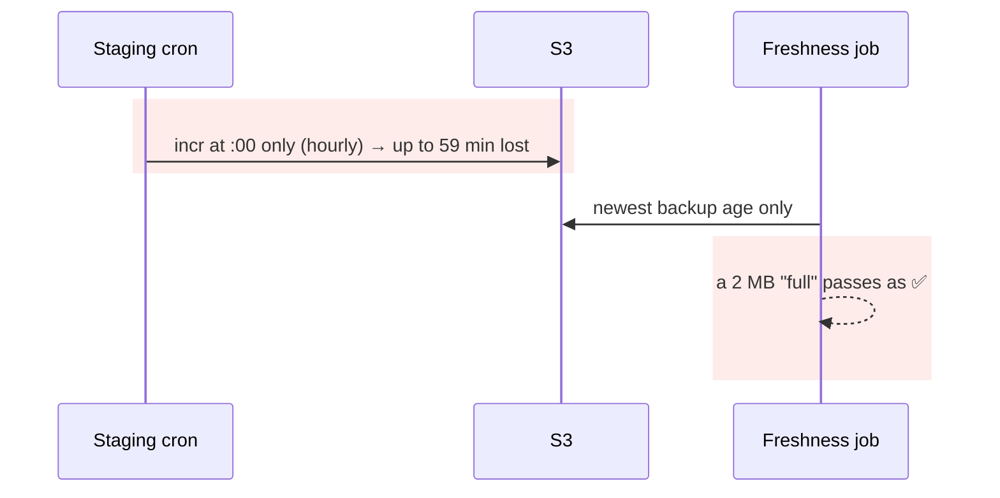
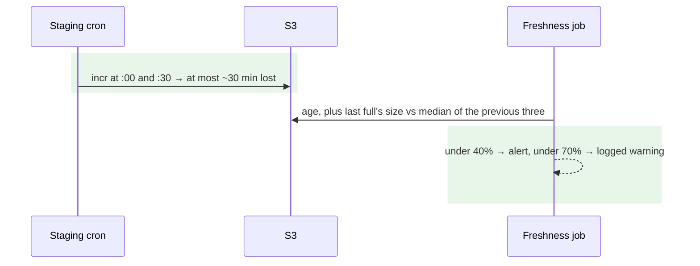

# Staging breaks the 30-minute recovery-point promise, and backups are checked for age only — Report

> **Audience:** The developer fixing this, and the reviewer checking the fix.
> **Companion document:** [Tasks](tasks.md)

> **Planning phase — no code changes.** Line numbers are **as of `426d02c8f8`** (`git show 426d02c8f8:<path>`). Live facts come from read-only checks on 2026-11-08.

> **Decisions (user, 2026-11-08):** change **staging only**, not production; change the **schedule only** (the live staging DB server has no AWS role, so the baked script can't run there yet; full migration goes with C5).

---

## Summary

- We promise clients a 30-minute recovery point, but staging backs up **hourly**. The 13:17 drill lost 48 minutes, and the worst case is 59.
- Backups are only checked for **age**: an empty or truncated full backup passes as ✅ until the day someone tries to restore it.

---

## The Feature — how it is meant to work

### The idea

- MySQL backups form a **chain**: one full each night at 23:00 UTC, then incrementals through the day.
- The **recovery point** is the newest backup. The gap between incrementals is the most data a recovery can lose, so the promise (RPO 30 min, security questionnaire H3) needs an incremental at least every 30 minutes.
- An hourly job (`DbBackupFreshnessJob`) alerts if the newest backup is too old, and a morning report (`rake s3:backup_daily_report`) shows counts, gaps and full sizes.

### Key concepts

| Concept | What it is | Example | Stored in |
|---|---|---|---|
| Cadence | How often incrementals run | `0,30 0-22 * * *` = :00 and :30 | the DB server's crontab |
| Legacy backup job | The pre-bake `ubuntu` crontab entry on the live boxes | `0 0-22 * * * /home/ubuntu/backup_db.sh incr` | live staging DB `10.0.3.138` |
| Full size | Total bytes of one nightly full's objects | staging ~138 MB, prod IN ~1.67 GB | S3 `<bucket>-backup-xtra/<ts>-full/` |
| Size check | Today's full compared with the median of the previous three | 131 MB vs 138 MB median = 95% | `DbBackupFreshnessJob` |

### How it fits together

### What it rests on

- Incrementals at least every 30 minutes on every environment.
- A backup that lands is a backup that restores.

---

## Symptom

| | |
|---|---|
| **What the user sees** | The drill report: "Recovery point (RPO) not met: 48 min of changes lost" (13:17 drill) |
| **Audit (read-only)** | Last 24 h: staging.in **23** incrementals (hourly); production.in **46**; production.us **46** (every 30 min) |
| **Who is affected** | Staging only; production keeps the promise |
| **Since when** | The live staging box's legacy crontab |

---

## Root Cause

- **Staging's live DB server runs incrementals hourly.** Its `ubuntu` crontab is `0 0-22 * * * /home/ubuntu/backup_db.sh incr` (read-only probe of `10.0.3.138`, 2026-11-08). Production runs `:00/:30`.
- **The baked 30-minute schedule can't simply replace it.** The baked script reads its settings from SSM through the server's AWS role, and this server has **no role** (probe: `instance role: NONE`, `Unable to locate credentials`).
- **No size check exists.** `check_bucket` (`app/packs/core/base/jobs/db_backup_freshness_job.rb:139-176`) checks only the newest backup's *age*. `prefix_size` (`:254`) exists but is used only by the morning report. The size check designed in `docs/operations/dr/db_backup_system.md` §11 was never built.

**Why it was hard to see:** freshness passes with hourly backups (limit 2 h), and the morning report's "largest gap 60 min" looks the same as production's expected nightly gap.

---

## Blast Radius

| Also touches this code | Changed? | Needs checking |
|---|---|---|
| Live staging DB crontab | **Yes**: one line, via a rake task with dry run; staging only | QA B1 |
| Production DB crontabs | **No**: refused by the task (decision) | X1 |
| `DbBackupFreshnessJob#check_bucket` (hourly alert, `dr_readiness`, `dr:assess`) | **Yes**: size check on the primary bucket | H3–X3 |
| `rake s3:backup_daily_report` | Indirect: it prints the same failures | QA |
| The drill report's RPO row | No code change; staging shows ✅ once the cadence is 30 min | next drill |

---

## Fix

### How it works today

### How it works after the fix

### What changes

| # | Before | After | Where |
|---|---|---|---|
| 1 | Hourly incrementals on staging | `0,30 0-22 * * *`. Pure transform `Dr::BackupSchedule.thirty_minute_cadence` changes only the legacy incremental line and refuses anything else | `lib/dr/backup_schedule.rb` |
| 2 | — | `rake dr:set_backup_cadence[staging.in]`: dry run by default, `EXECUTE=1` to apply. Refuses anything but `staging.in`; checks the AWS account (174852986003); refuses within 5 min of a :00/:30 run or while a backup runs; saves the old crontab on the server; re-reads to prove the change; prints the rollback command | `lib/tasks/dr_backup_cadence.rake` (new) |
| 3 | Age-only checks | Size check on the primary bucket: newest full older than 2 h (so an upload in progress isn't judged) vs the median of the three before it. Under 40% → failure (alert); under 70% → warning (logged; rollout per §11) | `DbBackupFreshnessJob#check_bucket`, `Dr::BackupSchedule.grade_full_size` |
| 4 | §11 "proposed" | Marked implemented, with thresholds | `db_backup_system.md` |

---

## Verification

All rows in `features/misc/dr_backup_rpo.feature`.

| # | Scenario | Given | When | Then |
|---|---|---|---|---|
| H1 | Hourly → 30 min | staging's crontab (2 `@reboot` lines, full, hourly incr) | transform | incr line `0,30 0-22 …`; others byte-identical |
| H2 | Healthy full | 138.1 MB vs median 138.0 MB | grade size | ✅ |
| E1 | Already 30 min | crontab with `0,30 0-22 … incr` | transform | unchanged |
| E2 | Thin history | only 2 earlier fulls | grade size | ✅ "not enough history" |
| E3 | Somewhat small full | 90 MB vs 138 MB (65%) | grade size | ⚠️ |
| X1 | Production refused | env `production.in` | cadence allowed? | no |
| X2 | No legacy incr line | crontab without it | transform | refused, crontab untouched |
| X3 | Truncated full | 2 MB vs 138 MB | grade size | ❌ "truncated or empty?" |
| X4 | Empty full | 0 bytes | grade size | ❌ |

**Fails against current code:** every row (no transform, guard or grading exists); X3 reproduces the age-only blind spot.

---

## Risks and Rollout

- The cadence change races a running backup → the task refuses within 5 min of :00/:30 and while `backup_db.sh` runs.
- More incrementals mean more S3 objects → about 23 more per day on staging (each a few MB); retention already handles it.
- Size check false alarms → a full under 70% only warns (log); the alert needs under 40%, which day-to-day data never shows (±1% per day over 30 days).
- Rollback: the task saves the crontab on the server and prints `crontab ~/crontab.before-30min.<ts>`.

| | |
|---|---|
| **Safe to deploy alone?** | Yes |
| **Data backfill?** | No |
| **Both regions together?** | No; production already meets the cadence |
| **Rollback** | Restore the saved crontab; revert the commit |

---

## Spec Impact

**None.** The promise already exists (security questionnaire H3); staging didn't meet it.
