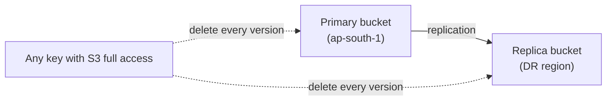
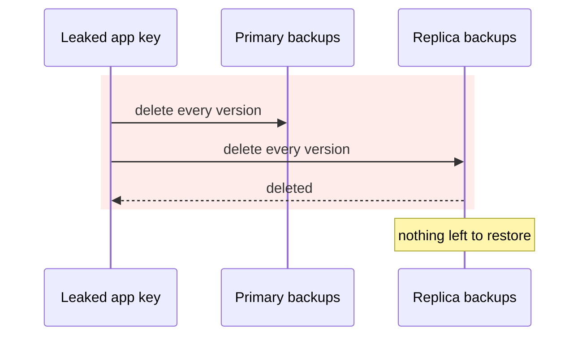
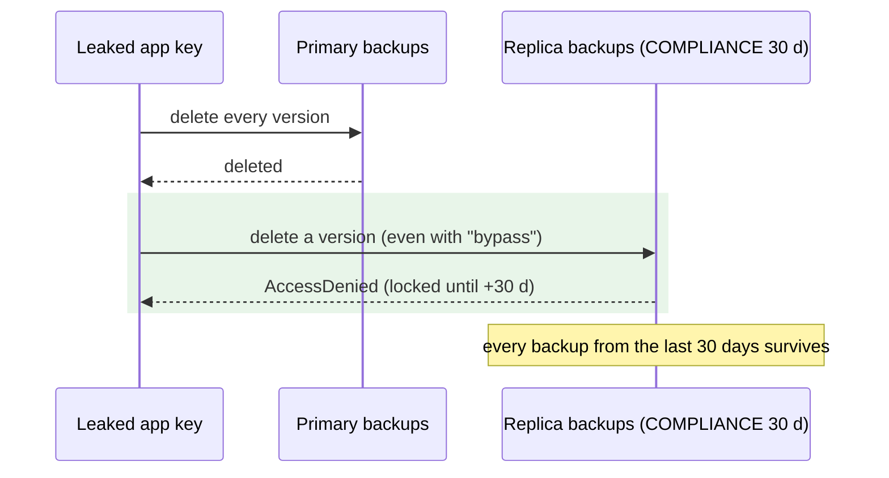

# Any app key can delete every backup — Report

> **Audience:** The developer fixing this, and the reviewer checking the fix.
> **Companion document:** [Tasks](tasks.md)

> **Planning phase — no code changes, no AWS changes.** Line numbers are **as of `588b13deec`**. AWS facts come from read-only checks and IAM policy simulation on 2026-11-08.

> **Decisions (user, 2026-11-08):** lock in **compliance mode for 30 days** (changed from governance once the simulation showed the app keys can bypass governance); **staging first**, production after a separate go-ahead.

---

## Summary

- Every database backup and document is replicated to a second region, but nothing stops a key with S3 access from **permanently deleting every version** in both copies. The app's own keys have that access.
- One leaked key (from an app server, a laptop, or the backup script where it sits in plain text) is enough to destroy everything a recovery would need.

---

## The Feature — how it is meant to work

### The idea

- Backups (xtrabackup chains) and documents are written to a **primary** bucket and replicated to a **replica** bucket in the DR region.
- Versioning keeps old versions of each file. Delete markers are deliberately *not* replicated, so a soft delete in the primary doesn't reach the replica.
- **The replica is the last line of defence.** It must survive a mistake, a bad script or a stolen key, for at least as long as it takes us to notice.

### Key concepts

| Concept | What it is | Example |
|---|---|---|
| Replica bucket | The DR-region copy of a primary bucket | `docs.altx.com.staging-replica-backup-xtra` (ap-south-2) |
| Version delete | Permanently removing a specific version (not a soft "delete marker") | `DeleteObject --version-id …` |
| Object Lock | An S3 setting that makes object versions undeletable until a date | — |
| Compliance mode | Object Lock that **nobody** can shorten or bypass, not even AWS root | 30 days |
| Governance mode | Object Lock that principals with `s3:BypassGovernanceRetention` can override | (rejected: the app keys have that right) |
| Default retention | The lock applied automatically to every new object written to the bucket | COMPLIANCE, 30 days |

**Object Lock rules**
- It can be enabled on an **existing** versioned bucket. Once enabled, it **can't be disabled**; the default retention can be changed or removed.
- Default retention applies to objects written **after** it is set, replicas included. Existing objects aren't locked retroactively.
- A compliance-locked version can't be deleted, overwritten in place or shortened until its date. The lifecycle can't remove it early either.

### How it fits together

---

## Symptom

| | |
|---|---|
| **What happens** | A key with S3 access can delete every backup version in both regions; there is no recovery from that |
| **Evidence** | IAM simulation: staging `user/developer` and production `user/dev` (shared by **IN and US**) → `s3:DeleteObjectVersion`, `s3:BypassGovernanceRetention`, `s3:PutBucketPolicy`, `s3:DeleteBucket` all **allowed** on the replica backup buckets (via `AmazonS3FullAccess` on their group) |
| **Where the keys live** | App credentials on every app server; **in plain text** in the live backup script `/home/ubuntu/backup_db.sh` on the DB servers |
| **Current replica settings** | `docs.altx.com.staging-backup-xtra` → `docs.altx.com.staging-replica-backup-xtra` (ap-south-2): versioning on, **Object Lock not enabled** |

---

## Root Cause

- **The replica buckets have no Object Lock.** `s3_ensure_bucket!` (`lib/tasks/aws_utils.rb:1285`) enables versioning, encryption and public-access blocking, but never Object Lock. Versioning protects against overwrites, not against version deletes.
- **Both regions are in the same AWS account and reachable with the same keys.** Replication protects against losing a *region*, not against a *key*.
- **The keys that could do this are everywhere:** the app's own keys hold `AmazonS3FullAccess`. That is a broader security issue, logged as G25 (Batch C), and out of scope here.

**Why it was hard to see:** "versioned and replicated to a second region" sounds safe. The gap only shows when you ask "who could delete the versions?"

---

## Blast Radius

| Also touches this code / bucket | Changed? | Needs checking |
|---|---|---|
| Replica backup buckets (staging now; prod IN / US later) | **Yes**: Object Lock + default COMPLIANCE 30 d | QA B1–B3 |
| Replica document buckets (staging now; prod later) | **Yes**: same | QA H2 |
| S3 replication into those buckets | Must keep working (replicas get the default retention) | QA H1 |
| Lifecycle on replicas (180-day expiry, `s3_backups.py`) | No: 180 d > 30 d, so compatible | — |
| Restore from the replica (`BUCKET_OVERRIDE`) | No: read-only | drill |
| `aws:provision_s3_buckets` | **Yes**: also ensures the lock on replicas | X1 |
| `aws:dr_readiness` | **Yes**: new check "Replica backups locked" | H3 |
| Primary buckets | **No**: unlocked, so the app can still prune and manage them | — |

---

## Fix

### How it works today

### How it works after the fix

### What changes

| # | Before | After | Where |
|---|---|---|---|
| 1 | Replicas unlocked | `s3_ensure_object_lock!(bucket:, mode: "COMPLIANCE", days: 30)`: enables Object Lock on the existing versioned bucket and sets the default retention; idempotent; never touches a primary bucket | `lib/tasks/aws_utils.rb` |
| 2 | — | `rake "aws:lock_replica_buckets[staging.in]"`: dry run by default, `EXECUTE=1` to apply. AWS account check; only the env's *replica* buckets (backup + documents); refuses production until approved (`ALLOW_PRODUCTION=1` plus a separate go-ahead); prints the irreversibility warning | `lib/tasks/aws.rake` |
| 3 | — | Proof step: writes one tiny marker to the primary backup bucket (`dr-lock-check/<ts>`), waits for it to replicate, reads its retention on the replica (expect COMPLIANCE, ~30 d), and tries to delete that version **with the app key and the bypass header** (expect AccessDenied). The marker stays 30 days (a few bytes) | same task, `PROVE=1` |
| 4 | Readiness doesn't look | `aws:dr_readiness`: "Replica backups locked" ❌ if Object Lock is off or default retention < 30 d / not COMPLIANCE | `aws.rake` `dr_readiness` |
| 5a | Replication role reads only versions/ACLs/tags | Also `s3:GetObjectRetention` + `s3:GetObjectLegalHold` (AWS asks for them to replicate into Object Lock buckets); added to the live role before locking | `aws_utils.rb`, `aws.rake`, the task |
| 5 | `provision_s3_buckets` creates unlocked replicas | Also ensures the lock, so a re-provisioned or new region is locked from day one | `aws.rake` |
| 6 | Docs say "replicated" | Docs say "replicated and locked 30 days (compliance)", plus the irreversibility note | DR guide, `db_backup_system.md`; questionnaire note (H2) |

**Not changed (lean):** existing objects stay unlocked; within 30 days every backup in the replica is locked. No new buckets or names; primary buckets stay unlocked.

**Logged separately (G25, Batch C):** the app keys' `AmazonS3FullAccess`, the single `dev` user shared by IN and US, and the keys in plain text in the backup script.

---

## Verification

`features/misc/dr_backups_locked.feature` (pure logic). The AWS behaviour is proven by the task's `PROVE=1` step on staging.

| # | Scenario | Given | When | Then |
|---|---|---|---|---|
| H1 | Lock plan for an unlocked replica | Object Lock off | plan | enable + COMPLIANCE 30 d |
| H2 | Already locked | COMPLIANCE 30 d | plan | nothing to do |
| H3 | Readiness passes | COMPLIANCE 30 d | grade | ✅ |
| E1 | Longer lock already set | COMPLIANCE 60 d | plan / grade | left alone, ✅ |
| E2 | Lock on, no default retention | enabled, no rule | plan | set COMPLIANCE 30 d |
| E3 | Replication role lacks the lock permissions | role policy | add | added once; second run changes nothing |
| X1 | Governance found | GOVERNANCE 30 d | grade | ❌ "can be bypassed" |
| X2 | Not locked | off | grade | ❌ "replica backups can be deleted" |
| X3 | Primary bucket never locked | a primary bucket name | plan | refused |
| X4 | Production refused without approval | `production.in`, no `ALLOW_PRODUCTION` | allowed? | no |
| X5 | Too short | COMPLIANCE 7 d | grade | ❌ "shorter than 30 days" |

**Fails against current code:** all rows (no plan or grade exists). X2 reproduces today's state.

---

## Risks and Rollout

- **Irreversible:** Object Lock can't be turned off, and compliance-locked versions can't be removed early by anyone → staging first; production only after the staging proof and a separate go-ahead. The cost is bounded: replicas already keep 180 days.
- **Replication into a locked bucket fails** → the `PROVE=1` step checks a fresh marker replicates and carries the lock; tomorrow's `s3:backup_daily_report` shows the replica in step with the primary.
- **A mistaken or secret file reaches the replica** → it stays 30 days; acceptable for backup and document replicas.
- **Readiness false alarm on staging before the lock** → expected until applied.

| | |
|---|---|
| **Safe to deploy alone?** | Yes (code); applying is a separate, approved step per environment |
| **Data backfill?** | No; locks apply to new writes |
| **Both regions together?** | No: staging → prod IN → prod US, each approved |
| **Rollback** | Remove the default retention (stops locking new objects); already-locked versions stay locked until their date; Object Lock stays enabled |

---

## Spec Impact

**None.** Backups are meant to survive; the configuration didn't ensure it.
