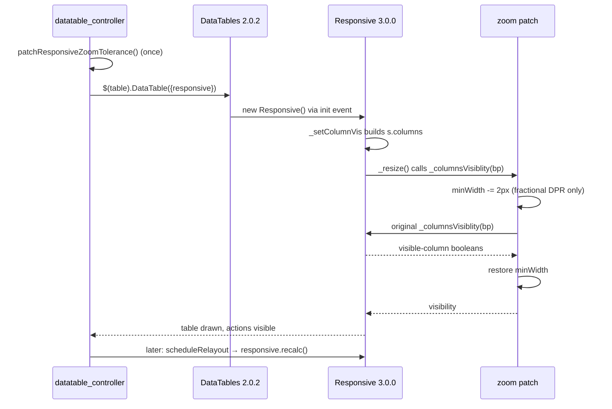
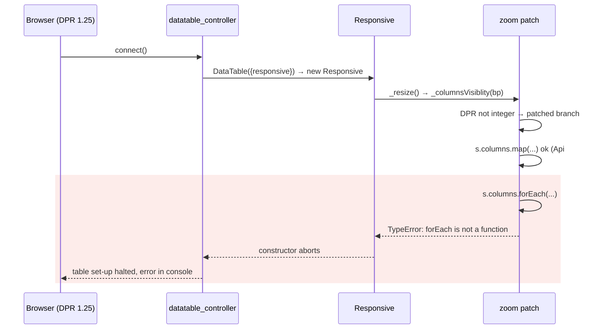
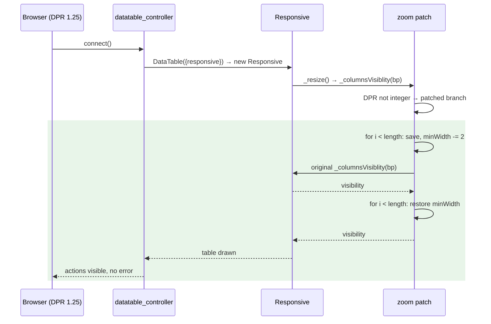

# DataTable responsive patch crashes at fractional zoom — Report

> **Audience:** The developer fixing this, and the reviewer checking the fix.
> **Companion document:** [Tasks](tasks.md)

> **Planning phase — no code changes.** This document diagnoses the bug and plans the fix.
> Implementation happens later, in the tasks phase.

> **Evidence, not guesses.** Every claim in Root Cause carries a `file:LINE` that has been opened.
> Those line numbers are **as of `3ad5f5dd4`** — the fix deletes the lines they point at, so read
> them with `git show 3ad5f5dd4:<path>`. The Responsive plugin lines refer to
> `https://cdn.datatables.net/responsive/3.0.0/js/dataTables.responsive.js` (the unminified build
> of the exact file loaded by `app/packs/core/base/views/layouts/modernize.html.erb:50`).

---

## Summary

On any browser whose `window.devicePixelRatio` is not a whole number (Windows display scaling of
125% / 150%, or Chrome zoom such as 90% / 110%), every DataTable managed by the `datatable`
Stimulus controller throws `TypeError: columns.forEach is not a function` while it is set up.
The zoom-tolerance patch added in #1745 calls `.forEach` on Responsive's `s.columns`, which in
Responsive 3.0.0 is a DataTables `Api` instance (array-like, with `.map`, but no `.forEach`), not
a plain `Array`.

---

## The Feature — how it is meant to work

### The idea

Every index table in the app that carries `class="jqDataTable"` inside a
`data-controller="datatable"` wrapper is turned into a DataTables 2.0.2 table with the Responsive
3.0.0 extension (about 115 views use the controller). Responsive keeps a table inside its
container. It does this by measuring each column's minimum width once, adding those widths up,
and folding columns that don't fit into an expandable "child" row behind a ▶ toggle. It folds
from right to left, lowest priority first.

Responsive measures those minimum widths with `offsetWidth`, which is always a whole number of
CSS pixels. At a fractional `devicePixelRatio` each measurement can be up to about 1px too large.
Across about 10 columns, that is enough to make a table that really fits look too wide, so the
last column gets folded. The last column is usually the Show / Edit actions. Change #1745
(spec `openspec/specs/ui/datatable-layout/spec.md`, requirement *"Fractional zoom does not
collapse a table that fits"*) fixed this by giving each column 2px of slack, only at fractional
ratios.

Responsive has no setting for this, so the slack is added by wrapping Responsive's internal
method `_columnsVisiblity(breakpoint)`. That is the one place where the column widths are
compared with the container. The wrapper lowers each column's `minWidth` before calling the
original method and puts the saved values back afterwards. This way the change only affects
that one comparison and doesn't stick around for later calls.

### How it fits together

| Part | Responsibility | Talks to |
|---|---|---|
| `datatable_controller.js` `connect()` | Installs the patch once, creates each `.jqDataTable`, wires accessibility / dropdown / relayout hooks | DataTables |
| `patchResponsiveZoomTolerance()` | Wraps `Responsive.prototype._columnsVisiblity` with 2px/column slack at fractional DPR | Responsive internals (`this.s.columns`) |
| Responsive `_resize()` | Picks the breakpoint, asks `_columnsVisiblity` which columns to show, applies it | the wrapped `_columnsVisiblity` |
| `scheduleRelayout()` | Re-runs `columns.adjust()` + `responsive.recalc()` after fonts/load and on container resize | Responsive `recalc` → `_resize` |

### What it rests on

- The patch only reads and writes `minWidth` on each entry of `this.s.columns`, and every
  change it makes is undone in a `finally` block.
- At a whole-number `devicePixelRatio` the patch passes straight through to the original method.
- `this.s.columns` can be walked and modified with the array methods the patch uses. **This was
  never checked against the plugin source.**

---

## Symptom

| | |
|---|---|
| **What the user sees** | Console: `TypeError: columns.forEach is not a function at Responsive._columnsVisiblity (datatable_controller-….js:23:13) at a._resize … at a._constructor … at new a (dataTables.responsive.min.js)`. Table set-up stops partway (see Blast Radius). |
| **Reproduce** | 1. Set Chrome zoom to 90% (Ctrl + −), or start Chrome with `--force-device-scale-factor=1.25`. 2. Open any index page with a DataTable, e.g. `/favorites` or the investments index. 3. Open DevTools Console → the TypeError appears. |
| **Who is affected** | Every user whose `devicePixelRatio` isn't a whole number. This covers most Windows laptops (the default scaling is 125% or 150%) and anyone who has zoomed the browser. |
| **How often** | Every time the page loads, and again on every resize or relayout, for those users. Never at DPR 1 or 2. |
| **Since when** | `f66ace76a` (#1745, 2026-09-30). |

It is **not intermittent**. It depends only on `devicePixelRatio`. That's why it showed up on
staging (users on Windows) but not on dev machines at 100% zoom, macOS Retina screens (DPR 2) or
the Cucumber suite. It reproduces locally as soon as the zoom is changed.

---

## Root Cause

**1. Array methods called on a DataTables `Api` object.** The patch does
`const columns = this.s.columns; columns.map(...); columns.forEach(...)`
(`app/javascript/controllers/datatable_controller.js:21-23`, and `:29` in the `finally`). Responsive
3.0.0 builds `s.columns` as `dt.columns().eq(0).map(function (i) { … })`
(`dataTables.responsive.js:545-548`) and stores it with `this.s.columns = columns`
(`:696`). `Api#map` returns another `Api` instance. That object is array-like (it has `length`
and `[i]` indexing) and has `map`, `each`, `pluck` and so on, but it has **no `forEach`**. So
line 22 runs fine and line 23 throws.

**2. The broken lines only run at a fractional ratio.**
`if (Number.isInteger(window.devicePixelRatio)) return original.call(this, breakpoint);`
(`datatable_controller.js:19`). Every environment where #1745 was developed and tested has
DPR 1 or 2, so lines 21-30 never ran there.

**Why it was hard to see:**

- The code only runs under the exact condition it exists to fix. A check at 100% zoom passes
  without touching it. #1745's own manual check at fractional zoom (task 3.1 in
  `openspec/changes/archive/2026-10-03-datatable-action-column-layout/tasks.md:14`) is still
  unchecked, and its note says automated coverage is "not practical".
- The Cucumber Playwright driver always runs at DPR 1 (`features/support/env.rb:232-240`
  sets no `device_scale_factor`), so the suite can never reach this code.
- `.map` succeeding one line earlier makes `s.columns` look like a real array.
- Any exception thrown inside the patch stops Responsive's set-up. Nothing catches it and falls
  back to the unpatched method. A problem in an optional width tweak ends up breaking the whole
  table.

---

## Blast Radius

| Also touches this code | Does this fix change it? | Needs checking |
|---|---|---|
| Responsive constructor → `_resize()` → `_columnsVisiblity` (`dataTables.responsive.js:954`): first draw of every `.jqDataTable` (~115 views using `data-controller="datatable"`) | Yes: stops throwing at fractional DPR | `features/core/datatable_responsive_zoom.feature` (X1) + QA B1 |
| `connect()` lines after `$(value).DataTable(...)` (`datatable_controller.js:66-100`): accessibility setup, `draw.dt` hooks, `scheduleRelayout`, and the remaining tables in the `$.each` loop | Yes: they now run, because the constructor no longer throws | QA R1 |
| `scheduleRelayout()` → `dt.responsive.recalc()` (`datatable_controller.js:135-136`) on rAF / fonts.ready / load / ResizeObserver | Yes: those calls stop throwing | QA R2, R3 |
| Window `resize` handler inside Responsive → `_resize()` | Yes: same path | Manual QA (resize the window) |
| Behaviour at whole-number DPR (1, 2) | No: the early return at `:19` is unchanged | Existing index-page features stay green |
| The 2px tolerance itself (spec requirement "Fractional zoom does not collapse a table that fits") | No: same amount, same scope, still restored afterwards | QA: investments index at 90% keeps the action column |

---

## Fix

### How it works today

### How it works after the fix

### What changes

| # | Before | After | Where |
|---|---|---|---|
| 1 | `columns.map(...)` / `columns.forEach(...)` on `this.s.columns` | Index-based `for (let i = 0; i < columns.length; i++)` loops over `columns[i]`, which work on an `Array` and on an `Api` | `app/javascript/controllers/datatable_controller.js`, `patchResponsiveZoomTolerance()` |
| 2 | A comment that doesn't mention the type of `s.columns` | A one-line comment: `s.columns` is a DataTables Api instance (array-like, no forEach) | same |
| 3 | No test covers the patch | A browser-free (`@rack_test`) Cucumber feature that checks the `datatable` controller is wired up (wrapper markup + importmap pin) and that its source makes no `columns.map(` / `columns.forEach(` calls | `features/core/datatable_responsive_zoom.feature` + `features/step_definitions/datatable_steps.rb` |

The fix doesn't add a `try/catch` fallback around the patch. The loop fix removes the only way
the patch can throw. A fallback that hides errors would bring back the "hard to see" problem
described above. It is noted as an option under Risks instead.

---

## Verification

**ID legend:** **H** = Happy path · **E** = Edge case · **X** = Error (exception) case

Playwright is not used for this fix: the browsers aren't installed on the dev machine, and the
decision was to keep the check browser-free. The feature runs under `@rack_test`, so no
JavaScript executes. It checks what Stimulus needs in order to attach the controller, plus a
static check of the controller's source. Behaviour at a real fractional zoom (former H2 / E1) is
covered by hand in the QA checklist.

### Happy Path

| # | Scenario | Given | When | Then | Feature |
|---|---|---|---|---|---|
| H1 | The datatable controller is attached to the index table | A logged-in user | They open `/favorites` | `table.jqDataTable` sits inside `[data-controller~='datatable']`, the "Actions" header is present, and the page's importmap pins `controllers/datatable_controller` | `features/core/datatable_responsive_zoom.feature` |

### Error Cases

| # | Scenario | Given | When | Then | Feature |
|---|---|---|---|---|---|
| X1 | The zoom patch doesn't call array methods on Responsive's columns | `app/javascript/controllers/datatable_controller.js` | Its source is read | It contains `patchResponsiveZoomTolerance` and no line matches `columns.(forEach\|map)(` | `features/core/datatable_responsive_zoom.feature` |

**Fails against current code (`3ad5f5dd4`):** X1. It was seen failing on lines 22, 23 and 29
(`columns.map`, `columns.forEach` ×2). H1 passes before and after the fix.

X1 reads the source file, not the URL the importmap serves. When `public/assets` contains a
precompiled build, Rails serves that build instead of the source, so a check of the served URL
passed on the old code because it read a stale, already-fixed build (`fb9f1b93…`).

---

## Risks and Rollout

- The loop changes how the patch modifies `minWidth` → **Mitigation:** the arithmetic and
  the restore are the same as before. QA row E1 checks the restore by hand.
- A future Responsive upgrade could change `s.columns` again → **Mitigation:** indexed access
  works for both `Array` and `Api`. X1 will fail on an upgrade that breaks it. Optionally, a
  later change could make the wrapper fall back to `original.call` with a `console.warn` if the
  shape is unexpected.
- The automated check is static: it proves the bad calls are gone, not that the patch behaves
  correctly at runtime → **Mitigation:** QA rows B1, H2, E1 and X1 test real fractional zoom in
  Chrome. A future browser-driven scenario could fake `devicePixelRatio` and call
  `responsive.recalc()`.

| | |
|---|---|
| **Safe to deploy alone?** | Yes. It is a single JS file with no server change. |
| **Data backfill needed?** | No. |
| **Both regions together?** | No. Each region serves its own assets, and both are fixed independently. |
| **Rollback** | Revert the commit. Nothing is saved, so there is nothing to undo. |

---

## Spec Impact

**None.** `openspec/specs/ui/datatable-layout/spec.md` already requires the right behaviour
("Fractional zoom does not collapse a table that fits": a table that fits shows every column at
90% zoom). The code didn't do that because it crashed. `skip_specs: true` is set in this
change's `.openspec.yaml`.
