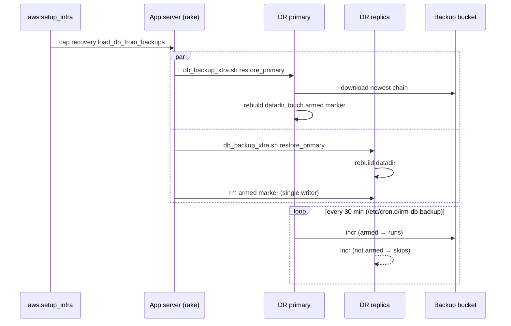
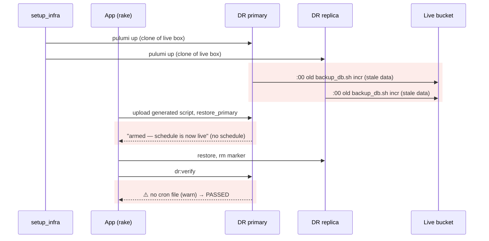
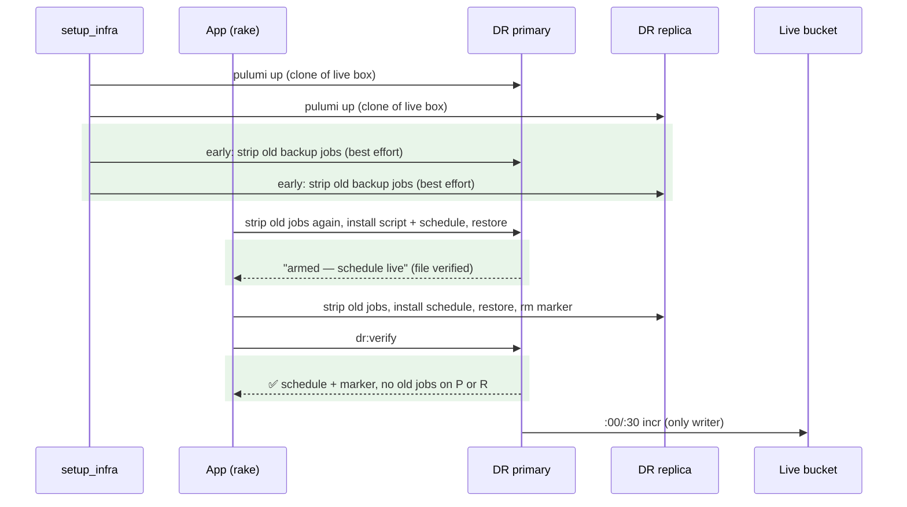

# DR restore leaves no backup schedule, and DR clones carry a second, unguarded backup writer — Report

> **Audience:** The developer fixing this, and the reviewer checking the fix.
> **Companion document:** [Tasks](tasks.md)

> **Planning phase — no code changes.** This document diagnoses the bug and plans the fix.
> Implementation happens later, in the tasks phase.

> **Evidence, not guesses.** Every claim in Root Cause carries a `file:LINE` that was opened.
> Line numbers are **as of `e8de0d7346`**. Read them with `git show e8de0d7346:<path>`.
> Live-box facts come from read-only probes on 2026-11-08 (staging DB `10.0.3.138`). The IN prod
> data box could not be reached from this machine's IP. Its facts are from the 2026-09-27 probe.

---

## Summary

- After a DR restore, the new primary gets the **armed marker** but no **backup schedule**, so the "backups resume automatically" promise is false. The drill passes anyway because `dr:verify` grades the missing schedule as a warning.
- Worse: DR database servers are cloned from a weekly snapshot of the **live** DB box. That box backs up through an old `ubuntu` crontab whose script **ignores the armed marker** and has the live bucket hard-coded. Every DR primary *and replica* therefore boots with an hourly job that writes into the live backup chain, starting before the restore, on stale data.

---

## The Feature — how it is meant to work

### The idea

- MySQL is backed up by **xtrabackup** into an S3 bucket: a nightly **full**, plus **incrementals** that each build on the previous one. Together they form a **chain**.
- A restore downloads the newest chain and rebuilds the data directory from it.
- **Exactly one server may write to a chain.** A second writer produces incrementals based on the wrong data, and the restore then silently rebuilds the wrong database.
- Every DB server image carries the same script and schedule. An **armed marker** file decides which server is allowed to act. Only a successful primary restore creates it.
- This lets one image boot primaries, replicas and throwaway verifier boxes safely: everything is wired, but only the true primary is armed.

### Key concepts

| Concept | What it is, in one line | Example | Stored in |
|---|---|---|---|
| Backup chain | One full plus the incrementals built on it | `2026-11-07_230001-full`, `2026-11-08_000001-incr` … | S3 `<bucket>-backup-xtra` |
| Backup script | Program that writes or restores a chain | `db_backup_xtra.sh incr` | `/usr/local/bin/db_backup_xtra.sh` (root 0700) |
| Baked script | Secret-free copy; reads config from SSM at run time | still contains `__BUCKET__` | the same path, from the Packer AMI |
| Generated script | Copy with secrets substituted from Rails credentials | bucket `docs.altx.com.staging-backup-xtra` | built in `tmp/db_backup_xtra_<env>.sh` |
| Backup schedule | Cron file that runs the script | `0,30 0-22 * * * root … incr` | `/etc/cron.d/irm-db-backup` |
| Armed marker | Empty file meaning "this host may write the chain" | present only on the primary | `/etc/db_backup_enabled` |
| Legacy backup job | Pre-2026-07 `ubuntu` crontab entry, **not** marker-aware | `0 0-22 * * * /home/ubuntu/backup_db.sh incr` | `ubuntu` crontab on the live box |
| DR clone | A DB server launched in DR from the weekly AMI | DR primary `10.0.3.88`, replica `10.0.4.217` | EC2 in ap-south-2 |

**Armed marker rules**
- Created by `restore_primary` / `restore_from_primary` (`lib/tasks/db_backup_xtra.sh:693`, `:731`).
- Removed on the replica right after its restore (`lib/tasks/backup_db.rake:117-122`).
- Checked by `require_armed` before every `full`/`incr`: missing → exit 0 quietly (`db_backup_xtra.sh:655-662`).
- Same-host writers are also serialised by `flock` (`db_backup_xtra.sh:632-645`). That lock only covers *this* script.

### How it fits together

| Part | Responsibility | Talks to |
|---|---|---|
| `run_baked_restore` (`backup_db.rake:28`) | SSH to a DB box, pick the script, stream the restore | DB box |
| `db_backup_xtra.sh` | Back up, restore, arm | S3, MySQL |
| Packer recipe (`db_redis_es.ami.pkr.hcl:296-312`) | Bake script, schedule, logrotate into an AMI | — |
| `dr:verify` (`dr_verify.rake:250-259`) | Prove the recovered stack, incl. backups | DB box via SSH |

### What it rests on

- Every DR DB server has the schedule file **and** the script at `/usr/local/bin`.
- Nothing except `db_backup_xtra.sh`, gated by the armed marker, ever writes the chain.
- `dr:verify` fails a recovery that will not take backups.

---

## Symptom

| | |
|---|---|
| **What the operator sees** | `✓ Backups armed (/etc/db_backup_enabled created) — cron schedule is now live.`, then `⚠️ Primary backup cron installed — no /etc/cron.d/irm-db-backup — pre-bake AMI?`, then `DR DRILL PASSED` |
| **Reproduce** | `TEARDOWN=true rake "aws:dr_drill[in, ap-south-2, staging.in]"` → see `docs/operations/dr/runs/dr_drill_in_2026_11_08_1039.log` |
| **Who is affected** | Every full DR and every `partial:restore_*` / `dr:fix:db_*`, on staging.in and production.in (and US once it has DR) |
| **How often** | Every run: the 2026-08-29 prod drill and the 2026-11-08 staging drill both show it |
| **Since when** | The 2026-07 bake design. The weekly AMI never used the bake |

- The *second-writer* half is **intermittent**. It bites only if a DR clone stays up past an hourly `:00` tick.
  - Today's drill clones lived ~12 min and crossed no tick, so there is nothing in the bucket (2,205 prefixes, 0 hours with 2 backups).
  - The 2026-08-29 prod clones launched at 12:58:29Z and **did** cross 13:00Z. That is unverifiable now: the bucket purges old versions after 30 days, and the chain was replaced by that night's 23:00 full.
  - In a **real** DR the clones never get torn down, so it bites every hour.

---

## Root Cause

- **The DR AMI is a snapshot of the live box, not the bake.**
  - The weekly cron runs `aws:create_and_copy_ami[DB-Redis-ES]` (`config/schedule.rb:71`).
  - That task snapshots the root volume of the running instance tagged `DB-Redis-ES` (`lib/tasks/aws_utils.rb:236-249`).
  - So the Packer recipe that installs the schedule (`db_redis_es.ami.pkr.hcl:309`) never reaches a DR image.
- **The live box predates the bake** (staging probe, 2026-11-08):
  - There is no `/usr/local/bin/db_backup_xtra.sh`, no `/etc/cron.d/irm-db-backup`, and no marker.
  - Backups run from the `ubuntu` crontab: `0 23 * * * /home/ubuntu/backup_db.sh full`, `0 0-22 * * * /home/ubuntu/backup_db.sh incr`.
  - IN prod (2026-09-27 probe): the same old job, every 30 min.
- **The old job is an unguarded second writer.**
  - `/home/ubuntu/backup_db.sh` has zero references to `db_backup_enabled`.
  - It hard-codes `BUCKET="docs.altx.com.staging-backup-xtra"` and `AWS_REGION="ap-south-1"` (lines 27-28 on the box).
  - It is cloned onto every DR primary **and replica**, so it runs from first boot regardless of the marker.
  - Both writers name prefixes `YYYY-MM-DD_HH0001-incr`, so a clone and the live box can write into the **same prefix**.
- **The restore's fallback installs the script but not the schedule.**
  - `run_baked_restore` detects "no baked script" (`backup_db.rake:76`).
  - It uploads the generated script to `/home/ubuntu/db_backup_xtra.sh` (`:86-91`).
  - It never writes `/etc/cron.d/irm-db-backup`. Nothing runs that path anyway.
- **The clone also carries the live box's LSN checkpoint.** Incrementals are taken against `$LSNDIR` (`db_backup_xtra.sh:124`, read in `incr_backup` at `:577-578`). The live staging box's `/var/lib/xtrabackup/lsndir` held `to_lsn = 71176295061` (Nov 7 23:00 full) on 2026-11-08. A clone inherits whatever was there at snapshot time, and no restore branch resets it. The first incremental after a DR is therefore taken against the wrong base, and xtrabackup refuses to pair it with the newest full at the next restore. *(Found in review, 2026-11-08.)*
- **Drills would turn the fix into a second writer.** The drill primary is armed (`dr:verify` requires it), and its bucket is the **live** one: the generated script's `BUCKET` is `AWS_S3_BUCKET-backup-xtra` (`backup_db_xtra.rake:96`), and the SSM path is seeded from the same credentials. That was harmless only because no schedule existed. Once the restore installs one, every drill primary would write into the live chain while the live box does too. *(Found in review, 2026-11-08.)*
- **The success message is unconditional.** "cron schedule is now live" prints without checking that the file exists (`db_backup_xtra.sh:695`, `:733`).

**Why it was hard to see:**
- `dr:verify` grades the missing schedule as `:warn` (`dr_verify.rake:258`), so drills pass.
- `dr:verify` checks only the *marker* on the replica (`dr_verify.rake:271`). It never looks at crontabs, so the cloned old job is invisible.
- The verifier service already deletes **all** crontabs on its clones (`app/packs/core/base/services/db_restore_service.rb:533-540`, added in `b28c0992a9` "Remove root users cron jobs too"). The clone problem was known on that path and never carried over to DR.

---

## Blast Radius

| Also touches this code | Does this fix change it? | Needs checking |
|---|---|---|
| `db:restore_primary_remote` / `restore_replica_remote` / `restore_all_remote` | **Yes**: strip old jobs, install script + schedule | staging drill |
| `cap recovery:load_db_from_backups` (`config/deploy.rb:607`) | Yes, via `restore_all_remote` | staging drill |
| `cap partial:restore_primary` / `restore_replica` (`lib/capistrano/tasks/dr_partial.rake:60,82`) | **Yes**: an in-place restore of a *live* box now removes its old job and installs the baked schedule | QA R2 |
| `dr:fix:db_replica` / `db_primary` (`dr_fix_db.rake:205`) | Yes, via `partial:*` | QA R2 |
| `aws:setup_infra` (`aws_utils.rb:1150`) | **Yes**: new best-effort early strip of old jobs on DR clones | staging drill |
| `dr:verify` → `recovery:verify` (setup_infra, `dr:fix:app_server` `dr_fix.rake:434`, `dr_fix_db.rake:208,314`) | **Yes**: new grading | QA R1, R3 |
| `aws:dr_drill` (`lib/tasks/aws.rake`) | **Yes**: sets `DR_DRILL=true` for its run | staging drill |
| `cap recovery:load_db_from_backups` / `recovery:verify` (`config/deploy.rb`) | **Yes**: forward `DR_DRILL=true` to the remote rake | staging drill |
| `DbRestoreService` (verifier; `db_restore_service.rb:152`) | No: own path, already clears crons | — |
| `xtrabackup:generate_backup_script` (`backup_db_xtra.rake:87`) | No | — |
| Packer recipe | No; a drift guard checks the schedule text matches | H4 |
| Weekly `create_and_copy_ami` | No (root fix is a follow-up) | — |
| `db_backup_xtra.sh` messages | Yes: text only | QA R1 |

---

## Fix

### How it works today

### How it works after the fix

### What changes

| # | Before | After | Where |
|---|---|---|---|
| 1 | Schedule text only inline in Packer | `Dr::BackupSchedule`: schedule + logrotate text, old-job detection, grading. Pure Ruby | `lib/dr/backup_schedule.rb` (new) |
| 2 | Old crontab jobs left on restored boxes | Strip `backup_db*.sh` / `db_backup_xtra.sh` lines from the `ubuntu` + root crontabs, keep everything else, print what was removed | `backup_db.rake` `run_baked_restore` |
| 3 | Generated script parked in `/home/ubuntu`, no schedule | Install it to `/usr/local/bin` (root 0700) and write the schedule + logrotate if they differ. A stale *generated* copy is always replaced; a *baked* one (contains `__BUCKET__`) is kept | `backup_db.rake` `run_baked_restore` |
| 4 | Clones run the old job until the restore | Best-effort strip right after the host addresses are known (SSH via an app server, retries, warns on failure, never fails DR) | `aws_utils.rb` `setup_infra` (inside phase 3) |
| 5 | Missing schedule = ⚠️; crontabs never checked | Primary: no schedule → ❌; schedule + old job → ❌ (two writers); old job only → ⚠️ (today's live boxes). Replica: any old job → ❌ | `dr_verify.rake` via `Dr::BackupSchedule` |
| 6 | "schedule is now live" always printed | Printed only if the file exists, otherwise a loud WARNING | `db_backup_xtra.sh` restore branches |
| 8 | Restore keeps the clone's LSN checkpoint | Both restore branches clear `LSNDIR`/`LSNDIR_INCR` before arming, so the first incremental bases on the newest full in S3 | `db_backup_xtra.sh` `reset_lsn_state` |
| 10 | Stale-LSN fix not verified (only a log line) | After every restore `run_baked_restore` removes any surviving checkpoint (covers baked script copies older than `reset_lsn_state`) and writes `/var/lib/xtrabackup/restored_at`; `dr:verify` adds **Backup checkpoint fresh** — ❌ if the checkpoint predates the restore (added 2026-11-08 on review: "will each change show in the end-of-run checks?") | `backup_db.rake`, `Dr::BackupSchedule.grade_checkpoint`, `dr_verify.rake` |
| 9 | Drill primary armed (writes the live chain once scheduled) | **Drill mode**: `aws:dr_drill` sets `DR_DRILL=true` → cap forwards it → the restore passes `DB_BACKUP_NO_ARM=1` and removes the marker as a backstop → `dr:verify` expects the drill primary **not** armed | `aws.rake`, `config/deploy.rb`, `backup_db.rake`, `db_backup_xtra.sh` `arm_backups`, `dr_verify.rake`, `Dr::BackupSchedule.grade_armed(drill:)` |
| 7 | Guide says backups resume automatically | Document the clone/old-job behaviour and the new checks | `dr_guide.md` §10, `db_backup_system.md` §9 |

- **Kept out of scope (follow-ups):**
  - Build the weekly DB AMI from Packer instead of snapshotting the live box. That removes the clone problem at the source.
  - Migrate the live boxes off the old job.
  - G21: the drill flooding the inbox with error emails.

---

## Verification

**ID legend:** **H** = Happy path · **E** = Edge case · **X** = Error (exception) case.
All rows land in `features/misc/dr_backup_schedule.feature`. Each exercises `Dr::BackupSchedule`, the logic the rake and verify paths call.

### Happy Path

| # | Scenario | Given | When | Then | Feature |
|---|---|---|---|---|---|
| H1 | Old jobs stripped, rest kept | staging live crontab (2 `@reboot` docker lines + 2 `backup_db.sh` lines) | split | 2 `@reboot` kept, 2 removed | dr_backup_schedule.feature |
| H2 | Healthy primary | schedule file, armed, no old jobs | grade primary | ✅ | dr_backup_schedule.feature |
| H3 | Healthy replica | schedule file, not armed, no old jobs | grade replica | ✅ | dr_backup_schedule.feature |
| H4 | Schedule matches the bake | Packer recipe text | compare to `CRON_CONTENT` | identical lines | dr_backup_schedule.feature |

### Edge Cases

| # | Scenario | Given | When | Then | Feature |
|---|---|---|---|---|---|
| E1 | Nothing to strip | crontab with only `@reboot` lines | split | unchanged, 0 removed | dr_backup_schedule.feature |
| E2 | No crontab at all | `no crontab for ubuntu` | split | empty, 0 removed | dr_backup_schedule.feature |
| E3 | Commented-out old job | `# 0 * * * * /home/ubuntu/backup_db.sh incr` | split | kept (inert) | dr_backup_schedule.feature |
| E4 | Every old variant | `backup_db.sh`, `backup_db.old.sh`, `db_backup_xtra.sh` lines | split | all 3 removed | dr_backup_schedule.feature |
| E5 | Today's live primary | old job, no schedule file | grade primary | ⚠️ "old unguarded job" (not ❌) | dr_backup_schedule.feature |
| E7 | Drill primary not armed | drill, no marker | grade armed (drill) | ✅ "deliberately not armed" | dr_backup_schedule.feature |
| E8 | Drill flag | `DR_DRILL` = `true` / `false` / unset | read | drill / not / not | dr_backup_schedule.feature |
| E6 | Baked vs generated script | head containing `__BUCKET__` / substituted bucket | classify | baked / generated | dr_backup_schedule.feature |

### Error Cases

| # | Scenario | Given | When | Then | Feature |
|---|---|---|---|---|---|
| X1 | Armed, no schedule | armed, no schedule file, no old job | grade primary | ❌ "no backups will run" | dr_backup_schedule.feature |
| X2 | Two writers on primary | schedule file + old job | grade primary | ❌ "two writers" | dr_backup_schedule.feature |
| X3 | Replica writes | replica with old job | grade replica | ❌ "replica must never write" | dr_backup_schedule.feature |
| X4 | Not armed | primary, no marker | grade primary | ❌ "marker missing" | dr_backup_schedule.feature |
| E9 | Checkpoint after restore | restore 1000, checkpoint 2000 | grade checkpoint | ✅ | dr_backup_schedule.feature |
| E10 | Live box, never restored | no restore record | grade checkpoint | ✅ "this box's own" | dr_backup_schedule.feature |
| X6 | Stale checkpoint survived | restore 1000, checkpoint 900 | grade checkpoint | ❌ "predates the restore" | dr_backup_schedule.feature |
| X5 | Drill primary armed | drill, marker present | grade armed (drill) | ❌ "would write into the live backup chain" | dr_backup_schedule.feature |

**Fails against current code:**
- **X1**: today it is ⚠️ (`dr_verify.rake:258`).
- **X3**: today replica crontabs are never checked.
- **X2**: today crontabs are never checked.

---

## Risks and Rollout

- In-place `partial:restore_*` on a **live** box now removes its old job → intended: that box becomes the single, marker-gated writer on the baked schedule. Noted in the QA checklist.
- `recovery:verify` on live prod may newly ❌ if the live **replica** has the old job → that would be a real, existing second writer. Investigate rather than relax the check.
- The early strip runs before the app servers are deployed → best effort with retries; on failure it warns, and the restore strips again. DR cannot fail because of it.
- A clone can still fire one `:00` tick in the ~2–3 min between boot and the early strip → shrinks today's ~9 min window. Fully closed only by the Packer follow-up.
- After the LSN reset, each incremental downloads the newest full until the 23:00 full writes a fresh checkpoint (prod: ~1.4 GB per run) → correct, but heavier for one evening. The writer lock skips overlapping runs. Watch disk on the DR box.
- A drill can no longer prove that a *real* recovery arms the primary: arming in a drill would write the live chain → the arm path is covered by the Cucumber grades (X4/H2) and is unchanged from before. The drill proves the schedule, the strip and the disarm.
- A generated script at `/usr/local/bin` holds secrets → root 0700, same as the bake path. It is replaced on every restore, so a rotated credential is picked up.

| | |
|---|---|
| **Safe to deploy alone?** | Yes. Operator/DR tooling only; it takes effect on the next drill (DR deploys the branch HEAD) |
| **Data backfill needed?** | No |
| **Both regions together?** | No. Shared code; no runtime coupling between IN and US |
| **Rollback** | Revert the commit. Boxes restored meanwhile keep a valid baked schedule, which old code tolerates |

---

## Spec Impact

**None.** The DR guide already promises "success arms the backup cron — backups resume automatically" and "one writer per backup chain". The code did not deliver it. `skip_specs: true` is set.
