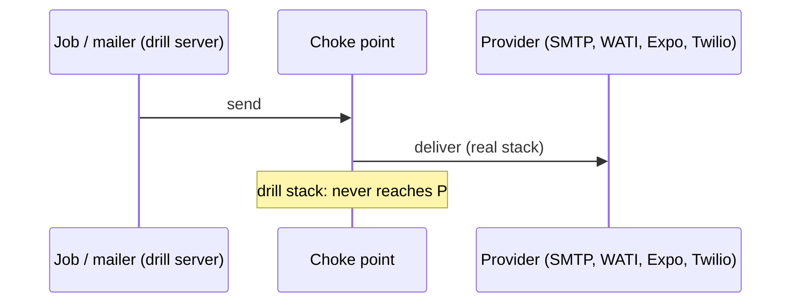
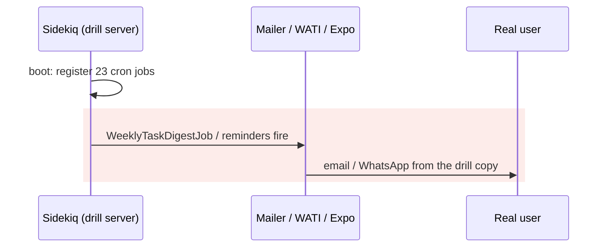
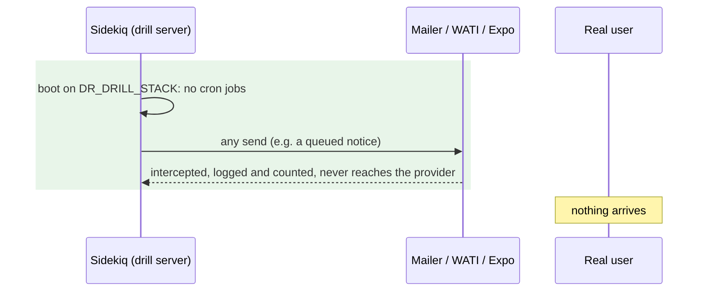

# A DR drill stack can contact real users — Report

> **Audience:** The developer fixing this, and the reviewer checking the fix.
> **Companion document:** [Tasks](tasks.md)

> **Planning phase — no code changes.** Line numbers are **as of `e70a74cbae`** (`git show e70a74cbae:<path>`).

> **Decision (user, 2026-11-08):** suppress **all** outgoing contact, on **drill stacks only** (gap B1 / G24).

---

## Summary

- A DR drill runs the real app on a copy of real data, and nothing stops it sending email, WhatsApp, SMS or push notifications, or running timed jobs that do.
- On a **production** drill, real investors and GPs could receive duplicate reminders and digests from the drill copy. A drill could also start the backup verifier, which launches an EC2 server.

---

## The Feature — how it is meant to work

### The idea

- A drill rebuilds production (or staging) in the DR region from real backups, to prove we can recover.
- It must be **invisible to users.** The rebuilt copy must never reach a person: no email, no WhatsApp, no SMS, no push, and no timed job that would cause one.
- Since `fix-dr-drill-hygiene`, every drill server carries `DR_DRILL_STACK=<region>` (`lib/drill_stack.rb`). Today that only tags error mail and stops WhatsApp *pages*.
- A real recovery never sets it, so a recovered production behaves normally.

### Key concepts

| Concept | What it is | Example | Stored in |
|---|---|---|---|
| Drill stack | The temporary copy a drill builds | ap-south-2 servers on 8 Nov | `.env` on the drill branch: `DR_DRILL_STACK=ap-south-2` |
| Outbound channel | A way the app reaches a person | email, WATI WhatsApp, Twilio SMS, Expo push | mailers; `Net::HTTP` posts in jobs |
| Timed job | Work that runs on a clock, not a click | `WorkflowAutoReminderJob`, `WeeklyTaskDigestJob`, whenever cron | `config/initializers/sidekiq.rb:118-254`, `config/schedule.rb` |
| Choke point | One place every message of a channel passes through | ActionMailer interceptor | — |

**Channels and where they leave the app**

| Channel | Senders today | One place they all pass through |
|---|---|---|
| Email | every mailer, Noticed email | ActionMailer delivery (interceptors) |
| WhatsApp | about 10 raw `Net::HTTP` posts to WATI (`whatsapp_general_notification.rb:36,59,95,111,128`, `EmployeeWhatsApp`, `SendOtpToWhatsappJob`) | `Net::HTTP#request` to `*.wati.io` |
| Mobile push | `ExpoPushClient` (`expo_push_client.rb:12,50`) | `Net::HTTP#request` to `exp.host` |
| SMS / OTP | `TwilioSmsDelivery`, `TwilioSmsVerification` (twilio gem, Faraday's Net::HTTP adapter) | `Net::HTTP#request` to `*.twilio.com` |
| Timed jobs | sidekiq-cron (23 jobs, `sidekiq.rb:118-254`), whenever crontab (installed on deploy: `whenever.rake:39`) | their registration |

### How it fits together

### What it rests on

- Every outbound message passes a point where drill stacks can be stopped.
- Nothing runs on a timer on a drill copy.

---

## Symptom

| | |
|---|---|
| **What a user would see** | A duplicate reminder, digest or notice, sent from a drill copy |
| **Reproduce** | Any drill: Sidekiq starts on restored data, cron jobs register, mail delivery is live |
| **Who is affected** | Every user of the drilled environment; production drills reach real investors |
| **How often** | Every drill that is up when a timed job fires, or long enough for a queued notice |
| **Since when** | Always; masked so far because recent drills were on staging |

---

## Root Cause

- **Mail is never intercepted.** No interceptor is registered anywhere (`grep register_interceptor` finds none). Delivery goes out as on any stack.
- **WhatsApp, push and SMS send directly** over `Net::HTTP` (or the Twilio gem) with no drill check. Only the critical *page* path checks `DrillStack.drill?` (`critical_error_whatsapp.rb`).
- **Timed jobs register on every non-local boot:** `unless Rails.env.local?` (`config/initializers/sidekiq.rb:118`). That includes reminders, digests and the production-only `DbRestoreJob` (`:251`), which launches a verifier EC2 instance.
- **The whenever crontab is installed on every deploy** (`whenever.rake:39`, `after "deploy:updated"`), the drill's deploy included.

**Why it was hard to see:** the drills so far were on staging, whose users are test accounts, and nobody looked for drill-originated mail.

---

## Blast Radius

| Also touches this code | Changed? | Needs checking |
|---|---|---|
| All mailers / Noticed email | **Yes, on drill stacks only** | X1, B-rows |
| WATI senders (about 10), Expo, Twilio | **Yes, on drill stacks only** | H2–H4 |
| `config/initializers/sidekiq.rb` cron block | **Yes**: skipped on drill stacks | H5 |
| whenever crontab on deploy | **Yes**: cleared on drill deploys (`DR_DRILL=true`) | QA |
| Real environments (live, real recovery) | **No**: the guard depends on `DR_DRILL_STACK` | E1, E2 |
| `CriticalErrorWhatsapp` | No (already off on drills) | — |
| Interactive sign-in on a drill copy | **Yes**: sign-in codes are suppressed too, so only users without a second login step can sign in by hand | QA note |

---

## Fix

### How it works today

### How it works after the fix

### What changes

| # | Before | After | Where |
|---|---|---|---|
| 1 | Mail always delivered | `DrillStack::MailInterceptor`: `perform_deliveries = false`, log, count. Registered at boot only when `DrillStack.drill?` | `lib/drill_stack.rb`, `config/initializers/drill_stack.rb` (new) |
| 2 | WATI / Expo / Twilio called directly | A `Net::HTTP#request` guard, prepended only on drill stacks: requests to `*.wati.io`, `exp.host`, `*.twilio.com` return a synthetic 200 (`{"suppressed":"dr drill"}`), are logged and counted, and never leave the server | same files |
| 3 | 23 cron jobs registered | Skipped when `DrillStack.drill?` (logged once) | `config/initializers/sidekiq.rb:118` |
| 4 | whenever crontab installed on drill deploys | `whenever:update_crontab` becomes `whenever:clear_crontab` when `DR_DRILL=true` | `config/deploy.rb` |
| 5 | Nothing proves a drill is silent | `dr:verify` (drill only): **"Drill cannot contact users"**: interceptor registered, HTTP guard active, 0 sidekiq-cron jobs, no whenever lines in the crontab; detail shows the count suppressed so far | `dr_verify.rake`, `Dr::ReportCatalog` |
| 6 | — | The count of suppressed messages (Rails.cache `dr:drill_suppressed`) is shown in that check's detail | `DrillStack` |

---

## Verification

**ID legend:** **H** = Happy · **E** = Edge · **X** = Error. All rows land in `features/misc/dr_drill_contacts_users.feature`.

| # | Scenario | Given | When | Then |
|---|---|---|---|---|
| H1 | Drill mail suppressed | `DR_DRILL_STACK=ap-south-2`, interceptor | a mailer delivers | nothing delivered; counted 1 |
| H2 | WhatsApp suppressed | drill, guard | `Net::HTTP` POST to `live-server-1.wati.io` | synthetic 200, no connection, counted |
| H3 | Push suppressed | drill, guard | POST to `exp.host` | same |
| H4 | SMS suppressed | drill, guard | POST to `verify.twilio.com` | same |
| H5 | No timed jobs | drill | cron registration predicate | skipped |
| E1 | Real stack untouched (mail) | no flag | a mailer delivers | delivered (test adapter receives it) |
| E2 | Real stack untouched (HTTP) | no flag | the guard's decision for a WATI host | pass through |
| E3 | Other hosts untouched on a drill | drill | request to `s3.amazonaws.com` / GitHub | pass through (deploys and backups still work) |
| X1 | Verify catches a live channel | drill, interceptor **not** registered | grade "Drill cannot contact users" | ❌ "mail delivery is live" |
| X2 | Verify catches timed jobs | drill, 3 cron jobs registered | grade | ❌ "3 timed jobs registered" |

**Fails against current code:** all rows. No interceptor, guard or grading exists; H1 and X1 reproduce the bug.

---

## Risks and Rollout

- The guard misses a provider we didn't list → it's an allow-by-default guard on a named list. New providers must be added, and the verify check lists the active hosts so a reviewer can spot gaps.
- The synthetic 200 confuses a caller → acceptable on a drill (no user is waiting). It avoids retries and error noise that raising would cause.
- No one can sign in to a drill copy with a second login step → stated in the drill report and the DR guide. Use a user without a second step for manual checks.
- Real stacks are affected → everything is keyed on `DR_DRILL_STACK`, which only drill branches set. E1/E2 prove it, and the drill-marker check from `fix-dr-drill-hygiene` fails a real recovery that carries it.

| | |
|---|---|
| **Safe to deploy alone?** | Yes |
| **Data backfill?** | No |
| **Both regions together?** | No |
| **Rollback** | Revert |

---

## Spec Impact

**None.** A drill is meant to be invisible to users; the code did not ensure it.
