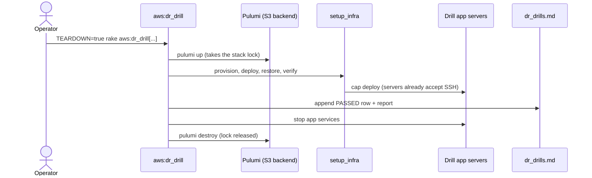
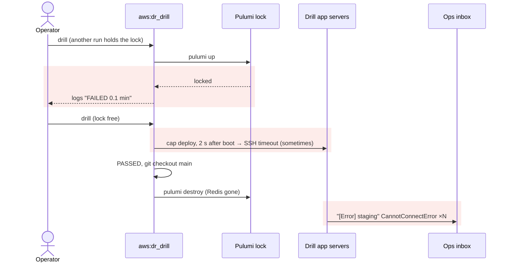
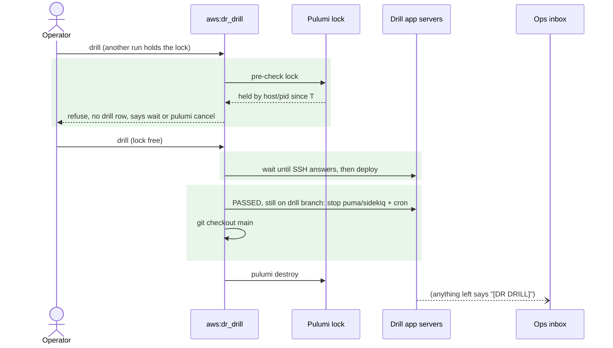

# DR drills collide, flood the inbox, and race booting servers — Report

> **Audience:** The developer fixing this, and the reviewer checking the fix.
> **Companion document:** [Tasks](tasks.md)

> **Planning phase — no code changes.**

> **Evidence, not guesses.** Line numbers are **as of `4b0dd31da3`**. Read them with `git show 4b0dd31da3:<path>`.

---

## Summary

- Three defects make a drill unreliable to run:
  - it starts straight into `pulumi up`, so a held stack lock shows up as a fake "FAILED 0.1 min" drill;
  - its teardown destroys the database while Sidekiq on the drill app servers is still running, and every reconnect error is emailed under the same subject as real staging errors;
  - it deploys before the new servers accept SSH.
- Each one cost a real run: the three lock-collision rows on 2026-11-08, the Redis error emails at 10:51 IST on 2026-11-08, and the 2026-09-12 18:32 SSH timeout.

---

## The Feature — how it is meant to work

### The idea

- `aws:dr_drill` rehearses a real DR: it rebuilds the stack in the DR region with the same `setup_infra` a real recovery uses.
- It records every attempt (a row in `dr_drills.md` plus an evidence report) and can tear the stack down afterwards (`TEARDOWN=true`).
- A drill must be **repeatable** (nothing left locked), **quiet** (no false alarms to the people who handle real ones) and **deterministic** (no races against booting servers).

### Key concepts

| Concept | What it is, in one line | Example | Stored in |
|---|---|---|---|
| Pulumi stack lock | File Pulumi writes while an update runs; a second update refuses to start | `…/locks/organization/IRM-infra/staging-ap-south-2/7da2….json` with pid, user, host, time | Pulumi S3 backend `irm-pulumi-state-<account>-primary-<region>` |
| Stale lock | A lock whose process is gone (killed run, closed terminal) | pid no longer alive on that host | same |
| Drill row | One line per drill attempt in the drill log | `2026-11-08 10:41 … FAILED 0.1` | `docs/operations/dr/dr_drills.md` |
| Drill branch | Branch holding the drill's credentials, `.env` and deploy IPs | `dr_drill_in_2026_11_08_1039` | git, pushed to origin |
| Error email | ExceptionNotifier mail from any app process | subject `[Error] staging:(altconnects.com) …` | `config/initializers/exception_notification.rb:30` |
| Teardown | `pulumi destroy` of the drill stack after a PASSED drill | 46 resources deleted | `aws.rake` `dr_drill` ensure block |

### How it fits together

### What it rests on

- Only one update runs per stack at a time, and a refused start is not a failed drill.
- Drill processes are stopped before their dependencies are destroyed.
- A server is reachable before anything is deployed to it.
- Anything a drill emails is identifiable as a drill.

---

## Symptom

| | |
|---|---|
| **Lock collision** | `error: the stack is currently locked by 1 lock(s)… created by thimmaiah@Inspiron (pid 2402456) at 2026-11-08T10:39:17+05:30`, then `❌ DR DRILL FAILED — measured rebuild time: 0.1 minutes (logged to …dr_drills.md)`, three times (10:40, 10:40, 10:41) |
| **Email flood** | `RedisClient::CannotConnectError … redis://10.0.3.88:6379`, Source `Sidekiq (no job)`, Host `ip-10-0-2-46` (a drill app server), 10:51:54 IST: 37 s after the drill PASSED (05:21:17 UTC), during teardown |
| **SSH race** | `Net::SSH::ConnectionTimeout … connect(2) for 18.60.214.25:22`, at `rvm:hook`, 2 s after `pulumi up` (2026-09-12 18:32) |
| **How often** | Lock: whenever two runs overlap or a run was killed. Emails: every torn-down drill. SSH: intermittent — depends on boot speed |

---

## Root Cause

- **No lock pre-check.** `dr_drill` calls `ensure_pulumi_backend!` (`aws.rake:373`) and then `setup_infra`. Its first Pulumi write is `pulumi up` (`aws_utils.rb` phase 2), and a lock refusal raises there. The `ensure` block then logs it like any failure: a drill row, a report, "FAILED 0.1 min" (`aws.rake:395-427`). Nothing stops a second drill from starting in the same checkout while one runs.
- **Teardown order.** In the `ensure` block: evidence → `git checkout <original>` → `pulumi destroy` (`aws.rake:440-458`). Puma and Sidekiq on the drill app servers are never stopped. Pulumi destroys the DB box (Redis) alongside them, Sidekiq's reconnect loop raises `CannotConnectError`, and ExceptionNotifier mails it.
  - The stop can't simply run after the checkout: back on the original branch, `config/deploy/<stack>_<variant>.rb` names the **live** servers.
- **Drill mail looks real.** The prefix is `"[Error] #{Rails.env}:(#{BASE_DOMAIN})"` (`exception_notification.rb:30`). A drill on staging sends exactly what a live-staging error sends.
- **No SSH readiness wait.** `setup_infra` goes from the phase-3 config rewrite to the phase-5 `cap … recovery:delete_old_assets` with nothing in between (`aws_utils.rb:1316-1318`). The early backup-job strip from change 1 retries on its own, but the deploy doesn't.

**Why it was hard to see:**
- The lock refusal is logged as a drill result. The log then reads "drills keep failing" instead of "a run was already in progress".
- Drill errors are indistinguishable from live ones, so the flood reads as a staging incident.

---

## Blast Radius

| Also touches this code | Does this fix change it? | Needs checking |
|---|---|---|
| `aws:dr_drill` (staging + production drills) | **Yes**: lock check, run lock, teardown stop | batch drill |
| `aws:setup_infra` (real DR) | **Yes**: SSH wait; email tag only when `DR_DRILL=true` | batch drill |
| `commit_dr_changes` (`.env` committed on the DR branch) | Yes: in a drill, `.env` gains `DR_DRILL_STACK` | QA R2 |
| `CriticalErrorWhatsapp` (critical WhatsApp pages) | **Yes**: off on a drill stack; unchanged otherwise | E4 |
| `exception_notification.rb` (every env's error mail) | **Yes**: prefix includes `ERROR_EMAIL_TAG` when set; unchanged otherwise | QA R3 |
| `cap nginx:switch_maintenance`, `whenever:clear_crontab` | No; reused for the stop | — |
| `aws:dns_cutover`, `dr:assess`, `dr:fix:*` | No | — |

---

## Fix

### How it works today

### How it works after the fix

### What changes

| # | Before | After | Where |
|---|---|---|---|
| 1 | Lock refusal = FAILED drill row | Pre-check reads the stack's lock files from the S3 backend. Held → refuse with host, pid, user, age. Same host with a dead pid → "stale" plus the exact `pulumi cancel` command. Refused runs write **no** drill row. Never auto-cancels | `Dr::PulumiLock` (new, pure classification) + `aws.rake` `dr_drill` |
| 2 | Two drills can start from one checkout | A local run lock (`flock` on `tmp/dr_drill_<stack>-<region>.lock`) held for the whole drill | `aws.rake` `dr_drill` |
| 3 | Teardown destroys under running services | Before the git checkout, while the deploy file still names the drill servers (guard: it must list exactly the drill's app IPs): `cap nginx:switch_maintenance` (stops sidekiq + puma) and `whenever:clear_crontab`. Warn-only; never blocks teardown | `aws.rake` `dr_drill` ensure + `Dr::DrillTeardown` (guard) |
| 4 | Drill mail = live mail; a **production** drill's teardown would page WhatsApp (`[IN] CRITICAL … Sidekiq cannot reach Redis`, enabled in production: `critical_error_whatsapp.rb:210`) | In drill mode, `setup_infra` writes `DR_DRILL_STACK=<region>` into the drill branch's `.env`. `DrillStack` (new, `lib/drill_stack.rb`) builds the mail prefix `[Error][DR DRILL <region>] …`, and `CriticalErrorWhatsapp.enabled?` is false on a drill stack: a drill never pages; its errors still arrive as tagged mail | `aws_utils.rb` `setup_infra`, `lib/drill_stack.rb`, `exception_notification.rb:30`, `critical_error_whatsapp.rb` |
| 5 | Deploy races boot | Wait (up to 5 min) until every app server accepts SSH before phase 5; a clear error if one never does | `aws_utils.rb` `setup_infra` |

- **Not in scope:** reading your inbox to check *which* errors arrive during the run itself, not just at teardown. The tag (row 4) makes every remaining drill mail identifiable, and the batch drill shows what's left.

---

## Verification

**ID legend:** **H** = Happy path · **E** = Edge case · **X** = Error case. All rows land in `features/misc/dr_drill_hygiene.feature`.

### Happy Path

| # | Scenario | Given | When | Then | Feature |
|---|---|---|---|---|---|
| H1 | No lock | no lock files for the stack | classify | `:free` | dr_drill_hygiene.feature |
| H2 | Teardown guard accepts the drill deploy file | deploy file lists `40.192.121.217`, `16.113.90.67`; drill IPs same | check | targets the drill | dr_drill_hygiene.feature |
| H3 | Drill mail is tagged | `DR_DRILL_STACK=ap-south-2` | build prefix | `[Error][DR DRILL ap-south-2] staging:(…)` | dr_drill_hygiene.feature |

### Edge Cases

| # | Scenario | Given | When | Then | Feature |
|---|---|---|---|---|---|
| E1 | Untagged mail unchanged | no tag | build prefix | exactly today's `[Error] staging:(…)` | dr_drill_hygiene.feature |
| E2 | Stale lock on this host | lock host = this host, pid dead | classify | `:stale`, message has `pulumi cancel --stack staging-ap-south-2` | dr_drill_hygiene.feature |
| E4 | A drill never pages | `DR_DRILL_STACK=ap-south-2`, WhatsApp otherwise enabled | ask whether alerts are enabled | not enabled | dr_drill_hygiene.feature |
| E3 | Lock from another machine | lock host ≠ this host | classify | `:held_elsewhere`, message names host, user, age | dr_drill_hygiene.feature |

### Error Cases

| # | Scenario | Given | When | Then | Feature |
|---|---|---|---|---|---|
| X1 | Live run on this host | lock host = this host, pid alive | classify | `:running_here` — refuse | dr_drill_hygiene.feature |
| X2 | Teardown guard refuses live config | deploy file lists the live `52.66.163.132` | check | does NOT target the drill → stop skipped | dr_drill_hygiene.feature |
| X3 | Guard refuses a partial match | deploy file lists one drill IP + one other | check | does NOT target the drill | dr_drill_hygiene.feature |

**Fails against current code:** every row (no `Dr::PulumiLock` or `Dr::DrillTeardown`, and the prefix has no tag). Behaviourally: H3, X1, X2.

---

## Risks and Rollout

- The stop step runs cap against the wrong servers → the guard requires the deploy file's server list to equal the drill's app IPs exactly; otherwise it skips with a warning. It runs before the checkout.
- The lock pre-check reads a stale lock left by Pulumi itself → it is never removed automatically; the operator is given the exact `pulumi cancel` command.
- The SSH wait hides a genuinely broken box → it caps at 5 min and then fails with the server named.
- The drill flag leaking to a real DR → `DR_DRILL_STACK` is written only when `DR_DRILL=true`. A real DR's branch `.env` has none, so a real recovery still pages.

| | |
|---|---|
| **Safe to deploy alone?** | Yes |
| **Data backfill needed?** | No |
| **Both regions together?** | No |
| **Rollback** | Revert; an existing drill branch's `.env` tag is inert without the prefix change |

---

## Spec Impact

**None.** The drill is meant to rehearse DR without disturbing anyone; the code did not deliver it.
