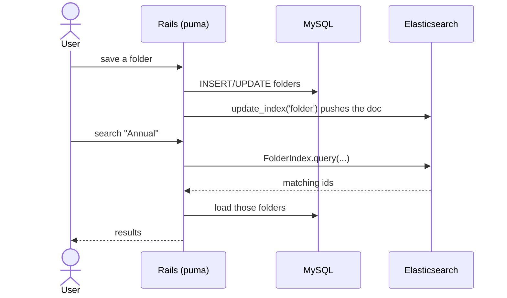
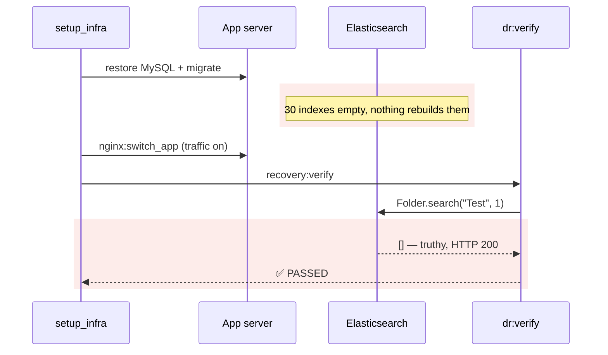
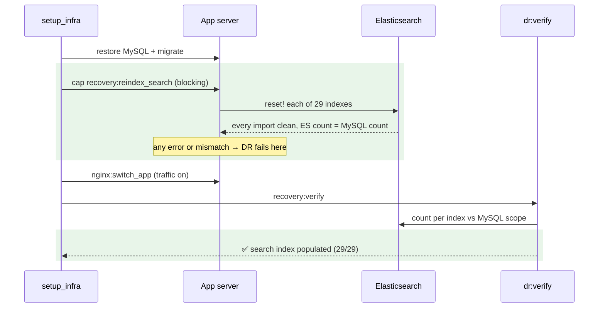

# Search is empty after a DR, and verification says it works — Report

> **Audience:** The developer fixing this, and the reviewer checking the fix.
> **Companion document:** [Tasks](tasks.md)

> **Planning phase — no code changes.** This document diagnoses the bug and plans the fix.

> **Evidence, not guesses.** Line numbers are **as of `4b0dd31da3`**. Read them with
> `git show 4b0dd31da3:<path>`. Row counts come from the prod copy on the dev DB
> (`mysql-restored`, port 33066, `information_schema.tables` estimates, read-only, 2026-11-08).

---

## Summary

- After a full DR, every search box (documents, folders, investors, funds, capital calls…) returns nothing. Elasticsearch is not backed up, and nothing in the DR rebuilds its indexes.
- Verification passes anyway: its search check gets an empty list back with no error. And the two "rebuild search" commands the DR tools print are a task that doesn't exist and a Chewy rake task that finds **zero** indexes in this app.

---

## The Feature — how it is meant to work

### The idea

- Every search box queries **Elasticsearch (ES)**, not MySQL. ES holds a search-shaped copy of selected tables.
- The copy is kept current by **callbacks**: `update_index('folder') { self }` on a model pushes each save to ES.
- ES data is **derived**: it can always be rebuilt from MySQL. That's why it isn't backed up and runs in a container on the DB box with no volume.
- The rebuild is a **reindex**. Each index is dropped, recreated and filled from its MySQL scope, in batches.

### Key concepts

| Concept | What it is, in one line | Example | Stored in |
|---|---|---|---|
| Index | ES's copy of one table, shaped for search | `FolderIndex`, `DocumentIndex` | ES container on the DB box |
| Index class | Ruby class that defines an index's fields and scope | `class FolderIndex < Chewy::Index` | `app/packs/**/models/*_index.rb` (30 files) |
| Index scope | The MySQL rows an index holds | `FaqEntry.published` → `WHERE status='published'` | `index_scope` in the class |
| Callback | Model hook that keeps an index current on every save | `update_index('document') { self }` | the model |
| Reindex | Drop, recreate and refill an index from its scope | `FolderIndex.reset!` | Chewy gem |
| Disabled index | Index whose callback is switched off, so live never maintains it | `AccountEntryIndex` | `account_entry.rb:3` (commented out) |

**Reindex rules (Chewy 8.4.1)**
- `reset!` builds a new suffixed index, imports into it, then swaps the alias. Readers never see a half-built index.
- `reset!` returns the result of the **non-raising** `import`: `true` if clean, `false` if any document failed (`index/actions.rb:150-186`, `index/import.rb:84-86`). Only `import!` raises (`:95-98`).
- `rake chewy:reset` finds indexes through `Chewy.eager_load!`, which loads only `indices_path`, default `app/chewy` (`chewy.rb:198-208`, `rake_helper.rb:219-222`).

### How it fits together

### What it rests on

- ES holds every row of every maintained index's scope.
- Anything that empties ES (a new box, a container restart with no volume) is followed by a reindex.
- A health check that says "ES ok" means search would return results.

---

## Symptom

| | |
|---|---|
| **What the user sees** | Any search after a DR returns no results. The records are there when browsed |
| **What the operator sees** | `✅ HTTP elastic_check (nginx→puma→Elasticsearch) — HTTP 200`, then `DR DRILL PASSED` |
| **Reproduce** | Run a drill, then search a known folder name on the drill app → nothing |
| **Who is affected** | Every user of a recovered environment, every search screen |
| **How often** | Every full DR; also after `dr:fix:promote_replica` / `dr:fix:db_primary` (the new box's ES is empty) |
| **Since when** | Always. The DR never reindexed |

---

## Root Cause

- **Full DR never reindexes.** `setup_infra` goes restore → migrate → traffic on → verify (`lib/tasks/aws_utils.rb:1340-1361`). There's no `chewy` anywhere in `aws.rake` or `aws_utils.rb`.
- **The new ES is empty by design.** The DB box's ES container runs `--rm` with no volume (live staging crontab, probe 2026-11-08), and ES isn't in the xtrabackup chain. The repo's own note: "Elasticsearch indexes are empty on the new box until rake chewy:reset" (`dr_fix_db.rake:261`).
- **The check can't tell empty from healthy.** `elastic_check` is `if Folder.search("Test", 1)` (`app/packs/core/base/controllers/health_check_controller.rb:86`). `Folder.search` returns `.objects`, an Array (`folder.rb:183-187`), and an empty Array is truthy in Ruby → HTTP 200 on an empty index.
- **Both printed fixes are dead ends.**
  - `cap … deploy:chewy_reset` (`dr_fix_db.rake:323`): no such task exists anywhere in the repo.
  - `rake chewy:reset`: `indices_path` is `app/chewy` and the app keeps its indexes in `app/packs/**/models`. A read-only probe gives `Chewy::RakeHelper.send(:all_indexes) # => []`, so it resets nothing and exits 0.
- **Even a working reset hides import errors.** `reset_one` ignores `reset!`'s return value (`rake_helper.rb:339-342`), so failed documents still exit 0.

**Why it was hard to see:**
- A green `elastic_check` reads as "search works". It only proves ES answered.
- Both printed commands *look* right. One fails with "task not found" mid-incident; the other succeeds silently and does nothing.

---

## Blast Radius

| Also touches this code | Does this fix change it? | Needs checking |
|---|---|---|
| `aws:setup_infra` (real DR + drill) | **Yes**: new blocking phase "Rebuild the search index" | staging drill |
| `aws:dr_drill` | Yes, via `setup_infra` | staging drill |
| `dr:verify` → `recovery:verify` (setup_infra, `dr:fix:*`) | **Yes**: new "search index populated" check per index | QA R1 |
| `dr:fix:promote_replica` / `dr:fix:db_primary` follow-ups (`dr_fix_db.rake:261,323,425`) | **Yes**: print the real command | QA R2 |
| `/health_check/elastic_check` (load-balancer / monitoring probe) | **No**: stays cheap | — |
| `ElasticImporterJob` (`app/packs/misc/elastic/elastic_importer_job.rb`) | No. Dead (unreferenced), with a stale list; left alone | — |
| `rake chewy:reset` (Chewy's own task) | No. Still finds 0 indexes; noted as a follow-up | — |
| `AccountEntrySearch` (reads `AccountEntryIndex`) | No. That index stays as live keeps it (not maintained) | — |

---

## Fix

### Which indexes, and how big

| | Indexes | Docs (prod copy) |
|---|---|---|
| All index classes | 30 | ~8.2M |
| **Excluded:** `AccountEntryIndex`, whose callback live has switched off ("too much data", `account_entry_search.rb:12`) | 1 | ~7.6M (18.5 GB table) |
| **Rebuilt in DR** | **29** | **~0.6M** |

- **Why exclude it:** the goal is to restore search *as live has it*. Live never maintains `AccountEntryIndex`, so rebuilding it would be 93% of the work, beyond live's own state.
- **Discovery is by file, not by a hand list:** every `app/packs/**/models/*_index.rb` class, minus an explicit exclusion list with its reason. A new index is included automatically. The dead `ElasticImporterJob` list shows how hand lists rot: it's missing `FolderIndex`, `DealIndex`, `FaqEntryIndex` and `AmlReportIndex`.
- **Biggest rebuilt:** `access_rights` 160k, `documents` 118k, `capital_remittances` 92k, `capital_distribution_payments` 57k, `folders` 52k. Prod time is unknown: the staging drill measures staging, and prod is estimated from it.

### How it works today

### How it works after the fix

### What changes

| # | Before | After | Where |
|---|---|---|---|
| 1 | No notion of "which indexes DR owns" | `Dr::SearchIndexes`: discover index classes by file, exclusion list with reasons, count grading (exact after reindex, tolerant in verify) | `lib/dr/search_indexes.rb` (new) |
| 2 | No reindex | `rake dr:reindex_search`: `reset!` each index in turn, collect failures (keep going), refresh, compare ES count to MySQL scope count, print a table, exit non-zero on any failure or mismatch | `lib/tasks/dr_reindex.rake` (new) |
| 3 | — | `cap recovery:reindex_search` runs it on the primary app server | `config/deploy.rb` |
| 4 | Restore → traffic on | New phase "Rebuild the search index" between restore and traffic on, in both interactive and unattended modes. Phases renumbered `/9` | `aws_utils.rb` `setup_infra` |
| 5 | `elastic_check` = reachable only | `dr:verify` adds "Search index populated" per index (tolerance for writes after traffic on). `elastic_check` unchanged | `dr_verify.rake` |
| 6 | Prints `deploy:chewy_reset` / `rake chewy:reset` | Prints `bundle exec cap <stage> recovery:reindex_search` | `dr_fix_db.rake:261,323,425` |
| 7 | Guide silent on search | Documented: what is rebuilt, what isn't and why, measured time | `dr_guide.md` §5 + §10 |

- **Follow-ups (out of scope):**
  - make Chewy's own `rake chewy:reset` find the app's indexes;
  - delete or repair the dead `ElasticImporterJob`;
  - decide whether `AccountEntryIndex` should exist at all.

---

## Verification

**ID legend:** **H** = Happy path · **E** = Edge case · **X** = Error case.
All rows land in `features/misc/dr_search_indexes.feature` and exercise `Dr::SearchIndexes`, the logic the rake and verify call. The real reindex against ES is proven by the staging drill (qa-checklist).

### Happy Path

| # | Scenario | Given | When | Then | Feature |
|---|---|---|---|---|---|
| H1 | DR owns 30 indexes | the repo's index files | discover | 30 classes incl. `FolderIndex`, `DocumentIndex`, `FaqEntryIndex`; not `AccountEntryIndex` | dr_search_indexes.feature |
| H2 | Clean reindex passes | import ok, ES 52,026 = MySQL 52,026 | grade after reindex | ✅ | dr_search_indexes.feature |
| H3 | Verify within tolerance | ES 10,000, MySQL 10,000 | grade in verify | ✅ | dr_search_indexes.feature |

### Edge Cases

| # | Scenario | Given | When | Then | Feature |
|---|---|---|---|---|---|
| E1 | Empty table | ES 0, MySQL 0 | grade after reindex | ✅ | dr_search_indexes.feature |
| E2 | Small drift after traffic on | ES 9,995, MySQL 10,000 | grade in verify | ✅ (within 1% / 5 docs) | dr_search_indexes.feature |
| E3 | New index file appears | an extra `*_index.rb` class | discover | included without code change | dr_search_indexes.feature |
| E4 | Scoped index | `FaqEntryIndex` | MySQL count source | its `index_scope` (`status = 'published'`), not the whole table | dr_search_indexes.feature |
| E6 | Unmaintained index drifts on live | `CapitalCallIndex` (no callback), ES 2,000 vs MySQL 2,270 | grade in verify | ⚠️ "live does not keep it current" (not ❌) | dr_search_indexes.feature |
| E7 | Unmaintained index right after reindex | same, ES 2,269 vs 2,270 | grade after reindex | ❌ "1 missing" (exact for all) | dr_search_indexes.feature |
| E5 | Every exclusion has a reason | the exclusion list | inspect | non-empty reason per entry; every entry is a real index class | dr_search_indexes.feature |

### Error Cases

| # | Scenario | Given | When | Then | Feature |
|---|---|---|---|---|---|
| X1 | Import reports errors | `reset!` returns false | grade after reindex | ❌ "import reported errors" naming the index | dr_search_indexes.feature |
| X2 | Missing documents after reindex | ES 52,025, MySQL 52,026 | grade after reindex | ❌ "1 missing" (exact) | dr_search_indexes.feature |
| X3 | Empty index in verify | ES 0, MySQL 52,026 | grade in verify | ❌ "search index empty" | dr_search_indexes.feature |
| X4 | Large drift in verify | ES 9,000, MySQL 10,000 | grade in verify | ❌ | dr_search_indexes.feature |
| X5 | Printed follow-ups are real | `dr_fix_db.rake` text + cap tasks | check | no `deploy:chewy_reset`; prints `recovery:reindex_search`, which is defined in `config/deploy.rb` | dr_search_indexes.feature |

**Fails against current code:** X3 and X5. Today verify passes an empty index, and `dr_fix_db.rake` prints `deploy:chewy_reset`, which doesn't exist. H1 also fails: there is no discovery of which indexes a DR owns.

---

## Risks and Rollout

- The reindex blocks traffic, so RTO grows by its duration → measured by the staging drill and recorded as its own phase. Prod (~0.6M docs) is estimated from that before relying on it.
- **Found in implementation:** six indexes (`AmlReport`, `CapitalCall`, `CommitmentAdjustment`, `FundRatio`, `KpiReport`, `PortfolioInvestment`) have **no** `update_index` callback and were only refreshed by the unreferenced `ElasticImporterJob`, so on live they drift. A strict verify check would fail `recovery:verify` on live environments and block component repairs → verify grades by `Dr::SearchIndexes.maintained?` (the model's `chewy_callbacks`): drift on an unmaintained index is ⚠️, not ❌. The reindex still requires all 29 to match exactly. That live search for capital calls and the others is stale is logged as gap G23.
- One bad document fails the whole DR (your rule: finish without errors) → the task keeps going through every index, then prints every failure at once, so one run shows everything to fix.
- Reindex memory on the app server → Chewy imports in batches of 1000. The heaviest scope is `Document.includes(:entity, :folder)`, 118k rows; `account_entries` is excluded.
- Traffic is off while the reindex runs (maintenance mode), so counts must match exactly. Verify runs after traffic is back on, so it gets the tolerance.

| | |
|---|---|
| **Safe to deploy alone?** | Yes. DR tooling only; takes effect on the next drill |
| **Data backfill needed?** | No |
| **Both regions together?** | No |
| **Rollback** | Revert. A recovered stack keeps its rebuilt indexes |

---

## Spec Impact

**None.** Search is meant to work, and the DR guide's verification promises "each request exercises nginx → puma → Rails → that dependency". The code did not deliver it.
