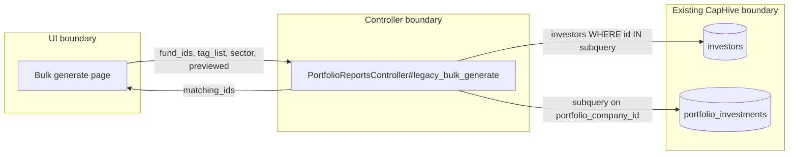
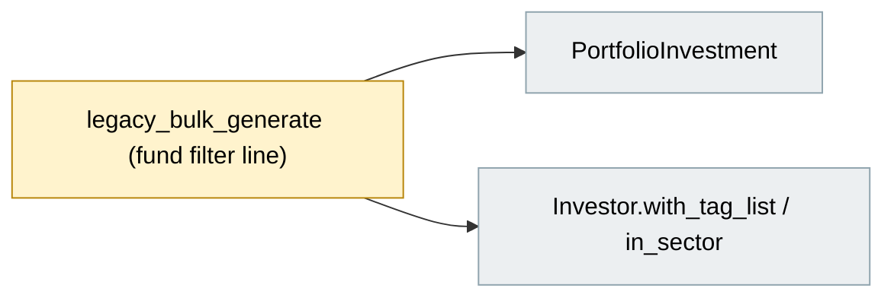
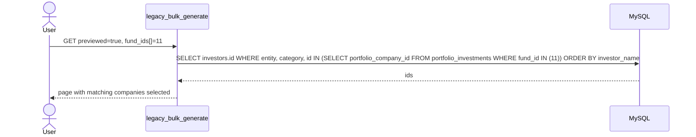

# Fix Legacy Bulk Generate Fund Filter — Design

> **Audience:** Engineering team.
> **Companion documents:** [Proposal](proposal.md) · [Spec](specs/)

> **Planning phase — no code changes.**

---

## Contents

- [Overview](#overview)
- [Architecture](#architecture)
  - [Component Boundaries](#component-boundaries)
  - [Class Diagram](#class-diagram)
  - [Change Footprint](#change-footprint)
- [Data Model and States](#data-model-and-states)
  - [Data Model](#data-model)
  - [State Transitions](#state-transitions)
- [Behaviour](#behaviour)
  - [Pipeline / Flow](#pipeline--flow)
  - [Sequence Diagrams](#sequence-diagrams)
  - [Worked Examples](#worked-examples)
- [Key Components](#key-components)
- [Controllers and Routes](#controllers-and-routes)
- [Policy](#policy)
- [UI Changes](#ui-changes)
- [Cross-cutting Concerns](#cross-cutting-concerns)
  - [Transactions and Queries](#transactions-and-queries)
  - [Exception Handling and Monitoring](#exception-handling-and-monitoring)
  - [Performance and Security](#performance-and-security)
- [Design Decisions](#design-decisions)
- [Testing](#testing)
- [Risks and Open Questions](#risks-and-open-questions)

---

## Overview

`PortfolioReportsController#legacy_bulk_generate` builds the selected-company ids with `joins(:portfolio_investments)...distinct.pluck(:id)` on a relation already ordered by `investor_name`. MySQL rejects `SELECT DISTINCT investors.id ... ORDER BY investors.investor_name`. The fix replaces the join and `distinct` with an `IN` subquery, so no `DISTINCT` is needed and the ordering stays valid.

---

## Architecture

### Component Boundaries

| From → To | Contract | Direction rule |
|---|---|---|
| UI → Controller | GET params `fund_ids[]`, `tag_list`, `sector`, `previewed` | Read-only |
| Controller → DB | One query returning investor ids | No writes |

### Class Diagram

N/A — no new classes; only the body of one existing controller action changes.

### Change Footprint

---

## Data Model and States

### Data Model

N/A — no schema change.

### State Transitions

N/A — no lifecycle or status.

---

## Behaviour

### Pipeline / Flow

N/A — single linear query chain.

### Sequence Diagrams

### Worked Examples

**ID legend:** **H** = Happy path · **E** = Edge case · **X** = Error case.

**Shared setup:**

| Record | Name | Key data |
|---|---|---|
| Entity | Alpha Capital | portfolio companies Ace Limited, Beta Corp, Cora Inc |
| Fund | Fund 11 | Ace has 3 investments, Beta has 1, Cora has none |
| Fund | Fund 12 | no investments |

#### Happy Path

| # | Scenario | Given | When | Then | Spec scenario | Feature |
|---|---|---|---|---|---|---|
| H1 | Preview by fund | Shared setup | Preview with Fund 11 | Ace and Beta selected, Cora not, page renders | Preview with a fund | features/fund/bulk_portfolio_report.feature |
| H2 | Fund plus sector | Ace sector Fintech, Beta sector Health | Preview with Fund 11 and sector Fintech | Only Ace selected | Fund and sector together | features/fund/bulk_portfolio_report.feature |

#### Edge Cases

| # | Scenario | Given | When | Then | Spec scenario | Feature |
|---|---|---|---|---|---|---|
| E1 | Several investments in fund | Ace has 3 investments in Fund 11 | Preview with Fund 11 | Ace selected once | Company with multiple investments in the fund | features/fund/bulk_portfolio_report.feature |
| E2 | Fund with no investments | Fund 12 | Preview with Fund 12 | Nothing selected, no error | Fund with no investments | features/fund/bulk_portfolio_report.feature |
| E3 | No fund | Shared setup | Preview with no fund | No fund filtering; list alphabetical | No fund chosen | features/fund/bulk_portfolio_report.feature |

#### Error Cases

| # | Scenario | Given | When | Then | Spec scenario | Feature |
|---|---|---|---|---|---|---|
| X1 | MySQL DISTINCT/ORDER BY | MySQL database | Preview with Fund 11 | No `StatementInvalid`. Not reproducible on SQLite, so verified manually (see qa-checklist X1) | Preview with a fund | manual QA |

---

## Key Components

N/A — no new services or jobs.

## Controllers and Routes

N/A — no route changes. `GET /portfolio_reports/legacy_bulk_generate` keeps its params and response.

---

## Policy

| Role | Access |
|---|---|
| Users allowed `bulk_generate?` on PortfolioReport | Unchanged |

**Multi-tenancy:** unchanged. `@portfolio_companies` is already scoped to `current_user.entity`, and the subquery only narrows that set.

---

## UI Changes

N/A — no screen changes. The page only stops erroring.

---

## Cross-cutting Concerns

### Transactions and Queries

| What is read | When | N+1 risk | How it stays cheap |
|---|---|---|---|
| Investor ids matching filters | On Preview | No | One query; subquery over `portfolio_investments(portfolio_company_id, fund_id)` |

Read-only, no transactions. `PortfolioInvestment`'s default scope (`proforma: false`) applies to the subquery exactly as it did to the old join.

### Exception Handling and Monitoring

N/A — no new failure modes. The existing exception alert is what reported this bug.

### Performance and Security

- Performance: the subquery replaces a join plus `DISTINCT`, so no deduplication step.
- Security: fund ids still come from request params and go in as bound values. No new trust boundary.

---

## Design Decisions

1. **Use an `IN` subquery on `portfolio_investments.portfolio_company_id`** — Alternatives: `reorder(nil)` on the matching chain (smallest change, but keeps join plus `DISTINCT`); `pluck(:id, :investor_name)` (fetches an unused column). Chosen because it needs no `DISTINCT` and stays correct if more joins are chained later.
2. **No Fund permission filtering added** — unchanged behaviour. Out of scope.

---

## Testing

Cucumber only. Extend `features/fund/bulk_portfolio_report.feature` and reuse the existing step file, adding steps to filter by fund and read which options are selected. Cucumber runs on SQLite, which accepts the old query, so these scenarios guard behaviour but cannot catch the MySQL error itself. X1 is a manual check on dev.

---

## Risks and Open Questions

- Subquery may differ from the old join in rows returned → both apply the same `proforma: false` default scope and the same `portfolio_company_id` key, and E1 covers duplicates.
- Same `DISTINCT` + `ORDER BY` pattern elsewhere → out of scope; flagged in tasks as a quick grep.

| # | Open question | Current thinking | Status |
|---|---|---|---|
| 1 | Any other `.distinct` on an ordered investors relation? | Grep during implementation | Deferred |
