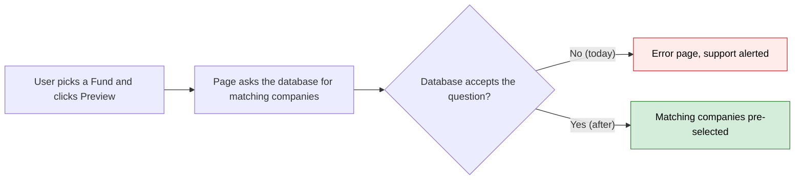

# Fix Legacy Bulk Generate Fund Filter — Proposal

> **Audience:** Business team, product, QA, support — non-technical.
> **Companion document:** [Design](design.md)

> **Planning phase — no code changes.** This document proposes and explains the change. Do not
> edit application code while writing it; implementation happens later, in the tasks phase.

---

## Why

On the "Bulk generate portfolio reports" page, choosing a Fund and clicking Preview crashes with an error page instead of selecting the portfolio companies that belong to that fund. The error is raised only by the production-style database (MySQL), so it went unnoticed in automated tests and was first seen on dev when someone previewed with Fund 11.

## What Changes

- Previewing with one or more Funds selected works again: the companies that hold investments in those funds are pre-selected in the company list.
- Nothing else on the page changes. The company list still shows every portfolio company, alphabetically.
- No data, permissions or screens change.

### Flow Diagram



*Caption: the Fund filter on the preview step, before and after.*

---

## User Stories

### US-1: Preview companies by fund

**As a** fund admin,
**I want** to pick a Fund and preview which portfolio companies belong to it,
**So that** I can bulk-generate reports for just those companies.

**Acceptance criteria:**
- Picking one or more Funds and clicking Preview shows the page without an error.
- Only companies with at least one portfolio investment in a picked fund are pre-selected.
- A company with several investments in the same fund is selected once.
- Combining Fund with Tag and/or Sector narrows the selection further, as before.

---

## UI Behavior

### Bulk generate page (filter step)

```
+-----------------------------------------------------+
|  Bulk generate portfolio reports                    |
|  Fund: [ Fund 11 x ]  Tag: [      ]  Sector: [    ] |
|  [ Preview ]                                        |
|  Portfolio companies (matches pre-selected):        |
|  [x] Ace Limited                                    |
|  [ ] Beta Corp                                      |
|  [Next]                                             |
+-----------------------------------------------------+
```

**Behavior notes:**
- Preview re-syncs which companies are selected. The list itself is never reduced.

---

## What This Feature Does NOT Cover

| Excluded | Covered In |
|---|---|
| Changes to the newer (non-legacy) bulk generate form | Not affected |
| Restricting the Fund picker input to funds the user can see | Out of scope, unchanged |
| New automated tests (Cucumber scenarios) | Skipped: the fix is a one-line query change, and the automated test database cannot reproduce the error anyway. Verified by hand on dev instead. |

---

## Validation Rules

| Field | Rule | Default |
|---|---|---|
| Fund | Optional, one or many | None selected: no fund filtering |
| Tag / Sector | Optional, unchanged | None |

---

## Behavior Rules

| Scenario | What User Sees |
|---|---|
| Preview with a Fund that has investments in two companies | Those two companies pre-selected, no error |
| Preview with a Fund with no investments | No companies pre-selected, no error |
| Preview with no Fund | Unchanged: all companies pre-selected (subject to Tag/Sector) |

---

## Resolved Design Decisions

| # | Decision | Resolution |
|---|---|---|
| 1 | Keep the alphabetical list order | Yes, list order untouched |
| 2 | Add Fund permission checks to the filter | No, unchanged behaviour; separate concern |
| 3 | Add automated tests for this fix | No. The change is a single line, and the test database accepts the old query, so a new scenario could not have caught the bug. Verification is a manual check on dev with the original failing URL. |

---

## Capabilities

### New Capabilities

- `funds/portfolio-report-bulk-company-filter`: how the legacy bulk-generate preview selects portfolio companies from the Fund, Tag and Sector filters.

### Modified Capabilities

None.

---

## Impact

The "Bulk generate portfolio reports" page (filter/preview step) only.

---

## Benefits

1. Fund-based bulk report generation works on dev, staging and production.
2. Support stops receiving the error alert for this page.

---

## FAQ

| Question | Answer |
|---|---|
| Is any data affected? | No. Read-only filtering. |
| Did selecting by Tag or Sector break too? | No, only the Fund filter triggered the error. |
| Why didn't tests catch it? | Tests run on a more lenient database; see design.md Testing. |
| Are tests being added? | No. The fix is too small to justify new scenarios, and they would pass on the test database with or without the fix. It is checked by hand on dev. |

---

## Design Principle for the Next Phase

Keep it to a single-line query change; no new abstractions.
