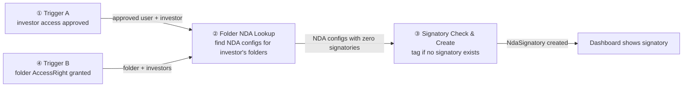
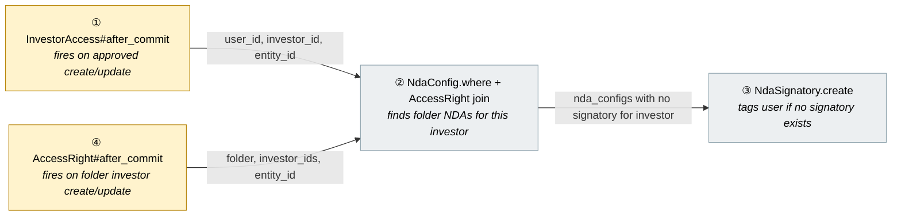
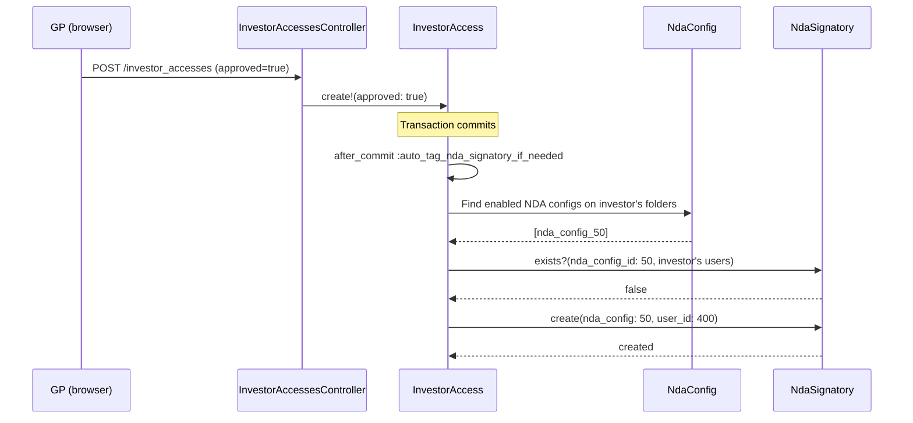
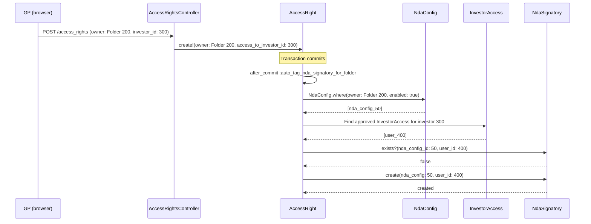
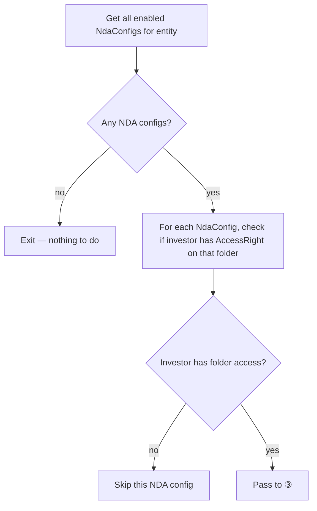
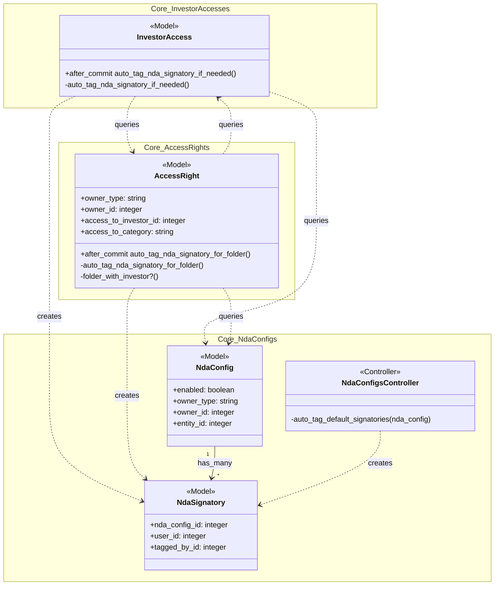

# Fix NDA Signatory Auto-Tag — Design

> **Audience:** Engineering team.
> **Companion documents:** [Proposal](proposal.md) · [Spec](specs/)

> **Planning phase — no code changes.** This document explains HOW the proposal will be built.
> Do not edit application code while writing it; implementation happens later, in the tasks phase.

---

## Contents

- [1. The idea](#1-the-idea)
- [2. The same picture with real names](#2-the-same-picture-with-real-names)
- [3. One card per box](#3-one-card-per-box)
  - [① Trigger](#①-trigger)
  - [② Folder NDA Lookup](#②-folder-nda-lookup)
  - [③ Signatory Check & Create](#③-signatory-check--create)
- [4. Reference](#4-reference)

---

## 1. The idea

### What this adds

Adds `after_commit` callbacks on both `InvestorAccess` and `AccessRight` that auto-tag users as NDA signatories when the investor has access to an NDA-protected folder but no existing signatory. The two callbacks cover both ordering paths: InvestorAccess approved before AccessRight exists, and AccessRight granted before InvestorAccess is approved. Also fixes the existing on-creation auto-tag in `NdaConfigsController` to scope by folder-level access rights instead of entity-wide.

### The idea in one picture

### Walkthrough: on one example, start to finish

**Setup:** Entity "Ace Fund" (id 100). Folder "Fund II Data Room" (id 200) has an NDA config (id 50, enabled). Investor "Alpha LP" (id 300) has an AccessRight on folder 200. User Meera (id 400) is added as InvestorAccess for Alpha LP.

| # | When | What happens | Behind the scenes | Result |
|---|---|---|---|---|
| 1 | GP adds Meera as investor access (approved) | InvestorAccess created with approved=true | The trigger (①) fires after commit | InvestorAccess saved |
| 2 | Callback runs | Finds NDA configs on folders accessible to Alpha LP | Folder NDA lookup (②) queries AccessRight + NdaConfig | NdaConfig id 50 found |
| 3 | Check for existing signatory | Checks if Alpha LP has any signatory for NDA 50 | Signatory check (③) queries NdaSignatory | No signatory found |
| 4 | Create signatory | Tags Meera as signatory for NDA 50 | Signatory create (③) inserts NdaSignatory | Meera is signatory |
| 5 | Meera visits folder | Sees NDA acceptance form | NdaAcceptancesController checks signatory status | Acceptance form shown |

**What to notice:**
- The callback runs after commit, not inside the transaction — no risk of partial saves
- Only folder-scoped NDA configs are considered, not all entity NDAs
- Idempotent — if Alpha LP already had a signatory, step 3 stops the flow

### Key ideas

| # | Idea | In one line | Card |
|---|---|---|---|
| 1 | after_commit on InvestorAccess | Fires on InvestorAccess create/update when approved | [①](#①-trigger) |
| 2 | Folder-scoped lookup | Uses AccessRight join to find relevant NDA configs | [②](#②-folder-nda-lookup) |
| 3 | Idempotent create | Skips silently if signatory exists (unique constraint) | [③](#③-signatory-check--create) |
| 4 | after_commit on AccessRight | Fires on folder AccessRight create/update for investor | [④](#④-accessright-trigger) |

**FAQ**

| Question | Answer |
|---|---|
| Why after_commit and not after_save? | after_commit runs outside the transaction, so the InvestorAccess is fully persisted. after_save could create an NdaSignatory inside a transaction that rolls back. |
| Does this block the GP's request? | No — after_commit is asynchronous to the HTTP response in practice, and the queries are lightweight (indexed lookups). |

---

## 2. The same picture with real names

### Picture

Colour = footprint: **amber** modified, **grey** reused unchanged.

### What each box does

| # | Box | Real parts | What it does | When it runs | What it decides | Details |
|---|---|---|---|---|---|---|
| ① | InvestorAccess Trigger | `InvestorAccess` model | Fires callback when `approved?` is true | After commit on create/update | Whether to run lookup | [card ① →](#①-trigger) |
| ④ | AccessRight Trigger | `AccessRight` model | Fires callback when folder AccessRight is created for an investor | After commit on create/update | Whether to run lookup | [card ④ →](#④-accessright-trigger) |
| ② | Folder NDA Lookup | `NdaConfig`, `AccessRight`, `Investor.owner_access_rights` | Finds enabled NDA configs on folders the investor can access | Inside callback | Which NDA configs need a signatory | [card ② →](#②-folder-nda-lookup) |
| ③ | Signatory Check & Create | `NdaSignatory` | Creates signatory record if none exists for this investor + NDA | Inside callback | Whether to create or skip | [card ③ →](#③-signatory-check--create) |

### One run, end to end

**Path A — InvestorAccess approved (investor already has folder access):**

**Path B — AccessRight granted on folder (investor already has approved InvestorAccess):**

### Lifecycles

N/A — no new stored status. NdaSignatory is a simple existence record.

### What users see

No UI changes. The NDA Status Dashboard already shows signatories correctly. After this fix, newly added investors will appear with a signatory on the dashboard — the same way existing investors do.

### Design decisions

1. **after_commit callbacks on two models vs. controller hook** — Callbacks on both InvestorAccess and AccessRight models. Alternative: hook in controllers. Rejected because: controller hooks miss non-controller creation paths (CSV import, admin panel, console). Two callbacks needed because GP workflow order varies — sometimes InvestorAccess is approved first, sometimes AccessRight is granted first.

2. **Tag the approved user vs. oldest user** — Tag the user being approved. Alternative: find oldest approved InvestorAccess for the investor. Rejected because: the user being approved is the one triggering the flow, and for new investors they are typically the first (and only) user.

3. **Fix controller auto-tag scoping** — Change from entity-wide to folder-scoped using `Investor.owner_access_rights`. Alternative: leave controller as-is. Rejected because: entity-wide tagging creates signatories for investors who can't even access the folder.

**FAQ**

| Question | Answer |
|---|---|
| Why not use a Sidekiq job instead of inline callback? | The queries are lightweight (2-3 indexed lookups). A job adds complexity and latency for no benefit. |
| Why do we need BOTH InvestorAccess and AccessRight callbacks? | GP workflow order varies. Sometimes InvestorAccess is approved first (investor already has folder access) — the InvestorAccess callback handles this. Other times AccessRight is granted first (investor already has approved InvestorAccess) — the AccessRight callback handles this. Both are needed to cover all paths. |

---

## 3. One card per box

### ① Trigger

The `after_commit` callback on `InvestorAccess` that initiates the auto-tag flow. Fires on `create` and `update` lifecycle events, guarded by `approved?`.

| Owns | Reads / receives | Produces |
|---|---|---|
| Callback registration | `approved` flag, `entity_id`, `investor_id`, `user_id` | Calls ② |

**Detail:**
- Guard: `if: :approved?` — unapproved records are skipped
- Lifecycle: `on: [:create, :update]` — covers both "created as approved" and "toggled to approved"
- The callback method `auto_tag_nda_signatory_if_needed` is private on InvestorAccess

**Also modifies: `NdaConfigsController#auto_tag_default_signatories`**
- Change `InvestorAccess.where(entity_id:)` to use `Investor.owner_access_rights(folder, nil)` to get folder-scoped investors
- Then for each investor, find the oldest approved InvestorAccess user and tag them

**Worked examples:** H1, H2, E1, E2

**FAQ**

| Question | Answer |
|---|---|
| Does this fire on every InvestorAccess update? | Only when `approved?` is true. Updates to email, phone, etc. on an already-approved record will fire but exit early because a signatory already exists (idempotent). |
| What about `approved` toggled to false (revoked)? | No action — revoking access does not remove signatories. That's a separate concern. |

### ② Folder NDA Lookup

Finds NDA configs on folders that the investor has access to.

| Owns | Reads / receives | Produces |
|---|---|---|
| Query logic | `entity_id`, `investor_id` from ① | List of NdaConfig records needing signatory |

**Detail:**

The lookup finds NDA configs via this path:
1. `Investor.owner_access_rights(folder, nil)` pattern — finds investors with AccessRight on a folder
2. But we need the reverse: given an investor, find folders they have access to
3. Query: `NdaConfig.where(entity_id:, enabled: true, owner_type: 'Folder')` then filter by folders where the investor has an AccessRight

**Decision flowchart:**

**Worked examples:** H1, E1, E3

**FAQ**

| Question | Answer |
|---|---|
| Why not query AccessRight directly instead of through NdaConfig? | We need the NdaConfig ID to create the signatory. Starting from NdaConfig and filtering by folder access is more direct. |
| What about inherited NDA configs? | Inherited NDAs use the parent folder's NdaConfig. The AccessRight is on the child folder but the NDA belongs to the parent. This lookup checks the NdaConfig's owner folder, which is the parent — so the investor needs access to the parent folder (or category-level access). This matches existing NDA inheritance behavior. |

### ③ Signatory Check & Create

Checks if the investor already has a signatory for the NDA config and creates one if not.

| Owns | Reads / receives | Produces |
|---|---|---|
| Signatory existence check + create | NdaConfig from ②, user_id from ① | NdaSignatory record (or skip) |

**Detail:**
1. Check: `NdaSignatory.where(nda_config_id:).where(user_id: InvestorAccess.where(investor_id:, entity_id:, approved: true).select(:user_id)).exists?`
   - This checks if ANY user of this investor is already a signatory for this NDA — not just the current user
2. If no signatory exists: `NdaSignatory.create(nda_config:, user_id:, tagged_by_id:)`
3. Rescue `RecordNotUnique` / `RecordInvalid` for race conditions

**Worked examples:** H1, H2, E2, X1

**FAQ**

| Question | Answer |
|---|---|
| Why check all investor users, not just the current user? | If another user of the same investor is already a signatory, we don't need a second one. The investor is covered. |
| What's `tagged_by`? | The GP who granted/approved the access (`granted_by`), falling back to the user themselves if no granter is recorded. |

### ④ AccessRight Trigger

The `after_commit` callback on `AccessRight` that initiates the auto-tag flow when a folder-level AccessRight is created for an investor. Fires on `create` and `update` lifecycle events, guarded by `folder_with_investor?`.

| Owns | Reads / receives | Produces |
|---|---|---|
| Callback registration | `owner_type`, `owner_id`, `access_to_investor_id`, `access_to_category`, `entity_id` | Calls ② → ③ |

**Detail:**
- Guard: `if: :folder_with_investor?` — only fires when `owner_type == 'Folder'` AND the AccessRight targets an investor (direct or category)
- Lifecycle: `on: [:create, :update]` — covers new grants and modifications
- The callback method `auto_tag_nda_signatory_for_folder` is private on AccessRight
- For direct investor AccessRights (`access_to_investor_id`): checks that single investor
- For category AccessRights (`access_to_category`): finds all investors matching the category in the entity

**Difference from ① (InvestorAccess trigger):**
- ① fires when a user's access is approved → checks folders the investor can access
- ④ fires when folder access is granted → checks if the investor already has approved users

**Worked examples:** H5, H6, E4

**FAQ**

| Question | Answer |
|---|---|
| Does this fire for Fund/Deal/Document AccessRights? | No — the `folder_with_investor?` guard ensures it only fires for `owner_type: 'Folder'`. |
| What if the investor has no approved InvestorAccess? | No auto-tag. The InvestorAccess callback (①) will handle it when access is later approved. |
| What about category-level AccessRights? | The callback resolves all investors matching the category in the entity and checks each one. |

---

## 4. Reference

### Class diagram

### Data model and schema changes

No schema changes — all tables already exist. No new columns or indexes needed.

**Changes to existing models:**
- `InvestorAccess` — add `after_commit` callback and `auto_tag_nda_signatory_if_needed` private method
- `AccessRight` — add `after_commit` callback, `auto_tag_nda_signatory_for_folder` private method, and `folder_with_investor?` guard method
- `NdaConfigsController` — modify `auto_tag_default_signatories` to use folder-scoped investor query

### Component contracts

| From → To | Contract | Direction rule |
|---|---|---|
| ① → ② | Passes entity_id, investor_id; expects array of NdaConfig | ① calls ② only when approved? is true |
| ④ → ② | Passes folder, entity_id, investor_ids; expects NdaConfig lookup | ④ calls ② only when folder_with_investor? is true |
| ② → ③ | Passes NdaConfig + user_id; expects signatory creation or skip | ② calls ③ only for NDA configs where investor has folder access |
| ③ → NdaSignatory | Creates record; expects unique constraint enforcement | ③ handles RecordNotUnique silently |

### Cross-cutting concerns

#### Transactions and queries

- The callback runs **outside** the InvestorAccess transaction (after_commit)
- Query 1: `NdaConfig.where(entity_id:, enabled: true, owner_type: 'Folder')` — indexed on entity_id
- Query 2: `AccessRight.exists?(owner_type: 'Folder', owner_id: nda_config.owner_id, ...)` — per NDA config, indexed
- Query 3: `NdaSignatory.exists?(nda_config_id:, user_id: [...])` — per NDA config, indexed on unique constraint
- Query 4 (AccessRight callback): `NdaConfig.where(owner: folder, enabled: true)` — indexed on owner_type/owner_id
- Query 5 (AccessRight callback): `InvestorAccess.where(investor_id:, entity_id:, approved: true).order(:created_at)` — indexed
- **N+1 risk:** Low. Typical entity has 1-3 NDA configs. Each triggers 2 indexed existence checks. AccessRight callback adds 1-2 queries for the folder's NDA + investor access lookup. No eager loading needed.

#### Exception handling and monitoring

No new error paths. `RecordNotUnique` and `RecordInvalid` are rescued silently (idempotency). No alerts needed — these are expected race conditions.

#### Performance and security

- **Volume:** 1-3 NDA configs per entity × 2 queries each = 2-6 queries per InvestorAccess approval. All indexed.
- **Inline vs background:** Inline callback. Under 10ms total. No job needed.
- **Tenant isolation:** Scoped by `entity_id` throughout. InvestorAccess already validates entity scoping.

### Worked examples

**Shared setup:**

| Record | Name | Key data |
|---|---|---|
| Entity | Ace Fund | id: 100 |
| Folder | Fund II Data Room | id: 200, entity_id: 100 |
| NdaConfig | Fund II NDA | id: 50, entity_id: 100, owner: Folder 200, enabled: true |
| Investor | Alpha LP | id: 300, entity_id: 100 |
| Investor | Beta LP | id: 350, entity_id: 100 |
| User | Meera | id: 400 (Alpha LP access) |
| User | Raj | id: 410 (Alpha LP access, existing signatory) |
| User | Priya | id: 500 (GP) |
| AccessRight | Alpha on Fund II | owner: Folder 200, access_to_investor_id: 300 |

#### Happy Path

| # | Scenario | Given | When | Then | Spec scenario | Feature |
|---|---|---|---|---|---|---|
| H1 | New investor access, auto-tag fires | Alpha LP has folder access, no signatory for NDA 50 | Meera's InvestorAccess created as approved | NdaSignatory created for Meera on NDA 50 | New investor access created as approved with folder NDA | nda_signatory_auto_tag |
| H2 | Access toggled to approved | Meera's access exists as unapproved | GP approves Meera's access | NdaSignatory created for Meera on NDA 50 | Existing investor access toggled to approved with folder NDA | nda_signatory_auto_tag |
| H3 | NDA creation, folder-scoped | Alpha LP has folder access, Beta LP does not | GP creates NDA on folder 200 | Only Alpha LP gets signatory tagged | NDA created on folder with folder-scoped investors | nda_signatory_auto_tag |
| H5 | AccessRight granted, investor has approved access | Alpha LP has approved InvestorAccess, no folder AccessRight | GP grants folder AccessRight for Alpha LP on folder 200 with NDA | NdaSignatory created for oldest approved user of Alpha LP | Folder AccessRight granted to investor with approved access | nda_signatory_auto_tag |
| H6 | Category AccessRight granted | Multiple LP investors with approved access, no folder access | GP grants category AccessRight "LP" on folder 200 with NDA | Each matching LP investor gets signatory auto-tagged | Category AccessRight granted matching multiple investors | nda_signatory_auto_tag |

#### Edge Cases

| # | Scenario | Given | When | Then | Spec scenario | Feature |
|---|---|---|---|---|---|---|
| E1 | No folder NDA exists | Alpha LP has folder access but no NDA on folder | Meera's access approved | No signatory created | Investor has no folder-level access to any NDA-protected folder | nda_signatory_auto_tag |
| E2 | Investor already has signatory | Raj is already signatory for NDA 50 | Meera's access for Alpha LP approved | No new signatory created | Investor already has a signatory for the folder NDA | nda_signatory_auto_tag |
| E3 | Investor has entity access but no folder access | Beta LP has entity access, no AccessRight on folder 200 | GP creates NDA on folder 200 | Beta LP not auto-tagged | Investor has entity access but no folder access | nda_signatory_auto_tag |
| E4 | AccessRight granted but investor has no approved access | Alpha LP has no approved InvestorAccess | GP grants folder AccessRight for Alpha LP on folder 200 with NDA | No signatory created | Folder AccessRight granted but no approved InvestorAccess | nda_signatory_auto_tag |

#### Error Cases

| # | Scenario | Given | When | Then | Spec scenario | Feature |
|---|---|---|---|---|---|---|
| X1 | Race condition: duplicate signatory | Two approvals fire simultaneously | Both try to create signatory | One succeeds, other rescued silently | Concurrent approval race condition | nda_signatory_auto_tag |

### Testing

Cucumber feature `nda_signatory_auto_tag.feature` covers all scenarios above. Reuses existing NDA step definitions from `nda_acceptance_steps.rb` and `nda_config_steps.rb` for setup. New step definitions in `nda_signatory_auto_tag_steps.rb` for the auto-tag-specific Given/When/Then steps. Factory setup: entity, folder, NDA config, investor, access right, investor access.

### Risks and open questions

- **Callback performance on bulk import** — If a CSV import approves 100 investors at once, 100 callbacks fire. Each does 2-6 indexed queries. Total: ~600 queries. Mitigated by: queries are fast (indexed, existence checks), and bulk imports are infrequent. → If this becomes a problem, batch the auto-tag in the importer.
- **Inherited NDA configs** — The callback checks `NdaConfig.owner_type: 'Folder'`. Inherited folders don't have their own NdaConfig; they use the parent's. The AccessRight may be on the child folder while the NdaConfig is on the parent. → The callback correctly checks the NdaConfig's owner folder, but the investor's AccessRight must be on that same folder (or match via category). This matches existing NDA gate behavior.

| # | Open question | Current thinking | Status |
|---|---|---|---|
| 1 | Should auto-tag also fire when AccessRight is created on a folder? | Yes — UI testing confirmed the common GP workflow is: NDA set up → AccessRight granted → investor already has InvestorAccess from before. The InvestorAccess callback alone misses this path. Both callbacks are needed. | Resolved (reversed after UI testing) |

**FAQ**

| Question | Answer |
|---|---|
| Where do I start reviewing? | Start with the InvestorAccess model callback (①), then the controller fix, then the Cucumber feature. |
