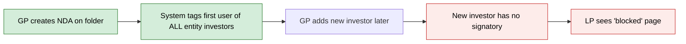
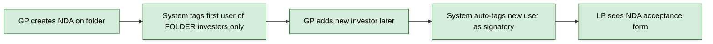
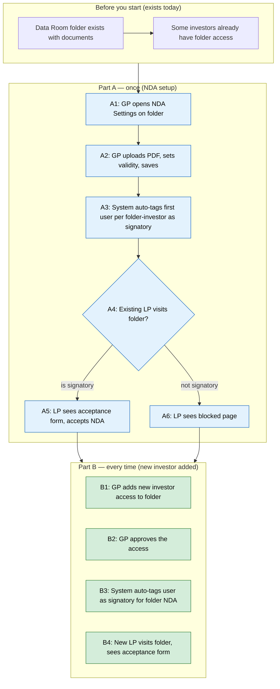

# Fix NDA Signatory Auto-Tag for New Investors — Proposal

> **Audience:** Business team, product, QA, support — non-technical.
> **Companion document:** [Design](design.md)
> **New to this? Start with the [Workflow Journey](#workflow-journey)** — every action, in order, from start to the outcome.

> **Planning phase — no code changes.** This document proposes and explains the change. Do not
> edit application code while writing it; implementation happens later, in the tasks phase.

---

## Why

When a GP sets up an NDA on a Data Room folder, the system auto-tags the first user of each existing investor as a default signatory. But if new investors are added to the folder **after** the NDA is configured, their users are never auto-tagged — those LPs see a "blocked" page and cannot accept the NDA. Additionally, the current auto-tag logic tags signatories for **all entity investors**, not just those with access to the specific folder, which is incorrect.

## What Changes

- **New investors get auto-tagged:** When an investor access is created or approved, the system checks if any NDA-protected folders grant access to that investor. If one exists and the investor has no signatory for it yet, the new user is auto-tagged as the default signatory.
- **Folder-scoped tagging:** Both the on-creation auto-tag (existing) and the new on-access auto-tag are scoped to investors with folder-level access rights, not entity-wide.

### Flow Diagram

**Before — NDA signatory auto-tagging (on NDA creation only)**



**After — NDA signatory auto-tagging (on NDA creation + on investor access)**



---

## Workflow Journey

### Who is involved

| Person | Role | What they do in the journey |
|---|---|---|
| Priya | GP (fund manager) | Sets up NDA on a Data Room folder, adds investors |
| Raj | LP (investor user) — existing investor | Already had access when NDA was set up |
| Meera | LP (investor user) — new investor | Added after NDA was already configured |

### The journey on one page



### Before you start

| Needed | Why | Where it comes from |
|---|---|---|
| Data Room folder | NDA is configured per folder | GP creates it under Documents |
| Investor access rights on folder | Determines which investors see NDA | GP grants access via Access Rights |
| NDA configured on folder | The NDA must be enabled and saved | GP sets up via NDA Settings modal |

### Part A — once (NDA setup)

| Step | Who | Where | Action | What the system does | What you see |
|---|---|---|---|---|---|
| A1 | Priya | Documents › folder tree › click folder caret | Opens NDA Settings | Shows NDA Settings modal with Settings tab | Modal with "Require NDA before access" toggle |
| A2 | Priya | NDA Settings modal › Settings tab | Sets "Yes", uploads PDF, picks validity, clicks Save Settings | Saves NdaConfig, sets folder inheritance to "own" | Success flash, modal closes |
| A3 | — | — | — | Finds investors with access to THIS folder, tags oldest approved user per investor as signatory | No visible change (background) |
| A4 | Raj | Documents › clicks on NDA-protected folder | Visits folder | Checks if Raj is a designated signatory | Acceptance form (if signatory) or blocked page (if not) |

### Part B — every time (new investor added)

| Step | Who | Where | Action | What the system does | What you see |
|---|---|---|---|---|---|
| B1 | Priya | Stakeholders › Investor › Add Access | Adds Meera as investor access | Creates InvestorAccess record (may be unapproved) | New access row appears |
| B2 | Priya | Stakeholders › Investor › Approve toggle | Approves Meera's access | Sets approved=true; checks if investor has folder NDA with no signatory → auto-tags Meera | Access shows as approved |
| B3 | — | — | — | Creates NdaSignatory for Meera on the folder's NdaConfig | No visible change (background) |
| B4 | Meera | Documents › clicks on NDA-protected folder | Visits folder | Checks Meera is a designated signatory → shows acceptance form | NDA acceptance screen with PDF and "I Accept" button |

### What you see

**LP visits NDA-protected folder (signatory — can accept):**

```
┌─────────────────────────────────────────────────────┐
│  CapHive Logo                                       │
│                                                     │
│  Non-Disclosure Agreement                           │
│  Ace Fund | Folder: Fund II Data Room               │
│                                                     │
│  ┌─────────────────────────────────────────────┐    │
│  │ 📄 NDA Document (PDF viewer)                │    │
│  │    az-report-2026-01-06.pdf                 │    │
│  └─────────────────────────────────────────────┘    │
│                                                     │
│  ☐ I have read and agree to the terms               │
│                                                     │
│  [ I Accept ]  [ Decline ]                          │
│                                                     │
│  Questions? Contact: legal@acefund.com              │
└─────────────────────────────────────────────────────┘
```

**LP visits NDA-protected folder (NOT a signatory — blocked):**

```
┌─────────────────────────────────────────────────────┐
│  CapHive Logo                                       │
│                                                     │
│  Non-Disclosure Agreement                           │
│  Ace Fund | Folder: Fund II Data Room               │
│                                                     │
│  ┌─────────────────────────────────────────────┐    │
│  │ 🔒 Please ensure that the authorised        │    │
│  │    signatory has signed the NDA to access    │    │
│  │    the documents.                            │    │
│  └─────────────────────────────────────────────┘    │
│                                                     │
│  Questions? Contact: legal@acefund.com              │
│                                                     │
│  [ Back to Data Rooms ]                             │
└─────────────────────────────────────────────────────┘
```

### What goes wrong

**Scenario: GP adds investor but forgets to approve the access.**

The investor access is created with `approved: false`. The auto-tag callback does not fire (it only runs when `approved?` is true). The LP cannot log in or see anything. **Fix:** GP clicks the approve toggle on the investor access row. On approval, the callback fires and auto-tags the signatory.

**Scenario: Investor has access to the entity but NOT to the specific folder.**

The investor has no `AccessRight` for the NDA-protected folder. The auto-tag callback finds no relevant NDA configs for this investor's folder access, so no signatory is created. This is correct — the investor cannot access the folder anyway. **Fix:** GP grants folder-level access rights to the investor, then the auto-tag fires on the next investor access approval.

### Summary: the minimum actions

| # | Action | Who | How often |
|---|---|---|---|
| 1 | Set up NDA on folder | GP | Once per folder |
| 2 | Add investor access | GP | Each new investor |
| 3 | Approve investor access | GP | Each new investor |
| 4 | (Automatic) System auto-tags signatory | System | Each approval |

---

## User Stories

### US-1: Auto-tag signatory on new investor access approval

**As a** GP,
**I want** newly added investors to automatically have a default signatory tagged for the folder's NDA,
**So that** their LPs can immediately accept the NDA without me manually designating a signatory.

**Acceptance criteria:**
- When an investor access is approved (created as approved, or toggled to approved), the system checks all NDA-enabled folders the investor has access to
- For each folder NDA where the investor has zero signatories, the approved user is auto-tagged as signatory
- If the investor already has a signatory for that NDA, no duplicate is created
- The auto-tag works for both new access creation and approval toggle

### US-2: Folder-scoped auto-tag on NDA creation

**As a** GP,
**I want** the initial NDA signatory auto-tag to only cover investors with access to the specific folder,
**So that** investors without folder access are not incorrectly tagged as signatories.

**Acceptance criteria:**
- When an NDA is first created on a folder, only investors with folder-level access rights are considered
- Investors with entity-level access but no folder-specific access right are not tagged
- The existing behavior of tagging the oldest approved user per investor is preserved

---

## UI Behavior

### No new UI elements

This fix is entirely backend logic. There are no new screens, buttons, or visible changes. The NDA Status Dashboard will correctly show the auto-tagged signatory for newly added investors — the same way it shows auto-tagged signatories for investors present at NDA creation time.

---

## What This Feature Does NOT Cover

| Excluded | Covered In |
|---|---|
| GP manually choosing which user to auto-tag (always picks the approved user being added) | Future enhancement if needed |
| Auto-tagging when folder access rights change (AccessRight created/modified) | Out of scope — only fires on InvestorAccess changes |
| Removing signatory when investor access is revoked | Future consideration |

---

## Validation Rules

| Field | Rule | Default |
|---|---|---|
| NdaSignatory.user_id | Unique per nda_config_id (DB index) | — |
| InvestorAccess.approved | Must be true for auto-tag to fire | false |

---

## Behavior Rules

| Scenario | What User Sees |
|---|---|
| New investor access created as approved + folder has NDA + investor has no signatory | User auto-tagged as signatory; LP sees acceptance form |
| New investor access created as approved + folder has NDA + investor already has signatory | No change; existing signatory retained |
| New investor access created as unapproved | No auto-tag; LP cannot access anything |
| Unapproved access toggled to approved + folder has NDA | User auto-tagged as signatory on approval |
| Investor has no folder-level access right | No NDA configs found; no signatory created |
| NDA created on folder (first time) | Only folder-access investors tagged (not all entity investors) |
| Race condition: two accesses approved simultaneously | Idempotent — second create silently skipped via unique constraint |

---

## Resolved Design Decisions

| # | Decision | Resolution |
|---|---|---|
| 1 | Where to hook the auto-tag logic? | `after_commit` callback on InvestorAccess model — catches all creation paths (UI, CSV import, admin) |
| 2 | Entity-wide vs folder-scoped tagging? | Folder-scoped — use `Investor.owner_access_rights` pattern matching NdaStatusResolver |
| 3 | Which user to tag for the new investor? | The user being approved (not oldest by created_at) — they are the one triggering the flow |
| 4 | What about the existing controller auto-tag? | Fix to also be folder-scoped, for consistency |

---

## Capabilities

### New Capabilities

- `nda/signatory-auto-tag`: Automatic NDA signatory tagging when investor access is approved and on NDA creation, scoped to folder-level access rights

### Modified Capabilities

_(none — no existing specs are affected)_

---

## Impact

- **NDA Settings (on creation):** The auto-tag at NDA creation time will now tag fewer investors (only those with folder access instead of all entity investors). This is a correctness fix.
- **Investor Access (on approval):** Adding a new background check when investor access is approved. Low query cost — one lookup for folder NDA configs, one existence check for signatory.
- **NDA Status Dashboard:** No changes — already displays signatories correctly. Will now show signatories for newly added investors.

---

## Benefits

1. **LPs are never blocked unnecessarily** — new investors automatically get a signatory tagged, so their users can accept the NDA immediately
2. **GPs don't need to manually tag signatories** for investors added after NDA setup — it just works
3. **Correct scoping** — only investors with actual folder access get tagged, reducing confusion on the NDA Status Dashboard

---

## FAQ

| Question | Answer |
|---|---|
| Does this change anything for existing NDAs? | No. Existing signatories are untouched. The fix only applies to future investor access approvals and new NDA creations. |
| What if a GP wants a different user as signatory? | They can still change the signatory from the NDA Status Dashboard. The auto-tag is a default, not a lock. |
| Will this slow down investor access creation? | No. The check runs after the save (after_commit) and involves minimal queries — a folder NDA lookup and a signatory existence check. |
| What about CSV-imported investors? | The callback fires on any InvestorAccess creation path, including CSV import. If the access is imported as approved, auto-tag will run. |
| Does this affect notifications? | No. NDA notification logic is unchanged. Notifications are still scoped to folder-level access. |

---

## Design Principle for the Next Phase

The callback on InvestorAccess should be lightweight — avoid loading the full NDA config or folder tree. Use existence checks (`NdaSignatory.exists?`) rather than loading records. The folder-scoped investor lookup already exists in `Investor.owner_access_rights` — reuse it rather than writing new query logic.
