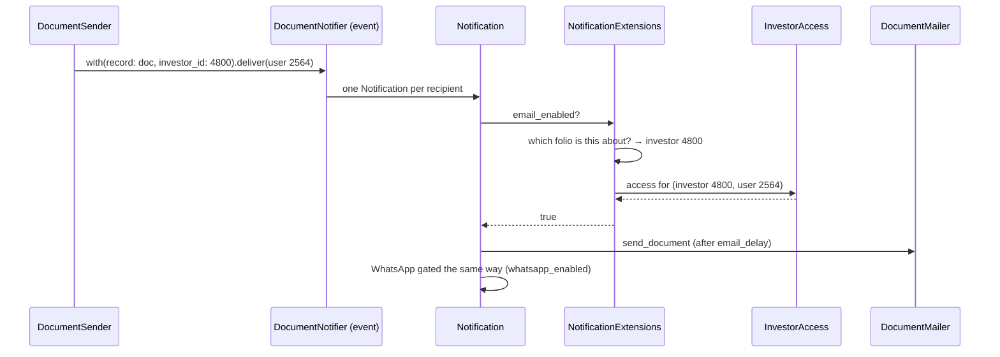
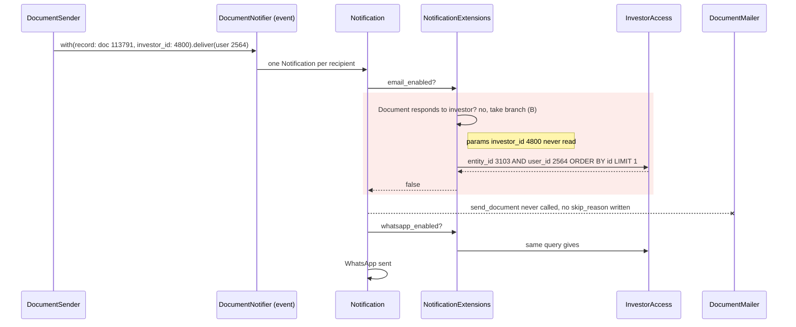
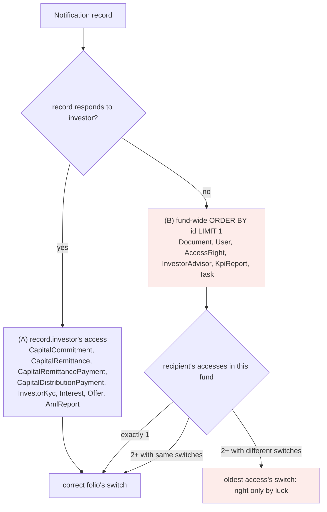
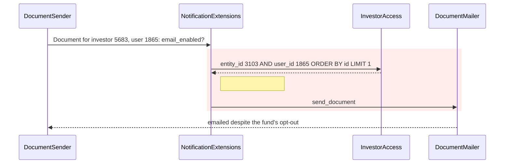
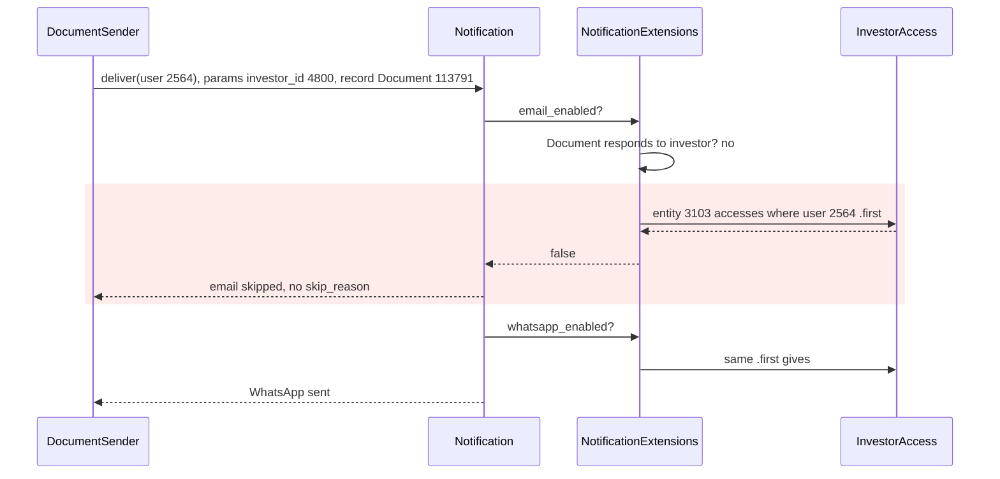
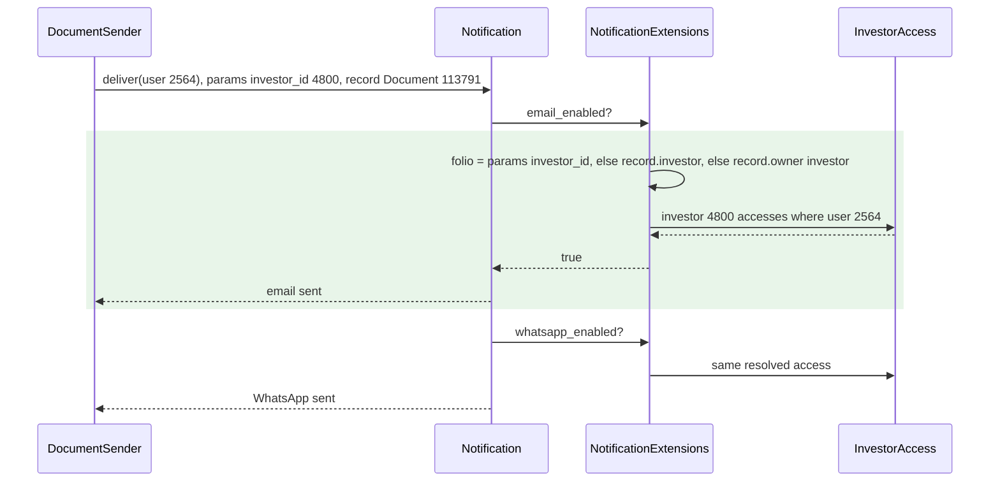

# Notification email gate reads the wrong InvestorAccess — Report

> **Audience:** The developer fixing this, and the reviewer checking the fix.
> **Companion document:** [Tasks](tasks.md)

> **Planning phase — no code changes.** This document diagnoses the bug and plans the fix.
> Implementation happens later, in the tasks phase.

> **Evidence, not guesses.** Every claim in Root Cause carries a `file.rb:LINE` you have opened.
> Those line numbers are **as of `7d92c4e96`** — the fix deletes the lines they point
> at, so read them with `git show 7d92c4e96:<path>`.
> Data figures come from the production dump (`mysql-restored`, port 33066, last event 2026-10-08).

---

## Summary

When a notification's record cannot name its investor (every `Document`, plus a few other
types), `NotificationExtensions#investor_access` falls back to "the recipient's **first**
InvestorAccess anywhere in the fund entity". So a person who holds more than one access in
the same fund gets that row's email setting applied to every folio. In Artha (entity 3103),
asrikanth@bridgemonte.com therefore never receives document emails for his own folio, because
his lowest-id access is the one he holds as Harshal Morde's advisor, and email is off on that
row. Another user gets emails that the fund had explicitly turned off.

---

## The Feature — how it is meant to work

### The idea

A fund (the *entity*, e.g. Artha Venture Partners) has *investors* (folios / stakeholders,
e.g. "Ayinavolu Visva Srikanth", "Harshal Morde"). Each person who should hear about a folio
gets an **`InvestorAccess`** row: `(entity_id, investor_id, user_id)` plus per-channel
switches `email_enabled` and `whatsapp_enabled`. The fund's admins manage these switches from
the investor's *Access* tab. Turning email off for one contact on one folio means "don't email
this person about this folio". It must not affect other folios that person also represents.

One person can therefore hold **several** InvestorAccess rows in the same fund: one per folio
they represent. The usual case is someone who is an LP in their own right and is also the
advisor or family contact for another LP. The switches are per folio on purpose, because
"email me about my own folio, but WhatsApp only for my client's" is a real request.

Every LP-facing notification is a Noticed event (`BaseNotifier` subclass) delivered to a
`User`. Before a channel fires, the notifier asks the notification whether that channel is
allowed for this recipient. The answer comes from the InvestorAccess for **the folio the
notification is about**. Senders already fan out per folio. For example,
`DocumentSender.send` emits one `DocumentNotifier` per `[user, investor]` pair and puts that
investor's id in the event params (`app/packs/core/documents/services/document_sender.rb:34-42`).
A contact on three folios gets three notifications, each gated by its own folio's switches.

### How it fits together



| Part | Responsibility | Talks to |
|---|---|---|
| `DocumentSender`, `CapitalRemittance*` callbacks, KYC flows … | Decide *who* is told, one notification per (user, folio) | Notifier `.with(...).deliver(user)` |
| `BaseNotifier` (`app/packs/core/notifications/models/base_notifier.rb`) | Declares the `:email` / `:whats_app` channels and gates each with `config.if` | `NotificationExtensions` |
| `NotificationExtensions` (`config/initializers/noticed.rb`) | `investor_access`, `email_enabled`, `whatsapp_enabled`: the per-recipient gate | `InvestorAccess`, `InvestorAdvisor`, Pundit |
| `InvestorAccess` | Per (fund, folio, person) channel switches | — |
| `DeliveryMethods::WhatsApp` (`app/packs/core/notifications/delivery_methods/whats_app.rb`) | Sends the WhatsApp; re-checks the switches | `InvestorAccess` |

`email_enabled` (`noticed.rb:29-37`) is an OR of three ways in:
1. the recipient is the fund's own staff (`model.entity_id == recipient.entity_id`);
2. **the folio's InvestorAccess has `email_enabled`**. This is the normal LP path and the one this bug breaks;
3. the recipient is an investor advisor whom the record's Pundit `show?` lets in (`investor_advisor_show_enabled`).

### What it rests on

- **The gate reads the access for the folio the notification is about**, never some other folio's.
- The folio is knowable: either the record names it (`record.investor`) or the sender put it in the params (`investor_id`).
- A person may hold several accesses in one fund, and their switches may differ.

---

## Symptom

| | |
|---|---|
| **What the user sees** | No email for statements, capital account statements, Form 16A, etc. WhatsApp for the same items *does* arrive. On *Notifications* the rows show **Email sent = No** and **no skip reason**. |
| **Reproduce** | Artha (3103) → *Notifications*, filter user email = asrikanth@bridgemonte.com → ids 68422, 67507 (and 69653, 69511, 69462, which are newer than the dump). Or run the probe in tasks 1.1. |
| **Who is affected** | Anyone with ≥2 InvestorAccess rows in the same fund whose email switches differ. In prod: **3 people, all in Artha (3103)**. 88 user/fund pairs have multiple accesses; these 3 have conflicting switches. |
| **How often** | Every time, for every record type that can't name its folio (see Root Cause). |
| **Since when** | Since `investor_access` was written. Not a regression. |

Not intermittent. Which way it fails depends only on **which access has the lowest id**:

| User | Accesses in 3103 (id: investor: email) | Lowest id | Effect on Document emails |
|---|---|---|---|
| 2564 asrikanth@bridgemonte.com | 3716: 4736 Morde: off · **4097: 4800 own: on** | 3716 (off) | **13 own-folio docs never emailed** (+8 Morde, correctly) |
| 2841 jashank@artha.vc | 4012: 5878: off · 4478: 4751: on · 4479: 4792: on | 4012 (off) | **31 docs for 4751/4792 never emailed** |
| 1865 dhairavs@gmail.com | **2195: 4722: on** · 3711/3712/3713/3714 (5683, 4712, 4767, 4774): off | 2195 (on) | **29 docs emailed for 4 folios where the fund turned email off** |

The third row is the mirror image. The same defect sends email that the fund opted out of. So
this is a correctness bug in both directions, not just a "missing email" bug.

### Side observations on the same user (not defects, no change planned)

- **Access 4097 shows "advisor":** `InvestorAccess#is_investor_advisor` is cached from the user's
  *global* `investor_advisor` role, which comes from the Morde grant (InvestorAdvisor 485 on entity 4006).
  It says the person is an advisor somewhere. It does not say this access is an advisor access.
- **Fund Access tab on 4097 is empty:** the tab lists advisor grants scoped to the investor's own
  entity (`investor_accesses_controller.rb:71-76`, entity 4068). His self-advisor grant there
  (InvestorAdvisor 484, AccessRight 60373) was deleted 2025-05-22. He sees Artha Select Fund (159)
  and Artha Fund IV (260) through ordinary investor access rights on investor 4800, so the empty tab is correct.

---

## Root Cause

### The defect in one sentence

To decide whether a recipient may be emailed, `NotificationExtensions#investor_access` has to find
**the InvestorAccess row for the folio the notification is about**. When the notification's record
is a `Document`, it doesn't look up that folio. Instead it runs
`SELECT … WHERE entity_id = <fund> AND user_id = <recipient> ORDER BY id LIMIT 1`. That is
**the recipient's oldest access anywhere in the fund**, whichever folio it belongs to. That row's
`email_enabled` decides the email.

### The code

`config/initializers/noticed.rb:21-27` (as of `7d92c4e96`):

```ruby
def investor_access
  if model.respond_to?(:investor) && model.investor.present?            # (A) record names its folio
    model.investor.investor_accesses.where(user_id: recipient.id).first
  else                                                                  # (B) record does not
    model.entity.investor_accesses.where(user_id: recipient.id).first
  end
end
```

`model` is the notification's record (here a `Document`) and `recipient` is the `User` being
notified. The result feeds `email_enabled` (`noticed.rb:29-37`) and `whatsapp_enabled`
(`noticed.rb:115-122`), and those two are the `config.if` gates on the `:email` and `:whats_app`
channels (`base_notifier.rb:23-41`).

### Three facts that together produce the bug

**Fact 1: `Document` has no `investor` method, so every document notification takes branch (B).**
A document belongs to an `owner` (polymorphic), not directly to an investor. Probed on the dump:
`Document.find(113791).respond_to?(:investor) # => false`. Records that *do* define `investor`
take branch (A) and are correct: `CapitalCommitment`, `CapitalRemittance`,
`CapitalRemittancePayment`, `CapitalDistributionPayment`, `InvestorKyc`, `Interest`, `Offer`,
`AmlReport`. Documents are 5,197 of the dump's ~9,100 notification events, so (B) is the common path, not a corner.

**Fact 2: branch (B) is scoped to the whole fund, not to a folio.** `model.entity` is the fund
(Artha, 3103). `entity.investor_accesses.where(user_id:)` is every access the person holds in that
fund, across all folios. The SQL Rails generates for `.first`, captured on the dump:

```sql
SELECT investor_accesses.* FROM investor_accesses
WHERE deleted_at IS NULL AND entity_id = 3103 AND user_id = 2564
ORDER BY investor_accesses.id ASC LIMIT 1
```

Without the `LIMIT`, that query matches two rows:

| id | investor (folio) | Why he has it | email_enabled | whatsapp_enabled |
|---|---|---|---|---|
| **3716** | 4736 Harshal Morde | added 2024-08-23 as Morde's advisor | **false** | true |
| 4097 | 4800 Ayinavolu Visva Srikanth (himself) | re-created 2025-05-22 for his own folio | true | true |

**Fact 3: `.first` means "lowest id", which here is the wrong folio.** Rails adds
`ORDER BY id ASC` to `.first`, so the result is deterministic: it is always the **oldest** access.
That's 3716, Morde's folio with email off. `email_enabled` then evaluates
(`noticed.rb:33-36`):

| OR branch | Value for user 2564, Document 113791 | Why |
|---|---|---|
| `model.entity_id == recipient.entity_id` | false | 3103 ≠ 4068. He is an LP, not Artha staff. |
| `investor_access&.email_enabled` | **false** | Reads access **3716** (Morde), not 4097 (his own) |
| `investor_advisor_show_enabled` | false | His advisor grant is on entity 4006 (Morde's firm), not on 3103 (`noticed.rb:57`) |

All three are false, so the `:email` channel's `config.if` is false and the email is never sent.

### The right answer was available and ignored

The code doesn't lack the information; it just doesn't look for it:

| Source of the folio | Value for Document 113791 | Read by `investor_access`? |
|---|---|---|
| `params[:investor_id]`, set by `DocumentSender` per `[user, investor]` pair (`document_sender.rb:38`; added `40a544fa9`, in events since 2026-10-07) | 4800 | **No** |
| `document.owner.investor`: owner is `CapitalCommitment#13812`, whose `investor_id` is 4800 (38,120 live documents are owned by a commitment) | 4800 | **No** |
| `document.investor` | method does not exist | Tried, falls through |

### How it breaks down

This is the same exchange as [How it fits together](#how-it-fits-together), with the same
participants and the same send (Document 113791, his own Q1 FY27 capital account statement).
The red block is where it goes wrong.



| Step | Should happen | Actually happens | Where |
|---|---|---|---|
| 1. Sender fans out | One notification for (user 2564, investor 4800) | Same: correct, `investor_id: 4800` is in the params | `document_sender.rb:34-42` |
| 2. Which folio? | Investor 4800 | `Document#investor` doesn't exist; params not consulted, so branch (B) | `noticed.rb:22` |
| 3. Which access? | #4097 | Oldest of {3716, 4097} is 3716 | `noticed.rb:25` |
| 4. Email allowed? | 4097 → true | 3716 → false; other OR branches false | `noticed.rb:33-36` |
| 5. Mailer | Sends | Never invoked, no `skip_reason` | `base_notifier.rb:32-36` |
| 6. WhatsApp | Gated by 4097 | Gated by 3716 (on), so sent | `noticed.rb:115-122` |

**Which records reach branch (B), and when it matters:**



So the bug needs both conditions at once: a **record type without `investor`** and a **person with
2+ accesses in the same fund whose switches differ**. In prod that's 3 people, all in Artha. 88
person/fund pairs have multiple accesses, but only these 3 have conflicting switches.

**The same defect, in the other direction.** Whether a person loses emails or gets unwanted ones
depends only on which folio's access is oldest. For dhairavs@gmail.com (user 1865) the oldest is
#2195 (investor 4722, email **on**), so step 4 says yes for documents of all five folios. That
includes four where Artha switched email off (#3711–3714): 29 documents sent against the opt-out.



### A second copy of the same mistake: WhatsApp delivery

`DeliveryMethods::WhatsApp#deliver` doesn't reuse the gate's answer. It looks the access up
again, by email (`whats_app.rb:9`):

```sql
SELECT investor_accesses.* FROM investor_accesses
WHERE deleted_at IS NULL AND entity_id = 3103 AND email = 'asrikanth@bridgemonte.com'
ORDER BY investor_accesses.id ASC LIMIT 1          -- => #3716 again
```

It has the same fund-wide scope and the same oldest-row pick, so WhatsApp is also decided by the wrong folio.

### Why it was hard to see

- **The skip leaves no trace.** The email is stopped by `deliver_by :email`'s `config.if`
  (`base_notifier.rb:32-36`) before any job is enqueued. `skip_reason` is only written from inside
  the mailer (`ApplicationMailer#record_notification_skip`, `application_mailer.rb:215`), which
  never runs. The Notifications screen shows *Email sent: No* with an empty reason, which looks the
  same as a bounce or a queue failure.
- **The other channel works.** Both accesses have WhatsApp on, so messages arrive, and everyone
  concluded "he has access, email is broken".
- **The screen shows the right row; the code reads a different one.** Access 4097 visibly has
  email ON. Nothing tells the admin the notifier is reading 3716.
- **Tests can't reach it.** In the test env the `:email` gate skips `email_enabled` entirely
  (`base_notifier.rb:12-15`), and fixtures give each user one access per fund, so the
  multi-access case never occurs.

---

## Blast Radius

| Also touches this code | Does this fix change it? | Needs checking |
|---|---|---|
| `email_enabled` (`noticed.rb:29`), all 35 `BaseNotifier` subclasses | **Yes**: now reads the right folio's access | V-table below; `features/core/investor_kyc_notification_delivery.feature` |
| `whatsapp_enabled` (`noticed.rb:115`) | **Yes**: same resolver | E3 |
| `DeliveryMethods::WhatsApp#deliver` (`whats_app.rb:9`) | **Yes**: uses the notification's resolved access instead of its own email lookup | E3 |
| Records that already have `#investor` (`CapitalCommitment`, `CapitalRemittance`, `CapitalRemittancePayment`, `CapitalDistributionPayment`, `InvestorKyc`, `Interest`, `Offer`, `AmlReport`) | **No**: the `record.investor` step still wins over owner/fallback; only `params[:investor_id]` is consulted first and matches it | H2 |
| Records with no folio at all (`User`, `AccessRight`, `InvestorAdvisor`, `KpiReport`, `Task`; fund-level docs before 2026-10-07) | **Yes, only for multi-access users**: deterministic "any access enabled" instead of "oldest access wins" | E2 |
| Fund staff recipients (`entity_id` match) and advisor `show?` path | No: other OR branches untouched | existing KYC delivery feature |
| `investor_advisor_id` (`base_notifier.rb:63`) | No: separate lookup, already reads `params[:investor_advisor_id]` | — |
| `ApplicationMailer#setup_cc` (reads `investor_id` for cc) | No | — |

---

## Fix

### How it works today



### How it works after the fix



### What changes

| # | Before | After | Where |
|---|---|---|---|
| 1 | Folio = `model.investor` or nothing | New `notification_investor`: `params[:investor_id]` → `model.investor` → `model.owner.investor` (or `model.owner` when the owner *is* an `Investor`) → `nil` | `config/initializers/noticed.rb`: `NotificationExtensions#notification_investor` (new) |
| 2 | No folio → `entity.investor_accesses.where(user_id:).first` (oldest access in the fund, any folio) | Folio known → that folio's access. No folio → no single access; callers use the user's accesses in the entity as a set | `NotificationExtensions#investor_access` + new `#recipient_entity_accesses` |
| 3 | `email_enabled` reads `investor_access&.email_enabled` | Folio known → that access's switch. No folio → **true if any** of the user's accesses in this fund has email on (they are a chosen recipient and have opted in to this fund somewhere) | `NotificationExtensions#email_enabled` |
| 4 | `whatsapp_enabled` same `.first` guess | Same rule as #3, applied to `whatsapp_enabled` | `NotificationExtensions#whatsapp_enabled` |
| 5 | WhatsApp delivery re-looks-up `entity.investor_accesses.where(email:).first` | Uses `notification.folio_channel_enabled?(:whatsapp_enabled)` (the same folio-resolved switch the gate uses) plus the `recipient.whatsapp_enabled` / entity permission checks it already does. Not `notification.whatsapp_enabled`, whose staff branch would start sending WhatsApp to fund employees, which delivery has never done | `app/packs/core/notifications/delivery_methods/whats_app.rb` — `#deliver` |
| 6 | Email gated off with nothing in the log | One `Rails.logger.info` naming notification id, resolved investor and access id when the email gate returns false | `NotificationExtensions#email_enabled` |

Not changed: `Document` does **not** gain an `investor` method. Four other call sites branch on
`respond_to?(:investor)`, and documents are owned by many types. The owner walk stays local to
the notification gate.

---

## Verification

**ID legend:** **H** = Happy path · **E** = Edge case · **X** = Error (exception) case

All rows build the notification directly and assert on `email_enabled` / `whatsapp_enabled`.
This is the existing pattern in `investor_kyc_notification_delivery_steps.rb`, needed because the
test-env `:email` gate skips `email_enabled`. Every row lands in
`features/core/notification_investor_access_resolution.feature` (new).

Shared Given for every row: fund F, investors **A** and **B**, one user U with access **a** on A
(created first, lower id) and access **b** on B (created second).

### Happy Path

| # | Scenario | Given | When | Then | Feature |
|---|---|---|---|---|---|
| H1 | Document for own folio uses own folio's switch (the asrikanth case) | a: email off; b: email on; Document owned by B's commitment | DocumentNotifier built for U with `investor_id: B` | `email_enabled` true | new feature |
| H2 | Record with `#investor` unchanged | a: email off; b: email on; CapitalRemittance for A | CapitalRemittanceNotifier built for U | `email_enabled` false | new feature |
| H3 | Opt-out respected (the dhairavs case) | a: email **on**; b: email **off**; Document owned by B's commitment | DocumentNotifier built for U with `investor_id: B` | `email_enabled` false | new feature |

### Edge Cases

| # | Scenario | Given | When | Then | Feature |
|---|---|---|---|---|---|
| E1 | No `investor_id` param, folio from owner (pre-2026-10-07 events, other senders) | a: off; b: on; Document owned by B's commitment | DocumentNotifier built **without** `investor_id` | `email_enabled` true | new feature |
| E2 | No folio at all → any-enabled | a: off; b: on; Document owned by Fund F | DocumentNotifier built without `investor_id` | `email_enabled` true; with a and b both off → false | new feature |
| E3 | WhatsApp follows the same folio | a: WA on, email off; b: WA off, email on; U WhatsApp-enabled, F has WhatsApp | DocumentNotifier for U with `investor_id: B` | `whatsapp_enabled` false, `email_enabled` true | new feature |
| E4 | Document owned by the Investor itself | a: off; b: on; Document owned by Investor B | DocumentNotifier built without `investor_id` | `email_enabled` true | new feature |
| E5 | Single-access user unchanged | U has only b, email on | DocumentNotifier for U, any folio source | `email_enabled` true | new feature |

### Error Cases

| # | Scenario | Given | When | Then | Feature |
|---|---|---|---|---|---|
| X1 | `investor_id` param names a folio U has no access on | a: on; b: on; Investor C with no access for U | DocumentNotifier with `investor_id: C` | `email_enabled` false (no access, no fallback to another folio); no exception | new feature |
| X2 | `investor_id` names a deleted investor | `investor_id` = id of a destroyed investor | DocumentNotifier built | falls through to record/owner resolution; no exception | new feature |
| X3 | Email gated off is logged | H3 setup | `email_enabled` evaluated | returns false and the log line names the notification, investor B and access b | new feature |

**Fails against current code:** confirmed by running the feature on `7d92c4e96`: **H1, H3, E1, E2, E3, E4, X1, X2, X3** fail (9 of 11); **H2** and **E5** pass today and guard against regression.

---

## Risks and Rollout

- **The 3 affected users' email volume changes immediately.** asrikanth and jashank start getting
  own-folio emails. dhairavs **stops** getting emails for the 4 folios Artha turned off. → Mention
  to Artha when it ships: that's the setting they chose, now being honoured.
- **"Any enabled" fallback is a policy choice** for records with no folio. → Only reachable for
  multi-access users on folio-less records. The alternative ("all enabled") would silence fund-wide
  notices for anyone with one opted-out folio. Flagged for review.
- **Extra queries per notification** (owner load, at most 2 small indexed lookups). → Negligible
  next to the mailer; no large tables involved.
- **Past notifications are not re-sent.** → If Artha wants the 13 + 31 missed documents, they
  re-send from the document screen. No automatic backfill.

| | |
|---|---|
| **Safe to deploy alone?** | Yes |
| **Data backfill needed?** | No |
| **Both regions together?** | No. Pure code, region-independent. IN has the observed cases; US gets the same fix on its own deploy. |
| **Rollback** | Revert the commit. Nothing persisted in a new shape. |

---

## Spec Impact

**None.** The per-folio InvestorAccess switches already mean "this person, this folio". The code
didn't honour that for records that can't name their folio. `skip_specs: true` is set in
`.openspec.yaml`.
