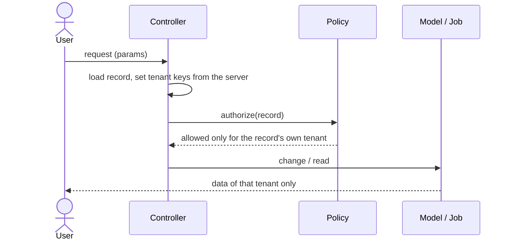
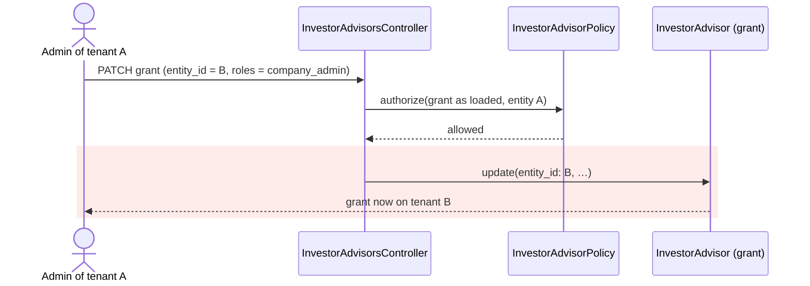
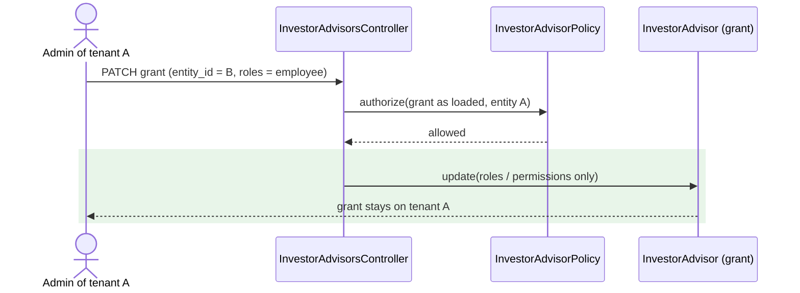

# Tenant isolation, batch 1 — Report

> **Audience:** The developer fixing this, and the reviewer checking the fix.
> **Companion documents:** [Tasks](tasks.md) · [QA checklist](qa-checklist.md)

> **Evidence, not guesses.** Line numbers in Root Cause are **as of `dd657b7a2`**; read them with
> `git show dd657b7a2:<path>`. Source: the investor-advisor role review of 2026-10-17 (four
> read-only passes; every item here re-read in code before fixing).

---

## Summary

Fifteen ways a signed-in user could act on, or read, another tenant's data. Three causes run through
most of them:
1. **Request params trusted as tenant keys:** `entity_id` on grants, users, imports and document search, and `fund_id` on Add Investor Advisor.
2. **Policies too loose to need an owner:** offers, fund reports and deal edit.
3. **`users.entity_id` treated as the user's company:** for advisors it is only wherever they are switched right now.

---

## The Feature — how it is meant to work

### The idea

Every record belongs to one **entity** (tenant). A user acts inside their current entity, and Pundit
policies (`app/packs/**/policies`) decide each action. **Ownership is decided on the server:** the
record's entity, and the user's rights there. Ownership never comes from a value the browser sends.

Advisors are the exception that the code must respect. An advisor's `users.entity_id` moves when
they switch persona (`InvestorAdvisor#switch` / `.revert`). Their real company is
`users.advisor_entity_id`. See [docs/modules/investors/investor_advisors.md](../../../docs/modules/investors/investor_advisors.md).

### How it fits together

| Part | Responsibility |
|---|---|
| Controllers | Build records, and **set tenant keys from the server** (owner, current user), never from params |
| Policies | Decide on the record's entity and the user's rights there |
| Advisor persona | `users.entity_id` = current persona; `advisor_entity_id` = home |
| Jobs | Act for the record's tenant, not the current persona of whoever queued them |

### What it rests on

- A tenant key is never mass-assigned from the request after authorization.
- A policy that grants editing of a record checks *whose* record it is.
- "The user's company" for an advisor is their home, not their current persona.

---

## Symptom

| | |
|---|---|
| **What the user sees** | Nothing. Each hole is silent: a forged request succeeds |
| **Reproduce** | One crafted request per item (see Verification) |
| **Who is affected** | Every tenant. S1–S3 and R1 are reachable by any company admin, S5 by any investor user, S6 by any LP |
| **How often** | Every time |
| **Since when** | Mixed. Several date from before the 2025 advisor security review (`docs/security/investor_advisor_security_review.md`) |

---

## Root Cause

| # | Defect | Evidence (`dd657b7a2`) |
|---|---|---|
| S1 | Grant `update` permits `entity_id`/`email`, and authorization ran on the record before it changed | `investor_advisors_controller.rb:117-129,192` |
| S2 | `create_for_investor` authorizes the investor; `fund_id` is unchecked and an AccessRight is written on it | `investor_advisors_controller.rb:53-75`; `add_folio_investor_advisor.rb:102` |
| S3 | Company admins may mass-assign `users.entity_id` | `users_controller.rb:461-464` |
| S4 | `documents#search` takes any `entity_id` and is excluded from `verify_authorized` | `documents_controller.rb:10,113-117` |
| S5 | `OfferInvestorPolicy#update?` = `create? && !verified`, and `create?` is `true` | `offer_investor_policy.rb:22-49` |
| S6 | `FundPolicy#report?` = `show?` (LPs included); `FundsController#report` renders any `funds/` template | `fund_policy.rb:6`; `funds_controller.rb:64-75` |
| S7a | `DealPolicy#edit?` = `create?` = the deals flag | `deal_policy.rb:81` |
| S8 | Switch notice interpolates `entity.name` into an `html_safe` flash | `investor_advisors_controller.rb:146` |
| R1 | Import `create` permits `entity_id`; the policy authorizes only the owner; importers read `entity_id` | `import_uploads_controller.rb:40-43,95-98` |
| R1b | Advisor import's company_admin check uses the global role | `import_investor_advisor.rb:19-22` |
| R2 | Deleting a grant never reverts a user switched into it | `investor_advisor.rb:236-239` |
| R3 | "Still has access" counts advisor rows on **any** investor of the fund before revoking one client's grant | `investor_access.rb:234-258` |
| R4 | Scheduled report runs on `User.find(user_id).entity` (current persona) | `report_builder_export_job.rb:10`; `report_builder_scheduler_job.rb:23` |
| R5 | `UserPolicy` uses `belongs_to_entity?` (transient entity); `login_as?` maps on it too | `user_policy.rb:28-45,98` |
| R7 | Switch saves the entity before, and outside, the role transaction; no lock | `investor_advisor.rb:112-125` |

**Why it was hard to see:** every forged request returns success, and normal screens only ever send
the user's own values, so day-to-day use never hits any of these. The report job's `rescue` named a
block-local `report`, so any job failure raised `NameError` and the user never saw the failure
alert (`report_builder_export_job.rb:68`). That is fixed here too.

---

## Blast Radius

| Also touches this code | Does this fix change it? | Needs checking |
|---|---|---|
| Advisor grant edit form | No: the hidden `entity_id` copy is now ignored | `features/advisor` |
| Add Investor Advisor from a commitment | No: always the commitment's own fund (S2-H) | `features/advisor/investor_advisor.feature` |
| User create / edit screens | No: create already set `entity_id` server-side | `features/core/user.feature` |
| Document search links | No: none pass `entity_id`; support keeps it | `features/core/document.feature` |
| Offer create / own-offer edit | No: a seller's own unverified offer is still editable | `features/secondaries` |
| Fund report links | Staff only; LPs lose the fund-card "Sign In Report" button (all users' sign-ins) | fund pages, QA C5 |
| Deal edit | Needs the update right, the same as saving | `features/deal` |
| All imports | No: posted `entity_id` equalled the owner's on every real form | `features/fund/capital_calls.feature`, `features/core/investor_access.feature` |
| Advisor switch / revert | Same result, now atomic | `features/advisor` |
| Scheduled vs on-demand reports | Scheduled: report entity. On demand: unchanged (R4-H) | `features/core/report_builder` |
| User page, 2FA reset, support login-as | Advisors judged by home | `features/admin/support_client_mapping*.feature`, `features/login/two_factor_method_reset.feature` |

---

## Fix

### How it works today

### How it works after the fix

The same pattern applies to S2, S3, S4 and R1: the server, not the request, decides the tenant.

### What changes

| # | After | Where |
|---|---|---|
| S1 | `update` permits only `allowed_roles`, `permissions`, `extended_permissions` | `InvestorAdvisorsController#investor_advisor_update_params` |
| S2 | `new_for_investor?`/`create_for_investor?` also require `fund.entity_id == investor.entity_id` | `InvestorAdvisorPolicy#fund_of_investors_company?` |
| S3 | `:entity_id` removed from `user_params` | `UsersController#user_params` |
| S4 | `search` uses `current_user.entity` unless support | `DocumentsController#search` |
| S5 | `update?`/`edit?`/`destroy?` = own offer and unverified | `OfferInvestorPolicy#own_offer?` |
| S6 | `report?` = `show? && permissioned_employee?` | `FundPolicy#report?` |
| S7a | `edit?` = `update?` | `DealPolicy#edit?` |
| S8 | Entity name escaped in the switch notice | `InvestorAdvisorsController#switch` |
| R1 | `create` sets `entity_id` from the authorized owner (same rule as `new`) | `ImportUploadsController#create`, `#owner_entity_id` |
| R1b | Importer must be company admin of the import's entity (or its group) | `ImportInvestorAdvisor#save_row` |
| R2 | Destroying a grant reverts a user switched into it | `InvestorAdvisor#remove_access_rights` |
| R3 | "Still has access" limited to the same client entity | `InvestorAccess#remove_advisor_fund_access_rights` |
| R4 | Scheduled runs use `report.entity`; `rescue` can name the report | `ReportBuilderExportJob#perform` |
| R5 | Advisors judged by `advisor_entity_id` for show/edit/2FA and support login-as | `UserPolicy#admin_of_records_company?`, `#login_as?` |
| R7 | Switch and revert in one transaction, under a row lock taken by a separate query (`lock_user_row`; not `user.lock!`, which raises on a dirty `current_user`), with `save!(validate: false)` so a failed save rolls the role swap back | `InvestorAdvisor#switch`, `.revert` |

**Follow-ups from the advisor-journey review** (so nothing advisors rely on breaks):

| # | After | Where |
|---|---|---|
| S1-E | An existing grant keeps its linked user instead of re-finding by email; email is read-only on the edit form | `InvestorAdvisor#ensure_user`, `investor_advisors/_form.html.erb` |
| R7-X | A switch into a grant deleted while it waited for the lock is refused | `InvestorAdvisor#switch` |
| R2 | The revert on delete runs in a savepoint and is logged if it fails, so it never blocks the delete | `InvestorAdvisor#remove_access_rights` |
| R4-X | A scheduled run is skipped when its owner no longer belongs to the report's entity (company, home, group parent or an advisor grant) | `ReportBuilderExportJob#owner_still_belongs?` |
| R1b-H | A Fund Advisor's `company_admin` grant on the import's entity counts, since the job may run after they switched away | `ImportInvestorAdvisor#save_row` |
| R1-U | Updating an import ignores `entity_id` too | `ImportUploadsController#update` |
| R5-UI | Company Employees lists a switched-in advisor without a link to a page that would deny | `users/_user.html.erb` |

---

## Verification

**ID legend:** S/R = the review item; **-H** = the paired happy path. All scenarios are in
`features/security/tenant_isolation_batch1.feature`.

| # | Scenario | Given | When | Then |
|---|---|---|---|---|
| S1 | Grant edit can't change tenant | grant in my entity | PATCH with `entity_id` B, new email, roles `employee` | entity and email unchanged; roles updated |
| S2 | Other tenant's fund refused | LP of my fund | add advisor on Zeta's fund | Access Denied; no AccessRight on it |
| S2-H | Own fund still works | LP of my fund | add advisor on my fund | AccessRight created |
| S3 | User can't change tenant | — | PATCH self with `entity_id` Zeta, new first name | same entity; name changed |
| S4 | Search stays in own entity | — | search with Zeta's `entity_id` | filtered by my entity |
| S5 | Others' offers | unverified offer by seller | another investor's user | can't edit/update/delete; seller still can |
| S6 | LP and fund reports | LP with fund access | — | sees fund, not reports; staff still can |
| S7a | Deal edit | deal in my entity | employee with only the flag | can't edit; admin can |
| S8 | Escaped name | client named `Client <b>Bold</b> & Co` | switch | name shown as text |
| R1 | Import tenant | — | post import with Zeta's `entity_id` | saved under my entity |
| R1b | Advisor import admin check | — | `company_admin` import into Zeta by me | refused |
| R2 | Grant deleted while switched | advisor switched in as company_admin | grant deleted | back home, no admin role |
| R3 | Remove one client | advisor on C1 and C2 in my fund | delete C1 row | C1 grant gone, C2 kept |
| R4 | Scheduled report | owner switched into Zeta | schedule runs | queried my entity |
| R4-H | On-demand export | owner = me | export | queried my entity |
| R5 | Client admin vs switched advisor | advisor from Advisory Co switched in | — | I can't show/edit/2FA; advisor and their home admin can |
| R7 | Failed switch | advisor at home | role add fails mid-switch | still home with home roles |
| R7-X | Stale switch | grant deleted after it was loaded | switch with the stale copy | refused; still home |
| S1-E | Email changed | advisor's login email changed | edit grant roles | roles saved |
| R1-U | Import update | existing import | PATCH with Zeta's `entity_id` | entity unchanged |
| R1b-H | Fund Advisor switched away | `company_admin` grant on Zeta, now home | advisor import row granting `company_admin` | not refused for the role |
| R4 | (owner is a Fund Advisor of my entity, switched into Zeta) | | schedule runs | queried my entity |
| R4-X | Removed owner | that grant deleted | schedule runs | skipped, no query |

**Fails against current code:** all except S2-H and R4-H (15 of the first 17, seen failing 2026-10-17). The
follow-up rows (S1-E, R7-X, R1-U, R1b-H, R4-X) were added after the review and cover the follow-up
changes; they were not separately run against the pre-fix code.
R4's red run hits the old `rescue` `NameError` before the entity assertion. The green run asserts
the entity.

---

## Risks and Rollout

- **LPs lose the "Sign In Report" button on the fund card.** That is intended: it listed every user's sign-ins.
- **Support login-as for an advisor now needs a mapping to the advisor's home company.** A mapping to the client they happen to be switched into no longer works.
- **`user.lock!` in switch/revert** is a row lock held for the duration of one switch. SQLite (tests) ignores it.

| | |
|---|---|
| **Safe to deploy alone?** | Yes |
| **Data backfill needed?** | No. Grants already moved by S1, ARs kept by R3 and S2 grants need an audit query (see tasks 3.4) |
| **Both regions together?** | No, independent |
| **Rollback** | Revert the commit; nothing persisted changes shape |

---

## Spec Impact

**None.** Tenant isolation is the existing contract; these are places the code didn't enforce it.
