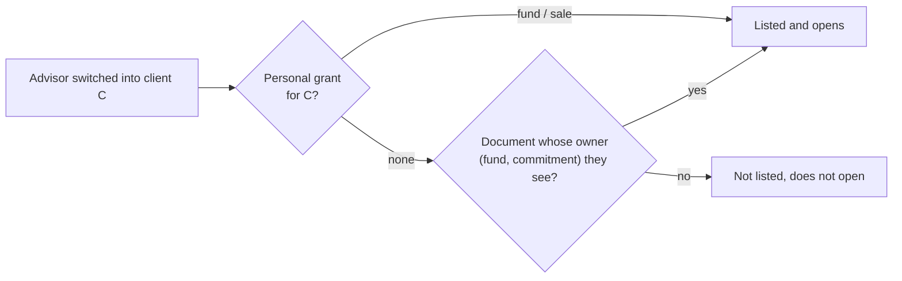
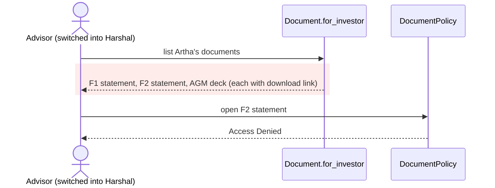
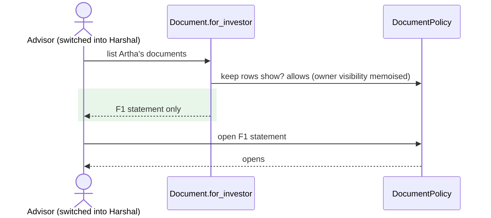

# Tenant isolation, batch 2 — Report

> **Audience:** The developer fixing this, and the reviewer checking the fix.
> **Companion documents:** [Tasks](tasks.md) · [QA checklist](qa-checklist.md) · Batch 1:
> [fix-tenant-isolation-batch1](../fix-tenant-isolation-batch1/report.md)

> **Evidence, not guesses.** Line numbers are **as of `dd657b7a2`** (`git show dd657b7a2:<path>`).
> The product decisions behind B1 and B3 were taken on 2026-10-17 and are recorded under each item.

---

## Summary

The second half of the 2026-10-17 advisor-role review. It fixes:
- **B1:** company pages showed every signed-in user another company's tax id and email.
- **B3:** an advisor switched into a client got lists, with download links, of documents, folders, approvals and sales that their pages denied them.
- **B4:** six smaller isolation gaps: other LPs' fund ratios, KYC edit, deal investor, staff search, MCP tokens, and global role checks.

Each fix makes a list, a page or a check follow the same rule the rest of the app already uses.

---

## The Feature — how it is meant to work

### The idea

Every list and every page decide visibility the same way:
- **Staff:** a record is visible to its company's staff, within their access rights.
- **Investors:** a record is visible to an investor's users when the GP has granted it to that investor.
- **Advisors acting for a client** (switched into the client) see what the GP granted **to them personally** for that client: the funds picked in **Add Investor Advisor**, or a sale in the advisor import. `Fund.for_investor` and every `ForInvestor` scope already do this through `AccessRight.investor_granted_access_filter`.
- **Documents** follow their owner: a fund statement is visible to whoever can see that fund or commitment (`DocumentPolicy#show?`).

How advisors work: [docs/modules/investors/investor_advisors.md](../../../docs/modules/investors/investor_advisors.md).

### What it rests on

- **A list and its page never disagree.** If a row is listed, it opens; if it would be denied, it isn't listed or downloadable.
- **Product decision B3 (b), "documents follow funds"** (2026-10-17): a client's advisor sees documents of the funds they were given. Documents not tied to a fund (data room, general notices) are not shown to them; a "share with the client's advisors" control would be new work.
- **Product decision B1 (b):** company pages stay open (investors land on the GP's page after requesting access), but non-public fields are shown only to related users.
- **Product decision B2:** advisor import roles stay as the GP chooses; no change.

---

## Symptom

| | |
|---|---|
| **What the user sees** | Nothing unusual. An LP sees another company's tax id and email. An advisor lists, and can download, client documents whose page says Access Denied. An LP lists other LPs' folio ratios. An employee's search lists deals their deal list hides |
| **Who is affected** | Every tenant (B1, B4-1, B4-4); advisors' clients (B3, B4-2, B4-3, B4-5) |
| **Since when** | Unknown; all predate this review |

---

## Root Cause

| # | Defect | Evidence (`dd657b7a2`) |
|---|---|---|
| B1 | `EntityPolicy#show?` = "own entity, or not own entity" (always true); the page renders PAN and primary email for everyone | `entity_policy.rb:40-46`; `entities/show.html.erb`; `_entity.json.jbuilder:1` |
| B3 | `AccessRight.access_filter` for a switched advisor matches grants to the client investor, not only personal ones; used by the document, folder, approval and sale list scopes, while `DocumentPolicy#show?` uses the owner rule and every row's JSON carries a 7-day `s3_url` | `access_right.rb:59-62`; `document_scope.rb:16`; `folder.rb:173`; `approval.rb:57`; `sale_access_scopes.rb:12`; `sale_children_scopes.rb:12`; `document_policy.rb:10-24`; `_document.json.jbuilder:3` |
| B4-1 | `FundRatio` has no investor association, so `for_investor` returns every folio's row of a permissioned fund; `show?` checks the fund only | `fund_ratio_policy.rb:2-9,20-23` |
| B4-2 | KYC `create?`/`update?`/`edit?` use `user.entity_id == investor_entity_id`; `show?` uses `for_investor_advisor` | `investor_kyc_policy.rb:94-96,160,171-174,180,191-193` |
| B4-3 | `DealInvestorPolicy#show?` = entity match only; the list needs a deal grant | `deal_investor_policy.rb:22-25` |
| B4-4 | Search actions filter Elasticsearch by entity only; task search's `.or` drops the query from one branch | `deals_controller.rb:32-44`, `deal_investors_controller.rb:36-50`, `notes_controller.rb:62-73`, `tasks_controller.rb:77-91`, `investors_controller.rb:321-341,505`, `kyc_datas_controller.rb:18-33`, `offers_controller.rb:48-63`, `secondary_sales_controller.rb:115-128` |
| B4-5 | MCP governance is judged on the token's entity while tools read as the user's current entity | `mcp_controller.rb:75-86`; `oauth_bearer_authenticator.rb:27-32` |
| B4-6 | `has_role?(:company_admin, entity)` also matches the global role (any entity) | `deals_controller.rb:208`; `_deal_ingest_address.html.erb:28,38`; `deal_ingest_authenticator.rb:161`; `validation_rule_policy.rb:31-37`; `validation_rule_override_policy.rb:34` |

**Why it was hard to see:** lists and pages were each internally consistent; only comparing the two, or
reading the JSON behind a list, shows the gap.

---

## Blast Radius

| Also touches this code | Does this fix change it? | Needs checking |
|---|---|---|
| LP portal documents, folders, data rooms, NDA gating | No for plain investors and at-home advisors; switched advisors only | `features/core/document.feature`, `folder.feature`, `data_rooms.feature`, `nda_*.feature`, `fund_documents_panel.feature` |
| Approvals / secondary sales for investors | Switched advisors: personal grants only | `features/secondaries`, `features/advisor/secondary_sale.feature` |
| Company page and entity JSON | Unrelated users lose PAN and email | `features/core/entity_deactivation.feature`, `features/funds/lp_portfolio` |
| Fund ratios for LPs | Other folios' rows hidden | `features/fund/fund_ratio_run_template.feature`, LP dashboards |
| KYC investor edit | Switched advisors follow `show?` | `features/core/investor_kyc_*` |
| Module search boxes, investor autocomplete | Fewer rows for non-admin staff | `features/deal`, `features/core/task_board.feature`, `features/core/lp_crm.feature`, `features/core/investors.feature` |
| MCP clients | Re-authorise after switching entity | `features/ai/mcp_server` |
| Deal ingest, validation rules | Same users as before (all callers already in the entity) | `features/deal`, `features/core/validation_rule_engine.feature` |

---

## Fix

### How it works today

### How it works after the fix

### What changes

| # | After | Where |
|---|---|---|
| B1 | `show?` open; `full_details?` (own, group parent, support, a contact at it, an advisor grant on it, staff of a company that has it as a stakeholder) gates PAN and primary email | `EntityPolicy`, `entities/show.html.erb`, `_entity.json.jbuilder` |
| B3 | `AccessRight.investor_list_filter` (personal grants for switched advisors) for approvals and sales; documents filtered through `DocumentPolicy.ids_a_switched_advisor_can_open`; folders through `Folder.ids_a_switched_advisor_can_see` | `access_right.rb`, `approval.rb`, `sale_*_scopes.rb`, `document_policy.rb`, `document_scope.rb`, `folder.rb` |
| B4-1 | Investor scope: fund-level rows or rows of commitments in the user's commitment scope; `show?` also checks the commitment | `FundRatioPolicy` |
| B4-2 | `investor_owns_kyc?`: switched advisors follow `for_investor_advisor` for persisted KYCs | `InvestorKycPolicy` |
| B4-3 | Switched advisors need `permissioned_investor?`; plain investors keep the entity match | `DealInvestorPolicy#show?` |
| B4-4 | `PolicyScopedSearch.restrict(user, model, hits)` on every search action; investor autocomplete uses `policy_scope(Investor)`; task search query fixed | `policy_scoped_search.rb`, the eight controllers |
| B4-5 | A token with `entity_id` is refused (401 + `WWW-Authenticate`) while its user is in another entity | `McpController#authenticate_mcp!` |
| B4-6 | `has_cached_role?(:company_admin)` plus membership of that entity (group parents included, consistently in controller, view and ingest) | deals controller and view, deal ingest authenticator, validation rule policies |

**Follow-ups from the independent review:**
- **KYC onboarding:** an advisor may still fill a client KYC with no commitment yet (the doc-first wizard saves, then continues on edit), B4-2-H.
- **Document list cost:** the advisor's document list is memoised per request. Full rows are loaded, in batches: `Document`'s `after_initialize` reads columns beyond `show?`'s, so a narrowed select crashes.
- **Search:** ignores index hits whose row is gone.
- **`DealInvestorPolicy::Scope`:** returns `none` for other personas instead of `nil`.

---

## Verification

All scenarios in `features/security/tenant_isolation_batch2.feature`.

| # | Scenario | Then |
|---|---|---|
| B1-X | Unrelated user opens another company's page | name shown; PAN and email not |
| B1-H | GP of an LP, LP contact, own company | full details |
| B3-1 | Advisor (F1 only) switched into Harshal | lists only the F1 statement; opens F1, not F2 or the AGM deck |
| B3-H | Harshal's own user | lists all three |
| B3-2 | Folders | F1 statement's folder listed, AGM folder not |
| B3-3 | Approval and sale shared with Harshal only | advisor lists neither; Harshal's user lists both |
| B3-4 | Sale granted to the advisor personally | listed |
| B4-1 | Two LPs' folio ratios | LP1 lists fund-level + own; can't open LP2's |
| B4-2 | Client KYC committed only to F2 | advisor can't open or edit; client's user can edit |
| B4-2-H | Client KYC with no commitment yet (onboarding) | advisor can edit |
| B4-3 | Client deal investor | advisor without a deal grant can't open; client's user can |
| B4-4 | Deal without the employee's access | dropped from an employee's results, kept for admin |
| B4-5 | MCP token for Artha, user moved to Zeta | 401 |
| B4-5-H | Same token, user in Artha | 200 |
| B4-6 | Validation rule of Zeta | Artha's admin can't view/update/delete; own rule fine |

**Fails against current code:** 11 of 14 (all but B3-H, B3-4, B4-5-H), seen failing 2026-10-17.

---

## Risks and Rollout

- **Switched advisors stop seeing general client documents** (data room, notices). This is decision B3 (b); a GP-controlled "show to advisors" option is future work.
- **Non-admin staff see fewer search and autocomplete results:** exactly their list's records.
- **Advisors' AI clients holding an entity-scoped token must re-authorise after switching persona.**
- **Adding a stakeholder no longer pre-fills its tax id** from the company search when the GP isn't yet related to that company. The search JSON omits `pan` for unrelated users, by B1. The GP types it, or it fills once the stakeholder exists.
- **Cost:** a switched advisor's document and folder lists run `show?` per candidate document, with owner checks memoised. That's one client's documents only.

| | |
|---|---|
| **Safe to deploy alone?** | Yes (independent of batch 1) |
| **Data backfill needed?** | No |
| **Both regions together?** | No |
| **Rollback** | Revert the commit |

---

## Spec Impact

**None.** Lists matching their pages, and tenant data staying within the tenant, is the existing
contract.
