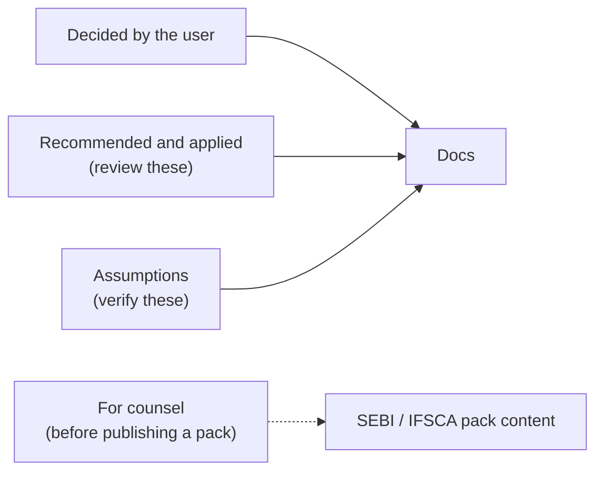

# Fund Compliance Monitoring — Decisions and Assumptions

> **Why this file exists:** the user asked (2026-11-05) to proceed without them — "make
> recommendations and move on, but document them". Every choice made on their behalf is listed
> here so it can be reviewed and overturned in one place. Nothing here is a counsel opinion.

---

## How to read this

- **Decided by the user** — confirmed in conversation.
- **Recommended and applied** — chosen by Claude, applied to the docs; review and overturn freely.
- **Assumption** — something believed true but not verified; listed with how to check it.
- **For counsel** — regulatory facts that must be confirmed before a pack is published.

---

## 1. Decided by the user

| # | Decision |
|---|---|
| U1 | Compliance module is generic across funds; JEV is not part of it |
| U2 | SEBI first, but extendable to SEC / IFSCA / others without code changes |
| U3 | Several packs per fund (e.g. SEBI + fund agreement; IFSCA for GIFT City funds) |
| U4 | Users can describe rules in words; AI drafts the check |
| U5 | Funds' own internal rules (fund agreement) are supported as entity packs |
| U6 | IC note per portfolio investment is a compliance check; wet-ink signatures count |
| U7 | AI checks on document contents are included |
| U8 | CapHive regulator packs are locked; versions apply by rule (all / new funds only / transition) |
| U9 | All 27 changes-over-time items applied with Claude's defaults, filtered for simplicity |
| U10 | Proposals and docs use bullets and diagrams; designs always include security and architecture-pattern sections |

## 2. Recommended and applied (review these)

| # | Recommendation | Why |
|---|---|---|
| R1 | Checks are structured fields (figure, grouping, limit), not fund-formula code | Readable sign-off by counsel; validated on save; no stored code runs nightly |
| R2 | AI only drafts checks and reads document facts; never decides pass/fail; nightly runs never call AI | Same data → same result; auditability |
| R3 | AI-read facts count only once a person confirms them | A misread can cause a false breach but never a false pass |
| R4 | One register item per check per fund per breach episode | Avoids a new item every night |
| R5 | "Could not check" / "Not monitored" are never shown as pass | Silent-pass is the main risk (same class as the Ransack ignore-unknown issue) |
| R6 | Maker–checker on explanations, overrides, disabling, detaching, early adoption, classification changes; approver = any Compliance approver or company admin ≠ requester | Stops someone silencing their own breach |
| R7 | Single-eligible-user entity may self-approve, labelled "Self-approved — single approver" | Small GPs would otherwise be blocked |
| R8 | IC note check covers buy transactions only (filter, changeable) | Most fund agreements require IC approval for investments; exits vary |
| R9 | Due rules count calendar days in v1 | Business days need a holiday calendar |
| R10 | No "confirmer ≠ uploader" setting in v1 | Simplicity; add if a customer asks |
| R11 | Unconfirmed AI facts show their age in the digest; no separate escalation | Simplicity |
| R12 | Duties without an owner go to the compliance owner | Usability — setup is never blocked |
| R13 | Monthly AI document-reading cap default 200 per entity | Cost control; CapHive can change per entity |
| R14 | Percentages compared as displayed, rounded to 2 decimals (25.0037% passes ≤ 25%) | Matches what users see; counsel may prefer exact |
| R15 | Results "out of date" after 26 hours (25 h is current) | One nightly run plus slack |
| R16 | Override equal to the pack limit is refused ("Same as the pack's limit") | It would change nothing |
| R17 | Transition-period warnings open no register items; an item opens when it becomes a Breach | Keeps the register to real breaches |
| R18 | Grandfathered funds keep the old version's duties only | Consistent with staying on the old version |
| R19 | "New funds only" applicability date defaults to the effective date | Most common case |
| R20 | Missing fund start date where needed → "Could not check" | Never guess grandfathering |
| R21 | Effective dates use the regime's time zone (IST for SEBI/IFSCA); runs at 02:00 entity time | Law changes on Indian dates |
| R22 | Delivery in four phases: (1) limits + document-exists + register + SEBI pack, (2) AI drafting, (3) AI document reading, (4) IFSCA pack | Phase 1 useful with no AI |
| R23 | SEBI check 7 (investor groups ≥ 50%) is a manual duty until Phase 3 | Needs AI-read ownership facts |
| R24 | Large Value Fund is a SEBI classification, not an override | Overrides on locked packs may only tighten |
| R25 | No re-running past dates; past results never rewritten | Past record states are not reliably reconstructable |
| R26 | Results, register and history never auto-deleted in v1 | Retention period pending counsel |
| R27 | Event-duty example: due diligence due 15 days after a new investor | Illustrative; each pack sets its own |
| R28 | Reference-list from/to dates are inclusive on both ends | A member counts on their first and last day |
| R29 | Correction versions are numbered like "v2.1" and may share the faulty version's effective date | The only exception to "effective date after the previous version's" |
| R30 | A version published on its effective date before that day's 02:00 run applies the same day and is not flagged "Published late" | It made the first run that could use it |
| R31 | A pack attached on a period-end day gets its first duty for the period ending that day | That period has not finished yet |
| R32 | Re-running a past date or deleting a stored result by direct request is refused | Results are append-only (R25, R26) |
| R33 | Existing-code changes approved on the user's behalf: append `compliance_edit` / `compliance_approve` to `UserEnabled`; add a Compliance item to the company menu partial; register an hourly `ComplianceScheduleJob` in `config/initializers/sidekiq.rb` | Smallest touch on existing code; additive only |
| R34 | Reuse the existing `enable_compliance` flag as the feature gate (it already gates AI Rules) | One switch for "compliance features"; no new flag |
| R35 | Wet-ink sign-off lives in a new `document_signoffs` table, not new columns on `documents` | `Document` (and other core models) stay unchanged — memory: ask before changing existing models |
| R36 | "Compliance owner" is a new `compliance_entity_setups.owner_id`; digest recipients are users with the existing `Compliance` notification tag | Needed by R12/R13; reuses existing tagging |
| R37 | Draft-pack test runs are preview mode — computed and shown, never stored | Simplicity; no test-run rows |
| R38 | "AI unavailable" means the entity's AI-drafting switch is off; provider errors/timeouts are a separate case | `LlmService` falls back to CapHive keys, so a missing key never makes AI unavailable |
| R39 | Implementation proceeds without a separate design sign-off | User instructed (2026-11-05): "start executing … dont stop till done" |
| R40 | Phase-4 rows living in Phase-1 feature files are tagged `@phase4`; Phase 1 runs `--tags 'not @phase4'` | Each phase green on its own |
| R41 | Compliance figures stored as `decimal(20,4)` in major units (sources' `_cents` ÷ 100 in the query) | Ratios and derived amounts, not ledger money |
| R42 | "Latest result per check" = highest `id` | Monotonic; avoids clock ties |
| R43 | One open register item per check enforced by a unique `open_key` ("1" open, NULL closed); scheduled duties store `''`/`0` subjects so their unique key holds | Database-level guarantee against duplicates on re-runs |
| R44 | One cron (`5 * * * *`) picks entities whose local hour is 02 (runs) or 08 (digest) | Per-entity time zones with a single schedule entry |
| R45 | Pack content in `db/seeds/compliance/*.json`, loaded by `rake compliance:load_pack[path]` (dry-run; `EXECUTE=1` applies) | Ops-as-rake-task convention; packs as reviewable data |
| R46 | SEBI check 7 becomes a content check in Phase 3 via SEBI v1.1 (applies to all funds) | Uses the versioning mechanism itself |
| R47 | Message wording aligned to business-rules.md (e.g. "Locked pack: overrides can only tighten this limit", "Upload the evidence", "In transition until <date>") | Tests assert these strings |
| R48 | Cucumber runs on this branch use plain cucumber with TEST_ENV_NUMBER 41201–41204, never pcuc | Other sessions run pcuc on workers 1–4 concurrently |
| R49 | Phase 1 schema added by hand-editing `db/schema.rb` / `db/schema_test.rb` (plus the migration file); the shared dev DB was **not** migrated from this branch | Memory: no dev-DB migrations from a side branch; dev DB lags schema.rb |
| R50 | During a transition period every breach of the fund's new version shows as a Warning (not only checks new in that version) | Simpler, and still never a pass; counsel can narrow it later |
| R51 | `compliance` added to `funds_view_paths` in `config/application.rb`; `draw :compliance` added to `config/routes.rb` | Required for pack views and routes (two one-line edits to existing files) |
| R52 | Models use `audited` directly instead of `Trackable` | `Trackable` adds `acts_as_paranoid`, which needs `deleted_at`; compliance rows are never soft-deleted |
| R53 | One `ComplianceNotifier` with a `kind` param (assignment, approval request, decision, escalation, run failed, version, digest) instead of six notifier classes | One recipient rule set, same Noticed/email plumbing |
| R54 | Register export is built on request and streamed (no background job, no stored file, no download link) | Nothing another user could open (X36); sizes are per-period and bounded |
| R55 | `ComplianceDocumentCheckQuery` uses three bounded queries (records, documents, sign-offs) instead of one SQL join | Simpler and portable; failing list capped at 500 |
| R56 | Investment "cost" is `portfolio_investments.amount_cents` of buy rows (quantity > 0) | Matches `PortfolioInvestment#buy?`; counsel may prefer net cost |
| R57 | A "wound-up" fund means a soft-deleted fund (no fund status column exists) | No new column on `funds` (existing-model rule) |
| R58 | The entity's local time zone for the 02:00 run / 08:00 digest lives on `compliance_entity_setups.time_zone` (default Asia/Kolkata) | No time zone on entities today; avoids changing `entities` |
| R59 | One-off digest lines (version applied late, dropped overrides, reassignments) are kept in `compliance_entity_setups.digest_notes` and cleared after each digest | Persisted between the run and the 08:00 digest; no extra table |
| R60 | Approvers who were deactivated are remembered in `ai_settings["handled_inactive_user_ids"]` so the "pending approvals returned" line appears once (E112) | Avoids a new column; once-only note |
| R61 | Category III NAV is a per-fund input entered in setup (`nav`) until the source is confirmed; blank → "Could not check — missing: NAV" (X38, A10) | Keeps check 2 honest without guessing a source |
| R62 | Run-now rate limiting relies on the running-run dedupe (E18); no rack-attack rule added in Phase 1 | Deferred — existing initializer untouched; revisit with Security item 10 |
| R63 | Failed-run alert to "CapHive support" is a logged error (no support mailbox constant exists); owners get the in-app + email notice | Wire to the support address when ops confirm one |
| R64 | Classifications are stored as their display names ("Category II", "Category II — LVF") rather than codes | Pre-fill compares with `funds.category` text directly (H12, E11) |
| R65 | Draft definitions are edited as one JSON document in Phase 1 (form-per-field builder deferred; Phase 2 "Describe in words" fills it) | Simplest editor that still validates everything on save |
| R66 | Group 11 rows that need AI-read document facts (E129, E130, E135) and SEBI E55/E56 move to Phase 3 with the facts feature; H54/E103/E104/E105 test the dated IC list directly in Phase 1 | Facts do not exist until Phase 3 |
| R67 | `ComplianceScheduleJob` registered in `config/initializers/sidekiq.rb` as `'5 * * * *'` (hourly, 5 past) beside `WorkflowEvaluateJob`; the job itself picks 02:00 / 08:00 in each entity's time zone, so one UTC cron serves IN and US | Phase 1 gap (task 1.12 said registered, it was not); no region branch needed because the job is time-zone aware |
| R68 | "Describe in words" on a CapHive pack is available to super admins without an entity switch (drafted with the super admin's entity's AI keys via `LlmService`); entity packs need the entity's `ai_settings["drafting"]` switch (X41), default off | CapHive content admins author the locked packs; customers opt in |
| R69 | The drafter, draft model, job, policy and controller live in the compliance pack (`app/packs/funds/compliance`) instead of `app/packs/ai/compliance` (LLD ⑧ path) | Keeps the pack self-contained; `app/packs/ai` has no package boundary and would need a reverse dependency on the compliance validator/catalogue |
| R70 | The AI returns a flat draft (figure, divided-by, compare, limit, unit, citation, or a duty's trigger/evidence/reason, plus assumptions) instead of a definition expression tree; Save turns it into `figure: ["/", a, b]` + any new measures with fresh `ai_*` keys | Structured fields only (never formula code); each field is editable in plain words; strict JSON schemas cannot express recursive expression trees reliably |
| R71 | A draft part either names an existing measure of the pack (preferred) or describes a new one (op/source/field/group by/filters); filters of a new measure are kept as drafted and shown in words, not edited | Covers E57/E58 (switch paid-in → commitments) without a full measure builder |
| R72 | Editing a part settles that part's "Assumed: …" line (it disappears); editing any field clears the test run (E60) | The user has made the call the assumption described |
| R73 | Drafted checks get defaults: applies to all classifications, tested continuously, override "any", 30 days to fix, severity breach; drafted duties: evidence required unless the AI says otherwise | Matches the entity pack's own defaults; all editable later in the JSON definition |
| R74 | Provenance is stored on the check/duty JSON as `drafted_with_ai` (sentence, confirmer id/name, date) and shown as "Drafted with AI from: '…' · confirmed by <name>, <date>" on the version page | The definition is the published record, so provenance travels with each version |
| R75 | `compliance_check_drafts` adds `sent_context` (field list, measure/input names, example checks and their pack ids), `test_fund_id`, `failure_reason`, `saved_check_key` beyond the design's columns | Records what was sent (design › Record what was sent) and lets E64 be verified |
| R76 | Drafting timeout is enforced with `Timeout.timeout(45s)` around the call (LlmService builds the RubyLLM context and exposes no timeout option) | No change to the shared LlmService |
| R77 | Up to 5 example checks are sent, taken from the 10 most recent versions of the entity's own packs and published CapHive packs (limit checks of the form "a" or "a ÷ b" only) | E64 — never another entity's checks |
| R78 | The draft screen is a page (Turbo frame that refreshes itself while drafting) opened from a Bootstrap modal on the version page, not a fully modal flow | Field-by-field review, test run and Save need the room; existing `auto-refresh` controller reused |
| R79 | Phase 1 fix: the version page's Publish form now binds the version (`form_with model:`) — `f.date_field` raised on an editable draft page, which Phase 1 never rendered | Found by the Phase 2 drafting features; one-line view fix |
| R80 | No hook is added to `Document` uploads: the hourly `ComplianceScheduleJob` sweep queues mapped documents uploaded or replaced since the last sweep (read within about an hour); older documents use Read now | Existing-model rule ("flag any change to uploads"); one additive job path instead of a `Document` callback |
| R81 | A re-read caused only by a new fact (same file) keeps the facts already confirmed; only the new fact waits for a person | Re-confirming 6 unchanged facts per note would be busywork (simplicity/usability) |
| R82 | Kind-4 "AI prepares, person decides" duties use a document trigger (`{"document": "ppm"}`): one occurrence per new document attached to the fund itself after the attach date, due n days after upload, AI notes attached when read | Smallest rule that covers "new PPM version → review duty with AI notes" (H44) |
| R83 | `db/seeds/compliance/sebi_aif_v1_1.json` loads as the SEBI pack's next version number (shown "v2" when loaded after v1); placeholder effective date 01 Jan 2027, applicability all; it also ships the land-border country list and a Needs-review land-border owner check (new row E136) | Uses the versioning mechanism as decided in R46; counsel to confirm the land-border check and dates |
| R84 | Content checks use a fixed list of 8 rules in code (`record_within_fact`, `fact_date_not_after_record`, `quorum`, `names_disjoint`, `matches_record`, `text_not_in_list`, `names_not_in_list`, `common_owner_share`), parameterised by the pack (facts, list, field, wording, severity) | Packs stay data; nothing in a definition is evaluated (Security item 4) |
| R85 | The reader reads PDF text layers and plain text only; other formats and scans without text show "Could not read document" with no AI call and do not count against the cap (no OCR in Phase 3) | Reuses the pdf-reader approach of `FolderDocumentExtractor`; facts can be entered by hand (X45) |
| R86 | The facts read for an input are the union of the facts declared for that input key across the entity's active fund packs; the facts signature is a hash of that union | The entity maps one tag/name per input key, so one reading serves every pack using it |
| R87 | Quorum is judged on the document's signed date (wet ink or e-sign), else the check's date fact (approval date), else the record date; dates in messages use the locale format (`l(...)`, e.g. "16/10/2026") | CLAUDE.md date rule; business-rules show "16 Oct 2026" for readability |
| R88 | Company check: names compared ignoring punctuation and Pvt/Ltd/Limited-style suffixes; a name matching another investee of the firm → Needs review "Document appears to concern X" (E77); any other mismatch → Breach naming both (E76) | Separates "wrong file attached" from "note names a different company" without judgement |
| R89 | A content check reads the newest mapped document of each record; a record with no document is counted, not listed (the record-document check reports "Missing") | One place reports a missing document |
| R90 | The monthly cap counts readings sent to AI in the calendar month; the job claims a slot under a row lock on the entity's setup; capped readings are released by the hourly sweep when the month or cap allows | Prevents two jobs passing the 200th slot together (E75) |
| R91 | SEBI check 7 groups investors transitively by shared confirmed beneficial-owner names (normalised); a group at ≥ 50.00% as displayed → Needs review and one enhanced-due-diligence duty per group (subject = lowest investor id), due 30 days after the run | Deterministic grouping over confirmed facts only; duty unique key stops repeats |
| R92 | Facts entered by hand create a reading with status "manual" (nothing sent to AI) and are confirmed on save; facts entered after a failed read attach to that reading | One place for a document's facts whatever their source (H43, X45) |
| R93 | The facts policy is `DocumentReadingPolicy` (Pundit resolves by the record class) rather than the LLD's `DocumentFactPolicy`; rule unchanged — the document must be visible, and confirming needs a compliance editor | Naming only (X48) |
| R94 | The digest line "N documents with facts to confirm — facts waiting D days" counts from when the reading was made and repeats daily while facts wait | Keeps waiting facts visible without a separate reminder (E135) |
| R95 | A names fact the document states as empty ("No conflicts declared") is stored as found with no names, not "Not found in document" | Distinguishes "none" from "missing section" (E69) |
| R96 | H54/E103/E104 now run the quorum content check over confirmed signatory facts (the Phase 1 list-only stand-in is replaced); E105 still tests the dated list directly | Facts exist from Phase 3 (R66) |

## 3. Assumptions (verify these)

| # | Assumption | How to check |
|---|---|---|
| A1 | One CapHive fund = one SEBI scheme for all customers | Ask product / sample customers; counsel Q2 |
| A2 | A CapHive demo entity exists (or can be created) for test-running draft packs | Check with ops |
| A3 | Company admins should get all compliance roles by default | Product |
| A4 | "Investable funds" = corpus less estimated expenses, entered once per fund | Counsel Q4; compare with the SEBI report's corpus definition |
| A5 | Category III NAV is available from existing fund ratios / valuations | Design confirms the source |
| A6 | Entities' configured AI provider is acceptable for KYC / IC documents | Data-protection review |
| A7 | Investor categories are free text per entity, so inputs must be mapped | Verified in code (`Investor.INVESTOR_CATEGORIES` per entity) |
| A8 | Pricing / billing unchanged | Product |
| A9 | Customers sign IC notes in wet ink or via CapHive e-sign only | Customer interviews |
| A10 | Category III NAV source (FundRatio vs valuations) — unresolved; check 2 shows "Could not check — missing: NAV" until settled | Design risk list |

## 4. For counsel (before any pack is published)

See proposal › Questions for counsel: when each limit is tested; fund vs scheme; continuing-interest
pro-rata reading; investable funds; Large Value Fund; Category III NAV; IFSCA figures after the
Dec 2024 amendments; investor-count definition; record retention; citations for every check.
