# Fund Compliance Monitoring — Design

<!-- STYLE: bullets and diagrams, not prose. One idea per bullet; a diagram per concept (model, lifecycle, flow); table cells a phrase each — longer reasoning goes in bullets under the table. -->

> **Audience:** Engineering team.
> **Companion documents:** [Proposal](proposal.md) · [Business rules (H/E/X)](business-rules.md) · [Specs](specs/compliance/)

> **Planning phase — no code changes.** This document explains HOW the proposal will be built.

> **Design, not code.** Real class, table and path names live in the diagrams and tables; no class bodies, migrations, routes or policy code.

> **Zoom one picture.** Part 1 draws the picture in plain words, Part 2 redraws it with real names, Part 3 has one card per box (①–⑨), Part 4 is reference.

---

## Contents

- [1. The idea](#1-the-idea)
  - [What this adds](#what-this-adds)
  - [The idea in one picture](#the-idea-in-one-picture)
  - [Key concepts](#key-concepts) — glossary, [register items](#register-items--breach-episodes), [maker–checker](#makerchecker--two-person-approval), [duties](#duties--things-a-person-must-do)
  - [Walkthrough: one example, start to finish](#walkthrough-one-example-start-to-finish)
  - [Key ideas](#key-ideas)
- [2. The same picture with real names](#2-the-same-picture-with-real-names)
  - [Picture](#picture)
  - [What each box does](#what-each-box-does)
  - [One run, end to end](#one-run-end-to-end)
  - [Lifecycles](#lifecycles)
  - [What users see](#what-users-see)
  - [Design decisions](#design-decisions) — D1–D13, plus changes made during the build
- [3. One card per box](#3-one-card-per-box)
  - [① Rule library](#①-rule-library)
  - [② Fund setup](#②-fund-setup)
  - [③ Data CapHive holds](#③-data-caphive-holds)
  - [④ Measure engine](#④-measure-engine)
  - [⑤ Check runner](#⑤-check-runner)
  - [⑥ Register and duties](#⑥-register-and-duties)
  - [⑦ People's decisions](#⑦-peoples-decisions)
  - [⑧ AI helpers](#⑧-ai-helpers)
  - [⑨ Notices and exports](#⑨-notices-and-exports)
- [4. Reference](#4-reference)
  - [Class diagram](#class-diagram)
  - [Data model and schema changes](#data-model-and-schema-changes)
  - [Component contracts](#component-contracts)
  - [Notifications](#notifications)
  - [Cross-cutting concerns](#cross-cutting-concerns)
  - [Changes over time](#changes-over-time)
  - [Worked examples](#worked-examples)
  - [Testing](#testing)
  - [Risks and open questions](#risks-and-open-questions)

---

## 1. The idea

### What this adds

- A deterministic compliance engine: **versioned rule packs (data) → nightly figures from SQL → immutable results → a register people work to closure**.
- It follows the app's **global-default + entity-override** pattern (`ValidationRule` / `ValidationRuleOverride`), the side-letter **obligation + fulfilment with evidence** pattern, and the **Trailblazer operation + Sidekiq fan-out** pattern of `SupportAgentService` / `WorkflowEvaluateJob`.
- AI is only a helper at the edges (drafting a check, reading a document once); it never runs inside a nightly check.
- CapHive regulator packs are **locked** and **versioned by rule**: each version declares who it applies to (all funds / new funds only / all with a transition), and the nightly run moves each fund to its version on the effective date.

### The idea in one picture

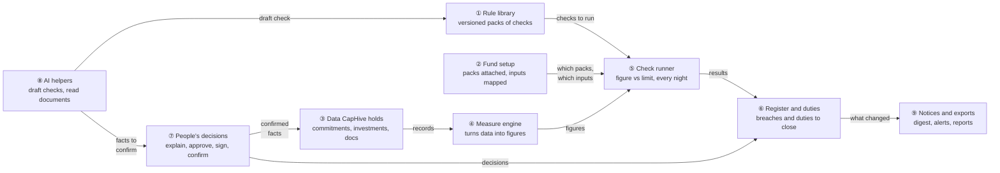

### Key concepts

Read this before the walkthrough. Every later section uses these words.

**How the concepts fit together**

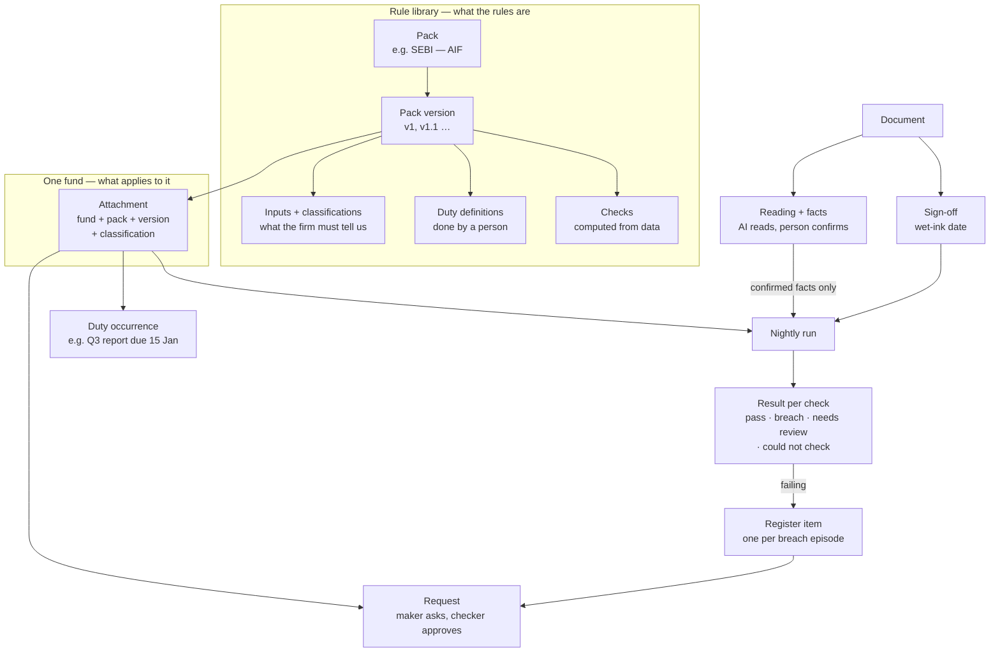

- **Top box:** the rules, written once per pack version.
- **Middle:** which rules apply to one fund.
- **Bottom:** what happens every night, and what people do about it.

**Glossary** — the example column uses the walkthrough's Horizon Growth Fund I.

| Concept | What it is, in one line | Example | Stored in |
|---|---|---|---|
| Pack | A named set of rules from one source | "SEBI — AIF" (CapHive's); "Horizon — fund agreement" (the firm's own) | `compliance_packs` |
| Locked pack | A CapHive regulator pack: customers use it but cannot edit it | SEBI's 25% can be tightened to 20% for one fund, never loosened to 30% | `compliance_packs.locked` |
| Pack version | A frozen copy of a pack's rules, with an effective date | SEBI v1 (in force); v1.1 (from 01 Jan 2027) | `compliance_pack_versions.definition` |
| Applicability | Which funds a new version applies to | All funds · new funds only · all, with a transition period | On the version |
| Classification | Which part of a pack applies to a fund | "Category II" → 25% limit; "Category III" → 10% | `fund_compliance_packs.classification` |
| Input | A fact a pack needs that CapHive cannot work out alone; mapped once per firm | "Sponsor/manager" = investors in category "Sponsor" | `compliance_entity_setups.input_mappings` |
| Measure | A figure CapHive computes from its own data with SQL | Largest investment in one company = ₹72.00 cr | In the version's definition |
| Check | One rule: a figure against a limit, or a document requirement | ₹72.00 cr ÷ ₹270.00 cr must be ≤ 25% | In the definition, by stable `key` |
| Attachment | A pack switched on for one fund, on one version | Growth Fund I + SEBI, on v1, "Category II" | `fund_compliance_packs` |
| Run | One nightly pass over every check of a fund | 5 Nov 02:00 | `compliance_runs` |
| Result | What one check found in one run, with its working; never edited | "26.67% > 25% — Breach" | `compliance_results` |
| Register item | One breach **episode**: opened by the first failing run, closed by the first passing run | "Concentration — open since 5 Nov, fix by 5 Dec" | `compliance_register_items` |
| Request (maker–checker) | A change one person asks for and a second person approves | Meera asks to explain a breach; Rahul approves | `compliance_requests` |
| Duty | Something a person must do and prove, that data cannot show | "Quarterly SEBI report filed", FY27-Q3 | `compliance_duties` |
| Sign-off | The date a document was signed on paper | IC note signed in wet ink, 28 Sep | `document_signoffs` |
| Reading and facts | The AI reads named facts from a document once; a person confirms each | "Approved amount: ₹15.00 cr (page 2)" | `document_readings`, `document_facts` |
| Draft | A check the AI wrote from a sentence, waiting for review | "No more than 20% in one company" | `compliance_check_drafts` |
| Preview | Running a draft or a future version on a fund without saving anything | SEBI v2 tried on Growth Fund I in December | Not stored |

**Three kinds of check**

| Kind | Question it answers | Example | Data it reads |
|---|---|---|---|
| Limit | Is a figure within a limit? | Largest company ≤ 25% of investable funds | Measures (SQL over CapHive records) |
| Document present | Does every record have its signed document? | Every portfolio investment has a signed IC note | Documents + e-sign status + sign-offs |
| Document contents | Does what the document says match the records? | Invested ₹18.00 cr vs approved ₹15.00 cr | Confirmed facts + records |

**Four outcomes of a check**

| Outcome | Means | Counts as pass? |
|---|---|---|
| Pass | Within the limit | Yes |
| Breach | Outside the limit — opens a register item | No |
| Needs review | Cannot be decided by rule; a person must look (e.g. a name match) | No |
| Could not check | Something is missing — an input, a rate, a start date — and the message names it | No — never shown as a pass |

#### Register items — breach episodes

- **The problem it solves:** a breach that lasts 30 nights would otherwise produce 30 separate "breaches".
- **The idea:** one register item covers the whole stretch of nights a check keeps failing for a fund. That stretch is called an **episode**.
- **Opens:** on the first failing run. The fix-by date is that day + the check's "time to fix" (e.g. 30 days).
- **Stays one item:** while the check keeps failing. Each run only updates "last result".
- **Closes by data, never by hand:**
  - a passing run → "Cleared by data";
  - the check was removed in a new version, the pack was detached, or the check was disabled → closed with that reason.
- **Explained:** an approver can accept a breach with a reason (via maker–checker, below). If the figure later gets **worse** than at approval, the item reopens.
- **Overdue:** derived — today is past fix-by. On the first overdue day, the owner and approvers are told once.

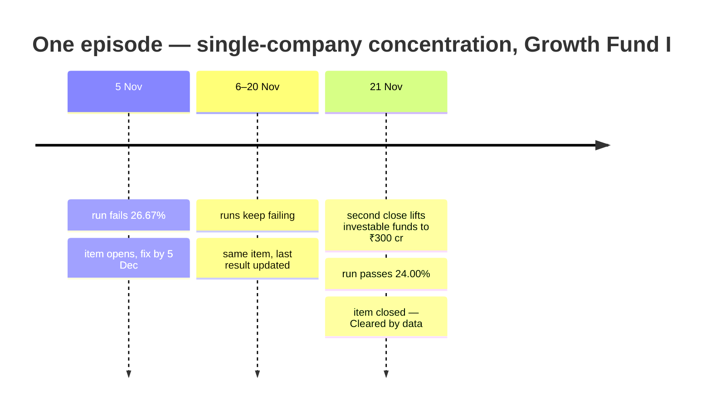

#### Maker–checker — two-person approval

- **What:** any change that **weakens or exempts monitoring** needs two people.
  - The **maker** asks (a compliance editor).
  - The **checker** approves or rejects (a compliance approver or company admin who is **not** the maker).
- **Why:** this is standard "four-eyes" control in fund compliance. One person alone must not be able to silence a breach, loosen a limit or switch a check off.
- **Until approved, nothing changes:** the old limit keeps applying and the item stays open.

**The six things that need a second person**

| Request kind | What it does once approved | Example |
|---|---|---|
| Override | Changes one check's limit for one fund. On a locked pack, only stricter. | Concentration 25% → 20% for Growth Fund I |
| Disable | Stops one check for one fund; its open item closes "Check disabled" | Turn off the investor-count check for a fund with 3 investors |
| Detach | Removes a pack from a fund; open items close "Pack detached"; history stays | Detach the IFSCA pack from an onshore fund |
| Explanation | Accepts an open breach with a reason; the item becomes "Explained" | "Temporary — follow-on call due 30 Nov" |
| Early adoption | Moves a fund to an upcoming version before its effective date, if that version allows it | Move to SEBI v2 in December |
| Classification | Changes which part of a pack applies to a fund | "Category II" → "Category II — Large Value Fund" |

**What does NOT need a second person** — one person acts and the change is audited:
- attach a pack;
- map inputs;
- assign a register item;
- mark a document signed;
- confirm or correct an AI-read fact;
- mark a duty done.

All of these either add monitoring or record a fact. None of them weakens monitoring.

**One request, start to finish**

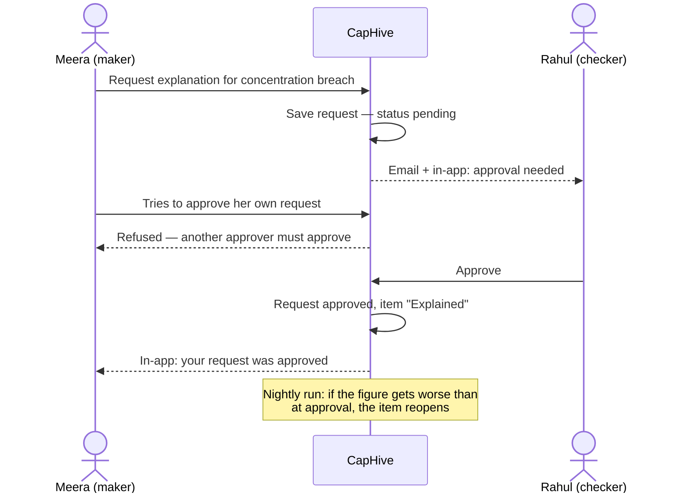

**Rules**
- The checker must hold the approver role (or be a company admin), belong to the same firm and be able to see the fund.
- The checker must not be the maker.
  - **Exception:** if the firm has exactly one eligible person, they may approve their own request. It is labelled "Self-approved — single approver" everywhere: on the item, in history and in exports.
- A request is decided once. A second click changes nothing.
- **Rejected:** nothing changes. An explanation's item goes back to "In progress".
- **The approver is deactivated:** pending requests go back to the compliance owner, and the digest says so once.

#### Duties — things a person must do

- **What:** a compliance obligation that CapHive **cannot check from data**. A person does it and, usually, attaches evidence.
- **Why separate from checks:** a check is decided by the nightly run. A duty is only "done" when a named person says so, with proof.

| | Check | Duty |
|---|---|---|
| Who decides | The nightly run, from data | A person |
| Proof | The working (figures, limit) | Evidence document attached |
| Example | Concentration ≤ 25% | Quarterly SEBI report filed |
| When it is "red" | Breach → register item | Past its due date → overdue |

**What creates a duty occurrence**

| Trigger | Creates | SEBI pack example | Due |
|---|---|---|---|
| Schedule | One per period | "Quarterly SEBI report filed" for FY27-Q3 | 15 days after the quarter ends |
| Schedule | One per year | "Annual compliance test report / PPM audit" for FY27 | 30 days after the year ends |
| Event | One per new record | "Due diligence for a new investor" — for each investor added on or after 01 Nov 2026 | 15 days after the investor is added |
| Document event (Phase 3) | One per new document | Review a new PPM; the AI prepares notes, a person decides | n days after upload |
| On demand | When a check asks for it | Enhanced due diligence for an investor group ≥ 50% (SEBI v1.1) | Set by the check |

**One duty, start to finish**

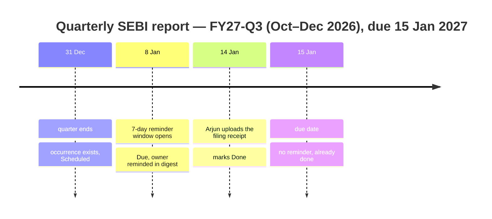

- **Late:** if marked done after the due date, it shows "Done — late (3 days)".
- **Owner:** the duty's named owner, else the firm's compliance owner.
- **Evidence:** stored in the duty's folder (`WithFolder`). If the duty requires evidence, Done is refused without a file.
- **Never twice:** one occurrence per duty + period + subject (unique index), so reruns never create duplicates.
- **No backfill:**
  - a pack attached mid-period gets its first duty at the next period end;
  - records older than the event duty's `from` date create none.
- **Stored:** only `done_on` is stored. "Scheduled", "due" and "overdue" are worked out from `due_on`, the 7-day reminder window and today.

### Walkthrough: one example, start to finish

**Setup:** Horizon Capital, Horizon Growth Fund I (SEBI Category II, corpus ₹300.00 cr, estimated expenses ₹30.00 cr), people Meera (editor + approver), Arjun (editor), Rahul (approver). Data from [business-rules.md › Shared setup](business-rules.md#shared-setup).

**Legend:** ✓ done · ● we are here — waiting on this, not done yet · ○ not started · ↺ redone after a change.

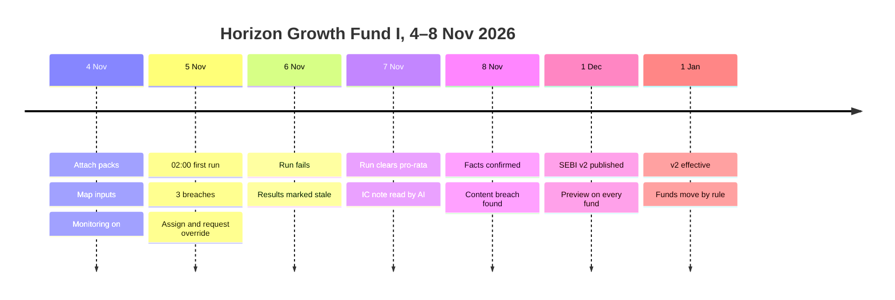

**Phase A — setup (4 Nov)**

| # | When | What happens | Behind the scenes | Result&nbsp;&nbsp;&nbsp;&nbsp;&nbsp;&nbsp;&nbsp;&nbsp;&nbsp;&nbsp; |
|---|---|---|---|---|
| 1 | 10:00 | Meera attaches SEBI — AIF and Horizon's fund-agreement pack to Growth Fund I | Fund setup (②) records the attachment; SEBI classification pre-fills "Category II" from the fund | **●&nbsp;Attach&nbsp;packs**<br>○&nbsp;Map&nbsp;inputs<br>○&nbsp;Turn&nbsp;monitoring&nbsp;on<br>○&nbsp;Run&nbsp;checks<br>○&nbsp;Close&nbsp;breaches |
| 2 | 10:10 | She maps "Sponsor/manager" → category Sponsor, estimated expenses → fund custom field, IC note → tag "IC Note" | Fund setup (②) validates each mapping against the data catalogue of the measure engine (④) | ✓&nbsp;Attach&nbsp;packs<br>**●&nbsp;Map&nbsp;inputs**<br>○&nbsp;Turn&nbsp;monitoring&nbsp;on<br>○&nbsp;Run&nbsp;checks<br>○&nbsp;Close&nbsp;breaches |
| 3 | 10:20 | **Mistake:** she requests "concentration 25% → 20%" and tries to approve it herself | People's decisions (⑦) refuses: approver must differ from requester; the pack's 25% keeps applying | Same as row 2 |
| 4 | 10:30 | Rahul approves the override; Meera turns monitoring on | Fund setup (②) activates the override; the run scheduler of the check runner (⑤) will pick the entity at 02:00 IST | ✓&nbsp;Attach&nbsp;packs<br>✓&nbsp;Map&nbsp;inputs<br>✓&nbsp;Turn&nbsp;monitoring&nbsp;on<br>**●&nbsp;Run&nbsp;checks**<br>○&nbsp;Close&nbsp;breaches |

**Phase B — first run and a stall (5–7 Nov)**

| # | When | What happens | Behind the scenes | Result&nbsp;&nbsp;&nbsp;&nbsp;&nbsp;&nbsp;&nbsp;&nbsp;&nbsp;&nbsp; |
|---|---|---|---|---|
| 5 | 5 Nov 02:00 | Nightly run | The check runner (⑤) asks the measure engine (④) for figures from the data (③): Acme ₹72.00 cr ÷ ₹270.00 cr = 26.67% > 20%; sponsor paid ₹2.10 cr < ₹5.00 cr × 45% = ₹2.25 cr; 3 of 17 investments lack a signed IC note | ✓&nbsp;Run&nbsp;checks<br>**●&nbsp;Close&nbsp;breaches** (3&nbsp;open) |
| 6 | 5 Nov 09:00 | Digest email; Meera assigns pro-rata to Arjun | The register (⑥) opened 3 items with fix-by 5 Dec; notices (⑨) send the digest and an assignment email | Same as row 5 |
| 7 | 6 Nov 02:00 | **Stall:** the run fails (database unavailable) | The check runner (⑤) marks the run failed; notices (⑨) email owners + CapHive support; screens show "Last successful run 05 Nov 02:00" | Same as row 5 (results flagged stale after 26 h) |
| 8 | 6 Nov 15:00 | Arjun records the sponsor's ₹0.15 cr top-up | Data (③) changes; nothing is decided until the next run | Same as row 5 |
| 9 | 7 Nov 02:00 | Run succeeds | The check runner (⑤): sponsor ₹2.25 cr ≥ ₹2.25 cr → pass; the register (⑥) closes the item "Cleared by data" | ✓&nbsp;Run&nbsp;checks<br>**●&nbsp;Close&nbsp;breaches** (2&nbsp;open) |

**Phase C — document contents (Phase 3 of delivery; 7–8 Nov)**

| # | When | What happens | Behind the scenes | Result&nbsp;&nbsp;&nbsp;&nbsp;&nbsp;&nbsp;&nbsp;&nbsp;&nbsp;&nbsp; |
|---|---|---|---|---|
| 10 | 7 Nov 11:00 | Arjun uploads Orbit Health's wet-ink IC note and marks it signed 28 Sep | People's decisions (⑦) store the sign-off; AI helpers (⑧) read the note once in a job: 6 facts with quote + page | ✓&nbsp;Run&nbsp;checks<br>**●&nbsp;Close&nbsp;breaches** (2&nbsp;open)<br>●&nbsp;Confirm&nbsp;facts (6) |
| 11 | 7 Nov 14:00 | **Undo:** AI read "₹1.50 cr"; Meera corrects to ₹15.00 cr against the quote and confirms | People's decisions (⑦) record AI value → Meera's value; facts now count as data (③) | ✓&nbsp;Confirm&nbsp;facts |
| 12 | 8 Nov 02:00 | Run | The check runner (⑤) compares invested ₹18.00 cr with approved ₹15.00 cr → breach ₹3.00 cr over | **●&nbsp;Close&nbsp;breaches** (3&nbsp;open) |

**Phase D — a new SEBI version (1 Dec – 1 Jan)**

| # | When | What happens | Behind the scenes | Result&nbsp;&nbsp;&nbsp;&nbsp;&nbsp;&nbsp;&nbsp;&nbsp;&nbsp;&nbsp; |
|---|---|---|---|---|
| 13 | 1 Dec | Priya publishes SEBI v2 (applicability C, transition to 30 Jun 2027) effective 1 Jan | The rule library (①) stores v2 as published-ahead; notices (⑨) tell owners; every fund shows "Coming into effect 01 Jan 2027" | ✓&nbsp;Publish&nbsp;v2<br>**●&nbsp;Wait&nbsp;for&nbsp;effective&nbsp;date**<br>○&nbsp;Move&nbsp;funds |
| 14 | 3 Dec | Meera opens the preview on Growth Fund I | The check runner (⑤) evaluates v2 in preview mode: nothing is stored, no register item | Same as row 13 |
| 15 | 25 Dec | 7-day notice | Notices (⑨) send "SEBI v2 in 7 days" | Same as row 13 |
| 16 | 1 Jan 02:00 | Nightly run moves Growth Fund I to v2 | The check runner (⑤) advances the fund's version on its pack attachment (②): the 20% override is kept (stricter than v2's 25%); a new v2 check fails but shows **Warning — in transition until 30 Jun 2027** (fund started before 1 Jan) | ✓&nbsp;Publish&nbsp;v2<br>✓&nbsp;Wait&nbsp;for&nbsp;effective&nbsp;date<br>**✓&nbsp;Move&nbsp;funds** |

**Snapshot — register item after row 12**

```
┌ Horizon — fund agreement v2 · IC note contents — Breach ─────────────┐
│ Orbit Health — Series A · invested 05 Oct 2026                       │
│ Amount   ₹18.00 cr invested vs ₹15.00 cr approved → ₹3.00 cr over ✗  │
│ Facts    confirmed by Meera 07 Nov (amount edited: AI ₹1.50 cr)      │
│ Fix by   07 Dec 2026 · Owner: — · [Assign] [Explain]                 │
└──────────────────────────────────────────────────────────────────────┘
```

**What to notice**

- Decisions only happen in the nightly run (⑤); people and AI change *inputs*, never results.
- Maker–checker lives in one place (⑦): the self-approval in row 3 is refused there.
- A failed run (row 7) never shows old results as current.
- AI misreads (row 11) are caught before they count, because unconfirmed facts are never data.
- Clearing is data-driven (row 9): nobody "closes" a breach by hand.
- Versions move by rule (row 16): no one pins or switches a fund by hand; previews (row 14) never touch the register.

### Key ideas

| # | Idea | In one line | Card |
|---|---|---|---|
| 1 | Packs are versioned data | One validated JSON definition per pack version; no code per regime | [①](#①-rule-library) |
| 2 | Allow-listed data catalogue | Measures can only name record types and fields the catalogue lists | [④](#④-measure-engine) |
| 3 | Results are immutable | Each run writes new rows with the full working and setup snapshot | [⑤](#⑤-check-runner) |
| 4 | One register item per episode | Opened by a failing run, cleared by a passing run | [⑥](#⑥-register-and-duties) |
| 5 | One maker–checker model | `ComplianceRequest` for override, disable, detach, explanation, early adoption, classification ([explained](#makerchecker--two-person-approval)) | [⑦](#⑦-peoples-decisions) |
| 6 | AI at the edges only | Drafts and document facts need a person; runs never call AI | [⑧](#⑧-ai-helpers) |
| 7 | Locked packs, versions by rule | Regulator packs can only be tightened per fund; each fund's version moves on the effective date by the version's applicability | [①](#①-rule-library), [⑤](#⑤-check-runner) |

**FAQ**

| Question | Answer |
|---|---|
| Does anything block users from saving records? | No. This is monitoring, not a gate; Validation Rules stay the gate. |
| Why nightly and not on every save? | Passive breaches happen with no save (investable funds shrink); one daily pass catches both. |
| Can a person change a result? | No. They change data or inputs; the next run writes new results. |
| Where does AI sit? | Only in ⑧, in jobs, producing drafts or facts a person must confirm. |

---

## 2. The same picture with real names

### Picture

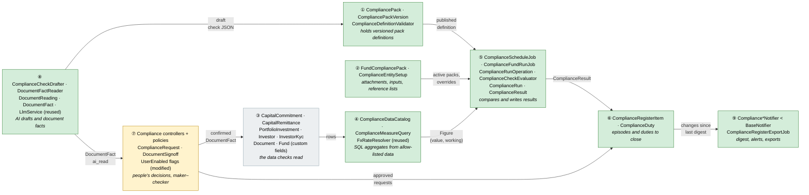

Colour = footprint: **green** new, **amber** modified, **grey** reused unchanged. Exact files are in [lld.md File Map](lld.md#file-map).

- New code lives in a new pack `app/packs/funds/compliance` (models, operations, jobs, controllers, policies, views, notifiers); AI services in `app/packs/ai/compliance` next to `FundFormulaGenerator`.
- The only modified existing code: `UserEnabled` (two permission flags appended), the company menu partial, `config/initializers/sidekiq.rb` (cron registration). See [Changes to existing models — needs approval](#changes-to-existing-models--needs-approval).

### What each box does

| # | Box | Real parts | What it does | When it runs | What it decides | Details |
|---|---|---|---|---|---|---|
| ① | Rule library | `CompliancePack`, `CompliancePackVersion`, `ComplianceDefinitionValidator` | Stores pack definitions, versions, lock, applicability, publish | Request (Rule Library, entity packs) | Is a definition valid / publishable; who a version applies to | [card ①](#①-rule-library) |
| ② | Fund setup | `FundCompliancePack`, `ComplianceEntitySetup` | Attachments, classifications, current version per fund, input mappings, reference lists, AI opt-in | Request (Setup); version moved by ⑤ | Which packs, versions and inputs apply to a fund | [card ②](#②-fund-setup) |
| ③ | Data | Existing models + `DocumentSignoff` + confirmed `DocumentFact` | Source records | — | Nothing | [card ③](#③-data-caphive-holds) |
| ④ | Measure engine | `ComplianceDataCatalog`, `ComplianceMeasureQuery`, `FxRateResolver` | Compiles measure JSON to SQL aggregates | Inside a run / test run | The figure and its working | [card ④](#④-measure-engine) |
| ⑤ | Check runner | `ComplianceScheduleJob`, `ComplianceFundRunJob`, `ComplianceRunOperation`, `ComplianceCheckEvaluator`, `ComplianceRun`, `ComplianceResult` | Advances versions on effective dates, runs every applicable check, writes results; preview mode writes nothing | Hourly cron tick → 02:00 entity time; Run now; preview on request | Pass / Breach / Warning (incl. in transition) / Needs review / Could not check | [card ⑤](#⑤-check-runner) |
| ⑥ | Register and duties | `ComplianceRegisterItem`, `ComplianceDuty` | Opens/clears episodes, schedules duties | End of each fund run | Item and duty status, fix-by, overdue | [card ⑥](#⑥-register-and-duties) |
| ⑦ | People's decisions | Controllers + policies, `ComplianceRequest`, `DocumentSignoff` | Assign, explain, approve, mark signed, confirm facts, mark duties done | Request | Who may do what; maker–checker | [card ⑦](#⑦-peoples-decisions) |
| ⑧ | AI helpers | `ComplianceCheckDrafter`, `DocumentFactReader`, `DocumentReading`, `DocumentFact`, `ComplianceCheckDraft` | Draft a check from a sentence; read facts from a document | Sidekiq jobs | Nothing final — drafts and unconfirmed facts | [card ⑧](#⑧-ai-helpers) |
| ⑨ | Notices and exports | `ComplianceDigestNotifier` and friends, `ComplianceRegisterExportJob` | Digest, alerts, escalation, exports | After runs; on events; on request | Whether today has anything to say | [card ⑨](#⑨-notices-and-exports) |

### One run, end to end

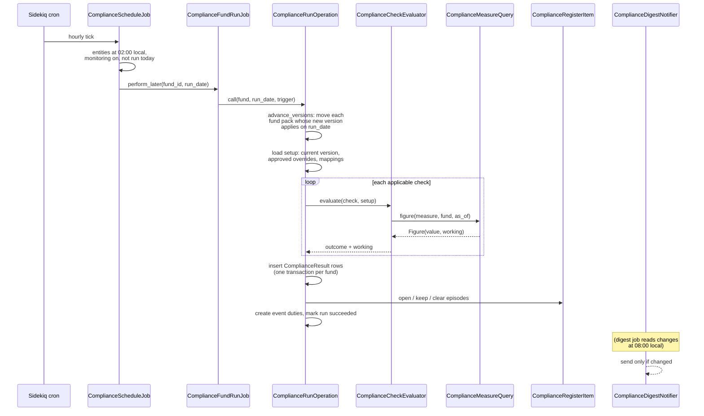

### Lifecycles

**Register item** — stored `status` ∈ open, in_progress, pending_approval, explained, closed, plus `closed_reason`; overdue is derived (`fix_by < today`).

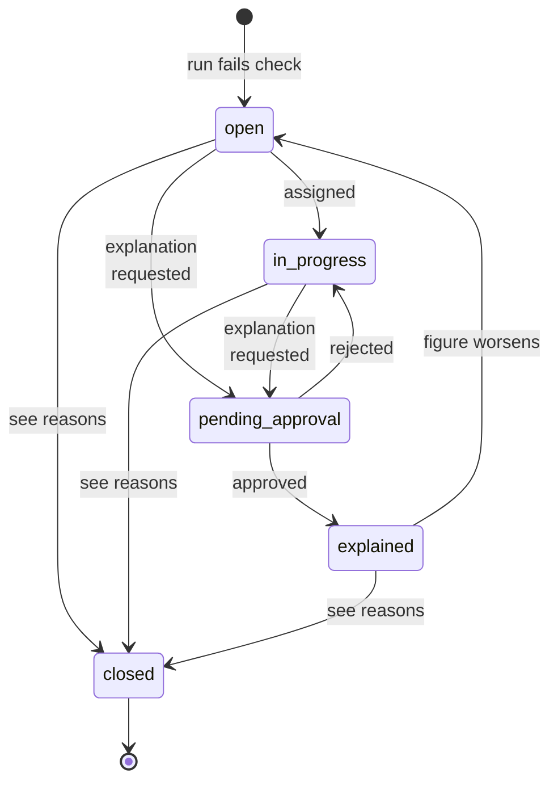

| `closed_reason` | Set when | IDs |
|---|---|---|
| `cleared` | A run passes the check | H25, E40 |
| `pack_corrected` | A correction version makes a fault-only breach pass (R14) | H57, X67 |
| `record_deleted` | The only failing record was soft-deleted (R7) | E125, E126 |
| `check_removed` | The fund moved to a version without the check | E94 |
| `detached` | Pack detach approved | H16 |
| `disabled` | Disable approved | H15 |

**Manual duty** — only `done_on` is stored; scheduled / due / overdue are derived from `due_on`, the reminder window and today.

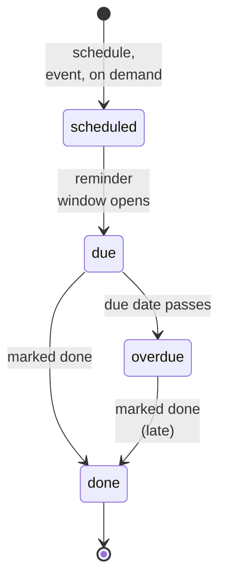

**Pack version** — stored `status` ∈ draft, published; ahead / effective / superseded / retired are derived from `effective_from` (in the pack's regime time zone, R18), the next version and `retired_on`.

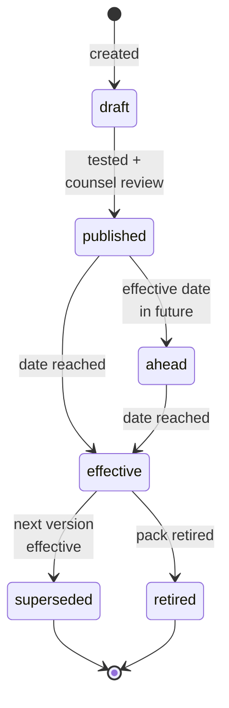

- A published version carries `applicability` (A all / B new funds only / C all with transition), `transition_ends_on` (C), `allows_early_adoption`; entity packs always A.

**Fund attachment version** — stored `fund_compliance_packs.compliance_pack_version_id`; "grandfathered" and "in transition" are derived from the version's applicability and `funds.start_date`.

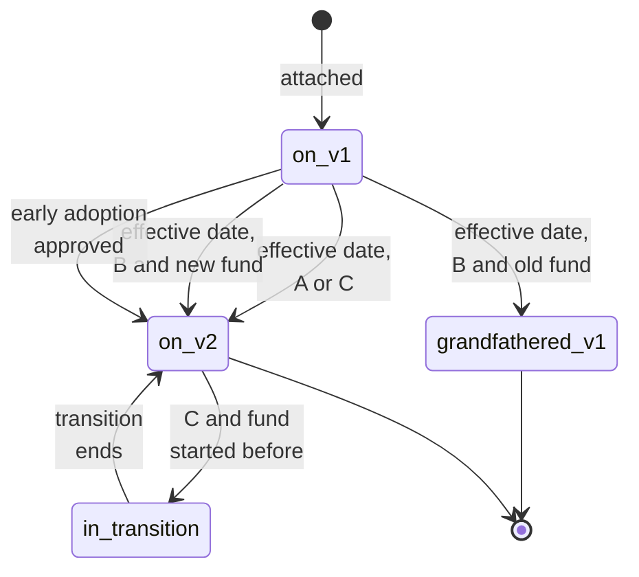

- No transition back: no pinning, no undo of early adoption (X58, X59).
- A fund with no `start_date` under B or C: its checks under that pack show "Could not check — missing: fund start date"; never guessed (R4).

**Request (maker–checker)** — stored.

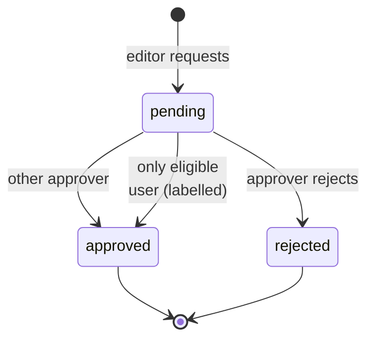

- Kinds: override, disable, detach, explanation, early_adoption, classification (R2).
- Approver = any Compliance approver or company admin other than the requester; if the entity has exactly one eligible user, self-approval is allowed and stored as `self_approved` → "Self-approved — single approver" on the item, in history and exports (R11).

**Document reading and facts** (Phase 3) — stored reading `status` ∈ queued, capped, read, failed; a reading is superseded (derived) when a newer reading exists for the same document and input.

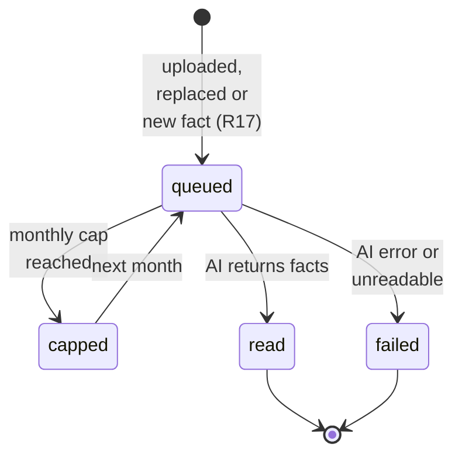

- Each fact: `ai_read` / `not_found` → `confirmed` (by a person). Facts belong to the document's reading, so they move with the document (R10).

**Run** — stored: `running → succeeded | failed`; "stale" is derived (last succeeded > 26 h ago); missed nights show as gaps in run history, never backfilled (R22).

### What users see

**At a glance**

| Where in CapHive | Today | After this change | Who sees it |
|---|---|---|---|
| Company menu › Compliance | AI Rules (same `enable_compliance` flag) | Compliance home, register, setup, plus AI Rules unchanged | Users with `enable_compliance` |
| Fund page › Compliance tab | — | Per-fund dashboard grouped by pack | Compliance viewers with fund access |
| Document row (portfolio investment) | Upload / e-sign | + "Mark signed (wet ink)" | Compliance editors |
| Compliance › Packs | — | One screen: CapHive packs (authored by super admins, read-only to customers) and entity packs | Super admins; compliance editors (own entity packs) |
| Email | — | Digest, assignment, approval request, escalation, run failed | Named roles ([Notifications](#notifications)) |

**Main journey — working a breach**

```
┌ Compliance › Register ─────────────────────────────────────────────┐
│ ① Fund [All▾] Pack [All▾] Status [Open▾]                           │
│ ② Horizon Growth I · SEBI — AIF · Single-investee conc. · Open     │
│ └─▶ ③ detail: working · fix-by 05 Dec · [Assign] [Explain]         │
│     ④ modal: "Request explanation — Rahul must approve"  [Send]    │
└────────────────────────────────────────────────────────────────────┘
```

| Step | The user… | They see |
|---|---|---|
| ① | filters the register | Open items, filters remembered |
| ② | opens a row | The detail with figures, limit, working, setup used |
| ③ | assigns or explains | Assign emails the assignee; Explain opens ④ |
| ④ | sends the request | Item "Pending approval"; Rahul gets an approval email |

### Design decisions

Each decision has the same parts:
- **Problem** — what had to be decided.
- **Decision** — what we built.
- **Why** — the reasons.
- **Not chosen** — the alternative, and why not.
- **Where** — where it lives in the code.

The full log of every smaller call (R1–R106) is in [decisions-and-assumptions.md](decisions-and-assumptions.md).

**At a glance**

| # | Decision | Why, in one line |
|---|---|---|
| D1 | A pack version's rules are one JSON document | Versioning becomes "copy one document"; no code per regulator |
| D2 | Every check has a stable key | Overrides and open breaches follow a check across versions |
| D3 | A new SQL figure engine, not `ConditionTreeEvaluator` | Compliance needs totals over thousands of rows, safely |
| D4 | One request model for all six two-person approvals | One approval rule in one place |
| D5 | Setup history from `audited`; each result keeps the setup it used | "Who changed what" without a new history table |
| D6 | Duties are their own model, not `Task` | A duty must be provable and must never be created twice |
| D7 | Wet-ink sign-offs in a new table | `Document` stays unchanged |
| D8 | Digest goes to users tagged "Compliance" | The tag already exists and is managed on the user screen |
| D9 | One hourly job picks each firm's 02:00 | Firms in one region sit in different time zones |
| D10 | Record-time checks store their subject on the result | No extra table for "already tested" |
| D11 | Locking is one pack flag plus a per-check override rule | Two fields cover every locking rule |
| D12 | A fund's current version is stored on its attachment | Funds on the same pack can be on different versions |
| D13 | Previews are never saved | "Preview never touches the register" is guaranteed by never writing |

#### D1. A pack version's rules are one JSON document

- **Problem:** a regulator pack has classifications, inputs, measures, checks, document inputs and duties. Each new version must be a frozen copy, so old results can still be explained.
- **Decision:** all of a version's rules live in one JSON column, `compliance_pack_versions.definition`. `ComplianceDefinitionValidator` checks it on every save.
- **Why:**
  - a new version is one copied document, not copies across 5 tables;
  - published versions are never edited, so nothing needs to query inside them;
  - adding SEBI, IFSCA or a firm's own rules is data, not code.
- **Not chosen:** a table each for measures, checks, inputs and so on — every version would need deep copies across all of them.
- **Where:** `CompliancePackVersion`, `ComplianceDefinitionValidator`, `db/seeds/compliance/*.json`.

#### D2. Every check has a stable key

- **Problem:** a fund's override (25% → 20%) and an open breach must still point to "the concentration check" after SEBI v2 replaces v1.
- **Decision:** each check carries a `key` (e.g. `sebi_concentration_cat12`) that stays the same across versions. Results, register items and requests store `check_key`.
- **Why:** the check's identity survives a new version, so overrides carry over and open items continue.
- **Not chosen:** referring to checks by per-version id — every new version would orphan overrides and open items.
- **Where:** `check_key` columns on `compliance_results`, `compliance_register_items` and `compliance_requests`.

#### D3. A new SQL figure engine, not `ConditionTreeEvaluator`

- **Problem:** checks need figures such as "largest total invested in one company" over all of a fund's records, and the rules are written by users.
- **Decision:** `ComplianceMeasureQuery` turns an allow-listed JSON measure (total, count, distinct, largest, smallest, with filters) into one Arel aggregate query. Filters reuse the ConditionTree operator names (`gt`, `lt`, `eq`, `blank`…) so they look familiar.
- **Why:**
  - aggregates belong in the database — no loading of thousands of rows (CLAUDE.md large-table rules);
  - only record types and fields listed in `ComplianceDataCatalog` can be named, so a user-written rule can never reach arbitrary columns or code.
- **Not chosen:** extending `ConditionTreeEvaluator`. It tests one in-memory record at a time with `public_send` on a field name — the wrong shape for totals, and unsafe for user-written names.
- **Where:** `ComplianceMeasureQuery`, `ComplianceDataCatalog`.

#### D4. One request model for all six two-person approvals

- **Problem:** six actions need a second person: override, disable, detach, explanation, early adoption and classification ([Maker–checker](#makerchecker--two-person-approval)).
- **Decision:** one `ComplianceRequest` model (`kind` = one of the six) and one operation, `ComplianceRequestDecide`, that applies the approved change.
- **Why:**
  - "the approver is not the requester" and the single-approver exception are written once;
  - one approvals list, one email and one history for all six.
- **Not chosen:** approval columns on each affected model — six copies of the same guard that could drift apart.
- **Where:** `ComplianceRequest`, `ComplianceRequestSubmit`, `ComplianceRequestDecide`, `ComplianceRequestPolicy`.

#### D5. Setup history from `audited`; each result keeps the setup it used

- **Problem:** an auditor asks "why did this check pass on 5 Nov?" when the limit, classification or mapping has since changed.
- **Decision:**
  - the models people change use `audited`, which records who changed what, when, and the before → after values;
  - fund-level changes (classification, early adoption, detach) only happen through approved requests, which are audited too;
  - each result also stores a snapshot of the setup it used.
- **Why:** the history comes for free, and a result explains itself without replaying history.
- **Not chosen:** a separate setup-history table, which would duplicate what `audited` already records.
- **Changed during the build:** the design said `Trackable`. We use `audited` directly, because `Trackable` adds soft-delete, which needs a `deleted_at` column, and compliance rows are never soft-deleted (R52).
- **Where:** `audited` on `ComplianceEntitySetup` (mappings, lists, AI settings), `ComplianceRequest`, `ComplianceRegisterItem`, `ComplianceDuty`, `DocumentSignoff`, `DocumentFact`; snapshot in `compliance_results.working`. Published pack versions are never edited, so they need no audit.

#### D6. Duties are their own model, not `Task`

- **Problem:** duties such as "Quarterly SEBI report filed" recur, must carry evidence, and must never appear twice for the same quarter ([Duties](#duties--things-a-person-must-do)).
- **Decision:** a `ComplianceDuty` row is one occurrence (duty + period + subject). Evidence goes in its folder via `WithFolder`.
- **Why:**
  - the unique `(duty, period, subject)` index makes reruns safe;
  - "Done" can require evidence;
  - the period key (e.g. `FY27-Q3`) and the event subject (e.g. the new investor) are first-class.
- **Not chosen:** `Task` + `TaskRecurrenceRule`, as side letters use. Tasks are free-form to-dos anyone can edit, with no evidence rule, period key or subject, so a duty could not be proved.
- **Where:** `ComplianceDuty`, `ComplianceDutyScheduler`, `ComplianceDutyComplete`, `CompliancePeriod`.

#### D7. Wet-ink sign-offs in a new table

- **Problem:** many IC notes are signed on paper, not through e-sign, so the system needs to record "signed on 28 Sep".
- **Decision:** a new `document_signoffs` table holds the document, the signed date and who marked it.
- **Why:** `Document` is a large, shared model. Changing it needs approval (project rule), and a side table needs none.
- **Not chosen:** three new columns on `documents` — open for approval later if you prefer it.
- **Where:** `DocumentSignoff`, `DocumentSignoffsController`.

#### D8. Digest goes to users tagged "Compliance"

- **Problem:** who receives the daily digest and alerts?
- **Decision:** the firm's compliance owner plus active users carrying the existing "Compliance" notification tag.
- **Why:** the tag already exists in `User::NOTIFICATION_TAGS`, and admins manage it on the user screen.
- **Not chosen:** a separate recipients list on the compliance setup — a second place to keep up to date.
- **Where:** `ComplianceNotices.owners`.

#### D9. One hourly job picks each firm's 02:00

- **Problem:** runs must happen at 02:00 in each firm's own time zone, and firms in one region can be in different zones.
- **Decision:** one cron job, `ComplianceScheduleJob`, runs every hour at 5 past. It starts runs for firms whose local time is 02:00 and digests for those at 08:00, then fans out one `ComplianceFundRunJob` per fund.
- **Why:** one cron covers every time zone, and adding a firm needs no cron change.
- **Not chosen:** a fixed UTC cron per region, which would be wrong for any firm outside the region's main zone.
- **Changed during the build:** the time zone lives on `compliance_entity_setups.time_zone` (default Asia/Kolkata), not `entity_settings`, so the existing table is unchanged (R58). The cron line is in `config/initializers/sidekiq.rb` (R67).
- **Where:** `ComplianceScheduleJob`, `ComplianceFundRunJob`.

#### D10. Record-time checks store their subject on the result

- **Problem:** some rules apply when a record is made and must test each record once, not every night. For example, a firm's own rule "each new commitment ≥ ₹1 cr at signing" must not re-flag an old commitment after a later transfer.
- **Decision:** a check marked `tested: on_record` writes its result with `subject_type` and `subject_id`. A subject that has already been tested is skipped on later runs. (`tested: continuous` checks run every night.)
- **Why:** the same results table serves both kinds of check.
- **Not chosen:** a separate "verdict per record" table — the same columns in one more table.
- **Where:** `compliance_results.subject_type` / `subject_id`; `ComplianceRunOperation`.

#### D11. Locking is one pack flag plus a per-check override rule

- **Problem:** customers must not loosen a regulator's limit, but may tighten it, and some checks must not be changed at all.
- **Decision:**
  - `compliance_packs.locked` is true for CapHive regulator packs;
  - each check's `override` field says `stricter_only` (default on a locked pack), `none` (cannot be changed) or `any`;
  - an override request on a locked pack is refused unless it is stricter.
- **Why:** two fields express every locking rule, and they are checked when the request is made.
- **Not chosen:** a separate "regulator check" model with its own screens.
- **Where:** `CompliancePack#locked`; `ComplianceRequest#override_allowed`.

#### D12. A fund's current version is stored on its attachment

- **Problem:** when SEBI v2 takes effect, some funds move and some stay ("new funds only"), and a fund may adopt early.
- **Decision:** `fund_compliance_packs.compliance_pack_version_id` holds the fund's version. The nightly run of the effective date moves it, following the version's applicability.
- **Why:** grandfathered and early-adopted funds need a stored per-fund answer, which "work it out from today's date" cannot give.
- **Not chosen:** working out "the version in force on the run date" on every run.
- **Where:** `ComplianceVersionMover`, called from `ComplianceRunOperation`.

#### D13. Previews are never saved

- **Problem:** firms want to see how a draft or a future version would score on a real fund, without touching the register or history.
- **Decision:** `CompliancePreview` runs the same figure engine and the same evaluator (`ComplianceMeasureQuery` + `ComplianceCheckEvaluator`) as the nightly run, shows the results and writes nothing.
- **Why:** "a preview never appears in history" is guaranteed by never writing.
- **Not chosen:** saving preview results with a flag, where every query would have to remember to exclude them.
- **Where:** `CompliancePreview`.

**Changed or added during the build** — the decisions that moved the design. Details are in the log.

| Log # | What changed | Why |
|---|---|---|
| R52 | `audited` instead of `Trackable` | Compliance rows are never soft-deleted |
| R53 | One `ComplianceNotifier` with a `kind`, not six notifier classes | One recipient rule set |
| R58 | Time zone on `compliance_entity_setups` | `entities` unchanged |
| R67 | Hourly cron registered at 5 past | Hourly run scheduling |
| R69 | AI drafting code lives in the compliance pack, not `app/packs/ai` | The pack stays self-contained |
| R70 | The AI returns a flat draft (figure, divided by, compare, limit), not a formula tree | Easier to check and to show in words |
| R80 | New documents found by the hourly sweep, not a hook on `Document` | `Document` unchanged; reading can take up to an hour |
| R84 | Document-contents checks use 8 fixed rules in code | Safe, testable and listed by name in the pack |
| R93 | Facts policy is `DocumentReadingPolicy` | Pundit resolves the policy by record class |
| R97–R100 | Currency: only fixed limits in another currency convert; the rate is shown; no rate → "Could not check" | Never a silent pass |
| R106 | A failed run emails `SUPPORT_EMAIL_TO` | The address exists in every `.env.*` |

**FAQ**

| Question | Answer |
|---|---|
| Why not reuse `ValidationRule` rows for checks? | They are per-record save gates with no versions, citations, classifications or results; we copy the default+override *pattern*, not the table. |
| Why JSON for definitions — can't it be queried? | Runs read one version at a time; nothing queries inside definitions. Results and register items carry `check_key` columns for querying. |
| Is `ComplianceRequest` over-general? | Six real callers share one guard (approver ≠ requester); YAGNI is satisfied. |
| Why is ⑦ amber? | It appends two flags to `UserEnabled` and adds a menu item; everything else is new. |

---

## 3. One card per box

> Same order and numbers as the picture.

### ① Rule library

- Versioned rule packs. CapHive packs (`entity_id` null, super admins) and entity packs (`entity_id` set, compliance editors) are the same model.

| Owns | Reads / receives | Produces |
|---|---|---|
| `compliance_packs`, `compliance_pack_versions` | Draft edits, AI draft JSON from ⑧, test-run results from ⑤ | Published definitions for ⑤; classifications/inputs list for ② |

**Definition shape** (one JSON per version):

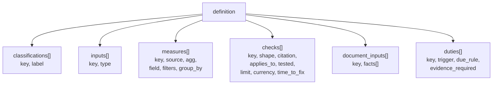

| Input type | Mapped by entity to |
|---|---|
| `investor_group` | Investor categories (e.g. Sponsor) |
| `fund_figure` | Fund column or fund custom field (e.g. estimated expenses) |
| `document` | Document tag / name / folder |
| `reference_list` | Entries in `ComplianceEntitySetup.reference_lists` |
| `nav` | Source per design open question (Cat III) |

**Publish decision**

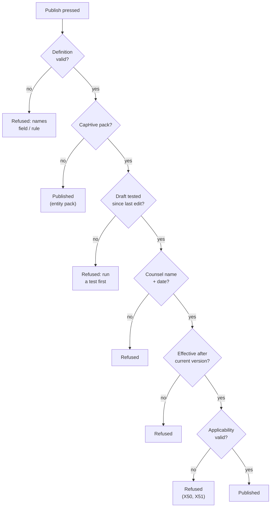

- `ComplianceDefinitionValidator` checks: classification keys exist, every measure field is in `ComplianceDataCatalog`, citations on CapHive checks, time_to_fix 0–365, currency on amount limits, due rules on scheduled duties, `checks_from` on document checks.
- Test runs: the same preview mode as fund previews (card ⑤) — nothing is written; the draft records `tested_at`/`tested_by_id`, cleared by any edit; target = CapHive demo entity, or a customer entity only while `entity.permissions.enable_support?` and an active `SupportClientMapping` for the super admin (E7, X11).
- Retiring: pack status `retired` → cannot be attached; runs stop using it from `retired_on` (E99, X60).
- **Lock:** `compliance_packs.locked` is true for CapHive regulator packs; customers may attach, map inputs and enter reference lists only — any edit of a locked pack's checks, measures, inputs or limits is refused in `CompliancePackVersionPolicy` (X55, E102).
- **Override direction per check** (definition field `override`): `stricter_only` (default on locked packs) or `not_overridable`; looser limits for special fund types come from a classification (e.g. Category II — LVF), never an override (X52–X54, E101).
- **Correction versions (R14):** `corrects_version_id` points at a faulty version and has the same `effective_from`; when it runs, results of the faulty version get `superseded_reason = pack_correction` and items that pass under the correction close as `pack_corrected`.
- **Published late (R15):** published after its `effective_from` → applies from the next run, shown "Published late"; no retroactive runs.
- **Regime time zone (R18):** `compliance_packs.time_zone` (Asia/Kolkata for SEBI/IFSCA) governs effective, applicability and transition dates; runs stay at 02:00 entity time.
- **Period basis (R20):** definition field `period_basis` (`calendar` or `fy_april`) drives duty periods.
- **Applicability on publish** (CapHive packs): `applicability` A / B (+ `applicability_date`, compared with `funds.start_date`) / C (+ `transition_ends_on`, must be after `effective_from`), plus `allows_early_adoption`. Entity packs: always A, from publish or an entity-set date (H51, E97, E98, X50, X51).

| Applicability | On the effective date | Funds started before | Funds started on/after |
|---|---|---|---|
| A All funds | Every carrying fund moves | Move | Move |
| B New funds only | Only new funds move | Stay — "On v1 — grandfathered", keep v1 checks + duties | Move |
| C All with transition | Every carrying fund moves | New-version breaches show Warning until `transition_ends_on` | Breach at once |

| Verb and path | Action | Does | Responds with |
|---|---|---|---|
| GET/POST `/compliance/packs` | index/create | One Packs screen: super admins author CapHive packs; entity editors author entity packs and see CapHive packs read-only | List |
| PATCH `/compliance/pack_versions/:id` | update | Edit draft definition | Turbo frame |
| POST `/compliance/pack_versions/:id/test_run` | test_run | Preview-mode run of the draft | Turbo stream result |
| POST `/compliance/pack_versions/:id/publish` | publish | Publish | Redirect |

**Worked examples:** H1–H10, E1–E7, X1–X13 ([business-rules § 1](business-rules.md#1-rule-library--phase-1)); lock, applicability, retirement H46, H47, H49, H51, H52, E97–E99, E102, X50, X51, X55, X60 ([§ 10](business-rules.md#10-pack-versions-and-locking--phase-1)).

**FAQ**

| Question | Answer |
|---|---|
| Can a customer edit a CapHive pack? | No — policy refuses (X13); they override per fund or build an entity pack. |
| Why no counsel review for entity packs? | They are the customer's own rules; the citation is optional (H7). |
| What happens to drafts when v2 publishes? | Only one draft per pack; publishing v2 supersedes v1 on its effective date (H8). |

---

### ② Fund setup

- Which packs a fund carries and how a pack's inputs map to this entity's data.

| Owns | Reads / receives | Produces |
|---|---|---|
| `fund_compliance_packs`, `compliance_entity_setups` | Pack classifications/inputs from ①; approved requests from ⑦ | Active packs, classification, mappings, reference lists, AI opt-in for ⑤ ⑧ |

- `FundCompliancePack`: one row per fund × pack (unique), `classification`, `status` active/detached; SEBI pre-fill when `funds.category` equals a pack classification label (H12, E11).
- `ComplianceEntitySetup` (one per entity): `owner_id` (compliance owner — default duty owner, R13), `input_mappings` JSON, `reference_lists` JSON (entries may carry `valid_from`/`valid_to`; content checks use the list as on the document's signed date, R1), `ai_settings` JSON (drafting on/off; reading per document input; monthly cap, default 200), `monitoring_enabled`.
- Mapping and reference-list edits apply from the change; past results are never rewritten (R3). Classification changes need an approved `classification` request and apply from approval (R2).
- Compliance turned off (flag or `monitoring_enabled`): runs stop, history read-only; turning it on resumes from that date, no backfill (R23).
- Monitoring cannot turn on while any required input of an attached pack is unmapped (X15).
- Overrides, disabling, detaching and **early adoption** go through `ComplianceRequest` (card ⑦); until approved the pack value / current version applies (E17).
- **Current version per fund:** `compliance_pack_version_id` set to the effective version on attach; moved only by ⑤ on the effective date or by an approved early adoption (H46, H47, H50, E100).
- **Override on a locked pack:** allowed only if `stricter_only` and the new limit is strictly tighter than the pack's; equal or looser refused (H53, X52, X53).
- **Version change effects on overrides** (applied by ⑤ when the fund moves, recorded as audits + digest lines):

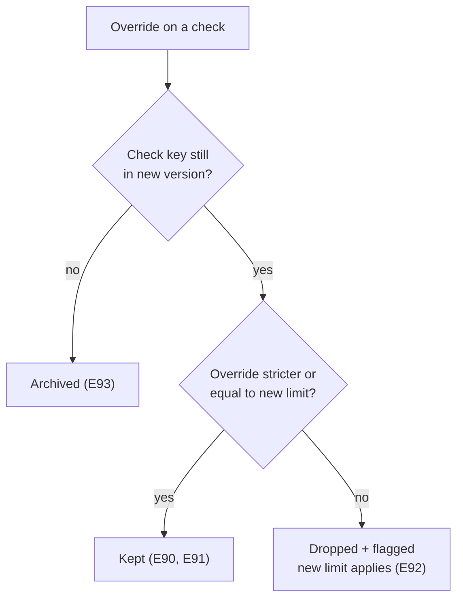
- Setup history: both models `include Trackable.new`; Setup › History lists their audits; "setup as of a day" = audits replayed to that date (H18).

**Access decision (every setup action)**

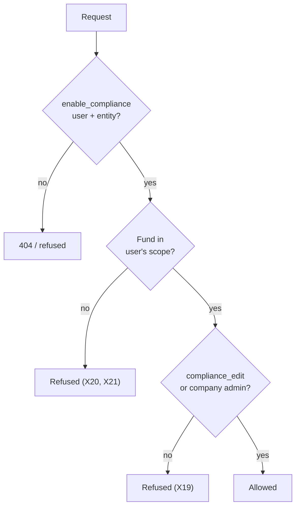

| Role | View setup | Edit setup | Approve requests |
|---|---|---|---|
| Company admin | ✓ | ✓ | ✓ (not own) |
| Compliance editor (`compliance_edit`) | ✓ | ✓ | — |
| Compliance approver (`compliance_approve`) | ✓ | — | ✓ (not own) |
| Viewer (`enable_compliance` only) | ✓ | — | — |
| Investor / advisor | — | — | — |

- Fund scope = `FundPolicy::Scope` for the user (existing access rights); `entity_id` from `current_user`, never params.

**Worked examples:** H11–H18, E8–E17, X14–X23 ([business-rules § 2](business-rules.md#2-fund-pack-setup--phase-1)); H50, H53, E90–E93, E100, E101, X52–X54, X56–X59 ([§ 10](business-rules.md#10-pack-versions-and-locking--phase-1)).

**FAQ**

| Question | Answer |
|---|---|
| Why one setup row per entity, not per pack? | Inputs are shared across packs (H13: Sponsor mapped once). |
| Where do fund figures like estimated expenses live? | In a fund custom field (`WithCustomField`), mapped as a `fund_figure` input — no new column. |
| Double-click on Attach? | Unique index on fund × pack; second insert is a no-op (E16). |

---

### ③ Data CapHive holds

- Existing records, read only. Two additions feed it: `DocumentSignoff` (wet ink) and confirmed `DocumentFact` rows.

| Owns | Reads / receives | Produces |
|---|---|---|
| `document_signoffs` (new) | Uploads, e-sign status, confirmed facts from ⑦ | Rows for ④ |

| Source in catalogue | Model | Date column (as-of, checks-from) | Notes |
|---|---|---|---|
| commitments | `CapitalCommitment` | `commitment_date` | Corpus = Σ `committed_amount_cents` ≤ as-of, same as `CorpusDetailsJob` |
| contributions | `CapitalRemittance` | `payment_date` | Paid-in = Σ `collected_amount_cents` |
| investments | `PortfolioInvestment` | `investment_date` | Buys; grouped by `portfolio_company_id` |
| investors | `Investor` via commitments | — | `category` for groups |
| kyc | `InvestorKyc` | — | Custom fields via `json_fields` |
| documents | `Document` + `DocumentSignoff` | signed date | `esign_completed?`, `last_status_updated_at`, tag/name/folder |
| facts | `DocumentFact` (confirmed only) | — | Phase 3 |
| fund | `Fund` | — | `category`, `currency`, custom fields |

- **Excluded:** `account_entries` and other large ledgers (CLAUDE.md); soft-deleted rows (`acts_as_paranoid` default scope) — a failing row whose record is deleted drops out, and an item left with none closes `record_deleted` (R7).
- Record-level checks use the same source filters as measures (e.g. investments: buys only), so the IC-note check covers buys by default (R8).
- A document moved to another record or deleted: the record-level check re-evaluates (Missing) on the next run (R10).
- Signed date = `document_signoffs.signed_on` (wet ink) or `documents.last_status_updated_at` when `esign_completed?` (H23, E26, E27).

**Worked examples:** H22, H23, E25–E27, X26, X27.

**FAQ**

| Question | Answer |
|---|---|
| Why not mark wet ink on `Document`? | Keeps `Document` unchanged unless approved (see [needs approval](#changes-to-existing-models--needs-approval)). |
| Do unconfirmed facts ever reach ④? | No — the catalogue's `facts` source filters `status = confirmed`. |

---

### ④ Measure engine

- Turns a measure definition into one SQL aggregate and a `Figure` (value, unit, currency, working).

| Owns | Reads / receives | Produces |
|---|---|---|
| `ComplianceDataCatalog` (constant registry), `ComplianceMeasureQuery` | Measure JSON, fund, as-of date, input mappings | `Figure(value, group_values, working)` |

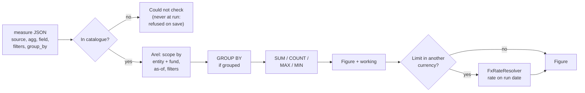

- Filters use the ConditionTree operator vocabulary (`eq`, `gt`, `lt`, `blank`, `not_blank`, `in`) compiled to bound Arel predicates — never `public_send` on a stored name.
- Arithmetic measures (÷ × + −, lower of, higher of) combine other figures in Ruby `BigDecimal`; percentages rounded to 2 dp **for comparison** (E22).
- Missing input / FX rate / NAV → `Figure` carries `missing:` and the check becomes Could not check (X24, X25, X38).
- Custom fields: `json_fields->>'$.key'` via a quoted, catalogue-checked key only.

**Worked examples:** H2, H3, H20, H24, E4, E22, E23, E30, X5, X24, X25 ([business-rules § 3](business-rules.md#3-runs-and-results--phase-1-currency-phase-4)).

**FAQ**

| Question | Answer |
|---|---|
| Why compile to SQL rather than load records? | Grouped sums over thousands of rows; CLAUDE.md large-table rules. |
| Can a pack name any column? | Only those `ComplianceDataCatalog` lists per source; the validator refuses others (X5). |
| How do grouped failures get listed? | The grouped query returns each group's value; failing groups go into the result's working (E23). |

---

### ⑤ Check runner

- Schedules runs, evaluates every applicable check of every active pack on a fund, writes immutable results.

| Owns | Reads / receives | Produces |
|---|---|---|
| `compliance_runs`, `compliance_results`; `ComplianceScheduleJob`, `ComplianceFundRunJob`, `ComplianceRunOperation`, `ComplianceCheckEvaluator` | Definitions ①, setup ②, figures ④, approved requests ⑦ | Results for ⑥ ⑨; run health |

| Component | Queue | Retries | Idempotency | Transaction |
|---|---|---|---|---|
| `ComplianceScheduleJob` (hourly cron) | `low` | default | Skips entities with a run for `run_date` | none |
| `ComplianceFundRunJob` | `ai_checks`-free `low` queue | 3, then run failed | Unique `(fund_id, run_date, trigger)` for nightly; Run now waits on an in-flight run (E18) | — |
| `ComplianceRunOperation` | inside job | — | Re-running a run_date replaces nothing: results are inserted once per run id | One transaction per fund: results + register + duties |

`ComplianceRunOperation` steps: `advance_versions → load_setup → evaluate_checks → write_results → update_register → create_event_duties → mark_succeeded`; `left :mark_failed`.

- **`advance_versions`** (nightly only): for each active fund pack whose pack has a version effective on `run_date` (regime time zone) and whose applicability includes this fund (A; B with `start_date ≥ applicability_date`; C) — set the new version, apply override effects (card ②), close register items for removed checks (card ⑥), record audits. Grandfathered funds (B, older) stay and keep the old version's checks and duties (E81).
- **Consistent snapshot (R21):** each fund's evaluation runs inside one read transaction (MySQL REPEATABLE READ), so every check of a fund sees the same data.
- **Missing start date (R4):** under B/C, a fund without `funds.start_date` gets Could not check for that pack's checks.
- **Transition (C):** a failing new-version check on a fund started before `effective_from` gets outcome `warning` with working "In transition until 30 Jun 2027" through `transition_ends_on`, `breach` from the next day (E82–E85).
- **Preview mode:** `ComplianceRunOperation.call(mode: :preview, version:)` evaluates a published-ahead version for one fund, returns results to the page, writes **nothing** (no run, result, item or digest line); a grandfathered fund's preview says "This version will not apply to this fund" (H48, E88, E89, X61).

**Outcome decision per check**

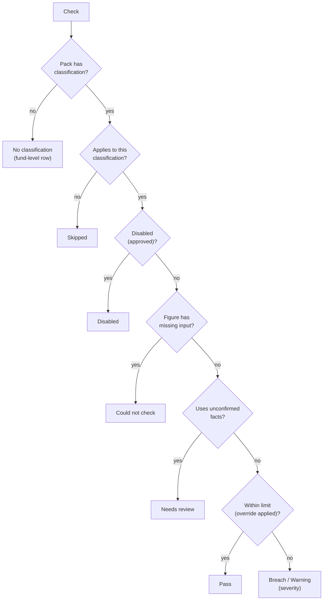

- **Tested "when a record is made":** evaluates only subjects with no earlier result for this check key; result rows carry `subject_type/subject_id` (E21).
- **Working snapshot:** each result stores `working` (figures, rates, limit, override id, classification, mapping values, version id) — the "setup that applied" (H18).
- **Run health:** stale = no `succeeded` run for the fund in the last 26 h (25 h is current, E28); failed run → `ComplianceRunFailedNotifier` (X28).
- **Run now:** `POST /funds/:fund_id/compliance_runs` → same job with `trigger: run_now`.

| Verb and path | Action | Does | Responds with |
|---|---|---|---|
| GET `/funds/:fund_id/compliance` | dashboards#show | Latest results by pack | Page |
| POST `/funds/:fund_id/compliance_runs` | create | Run now | Turbo stream "running" |
| GET `/funds/:fund_id/compliance/preview?version_id=` | preview | Preview a published-ahead version | Turbo frame (nothing stored) |

**Worked examples:** H19–H24, E18–E30, X24–X29 ([business-rules § 3](business-rules.md#3-runs-and-results--phase-1-currency-phase-4)); versions H46–H48, E80–E89, E94–E96 ([§ 10](business-rules.md#10-pack-versions-and-locking--phase-1)); SEBI pack H32–H36, E48–E56, X37, X38 ([§ 7](business-rules.md#7-sebi-pack--phase-1)).

**FAQ**

| Question | Answer |
|---|---|
| Why one transaction per fund? | A fund's results and register changes must agree; funds are independent. |
| What if a version becomes effective mid-day? | The run uses the version effective on `run_date` (entity local). |
| Can a run ever call AI? | No; the operation has no `LlmService` dependency (E63). |

---

### ⑥ Register and duties

- Turns results into episodes people work to closure, and schedules manual duties.
- New to these terms? Read [Register items](#register-items--breach-episodes) and [Duties](#duties--things-a-person-must-do) first.

| Owns | Reads / receives | Produces |
|---|---|---|
| `compliance_register_items`, `compliance_duties` | Results ⑤, approved requests ⑦, events (new investor, new document version) | Items/duties for ⑦ ⑨ |

**Episode rule**

```mermaid
flowchart TD
    R["New result"] --> F{"Failing?"}
    F -- "yes" --> O{"Open item for<br/>fund+pack+check?"}
    O -- "yes" --> W{"Explained and<br/>figure worse?"}
    W -- "yes" --> RE["Reopen"]
    W -- "no" --> K["Keep, update<br/>last result"]
    O -- "no" --> N["Open new item<br/>fix_by = today +<br/>time_to_fix"]
    F -- "no" --> C{"Open item?"}
    C -- "yes" --> CL["Clear by data"]
    C -- "no" --> Z["Nothing"]
```

- One open item per `(fund_compliance_pack, check_key)` — unique partial index on open statuses (E31, E37).
- When a fund moves version: open items for a **removed** check close as `check_removed` ("Check removed in v2", E94); items for **changed** checks stay open and the next run clears or keeps them (E95, E96).
- `fix_by` = first result's date + `time_to_fix`; overdue derived; escalation via ⑨ on the first overdue day (E35, E36, E38).
- Duties: created by schedule (period key per the pack's `period_basis`, e.g. `FY2026-Q3`), on demand, or event ("for each new investor", "document input replaced"); unique `(fund_compliance_pack, duty_key, period_key, subject)` (E44).
- Event duties have a `from` date in the definition; records created before it (e.g. historic imports) create none; the digest groups bulk events into one line ("312 new investors — 312 due-diligence duties") (R6).
- Attached mid-period: first duty is due at the next period end; nothing backfilled (R16). Due rules count calendar days (R19).
- No named owner → the entity's compliance owner (R13). A deactivated user's assigned items, duties and pending approvals return to the owner; the digest says so once (R12).
- Evidence on duties via `WithFolder` documents; `evidence_required` refuses Done without one (X33).

**Worked examples:** H25–H28, E31–E44, X30–X34 ([§ 4](business-rules.md#4-register--phase-1), [§ 5](business-rules.md#5-manual-duties--phase-1)).

**FAQ**

| Question | Answer |
|---|---|
| Can someone close an item by hand? | No — only data (cleared), approval (explained/disabled) or detach close it. |
| What does "worsens" compare? | The failing figure at approval time, stored on the item, vs the new figure (E33, E34). |

---

### ⑦ People's decisions

- Every human action: assign, request/approve, mark signed, confirm facts, mark duty done — and the single maker–checker rule.
- New to maker–checker? Read [Maker–checker — two-person approval](#makerchecker--two-person-approval) first: which six changes need a second person, and which do not.

| Owns | Reads / receives | Produces |
|---|---|---|
| `compliance_requests`, `document_signoffs`; controllers + policies | User input | Approved requests for ② ⑥; confirmed facts for ③ |

**Approve decision**

```mermaid
flowchart TD
    A["Approve pressed"] --> B{"Request<br/>pending?"}
    B -- "no" --> X1["Refused<br/>(X31)"]
    B -- "yes" --> C{"User has<br/>compliance_approve?"}
    C -- "no" --> X2["Refused"]
    C -- "yes" --> D{"User ≠ requester,<br/>or only eligible<br/>user?"}
    D -- "no" --> X3["Refused (X18, X30)"]
    D -- "yes" --> E{"Same entity +<br/>fund access?"}
    E -- "no" --> X4["Refused (X21)"]
    E -- "yes" --> K{"Kind rules hold?<br/>stricter-only,<br/>early adoption allowed"}
    K -- "no" --> X5["Refused<br/>(X52–X54, X56)"]
    K -- "yes" --> OK["Approved → apply"]
```

| Verb and path | Action | Does | Responds with |
|---|---|---|---|
| GET `/compliance/register_items` | index | Register (ransack, allowlisted) | Page |
| GET `/compliance/register_items/:id` | show | Detail + working | Page |
| PATCH `/compliance/register_items/:id/assign` | assign | Set assignee | Turbo stream |
| POST `/compliance/requests` | create | Override / disable / detach / explanation / early adoption / classification | Turbo stream |
| POST `/compliance/requests/:id/approve` · `/reject` | decide | Maker–checker | Turbo stream |
| PATCH `/compliance/duties/:id/complete` | complete | Done with evidence | Turbo stream |
| POST `/documents/:document_id/signoff` | create | Mark signed (wet ink) | Turbo stream |
| GET/PATCH `/compliance/document_facts` | index/update/confirm | Confirm or correct facts | Turbo frame |

- Build notes: Bootstrap modals with action-summary cards for every request; Turbo streams update row + counts; styling copied from existing dashboards (stat cards, `badge bg-X-subtle`).

**Worked examples:** H14–H16, H26, H43, H50, H53, E12, E32, E39, E67, X17, X18, X30, X31, X34, X48, X52–X54, X56–X59.

**FAQ**

| Question | Answer |
|---|---|
| Why is the approver rule in the policy and not the model? | Authorization lives in policies (memory: authorization in policies); the model only validates shape. |
| Who can mark a document signed? | Compliance editors with access to the document's owner (`DocumentPolicy#show?` delegated). |

---

### ⑧ AI helpers

- Phase 2: draft a check from a sentence. Phase 3: read declared facts from a document once per version. Both in jobs, both produce only drafts/unconfirmed facts.

| Owns | Reads / receives | Produces |
|---|---|---|
| `compliance_check_drafts`, `document_readings`, `document_facts`; `ComplianceCheckDrafter`, `DocumentFactReader` | Sentence + catalogue field names; document file + declared facts | Draft check JSON for ①; `ai_read` facts for ⑦ |

```mermaid
sequenceDiagram
    participant U as Editor
    participant C as DocumentsController
    participant J as DocumentFactReadJob
    participant R as DocumentFactReader
    participant L as LlmService
    U->>C: upload / replace IC note
    C->>J: perform_later(document_id)
    J->>J: reload via entity,<br/>opt-in? cap?
    J->>R: call(document, input)
    R->>L: ruby_llm_chat(entity:)<br/>with_schema(facts)
    L-->>R: structured JSON
    R->>R: validate types,<br/>keep quote + page
    R-->>J: DocumentFact rows (ai_read)
```

- **Prompt-injection handling:** document text is passed as an attachment labelled untrusted data; the schema allows only the declared fact keys and types; no tools; instructions found in the text are ignored and cannot change status (X49).
- **Drafting:** `ComplianceCheckDrafter` sends the sentence, the catalogue's field names and up to N examples from the entity's own and published CapHive checks (never another entity's — E64); output parsed into a definition fragment and run through `ComplianceDefinitionValidator` (X40).
- **Cap and opt-in:** `DocumentFactReadJob` checks `ComplianceEntitySetup.ai_settings` per input and the month's `document_readings` count (E74, E75).
- **New fact in a version (R17):** documents already confirmed for an input whose declared facts changed show "Needs review — new fact in v2" and are re-queued (new `facts_signature`) within the monthly cap.
- **Record what was sent:** `document_readings` stores model, input key, file checksum, byte size; `compliance_check_drafts` stores the sentence and field list.
- "AI unavailable" = drafting/reading switched off in setup or `LlmService` raises/times out (X41, X42, X46).

**Worked examples:** H37–H45, E57–E79, X39–X49 ([§ 8](business-rules.md#8-ai-drafting--phase-2), [§ 9](business-rules.md#9-document-content-checks--phase-3)).

**FAQ**

| Question | Answer |
|---|---|
| Why `with_schema` instead of "reply in JSON" like `KycDocExtractorAgent`? | Constrains keys/types at the provider and removes regex parsing; we still validate. |
| Does AI see investor records? | Drafting: no (E65). Reading: only the document being read. |

---

### ⑨ Notices and exports

- One place decides recipients; sends nothing on quiet days.

| Owns | Reads / receives | Produces |
|---|---|---|
| `ComplianceDigestNotifier`, `ComplianceAssignmentNotifier`, `ComplianceApprovalRequestNotifier`, `ComplianceDecisionNotifier`, `ComplianceEscalationNotifier`, `ComplianceRunFailedNotifier`; `ComplianceDigestJob`, `ComplianceRegisterExportJob` | Changes since last digest; requests; runs | Emails + in-app notifications; export files |

- All notifiers `< BaseNotifier` (Noticed), like `WeeklyTaskDigestNotifier`: `record` = recipient user, counts in params.
- `ComplianceDigestJob` runs from the same hourly tick at 08:00 entity time; sends only if the change set is non-empty (E45).
- Export states "computed on data as entered at run time"; past dates are never re-run (R5); results and history are never auto-deleted (R24, retention → counsel).
- Export: `ComplianceRegisterExportJob` builds Excel/PDF for a period, filtered by the requester's fund scope at build time; download via the existing authorized document URL (E47, X36).

**Worked examples:** H29–H31, E45–E47, X35, X36 ([§ 6](business-rules.md#6-notifications-digest-export--phase-1)).

**FAQ**

| Question | Answer |
|---|---|
| Can an investor ever receive one? | No — recipients are resolved from internal roles/tags only (X35). |
| Why not a mailer per event without Noticed? | Noticed gives in-app bell, bounce tracking and entity email toggles for free. |

---

## 4. Reference

### Class diagram

```mermaid
classDiagram
    namespace Library {
        class CompliancePack {
            <<Model>>
            +locked
            +published_version_on(date)
            +retire!()
        }
        class CompliancePackVersion {
            <<Model>>
            +definition
            +publish!(reviewer, reviewed_on, applicability)
            +applies_to?(fund)
            +in_transition?(fund, date)
            +check(key)
        }
        class ComplianceDefinitionValidator {
            <<Service>>
            +call(definition, owner)
        }
    }
    namespace Setup {
        class FundCompliancePack {
            <<Model>>
            +current_version
            +active_overrides()
            +move_to!(version, reason)
        }
        class ComplianceEntitySetup {
            <<Model>>
            +mapping(input_key)
            +reference_list(key)
        }
        class ComplianceRequest {
            <<Model>>
            +apply!()
        }
    }
    namespace Engine {
        class ComplianceDataCatalog {
            <<Registry>>
            +source(name)
            +field?(source, field)
        }
        class ComplianceMeasureQuery {
            <<Service>>
            +call(measure, fund, as_of, setup)
        }
        class ComplianceCheckEvaluator {
            <<Service>>
            +call(check, fund_pack, as_of)
        }
        class ComplianceRunOperation {
            <<Operation>>
        }
        class ComplianceScheduleJob {
            <<Job>>
        }
        class ComplianceFundRunJob {
            <<Job>>
        }
        class ComplianceRun {
            <<Model>>
        }
        class ComplianceResult {
            <<Model>>
        }
    }
    namespace Register {
        class ComplianceRegisterItem {
            <<Model>>
            +record_result(result)
        }
        class ComplianceDuty {
            <<Model>>
            +complete!(user, note, evidence)
        }
    }
    namespace People {
        class ComplianceRequestPolicy {
            <<Policy>>
            +approve?()
        }
        class DocumentSignoff {
            <<Model>>
        }
    }
    namespace AI {
        class ComplianceCheckDrafter {
            <<Service>>
            +call(sentence, pack_version, user)
        }
        class DocumentFactReader {
            <<Service>>
            +call(document, input)
        }
        class DocumentReading {
            <<Model>>
        }
        class DocumentFact {
            <<Model>>
            +confirm!(user, value)
        }
        class ComplianceCheckDraft {
            <<Model>>
        }
    }
    namespace Notices {
        class ComplianceDigestNotifier {
            <<Notifier>>
        }
        class ComplianceRegisterExportJob {
            <<Job>>
        }
    }
    CompliancePack --> CompliancePackVersion
    FundCompliancePack --> CompliancePack
    ComplianceRequest --> FundCompliancePack
    ComplianceRequest --> ComplianceRegisterItem
    ComplianceScheduleJob --> ComplianceFundRunJob
    ComplianceFundRunJob --> ComplianceRunOperation
    ComplianceRunOperation --> ComplianceCheckEvaluator
    ComplianceCheckEvaluator --> ComplianceMeasureQuery
    ComplianceMeasureQuery --> ComplianceDataCatalog
    ComplianceRunOperation --> ComplianceResult
    ComplianceRunOperation --> ComplianceRegisterItem
    ComplianceRunOperation --> ComplianceDuty
    ComplianceRun --> ComplianceResult
    DocumentReading --> DocumentFact
    ComplianceCheckDrafter --> ComplianceDefinitionValidator
    ComplianceDigestNotifier --> ComplianceRegisterItem
```

### Data model and schema changes

```mermaid
erDiagram
    entities ||--o{ compliance_packs : "owns (entity packs)"
    compliance_packs ||--o{ compliance_pack_versions : "has"
    funds ||--o{ fund_compliance_packs : "carries"
    compliance_pack_versions ||--o{ fund_compliance_packs : "current version"
    compliance_packs ||--o{ fund_compliance_packs : "attached as"
    entities ||--|| compliance_entity_setups : "has"
    fund_compliance_packs ||--o{ compliance_requests : "about"
    compliance_register_items ||--o{ compliance_requests : "explained by"
    funds ||--o{ compliance_runs : "runs"
    compliance_runs ||--o{ compliance_results : "writes"
    fund_compliance_packs ||--o{ compliance_results : "for"
    fund_compliance_packs ||--o{ compliance_register_items : "episodes"
    fund_compliance_packs ||--o{ compliance_duties : "duties"
    documents ||--o| document_signoffs : "wet ink"
    documents ||--o{ document_readings : "read"
    document_readings ||--o{ document_facts : "facts"
    compliance_pack_versions ||--o{ compliance_check_drafts : "drafts"
    entities ||--o{ compliance_runs : "scopes"
    compliance_packs {
        bigint id PK
        bigint entity_id FK "null = CapHive"
        string name
        string regime
        boolean locked
        string time_zone
        date retired_on
    }
    compliance_pack_versions {
        bigint id PK
        bigint compliance_pack_id FK
        int version_no
        date effective_from
        string status "draft|published"
        bigint corrects_version_id FK
        string applicability "all|new_funds|transition"
        date applicability_date
        date transition_ends_on
        boolean allows_early_adoption
        json definition
        datetime tested_at
        bigint tested_by_id FK
        string counsel_reviewer
        date counsel_reviewed_on
        bigint published_by_id FK
    }
    fund_compliance_packs {
        bigint id PK
        bigint entity_id FK
        bigint fund_id FK
        bigint compliance_pack_id FK
        string classification
        bigint compliance_pack_version_id FK
        string status "active|detached"
    }
    compliance_entity_setups {
        bigint id PK
        bigint entity_id FK, UK
        json input_mappings
        json reference_lists
        bigint owner_id FK
        json ai_settings
        boolean monitoring_enabled
    }
    compliance_requests {
        bigint id PK
        bigint entity_id FK
        string kind "override|disable|detach|explanation|early_adoption|classification"
        string target_type
        bigint target_id
        string check_key
        json payload
        text reason
        string status "pending|approved|rejected"
        boolean self_approved
        bigint requested_by_id FK
        bigint decided_by_id FK
        datetime decided_at
    }
    compliance_runs {
        bigint id PK
        bigint entity_id FK
        bigint fund_id FK
        date run_date
        string trigger "nightly|run_now|test"
        string status "running|succeeded|failed"
        datetime finished_at
        text error_summary
    }
    compliance_results {
        bigint id PK
        bigint entity_id FK
        bigint compliance_run_id FK
        bigint fund_compliance_pack_id FK
        bigint compliance_pack_version_id FK
        string check_key
        string subject_type
        bigint subject_id
        string outcome
        decimal figure
        decimal limit_value
        json working
        string superseded_reason
    }
    compliance_register_items {
        bigint id PK
        bigint entity_id FK
        bigint fund_id FK
        bigint fund_compliance_pack_id FK
        string check_key
        string status
        bigint first_result_id FK
        bigint last_result_id FK
        date fix_by
        bigint assignee_id FK
        decimal approved_figure
        string closed_reason
        date closed_on
    }
    compliance_duties {
        bigint id PK
        bigint entity_id FK
        bigint fund_compliance_pack_id FK
        string duty_key
        string period_key
        string subject_type
        bigint subject_id
        date due_on
        bigint owner_id FK
        bigint done_by_id FK
        date done_on
        text note
        text ai_notes
    }
    document_signoffs {
        bigint id PK
        bigint entity_id FK
        bigint document_id FK, UK
        date signed_on
        bigint marked_by_id FK
    }
    document_readings {
        bigint id PK
        bigint entity_id FK
        bigint document_id FK
        string input_key
        string file_checksum
        string facts_signature
        string status "queued|capped|read|failed"
        string llm_model
    }
    document_facts {
        bigint id PK
        bigint entity_id FK
        bigint document_reading_id FK
        string fact_key
        string value_type
        json value
        text quote
        int page
        string source "ai|manual"
        string status "ai_read|not_found|confirmed"
        bigint confirmed_by_id FK
        datetime confirmed_at
    }
    compliance_check_drafts {
        bigint id PK
        bigint entity_id FK
        bigint compliance_pack_version_id FK
        bigint user_id FK
        text sentence
        json draft
        json test_result
        string status "drafting|ready|saved|failed"
    }
```

**Indexes:** `fund_compliance_packs (fund_id, compliance_pack_id)` UK · `compliance_pack_versions (compliance_pack_id, version_no)` UK · `compliance_runs (fund_id, run_date, trigger)` · `compliance_results (fund_compliance_pack_id, check_key, created_at)` · `compliance_results (check_key, subject_type, subject_id)` · `compliance_register_items (fund_compliance_pack_id, check_key, open_key)` UK where `open_key` is null when closed · `compliance_duties (fund_compliance_pack_id, duty_key, period_key, subject_type, subject_id)` UK · `document_signoffs (document_id)` UK · `document_readings (entity_id, created_at)` · `document_readings (document_id, input_key, file_checksum, facts_signature)` UK · `compliance_entity_setups (entity_id)` UK · `compliance_requests (target_type, target_id, status)`.

**Schema changes** — every table is new; every table has `entity_id` (`attr_readonly`) and timestamps; all `include Trackable.new` except the append-only `compliance_results` and `document_facts` history (which use `audited` only on confirm/edit).

**`compliance_packs`** (new): one rulebook, CapHive or entity-owned.

| Column / index | What changed | Why it's needed |
|---|---|---|
| `entity_id` | bigint, null for CapHive | Same model for both owners; scoping |
| `name`, `regime` | string | Display; regime orders suggestions |
| `retired_on` | date | Retired is derived from it; stops attaching and runs (E99, X60) |
| `time_zone` | string, default Asia/Kolkata | Regime time zone for effective/applicability/transition dates (R18) |
| `locked` | boolean, true for CapHive regulator packs | Customers may not edit checks/limits (X55) |

**`compliance_pack_versions`** (new): immutable definitions over time.

| Column / index | What changed | Why it's needed |
|---|---|---|
| `version_no` + UK | int | Ordered versions per pack |
| `effective_from` | date | Version switch on date (H8, X10) |
| `status` | string draft / published | Effective, ahead, superseded, retired are derived from dates |
| `corrects_version_id` | FK self | Correction version supersedes faulty results (R14) |
| `applicability` | string all / new_funds / transition | Who moves on the effective date (H46, H47) |
| `applicability_date` | date | B: compared with `funds.start_date` (E80) |
| `transition_ends_on` | date, > `effective_from` | C: Warning until this date (E82, E83, X51) |
| `allows_early_adoption` | boolean | Gate for early-adoption requests (X56) |
| `definition` | json | Classifications, inputs, measures, checks, duties as data |
| `tested_at`, `tested_by_id` | datetime, FK | Publish requires a test since the last edit (X8); any edit clears them |
| `counsel_reviewer`, `counsel_reviewed_on` | string, date | Publish gate for CapHive packs (X9) |
| `published_by_id` | FK users | Audit |

**`fund_compliance_packs`** (new): a pack attached to a fund.

| Column / index | What changed | Why it's needed |
|---|---|---|
| `fund_id`, `compliance_pack_id` + UK | FKs | One pack once per fund (X14, E16) |
| `classification` | string | Fund type under this pack (null = no classification, E9) |
| `compliance_pack_version_id` | FK | The fund's current version; grandfathered funds stay (E81) |
| `status` | string | Detached keeps history (H16) |

**`compliance_entity_setups`** (new): per-entity mapping of pack inputs.

| Column / index | What changed | Why it's needed |
|---|---|---|
| `entity_id` UK | FK | One setup per entity |
| `input_mappings` | json | Input key → categories / field / tag (H13) |
| `reference_lists` | json | IC members + quorum, associates, excluded sectors; entries with optional `valid_from`/`valid_to` (E14, X16, R1) |
| `owner_id` | FK users | Compliance owner: default duty owner, reassignment target (R12, R13) |
| `ai_settings` | json | Drafting on/off (X41); reading opt-in per document input; monthly cap (E74, E75) |
| `monitoring_enabled` | boolean | Gate for scheduled runs (H17, X15) |

**`compliance_requests`** (new): maker–checker for six actions ([explained](#makerchecker--two-person-approval)).

| Column / index | What changed | Why it's needed |
|---|---|---|
| `kind` | string | override / disable / detach / explanation / early_adoption / classification (R2) |
| `target_type`, `target_id` | polymorphic (allow-listed types) | FundCompliancePack or RegisterItem |
| `check_key` | string | Which check an override/disable targets |
| `payload` | json | New limit / explanation text |
| `reason` | text | ≥ 10 chars (E13, X17) |
| `status` | string | pending → approved / rejected |
| `self_approved` | boolean | Single-eligible-user approval, labelled everywhere (R11) |
| `requested_by_id`, `decided_by_id`, `decided_at` | FKs, datetime | Approver ≠ requester (X18) |
| index `(target_type, target_id, status)` | index | Active overrides per fund pack |

**`compliance_runs`** (new): one run of one fund.

| Column / index | What changed | Why it's needed |
|---|---|---|
| `fund_id`, `run_date`, `trigger` + index | FK, date, string | Idempotent nightly; Run now dedupe (E18) |
| `status`, `finished_at` | string, datetime | Run health, staleness, gaps in history (E28, X28, R22) |
| `error_summary` | text | Failure email detail (no PII) |

**`compliance_results`** (new, append-only): one check outcome.

| Column / index | What changed | Why it's needed |
|---|---|---|
| `compliance_run_id` | FK | Which run |
| `fund_compliance_pack_id`, `compliance_pack_version_id` | FKs | Pack + version used |
| `check_key` | string | Stable key across versions |
| `subject_type`, `subject_id` + index | polymorphic | Record-time checks and per-record rows (E21) |
| `outcome` | string | Pass / breach / warning / needs_review / could_not_check |
| `figure`, `limit_value` | decimals | Dashboard columns, worsens test (currency and rate live in `working`) |
| `working` | json | Full arithmetic, failing groups, setup snapshot |
| `superseded_reason` | string, set once | "Superseded — pack correction" (R14); the only update a result ever receives |
| index `(fund_compliance_pack_id, check_key, created_at)` | index | Latest result per check |

**`compliance_register_items`** (new): one breach episode.

| Column / index | What changed | Why it's needed |
|---|---|---|
| `fund_id`, `fund_compliance_pack_id`, `check_key` | FKs, string | Episode identity |
| `status` | string | open / in_progress / pending_approval / explained / closed |
| `closed_reason` | string | cleared, pack_corrected, record_deleted, check_removed, detached, disabled |
| `first_result_id`, `last_result_id` | FKs | Failing and clearing figures kept (H25) |
| `fix_by` | date | Fix-by and escalation (E35, E36); first seen = first result's date |
| `assignee_id` | FK users | Assignment (H26) |
| `approved_figure` | decimal | Reopen when worse (E33) |
| `closed_on` | date | Closed episodes searchable |
| `open_key` + UK | string | One open item per check per fund pack (E31) |

**`compliance_duties`** (new): one occurrence of a manual duty.

| Column / index | What changed | Why it's needed |
|---|---|---|
| `duty_key`, `period_key`, `subject_type`, `subject_id` + UK | strings, polymorphic | Schedule / event identity; no duplicates (E44) |
| `due_on` | date | Scheduled / due / overdue derived (E41, E42) |
| `owner_id`, `done_by_id`, `done_on`, `note` | FKs, date, text | Who/when (H27, E43) |
| `ai_notes` | text | Phase 3 notes (H44) |
| (documents via `WithFolder`) | association | Evidence (X33) |

**`document_signoffs`** (new): wet-ink sign-off.

| Column / index | What changed | Why it's needed |
|---|---|---|
| `document_id` UK | FK | One sign-off per document |
| `signed_on` | date, not future | Timing uses signed date (H23, X27) |
| `marked_by_id` | FK users | Who marked (audit) |

**`document_readings`** (new, Phase 3): one AI read of one document version.

| Column / index | What changed | Why it's needed |
|---|---|---|
| `document_id`, `input_key`, `file_checksum` + UK | FK, strings | Read once per version (E68) |
| `status` | string | queued / capped / read / failed; superseded derived |
| `facts_signature` | string | Hash of declared fact keys: a version adding a fact queues a re-read (R17) |
| `llm_model` | string | Record what was sent (with the file checksum and timestamps) |
| index `(entity_id, created_at)` | index | Monthly cap count (E75) |

**`document_facts`** (new, Phase 3): one fact read from a document.

| Column / index | What changed | Why it's needed |
|---|---|---|
| `document_reading_id` | FK | Which read |
| `fact_key`, `value_type`, `value` | string, string, json | Declared fact and typed value |
| `quote`, `page` | text, int | Source shown to confirmer |
| `source` | string | ai / manual (H43) |
| `status` | string | ai_read / not_found / confirmed (E66, E69) |
| `confirmed_by_id`, `confirmed_at` | FK, datetime | Confirmation before it counts |

**`compliance_check_drafts`** (new, Phase 2): one AI draft.

| Column / index | What changed | Why it's needed |
|---|---|---|
| `compliance_pack_version_id`, `user_id` | FKs | Scope to draft + author |
| `sentence` | text ≤ 1,000 | What was sent (E62, X39) |
| `draft`, `test_result` | json | Draft fields and its test run |
| `status` | string | drafting/ready/saved/failed (X42) |

#### Changes to existing models — needs approval

- **`UserEnabled`**: append `compliance_edit`, `compliance_approve` to `extended_permissions` (end of list, per the file's rule). Viewer stays the existing `enable_compliance` flag.
- **`enable_compliance`** (user + entity) is reused as the feature gate; it already gates AI Rules, so Compliance and AI Rules appear together for the same users.
- **Company menu partial** (`layouts/modernize/_company_menus.html.erb`): Compliance menu entries.
- **`config/initializers/sidekiq.rb`**: register `ComplianceScheduleJob` hourly.
- **Alternative needing a decision:** wet ink as three columns on `documents` instead of `document_signoffs`.
- No changes to `Document`, `Fund`, `Investor`, `CapitalCommitment`, `PortfolioInvestment`, `ValidationRule`, `SideLetterObligation`.

### Component contracts

| From → To | Contract | Direction rule |
|---|---|---|
| ① → ⑤ | `CompliancePackVersion#definition` effective on run_date | ⑤ reads only published versions |
| ② → ⑤ | Active `FundCompliancePack` + current version + classification + approved overrides + `ComplianceEntitySetup` mappings | ⑤ writes setup only in `advance_versions` (version move + override effects) |
| ③ → ④ | Rows reachable from `ComplianceDataCatalog` sources, scoped by entity + fund | ④ is read-only |
| ④ → ⑤ | `Figure(value, group_values, missing, working)` | Pure function of inputs + as-of |
| ⑤ → ⑥ | Inserted `ComplianceResult` rows | ⑥ updates items inside ⑤'s transaction |
| ⑦ → ⑥ | Approved `ComplianceRequest#apply!` | Only approved requests change items/setup |
| ⑧ → ① | Draft definition fragment, validated | Saved only by a person (H38) |
| ⑧ → ⑦ | `DocumentFact` rows `ai_read` / `not_found` | Never counted until confirmed |
| ⑦ → ③ | Confirmed `DocumentFact`; `DocumentSignoff` | Writes by editors only |
| ⑥ → ⑨ | Items/duties changed since last digest | ⑨ never changes state |

### Notifications

| Notification | Trigger | Recipients | Channel | Customisable | Default | Sent once? |
|---|---|---|---|---|---|---|
| Compliance digest | 08:00 entity time if anything changed | Users tagged `Compliance` (`User::NOTIFICATION_TAGS`) with fund access | Email + in-app | No (internal) | On when monitoring on | One per recipient per day (`digest_date` param) |
| Breach assigned | Assign | The assignee | Email + in-app | No | On | Per assignment |
| Approval requested | Request created | Users with `compliance_approve` (not requester) with fund access | Email + in-app | No | On | Per request |
| Request decided | Approve / reject | Requester | In-app | No | On | Per decision |
| Breach past fix-by | First overdue day | Assignee (or `Compliance` tag) + approvers | Email, then digest | No | On | Email once per item; digest daily |
| Duty due / overdue | Reminder window / due date | Duty owner (overdue: + approvers) | Digest | No | On | In digest only |
| Facts to confirm | Reading finished | Compliance editors (`compliance_edit`) | Digest, with "waiting N days" (R25) | No | On | In digest only |
| Work returned from a deactivated user | Nightly tick finds a deactivated assignee / approver | Compliance owner | Digest | No | On | Once per user (R12) |
| Bulk event duties | Many records in one day | Duty owner | Digest, one grouped line (R6) | No | On | In digest only |
| Run failed / stale | Run failed or > 26 h | `Compliance` tag + CapHive support (`support@`) | Email | No | On | Once per failed run |
| New version published | CapHive / entity publishes a version for a pack the entity carries | `Compliance` tag | Email + in-app | No | On | Once per version per entity (H49) |
| Version coming into effect | 7 days before `effective_from` | `Compliance` tag | Email | No | On | Once per version per entity (E87) |
| Version effective — fund moved / grandfathered | Nightly run of the effective date | `Compliance` tag | Digest | No | On | Once per fund per version |
| Override kept / dropped / archived, item closed "check removed" | Version move | `Compliance` tag + override requester | Digest | No | On | Once per change |
| Investors / investor advisors | — | **None** — no compliance notice ever reaches investors or advisors | — | — | — | — |

### Cross-cutting concerns

#### Transactions and queries

- One DB transaction per fund run: insert results, update register items, create event duties.
- Measures: one aggregate query per measure per fund (grouped where needed); per-record document checks: one joined query (investments ⟕ documents by owner + tag ⟕ signoffs) — no N+1.
- Register and dashboard: latest result per check via index `(fund_compliance_pack_id, check_key, created_at)`.
- MySQL: `unscope(:order)` before any `distinct` (memory: SQLite hides MySQL DISTINCT/ORDER errors).

#### Exception handling and monitoring

| Failure | Detected by | Alerted | Channel | Detail |
|---|---|---|---|---|
| Fund run raises | `ComplianceRunOperation` `left :mark_failed` | `Compliance` tag + support | `ComplianceRunFailedNotifier` | Run id, fund, error class (no PII) |
| No run in 26 h | Derived on every screen | Users on screen | Amber banner | Last successful run time |
| One check raises | `ComplianceCheckEvaluator` rescue | — | Result `could_not_check` | Error key in working |
| AI read fails | `DocumentFactReadJob` | Editors | Digest | Reading `failed`; manual entry possible |
| Export fails | `ComplianceRegisterExportJob` | Requester | In-app | Retry link |

#### Architecture and design patterns

| # | Pattern | How this design applies it | Existing example reused | Where |
|---|---|---|---|---|
| 1 | Pack boundaries | New `app/packs/funds/compliance` (depends on core, funds); AI services in `app/packs/ai/compliance` | `app/packs/funds/side_letters`, `app/packs/core/validation_rules` | all boxes |
| 2 | Thin controllers, skinny models | Controllers authorize/load/render; runs are `ComplianceRunOperation` (`step :`); single jobs are `.call` services | `ObligationApprove < Trailblazer::Operation`, `SupportAgentService` | ⑤ ⑦ |
| 3 | Single responsibility, deep modules | Catalogue, measure query, evaluator, operation each one job behind one call | `FxRateResolver` | ④ ⑤ |
| 4 | Reuse before you add | `Trackable`, `WithFolder`, `WithCustomField` (fund figures), `FxRateResolver`/`WithExchangeRate`, `BaseNotifier`, `LlmService`, `FolderDocumentExtractor` text helpers, existing dashboard styling; existing-model changes flagged | listed | ②③④⑥⑧⑨ |
| 5 | Configuration as data | CapHive packs = global defaults, entity overrides via approved requests, entity packs = custom rules; versioned | `ValidationRule` / `ValidationRuleOverride` | ① ② |
| 6 | Explicit state machines | Status columns with transitions guarded in one model method each; transitions audited | `SideLetterObligation` review_status | Lifecycles |
| 7 | Append-only audit records | `compliance_results` insert-only (readonly after create); facts edits audited; requests never edited after decision | `WithSnapshot` read-only snapshots | ⑤ ⑧ |
| 8 | Background work | Hourly cron tick → per-fund jobs; AI in jobs; exports in jobs; all idempotent | `WorkflowEvaluateJob`, `SchedulerPollingJob` | ⑤ ⑧ ⑨ |
| 9 | Notifications | Noticed notifiers, recipients resolved in one `ComplianceRecipients` helper | `WeeklyTaskDigestNotifier` | ⑨ |
| 10 | UI | Turbo frames/streams, Bootstrap modals with action-summary cards, existing stat cards and badges; no new CSS | capital-call journey panel, side-letter matrix | ⑦ |
| 11 | Queries and data | SQL aggregates, money in `_cents`, Ransack allowlists on register/results, no `account_entries` | `RansackerAmounts` | ④ ⑦ |
| 12 | AI | Only `LlmService.ruby_llm_chat(entity:)` with `with_schema`; prompts in two services; outputs validated; never in ⑤ | `FundFormulaGenerator`, `KycDocExtractorAgent` | ⑧ |
| 13 | Rollout | `enable_compliance` + `monitoring_enabled` per entity; phases 1–4 map to boxes (below) | per-entity flags | all |
| 14 | YAGNI / DRY | One request model for four approvals; one definition JSON; no history table | — | ① ⑦ |

**Phases → boxes**

| Phase | Boxes | New tables |
|---|---|---|
| 1 | ① ② ③ ④ ⑤ ⑥ ⑦ ⑨ (limit + document-exists checks, SEBI pack) | packs, versions, fund packs, setups, requests, runs, results, register items, duties, signoffs |
| 2 | ⑧ drafting | `compliance_check_drafts` |
| 3 | ⑧ reading + facts source in ④ | `document_readings`, `document_facts` |
| 4 | ④ currency (`FxRateResolver`) + IFSCA pack data | none |

#### Performance

- Volume: ~400 funds × ~15 checks ≈ 6,000 aggregate queries per night, spread across per-fund jobs.
- Grouped measures use one `GROUP BY`; failing lists capped at 500 entries in `working` with a total count.
- `compliance_results` grows ~6k rows/day; latest-result index keeps dashboards O(checks); export reads by date range.
- No eager loading of ledgers; `account_entries` excluded from the catalogue.
- AI: one read per document version; monthly cap per entity.

#### Security

| # | Item | How this design meets it | Where | Test |
|---|---|---|---|---|
| 1 | Authorization | Every action `authorize`s a record loaded through `policy_scope`; locked packs refused for any customer edit and looser/not-overridable overrides refused in `ComplianceRequestPolicy` + validator; preview loads the fund through the user's fund scope (X55, X61); new policies: `CompliancePackPolicy`, `CompliancePackVersionPolicy`, `FundCompliancePackPolicy` (delegates to `FundPolicy#show?`), `ComplianceEntitySetupPolicy`, `ComplianceRequestPolicy`, `ComplianceRegisterItemPolicy`, `ComplianceDutyPolicy`, `ComplianceRunPolicy`, `DocumentSignoffPolicy` (delegates to `DocumentPolicy#show?`), `DocumentFactPolicy`, `ComplianceCheckDraftPolicy`, `ComplianceExportPolicy`; no `verify_authorized` exclusions; no predicate that is only a flag | ⑦ | X19–X23, X34, X43, X48; `features/security/compliance_tenant_isolation.feature` |
| 2 | Tenant isolation | Scopes by `user.entity_id` + fund scope; `entity_id` `attr_readonly`; same-firm validation on `fund_id`, `document_id`, `assignee_id`, `owner_id`; CapHive packs (`entity_id` null) readable, never writable by customers; investors/advisors get `scope.none` (no ForInvestor path) | ② ⑦ | X12, X13, X21, X22, X23 |
| 3 | Mass assignment | Strong params per form; never `entity_id`, `status`, `decided_by_id`, `requested_by_id`, `confirmed_by_id`, `published_by_id`, `fund_id`, `compliance_pack_version_id`, `adopted_early_on`, `locked` — version changes only via ⑤ or an approved early-adoption request; classification only via an approved request (maker–checker, X57, R2); `self_approved` set by the server, never by params (R11) | ⑦ | X23 |
| 4 | No code from data | Definitions are data compiled through `ComplianceDataCatalog`; no `eval`/`send`/`constantize` on stored or AI names; polymorphic `target_type`/`subject_type` allow-listed | ① ④ | X5, X40 |
| 5 | Injection | Arel with bound values; JSON custom-field keys from the catalogue only; register Ransack attributes allowlisted; document quotes rendered escaped; export file names generated | ④ ⑦ ⑨ | E4, X5, X49 |
| 6 | Background jobs | Jobs take ids, reload via `Entity`/`Fund` scope, read each fund in one consistent snapshot (R21), re-check `monitoring_enabled` and (for drafts/exports) the requesting user's access at run time; idempotent keys on runs, duties, readings | ⑤ ⑧ ⑨ | E18, E47 |
| 7 | Files and documents | Evidence uploads via existing `Document`/`WithFolder` validation; downloads through existing authorized URLs; document text treated as untrusted | ⑥ ⑧ | X33, X49 |
| 8 | AI / LLM | Untrusted text as data, `with_schema` restricted keys, no tools, output validated like form input, AI never decides; context only from the entity (and published CapHive packs); minimum data (no investor records in drafting); entity's provider via `LlmService`; what was sent recorded | ⑧ | E63, E64, E65, X49 |
| 9 | Webhooks, tokens, links | None added; export links use existing expiring document URLs | ⑨ | X36 |
| 10 | Rate limiting and cost | rack-attack throttles on Run now, draft and test-run endpoints; one in-flight run per fund; monthly AI reading cap | ⑤ ⑧ | E18, E75 |
| 11 | Audit and logging | `Trackable` on setup, requests, signoffs, facts; version moves, early adoptions and override keep/drop/archive recorded as audits; results append-only; logs carry ids only (no names, quotes or amounts) | all | H18, E67 |
| 12 | Verification | Brakeman + bundler-audit clean; `features/security/compliance_tenant_isolation.feature` (other firm refused, owner allowed, direct request refused, investor refused) per new controller | — | X12, X20–X23, X35, X36 |

### Changes over time

Rules R1–R25 (proposal review, applied with the fewest new columns). Their H/E/X rows are in [business-rules § 11 Changes over time](business-rules.md) (H54–H61, E103–E135, X62–X67; R4 also E86).

| Rule | Design answer | Where | IDs |
|---|---|---|---|
| R1 Reference-list entries dated | `valid_from`/`valid_to` inside `reference_lists` JSON; lists read as on the signed date | ② | H54, H60, E103–E105 |
| R2 Classification change | `ComplianceRequest` kind `classification`; applies from approval | ② ⑦ | H55, X64 |
| R3 Mapping / list changes | Audited; apply from change; results never rewritten | ② | H56 |
| R4 Missing fund start date | Could not check under B/C | ⑤ | E86, X62 |
| R5 Backdated data | No re-runs; export says "data as entered at run time" | ⑤ ⑨ | H58, E123, X65 |
| R6 Event duties from-date, bulk digest | `from` in duty definition; one grouped digest line | ⑥ ⑨ | E106–E108, X63 |
| R7 Soft-deleted records | Excluded by default scope; item closes `record_deleted` | ③ ⑥ | E124–E126 |
| R8 Record checks use measure filters | Same source filters (buys only) | ③ ④ | E127 |
| R9 Investor count definition | Counsel question; measure is pack data | ① | E131 |
| R10 Document moved/deleted | Re-evaluated next run; facts follow the document | ③ ⑧ | E128, E129 |
| R11 Approver rule, single user | Any approver/company admin ≠ requester; `self_approved` labelled | ⑦ | H59, E109–E111, X64 |
| R12 Deactivated user | Work returns to `owner_id`; one digest line | ⑥ ⑨ | E112, E113 |
| R13 Duty without owner | Defaults to `owner_id` | ⑥ | E122 |
| R14 Faulty version | `corrects_version_id`; `superseded_reason`; `pack_corrected` | ① ⑤ ⑥ | H57, X67 |
| R15 Published late | Applies from next run, "Published late" | ① | E114, E115 |
| R16 Attached mid-period | First duty at next period end | ⑥ | E120, E121 |
| R17 New fact in a version | `facts_signature` re-queues within cap | ⑧ | E130 |
| R18 Regime time zone | `compliance_packs.time_zone` | ① ⑤ | E116 |
| R19 Calendar days | Due rules in calendar days | ⑥ | E117 |
| R20 Period basis | `period_basis` in definition | ① ⑥ | H61, E118, E119 |
| R21 Consistent snapshot | One read transaction per fund | ⑤ | E134 |
| R22 Missed runs | Gaps in run history; no backfill | ⑤ | E132 |
| R23 Compliance off | Runs stop; resume without backfill | ② ⑤ | E133 |
| R24 Retention | Never auto-deleted; counsel decides | ⑨ | X66 |
| R25 Unconfirmed facts age | "Waiting N days" in digest | ⑨ | E135 |

- **Cut for simplicity (not in v1):** confirmer ≠ uploader setting; separate escalation of unconfirmed facts; explicit detach/re-attach rule; blocking monitoring until every duty has an owner.

### Worked examples

All Happy Path (H), Edge Case (E) and Error Case (X) rows — with the shared setup and spec-scenario mapping — live in **[business-rules.md](business-rules.md)** (H1–H61, E1–E135, X1–X67). Each card above lists the IDs that prove it; each row becomes exactly one Cucumber scenario.

### Testing

- Cucumber only, under `features/compliance/` (one feature per business-rules section) plus `features/security/compliance_tenant_isolation.feature`.
- Shared setup step file builds Horizon Capital per [business-rules › Shared setup](business-rules.md#shared-setup); reuse existing fund/commitment/document steps; AI stubbed at `LlmService` with fixed structured responses.
- Traceability: every scenario has a comment `# H20 — Happy path: …` naming its ID; code comments name the IDs of the paths they implement.

### Risks and open questions

- **Counsel questions unresolved (tested-when, scheme, pro-rata, investable funds)** → each is a per-check setting or a measure in the SEBI pack definition, so answers change data, not code.
- **Category III NAV source** → open: confirm whether `FundRatio` or valuations hold NAV; until then check 2 is Could not check (X38).
- **JSON definitions drift from the catalogue** → validator runs on save and again at run start; a stale field becomes Could not check, never a pass.
- **Result table growth** → append-only rows indexed by fund-pack + check; archive policy deferred until volume is measured.
- **AI misreads** → confirmation required; edits audited; unconfirmed never passes.
- **Fund start dates missing** → B/C applicability needs `funds.start_date`; funds without one show Could not check for that pack (R4) — business-rules E86 still says "moves to v2" and must be updated.
- **`enable_compliance` reuse exposes Compliance to every AI Rules user** → acceptable (same audience); flagged for approval.

**FAQ**

| Question | Answer |
|---|---|
| Why no `compliance_setup_changes` table? | `Trackable` audits already record who/when/before→after for every setup model. |
| Why is `compliance_results.working` JSON? | It is a snapshot for humans and exports; queries use the typed columns. |
| How is Phase 1 useful with no AI? | Limits, document-exists checks, register, duties and digest work without ⑧. |
| What if two approvers act at once? | `approve` updates with a status guard (`pending` only); the second gets "already decided" (X31). |
