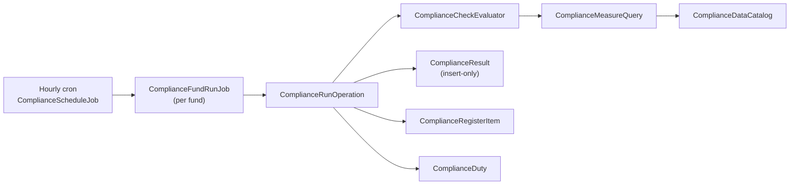

# Fund Compliance Monitoring — Low-Level Design

<!-- STYLE: bullets and diagrams, not prose. One idea per bullet; a diagram per concept (model, lifecycle, flow); table cells a phrase each — longer reasoning goes in bullets under the table. -->

> **Audience:** The developer who reviews the implementation plan before coding starts.
> **Companion documents:** [Design](design.md) · [Business rules](business-rules.md) · [Spec](specs/) · [Tasks](tasks.md) · [Decisions](decisions-and-assumptions.md)

> **Planning phase — no code changes.** Adds to [design.md](design.md); links to its diagrams
> and worked examples rather than repeating them.

> **Reviewable, not descriptive.** Every section states concrete decisions and ends with
> **Reviewer checks**.

---

## Contents

- [Review Summary](#review-summary)
- [File Map](#file-map)
- [Schema Detail](#schema-detail)
- [Definition JSON](#definition-json)
- [Method Contracts](#method-contracts)
- [Controllers, Params and Responses](#controllers-params-and-responses)
- [Queries and Indexes](#queries-and-indexes)
- [Transactions, Locking and Concurrency](#transactions-locking-and-concurrency)
- [Background Jobs](#background-jobs)
- [External Integrations](#external-integrations)
- [Error Mapping and Logging](#error-mapping-and-logging)
- [Security Review](#security-review)
- [Configuration and Rollout](#configuration-and-rollout)
- [Test Plumbing](#test-plumbing)
- [Pattern Conformance](#pattern-conformance)
- [Security Detail](#security-detail)
- [Project Rules Checklist](#project-rules-checklist)
- [Sign-off](#sign-off)

---

## Review Summary

The decisions most likely to be contested:

- **One JSON `definition` per pack version**, validated by `ComplianceDefinitionValidator` against `ComplianceDataCatalog` — no per-check tables. See [Definition JSON](#definition-json).
- **Measures compile to Arel aggregates**, never strings; the catalogue is the only allowlist of record types and fields. See [Queries and Indexes](#queries-and-indexes).
- **One transaction per fund run** with a `REPEATABLE READ` snapshot on MySQL; uniqueness via `open_key` keeps one open register item per check. See [Transactions](#transactions-locking-and-concurrency).
- **Hourly cron tick** picks entities whose local hour is 02 (runs) / 08 (digest). See [Background Jobs](#background-jobs).
- **Maker–checker in one table** (`compliance_requests`) with the approver rule in `ComplianceRequestPolicy#approve?`. See [Security Detail](#security-detail).
- **AI only in jobs** (`ComplianceCheckDraftJob`, `DocumentFactReadJob`) through `LlmService.ruby_llm_chat(entity:)` with `with_schema`. See [External Integrations](#external-integrations).



**Reviewer checks**
- [ ] Each summary bullet's linked section states the decision concretely

---

## File Map

Pack: `app/packs/funds/compliance` (depends on `app/packs/core`, `app/packs/funds`). AI services: `app/packs/ai/compliance`.

| Box | File (under the pack unless absolute) | New / Mod | Responsibility | Phase |
|---|---|---|---|---|
| ① | `models/compliance_pack.rb` | New | Rulebook, locked flag, retire | 1 |
| ① | `models/compliance_pack_version.rb` | New | Definition, applicability, publish | 1 |
| ① | `services/compliance_definition_validator.rb` | New | Validates definition JSON | 1 |
| ① | `controllers/compliance_packs_controller.rb` + views | New | Rule Library + entity packs | 1 |
| ① | `controllers/compliance_pack_versions_controller.rb` + views | New | Edit draft, preview, publish | 1 |
| ① | `db/seeds/compliance/sebi_aif_v1.json` (repo root `db/`) | New | SEBI pack content | 1 |
| ① | `db/seeds/compliance/ifsca_fm_v1.json` | New | IFSCA pack content | 4 |
| ① | `lib/tasks/compliance.rake` | New | `compliance:load_pack[path]` (dry-run + `EXECUTE=1`) | 1 |
| ② | `models/fund_compliance_pack.rb` | New | Attachment + current version | 1 |
| ② | `models/compliance_entity_setup.rb` | New | Mappings, lists, owner, AI settings | 1 |
| ② | `controllers/fund_compliance_packs_controller.rb` | New | Attach / grid / run now / preview | 1 |
| ② | `controllers/compliance_entity_setups_controller.rb` | New | Setup screens | 1 |
| ③④ | `services/compliance_data_catalog.rb` | New | Allowlisted sources + fields | 1 |
| ④ | `services/compliance_measure_query.rb` | New | Measure → Arel aggregate | 1 |
| ④ | `services/compliance_document_check_query.rb` | New | Record-has-document query | 1 |
| ④ | `services/compliance_fact_source.rb` | New | Confirmed facts as a source | 3 |
| ⑤ | `models/compliance_run.rb`, `models/compliance_result.rb` | New | Run + immutable result | 1 |
| ⑤ | `operations/compliance_run_operation.rb` | New | `step :` pipeline per fund | 1 |
| ⑤ | `services/compliance_check_evaluator.rb` | New | One check → outcome + working | 1 |
| ⑤ | `services/compliance_version_mover.rb` | New | Applicability, overrides keep/drop/archive | 1 |
| ⑤ | `jobs/compliance_schedule_job.rb`, `jobs/compliance_fund_run_job.rb` | New | Tick + fan-out | 1 |
| ⑥ | `models/compliance_register_item.rb`, `models/compliance_duty.rb` | New | Episodes, duties | 1 |
| ⑥ | `services/compliance_duty_scheduler.rb` | New | Schedule + event duties | 1 |
| ⑥ | `controllers/compliance_register_items_controller.rb`, `controllers/compliance_duties_controller.rb`, `controllers/compliance_dashboards_controller.rb` | New | Register, duties, dashboard | 1 |
| ⑦ | `models/compliance_request.rb`, `operations/compliance_request_decide.rb` | New | Maker–checker | 1 |
| ⑦ | `controllers/compliance_requests_controller.rb` | New | Request / approve / reject | 1 |
| ⑦ | `models/document_signoff.rb`, `controllers/document_signoffs_controller.rb` | New | Wet-ink sign-off | 1 |
| ⑦ | `policies/*_policy.rb` (12 policies, see Security Detail) | New | Authorization | 1–3 |
| ⑦ | `app/packs/core/users/models/concerns/user_enabled.rb` | Mod | Append `compliance_edit`, `compliance_approve` | 1 |
| ⑦ | `app/views/layouts/modernize/_company_menus.html.erb` | Mod | Compliance menu | 1 |
| ⑧ | `app/packs/ai/compliance/compliance_check_drafter.rb`, `models/compliance_check_draft.rb`, `jobs/compliance_check_draft_job.rb`, `controllers/compliance_check_drafts_controller.rb` | New | Describe in words | 2 |
| ⑧ | `app/packs/ai/compliance/document_fact_reader.rb`, `models/document_reading.rb`, `models/document_fact.rb`, `jobs/document_fact_read_job.rb`, `controllers/document_facts_controller.rb` | New | Document reading + confirm | 3 |
| ⑨ | `notifiers/compliance_*_notifier.rb` (6), `jobs/compliance_digest_job.rb`, `jobs/compliance_register_export_job.rb`, `controllers/compliance_exports_controller.rb` | New | Notices + export | 1 |
| — | `config/initializers/sidekiq.rb` | Mod | Register `ComplianceScheduleJob` hourly | 1 |
| — | `config/routes/compliance.rb` (drawn from `config/routes.rb`) | New + Mod | Routes | 1 |
| — | `app/packs/funds/compliance/package.yml` | New | Packwerk deps | 1 |
| — | `features/compliance/*.feature`, `features/step_definitions/compliance/*.rb`, `features/security/compliance_tenant_isolation.feature` | New | Cucumber | 1–4 |

**Reviewer checks**
- [ ] Every class in design.md › Class diagram has a row here, and nothing here is missing from it
- [ ] Only the four "Mod" files touch existing code (R33)

---

## Schema Detail

- All tables new; `entity_id bigint NOT NULL` (except `compliance_packs.entity_id` nullable for CapHive) with FK + index, `attr_readonly :entity_id`; `created_at/updated_at`.
- Money: compliance figures are stored as `decimal(20,4)` in **major units** of the comparison currency (they are computed ratios/amounts, not ledger money); source `_cents` columns are divided by 100 in the query.

**`compliance_pack_versions`** — immutable once published.

| Column | Type | Null | Default | Index / FK | Why |
|---|---|---|---|---|---|
| `version_no` | integer | no | — | UK (`compliance_pack_id`, `version_no`) | Ordered; correction = next number, label "v2.1" from `corrects_version_id` |
| `effective_from` | date | no | — | — | Compared in the pack's `time_zone` |
| `status` | string(10) | no | "draft" | — | draft / published only (others derived) |
| `applicability` | string(12) | no | "all" | — | all / new_funds / transition |
| `applicability_date` | date | yes | — | — | Defaults to `effective_from` (R19) |
| `transition_ends_on` | date | yes | — | — | Must be > `effective_from` |
| `definition` | json | no | `{}` | — | See [Definition JSON](#definition-json) |
| `tested_at` | datetime | yes | — | — | Cleared on any definition change |

**`compliance_results`** — insert-only; ~6k rows/day.

| Column | Type | Null | Index | Why |
|---|---|---|---|---|
| `outcome` | string(16) | no | — | pass / breach / warning / needs_review / could_not_check |
| `figure`, `limit_value` | decimal(20,4) | yes | — | Displayed values; `nil` when could not check |
| `working` | json | no | — | Arithmetic, failing groups (≤ 500), setup snapshot ids, FX rate |
| `superseded_reason` | string(20) | yes | — | Only column ever updated, once (R14) |
| — | — | — | (`fund_compliance_pack_id`, `check_key`, `id`) | Latest per check uses `id` not `created_at` (monotonic) |

**`compliance_register_items`**

| Column | Type | Null | Index | Why |
|---|---|---|---|---|
| `open_key` | string(1) | yes | UK (`fund_compliance_pack_id`, `check_key`, `open_key`) | "1" while open, NULL when closed → MySQL/SQLite allow many NULLs → one open item per check |
| `status` | string(16) | no | — | open / in_progress / pending_approval / explained / closed |
| `closed_reason` | string(16) | yes | — | cleared / pack_corrected / record_deleted / check_removed / detached / disabled |

**`compliance_duties`** — UK (`fund_compliance_pack_id`, `duty_key`, `period_key`, `subject_type`, `subject_id`) with `subject_type`/`subject_id` stored as `''`/`0` for scheduled duties (NULLs would defeat the UK).

**Migration safety**
- All `create_table`; no existing table altered → no locks on prod tables.
- One migration per phase (Phase 1: 10 tables; Phase 2: 1; Phase 3: 2; Phase 4: none).
- After local migrate: restore `db/schema.rb` / `db/schema_test.rb` from git, hand-insert the new tables, run `db:clean_schema` (memory: local migrate drops tables).

**Reviewer checks**
- [ ] Every FK has an index; every uniqueness rule has a unique index
- [ ] `open_key` and duty UK sentinel values behave the same on SQLite (tests) and MySQL (prod)
- [ ] Migrations reversible; no change to existing tables

---

## Definition JSON

One document per pack version. Shape (keys are the contract between ①, ④, ⑤):

```json
{
  "classifications": ["cat_1", "cat_2", "cat_3", "cat_1_lvf", "cat_2_lvf"],
  "period_basis": "fy_apr",
  "inputs": [{"key": "sponsor", "type": "investor_group"}, {"key": "ic_note", "type": "document"}],
  "reference_lists": [{"key": "ic_members", "dated": true, "quorum": true}],
  "measures": [{"key": "investable_funds", "op": "expr", "expr": ["-", "corpus", "est_expenses"]},
               {"key": "max_investee_cost", "op": "max", "source": "portfolio_investments",
                "field": "cost", "group_by": "investee", "filters": [["transaction", "eq", "buy"]]}],
  "checks": [{"key": "sebi_concentration_cat12", "kind": "limit", "applies_to": ["cat_1","cat_2"],
              "figure": ["/", "max_investee_cost", "investable_funds"], "compare": "lte",
              "limit": {"value": 25, "unit": "pct"}, "tested": "continuous",
              "override": "stricter_only", "time_to_fix_days": 30, "severity": "breach",
              "citation": "AIF Regs 15(1)(c)"}],
  "duties": [{"key": "sebi_quarterly_report", "trigger": {"schedule": "quarterly"},
              "due": {"days_after": "period_end", "n": 15}, "evidence": true}]
}
```

- `op`: `sum | count | count_distinct | max | min | expr`; `expr` operators `+ - * / min max` only.
- `kind`: `limit | record_document | content | manual`.
- Unknown keys, sources, fields, ops → validator error naming the key (X5).

**Reviewer checks**
- [ ] No string in the definition is ever evaluated, sent, or constantized
- [ ] Validator rejects a measure referencing an undefined measure or a cycle

---

## Method Contracts

**`ComplianceDataCatalog`** (Registry, frozen hash)

| Method | Args | Returns | Raises | Idempotent |
|---|---|---|---|---|
| `.source(name)` | String | `Source(model:, scope:, date_column:, fields:)` | `UnknownSource` | Yes |
| `.field?(source, field)` | String, String | Boolean | — | Yes |

**`ComplianceMeasureQuery`** (Service)

| Method | Args | Returns | Raises | Side effects |
|---|---|---|---|---|
| `.call(measure, fund:, as_of:, setup:)` | Hash, Fund, Date, ComplianceEntitySetup | `Figure(value, groups, missing, working)` | — (missing inputs → `missing`) | None (read-only) |

**`ComplianceCheckEvaluator`** (Service)

| Method | Args | Returns | Raises | Side effects |
|---|---|---|---|---|
| `.call(check, fund_pack:, as_of:, overrides:)` | Hash, FundCompliancePack, Date, Array | `Outcome(outcome, figure, limit, working)` | none — rescues and returns `could_not_check` | None |

**`ComplianceRunOperation`** (Trailblazer) — steps: `load_fund` → `advance_versions` → `snapshot` → `evaluate_checks` → `insert_results` → `update_register` → `schedule_duties` → `finish`; `left :mark_failed`.

| Input | Output | Idempotent |
|---|---|---|
| `fund:, run_date:, trigger:` | `ctx[:run]` | Yes — nightly run is unique per `(fund_id, run_date, "nightly")` |

**`ComplianceVersionMover`** — `.call(fund_pack, run_date)` → moved?/grandfathered/could_not_check; drops/archives overrides; closes `check_removed` items. Idempotent (no-op if already current).

**`ComplianceRequestDecide`** (Trailblazer) — `.call(request:, decider:, decision:)`; enforces approver ≠ requester unless single eligible user (sets `self_approved`); applies payload in the same transaction.

**`ComplianceCheckDrafter`** (Phase 2) — `.call(sentence:, pack_version:, user:)` → `ComplianceCheckDraft` (`ready` / `failed`); never saves to the definition.

**`DocumentFactReader`** (Phase 3) — `.call(document:, input_key:)` → `DocumentReading` with facts `ai_read`/`not_found`; respects cap/opt-in.

**Reviewer checks**
- [ ] Every raised error is listed in Error Mapping
- [ ] Every job-called method is idempotent on retry

---

## Controllers, Params and Responses

All under `/compliance` (Turbo; HTML + turbo_stream). Super-admin Rule Library uses the same controllers; the policy branches on `user.has_cached_role?(:super)`.

| Action | Permitted params | Policy | Success | Failure |
|---|---|---|---|---|
| `CompliancePacksController#index/show` | — | `index?/show?` | HTML | 403 |
| `#create` (entity pack) | `compliance_pack: [:name]` | `create?` | redirect to draft | 422 |
| `#retire` (CapHive) | — | `retire?` (super only) | turbo_stream | 403 |
| `CompliancePackVersionsController#update` | `definition` (JSON string, size ≤ 256 KB) | `update?` (draft + not locked for customer) | turbo_stream; clears `tested_at` | 422 with validator errors |
| `#preview` | `fund_id` or `entity_id` (demo/consenting) | `preview?` | turbo_stream results (not stored) | 403/422 |
| `#publish` | `effective_from, applicability, applicability_date, transition_ends_on, allows_early_adoption, counsel_reviewer, counsel_reviewed_on` | `publish?` | redirect | 422 ("Run a test first", "Record the counsel review") |
| `FundCompliancePacksController#index` | — | `index?` | grid | — |
| `#create` (attach) | `fund_id, compliance_pack_id, classification` | `create?` | turbo_stream | 422 |
| `#run_now` | — | `run_now?` | turbo_stream "Running…" | 429 (rack-attack) |
| `ComplianceEntitySetupsController#update` | `input_mappings, reference_lists, owner_id, ai_settings, monitoring_enabled` | `update?` | turbo_stream | 422 |
| `ComplianceRequestsController#create` | `kind, target_type (allowlist), target_id, check_key, payload, reason` | `create?` | turbo_stream | 422 |
| `#approve` / `#reject` | `note` | `approve?` / `reject?` | turbo_stream | 403 ("You cannot approve your own request") |
| `ComplianceRegisterItemsController#index/show/assign` | `assignee_id` | `index?/show?/assign?` | HTML / turbo_stream | 403/422 |
| `ComplianceDutiesController#complete` | `note, evidence (file)` | `complete?` | turbo_stream | 422 ("Upload the evidence") |
| `DocumentSignoffsController#create` | `document_id, signed_on` | `create?` | turbo_stream | 422 (future date) |
| `ComplianceExportsController#create` | `from, to, fund_ids[], pack_ids[], format` | `create?` | "Export started" | 422 |
| `ComplianceCheckDraftsController#create/update/test/save` (P2) | `sentence` / draft fields / `fund_id` | `create?…` | turbo_stream | 422 / "Describe in words is unavailable" |
| `DocumentFactsController#index/update/confirm` (P3) | `value` | `update?/confirm?` | turbo_stream | 403/422 |

**Reviewer checks**
- [ ] No action without `authorize` / `policy_scope`; no `verify_authorized` exclusions
- [ ] No param can set `entity_id`, `status`, `requested_by_id`, `decided_by_id`, `self_approved`, `locked`, `compliance_pack_version_id`

---

## Queries and Indexes

| Where | Query shape | Index | Rows | Batching |
|---|---|---|---|---|
| `ComplianceMeasureQuery` (sum/count) | `Model.where(entity_id:, fund_id:).where(date_col <= as_of).merge(filters).sum(arel)` | existing `fund_id` indexes | 1 row | — |
| grouped (`max` per investee) | `...group(group_col).maximum(arel)` then max in SQL via subquery | existing | ≤ investees | — |
| `count_distinct` | `...unscope(:order).distinct.count(col)` | existing | 1 | — |
| `ComplianceDocumentCheckQuery` | investments `LEFT JOIN documents ON owner + tag LEFT JOIN document_signoffs LEFT JOIN e_signatures` | `documents(owner_type, owner_id)`, `document_signoffs(document_id)` | ≤ 10k → failing list capped 500 | one query |
| Dashboard latest results | `ComplianceResult.where(fund_compliance_pack_id: ids).where(id: subquery max(id) group by check_key)` | (`fund_compliance_pack_id`, `check_key`, `id`) | ≤ 50 | — |
| Register index | `policy_scope(ComplianceRegisterItem).ransack(allowlisted)` | (`entity_id`, `status`) | paged 25 | `includes(:fund, :assignee)` |
| Monthly cap | `DocumentReading.where(entity_id:, created_at: month).count` | (`entity_id`, `created_at`) | 1 | — |

- `account_entries` is not a catalogue source.
- Every `distinct` preceded by `unscope(:order)` (MySQL).

**Reviewer checks**
- [ ] Every query scoped by `entity_id` and fund
- [ ] No N+1 on dashboard/register; no unbounded loads

---

## Transactions, Locking and Concurrency

| Operation | Transaction | Lock | Race prevented | Idempotency key |
|---|---|---|---|---|
| Fund run | one per fund: results + register + duties | `fund_compliance_packs` rows `lock!` in id order | Two runs updating one item | UK `(fund_id, run_date, trigger)` for nightly |
| Snapshot read | `ActiveRecord::Base.transaction(isolation: :repeatable_read)` on MySQL; SQLite single-writer | — | Import mid-run mixing states (R21, E134) | — |
| Run now | — | `compliance_runs` row status `running` checked; second request waits | Double click (E18) | in-flight run |
| Request decide | one | `request.lock!` | Double approve | status pending → decided once |
| Register item open | in run transaction | UK `open_key` | Duplicate open items | `open_key` |
| Duty create | in run transaction | UK | Duplicate duties | duty UK |
| Document reading | — | UK `(document_id, input_key, file_checksum, facts_signature)` | Double read | UK |

**Reviewer checks**
- [ ] No HTTP / AI / email inside a transaction (notifiers enqueue after commit)
- [ ] Lock order: fund packs by id, then items

---

## Background Jobs

| Job | Queue | Trigger | Retry | Discard on | Guard | Timeout |
|---|---|---|---|---|---|---|
| `ComplianceScheduleJob` | `low` | sidekiq-cron `5 * * * *` | 0 | — | picks entities where local hour = 2 (runs) / 8 (digest) and `monitoring_enabled` | 60s |
| `ComplianceFundRunJob` | `low` | per fund | 3 (polynomial) then mark failed | `RecordNotFound` | nightly UK | 10 min |
| `ComplianceDigestJob` | `low` | tick at 08 local | 3 | — | one per recipient per day (`digest_date`) | 2 min |
| `ComplianceRegisterExportJob` | `low` | user | 2 | — | re-checks requester access | 10 min |
| `ComplianceCheckDraftJob` (P2) | `default` | user | 1 | — | draft status `drafting` | 60s |
| `DocumentFactReadJob` (P3) | `low` | document upload/replace, version fact change | 2 | `RecordNotFound` | reading UK; cap + opt-in | 3 min |

- Cron registered in `config/initializers/sidekiq.rb` next to `WorkflowEvaluateJob` (non-local envs only, like the others).

**Reviewer checks**
- [ ] A job run twice or out of order is harmless
- [ ] Cron entry registered where crons actually run

---

## External Integrations

| Call | Path | Auth | Timeout | Errors |
|---|---|---|---|---|
| Draft a check (P2) | `LlmService.ruby_llm_chat(entity:).with_schema(DraftSchema).ask(...)` | entity / CapHive key (existing) | 45s | provider error/timeout → draft `failed` → "Drafting failed — try again or use the form" (X42) |
| Read a document (P3) | same, with document text from `FolderDocumentExtractor` helpers | same | 90s | → reading `failed`; manual entry offered |

- Prompts carry: sentence or document text **as quoted data**, the allowed field list, the entity's own input names; never investor records (drafting).
- Responses parsed by schema; then `ComplianceDefinitionValidator` / fact type validation.

**Reviewer checks**
- [ ] Secrets never logged; prompts/responses not logged (ids + model only)
- [ ] No AI call from `ComplianceRunOperation`

---

## Error Mapping and Logging

| Exception | Raised in | Handled by | User sees | Logged / alerted |
|---|---|---|---|---|
| `ComplianceDataCatalog::UnknownSource/Field` | validator | validator | field error naming key | — |
| `ComplianceMeasureQuery::MissingInput` | measure | evaluator | "Could not check — missing: <input>" | info (ids) |
| any `StandardError` in one check | evaluator | evaluator | `could_not_check` + error key | warn with run/check ids |
| any error in run | operation | `left :mark_failed` | amber banner | `ComplianceRunFailedNotifier` → Compliance tag + support |
| `Pundit::NotAuthorizedError` | controllers | app default | 403 page | — |
| `ActiveRecord::RecordNotUnique` (open_key, duty UK) | run | operation (re-read and update) | — | debug |
| LLM error/timeout | P2/P3 jobs | job | messages above | warn with ids |

**Reviewer checks**
- [ ] No bare `rescue => e` without logging ids and setting an outcome
- [ ] Logs carry entity/fund/run ids only (no names, amounts, quotes)

---

## Security Review

| Concern | Decision |
|---|---|
| Authorization | 12 policies, `policy_scope` then `authorize` on every action |
| Tenant isolation | Scopes by `user.entity_id` and fund access; CapHive packs readable, never customer-writable |
| Secrets | None new; AI keys stay in `EntitySetting` / credentials |
| Input / output | Definition JSON size-capped and validated; quotes and notes rendered escaped |
| Mass assignment | Per-action permits (above) |

**Reviewer checks**
- [ ] Another entity's user cannot reach any compliance record through any route, job or MCP tool (no MCP tools added)

---

## Configuration and Rollout

| Item | Value / location |
|---|---|
| Feature gate | `enable_compliance` (entity + user) — existing (R34) |
| Roles | `compliance_edit`, `compliance_approve` in `UserEnabled.extended_permissions` (appended) |
| Per entity | `compliance_entity_setups.monitoring_enabled` |
| Cron | `ComplianceScheduleJob` hourly, `config/initializers/sidekiq.rb` |
| Pack content | `rake compliance:load_pack[db/seeds/compliance/sebi_aif_v1.json]` (dry-run; `EXECUTE=1`) per environment (IN and US independent) |
| Deploy order | migrations → code → load packs → cron live |
| Rollback | turn off `monitoring_enabled`; drop cron; tables can stay (no dependants) |

**Reviewer checks**
- [ ] Safe to deploy with the feature unused; safe to roll back

---

## Test Plumbing

| Feature file | Stubs / fixtures | New steps |
|---|---|---|
| `features/compliance/rule_library.feature` | SEBI v1 JSON fixture; demo entity | "Given the SEBI AIF pack v1 is published", "When Priya previews …" |
| `features/compliance/fund_pack_setup.feature` | Horizon shared setup | "Given Growth Fund I carries SEBI as Category II" |
| `features/compliance/compliance_runs.feature` | `travel_to` run dates; run job inline | "When the nightly compliance run happens on <date>" |
| `features/compliance/compliance_register.feature`, `manual_duties.feature`, `notifications_digest.feature` | ActionMailer deliveries; Noticed | "Then Meera's digest says …" |
| `features/compliance/sebi_aif_pack.feature` | figures from business-rules shared setup | reused |
| `features/compliance/pack_versions.feature`, `changes_over_time.feature` | v2 / v2.1 fixtures | "Given SEBI v2 applies to new funds only from …" |
| `features/compliance/ai_check_drafting.feature` (P2) | `LlmService` stub returning fixed schema output / raising | "Given the AI drafts …" |
| `features/compliance/document_content_checks.feature` (P3) | `DocumentFactReader` stub facts | "Given the AI read these facts …" |
| `features/security/compliance_tenant_isolation.feature` | two entities | reuses `tenant_isolation_batch1` steps |

- Shared setup in `features/step_definitions/compliance/compliance_setup_steps.rb` builds Horizon Capital per business-rules › Shared setup.
- Every scenario has `# <ID> — <Happy path|Edge case|Error case>: …` above it; feature header links business-rules.md.

---

## Pattern Conformance

| Class | Pattern | Pack | Public interface | Modelled on |
|---|---|---|---|---|
| `CompliancePack`, `CompliancePackVersion` | Model | funds/compliance | `publish!`, `applies_to?`, `in_transition?` | `ValidationRule` |
| `FundCompliancePack`, `ComplianceEntitySetup` | Model | funds/compliance | `move_to!`, `mapping`, `reference_list(key, on:)` | `ValidationRuleOverride` |
| `ComplianceRequest` | Model | funds/compliance | status scopes | `SideLetterObligation` review |
| `ComplianceRequestDecide` | Operation | funds/compliance | `.call` | `ObligationApprove` |
| `ComplianceRunOperation` | Operation | funds/compliance | `.call(fund:, run_date:, trigger:)` | `SupportAgentService` steps |
| `ComplianceDataCatalog` | Registry | funds/compliance | `.source`, `.field?` | `ValidationRuleEvaluator::CONTEXT_PROVIDERS` |
| `ComplianceMeasureQuery`, `ComplianceCheckEvaluator`, `ComplianceVersionMover`, `ComplianceDutyScheduler`, `ComplianceDocumentCheckQuery` | Service `.call` | funds/compliance | `.call` | `FxRateResolver` |
| `Compliance*Job` | Sidekiq job | funds/compliance | `perform(ids)` | `WorkflowEvaluateJob` |
| `Compliance*Notifier` | Noticed notifier | funds/compliance | `deliver` | `WeeklyTaskDigestNotifier` |
| `Compliance*Policy` | Pundit policy | funds/compliance | predicates + Scope | `SideLetterObligationPolicy` |
| `ComplianceCheckDrafter`, `DocumentFactReader` | AI service | ai/compliance | `.call` | `FundFormulaGenerator`, `KycDocExtractorAgent` |

**Reviewer checks**
- [ ] No controller computes figures or decides outcomes
- [ ] No model calls AI

---

## Security Detail

| Action / job / call | Policy method | Loaded through | Permitted params | Tenant checks | Security scenario |
|---|---|---|---|---|---|
| Pack index/show | `CompliancePackPolicy#show?` | `policy_scope(CompliancePack)` = CapHive published + own entity | — | entity_id null or own | X12 |
| Version update/publish (customer) | `CompliancePackVersionPolicy#update?/publish?` | scope | `definition` / publish fields | own entity pack, not locked | X13, X55 |
| Version update/publish (CapHive) | same, super branch | scope | same | super only | X13 |
| Preview | `#preview?` | fund via `policy_scope(Fund)`; entity demo or consenting | `fund_id` | same-firm fund | X11, X61 |
| Attach / run now | `FundCompliancePackPolicy#create?/run_now?` → `FundPolicy#show?` + editor | `policy_scope(Fund)` | fund, pack, classification | fund in entity; pack visible | X20, X23 |
| Setup update | `ComplianceEntitySetupPolicy#update?` | `current_user.entity` setup | setup fields | owner_id same-firm | X19 |
| Request create | `ComplianceRequestPolicy#create?` | target via scope (allowlisted types) | request fields | target same-firm | X21, X23 |
| Approve / reject | `#approve?` (approver/admin, ≠ requester unless single eligible) | `policy_scope(ComplianceRequest)` | note | same-firm | X18, X64 |
| Register index/show/assign | `ComplianceRegisterItemPolicy` | scope by entity + fund access | assignee_id | assignee same-firm | X20, X21 |
| Duty complete | `ComplianceDutyPolicy#complete?` | scope | note, evidence | same-firm | X33 |
| Signoff create | `DocumentSignoffPolicy#create?` → `DocumentPolicy#show?` + editor | `policy_scope(Document)` | document_id, signed_on | document same-firm | X27 |
| Export | `ComplianceExportPolicy#create?` | scope | filters | job re-checks fund access | X36 |
| Draft (P2) | `ComplianceCheckDraftPolicy` | scope | sentence, fields | own drafts | X43 |
| Facts (P3) | `DocumentFactPolicy` → `DocumentPolicy#show?` + editor | scope | value | same-firm | X48 |
| Investor / advisor any route | all policies | `scope.none` | — | — | X22, X35 |
| `ComplianceFundRunJob` | — | `Fund.find` then `entity.monitoring_enabled` | — | reloads | E18 |
| `DocumentFactReadJob` | — | reload document via entity | — | opt-in + cap | E74, E75 |

---

## Project Rules Checklist

| Rule | Applies? | How it is met |
|---|---|---|
| No `blank?`/`present?` on relations | Applies | `exists?`/`none?` everywhere; cop runs |
| Dedup in SQL, batch bulk ops | Applies | `unscope(:order).distinct`; duties created by `insert_all` in batches of 500 |
| `account_entries` column hygiene | N/A | Not a catalogue source |
| Screen dates via `l(...)`; emails via `EmailDateLocalization` | Applies | Digest and notifiers use bare `l(date)` in mailer views |
| Date inputs via `f.date_field` | Applies | signed_on, effective_from, transition dates, export period |
| Entity-scoped queries; Pundit everywhere | Applies | Security Detail |
| MCP ontology | N/A | No MCP tools added |
| Cucumber only; distinct TEST_ENV_NUMBER | Applies | Block 41201–41204, plain cucumber (no pcuc) |
| Rubocop incl. `IRM/RelationBlankPresent` | Applies | Per-phase task |

---

## Sign-off

| Reviewer | Date | Decision | Notes |
|---|---|---|---|
| Claude (on the user's instruction, R39) | 2026-11-05 | Approved to implement | User asked to proceed without further input |
