# Fund Compliance Monitoring — Proposal

> **Audience:** Business team, product, QA, support — non-technical.
> **Companion document:** [Design](design.md)
> **New to this? Start with the [Workflow Journey](#workflow-journey)** — every action, in order, from start to the outcome.

> **Planning phase — no code changes.** This document proposes and explains the change. Do not
> edit application code while writing it; implementation happens later, in the tasks phase.

---

## Why

**The job today**
- A compliance officer must keep confirming that each fund meets every rulebook it is bound by:
  - its regulator's — SEBI (domestic AIF), IFSCA (GIFT City fund), SEC (US fund);
  - its own fund agreement's limits;
  - recurring duties — quarterly SEBI report, annual compliance test report, investor due diligence.
- They do it in spreadsheets, outside CapHive.
- Yet CapHive already holds every figure needed: commitments, contributions, portfolio investments, investors, KYC.

**Why a check on save is not enough**
- Some limits break with **no one doing anything**:

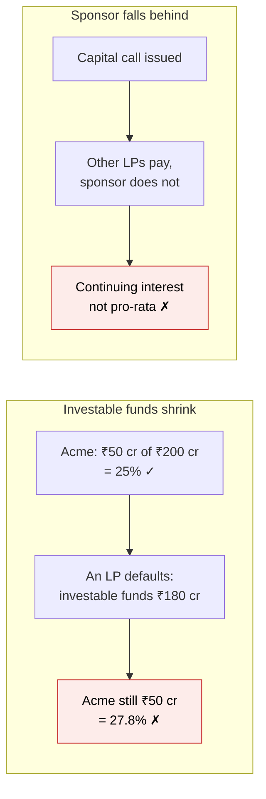

- No record of Acme was saved in the first case, so nothing would have checked it.
- Whether such a passive change counts as a breach depends on whether the rule is tested **continuously** or only **when a record is made** — each check carries that setting, and counsel decides it per rule (see [Questions for counsel](#questions-for-counsel)).
- SEBI has settled proceedings with managers over the second case.

**Why now, and why as data**
- Most funds on CapHive carry a SEBI category: 153 Category I, 42 Category II, 1 Category III (127 have none) → SEBI first.
- One manager often runs a SEBI AIF **and** a GIFT City fund → rulebooks must attach **per fund, several per fund**.
- New regimes (IFSCA, SEC, MAS) and fund-agreement limits must arrive **without a code release** → rulebooks are data.

## What Changes

### Key concepts

**The idea: rulebooks plus a logbook**

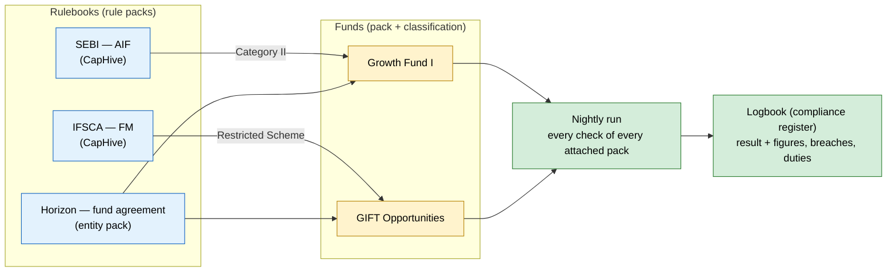


**The words used in this proposal**

| Concept | What it means for you | Example |
|---|---|---|
| Pack (rulebook) | A set of rules from one source, attached to funds | "SEBI — AIF" from CapHive; "Horizon — fund agreement", your own |
| Locked pack | A CapHive regulator pack: you use it, you cannot edit it; per fund you may only make a limit stricter | SEBI's 25% → 20% for one fund: allowed. 30%: refused |
| Version | A dated edition of a pack; the old one stays readable | SEBI v1 today, v1.1 from 01 Jan 2027 |
| Classification | Which part of a pack applies to a fund | "Category II" → 25% concentration limit |
| Input | Something the pack needs to know that CapHive can't guess; you map it once | "Sponsor/manager" = investors in category "Sponsor" |
| Check | One rule CapHive tests from your data every night | Largest company ≤ 25% of investable funds |
| Result | What a check found on one night, with the arithmetic | ₹72.00 cr ÷ ₹270.00 cr = 26.67% > 25% — Breach |
| Register item | One breach from the night it starts to the night it clears — not one per night | "Concentration — open since 5 Nov, fix by 5 Dec" |
| Maker–checker | A change that weakens monitoring needs two people: one asks, another approves | Meera asks to explain a breach; Rahul approves |
| Duty | Something a person must do and prove, that data can't show | "Quarterly SEBI report filed" for Oct–Dec, due 15 Jan |
| Sign-off | Recording that a paper document was signed, and when | IC note signed in wet ink on 28 Sep |
| Fact | A value the AI read from a document, which counts only after a person confirms it | "Approved amount ₹15.00 cr (page 2)" |
| Preview | Trying a draft or future version on a real fund; nothing is saved | SEBI v2 tried on Growth Fund I in December |

**Register items, in brief**
- One item per breach **episode**: it opens on the first failing night and stays one item while the check keeps failing.
- It closes by itself when a run passes ("Cleared by data"). Nobody closes a breach by hand.
- An approver can accept it with a reason ("Explained"). If the figure later gets worse, it reopens.

**Maker–checker, in brief**
- **Needs two people:** override a limit, disable a check, detach a pack, explain a breach, adopt a version early, change a fund's classification.
- **One person is enough** (each action is still recorded): attach a pack, map inputs, assign an item, mark a document signed, confirm a fact, mark a duty done. These add monitoring or record facts, so none of them weakens it.
- **Self-approval:** you cannot approve your own request, unless you are the firm's only approver. Then it is labelled "Self-approved — single approver".

**Duties, in brief**
- **What they cover:** things data can't prove, such as a filed report, a completed audit, or due diligence on a new investor.
- **What creates them:**
  - a schedule (each quarter or year);
  - an event (each new investor);
  - a new document (a new PPM to review);
  - a check that asks for one.
- **When they turn red:** a duty is reminded 7 days before it is due and is overdue after the due date. "Done" can require an evidence file.

The full explanations, with diagrams, are in [design.md › Key concepts](design.md#key-concepts).

### In detail

**Rulebooks (rule packs)**
- CapHive publishes one pack per regime — first "SEBI — Alternative Investment Funds", next "IFSCA — Fund Management".
- A pack is a list of **checks**. Each check has:
  - a source citation;
  - the fund classifications it applies to;
  - either an **automatic** test (a limit on a figure CapHive computes) or a **manual duty** (a person confirms, with evidence, on a schedule).
- Each pack declares **its own classifications**:
  - SEBI: Category I / II / III, and Category I / II — Large Value Fund
  - IFSCA: Venture Capital Scheme / Restricted Scheme / Retail Scheme
  - SEC: 3(c)(1) / 3(c)(7)

**Locked packs and versions**

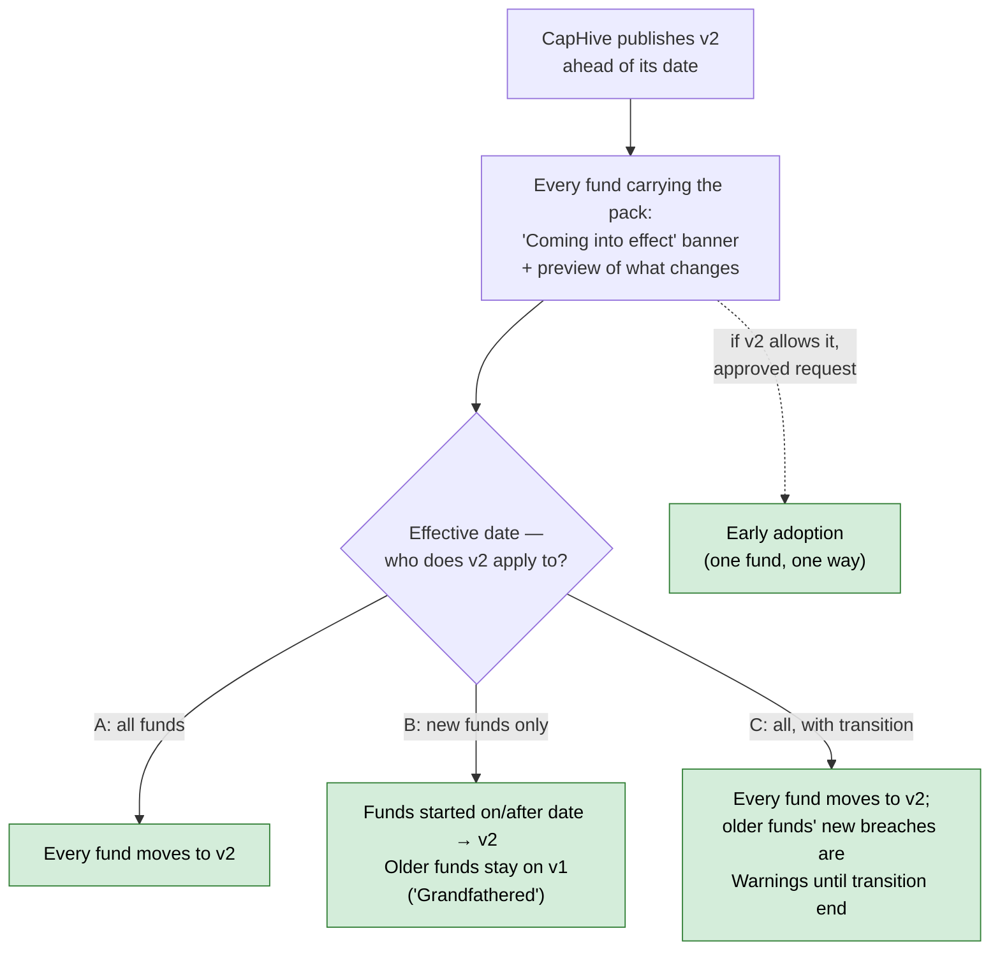

- **Locked:** CapHive regulator packs (SEBI, IFSCA) cannot be edited by customers — they attach them, map inputs and enter reference lists only.
- **Tighten, never loosen:** each check in a locked pack is "stricter only" or "not overridable"; a fund can lower 25% to 20%, never raise it to 30%. Looser limits come only from a classification (e.g. Category II — LVF).
- **Every publish is a new version**; each result records the version used for that fund.
- **Each version says who it applies to:** A all funds; B new funds only (by fund start date — older funds stay on the old version, labelled "Grandfathered — v1"); C all funds with a transition period (older funds' new breaches show as Warning until the transition end date).
- **Switching is automatic, by that rule, on the effective date** — no one has to remember; no manual pinning to an old version; no switching back.
- **Early adoption** only where the version allows it, per fund, requested by an editor and approved by a different approver.
- **Published ahead:** a banner and a read-only preview per fund show what will change; previews never touch the register. Owners are told on publish and 7 days before.
- **Overrides across versions:** kept while still at least as strict as the new limit; dropped (and flagged) when the new limit is stricter; archived when the check is removed.
- **Entity packs** (fund agreements) are unlocked: edited by the entity, new versions apply from publish or a date the entity sets.

**Packs attach to funds, many per fund**
- Growth Fund I → SEBI (as Category II) + Horizon's fund-agreement pack.
- GIFT Opportunities Fund → IFSCA (as Restricted Scheme) + the same fund-agreement pack.
- Each pack is checked and reported on its own.

**How a check is built — from figures, not code**

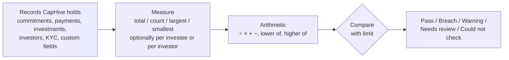

- Example: "largest investment per investee" ÷ "investable funds" ≤ 25%.
- Example: "lower of 2.5% of corpus and ₹5 crore" — arithmetic over a measure and two limits.
- This is what makes a new regime a matter of data, not code.

**Three shapes of automatic check**

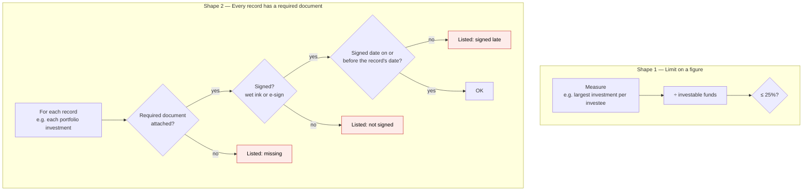

- **Shape 1 — limit on a figure:** concentration, continuing interest, minimum investment, investor count.
- **Shape 2 — every record has a required document:** e.g. "every portfolio investment has an IC note, signed by the investment committee, dated on or before the investment".
  - The pack names the document as an **input** ("IC note"); each entity maps it once to how it files them (document name, tag or folder).
  - "Signed" can happen two ways — both count equally:
    - **Wet ink** (common for IC approvals): the scanned signed copy is uploaded and a user marks it **"Signed (wet ink)"**, entering the **date it was signed**; who marked it, and when, is recorded.
    - **E-sign in CapHive**: signed when the e-signature completes; its completion date is the signed date.
  - "Dated on or before the investment" uses the **signed date**, never the upload date — a scan uploaded a week later still passes.
  - A **"checks from" date** limits it to records created on or after that date, so historic investments made before CapHive held IC notes do not flood the register.
  - The breach lists every failing record and why (missing / not signed / signed late), each with a link to upload or send for e-sign.
- The same shape covers other "document must exist" duties: signed contribution agreement per commitment, KYC documents per investor, valuation report per valuation, drawdown notice per capital call.

**Shape 3 — check on what a document says (AI reads, rules decide)**

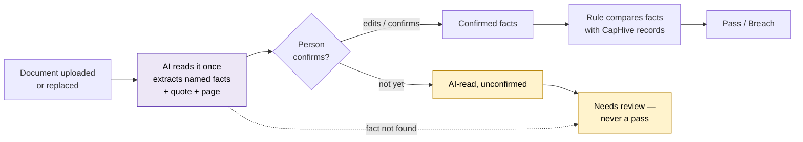

- The pack declares, per document input, the **facts** to read — e.g. IC note: company, instrument, amount approved, approval date, signatories, conflicts declared.
- AI reads each document **once per version** (on upload or replacement), never in the nightly run.
- Each fact keeps the **quote and page** it came from.
- A fact counts toward a **pass only once a person confirms it**; until then the result is "AI-read, unconfirmed" (shown as Needs review).
- A fact the AI cannot find → Needs review, never a pass.
- The comparison itself is plain arithmetic, the same every night.

Four kinds of content check:

| Kind | Example | Result type |
|---|---|---|
| 1. Document agrees with CapHive's records | IC note amount approved ≥ amount invested; contribution agreement amount = commitment; valuation report value = recorded valuation | Pass / Breach |
| 2. It is the right document | File labelled "IC note" is an IC note for *this* company | Pass / Needs review |
| 3. Facts only in documents, tested against a restriction | Investee's business vs excluded sectors; directors vs sponsor's associates; beneficial owners' countries vs land-border list | Pass / Breach / Needs review |
| 4. AI prepares, person decides | PPM changes since last version; disclosures in LP reports; conflicts discussion in IC minutes | Manual duty with AI notes attached |

**Entity packs — the fund's own rules**
- A manager's own limits (fund agreement, internal policy) are a private pack.
- Built the same way, attached to funds like any other pack.

**Describe it in words (AI drafting)**

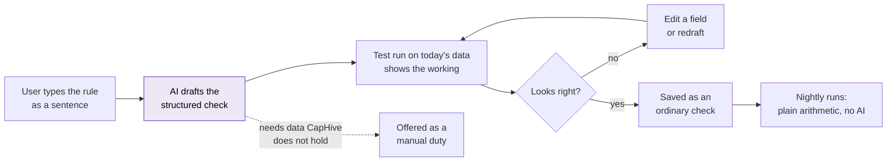

- AI only **writes** the check; it never runs one.
- Same data → same result, every night.

**The logbook (compliance register)**
- Every run stores each check's result **and the figures behind it**.
- A failed check opens a register item:

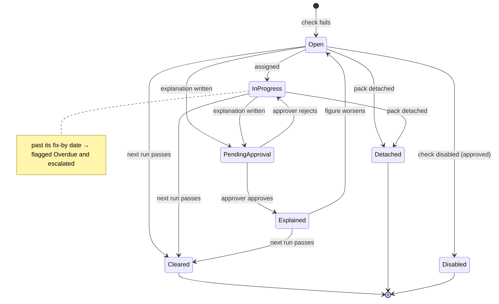

- Each breach has a **fix-by date** = first seen + the check's "time to fix" (set in the pack, e.g. 30 days); past it, the item is flagged Overdue and escalated.

Manual duties live in the same register:

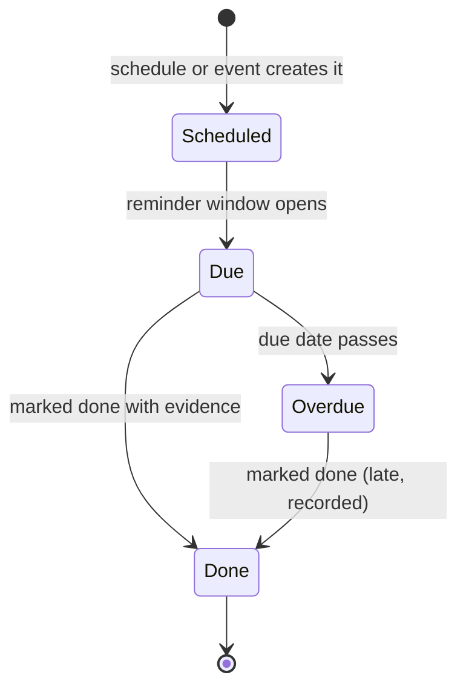

- Duties are created by a **schedule** (quarterly, yearly…), **on demand**, or an **event** — e.g. "for each new investor" (due diligence) or "when a new PPM version is uploaded" (PPM change review).

**When things change over time**

- **History is never rewritten** — setup changes (mappings, reference lists, classifications) apply from the day they are made; past results stay as computed, and exports say "computed on data as entered at run time".
- **Reference lists are dated** — an IC member's from/to dates mean a note signed in September is checked against September's committee, not today's.
- **Classification changes need approval** — they can loosen limits (Category II → Category II — LVF).
- **Imports don't flood** — event duties and record checks have a "from" date; bulk changes appear as one digest line.
- **Nothing is guessed** — a missing fund start date (needed for grandfathering) shows "Could not check".
- **CapHive mistakes are correctable** — a correction version supersedes a faulty one; items it caused close as "Pack corrected".
- **People leave** — their items and approvals return to the compliance owner; duties without an owner go to the owner by default.

**Concrete changes**
- New **Compliance** menu for fund-manager users: per-fund dashboard (grouped by pack), register, setup.
- New **Rule Library** screen for CapHive super admins: author, test, publish packs.
- Per fund: **attach packs** and pick the fund's classification **in each pack**.
  - The entity's regulator setting only *suggests* packs; any published pack can be attached.
- Per entity, once:
  - **map each pack's inputs** to own data (e.g. "which investor category is your Sponsor?");
  - **override a limit** with a reason (e.g. Large Value Fund: 25% → 50%);
  - build **entity packs** — by form or in words.
- CapHive content admins can also draft pack checks from a regulation's wording.
- Checks run **every night** and on **Run now**.
- **Daily digest email** only when something changed.
- A check that cannot be computed → **"Could not check"**, never a pass.
- **Roles** — Compliance viewer, editor and approver; overrides, disabling and detaching need an approver (see [Roles and access](#roles-and-access)).
- **Setup history** — every setup change is kept; any result shows the rules and limits that applied that day.
- **Run health** — "last successful run" on every screen; a failed or stale run alerts the owners.
- **Register export** — Excel / PDF for any period, for the compliance test report, auditors and trustee.
- **AI document reading is opt-in per entity**, with a monthly document cap.
- Delivered in **four phases** (see [Delivery phases](#delivery-phases)).
- Nothing existing changes — AI Rules, Validation Rules, SEBI reports, side-letter obligations. No **BREAKING** changes.

### Flow Diagram

Monitoring a limit — today the officer rebuilds the figures by hand, per rulebook; after, CapHive computes and logs them per attached pack.

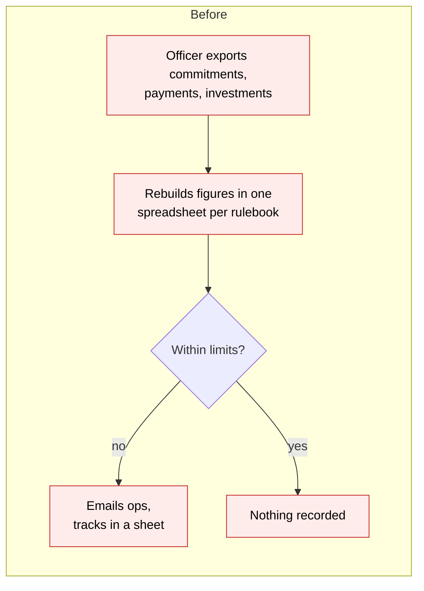

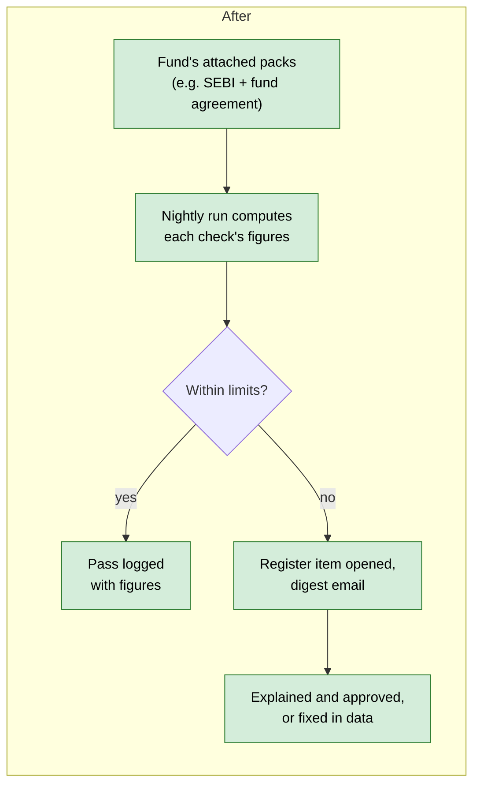

Recurring duties — today a calendar reminder at best; after, a dated register item with evidence.

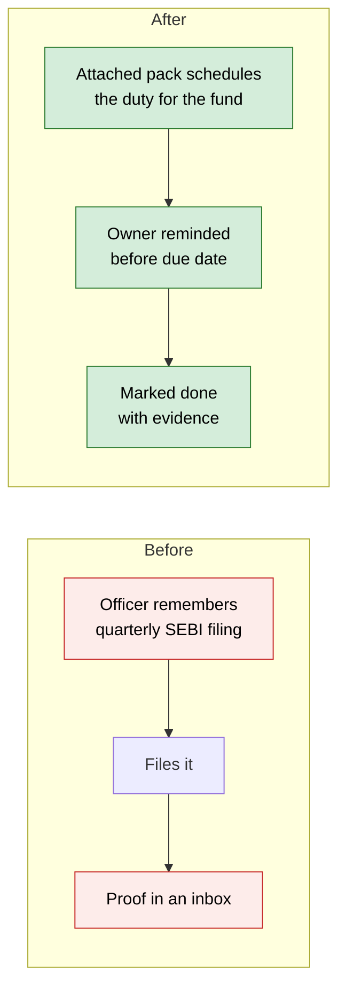

---

## Workflow Journey

One worked journey: the SEBI and IFSCA packs are published, Horizon Capital attaches them to its
two funds, and the nightly run catches two breaches on **Horizon Growth Fund I** (SEBI Category II).

### Who is involved

| Person | Role | What they do in the journey |
|---|---|---|
| Priya | CapHive regulatory content admin (super admin) | Authors, tests and publishes the SEBI and IFSCA packs |
| Meera | Compliance Officer, Horizon Capital (company admin or Compliance access) | Attaches packs to funds, maps inputs, builds the fund-agreement pack, owns the register |
| Arjun | Fund operations lead, Horizon Capital | Fixes data and carries out remediation |
| Rahul | Principal Officer, Horizon Capital | Approves explanations for breaches that are accepted rather than fixed |

### The journey on one page

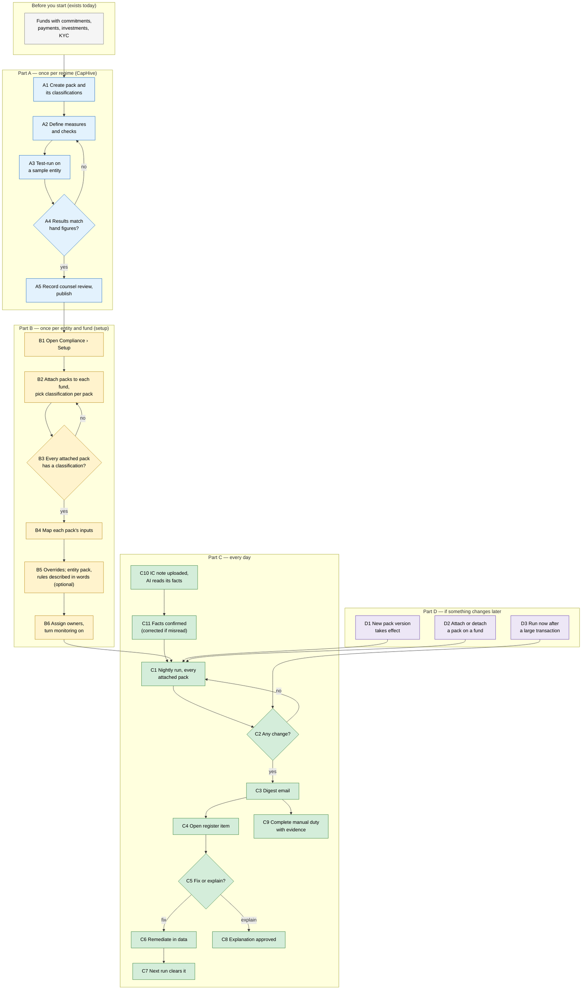

### Before you start

| Needed | Why | Where it comes from |
|---|---|---|
| Commitments, capital call payments, portfolio investments | Inputs to concentration, continuing interest, investor limits | Existing fund screens and imports |
| Investor categories that identify sponsor/manager and employees | Continuing interest and the ₹25 lakh employee minimum | Existing investor categories (free text per entity, hence the mapping step) |
| Fund's estimated expenses (if investable funds are not otherwise derivable) | Investable funds = corpus less estimated expenses (definition to be confirmed by counsel) | Entered once per fund in setup |
| Fund's Category field (optional) | Pre-fills the fund's classification when the SEBI pack is attached | Fund › Edit › Category (127 funds blank today) |
| Entity's regulator setting (optional) | Only suggests which packs to attach | Entity settings |
| Reference lists: IC members + quorum, sponsor's associates, excluded sectors | Content checks compare document facts with them | Entered once in Setup › Reference lists (land-border countries come with the SEBI pack) |
| Entity opt-in to AI document reading (only for content checks) | Documents are sent to the entity's AI provider | Setup › AI document reading |
| Compliance roles given to users | Who can edit, approve, view | Setup › Roles |

### Part A — once per regime (CapHive)

| Step | Who | Where | Action | What the system does | What you see |
|---|---|---|---|---|---|
| A1 | Priya | Rule Library › New pack | Names it "SEBI — Alternative Investment Funds", regime SEBI, effective 1 Dec 2026; lists its classifications Category I, II, III | Creates a draft pack (invisible to customers) | Empty pack in Draft |
| A2 | Priya | Pack › Measures / Checks › New check (form) or Describe in words | Defines measures (e.g. "Investable funds"), document inputs with the facts to read from them (e.g. IC note: company, amount approved, signatories), and checks, each with citation, classifications it applies to, kind, limit and severity — or pastes the regulation's sentence and reviews the AI draft | Refuses any measure naming a field CapHive does not hold; an AI draft goes through the same validation | Check list with citations |
| A3 | Priya | Pack › Test run | Picks a sample entity and fund, and a classification | Runs every check read-only; nothing is logged for the customer | Per-check results with figures |
| A4 | Priya | Test results | Compares with a hand calculation; edits and re-runs on mismatch | — | Same screen, updated |
| A5 | Priya | Pack › Publish | Enters the counsel reviewer's name and review date | Publishes; refuses without a review record | Pack "Published v1"; available to attach |
| A1–A5 | Priya | Rule Library | Repeats for "IFSCA — Fund Management" (classifications: Venture Capital Scheme, Restricted Scheme, Retail Scheme) | Same | Second published pack |

### Part B — once per entity and fund (setup)

| Step | Who | Where | Action | What the system does | What you see |
|---|---|---|---|---|---|
| B1 | Meera | Compliance › Setup | Opens setup | Lists Horizon's funds and every published pack, suggesting SEBI from the entity's regulator setting | Fund × pack grid, all empty |
| B2 | Meera | Setup › Funds › Attach pack | Growth Fund I: attaches SEBI (classification pre-filled Category II from the fund). GIFT Opportunities Fund: attaches IFSCA, picks Restricted Scheme | Records each attachment with its classification; refuses the same pack twice on one fund | Grid shows SEBI · Cat II and IFSCA · Restricted |
| B3 | Meera | Setup › Funds | Checks every attachment has a classification | Lists attachments missing one | "Horizon Seed Fund · SEBI — no classification" |
| B4 | Meera | Setup › Inputs | Per pack: maps "Sponsor/manager" → category "Sponsor"; "Employees/directors" → "Directors/ Partners/ Employees of Sponsor"; enters estimated expenses per fund; maps "IC note" to the tag "IC Note"; enters reference lists — IC members and quorum (3 of 5), sponsor's associates; turns on AI document reading for IC notes | Saves; an input shared by two packs is mapped once | Each input shows ✓ |
| B5 | Meera | Setup › Overrides | Tightens concentration 25% → 20% for Growth Fund I (board policy), with reason | Sends to Rahul for approval; the pack's limit applies until he approves; keeps the pack's value visible beside the override | "Override pending approval" → badge once approved |
| B5a | Meera | Setup › Entity packs › New pack | Creates "Horizon — fund agreement limits" | Creates an empty entity pack | Pack in Draft |
| B5b | Meera | Entity pack › Describe in words | Types "No more than 15% of investable funds in any one sector — LPA clause 8.2" | AI drafts: measure "investment cost per sector", divided by "investable funds", limit ≤ 15%, citation "LPA cl. 8.2"; test-runs it on Growth Fund I | Draft shown in plain words with today's working: "Fintech ₹34.00 cr ÷ ₹270.00 cr = 12.6% ≤ 15% ✓" |
| B5c | Meera | Draft › Save check | Confirms (or edits a field, re-runs) | Saves an ordinary check; records "drafted with AI, confirmed by Meera" | Check in the pack |
| B5d | Meera | Entity pack › Describe in words | Types "Key-person event must be notified to LPs within 30 days" | AI finds no data to compute it and offers a manual duty "Key-person event notified", on demand, evidence required | Manual duty draft → Save |
| B5e | Meera | Entity pack › Publish, Attach | Publishes and attaches the pack to both funds | No counsel review needed for entity packs | Entity pack in grid |
| B6 | Meera | Setup › Roles / Owners | Gives herself and Arjun Compliance editor, Rahul Compliance approver; names herself owner of manual duties; turns monitoring on | Schedules nightly runs and creates first due dates for every attached pack's duties | "Monitoring on — first run tonight" |

### Part C — every day

| Step | Who | Where | Action | What the system does | What you see |
|---|---|---|---|---|---|
| C1 | — | (nightly) | — | For every fund, computes every applicable check of every attached pack; stores result, figures and pack version | — |
| C2 | — | — | — | Compares with the previous run | — |
| C3 | Meera | Email | Reads digest | Sent only if a result changed or a duty is due/overdue | "3 new breaches, 1 needs review, 1 duty due in 7 days" |
| C4 | Meera | Compliance › Register | Opens the concentration breach | Shows pack, figures and arithmetic | Breach detail (below) |
| C5 | Meera | Register item | Assigns to Arjun with a note, or writes an explanation | Records who/when; emails Arjun the assignment (or Rahul the approval request) | Item "In progress" with fix-by date |
| C6 | Arjun | Capital call / payments | Records the sponsor's top-up payment | — | — |
| C7 | — | (next run) | — | Check passes; item closes as "Cleared by data" with both runs' figures kept | Item "Cleared 7 Nov" |
| C8 | Rahul | Register item › Approve | Approves Meera's explanation for an accepted breach | Item "Explained"; reopens automatically if the figure worsens | Approval stamp |
| C9 | Meera | Register › Duties | Marks "Quarterly SEBI report — Q2 FY27" done, uploads acknowledgement | Requires evidence when the duty says so; schedules next quarter | Duty "Done" with link |
| C10 | Arjun | Portfolio investment › Documents | Uploads the wet-ink IC note for Orbit Health, marks it signed (28 Sep) | AI reads it once: company, instrument, amount approved, approval date, signatories, conflicts — each with quote and page | "AI-read — 6 facts to confirm" |
| C11 | Meera | Register › Facts to confirm | Opens the IC note facts, checks each against the highlighted quote, corrects the misread amount (see What goes wrong 5), confirms | Facts become confirmed; the next run uses them | Facts "Confirmed by Meera" |
| C12 | — | (next run) | — | Compares confirmed facts with the investment record | Breach: invested ₹18.00 cr, approved ₹15.00 cr |

### Part D — if something changes later

| Step | Who | Where | Action | What the system does | What you see |
|---|---|---|---|---|---|
| D1 | Priya | Rule Library › New version | Publishes SEBI v2 on 1 Dec after an amendment: effective 1 Jan 2027, applies to "all funds, transition until 30 Jun 2027", early adoption allowed | Banner + preview on every fund carrying SEBI; owners notified now and on 25 Dec | "Coming into effect 1 Jan — preview: 1 check changes for Growth Fund I" |
| D1a | — | (nightly run, 1 Jan) | — | Moves every SEBI fund to v2; Growth Fund I started 2024 → transition applies; drops an override now looser than v2's limit | Growth Fund I: new v2 breach shown as "Warning — in transition until 30 Jun 2027" |
| D1b | Meera → Rahul | Fund › Compliance › Adopt v2 early | (Alternative, before 1 Jan) requests early adoption for GIFT-ready fund; Rahul approves | Fund moves to v2 now; cannot move back | "On v2 (adopted early 10 Dec)" |
| D2 | Meera | Setup › Funds | Detaches a pack (e.g. fund migrates regime) or attaches a new one | Detach requires a reason; history for the detached pack is kept read-only; open items for it close as "Pack detached" | Grid updated |
| D3 | Meera | Fund › Compliance › Run now | Runs after a large investment | Same as nightly, for one fund | Fresh results in a few seconds |

### What you see

Fund dashboard after the first run (Horizon Growth Fund I, as of 5 Nov 2026) — 3 breaches + 1 needs review + 5 passes = 9 checks:

```
┌ Horizon Growth Fund I ──────── Last successful run 05 Nov 2026 02:00 IST [Run now] ┐
│ ● 3 breaches   ◐ 1 needs review   ● 0 could not check   ✓ 5 pass                    │
├──────────────────────────────────────┬────────────────┬────────────┬───────────────┤
│ SEBI — AIF v1 · Category II          │ Figure         │ Limit      │ Result        │
├──────────────────────────────────────┼────────────────┼────────────┼───────────────┤
│ Single-investee concentration        │ 26.67%         │ ≤ 25%      │ ✗ Breach      │
│   largest: Acme Foods                │                │            │               │
│ Continuing interest — amount         │ ₹6.00 cr       │ ≥ ₹5.00 cr │ ✓ Pass        │
│ Continuing interest — pro-rata       │ ₹2.10 cr       │ ≥ ₹2.25 cr │ ✗ Breach      │
│ Minimum investment per investor      │ 0 below        │ 0 below    │ ✓ Pass        │
│ Investors in scheme                  │ 212            │ ≤ 1,000    │ ✓ Pass        │
│ Largest investor group (Phase 3,     │ 18%            │ < 50%      │ ✓ Pass        │
│   confirmed KYC ownership facts)     │                │            │               │
├──────────────────────────────────────┼────────────────┼────────────┼───────────────┤
│ Horizon — fund agreement limits v2   │                │            │               │
├──────────────────────────────────────┼────────────────┼────────────┼───────────────┤
│ Single-sector limit                  │ 12.6%          │ ≤ 15%      │ ✓ Pass        │
│ IC note for every investment         │ 3 of 17 failing│ 0 failing  │ ✗ Breach      │
│ IC note contents (amount, quorum,    │ 1 note AI-read,│ —          │ ◐ Needs review│
│   conflicts)                         │ unconfirmed    │            │               │
├──────────────────────────────────────┴────────────────┴────────────┴───────────────┤
│ Duties: Quarterly SEBI report Q2 FY27 — due 15 Nov  [Mark done]                     │
└─────────────────────────────────────────────────────────────────────────────────────┘
```

Breach detail — the working is always shown:

```
┌ SEBI — AIF v1 · Single-investee concentration — Breach ──────────────────┐
│ Source: SEBI AIF Regulations, Reg 15(1)(c) · applies to Category I, II   │
│                                                                          │
│ Investable funds  = corpus − estimated expenses                          │
│                   = ₹300.00 cr − ₹30.00 cr            = ₹270.00 cr       │
│ Acme Foods        = investment cost                   = ₹72.00 cr        │
│ Share             = 72.00 ÷ 270.00                    = 26.67%  > 25%    │
│                                                                          │
│ First seen 05 Nov 2026 · Owner: Arjun · Status: In progress              │
│ [Assign]  [Explain]  [View history]                                      │
└──────────────────────────────────────────────────────────────────────────┘

┌ SEBI — AIF v1 · Continuing interest — pro-rata — Breach ─────────────────┐
│ Source: SEBI Master Circular for AIFs, para 17.6.1                       │
│                                                                          │
│ Required interest = lower of 2.5% × ₹300 cr (₹7.50 cr) and ₹5.00 cr     │
│                                                       = ₹5.00 cr         │
│ Others paid in    = ₹132.30 cr of ₹294.00 cr          = 45%              │
│ Sponsor must have = ₹5.00 cr × 45%                    = ₹2.25 cr         │
│ Sponsor paid in   =                                     ₹2.10 cr         │
│ Shortfall         = 2.25 − 2.10                       = ₹0.15 cr         │
└──────────────────────────────────────────────────────────────────────────┘
```

Setup grid — which packs each fund carries:

```
┌ Compliance › Setup › Funds ──────────────────────────────────────────────────┐
│ Fund                         │ SEBI — AIF   │ IFSCA — FM      │ Horizon — FA │
├──────────────────────────────┼──────────────┼─────────────────┼──────────────┤
│ Horizon Growth Fund I        │ Category II  │ —               │ ✓            │
│ Horizon GIFT Opportunities   │ —            │ Restricted      │ ✓            │
│ Horizon Seed Fund            │ ⚠ choose     │ —               │ —            │
│                              │ [Attach pack ▾]                              │
└──────────────────────────────────────────────────────────────────────────────┘
```

### What goes wrong

Nothing that cannot be checked is ever shown as a pass:

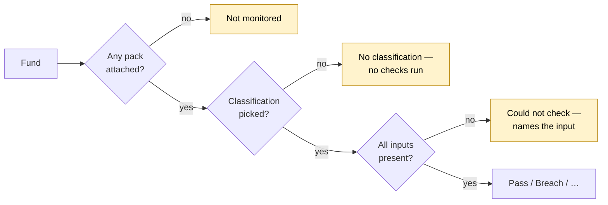

**1. Attached pack with no classification**
- Horizon Seed Fund has the SEBI pack but no Category.
- No SEBI check knows which limits apply.
- Shown: amber "SEBI — AIF: no classification — no checks run" (not a green "all clear"); listed in the digest every day.
- Fix: Meera picks a classification in Setup › Funds (or Arjun sets the fund's Category, which pre-fills it) → next run or Run now covers it.

**2. Fund with no pack at all**
- Listed under "Not monitored" on the Compliance home page.
- Cannot be mistaken for a compliant fund.

**3. AI draft that does not match the sentence**
- Meera types "No single LP above 20% of the fund".
- The draft measures *paid-in* capital; the fund agreement means *commitments*.
- Visible before saving:
  - plain-words summary: "largest investor's paid-in ÷ total paid-in ≤ 20%";
  - test-run working uses paid-in figures.
- Fix: change the figure to "commitment" (or rephrase and redraft) → re-run → save.
- Nothing is saved until she confirms.

**4. Missing input**
- Meera skipped estimated expenses for one fund.
- Shown: "Could not check — missing: estimated expenses (Setup › Inputs)", counted under "could not check", never "pass".
- Fix: enter the figure → result appears on the next run.

**5. AI misreads a fact**
- The Orbit Health IC note says "not exceeding INR 15 crore"; the AI reads ₹1.50 cr (a misplaced decimal in the scan).
- Nothing is decided yet: the check shows Needs review — "AI-read, unconfirmed".
- Meera compares the fact with the highlighted quote on p.2, sees the mismatch, edits it to ₹15.00 cr and confirms.
- The edit is recorded (AI read ₹1.50 cr → Meera set ₹15.00 cr, 06 Nov).
- Next run: invested ₹18.00 cr > approved ₹15.00 cr → Breach (₹3.00 cr over). Had she confirmed without checking, ₹18.00 > ₹1.50 would still have been a breach — a misread can produce a false breach, but an unconfirmed fact never produces a pass.

**6. Nightly run fails**
- The run on 06 Nov stops (e.g. the database is unavailable).
- Shown: every screen says "Last successful run 05 Nov 02:00 — results may be out of date" in amber; owners get a "Compliance run failed" email; CapHive support is alerted.
- Results are never shown as current when they are older than 26 hours.
- Fix: none needed by the customer; the next successful run (or Run now) refreshes everything.

### Summary: the minimum actions

| # | Action | Who | How often |
|---|---|---|---|
| 1 | Author, test, publish a pack | Priya (CapHive) | Once per regime, then per regulatory amendment |
| 2 | Attach packs to each fund and pick its classification in each | Meera | Once per fund |
| 3 | Map inputs, assign owners | Meera | Once per entity (per pack) |
| 3a | Describe the fund's own rules in words, confirm each draft | Meera | Once per rule (optional) |
| 3b | Confirm the facts AI read from each new document | Meera | Per document uploaded |
| 4 | Read the digest | Meera | Only on days something changed |
| 5 | Fix or explain each breach | Arjun / Meera, Rahul approves | Per breach |
| 6 | Complete manual duties with evidence | Meera | Per duty schedule (quarterly, yearly, per event) |

---

## Roles and access

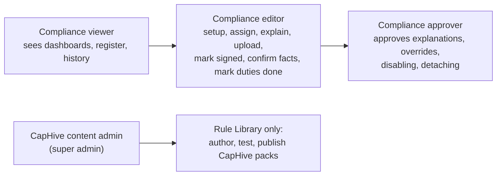

- Roles are given per entity, and limited to the funds the user can already access.
- **Company admins** get all three compliance roles by default.
- **Maker–checker:**
  - An explanation, override, disable or detach is **requested** by an editor and **takes effect only when an approver approves**.
  - The approver must be a different person from the requester.
  - Until approved, the pack's own rule keeps applying.
- **Investors** and investor advisors never see Compliance.
- **CapHive content admins** cannot see a customer's register; test runs use the CapHive demo entity, or a customer entity only while that customer has granted CapHive support access.

## Notifications

| Event | Who is told | How |
|---|---|---|
| New breach, needs review, cleared, no classification, run summary | Compliance owner(s) of the entity | Daily digest email — only if something changed |
| Breach assigned | The assignee | Email + in-app notification |
| Explanation / override / disable / detach requested | Compliance approver(s) | Email + in-app notification |
| Request approved or rejected | The requester | In-app notification |
| Breach past its fix-by date | Owner + approver (escalation) | Email, then in every digest until resolved |
| Duty due within reminder window / overdue | Duty owner (overdue also approver) | Daily digest |
| AI-read facts waiting to confirm | Compliance editors | Daily digest |
| Nightly run failed or results older than 26 hours | Compliance owners + CapHive support | Email |
| New CapHive pack version takes effect | Compliance owners | Digest, with overrides needing review |

- No notification ever goes to investors.
- No email is sent on a day with nothing to report.

## Delivery phases

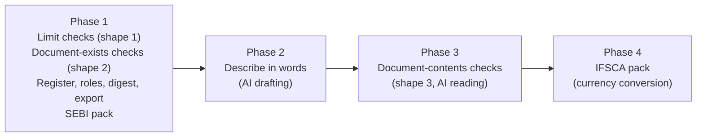

- **Phase 1** stands alone — useful with no AI at all. SEBI checks 1–6 and 8–10 ship here; check 7 (investor groups) needs AI-read ownership facts and arrives in Phase 3 — until then it is a manual duty.
- **Phase 2** adds AI only at authoring time.
- **Phase 3** adds AI reading of documents, opt-in per entity.
- **Phase 4** is pack content plus currency handling; no new screens. The IFSCA steps in the Workflow Journey apply from Phase 4.
- Each phase ships with its own Cucumber features and can be paused without breaking the previous one.

---

## User Stories

### US-1: Publish a regime's rule pack without a release

**As a** CapHive regulatory content admin,
**I want** to define a regime's classifications, checks and the figures they test as data,
**So that** new regimes (IFSCA, SEC, MAS) and amendments ship without engineering work.

**Acceptance criteria:**
- A pack has a name, regime, version, effective date, status (Draft / Published / Retired), a locked flag (CapHive packs) and its own list of classifications.
- Each version declares applicability — all funds / new funds only (by fund start date) / all funds with a transition end date — and whether early adoption is allowed.
- Customers cannot edit a locked pack; a direct request to do so is refused.
- Each check has a name, citation, the classifications it applies to (or all), kind (Automatic / Manual), severity (Breach / Warning / Needs review) and, if automatic, a measure and a limit.
- A measure is a total, count, distinct count, largest or smallest of a field over commitments, contributions, distributions, portfolio investments, valuations, investors, KYC, documents (with their signature status) or the fund — including their custom fields — with filters and an optional "per investee" / "per investor" grouping; or arithmetic (+ − × ÷, lower of, higher of) over other measures and limits.
- Saving a measure that names a field or record type CapHive does not hold is refused with the name of the unknown field.
- Publishing is refused until a test run has been done and a counsel review (name, date) is recorded.

### US-2: Attach several packs to a fund

**As a** compliance officer,
**I want** to attach every rulebook a fund is bound by, and pick its classification in each,
**So that** a SEBI AIF and a GIFT City fund under the same manager are each checked against the right rules.

**Acceptance criteria:**
- Any published pack can be attached to any fund of the entity; the entity's regulator setting only orders the suggestions.
- A fund can carry any number of different packs, but the same pack only once.
- Attaching requires a classification from that pack's list; the SEBI pack pre-fills it from the fund's Category field when it matches.
- An attachment without a classification shows "no classification — no checks run" for that pack.
- Detaching requires a reason; that pack's history on the fund remains viewable.

### US-3: Map inputs once

**As a** compliance officer,
**I want** to map each pack's inputs to my own investor categories and fund figures,
**So that** the checks compute correctly on my data.

**Acceptance criteria:**
- Setup lists every input needed by the packs attached to the entity's funds, with ✓ / ✗, and the checks each missing input blocks.
- An input used by two packs (e.g. "Sponsor/manager") is mapped once per entity.
- Monitoring cannot be turned on while a required input is unmapped; the button says which.

### US-4: Override a limit or build our own pack

**As a** compliance officer,
**I want** to change a limit for a fund (Large Value Fund 50%) or build a pack for our fund agreement,
**So that** the register reflects what actually binds us.

**Acceptance criteria:**
- An override applies to one check on one fund, requires a reason, needs approval by a different Compliance approver, and shows the pack's value beside it on every result.
- On a locked pack, an override may only make a "stricter only" check stricter; a looser value, or any override of a "not overridable" check, is refused with the reason.
- Until approved, the pack's own limit applies and the override shows "Pending approval".
- Entity packs use the same classification, measure and limit builder as CapHive packs, are visible only to the entity, are labelled "Entity pack", and need no counsel review to publish.
- Disabling a pack check for a fund requires a reason and approval, and appears in the register as "Disabled by <requester>, approved by <approver> on <date>".
- Entity packs are versioned like CapHive packs: edits are a draft until published; results record the version used.

### US-4a: Describe a rule in words

**As a** compliance officer (or CapHive content admin),
**I want** to type a rule as a sentence and get a ready-to-check draft,
**So that** I can capture our fund agreement's limits without learning the check builder.

**Acceptance criteria:**
- "Describe in words" is available wherever a check can be added (CapHive packs and entity packs).
- The draft is shown in plain words ("largest investment per sector ÷ investable funds ≤ 15%"), field by field, and is test-run on a fund the user picks, with the working shown.
- Nothing is saved until the user presses Save; the user can edit any field of the draft and re-run first.
- If the sentence needs data CapHive does not hold, the draft is a manual duty and says why ("CapHive does not record key-person events").
- If the sentence is ambiguous (e.g. "of the fund" — commitments or paid-in?), the draft names the assumption it made, so the user can change it.
- A saved check records that it was drafted with AI, the original sentence, and who confirmed it.
- If AI is unavailable or not configured for the entity, the form still works and a message says "Describe in words is unavailable — use the form".

### US-4b: Every record has its required, signed document

**As a** compliance officer,
**I want** a check that every portfolio investment has a signed IC note dated on or before the investment,
**So that** no investment is made, or left on the books, without investment committee approval on file.

**Acceptance criteria:**
- A check of this shape names: the record type (portfolio investment), the required document input ("IC note"), whether it must be signed, whether it must be dated on or before the record's date, and a "checks from" date.
- Each entity maps "IC note" once to a document name, tag or folder.
- "Signed" is met by either:
  - a scanned wet-ink copy marked "Signed (wet ink)" by a user, with the signed date entered (required); or
  - a completed CapHive e-signature.
- The timing test uses the signed date (entered for wet ink, completion date for e-sign), not the upload date.
- The result shows "N of M investments OK" and lists each failing investment with its reason: Missing, Not signed, or Signed after investment date.
- One register item per check per fund; the list shrinks as documents are added, and the item clears when the list is empty.
- Records created before the "checks from" date are not checked and are shown as a count ("120 earlier investments not checked").
- Typing "Every portfolio investment must have a signed IC note dated before the investment" in Describe in words drafts this check.

### US-4c: Check what a document says

**As a** compliance officer,
**I want** CapHive to read key facts from each IC note (and other documents) and compare them with our records,
**So that** an investment larger than approved, or without quorum, is caught without me re-reading every document.

**Acceptance criteria:**
- A pack's document input lists the facts to read, each with a type (text, amount, date, list of names, yes/no).
- AI reads a document once when it is uploaded or replaced; it is not read again on nightly runs.
- Each fact shows the quote and page it was read from; the user can correct any fact before confirming.
- A check using unconfirmed facts shows "Needs review — AI-read, unconfirmed", never Pass.
- A fact the AI could not find shows "Not found in document" and the check shows Needs review.
- Replacing the document resets its facts to unconfirmed and re-reads them.
- Example rules expressible: amount invested ≤ amount approved; approval date ≤ investment date; signatories who are IC members ≥ quorum; no IC member who declared a conflict is among the approvers; company named = investee.
- Kind-4 duties (PPM changes, report disclosures) attach the AI's notes to the manual duty; the person still marks it done.
- Document reading is off until the entity turns it on (Setup › AI document reading), per document input; a monthly cap on documents read applies — beyond it, documents queue and the digest says so.
- Reference lists (IC members and quorum, sponsor's associates, excluded sectors) are entered in Setup › Reference lists; the land-border country list ships with the SEBI pack.

### US-5: See daily results with the working

**As a** compliance officer,
**I want** each check's result, the figures and the arithmetic, every day, grouped by pack,
**So that** I can trust the result and show it to an auditor.

**Acceptance criteria:**
- Every run stores, per check per fund: pack and version, result, each figure used, limit, run time.
- Results are Pass / Breach / Warning / Needs review / Could not check; "Could not check" names the missing input.
- Stored results never change after the run, even if data is later corrected.
- A grouped check (per investor / per investee) lists every failing group with its figure — e.g. the investors below the minimum.
- Every result links to the setup that applied: pack version, classification, overrides, input mappings and reference lists as of that run.
- Setup › History shows every setup change (who, when, before → after, approver).
- Every screen shows "Last successful run"; results older than 26 hours are marked "may be out of date".
- Amount limits carry a currency; a figure in another currency is converted at CapHive's exchange rate for the run date, and the working shows the rate. No rate → Could not check.
- Each check has a "tested" setting: **continuously** (every run) or **when a record is made** (each record tested once, in the first run after it is created, using that day's figures).
- Runs happen at 02:00 in the entity's time zone.

### US-6: Work a breach to closure

**As a** compliance officer,
**I want** a breach to stay open until it is fixed in the data or an approved explanation exists,
**So that** nothing is silently forgotten.

**Acceptance criteria:**
- A new failing result opens one register item per check per fund (not one per day).
- When the check passes again the item closes as "Cleared by data", keeping the failing and passing figures.
- An explanation needs approval by a Compliance approver other than its author; an approved item reopens if the figure gets worse than when it was approved.
- Each item shows a fix-by date (first seen + the check's time to fix); past it, the item is flagged Overdue and escalated.

### US-7: Complete manual duties with evidence

**As a** compliance officer,
**I want** each attached pack's recurring duties scheduled per fund with reminders and an evidence trail,
**So that** filings and attestations are provably done on time.

**Acceptance criteria:**
- A duty has a trigger — schedule (quarterly, half-yearly, yearly), on demand, or event ("for each new <record type>", "when a <document input> is uploaded or replaced") — and a due rule (e.g. N days after period end, N days after the event).
- Marking done records who, when, a note and — if the duty requires it — an uploaded document.
- Overdue duties are shown in red on the dashboard and in the digest.

### US-7a: Export the register

**As a** compliance officer,
**I want** to export the register and results for a period,
**So that** I can attach them to the compliance test report and give them to auditors and the trustee.

**Acceptance criteria:**
- Compliance › Register › Export: period, funds, packs; Excel or PDF.
- The export lists every check result at period end with its figures, every register item opened or open in the period with its history, and every duty with its evidence links.
- Exports run in the background and arrive as a download link; they respect the user's fund access.

### US-8: Daily digest only when something changed

**As a** compliance officer,
**I want** one email a day only if a result changed or a duty is due or overdue,
**So that** I am not trained to ignore it.

**Acceptance criteria:**
- The digest lists new breaches, cleared items, attachments missing a classification, duties due within the pack's reminder window and overdue duties, grouped by fund and pack.
- No email is sent on a day with none of these.

---

## UI Behavior

### Compliance › Register

```
┌ Compliance Register ───────────────────────────────────────────────────────────┐
│ Fund [All ▾]  Pack [All ▾]  Status [Open ▾]  Severity [All ▾]  Owner [All ▾]   │
├────────────────────┬──────────────┬───────────────────────────┬────────┬───────┤
│ Fund               │ Pack         │ Check                     │ Opened │ Status│
├────────────────────┼──────────────┼───────────────────────────┼────────┼───────┤
│ Horizon Growth I   │ SEBI — AIF   │ Single-investee conc.     │ 05 Nov │ In pr.│
│ Horizon Growth I   │ SEBI — AIF   │ Continuing interest p-r   │ 05 Nov │ Open  │
│ Horizon Seed       │ SEBI — AIF   │ No classification         │ 05 Nov │ Open  │
│ Horizon Growth I   │ SEBI — AIF   │ Quarterly SEBI report Q2  │ 15 Nov │ Due   │
└────────────────────┴──────────────┴───────────────────────────┴────────┴───────┘
```

**Behavior notes:**
- The Status filter defaults to Open; closed items remain searchable.
- Each row opens the detail with the working (see Workflow Journey).
- Assign / Explain / Approve / Mark done / Attach / Detach open Bootstrap modals that state what will happen before confirming.

### Compliance › Setup › Inputs

```
┌ Inputs (used by: SEBI — AIF, IFSCA — FM) ────────────────────────────────┐
│ Sponsor / manager investors   [ Sponsor               ▾ ]   ✓  both packs │
│ Employees / directors         [ Directors/ Partners/… ▾ ]   ✓  SEBI       │
│ Estimated expenses            Horizon Growth I  ₹30.00 cr   ✓            │
│                               Horizon Seed      [        ]   ✗ blocks 1  │
│                                                                          │
│ [Turn monitoring on]  (disabled: 1 input missing — Estimated expenses)   │
└──────────────────────────────────────────────────────────────────────────┘
```

### Describe a check in words (entity packs and CapHive packs)

```
┌ Horizon — fund agreement limits · Describe a check ──────────────────── ✕ ┐
│ Rule  [ No more than 15% of investable funds in any one sector —        ] │
│       [ LPA clause 8.2                                                  ] │
│                                                       [Draft check]       │
├───────────────────────────────────────────────────────────────────────────┤
│ Draft (AI) — please check each line                                       │
│   Figure      largest  investment cost  per  sector          [edit]       │
│   Divided by  Investable funds (corpus − estimated expenses) [edit]       │
│   Limit       ≤ 15%                                          [edit]       │
│   Applies to  all funds carrying this pack                   [edit]       │
│   Source      LPA cl. 8.2                                    [edit]       │
│   Assumed     "investment" = cost, not fair value            [edit]       │
├───────────────────────────────────────────────────────────────────────────┤
│ Test run on [Horizon Growth Fund I ▾]                                     │
│   Fintech  ₹34.00 cr ÷ ₹270.00 cr = 12.6%  ≤ 15%   ✓ Pass                 │
├───────────────────────────────────────────────────────────────────────────┤
│              [Cancel]   [Redraft]   [Save check]                          │
└───────────────────────────────────────────────────────────────────────────┘
```

**Behavior notes:**
- Save stays disabled until a test run has been shown for the current draft; editing a field clears the test run.
- The AI sees the sentence, the list of figures and fields CapHive can use, and the entity's input names — not investor records. The test run happens inside CapHive.

### Breach detail — record-level document check

```
┌ Horizon — fund agreement · IC note for every investment — Breach ─────────┐
│ Source: LPA cl. 6.3 (investment committee approval)                       │
│ Rule: each portfolio investment from 01 Apr 2026 has an "IC note",        │
│       signed, dated on or before the investment date                      │
│                                                                           │
│ 14 of 17 investments OK · 3 failing · 120 earlier investments not checked │
├──────────────────┬────────────┬──────────────────────┬───────────────────┤
│ Investment       │ Date       │ Problem              │                   │
├──────────────────┼────────────┼──────────────────────┼───────────────────┤
│ Acme Foods — B2  │ 12 Sep 26  │ Missing              │ [Upload IC note]  │
│ Zen Labs — Seed  │ 03 Oct 26  │ Not signed — scan    │ [Mark signed      │
│                  │            │ uploaded, not marked │  (wet ink)]       │
│ Kite Pay — A     │ 20 Oct 26  │ Signed 24 Oct, after │ [Explain]         │
│                  │            │ investment date      │                   │
└──────────────────┴────────────┴──────────────────────┴───────────────────┘
```

**Behavior notes:**
- 14 + 3 = 17 investments dated on or after 01 Apr 2026; the 120 earlier ones are out of scope by the "checks from" date.
- "Signed late" cannot be fixed by uploading — it needs an explanation approved by the approver.
- **Mark signed (wet ink)** opens a modal: signed date (required), optional signatories, confirm. An e-signed IC note needs no marking.
- An investment whose IC note was signed in wet ink on 10 Sep and scanned on 15 Sep, for a 12 Sep investment, passes: 10 Sep ≤ 12 Sep.

### Confirm facts read by AI

```
┌ IC note — Orbit Health Series A · Facts to confirm ──────────────────── ✕ ┐
│ Fact             │ AI read                  │ Source (page)       │       │
├──────────────────┼──────────────────────────┼─────────────────────┼───────┤
│ Company          │ Orbit Health Pvt Ltd     │ "…invest in Orbit…" │ p.1 ✓ │
│ Instrument       │ CCPS Series A            │ "…Series A CCPS…"   │ p.1 ✓ │
│ Amount approved  │ ₹15.00 cr                │ "…not exceeding INR │ p.2 ✓ │
│                  │                          │ 15 crore…"          │       │
│ Approval date    │ 28 Sep 2026              │ signature block     │ p.3 ✓ │
│ Signatories      │ A. Rao, K. Shah, M. Iyer │ signature block     │ p.3 ✓ │
│ Conflicts        │ R. Mehta — abstained     │ "…R. Mehta declared…│ p.2 ✓ │
├──────────────────┴──────────────────────────┴─────────────────────┴───────┤
│                         [Edit a fact]   [Confirm all]                      │
└───────────────────────────────────────────────────────────────────────────┘
```

Resulting checks for the investment (₹18.00 cr on 05 Oct 2026):

```
Amount     invested ₹18.00 cr  vs approved ₹15.00 cr   → 18.00 > 15.00   ✗ Breach (₹3.00 cr over)
Timing     approved 28 Sep     vs invested 05 Oct      → 28 Sep ≤ 05 Oct ✓
Quorum     3 IC members signed vs quorum 3 of 5        → 3 ≥ 3           ✓
Conflicts  R. Mehta declared   → not among signatories                   ✓
Company    "Orbit Health Pvt Ltd" = investee Orbit Health                ✓
```

### Rule Library (CapHive super admin)

```
┌ SEBI — Alternative Investment Funds · v1 · Draft ────────────────────────┐
│ Classifications (3)   Measures (9)   Checks (10)   Test run   Publish    │
├────────────────────────────┬───────────────┬─────────┬──────────────────┤
│ Check                      │ Kind          │ Applies │ Source           │
├────────────────────────────┼───────────────┼─────────┼──────────────────┤
│ Single-investee conc.      │ Automatic     │ I, II   │ Reg 15(1)(c)     │
│ Quarterly SEBI report      │ Manual · qtr  │ all     │ Master Circular  │
└────────────────────────────┴───────────────┴─────────┴──────────────────┘
```

### First SEBI pack (content to be confirmed by counsel before publishing)

| # | Check | Kind | Applies to | Test |
|---|---|---|---|---|
| 1 | Single-investee concentration | Automatic | Cat I, II | Investment in any one investee ≤ 25% of investable funds — tested at investment or continuously: counsel |
| 1a | Single-investee concentration | Automatic | Cat I / II — LVF | ≤ 50% of investable funds |
| 2 | Single-investee concentration | Automatic | Cat III | ≤ 10% of NAV |
| 3 | Continuing interest — amount | Automatic | Cat I, II / III | Sponsor/manager investment ≥ lower of 2.5% of corpus and ₹5 cr (Cat III: 5% / ₹10 cr) |
| 4 | Continuing interest — pro-rata | Automatic | all | Sponsor/manager paid in ≥ required interest × others' paid-in share (CapHive's reading of Master Circular ¶17.6.1 — counsel to confirm) |
| 5 | Minimum investment | Automatic | all | Each investor ≥ ₹1 cr; employees/directors ≥ ₹25 lakh |
| 6 | Investors in scheme | Automatic | all | ≤ 1,000 |
| 7 | Investor group ≥ 50% (Phase 3; manual duty before) | Document contents · Needs review | all | Groups formed from common beneficial owners in confirmed KYC ownership facts; any group ≥ 50% of scheme → enhanced due diligence duty |
| 8 | Investor & investment due diligence (related parties, land-border countries) | Manual · per new investor / investment (event) | all | Per SEBI circular of 8 Oct 2024; AI notes from beneficial-owner declarations attached when reading is on |
| 9 | Quarterly SEBI report filed | Manual · quarterly | all | Links to the existing SEBI report screen |
| 10 | Annual compliance test report / PPM audit | Manual · yearly | all | Evidence upload required |

### Extensibility proof — sample packs, no code

These illustrate shape only; every figure is taken from secondary summaries and must be confirmed
against the current regulations by counsel before a pack is published.

**IFSCA — Fund Management (GIFT City)** — classifications: Venture Capital Scheme, Restricted Scheme, Retail Scheme

| Check | Kind | Built from |
|---|---|---|
| Minimum investment per non-accredited investor (Restricted: USD 150,000; VCS: USD 250,000) | Automatic | Smallest commitment among investors not mapped to "Accredited investor" |
| Restricted Scheme: fewer than 1,000 investors | Automatic | Count of investors with a commitment |
| Fund management entity's own contribution | Automatic | Same "Sponsor/manager" input and arithmetic shape as SEBI check 3, with IFSCA's limits |

**SEC (US)** — classifications: 3(c)(1), 3(c)(7)

| Check | Kind | Built from |
|---|---|---|
| 3(c)(1) fund: ≤ 100 beneficial owners | Automatic + Manual | Count of investors ≤ 100 (automatic); look-through of entity investors confirmed as a manual duty |
| 3(c)(7) fund: every investor a qualified purchaser | Automatic | Count of investors whose KYC custom field "Qualified purchaser" ≠ Yes = 0 |
| Form ADV annual amendment | Manual · yearly | Due 90 days after fiscal year end |
| Marketing material reviewed before use | Manual · on demand | Evidence upload required |

### Questions for counsel

Settle before the SEBI pack is published:

1. **When is each limit tested?** Concentration: at each investment, or continuously (does a fall in investable funds after investing create a breach)? Same for continuing interest and the investor count.
2. **Fund vs scheme.** Limits apply per scheme; confirm one CapHive fund = one scheme for every customer, or how multi-scheme funds are set up.
3. **Continuing interest pro-rata** — confirm CapHive's reading of Master Circular ¶17.6.1 (required interest × others' paid-in share).
4. **Investable funds** — confirm "corpus less estimated expenses for the fund's tenure", and where the estimate comes from.
5. **Large Value Fund** limits and eligibility.
6. **Category III** — confirm "10% of NAV" and which NAV (latest published, or as of the investment).
7. **IFSCA figures** — the minimums, investor cap and manager contribution after the Dec 2024 amendments.
8. **Investor count** — confirm "distinct investors with a non-zero commitment, excluding those fully transferred out".
9. **Record retention** — how long results, the register and history must be kept (v1 never deletes them).
10. **Citations** for every check, including the IC approval requirement if it is to be in the SEBI pack rather than an entity pack.

---

## What This Feature Does NOT Cover

| Excluded | Covered In |
|---|---|
| Blocking a save before it breaches a limit (pre-trade gate) | Existing Validation Rules; a later phase may reuse packs there |
| AI deciding whether a fund is compliant | Not planned — AI drafts checks and reads document facts (confirmed by a person); every run is plain arithmetic, and judgement checks are manual duties |
| AI reading a whole fund agreement and proposing every check at once | Later phase — v1 drafts one rule per sentence |
| AI reading facts from documents automatically counting as a pass | Not planned — a person confirms each document's facts |
| Re-reading every historic document when a check is created | Later phase — v1 reads documents uploaded or replaced after the check exists, plus on-demand "Read now" per document |
| The existing AI Rules feature | Unchanged |
| Filing reports with any regulator | Existing SEBI reports; this feature only tracks that filing happened |
| Re-running checks as of a past date | Later phase — past record states are not always reconstructable |
| Checks on data CapHive does not hold (e.g. employees' personal trades) | Expressed as manual duties |
| Combining limits across packs (e.g. "strictest of SEBI and the fund agreement") | Not planned — each pack's check is reported separately |
| Investor-facing visibility | Not planned — internal to the fund manager |
| Side-letter obligations | Existing side-letter obligations feature, unchanged |
| Changing the entity's single regulator setting | Unchanged; used only to suggest packs |
| Compliance results via the public API / MCP tools | Later phase |
| Schemes inside one CapHive fund | Not planned — one CapHive fund = one scheme (counsel question 2) |

---

## Validation Rules

| Field | Rule | Default |
|---|---|---|
| Pack name, regime | Required | — |
| Pack classifications | At least one | — |
| Pack effective date | Required; a new version's date must be after the current version's | — |
| Version applicability | One of: all funds / new funds only (+ date) / all with transition (+ transition end date after the effective date) | All funds |
| Override on a locked pack | Only on "stricter only" checks, and only stricter than the pack's limit | — |
| Early adoption | Only when the version allows it; before the effective date; approver ≠ requester | — |
| Check citation | Required for CapHive packs; optional for entity packs | — |
| Check applicable classifications | At least one of the pack's classifications, or "all" | all |
| Automatic check limit | Number; percentage or amount as the measure's unit | — |
| Measure field | Must exist on the chosen record type (incl. custom fields) | — |
| Manual duty schedule | One of quarterly, half-yearly, yearly, on demand; due rule required unless on demand | — |
| Pack attachment | Same pack at most once per fund; classification required from that pack's list | SEBI: pre-filled from fund Category |
| Detach / override / disable reason | Required, min 10 characters | — |
| Breach explanation | Required text; approver must be a named approver, not the author | — |
| Publish (CapHive pack) | Requires a completed test run and a counsel review record | — |
| AI-drafted check | Same rules as a form-built check; Save requires a test run of the current draft | — |
| Rule sentence | Required for Describe in words; max 1,000 characters | — |
| Record-level document check | Record type, document input and "checks from" date required | Signed: yes; dated on/before record: yes |
| Check "tested" setting | Continuously or when a record is made | Continuously |
| Check time to fix | Whole days, 0–365 | 30 |
| Amount limit | Currency required | Pack's currency |
| Document fact | Name and type (text, amount, date, list of names, yes/no) required | — |
| Reference list | At least one entry when a check uses it; IC quorum ≤ number of IC members | — |
| Override / disable / detach / explanation approval | Approver must hold Compliance approver and differ from the requester | — |
| Wet-ink signed date | Required; not in the future | — |
| Reference-list entry dates | Optional from/to; "to" after "from" | Blank = always |
| Event duty / record check "from" date | Required | Date the check is attached |
| Due rule | Calendar days | — |
| Pack period basis | Calendar quarters or financial year (Apr–Mar) | Pack's choice |
| Classification change | Approver ≠ requester (single-user entity: self-approval, labelled) | — |

---

## Behavior Rules

| Scenario | What User Sees |
|---|---|
| Check fails for the first time | Register item opens; digest lists it |
| Check fails again next day | Same item; no new digest line |
| Check passes after failing | Item closes "Cleared by data"; digest lists it once |
| Approved explanation, figure worsens | Item reopens "Worsened since approval" |
| Input missing | "Could not check — missing: <input> (Setup › Inputs)"; never a pass |
| Attached pack has no classification | "<Pack>: no classification — no checks run"; listed daily until fixed |
| Fund has no pack attached | Listed under "Not monitored" on the Compliance home page |
| Two packs test the same figure with different limits | Two rows, two results, two register items if both fail — each under its own pack |
| New pack version effective (all funds) | Every fund carrying the pack moves on the effective date; results show the new version |
| New version for new funds only | Funds started on/after the date move; older funds stay on the old version, labelled "Grandfathered — v1" |
| New version with transition | All funds move; older funds' new breaches show Warning "In transition until <date>", Breach from the day after |
| Version published ahead | Banner + read-only preview on each fund; owners notified on publish and 7 days before; preview never opens register items |
| Override still at least as strict as the new limit | Kept |
| New limit stricter than the override | Override dropped, new limit applies, flagged in digest and history |
| Check removed in the new version | Its overrides archived; its open items close "Check removed in v2" |
| Looser override on a locked pack | Refused: "Locked pack: overrides can only tighten this limit" |
| Customer tries to edit a locked pack | Refused (screen hides edit; direct request refused) |
| IC member left the committee after signing | Note still counts — the IC list is read as at the signed date |
| Fund classification change requested | Needs a different approver; applies from approval |
| Mapping or reference list edited | Applies from the change; recorded in history; past results unchanged |
| Fund start date blank, version needs it | "Could not check — missing: fund start date" |
| Payment entered today, dated last month | Past results unchanged; export notes "computed on data as entered at run time" |
| 312 historic investors imported (before the duty's "from" date) | No due-diligence duties created |
| 312 new investors imported (after the "from" date) | 312 duties; digest shows one line |
| Record deleted | Its failing rows and items close "Record deleted" |
| Sell transaction without an IC note (check filters buys only) | Not listed |
| Document moved to another record | Old record shows Missing; facts move with the document |
| Only one eligible user in the entity | May self-approve; labelled "Self-approved — single approver" everywhere |
| Assignee or approver deactivated | Items and approvals return to the compliance owner; digest notes it once |
| Duty with no owner | Goes to the compliance owner |
| CapHive publishes a correction version | Faulty results marked "Superseded — pack correction"; items it caused close "Pack corrected" |
| Version published after its effective date | Applies from the next run; flagged "Published late" |
| Pack attached mid-quarter | First duty due at the next period end; none backfilled |
| New version adds a fact to read | Confirmed documents show "Needs review — new fact in v2" and queue for re-reading |
| Effective date for an entity outside India | Decided in IST for SEBI/IFSCA packs |
| Nightly run missed | Gap shown in run history; no backfill |
| Compliance turned off, then on | No runs while off; resumes from the day it is turned on |
| AI facts unconfirmed for days | Digest shows the wait ("waiting 9 days") |
| Pack detached from a fund | Open items for it close as "Pack detached"; history read-only |
| Fund closed / wound up | No further runs; register history kept |
| Nothing changed overnight | No email |
| Run now pressed twice | Second press waits for the first run; one result set |
| Sentence needs data CapHive does not hold | Draft is a manual duty, with the reason shown |
| AI draft edited by the user | Test run cleared; must re-run before Save |
| AI unavailable | "Describe in words is unavailable — use the form"; form unaffected |
| Same data, two nightly runs | Identical results — no AI at run time |
| IC note added and signed for a failing investment | Removed from the list on the next run; item clears when the list is empty |
| IC note signed in wet ink | Scan uploaded, marked "Signed (wet ink)" with the signed date → counts as signed; who marked it and when is recorded |
| Wet-ink scan uploaded after the investment, signed before it | Passes — the entered signed date is used, not the upload date |
| Wet-ink scan uploaded but not marked signed | Listed as "Not signed — mark as signed (wet ink)" |
| Investment dated before the "checks from" date | Not checked; counted as "earlier investments not checked" |
| Document uploaded | AI reads it once; facts shown as "AI-read — N to confirm" |
| Check uses unconfirmed facts | Needs review — "AI-read, unconfirmed"; never Pass |
| AI cannot find a fact | "Not found in document"; check Needs review |
| Document replaced | Facts reset to unconfirmed and re-read |
| Confirmed fact later edited | Edit recorded (who, when, old → new); next run uses the new value |
| Scanned document AI cannot read | "Could not read document"; check Needs review; facts can be entered by hand |
| IC note signed after the investment date | Listed as "Signed late"; needs an approved explanation, uploading again does not clear it |
| Override requested, not yet approved | Pack's limit applies; override shows "Pending approval" |
| Approver rejects an override | Override discarded; requester notified |
| Breach past its fix-by date | Flagged Overdue; owner and approver emailed; in every digest until resolved |
| Grouped check fails | Result lists each failing investor / investee with its figure |
| Nightly run fails | Amber "Last successful run <date> — may be out of date"; owners and CapHive support emailed |
| Fund figure in another currency than the limit | Converted at the run date's CapHive rate, rate shown; no rate → Could not check |
| Check tested "when a record is made" | Each new record tested once in the next run; later changes do not reopen it |
| New investor added (event duty "for each new investor") | Due-diligence duty created for that investor, due N days later |
| New PPM version uploaded (event duty) | PPM change review duty created, AI notes attached if reading is on |
| AI document reading off for the entity | Content checks show "Needs review — reading not enabled"; facts can be entered by hand |
| Monthly document-reading cap reached | Further documents queue; digest says "N documents waiting — cap reached" |
| Setup change made | Recorded in Setup › History; results from then on link to the new setup |

---

## Resolved Design Decisions

| # | Decision | Resolution |
|---|---|---|
| 1 | Hard-code SEBI rules or store them as data? | Data. Classifications, checks and the figures they test are pack data; a new regime needs no release unless it needs a record type CapHive does not hold |
| 2 | Which rules apply to a fund? | The packs attached to that fund — any number of different packs per fund. The entity's single regulator setting only suggests packs |
| 3 | Where does a fund's category live? | Per attached pack (SEBI Category II, IFSCA Restricted Scheme). The SEBI pack pre-fills from the existing fund Category field |
| 4 | Who authors packs? | CapHive super admins, with a recorded counsel review. Entities override limits per fund and build their own entity packs, but do not edit CapHive packs |
| 5 | Two packs, same figure, different limits? | Reported separately per pack; no merging or "strictest wins" |
| 6 | Check on save, or daily? | Daily plus Run now — limits can be breached with no transaction. Pre-trade gating is out of scope |
| 7 | Automatic checks and manual duties: separate tools? | One register, one dashboard, one digest |
| 8 | What if a figure cannot be computed? | "Could not check", counted separately, never a pass |
| 9 | One register item per day of breach? | No — one per breach episode, closed when data clears it or an explanation is approved |
| 10 | How are entity-specific investor groups (sponsor, employees) found? | Packs declare named inputs; each entity maps them once, shared across packs that use the same input |
| 11 | New pack versions: opt-in or automatic? | Automatic on the effective date, by the version's own applicability rule (all / new funds only / transition); early adoption only if allowed, with approval; never manual pinning |
| 12 | Results editable later? | No. Each run's figures are an immutable record for audit |
| 13 | Can users write rules in words? | Yes — AI drafts a structured check from a sentence; the user reviews it in plain words with a test run and confirms. AI never runs at check time |
| 14 | Are checks written like fund formulas (a line of formula code)? | No — structured fields, not code. See below |
| 15 | Can a check require a document per record (IC note per investment)? | Yes — a second check shape: every record has a required, signed document, dated in time |
| 16 | What counts as "signed"? | Wet ink (scan + "Signed (wet ink)" + signed date) or CapHive e-sign completed. Timing uses the signed date |
| 17 | Historic records with no documents? | A "checks from" date per check; earlier records are counted, not listed |
| 18 | Can checks depend on what a document says? | Yes — a third check shape: AI reads named facts once per document version; rules compare them |
| 19 | Does an AI-read fact count straight away? | No — only once a person confirms it; until then Needs review |
| 20 | Does AI ever decide pass/fail? | No — it reads facts and prepares notes; the comparison is plain arithmetic |
| 21 | Can the person whose breach it is silence it? | No — overrides, disabling, detaching and explanations need a different Compliance approver |
| 22 | Is the setup history kept? | Yes — every setup change; each result links to the setup that applied |
| 23 | How is a failed run noticed? | "Last successful run" everywhere, amber after 26 hours, email to owners and CapHive support |
| 24 | Is a limit tested continuously or at the time of a record? | Per check setting; counsel decides per rule |
| 25 | Different currencies? | Limits carry a currency; figures converted at the run date's CapHive rate, shown in the working |
| 26 | Is AI document reading on by default? | No — opt-in per entity and per document input, with a monthly cap |
| 27 | Where do test runs of a draft CapHive pack run? | On the CapHive demo entity; a customer entity only while it has granted CapHive support access |
| 28 | Large Value Fund? | Its own SEBI classification (Category I / II — LVF), not an override |
| 29 | How are percentages compared? | As displayed, rounded to 2 decimals: 25.0037% shows 25.00% and passes a ≤ 25% limit |
| 30 | When are results "out of date"? | Older than 26 hours; a result 25 hours old is current |
| 31 | What does retiring a pack do? | It can no longer be attached; funds stop being checked against it from the retirement date; history kept |
| 32 | Default AI reading cap? | 200 documents per entity per month (CapHive can change it per entity) |
| 33 | Event duty timing? | Set per duty in the pack, e.g. "due diligence due 15 days after a new investor" |
| 34 | Category III NAV source? | Design confirms the source; until then check 2 shows "Could not check — missing: NAV" |
| 35 | Can customers change a SEBI pack? | No — CapHive packs are locked; overrides only tighten "stricter only" checks |
| 36 | Do amendments always hit every fund? | No — each version declares all funds, new funds only, or all with a transition period |
| 37 | Can a fund stay on an old version by choice? | No — only when the version grandfathers it by start date |
| 38 | Who can approve? | Any Compliance approver or company admin other than the requester; a single-user entity may self-approve, labelled |
| 39 | Are reference lists dated? | Yes — optional from/to per entry; checks read the list as at the document's date |
| 40 | Fund start date missing? | "Could not check" — never guessed |
| 41 | Business days? | Calendar days in v1 |
| 42 | Things deliberately left out for simplicity | "Confirmer ≠ uploader" setting; separate escalation of unconfirmed facts; extra detach/re-attach rules; blocking monitoring until every duty has an owner |


**Why checks are not fund-formula code (decision 14)**

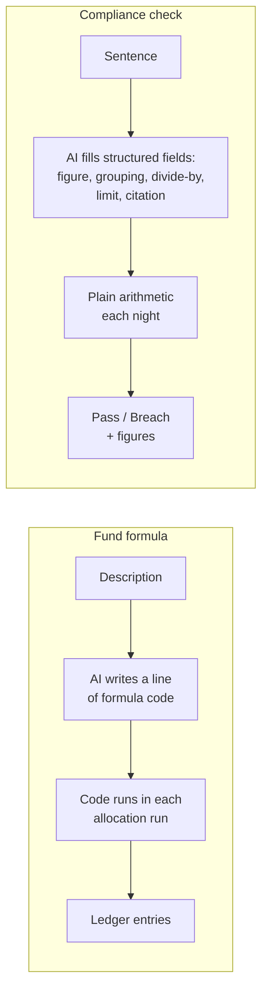

- **Readable sign-off** — compliance staff and counsel must read and approve a check without reading code.
- **Nothing silently passes** — every field is validated on save against data CapHive holds.
- **No stored code runs nightly** — less to secure on a compliance path.
- **Fund formulas need code; checks do not** — a formula produces ledger entries; a check only compares a figure with a limit.
- **Reused from fund formulas:** the AI-from-a-description pattern, templates, showing the working.

---

## Capabilities

### New Capabilities

- `compliance/rule-library`: Rule packs with their classifications, measures, checks, versions, test runs, publishing with counsel review, and entity packs.
- `compliance/ai-check-drafting`: Drafting a check or manual duty from a sentence, plain-words review, mandatory test run, and the record of who confirmed it.
- `compliance/document-content-checks`: Facts declared per document input, AI reading once per document version with quote and page, person confirmation, and content rules over confirmed facts.
- `compliance/fund-pack-setup`: Attaching several packs to a fund with a classification per pack, input mapping, reference lists, per-fund overrides and disabling with maker–checker approval, compliance roles, owners, and setup history.
- `compliance/compliance-monitoring`: Nightly and on-demand runs across every attached pack, tested-when and currency handling, stored results with figures, run health, the compliance register lifecycle with fix-by dates and escalation, scheduled and event-triggered manual duties with evidence, notifications, the daily digest, and register export.
- `compliance/sebi-aif-rule-pack`: The content and expected results of the first SEBI AIF pack.

### Modified Capabilities

None.

---

## Impact

- New **Compliance** menu (dashboard, register, setup) for fund-manager users; a **Compliance** tab on the fund page.
- New **Rule Library** screen for CapHive super admins.
- A nightly background run and a daily digest email.
- "Describe in words" and document reading use the AI provider already configured for the entity; the nightly run uses no AI.
- Documents checked for content are sent to that AI provider when uploaded or replaced.
- Reads existing data only (commitments, payments, distributions, portfolio investments, valuations, investors, KYC, custom fields, fund Category); no existing record changes.
- AI Rules, Validation Rules, SEBI reports, side-letter obligations and the entity's regulator setting are unchanged.

---

## Benefits

1. Breaches that happen with no transaction — investable funds shrinking, sponsor falling behind pro-rata — are caught the next morning, not at audit.
2. A manager running SEBI AIFs and GIFT City funds sees every fund against the right rulebooks in one place, including its own fund-agreement limits.
3. Every pass and breach is recorded with its figures, giving an inspection-ready trail instead of spreadsheets.
4. Filings and attestations are scheduled, reminded and evidenced in the same place as limit checks.
5. Officers see the working, so they can trust and explain each result.
6. New regimes (IFSCA, SEC, MAS) and regulatory amendments ship as data — faster for CapHive, consistent across customers.

---

## FAQ

| Question | Answer |
|---|---|
| Who can see Compliance? | Company admins, and users given Compliance access on the fund. Investors never see it. |
| We run a SEBI AIF and a GIFT City fund — does that work? | Yes. Attach the SEBI pack to the AIF and the IFSCA pack to the GIFT City fund; each is checked against its own rules, and both appear in the same register. |
| Can one fund carry more than one pack? | Yes — e.g. SEBI plus your fund-agreement pack. Each pack's checks are reported separately. |
| Who can edit the SEBI rules? | Only CapHive's content admins. You can override a limit for a fund, or build your own entity pack, with a reason. |
| Is a CapHive pack legal advice? | No. Each pack records the counsel review it was published with; customers remain responsible for compliance. |
| What happens to existing data? | Nothing changes. The first run reads current data; history starts from that run. |
| Our sponsor is called something else in our investor categories — does it work? | Yes. Setup maps the pack's "Sponsor/manager" input to your own category once, for every pack that uses it. |
| Why does a fund say "no classification"? | A pack is attached but CapHive does not know the fund's type under that pack, so it cannot tell which limits apply. Pick it in Setup › Funds. |
| Why is a fund "Not monitored"? | No pack is attached to it yet. |
| Will I get an email every day? | Only on days something changed or a duty is due or overdue. |
| How do you add SEC, MAS or another regime? | CapHive publishes a new pack; entities attach it to the relevant funds. No release unless a check needs data CapHive does not hold at all. See [design](design.md). |
| Does this replace AI Rules? | No. AI Rules is untouched; this is a separate, deterministic feature. |
| Can we write our own rules in plain English? | Yes. Type the rule; AI drafts the check; you see it in plain words with today's figures and confirm before it is saved. |
| Does AI decide whether we are compliant? | No. AI only helps write a check. Every daily result is plain arithmetic on your data, the same every time. |
| What does the AI see? | For Describe in words: your sentence and the names of fields CapHive can check. For content checks: the documents those checks read (e.g. IC notes), once per version, sent to the AI provider configured for your entity. |
| Is a check like a fund formula? | Similar idea (defined per fund, can be drafted from a description, shows its working), but a check is a filled-in form rather than formula code, so compliance staff and counsel can read and sign it off. |
| What if the nightly run fails? | Every screen shows the last successful run and turns amber after 26 hours; owners and CapHive support are emailed. |
| Can I export the register for the compliance test report? | Yes — Excel or PDF for any period, with figures, history and evidence links. |
| Is document reading by AI on by default? | No. Your entity turns it on per document type, with a monthly cap. |
| When SEBI changes a rule, do our funds switch automatically? | Yes — on the effective date, following the version's rule: all funds, only new funds (older ones grandfathered), or all funds with a transition period. You see a preview beforehand. |
| Can we loosen a SEBI limit for a fund? | No. You can only tighten it. Special fund types with higher limits (e.g. Large Value Fund) are chosen as the fund's classification. |
| Can a compliance officer switch off a check that is failing? | Only with a reason and a different approver's approval; it is recorded in the register and history. |
| Is there a cost or plan change? | To be decided by product (AI document reading has a per-entity monthly cap); nothing in this proposal changes billing. |
| How is it rolled out? | In four phases (see [Delivery phases](#delivery-phases)); enabled per entity from Setup. See [design](design.md). |

---

## Design Principle for the Next Phase

Keep the design DRY and simple. Flagged risks the design must address head-on:

1. **The measure builder must not grow into a programming language.** Fixed operations only (total, count, distinct count, largest, smallest, grouping, + − × ÷, lower/higher of), allow-listed record types and fields, validated on save. Reuse the condition tree and global-default-plus-entity-override pattern from Validation Rules rather than inventing a second one.
2. **Many packs per fund must stay one model.** CapHive packs and entity packs are the same thing with a different owner; attachment (fund × pack × classification) is the only join. No special cases per regime.
3. **Silent passes.** Any unknown field, empty input, missing classification or unattached fund must surface as "Could not check" / "Not monitored" — the same silent-success trap documented for ontology filters in CLAUDE.md.
4. **Agreed definitions.** "Corpus", "investable funds" and "funds raised (net)" must have one definition shared with the existing SEBI reports, or the two will disagree on the same fund. Currency: IFSCA and SEC limits are in USD; measures must say which currency they compare in.
5. **Large tables.** Measures aggregate in the database; ledger entries are excluded as a source in v1 (see CLAUDE.md large-table rules).
6. **Reuse, don't rebuild.** Manual duties should reuse the side-letter obligation pattern (schedule, owner, fulfilment with evidence) and existing reminders/Tasks; notifications reuse the existing digest mailers; permissions live in Pundit policies.
7. **AI drafting reuses, and is bounded.** Reuse the fund-formula generator's approach (LLM service, few-shot examples from the entity's own checks) but have the AI return the check's structured fields, validated exactly like form input — never formula code. The AI is a drafting aid only; no run path may call it.
8. **Document checks reuse what documents already carry.** Match the required document through the entity's own name/tag/folder mapping and read the existing e-sign status; wet-ink signing adds only "signed (wet ink)", signed date and who marked it. Do not add a new document type system.
9. **Document reading reuses the existing extractors.** KYC document extraction, the CP/CS and side-letter obligation extraction (confidence + review gate) and the document-to-text helper already exist — build content checks on them, store facts with quote and page, and never call AI from a run.
10. **NAV source for Category III** must be confirmed (existing fund ratios or valuations) before check 2 is built.
11. **Consistent reads** — each fund's run reads one consistent snapshot of its data, so an import mid-run cannot mix states.
12. **Security by default** — every new screen and job follows the app's security rules (see design.md › Security).
13. **Messy entity data.** Investor categories are free text per entity ("LP" / "LPs"), which is why inputs are mapped rather than assumed — keep the mapping one screen.
