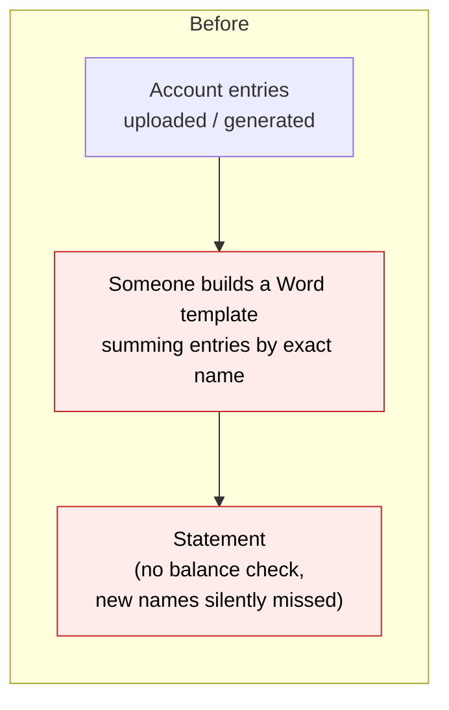
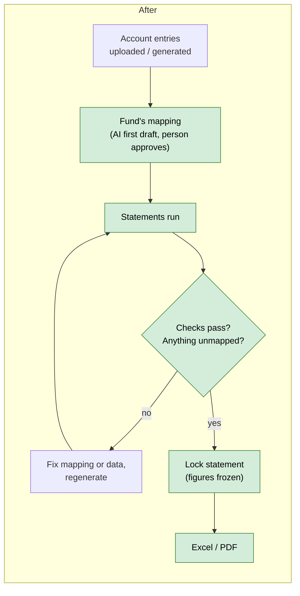
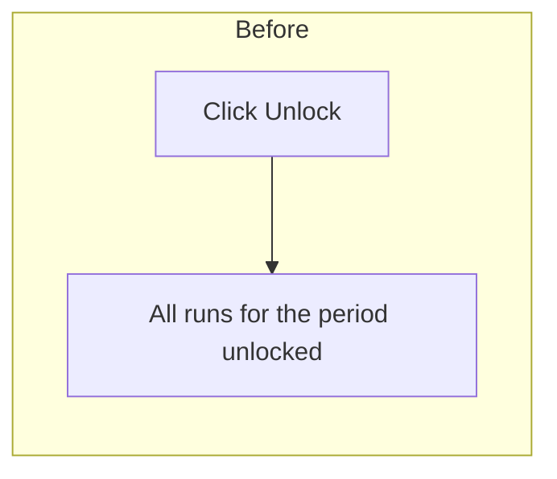
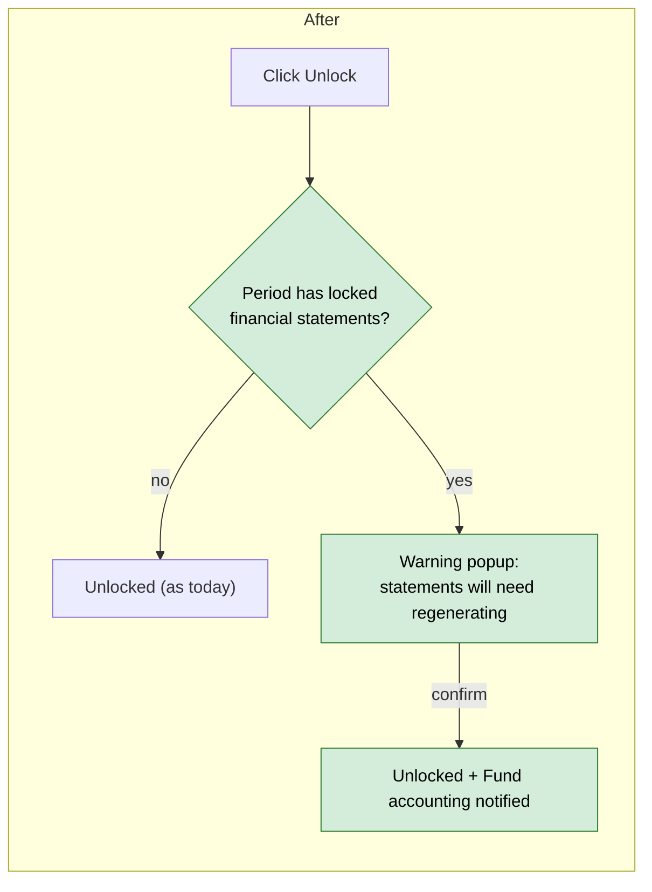

# Fund Financial Statements from Account Entries — Proposal

> **Audience:** Business team, product, QA, support — non-technical.
> **Companion document:** [Design](design.md)

> **Planning phase — no code changes.** This document proposes and explains the change. Do not
> edit application code while writing it; implementation happens later, in the tasks phase.

---

## Why

Funds want their **Balance Sheet** and **Profit & Loss (P&L)** — plus the Statement of Changes
in Partners' Capital and supporting schedules — out of CapHive. Today the numbers are already in
CapHive as **account entries** (uploaded by the fund admin or generated by fund formulas), but the
only way to get a statement is a hand-built Word template that sums entries by their exact names —
it breaks the moment a fund names an expense differently, and nothing checks that the Balance
Sheet balances.

This is the **lightweight alternative** to the full double-entry ledger scoped in
`docs/modules/accounting/fund_ledger_requirements_questions.md`: no debits/credits, no journals —
the statements are built from the account entries the fund already has, through a per-fund
**mapping** and **integrity checks**.

## What Changes

Think of it as a **seating plan**. The account entries are the guests (hundreds of names per
fund: "Audit Fees", "Custody Fees", one "Deal Expense" per portfolio company…). The statement is
the table plan (a few dozen lines: "Professional fees", "Investments at fair value"…). The
**mapping** says which guest sits at which table; anyone without a seat shows up on an
**Unmapped** list instead of silently going missing.

- **Everything comes from account entries.** Anything a statement needs that isn't an account
  entry yet (contributions, distributions, investments at fair value) is pulled in with the fund
  formulas the fund already uses.
- **Per-fund mapping screen.** Each fund has its own **statement accounts** (e.g. *Professional
  fees*, typed as an expense) and **mapping rules** (e.g. *every "Non Deal Expense" named "Audit
  Fees"* → *Professional fees*; *every "Deal Expense"* → *Transaction costs*; *every "Portfolio
  Allocation"* → *excluded*). A live preview shows each line's figure as rules change.
- **AI first draft of the mapping.** Upload the fund's last financial statements (PDF/Excel). The
  AI proposes the accounts, layout and rules, then **checks its own proposal against the printed
  figures** — any line that doesn't match is flagged for the reviewer. Nothing is saved until a
  person approves.
- **Statements are produced by a "statements run".** A new kind of fund formula turns the mapping
  into statement-line account entries. It runs in its **own allocation run**, separate from the
  fund's accounting run, so it can be generated (and regenerated) after the accounting run is
  locked, without touching any other numbers.
- **Statements you choose.** Balance Sheet, P&L and Changes in Partners' Capital come with every
  fund; schedules (expenses, income, investments, commitments, fees…) are added as needed — see
  [Statements a fund can generate](#statements-a-fund-can-generate).
- **Built-in checks** on every set of statements: the Balance Sheet balances (assets − liabilities =
  partners' capital); partners' capital = the fund's NAV; sum of investor capital accounts =
  partners' capital; opening capital + movements = closing capital.
- **Locking a statement freezes a copy** of every figure. Later edits to the underlying data are
  shown as a **"changed since locked"** warning, and next year's comparative columns use the
  frozen copy, not recomputed numbers.
- **Excel and PDF** download of each statement.
- **Allocation-run unlocks warn first** when the period has locked financial statements, and the
  fund's accounting team is notified.

### Statements a fund can generate

Every fund gets the three core statements; it can add any number of **schedules** of its own. Each
statement is just a layout over the same mapped accounts, so adding one needs no new data.

| Statement | Also called | Shows | Columns | Typical lines |
|---|---|---|---|---|
| **Balance Sheet** (core) | Statement of Assets, Liabilities and Partners' Capital; Statement of Net Assets | What the fund owns and owes at the period end | At period end · prior financial year-end | Investments at fair value, Cash, Receivables, Accrued expenses, Payable to manager, Partners' capital |
| **Profit & Loss** (core) | Statement of Operations; Income Statement | Income, expenses and gains for the period | This period · year to date · same period last year | Dividend income, Interest income, Management fees, Professional fees, Fund expenses, Realised gain, Change in unrealised gain, Net increase from operations |
| **Statement of Changes in Partners' Capital** (core) | Statement of Changes in Net Assets | How partners' capital moved from opening to closing | This period · year to date · same period last year | Opening capital, Contributions, Distributions, Net increase from operations, Closing capital |
| Schedule of Fund Expenses (optional) | Expense note | Every expense line in detail | This period · year to date | Audit fees, Legal fees, Custody fees, Bank charges, Director fees, Organisation costs |
| Schedule of Investment Income (optional) | Income note | Income by source | This period · year to date | Dividends by portfolio company, Interest on temporary investments |
| Schedule of Investments – cost vs fair value (optional) | Portfolio summary | Cost and fair value of holdings at the date | At period end | Cost of investments, Unrealised gain, Investments at fair value |
| Commitments summary (optional) | Unfunded commitments note | Commitments, called and uncalled capital | At period end | Total commitments, Capital called, Unfunded commitments |
| Management fee computation (optional) | Fee note | How the period's fee was arrived at | This period · year to date | Fee base, Management fee, Fee offsets, Net management fee |

A schedule can only show figures that exist as account entries (directly or via a fund formula), so
the last four depend on the fund already producing those entries — which most funds do today
(e.g. *Portfolio FMV*, *Commitment*, *Management fees*).

### Flow Diagram

**Producing a fund's financial statements** — today a hand-built template sums exact names;
after, a mapping turns all entries into checked statements.





**Unlocking an allocation run** — today unlocking is silent; after, a period with locked
statements warns first and tells the accounting team.





---

## User Stories

### US-1: Set up statement accounts and layout

**As a** fund admin or accountant,
**I want** to define my fund's statement accounts and the order they print in,
**So that** the statements look like the ones my fund already publishes.

**Acceptance criteria:**
- The fund's Actions menu (next to Allocate) opens a **Financial Statements** page with tabs **Statements**, **Mapping** and
  **Layout**.
- Each statement account has a name, a type (Asset, Liability, Partners' capital, Income,
  Expense, Gain/Loss) and a behaviour (**Balance** = value at the date, **Movement** = change over
  the period).
- Every fund starts with the three core statements — **Balance Sheet**, **Profit & Loss** and
  **Statement of Changes in Partners' Capital** — which can be renamed (e.g. "Statement of
  Operations") but not deleted.
- **Add schedule** creates an extra statement (e.g. "Schedule of Fund Expenses") with a name and a
  column style: **At a date** (like the Balance Sheet) or **For a period** (like the P&L).
- The Layout tab lists, per statement, sections, accounts and subtotals in order; rows can be
  reordered by drag and drop.
- An account can be used by more than one statement (e.g. *Net increase from operations* on the
  P&L and on Changes in Partners' Capital; *Audit fees* on the P&L total and in the Schedule of
  Fund Expenses).

### US-2: Map account entries to statement accounts

**As a** fund admin or accountant,
**I want** to say which account entries feed each statement account,
**So that** every entry lands on exactly one line, or is deliberately excluded.

**Acceptance criteria:**
- A rule matches by **entry type** and optionally an **exact name**. "Entry type only" catches
  every name of that type, including names added later.
- A rule either points to a statement account or **Excludes** the entries.
- When an entry matches several rules, the **exact-name** rule wins over the entry-type-only rule.
- The **Unmapped** panel lists every fund-level entry type + name that has amounts in the chosen
  period but no rule, with its total, and a **Map** button.
- A **Preview** column shows each account's figure for a chosen period, updating as rules change
  without running anything.

### US-3: AI first draft of the mapping

**As a** fund admin onboarding a fund,
**I want** to upload the fund's last statements and have the mapping proposed for me,
**So that** I don't build it line by line.

**Acceptance criteria:**
- **Suggest from statements** accepts one PDF or Excel file and a "statements as at" date.
- The result is a **draft**: proposed accounts, layout and rules, each with a **Printed figure**
  (from the upload), a **CapHive figure** (from the account entries) and a ✓ / ⚠ match marker.
- Nothing is saved until **Approve draft**; **Discard** throws it away.
- If the fund already has a mapping, the draft is shown as additions/changes against it.

### US-4: Generate statements for a period

**As a** fund admin or accountant,
**I want** to generate the fund's statements for a quarter or year,
**So that** I can review and publish them.

**Acceptance criteria:**
- **Generate statements** asks for a period (start/end date) and creates a **Draft statement set**
  for that period: the Balance Sheet, P&L, Changes in Partners' Capital and every schedule the
  fund has, generated together so they agree with each other.
- It is refused, with a message, when: there is no successful accounting run covering the
  period; any allocation run is in progress on the fund; the fund has no statement formula.
- The set opens on the Balance Sheet with a statement switcher (Balance Sheet · P&L · Changes in
  Partners' Capital · schedules). Period statements (P&L, Changes, period schedules) show
  **this period / year to date / same period last year**; date statements (Balance Sheet, date
  schedules) show **at period end / prior financial year-end**.
- A **Checks** panel shows each integrity check as Passed / Failed with the difference.
- An **Unmapped** count is shown; a draft with unmapped entries can be viewed but **not locked**.
- **Regenerate** replaces a draft's figures; earlier figures are not kept for drafts.

### US-5: Lock a statement

**As an** accountant,
**I want** to lock a reviewed statement,
**So that** its figures are fixed for investors, auditors and next year's comparatives.

**Acceptance criteria:**
- **Lock** is enabled only when all checks pass and nothing is unmapped.
- Locking freezes a copy of every figure, the mapping used and the check results.
- A locked statement shows "Locked on 15 Oct 2026 by …".
- **Download Excel** and **Download PDF** are available on drafts (watermarked "DRAFT") and
  locked statements.

### US-6: See when locked figures no longer match the data

**As an** accountant,
**I want** to be told when data behind a locked statement has changed,
**So that** I'm never surprised by numbers that moved.

**Acceptance criteria:**
- Opening or downloading a locked statement recomputes it from current data; if any line
  differs, a yellow banner lists the lines, old → new figures.
- Generating the next period flags any comparative column whose source statement has drifted.

### US-7: Unlocking a period with locked statements

**As an** accountant,
**I want** a warning before an allocation-run unlock touches a period whose statements are locked,
**So that** published statements aren't changed by accident.

**Acceptance criteria:**
- Unlock / Unlock all shows a confirm popup listing the affected locked statements.
- After confirming, the statements go back to **Draft** and Fund accounting is notified.

---

## UI Behavior

### Fund › Financial Statements › Statements

```
┌────────────────────────────────────────────────────────────────────────────┐
│ Alpha Fund I  ›  Financial Statements                                       │
│ [Statements] [Mapping] [Layout]                       [Generate statements] │
│                                                                            │
│  Period                 Status   Checks      Unmapped  Locked by            │
│  01 Jul 26 – 30 Sep 26  Draft    3/4 ✗       2         —            [Open]  │
│  01 Apr 26 – 30 Jun 26  Locked   4/4 ✓       0         R. Iyer      [Open]  │
│  01 Jan 26 – 31 Mar 26  Locked ⚠ 4/4 ✓       0         R. Iyer      [Open]  │
└────────────────────────────────────────────────────────────────────────────┘
```

### Statement view

```
┌────────────────────────────────────────────────────────────────────────────┐
│ Q3 2026 statements                           Draft   [Regenerate] [Lock]    │
│ [Balance Sheet] [P&L ●] [Changes in Capital] [Sch. Expenses] [Sch. Income]  │
│ Profit & Loss (Statement of Operations)                                     │
│ Built from accounting run #3331 (locked)     [Excel] [PDF]                  │
│ ⚠ 2 unmapped entries — Lock disabled   [View]                               │
│                                                                            │
│                              QTD Q3 26    YTD 2026    YTD 2025 (as locked)  │
│ Investment income                                                          │
│   Dividend income              12,000       30,500          18,200          │
│   Interest income               4,100       11,900           9,050          │
│ Expenses                                                                   │
│   Management fees            (250,000)    (750,000)       (750,000)         │
│   Professional fees           (45,200)    (101,300)        (88,400)         │
│ Net investment loss          (279,100)    (808,900)       (811,150)         │
│ ...                                                                        │
│ Checks: ✓ Balance  ✓ NAV tie-out  ✗ Partners' capital tie-out (diff 1,200)  │
│         ✓ Roll-forward                                                      │
└────────────────────────────────────────────────────────────────────────────┘
```

### Mapping

```
┌────────────────────────────────────────────────────────────────────────────┐
│ Mapping                     Preview period: [Q3 2026 ▾]  [Suggest from      │
│                                                           statements]       │
│  Entry type          Name           →  Statement account     Preview        │
│  Non Deal Expense    Audit Fees     →  Professional fees      30,000        │
│  Non Deal Expense    Legal Fees     →  Professional fees      15,200        │
│  Deal Expense        (any)          →  Transaction costs      62,400        │
│  Portfolio Allocation (any)         →  Excluded                  —          │
│                                                     [+ Add rule]            │
│ Unmapped (2)                                                               │
│  Non Deal Expense    Director Fees        8,000                     [Map]   │
│  Tax                 TDS                  1,150                     [Map]   │
└────────────────────────────────────────────────────────────────────────────┘
```

**Behavior notes:**
- The preview updates in place (Turbo Frame) when a rule is added, edited or deleted.
- **Map** opens the add-rule form pre-filled with the entry type and name.
- Tables, tabs and forms reuse the existing fund-page styling.

### Unlock warning (allocation runs)

```
┌───────────────────────────────────────────────────┐
│ Unlock allocation runs for 01 Jul – 30 Sep 2026?  │
│ ┌───────────────┐ ┌───────────────┐ ┌───────────┐ │
│ │ 2 runs        │ │ Q3 2026       │ │ Fund      │ │
│ │ unlocked      │ │ statements    │ │ accounting│ │
│ │               │ │ back to Draft │ │ notified  │ │
│ └───────────────┘ └───────────────┘ └───────────┘ │
│                         [Cancel]  [Unlock anyway] │
└───────────────────────────────────────────────────┘
```

---

## What This Feature Does NOT Cover

| Excluded | Covered In |
|---|---|
| Debits/credits, journals, trial balance, period close | Full fund ledger (`docs/modules/accounting/fund_ledger_requirements_questions.md`) |
| Cash Flow Statement; full Schedule of Investments (each holding, industry, % of net assets); notes text | Later phase (a cost-vs-fair-value summary schedule *is* possible in v1) |
| Statements per investor (LP's share) | Later phase — by allocating statement lines with existing formulas |
| Keeping several versions of a locked statement ("as restated") | Later phase; v1 keeps only the latest frozen copy |
| A statement lock independent of allocation-run unlocks | Later phase; v1 warns instead |
| Stopping edits/deletes of account entries in locked periods | Separate change (would alter account entries) |
| Pushing statements to Xero/Tally | `xero-pull-sync` / ledger phase 2 |
| Bulk generation across funds | Later phase |

---

## Validation Rules

| Field | Rule | Default |
|---|---|---|
| Statement name | Required, unique within the fund, ≤ 100 chars; the three core statements can be renamed, not deleted | Balance Sheet / Profit & Loss / Statement of Changes in Partners' Capital |
| Schedule column style | At a date, or For a period | For a period |
| Statement account name | Required, unique within the fund, ≤ 100 chars | — |
| Statement account type | One of Asset, Liability, Partners' capital, Income, Expense, Gain/Loss | — |
| Statement account behaviour | Balance or Movement | Asset/Liability/Partners' capital → Balance; others → Movement |
| Mapping rule entry type | Required | — |
| Mapping rule name | Optional; blank = all names of that entry type | blank |
| Mapping rule target | A statement account of this fund, or Excluded | — |
| Mapping rule uniqueness | Only one rule per (entry type, name) per fund | — |
| Financial-year start month | 1–12 | 1 (January) |
| NAV entry / Capital entry (for checks) | Optional entry type + name; blank = that check is skipped | blank |
| Statement period | Start ≤ end; no other statement for the fund with the same period | — |
| Lock | All checks passed and Unmapped = 0 | — |
| Suggest upload | One PDF/XLSX/XLS file, ≤ 20 MB | — |

---

## Behavior Rules

| Scenario | What User Sees |
|---|---|
| Generate with no successful accounting run covering the period | "Run and complete the fund's allocations for this period first." |
| Generate while an allocation run is in progress on the fund | "An allocation run is in progress for this fund. Try again when it finishes." |
| Generate on a period whose accounting run is locked | Allowed — the statements run only replaces statement lines |
| Ordinary (untagged) allocation run | Does not produce or delete statement lines |
| New expense name uploaded after the mapping was built, type already mapped by "any name" rule | Included automatically |
| New expense name with no matching rule | Appears under Unmapped; Lock disabled |
| Entry type mapped by "any name" rule and one name mapped exactly | Exact rule wins for that name |
| Check fails | Statement viewable and downloadable as draft; Lock disabled; failing check shows the difference |
| Account entry behind a locked statement edited/deleted | Yellow "changed since locked" banner on the statement listing changed lines |
| Allocation run unlock covering a locked statement's period | Confirm popup; on confirm statement → Draft, Fund accounting notified |
| Prior-period statement not available for comparatives | Column computed from current data and headed "Not locked — computed" |
| Prior-period statement drifted | Comparative shows locked figures with ⚠ "changed since locked" |
| AI suggestion line doesn't match printed figure | Line marked ⚠ with both figures; reviewer must fix or accept before approve |

---

## Resolved Design Decisions

| # | Decision | Resolution |
|---|---|---|
| 1 | Ledger or mapping? | Mapping over account entries; no double entry. |
| 2 | Where do non-entry figures (contributions, FMV) come from? | Pulled into account entries by existing fund formulas. |
| 3 | Mapping per entity or per fund? | **Per fund.** |
| 4 | How is the mapping maintained? | In the UI; AI drafts the first one from existing statements. |
| 5 | Compute statement lines on read, or store them? | Stored as account entries by a new statement formula, in a **separate statements run**. |
| 6 | Statements run vs the fund's locked accounting run | Separate runs; the statements run is allowed on a period whose other runs are locked. |
| 7 | Comparatives | From the prior statement's **frozen copy**, never recomputed. |
| 8 | Protection against historical data changes | v1 accepts the risk; guards: frozen copy, drift banner, unlock warning, notification. |
| 9 | Accounting standard | Layout is the fund's own; US GAAP-style statement names used in examples only. |

---

## Capabilities

### New Capabilities

- `funds/financial-statement-mapping`: per-fund statement accounts, layout, mapping rules,
  unmapped list, live preview, AI-drafted mapping from uploaded statements.
- `funds/financial-statement-generation`: statement formula rule type, separate statements run,
  run guards, integrity checks.
- `funds/financial-statements`: statement records, lock with frozen copy, comparatives, drift
  warning, unlock warning and notification, Excel/PDF output.

### Modified Capabilities

<!-- None: allocation runs have no spec under openspec/specs; their changed guards are specified
     in funds/financial-statement-generation. -->

---

## Impact

- **Fund page**: new Financial Statements page (statements, mapping, layout), opened from the fund's Actions menu.
- **Fund formulas**: one new formula type for statement lines; ordinary allocation runs skip it.
- **Allocation runs**: the "period is locked" block lets statement-only runs through; unlock
  shows a warning when locked statements exist.
- **Account entries**: unchanged. New statement-line entries appear with entry type
  "Financial Statement".
- **AI**: one new document-reading prompt for the mapping draft.
- **Notifications**: one new internal notification to Fund accounting.

---

## Benefits

1. Statements from data the fund already has, without a parallel bookkeeping system.
2. New expense names can't silently drop out — they're caught as Unmapped.
3. Every statement is checked to balance and to tie to NAV and investor capital accounts.
4. Onboarding a fund's mapping takes minutes with the AI draft, verified against its own
   published figures.
5. Published figures and comparatives can't silently change; any later change is flagged.

---

## FAQ

| Question | Answer |
|---|---|
| Who can use this? | Employees with access to the fund; editing the mapping and locking need update rights on the fund. |
| Does it change existing account entries or allocations? | No. Ordinary allocation runs work exactly as today and skip statement formulas. |
| What happens to existing data? | Nothing to migrate. A fund starts using it by creating a mapping. |
| Do investors see these statements? | Not in v1 — fund team only. |
| Is it a replacement for the fund's accounting system? | No. It produces management/investor-facing statements from CapHive's data. |
| What if someone unlocks and reruns allocations after statements are locked? | It's allowed; they get a warning first, the statement goes back to Draft, and Fund accounting is notified. The frozen copy still shows what was published. |
| Are uploaded statements used for anything else? | Only to draft the mapping. Their figures are not imported. |
| Notifications? | One internal alert to Fund accounting when a locked statement's period is unlocked. See design. |

---

## Design Principle for the Next Phase

Keep it DRY and simple:
- **One calculator** computes statement figures for the preview, the AI check, the statements
  run and the drift check — never four separate implementations.
- The statement formula should follow `GeneratePortfolioNumbersForFund` (runs once per fund);
  the allocation engine otherwise stays untouched.
- Aggregate account entries in SQL (`GROUP BY`), never load rows — the table is very large.
- Reuse fund-page tabs/tables, existing confirm-popup cards, `DocLlmContext` / `LlmService`,
  existing XLSX/PDF generation, and the existing notifier base.
- Risk to address head-on: the **lock-check change** for statement-only runs and the
  **unlock cascade** — keep both as small, explicit rules.
