# Fund Market Data — Design

> **Audience:** Engineering team.
> **Companion documents:** [Proposal](proposal.md) · [Spec](specs/) · [Business rules](business-rules.md) · [LLD](lld.md) · [QA checklist](qa-checklist.md) · [Tasks](tasks.md)

> **Planning phase — no code changes.** This document explains HOW the proposal will be built.

> **Zoom one picture.** Part 1 draws the picture in plain words, Part 2 redraws it with real names,
> Part 3 has one card per box, Part 4 is reference. ①–⑧ mean the same box everywhere.

> **Branch.** Built on `market-data`, branched from `main`. Boxes ①–⑦ need nothing from open-ended
> funds. Box ⑧ (the open-ended NAV) is built last, after `market-data` is merged into `open-ended-funds` — see
> [Bridge to open-ended funds](#bridge-to-open-ended-funds-the-nav-part).

---

## Contents

- [1. The idea](#1-the-idea)
  - [What this adds](#what-this-adds)
  - [The idea in one picture](#the-idea-in-one-picture)
  - [Walkthrough: one example, start to finish](#walkthrough-one-example-start-to-finish)
  - [Key ideas](#key-ideas)
- [2. The same picture with real names](#2-the-same-picture-with-real-names)
  - [Picture](#picture)
  - [What each box does](#what-each-box-does)
  - [One run, end to end](#one-run-end-to-end)
  - [Lifecycles](#lifecycles)
  - [What users see](#what-users-see)
  - [Bridge to open-ended funds (the NAV part)](#bridge-to-open-ended-funds-the-nav-part)
  - [Design decisions](#design-decisions)
- [3. One card per box](#3-one-card-per-box)
  - [① Switches](#①-switches)
  - [② Feeds](#②-feeds)
  - [③ Rate store](#③-rate-store)
  - [④ Price store](#④-price-store)
  - [⑤ Resolvers](#⑤-resolvers)
  - [⑥ Derivatives](#⑥-derivatives)
  - [⑦ Fund figures](#⑦-fund-figures)
  - [⑧ Open-ended NAV](#⑧-open-ended-nav)
- [4. Reference](#4-reference)
  - [Class diagram](#class-diagram)
  - [Data model and schema changes](#data-model-and-schema-changes)
  - [Component contracts](#component-contracts)
  - [Notifications](#notifications)
  - [Cross-cutting concerns](#cross-cutting-concerns)
  - [Worked examples](#worked-examples)
  - [Testing](#testing)
  - [Risks and open questions](#risks-and-open-questions)

---

## 1. The idea

### What this adds

Every rate and price now carries a **source** (manual, market, derived, cost), and every fund carries
a **policy** saying which sources it accepts, held in a new fund flag set modelled on
`EntityEnabled`. One rate resolver and one price resolver apply that policy at every place CapHive
converts money or values a holding, so the existing computations (FMV, conversions, tracking
currency, NAV) pick the right number without each learning about sources. Feeds and derivatives are
new producers that write into the same stores.

### The idea in one picture

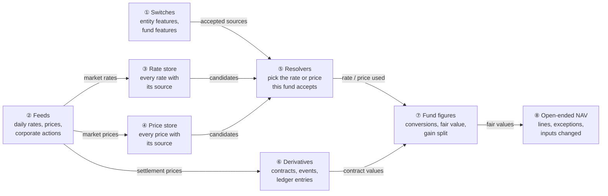

### Walkthrough: one example, start to finish

Caphive Capital (INR) runs Growth AIF II (Manual only), Bridge Hybrid Fund (Manual + Derived rates,
Manual + Market prices) and Horizon Evergreen Fund (everything on). All three hold Nimbus Inc
(USD). Data as in [Shared setup](business-rules.md#shared-setup).

**Legend:** ✓ done · **●** we are here — waiting on this, not done yet · ○ not started.

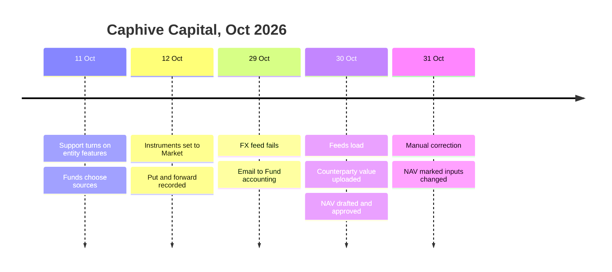

**Phase 1 — set-up**

| # | When | What happens | Behind the scenes | Result&nbsp;(state&nbsp;after)&nbsp;&nbsp;&nbsp;&nbsp;&nbsp;&nbsp;&nbsp;&nbsp; |
|---|---|---|---|---|
| 1 | 11 Oct | Support ticks Market FX rates, Market prices, Derivatives | the switches (①) set three entity flags | ✓&nbsp;Switch&nbsp;on&nbsp;entity&nbsp;features<br>**●&nbsp;Choose&nbsp;fund&nbsp;features**<br>○&nbsp;Price&nbsp;holdings |
| 2 | 11 Oct | Meera chooses each fund's sources | the switches (①) set fund flags; existing six switches already copied | ✓&nbsp;Switch&nbsp;on&nbsp;entity&nbsp;features<br>✓&nbsp;Choose&nbsp;fund&nbsp;features<br>**●&nbsp;Price&nbsp;holdings** |
| 3 | 11 Oct | Turning on Accept market FX rates for Horizon | the fund figures (⑦) recompute Horizon's fair values through the resolvers (⑤); nothing booked moves | Same as row 2 |
| 4 | 12 Oct | ACMEIND set to Market (Nimbus stays Manual); put and forward recorded | the price store (④) gets identifiers; derivatives (⑥) post the ₹40,000 premium | ✓&nbsp;Switch&nbsp;on&nbsp;entity&nbsp;features<br>✓&nbsp;Choose&nbsp;fund&nbsp;features<br>✓&nbsp;Price&nbsp;holdings |

**Phase 2 — the feed, a failure, and the NAV**

| # | When | What happens | Behind the scenes | Result&nbsp;(state&nbsp;after)&nbsp;&nbsp;&nbsp;&nbsp;&nbsp;&nbsp;&nbsp;&nbsp; |
|---|---|---|---|---|
| 5 | 29 Oct 18:30 | ECB via EUR is down | the feeds (②) retry, mark the run *failed*, email Fund accounting once | ✓&nbsp;Load&nbsp;29&nbsp;Oct&nbsp;rates&nbsp;(failed,&nbsp;emailed)<br>○&nbsp;Load&nbsp;30&nbsp;Oct&nbsp;rates<br>○&nbsp;Draft&nbsp;NAV |
| 6 | 30 Oct 10:00 | Meera drafts the NAV before the evening run | the open-ended NAV (⑧) asks the resolvers (⑤); the latest accepted USD→INR is 26 Oct, 4 business days old, so it becomes a rate-age exception (not a block); Meera waits for the feed | **●&nbsp;Load&nbsp;30&nbsp;Oct&nbsp;rates**<br>○&nbsp;Draft&nbsp;NAV |
| 7 | 30 Oct 18:30 | Feeds load USD→INR 85.00, ACMEIND ₹1,250, put ₹333.33 (Meera enters Nimbus $120 by hand) | the feeds (②) write market rows to the rate store (③) and price store (④), recompute each holding once; derivatives (⑥) store the put value and post −₹15,000.25 | ✓&nbsp;Load&nbsp;30&nbsp;Oct&nbsp;rates<br>**●&nbsp;Draft&nbsp;NAV** |
| 8 | 30 Oct 19:00 | Meera uploads Bank X's forward value −₹1,50,000 and drafts | the open-ended NAV (⑧) sums fair values from the fund figures (⑦) and contract values from derivatives (⑥); the ACMEIND move (+22.5 %) becomes an exception | ✓&nbsp;Draft&nbsp;NAV<br>**●&nbsp;Clear&nbsp;exceptions**<br>○&nbsp;Approve&nbsp;NAV |
| 9 | 30 Oct 19:10 | Arjun accepts the exception and approves at ₹108.44 | the open-ended NAV (⑧) stores the acceptance; approve check passes | ✓&nbsp;Draft&nbsp;NAV<br>✓&nbsp;Clear&nbsp;exceptions<br>✓&nbsp;Approve&nbsp;NAV |

Row 6 is the stall: an old rate does not block the NAV — it shows as an exception. Only a pair
with *no* accepted rate at all blocks.

**Phase 3 — a correction (the undo)**

| # | When | What happens | Behind the scenes | Result&nbsp;(state&nbsp;after)&nbsp;&nbsp;&nbsp;&nbsp;&nbsp;&nbsp;&nbsp;&nbsp; |
|---|---|---|---|---|
| 10 | 31 Oct | Meera adds Manual USD→INR 84.80 for 30 Oct | the rate store (③) keeps both rows; the resolvers (⑤) now return 84.80 for Market-accepting funds; Growth AIF II is not recomputed | ✓&nbsp;Approve&nbsp;NAV<br>**●&nbsp;Review&nbsp;inputs&nbsp;changed** |
| 11 | 31 Oct | Horizon's approved NAV shows *Inputs changed* | the open-ended NAV (⑧) fingerprint now includes exchange rates; the approved NAV is never rebuilt | Same as row 10 |

**Snapshot — Horizon NAV draft at row 8**

```
Investments at fair value  ₹4,02,00,000   (ACMEIND Market·NSE, Nimbus Manual $120 · ECB via EUR 85.00, Pvt Co A Manual·30 Sep 30d)
Derivative assets              ₹25,000   (Nifty put, Market·NSE)
Cash / Other assets        ₹35,00,000
Derivative liabilities     − ₹1,50,000   (FX forward, Upload·Bank X)
Mgmt fee payable           − ₹2,00,000
NAV                        ₹4,33,75,000   ÷ 4,00,000 = ₹108.44
⚠ ACMEIND moved +22.5% (₹1,020 → ₹1,250); threshold 10%   [Accept] [Fix]
```

**What to notice**
- The same holding has three values in three funds; the only thing that differs is the fund's
  policy given to the resolvers (⑤).
- Booked amounts never move; only current fair values follow a policy or rate change.
- Feeds never overwrite people: manual rows win ties, and a purchase writes a *cost* row.
- The NAV gets policy-aware values for free, because it already reads fair value through
  `fmv_on_date`.

### Key ideas

| # | Idea | In one line | Card |
|---|---|---|---|
| 1 | Source on every row | Rates: manual / market / derived, entity-wide or owned by one fund. Prices: manual / market / cost. One row per source (and owner) per date. Market rows belong to the entity that loaded them. | [③](#③-rate-store), [④](#④-price-store) |
| 2 | Policy per fund | Fund flags say which sources the fund accepts; manual is always in. | [①](#①-switches) |
| 3 | One resolver each | Most recent accepted row on or before the date; ties by precedence. All callers go through it. | [⑤](#⑤-resolvers) |
| 4 | Derived rates are rows | Built on demand from accepted legs, stored as `derived` with leg links, never start jobs. | [③](#③-rate-store) |
| 5 | Feeds are producers | They write market rows and run records; they never decide what a fund uses. | [②](#②-feeds) |
| 6 | Derivatives are their own records | Contracts and events, valued by events, posted to the ledger. | [⑥](#⑥-derivatives) |
| 7 | NAV through seams | Part 4 adds lines, exceptions and fingerprint parts; values already arrive policy-aware. | [⑧](#⑧-open-ended-nav) |

**FAQ**

| Question | Answer |
|---|---|
| Does any existing fund's number change on deploy? | No. All rows backfill to `manual`, every fund's policy starts manual-only, so the resolvers return exactly today's "latest on or before" row. |
| Why not a per-fund rate table? | The same rate is shared by many funds; duplicating it per fund multiplies rows and corrections. A policy filter over one table is simpler. |
| Why can't a fund drop manual? | Manual is the only way to correct a feed value and is what AIFs use; making it optional adds a "no correction possible" state for no business gain. |
| Is the NAV blocked by an old rate? | No — an old rate is an exception to accept. Only a pair with no accepted rate at all blocks. |

---

## 2. The same picture with real names

### Picture

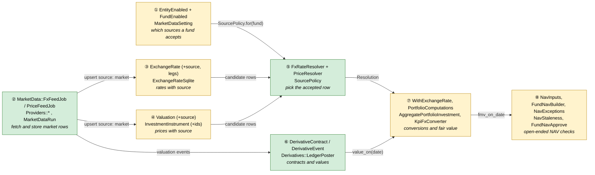

Colour = footprint: **green** new, **amber** modified, **grey** reused unchanged. Exact files are in
[lld.md File Map](lld.md#file-map). Box ⑧ is built only after `market-data` is merged into `open-ended-funds`.

### What each box does

| # | Box | Real parts | What it does | When it runs | What it decides | Details |
|---|---|---|---|---|---|---|
| ① | Switches | `EntityEnabled` (3 new flags), `FundEnabled` (new, `flag :features`), `MarketDataSetting`, `MarketData::SettingsController`, `funds/_features` partial | Stores entity features, fund features and limits | Request | Which sources a fund accepts; which screens appear | [card ① →](#①-switches) |
| ② | Feeds | `MarketData::FxFeedJob`, `MarketData::PriceFeedJob`, `MarketData::FeedRunner`, `MarketData::Providers::{Fbil,Ecb,NseEquity,BseEquity,Amfi,NseFo}`, `MarketData::PairsInUse`, `MarketDataRun`, `CorporateActionSuggestion`, `MarketDataOpsNotifier` | Fetches and upserts market rows; logs runs; suggests corporate actions | Cron (per region) and *Test feed* | Which pairs/instruments to fetch; run status | [card ② →](#②-feeds) |
| ③ | Rate store | `ExchangeRate`, `ExchangeRateShared`, `ExchangeRateSqlite`, `ImportExchangeRate`, `ExchangeRatePortfolioInvestmentJob`, `ExchangeRateCommitmentAdjustmentJob` | Holds rates with source; reacts to new rates | Request / job | Which jobs a new rate starts | [card ③ →](#③-rate-store) |
| ④ | Price store | `Valuation`, `InvestmentInstrument`, `ImportValuation`, `PortfolioInvestmentCreate#create_valuation`, `Investor#valuation_updated` | Holds prices with source; instrument identifiers | Request / job | Which recompute a new price starts | [card ④ →](#④-price-store) |
| ⑤ | Resolvers | `SourcePolicy`, `FxRateResolver`, `PriceResolver`, `FxRateResolver::Resolution`, `PriceResolver::Resolution` | Picks the accepted rate/price for a fund and date | Inline, memoised per call chain | Precedence, derivation, refusal | [card ⑤ →](#⑤-resolvers) |
| ⑥ | Derivatives | `DerivativeContract`, `DerivativeEvent`, `Derivatives::EventRecorder`, `Derivatives::LedgerPoster`, `Derivatives::Exerciser`, `ImportDerivativeValuation`, controllers, policies, `MarketData::DerivativeExpiryJob` | Records contracts and events; posts ledger; exercises into holdings | Request / cron | Event validity; ledger amounts | [card ⑥ →](#⑥-derivatives) |
| ⑦ | Fund figures | `WithExchangeRate`, `PortfolioComputations`, `AggregatePortfolioInvestment#fmv_on_date`, `Valuation#per_share_value_in`, `TrackingCurrencyJob`, `KpiFxConverter` | Existing conversions and fair values, now via ⑤; gain split | Request / job | — (delegates to ⑤) | [card ⑦ →](#⑦-fund-figures) |
| ⑧ | Open-ended NAV | `NavInputs`, `FundNavBuilder`, `NavExceptions` (new), `FundNav`, `NavStaleness`, `FundNavApprove`, `Evergreen::NavsController#accept_exception` | NAV lines, exceptions, staleness | Request | Block / exception / approve | [card ⑧ →](#⑧-open-ended-nav) |

### One run, end to end

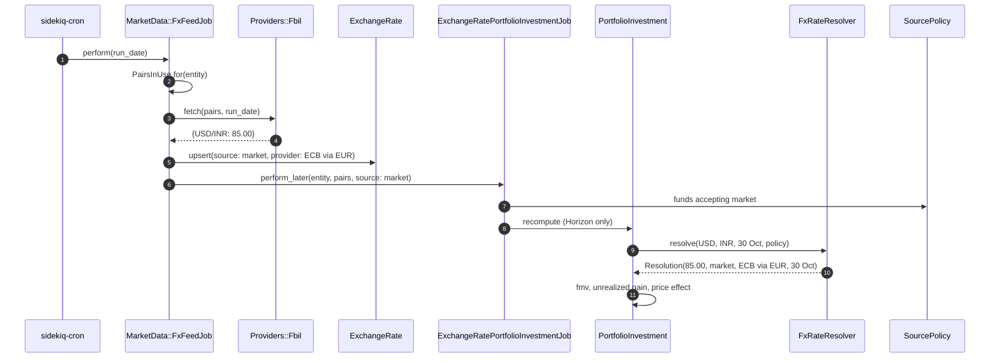

### Lifecycles

**MarketDataRun** (stored `status`)

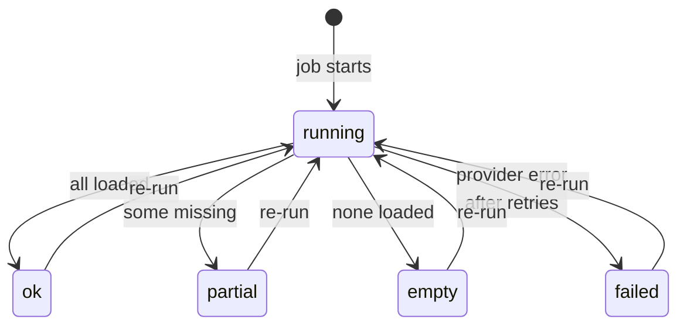

**DerivativeContract** (stored `status`, `open_lots`)

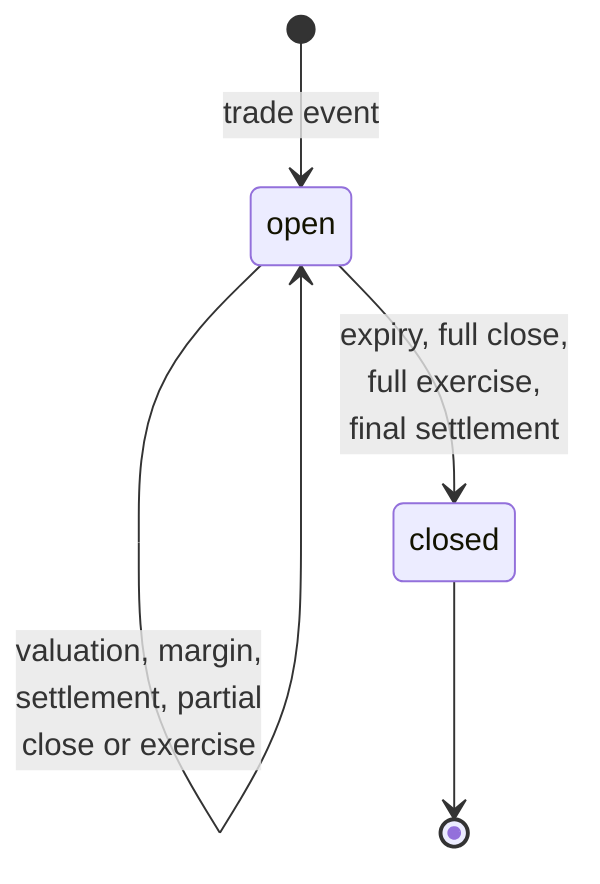

**CorporateActionSuggestion** (stored `status`)

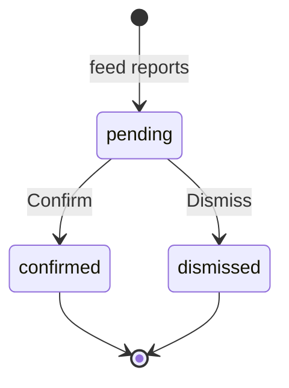

**NAV exception** (stored in `fund_navs.exceptions`, Part 4)

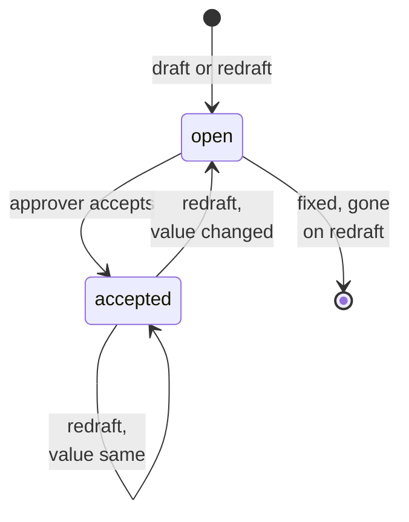

### What users see

**At a glance**

| Where in CapHive | Today | After this change | Who sees it |
|---|---|---|---|
| Admin › Entities › Edit | Entity features | + Market FX rates, Market prices, Derivatives | CapHive support |
| Entity › Settings | — | Market Data card | Entity admin |
| Fund › Edit | Six scattered checkboxes | One *Features* section (visibility, reporting, market data, limits) | Fund staff |
| Exchange Rates | Rate list | + Source, Provider, Rate type; Source filter | Entity users |
| Valuations / Instruments | Value list | + Source, Price type; ISIN, ticker, exchange, pricing method | Fund staff |
| Holding / API pages | Gain | + price effect / currency effect | Fund staff |
| Fund › Derivatives | — | New tab, contract page; exposure report and limit profile in phase 9 | Fund staff (feature on) |
| Portfolio › Corporate actions | — | New tab | Fund staff (Market prices) |
| Open-ended NAV draft | Lines | + derivative lines, sources/ages, Exceptions panel | Fund staff, approvers |

**Main everyday journey — Meera chooses a fund's features**

```
┌──────────────────────────────────────────────────────────────┐
│ Edit fund — Horizon Evergreen Fund                            │
│ ...existing fields...                                         │
│ Features ①                                                    │
│  Investor visibility  [✓] ratios [✓] units [ ] portfolio [ ] valuations
│  Reporting            [✓] AI commentary                       │
│  Market data ②                                                │
│   FX rates  [✓] Manual (always) ③  [✓] Market  [✓] Derived    │
│   Prices    [✓] Manual (always)    [✓] Market                 │
│   [✓] Derivatives                                             │
│  Limits (open-ended) ④  rate age [3] price age [3] move [10]%
│                                              [Save]           │
└──────────────────────────────────────────────────────────────┘
```

| Step | The user… | They see |
|---|---|---|
| ① | Opens Edit fund | The Features section with the six existing switches pre-ticked as before |
| ② | Looks at Market data | Only rows whose entity feature is on |
| ③ | Tries to untick Manual | It is disabled, tooltip "Hand-entered values are always accepted so a wrong feed value can be corrected" |
| ④ | Sets limits (open-ended only, Part 4) | Blank fields show the entity default as placeholder |
| — | Saves | Fund page; a popup-free success flash; fair values recompute in the background |

### Bridge to open-ended funds (the NAV part)

This change is built on `market-data`, branched from `main`, because ①–⑦ need nothing from
open-ended funds. **The plan (11 Oct 2026) is to merge `market-data` into `open-ended-funds`** once
phases 1–7 are green; phase 8 (box ⑧) is then built on `open-ended-funds`, where the evergreen NAV
code lives. If `open-ended-funds` reaches `main` first, the same phase 8 is built on `market-data`
after merging `main` in. Either way ⑧ is a thin last phase and nothing in ①–⑦ changes when it lands.

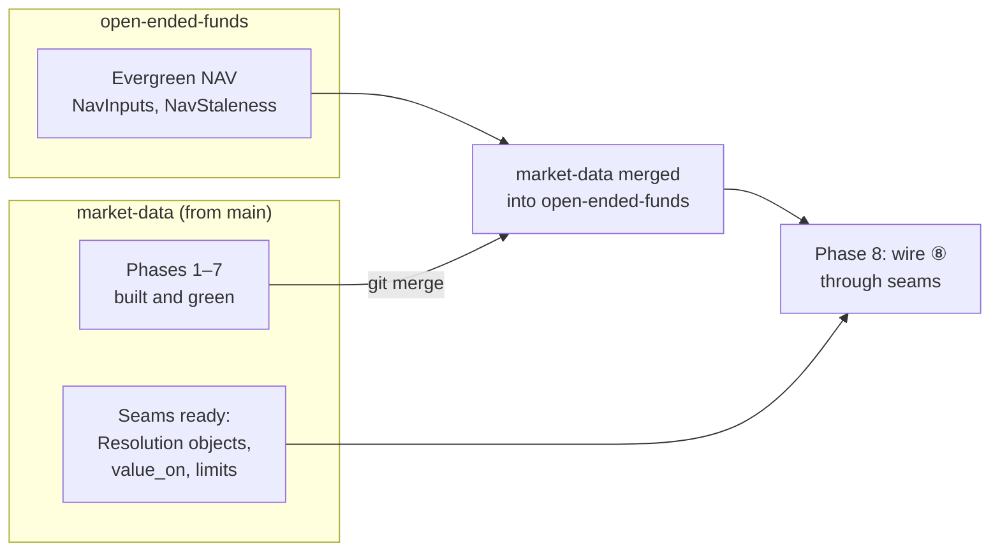

| Seam | Built in | What ⑧ does with it | Why it means no rework |
|---|---|---|---|
| `AggregatePortfolioInvestment#fmv_on_date(date)` goes through `PriceResolver` + `FxRateResolver` with the fund's policy | ⑤/⑦ (phases 2, 4) | `NavInputs#investments_fmv_cents` already sums `fmv_on_date` — values are policy-aware with **no NAV code change** | The NAV's investment line is untouched |
| `fmv_on_date(date, with_resolution: true)` returns the price and rate `Resolution`s used (source, provider, as_of, previous value) | ⑤ (phase 4) | `NavExceptions` reads them for moves, ages and the source/age shown per line | Exceptions need no second lookup |
| `DerivativeContract.value_on(fund, date)` and `.open_on(fund, date)` | ⑥ (phase 6) | `NavInputs#derivative_assets_cents` / `#derivative_liabilities_cents` | Contract valuation logic lives only in ⑥ |
| Fund limits in `market_data_settings` (not `evergreen_fund_settings`) via `MarketDataSetting.limits_for(fund)` | ① (phase 1) | NAV reads the limits; the Limits form group appears when `fund.evergreen_fund_setting` exists | Limits exist on `main` without evergreen tables |
| Entity flag bit order: this branch appends `enable_evergreen_funds` (same name, same position as on `open-ended-funds`) **before** its own three flags | ① (phase 1) | Nothing — identical line merges cleanly; bits never collide | Prevents a silent bit clash in `entities.permissions` |
| `FxRateResolver::MissingRate`, `PriceResolver::MissingPrice` raised with the message | ⑤ | `FundNavBuilder#gather_inputs` rescues them into `ctx[:errors]` exactly as it rescues `NavInputs::MissingValuation` | Same blocking path the NAV uses today |
| Fingerprint parts as class methods `MarketData::Fingerprint.rates(entity, date)` / `.derivatives(fund, date)` | ③/⑥ | `NavStaleness.common_parts` appends two aggregates | NAV staleness stays one mechanism |
| Spec: Part 4 requirements are ADDED requirements in `fx-rates`, `market-prices`, `derivative-contracts` | specs | At phase 8 start, on `open-ended-funds` (where `funds/fund-nav` is already in `openspec/specs/`), they are restated as MODIFIED deltas of `funds/fund-nav` (lines, staleness, approve) and removed from this change's capabilities | One source of truth for NAV requirements |

**Order on merge day**: (1) phases 1–7 green on `market-data`; (2) on `open-ended-funds`,
`git merge market-data` — expected conflicts only in `entity_enabled.rb` (identical flag line,
auto-resolves), `db/schema.rb`/`schema_test.rb` (both add tables; keep both) and
`config/initializers/sidekiq.rb` (both add cron entries; keep both); (3) run phases 1–7 features and
the evergreen NAV features on `open-ended-funds`; (4) start phase 8 there.

**The earlier proposal commit** `cbdf9d381` on `open-ended-funds` (change folder
`open-ended-market-data`, proposal only) is left as it is; this change (`fund-market-data`)
supersedes it.

### Design decisions

1. **Policy filter over one table, not per-fund rows.** Alternative: copy rates per fund. Rejected:
   N× rows, N× corrections, and booked records already point at shared `exchange_rate_id`s.
2. **Fund flags via `active_flag` (`FundEnabled`), migrating six booleans.** Alternative: new
   boolean columns per switch. Rejected: the user asked for entity-style flags; one bitfield gives one
   form section, one admin field type, one scope style (`where_features`).
3. **Manual always accepted.** Alternative: three free checkboxes. Rejected: a fund with no manual
   source cannot correct a bad feed value.
4. **Derived rates stored as `ExchangeRate` rows.** Alternative: compute on the fly and store
   nothing. Rejected: converted records keep `exchange_rate_id`; a derived rate with no row loses
   the audit trail of which rate was used.
5. **Purchase writes a `cost` valuation instead of skipping.** Alternative: skip for Market
   instruments only. Rejected: a manual-only fund holding a Market instrument would have no value.
   Source precedence (manual > market > cost) fixes the overwrite for everyone with one rule.
6. **Feeds as producers only.** Alternative: feed decides per fund what to store. Rejected: mixes
   fetching with policy; the resolver is the only place policy lives.
7. **Derivatives as separate tables, values from events.** Alternative: model as instruments with
   valuations. Rejected: negative values, notional, events and exercise don't fit holdings.
8. **No in-house pricing models.** Alternative: Black-Scholes/curves. Rejected: out of scope; auditors
   rely on independent marks.
9. **①–⑦ on their own branch, merged into `open-ended-funds` for ⑧.** Alternative: build all on
   `open-ended-funds`. Rejected by the user (11 Oct 2026): ①–⑦ are independent of open-ended funds;
   they are built from `main` and merged into `open-ended-funds` when ready.
10. **Fund-specific rates as an owner on the same table, entity-wide by default.** Alternative: a
    separate fund-rates table. Rejected: two lookups and two upload paths; one optional owner column
    lets the resolver add the fund's rows to the same candidate query. Same-date own > entity, latest
    wins otherwise — one rule, no "pinning".
11. **Market data stored per entity.** Alternative: one global market table shared by all
    entities. Rejected: providers are chosen per entity, tenant isolation stays a plain
    `entity_id` filter, and corrections in one entity can't leak into another.
12. **Business days = Monday–Friday** for age limits. Alternative: exchange holiday calendars.
    Rejected for now: a holiday makes a rate one day "older", which surfaces as an acceptable
    exception, never a wrong number.

**FAQ**

| Question | Answer |
|---|---|
| Why is ⑤ new rather than extending `ExchangeRateShared.get_rate`? | `get_rate` stays as a thin wrapper that builds an entity policy and calls `FxRateResolver`, so old call sites keep working while precedence and derivation live in one class. |
| What if `open-ended-funds` changes `NavInputs` again before merging? | ⑧ only touches three spots (two new methods, one rescue, two fingerprint parts); the rebase conflict surface is small and named in the bridge table. |
| Why store limits outside `evergreen_fund_settings`? | That table doesn't exist on `main`; putting limits in `market_data_settings` lets phase 1 ship them and keeps ⑧ to wiring. |
| Does the allocation engine (SQLite) see the same rates? | Yes — `FxRateResolver` takes the rate model as a parameter and runs the same query shape on `ExchangeRateSqlite` ([card ⑤](#⑤-resolvers)). |

---

## 3. One card per box

### ① Switches

Entity features (CapHive-managed) gate what exists; fund features choose what a fund uses; Market
Data settings hold feeds, the pivot currency, fund defaults and limits.

| Owns | Reads / receives | Produces |
|---|---|---|
| `entities.permissions` bits `enable_market_rates`, `enable_market_prices`, `enable_derivatives`; `funds.features`; `market_data_settings` | Admin form, entity settings form, fund form, `ImportFund` | `SourcePolicy.for(fund)`; effective limits; visibility of screens |

**Flags**

| Flag set | Position rule | Flags |
|---|---|---|
| `Entity#permissions` (`EntityEnabled`) | Append only; `enable_evergreen_funds` reserved first (bridge) | `… enable_workflow_templates enable_evergreen_funds enable_market_rates enable_market_prices enable_derivatives` |
| `Fund#features` (`FundEnabled`, new) | Append only | `show_fund_ratios show_fund_units show_portfolios show_valuations enable_ai_commentary editable_formulas accept_market_rates accept_derived_rates accept_market_prices enable_derivatives use_own_fx_rates` |

**Migrating the six booleans** — copy first, switch readers, drop later:

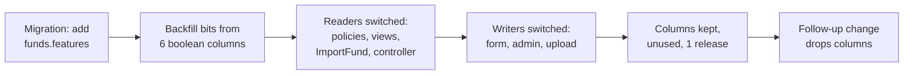

| Reader today | Becomes |
|---|---|
| `FundPolicy` `record.show_portfolios` | `record.features.show_portfolios?` |
| `FundRatioPolicy` scope `where("funds.show_fund_ratios = true")` | `joins(:fund).merge(Fund.where_features(:show_fund_ratios))` |
| `FundUnitPolicy`, `PortfolioInvestmentPolicy`, `AggregatePortfolioInvestmentPolicy` | same pattern |
| Views (`funds/_show`, `_show2`, `_investor_fund_details`, commitments `_card`, `_investor_details`, remittances `_details`, APIs `_index`, `account_entry_reports/_commentary`) | `fund.features.x?` |
| `FundsController#fund_params` | permits `features: []` (filtered through `FundFeatureGuard`) |
| `ImportFund` | sets the flags from the same two columns |
| `FundDashboard` (`editable_formulas`) | `ActiveFlagField` for `features` |

**Fund defaults on create**: `Fund` `after_initialize` (new records) sets `show_fund_units`,
`enable_ai_commentary` (today's column defaults) plus the entity's `fund_defaults`.

**`FundFeatureGuard`**: strips/refuses `accept_market_rates`, `accept_market_prices`,
`enable_derivatives` when the entity flag is off; always keeps manual implied (no flag for it).

**Routes**

| Verb and path | Action | Does | Responds with |
|---|---|---|---|
| GET `/market_data/settings` | `MarketData::SettingsController#show` | Entity card | HTML |
| PATCH `/market_data/settings` | `#update` | Save entity settings | redirect / 422 |
| POST `/market_data/settings/test_feed` | `#test_feed` | Dry-run fetch | turbo_stream popup |
| GET `/market_data/runs` | `MarketData::RunsController#index` | Run history | HTML |
| PATCH `/funds/:id` | `FundsController#update` (existing) | Saves `features` + `market_data_setting_attributes` | existing |

**Access**

| Role | Entity features | Market Data settings | Fund features |
|---|---|---|---|
| CapHive support | edit (Administrate) | edit | edit |
| Entity admin (`company_admin`) | view | edit | edit (any fund) |
| Fund staff with fund update | — | view | edit |
| Investor / advisor | — | — | — |

All reads are `entity_id`-scoped; `MarketDataSettingPolicy` uses `EntityPolicy#update?` for edit.

**Worked examples** ([business rules](business-rules.md)): H1, H2, H3, E1–E10, X1–X5

**FAQ**

| Question | Answer |
|---|---|
| Why keep the old columns for a release? | A rollback of the code must still read correct values; dropping is a separate, later change. |
| Why is there no `accept_manual` flag? | Manual is always accepted; a flag that can only be true is noise. |
| What happens to a fund flag when the entity feature is later switched off? | The fund bit is kept but ignored (`SourcePolicy` ANDs entity and fund), so switching the entity back on restores the fund's choice. |

### ② Feeds

Scheduled producers that fetch market data and upsert market rows. They never decide what a fund
uses.

| Owns | Reads / receives | Produces |
|---|---|---|
| `market_data_runs`, `corporate_action_suggestions`, provider adapters, cron entries | `MarketDataSetting` (feeds, providers, key), `PairsInUse`, Market instruments, listed contracts | Market `ExchangeRate` and `Valuation` rows, `DerivativeEvent` valuations, suggestions, emails |

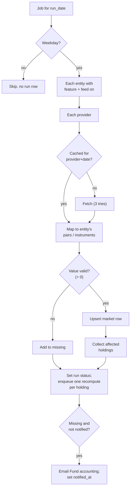

| Component | Queue | Retries | Idempotency | Transaction |
|---|---|---|---|---|
| `MarketData::FxFeedJob` | `:low` | provider fetch 3× with backoff inside job; job itself `retry: 1` | `market_data_runs` unique (entity, kind, provider, run_date); rate upsert on (entity, from, to, as_of, source) | per entity per provider |
| `MarketData::PriceFeedJob` | `:low` | same | valuation upsert on (instrument, owner, date, source) | per entity per provider |
| `MarketData::CorporateActionJob` (part of price run) | `:low` | same | suggestion unique (entity, provider_ref) | per suggestion |
| Test feed | inline (request) | none | stores nothing | none |

**Providers** (one small class each, same interface `fetch(keys, date) → {key => value}`):

| Provider | Kind | Key | Source file / API |
|---|---|---|---|
| `Fbil` | FX | pair (INR base) | ECB via EUR rates (daily) |
| `Ecb` | FX | pair (EUR base) | ECB euro reference rates (existing `eu_central_bank` gem) |
| `NseEquity` / `BseEquity` | Price | ticker | Daily bhavcopy |
| `Amfi` | Price | ISIN | AMFI NAV file |
| `NseFo` | Derivative | contract feed symbol | F&O bhavcopy settlement price |
| *(none)* | — | — | Licensed vendors are added per client later (L4); the interface above is all an adapter needs |

**Market data is per entity.** The provider download is cached once per (provider, date) for a
run, but every row is written with the running entity's `entity_id` and no owner; providers are
chosen per entity, so entities can hold different market values. Nothing reads market rows across
entities.

`PairsInUse.for(entity)` = distinct currency pairs from fund currencies × (instrument currencies,
folio currencies, derivative currencies), computed with `distinct.pluck`.

**Worked examples** ([business rules](business-rules.md)): H4, H8, H10, E11–E15, E42–E47, E73, X6, X7, X15

**FAQ**

| Question | Answer |
|---|---|
| Why cache by provider+date? | Ten entities using ECB via EUR fetch once, not ten times. |
| Why one recompute per holding? | `Valuation#update_owner` today recomputes every PI of a company per save; the feed saves with `skip_owner_update` and enqueues one `PortfolioInvestmentUpdate` per (company, instrument). |
| Why skip weekends silently but email on weekday empties? | Weekends are expected to be empty; a weekday empty is a real gap someone must cover by hand. |

### ③ Rate store

`ExchangeRate` gains a source, provider, rate type and (for derived rows) leg links. Its after-commit
hooks become source-aware.

| Owns | Reads / receives | Produces |
|---|---|---|
| `exchange_rates` columns `source`, `provider`, `rate_type`, `leg1_id`, `leg2_id`; uniqueness per source; `latest` per (pair, source) | Manual form, `ImportExchangeRate`, feed upserts, `FxRateResolver` (derived rows) | Candidate rows; jobs on new rows |

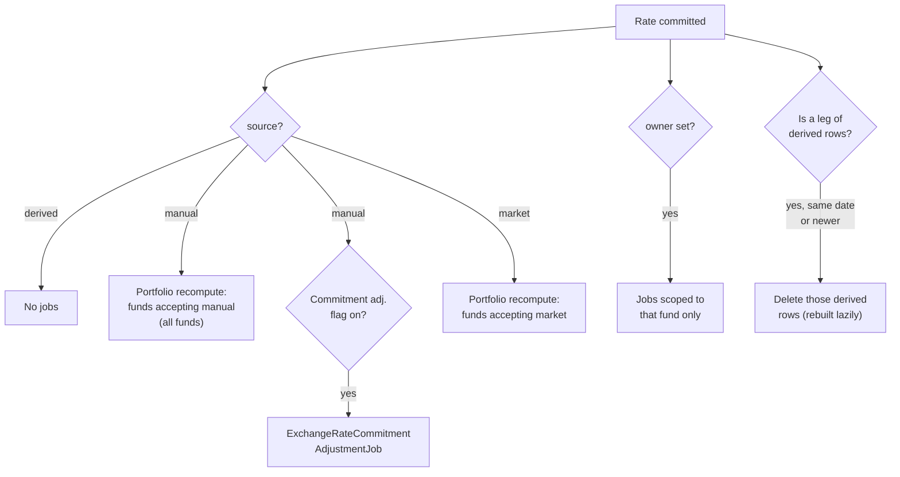

- **Owner (fund-specific rates)**: `owner_type`/`owner_id`, null = entity-wide (the default). In
  this change the owner is only a `Fund` with `use_own_fx_rates`; owner rows are always `manual`;
  the rate form shows a Fund select and `ImportExchangeRate` accepts a *Fund* column, both limited to
  such funds. An owner row's jobs run for that fund only (recompute and commitment adjustment).
- **Corrections**: `ExchangeRatePolicy#update?` stays `false`; a correction is a new Manual row
  (manual beats market on the same date).
- **`ExchangeRateSqlite`** gets the same columns in its schema copy (allocation runs).
- **Upload**: optional `Source` column accepted values `Manual` only (uploads are manual by
  definition); provider `"Upload"`. The duplicated `"Rate"` header is fixed.

**Worked examples** ([business rules](business-rules.md)): H20, H21, E15–E17, E24, E25, E29, E30, E68–E72, X8, X33, X34

**FAQ**

| Question | Answer |
|---|---|
| Why delete derived rows on a leg change rather than update them? | The resolver rebuilds on demand with the current legs; deleting is simpler and can't leave a half-updated row. Records that already used the old derived row keep their `exchange_rate_id` — booked amounts never move. |
| Can deleting a derived row break a foreign key? | Derived rows referenced by a booked record are not deleted; a new derived row (new date or replaced leg) is built instead, and the old one stays as history. |

### ④ Price store

`Valuation` gains source, provider and price type; `InvestmentInstrument` gains identifiers and a
pricing method; purchases write `cost` rows.

| Owns | Reads / receives | Produces |
|---|---|---|
| `valuations.source/provider/price_type`; `investment_instruments.isin/ticker/exchange/pricing_method`; uniqueness incl. source | Valuation form/upload/API, feed upserts, `PortfolioInvestmentCreate#create_valuation` | Candidate rows; recompute triggers |

- `create_valuation` does `find_or_initialize_by(…, valuation_date:, source: "cost")` — never
  touches manual or market rows.
- `Valuation#update_owner` runs for any non-synthetic row that is the latest **for its source**;
  `PortfolioInvestmentUpdate` then asks `PriceResolver` per fund.
- **ISIN backfill**: copy `json_fields["sebi_isin"]` → `isin`; `InformationOnInvestmentsJob` reads
  `isin` with fallback to the json key.
- MCP: `valuation.yml` gains `source` (filterable) and a note that the "latest" row must be sorted
  by `valuation_date desc` **and** filtered by source; `ransackable_attributes` gains `source`. Drift
  feature re-run.

**Worked examples** ([business rules](business-rules.md)): H6, H7, E34–E41, X11–X14, X35

**FAQ**

| Question | Answer |
|---|---|
| Why not skip the cost row for Market instruments? | A manual-only fund holding that instrument needs it as its first value; precedence makes it harmless for market-accepting funds. |
| Existing auto-created cost-at-purchase rows? | Backfilled as `manual` (can't be told apart reliably); values unchanged, so figures unchanged. |

### ⑤ Resolvers

The only place policy is applied. `SourcePolicy` says what a fund accepts; `FxRateResolver` and
`PriceResolver` return a `Resolution` (value, source, provider, as_of, row id, previous value).

| Owns | Reads / receives | Produces |
|---|---|---|
| Precedence, derivation, refusal messages, per-call memo | `SourcePolicy`, rate/valuation candidate rows, pivot currency | `Resolution`, or `MissingRate` / `MissingPrice` |

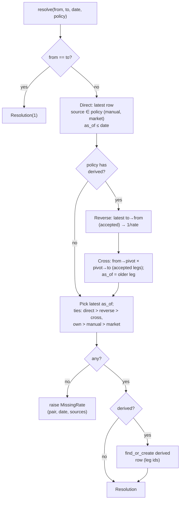

- **Candidates**: always `entity_id = fund.entity_id`; owner null (entity-wide) plus, when
  `policy.own_fund` is set, `owner = that fund`. Never another fund's rows, never another
  entity's rows. Derived legs follow the same rule; a derived row built from an own leg is stored
  with the same owner.
- **Price precedence**: latest `valuation_date ≤ date` with source in policy (`manual`, `cost`
  always; `market` if accepted); ties manual > market > cost.
- **Where it is called** (all existing call sites, now with a policy):

| Caller | Policy |
|---|---|
| `WithExchangeRate#convert_currency` / `#get_exchange_rate` / `#tracking_exchange_rate` (commitments, adjustments, remittances, fees, payments, distributions, account entries, PIs, stock converter, tracking-currency job, fund ratio calcs, incremental migration) | `SourcePolicy.for(fund)` |
| `Valuation#per_share_value_in(ccy, date, fund:)` | fund's policy (callers pass the fund) |
| `ExchangeRateShared.get_rate/convert/setup_variable_exchange` | `policy:` keyword, default `SourcePolicy.for_entity(entity)` |
| `KpiFxConverter`, `PortfolioCompanyCalc`, `PortfolioInvestmentAsOfReport`, `FundRatioMultiFundCalcs`, portfolio stats views | entity default policy |
| `PortfolioInvestmentCreate` direct `ExchangeRate.where` (line 27, unscoped) | replaced by resolver (also fixes missing entity scope) |
| `ChangeFundCurrencyJob` (~25 direct queries, sandbox only) | left as is (sandbox tool), noted in LLD |

- **Memo**: `FxRateResolver.with_cache { … }` around jobs/requests memoises (entity, policy key,
  from, to, date) — avoids N lookups in `TrackingCurrencyJob` loops.

**Worked examples** ([business rules](business-rules.md)): H5, H7, H21, E18–E28, E38–E41, E68–E71, X9, X10

**FAQ**

| Question | Answer |
|---|---|
| Why is a newer derived rate allowed to beat an older direct one? | Otherwise a stale 2024 manual rate would block every newer cross forever; "most recent accepted" is the single rule users can predict. |
| Why does derived only use direct legs? | A cross of crosses compounds error and makes leg tracking recursive; one level is enough for real pairs. |
| What does `SourcePolicy` key look like? | e.g. `"rates:manual+market+derived/own:42/prices:manual+market"` — used for the memo and in messages. |

### ⑥ Derivatives

Contracts and their events; values come from valuation events; ledger entries are posted per
event; exercise creates holdings through the existing purchase flow.

| Owns | Reads / receives | Produces |
|---|---|---|
| `derivative_contracts`, `derivative_events`, ledger entry names, exposure, expiry reminders | Forms, `ImportDerivativeValuation`, `NseFo` feed, `FxRateResolver` | `AccountEntry` rows (fund-level), `PortfolioInvestment` (exercise), values for ⑦/⑧ |

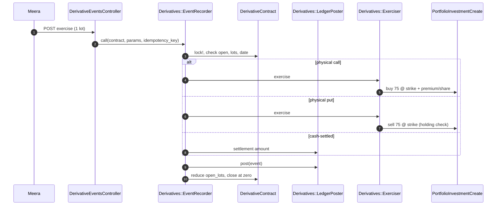

**Ledger entries** (fund-level `AccountEntry`, `entry_type: "Derivatives"`, `parent: DerivativeEvent`,
one entry per (event, name) — idempotent)

| Event | Entry name | Amount |
|---|---|---|
| trade | Derivative Premium | −premium paid / +premium received |
| valuation | Derivative Unrealised Gain/Loss | value − previous value (first valuation: value − premium) |
| settlement / close-out / expiry | Derivative Realised Gain/Loss | cash received/paid − carrying value of closed lots; reverses their unrealised |
| margin | Derivative Margin | −posted / +returned |

**Routes**

| Verb and path | Action | Does | Responds with |
|---|---|---|---|
| GET `/funds/:fund_id/derivative_contracts` | `index` | List (default Open) | HTML |
| GET/POST `/funds/:fund_id/derivative_contracts/new`, `create` | `new`/`create` | Record contract + trade event | redirect / 422 |
| GET/PATCH `/derivative_contracts/:id(/edit)` | `show`/`edit`/`update` | Terms (not events) | HTML / 422 |
| POST `/derivative_contracts/:id/events` | `DerivativeEventsController#create` | Any event | turbo_stream / 422 |
| GET `/funds/:fund_id/derivative_contracts/exposure` | `exposure` | Exposure report | HTML |
| POST `/funds/:fund_id/derivative_valuations/import` | via `ImportUpload` (`ImportDerivativeValuation`) | Counterparty values | existing upload flow |

**Access**

| Role | View | Record / events |
|---|---|---|
| Fund staff with fund read | ✓ (feature on) | — |
| Fund staff with fund update | ✓ | ✓ |
| Entity admin | ✓ | ✓ |
| Investor / advisor / other entity | — | — |

`DerivativeContractPolicy`: `entity.permissions.enable_derivatives?` &&
`fund.features.enable_derivatives?` && `FundPolicy` show?/update?; scope `where(entity_id:
user.entity_id)`.

**Exposure limits — phase 9 (separate, later; nothing in phases 1–8 depends on it).**

| Part | Real names | Rule |
|---|---|---|
| Measure | `ExposureReport.new(fund, date)` | Per open contract: notional (futures, forwards, swaps); options `|delta| × lots × lot_size × underlying price` (else full notional, labelled); short puts without delta at strike × quantity. Commitment (default) subtracts hedge-linked contracts up to the covered value and nets opposite positions on the same underlying + expiry |
| Profile | `market_data_settings.exposure_preset`, `exposure_method`, limit columns; `Derivatives::LimitPresets` (constant table) | Preset fills limits; any change → "(customised)" |
| Hard rules | `Derivatives::HardRules` called by `EventRecorder` on trade | Hedging-only: hedge link required, hedge notional ≤ covered value; naked short call refused unless `allow_naked_short_calls` |
| Checks | `Derivatives::LimitCheck.call(fund, date, proposed: nil)` → `[LimitResult(key, value, limit, level)]` | % of latest approved NAV (open-ended only); amber ≥ 90 %, red > 100 %; counterparty = positive OTC values per `counterparty_name`, limit by `counterparty_kind` |
| Breach | `exposure_alerts` (fund, limit_key, as_of) UK; `MarketDataOpsNotifier` `exposure_breach`; `NavExceptions` adds red limits | One email per fund/limit/date; NAV exception to accept |
| Pre-trade | `DerivativeContractsController#create` with `proposed:` → confirm popup (action-summary card) | Recorded only after confirm |

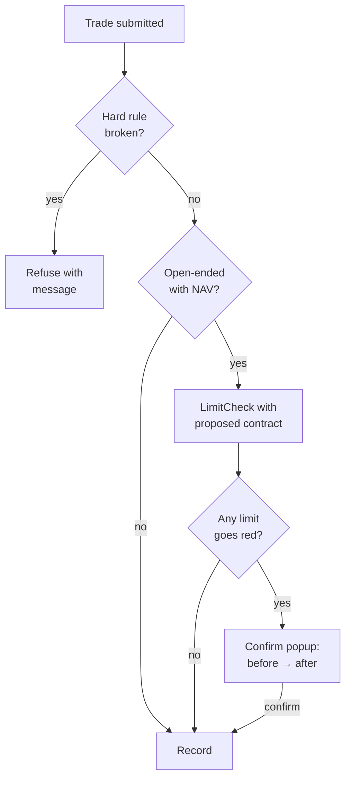

**Expiry**: `MarketData::DerivativeExpiryJob` daily; contracts with `expiry_date` exactly 5
business days ahead (or past that point and `expiry_reminded_at` nil, still open) → email; set
`expiry_reminded_at`.

**Worked examples** ([business rules](business-rules.md)): H11–H17, E48–E55, E57, X16–X26; exposure limits (phase 9): H22, H23, E56, E74–E88, X32, X36–X38

**FAQ**

| Question | Answer |
|---|---|
| Why post unrealised to the ledger if the NAV reads contracts directly? | Financial statements and the fund ledger need the P&L; the NAV deliberately reads the contract value so it can't double-count (no NAV line reads the "Derivative …" entry names). |
| Why the existing purchase flow for exercise? | Cost basis, attribution (FIFO/weighted), aggregates and valuations all hang off `PortfolioInvestmentCreate`; a second path would drift. |
| Why lock the contract? | Two exercises at once could exceed open lots; `lock!` + idempotency key on the event make the double-click harmless. |

### ⑦ Fund figures

The existing computations, unchanged in what they compute, now calling ⑤; plus the gain split.
(The exposure report belongs to ⑥, phase 9.)

| Owns | Reads / receives | Produces |
|---|---|---|
| `portfolio_investments.unrealized_price_effect_cents`, `realized_price_effect_cents` (and API sums) | `Resolution`s from ⑤, contract values from ⑥ | FMV, gains, split, converted amounts |

- **Gain split** in `PortfolioComputations#compute_all_numbers`: price effect = (current local
  price − cost local price) × qty × current rate, rounded to the cent; currency effect = total
  unrealised − price effect (so they always add up). Realised: same on the lots sold (cost rate =
  each buy's stored `exchange_rate`).
- **Recompute on policy change**: saving a fund whose rate/price flags changed enqueues
  `FundFairValueRecomputeJob(fund)` (reuses `PortfolioInvestmentUpdate` over the fund's PIs with
  `find_each`).

**Worked examples** ([business rules](business-rules.md)): H5, H9, E31–E33, E52, E56

**FAQ**

| Question | Answer |
|---|---|
| Why store the price effect rather than compute on display? | Reports and the MCP portfolio tool read stored columns; computing on display would need the cost rate per lot at read time. |
| Do booked conversions get recomputed on policy change? | No — only FMV-type figures. Commitments, remittances, distributions and account entries keep their stored rate. |

### ⑧ Open-ended NAV

Built in phase 8, on `open-ended-funds` after `market-data` is merged into it (see the [bridge](#bridge-to-open-ended-funds-the-nav-part)).

| Owns | Reads / receives | Produces |
|---|---|---|
| `fund_navs.derivative_assets_cents`, `derivative_liabilities_cents`, `exceptions` (json); `NavExceptions`; accept action; 2 fingerprint parts; `nav_exceptions_open` notification key | `fmv_on_date(…, with_resolution: true)`, `DerivativeContract.value_on`, `MarketDataSetting.limits_for(fund)` | NAV lines, exceptions, approve guard, staleness |

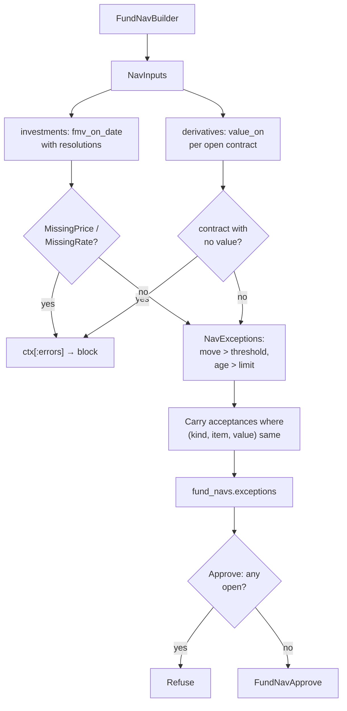

- **Move**: |p₁ / p₀ − 1| > threshold (strictly greater), Market-source prices only, p₀ = previous
  Market valuation of that instrument.
- **Age**: business days (Mon–Fri) between `as_of` and NAV date > limit; Market prices, listed
  contract values and every rate used.
- **Accept**: `POST /evergreen/navs/:id/exceptions/:key/accept` (approver only, note required),
  draft NAVs only.
- **Notification**: `EvergreenOpsNotifier` key `nav_exceptions_open` (morning of a dealing date,
  draft with open exceptions) via `EvergreenFundSetting::NOTIFICATIONS`.

**Worked examples** ([business rules](business-rules.md)): H18–H20, E58–E67, X27–X31

**FAQ**

| Question | Answer |
|---|---|
| Why aren't private marks exceptions? | They are quarterly by nature; flagging them every week would train approvers to click Accept blindly. Their age is shown instead. |
| Why keep acceptances across redrafts? | A redraft for an unrelated fix shouldn't force the approver to re-accept the same, unchanged move. |
| Approved NAV and a later rate change? | Never rebuilt; *Inputs changed* is a flag for review (existing behaviour, now also for rates). |

---

## 4. Reference

### Class diagram

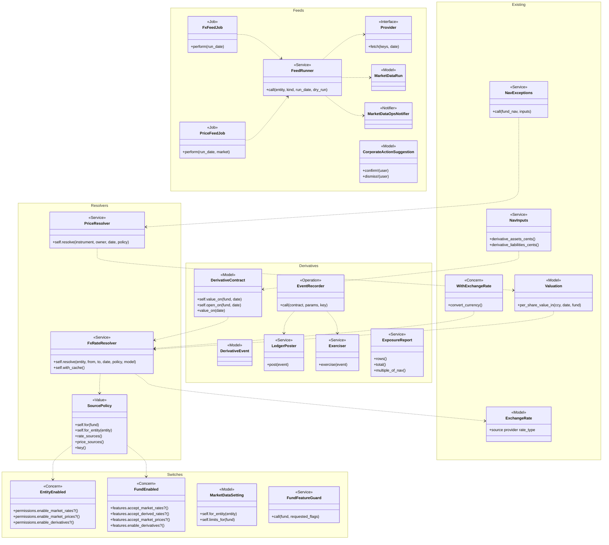

### Data model and schema changes

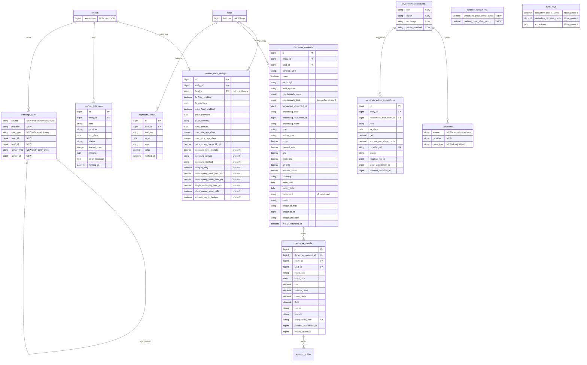

**Indexes:** `market_data_settings (entity_id, fund_id)` UK · `exchange_rates (entity_id, owner_type, owner_id,
from, to, as_of, source)` UK (replaces the Ruby-only uniqueness), `(leg1_id)`, `(leg2_id)` · `valuations`
existing `idx_latest_valuation` extended to `(investment_instrument_id, deleted_at, synthetic,
source, valuation_date)` · `investment_instruments (entity_id, exchange, ticker)` UK, `(entity_id,
isin)` · `market_data_runs (entity_id, kind, provider, run_date)` UK · `corporate_action_suggestions
(entity_id, provider_ref)` UK · `derivative_contracts (fund_id, status)`, `(entity_id)`,
`(expiry_date, status)` · `derivative_events (derivative_contract_id, event_date)`,
`(idempotency_key)` UK.

**Schema changes**

**`entities`** (existing): new feature bits so CapHive can switch the three features on.

| Column / index | What changed | Why it's needed |
|---|---|---|
| `permissions` bit 35 `enable_evergreen_funds` | Reserved (name and position as on `open-ended-funds`) | Keeps bit positions identical across branches (bridge) |
| `permissions` bits 36–38 `enable_market_rates`, `enable_market_prices`, `enable_derivatives` | Added | Entity-level gate for each feature |

**`funds`** (existing): one flag set replaces scattered booleans and holds the new switches.

| Column / index | What changed | Why it's needed |
|---|---|---|
| `features` | Added: bigint, default 0, not null | Bitfield for `FundEnabled` (`active_flag`) |
| `show_fund_ratios`, `show_fund_units`, `show_portfolios`, `show_valuations`, `enable_ai_commentary`, `editable_formulas` | Backfilled into `features`; no longer read or written; dropped in a follow-up change | Copy-first migration, safe rollback |

**`market_data_settings`** (new): entity feed settings and defaults, plus per-fund limit overrides.

| Column / index | What changed | Why it's needed |
|---|---|---|
| `entity_id` | Added, FK | Tenant scope |
| `fund_id` | Added, FK, null = entity row | One table for entity defaults and fund overrides |
| `fx_feed_enabled`, `fx_providers` | Added | Which FX feeds run |
| `price_feed_enabled`, `price_providers` | Added | Which price feeds run |
| `pivot_currency` | Added, default USD | Cross-rate pivot |
| `fund_defaults` | Added, json | Flags a new fund starts with |
| `max_rate_age_days`, `max_price_age_days` | Added, int | NAV age limits (entity default / fund override) |
| `price_move_threshold_pct` | Added, decimal(5,2) | NAV move check |
| `exposure_limit_multiple` | Added in phase 9, decimal(5,2) | Leverage limit (× NAV) |
| `exposure_preset` | Added in phase 9, string | Which preset the profile started from; "(customised)" is derived by comparing to the preset |
| `exposure_method` | Added in phase 9, `gross`/`commitment`, default commitment | How exposure is measured |
| `hedging_only` | Added in phase 9, boolean | Cat I/II hard rule |
| `counterparty_bank_limit_pct`, `counterparty_other_limit_pct` | Added in phase 9, decimal(5,2) | UCITS-style counterparty caps |
| `single_underlying_limit_pct` | Added in phase 9, decimal(5,2) | Concentration on one name |
| `allow_naked_short_calls` | Added in phase 9, boolean, default false | Hard rule switch |
| `exclude_ccy_ir_hedges` | Added in phase 9, boolean | '40 Act preset exclusion |
| UK `(entity_id, fund_id)` | Added | One entity row, one row per fund |

**`exchange_rates`** (existing): rates need a source so a fund can choose.

| Column / index | What changed | Why it's needed |
|---|---|---|
| `source` | Added, default `manual`, not null | Policy filter; backfill |
| `provider` | Added | Shows where a rate came from |
| `rate_type` | Added, default `reference` | Reference vs closing |
| `leg1_id`, `leg2_id` | Added, self-FK | Derived row legs; rebuild on leg change |
| `owner_type`, `owner_id` | Added, nullable polymorphic (only `Fund` in this change) | Fund-specific rates; null = entity-wide default |
| Index `(entity_id, owner_type, owner_id, from, to, as_of, source)` | Added (non-unique) | Resolver lookups. Uniqueness per source and owner is the model's validation: production already holds duplicate rows, so a DB unique key would need data deletion (LLD apply note A12) |
| `decimal` (stray) | Unchanged here | Out of scope; noted in LLD |

**`valuations`** (existing): prices need a source.

| Column / index | What changed | Why it's needed |
|---|---|---|
| `source` | Added, default `manual` | Policy filter, cost rows |
| `provider` | Added | Shows where a price came from |
| `price_type` | Added, default `close` | Close/bid/mid |
| `idx_latest_valuation` | Extended with `source` | Resolver query per source |
| Ruby uniqueness scope | + `source` | One row per source per date (soft-delete prevents a DB UK) |

**`investment_instruments`** (existing): identifiers for feeds.

| Column / index | What changed | Why it's needed |
|---|---|---|
| `isin` | Added (12) | AMFI key; SEBI report |
| `ticker` | Added (30) | Exchange key |
| `exchange` | Added (10) | NSE/BSE/NASDAQ… |
| `pricing_method` | Added, default `manual` | Which instruments the feed prices |
| UK `(entity_id, exchange, ticker)` | Added | No two instruments share a ticker |
| `(entity_id, isin)` | Added | ISIN lookup |

**`portfolio_investments`** (existing): gain split.

| Column / index | What changed | Why it's needed |
|---|---|---|
| `unrealized_price_effect_cents` | Added | Stored split for reports |
| `realized_price_effect_cents` | Added | Same, for sales |

(`aggregate_portfolio_investments` gets the same two columns as sums.)

**`market_data_runs`**, **`corporate_action_suggestions`**, **`derivative_contracts`**,
**`derivative_events`** (new): every column is listed in the ER diagram; each exists for the
purpose in its card ([②](#②-feeds), [⑥](#⑥-derivatives)). Notable: `market_data_runs.notified_at`
(send-once), `corporate_action_suggestions.provider_ref` (never suggest twice),
`derivative_contracts.open_lots` (partial close/exercise), `derivative_events.idempotency_key`
(double submit), `derivative_contracts.expiry_reminded_at` (send-once).

**`exposure_alerts`** (new, phase 9): one row per fund, limit and date that went red — `limit_key`
(leverage, counterparty:{name}, underlying:{instrument}, us40act), `level`, `value`, `notified_at`;
UK `(fund_id, limit_key, as_of)` makes the breach email send-once. `derivative_contracts.counterparty_kind`
(bank | other) is added in the same phase for the UCITS-style counterparty caps.

**`fund_navs`** (existing, phase 8): `derivative_assets_cents`, `derivative_liabilities_cents` (the
two lines), `exceptions` (json list with kind, item, value, accepted_by, accepted_at, note).

**Changes to existing models:** `Entity` (flags), `Fund` (`FundEnabled`, defaults, recompute on
flag change), `ExchangeRate`/`ExchangeRateShared`/`ExchangeRateSqlite` (source, hooks, uniqueness),
`Valuation` (source, `per_share_value_in(…, fund:)`, `update_owner`), `InvestmentInstrument`
(identifiers, validations), `PortfolioInvestmentCreate` (cost row), `PortfolioComputations` (split),
`AggregatePortfolioInvestment` (`fmv_on_date` via resolver), `WithExchangeRate` (policy), seven
policies/views reading the old booleans, `ImportFund`, `ImportExchangeRate`, `ImportValuation`,
`InformationOnInvestmentsJob`, `FundDashboard`, `EntityDashboard`; phase 8: `FundNav`, `NavInputs`,
`FundNavBuilder`, `NavStaleness`, `FundNavApprove`, `EvergreenFundSetting::NOTIFICATIONS`.

### Component contracts

| From → To | Contract | Direction rule |
|---|---|---|
| ① → ⑤ | `SourcePolicy.for(fund)` → `rate_sources ⊆ {manual, market, derived}`, `price_sources ⊆ {manual, cost, market}`; manual (+cost) always present; entity flag AND fund flag | ⑤ never reads flags directly |
| ② → ③ | Upsert `ExchangeRate(entity_id: running entity, owner: nil, source: "market", provider:, rate_type:, as_of:)` on the UK | ② never writes manual, derived or fund-owned rows, nor another entity's rows |
| ② → ④ | Upsert `Valuation(source: "market", provider:, price_type: "close")` with `skip_owner_update`; then one `PortfolioInvestmentUpdate` per (company, instrument) | ② never writes manual or cost rows |
| ② → ⑥ | `DerivativeEvent(event_type: "valuation", source: "market", provider: "NSE F&O")` via `EventRecorder` | Only for `listed` contracts with `feed_symbol` |
| ③ → ⑤ | Candidate rows filtered by `entity_id`, pair, `as_of ≤ date`, `source ∈ policy` | ⑤ may create `derived` rows; nothing else may |
| ④ → ⑤ | Candidate valuations filtered by instrument, owner, date, `source ∈ policy`, not synthetic | read only |
| ⑤ → ⑦ | `Resolution(value, source, provider, as_of, row_id, previous_value)` or `MissingRate`/`MissingPrice` | ⑦ stores `row_id` as today (`exchange_rate_id`, `valuation_id`) |
| ⑥ → ⑦ | `DerivativeContract#value_on(date)` → contract-currency value; ⑦ converts via ⑤ | ⑥ owns valuation; ⑦ owns conversion |
| ⑦ → ⑧ | `fmv_on_date(date, with_resolution: true)`, `DerivativeContract.value_on(fund, date)`, `MarketDataSetting.limits_for(fund)` | ⑧ reads only; never writes ①–⑦ |

### Notifications

| Notification | Trigger | Recipients | Channel | Customisable | Default | Sent once? |
|---|---|---|---|---|---|---|
| FX feed: no rates loaded for {date} | `FxFeedJob` weekday run ends `failed`/`empty`/`partial` | Active entity users tagged **FundAccounting** | Email + in-app (`MarketDataOpsNotifier`, `email_method: fx_feed_missing`) | No (internal) | On whenever the FX feed is on | `market_data_runs.notified_at`; re-runs of the same date don't re-send |
| Price feed: no prices loaded for {date} | `PriceFeedJob` weekday run `failed`/`empty`/`partial` | FundAccounting-tagged users | Email + in-app (`price_feed_missing`) | No | On with the price feed | `notified_at` |
| Corporate action suggested | New `CorporateActionSuggestion` | FundAccounting-tagged users | Email + in-app (`corporate_action_suggested`) | No | On with the price feed | Suggestion UK on `provider_ref`; email in `after_create_commit` only |
| Derivative contract expiring | Open contract 5 business days before `expiry_date` | FundAccounting-tagged users who pass `FundPolicy#show?` for the fund | Email + in-app (`derivative_expiring`) | No | On with the fund's Derivatives feature | `derivative_contracts.expiry_reminded_at` |
| Exposure limit breached (phase 9) | `LimitCheck` finds a red limit (NAV draft or daily check) | **Compliance**-tagged users and fund **approvers** | Email + in-app (`MarketDataOpsNotifier`, `exposure_breach`) | No | On when the fund has a limit profile | `exposure_alerts` UK (fund, limit_key, as_of) |
| NAV exceptions open (phase 8) | Morning of a dealing date, draft NAV with open exceptions | FundAccounting-tagged users and **approvers** of the fund (`EvergreenRecipients`) | Email + in-app (`EvergreenOpsNotifier`, key `nav_exceptions_open`) | No | On; per-fund switch in `EvergreenFundSetting#notifications` | One per NAV per date, stored in `fund_navs.exceptions` meta `notified_on` |

**Investors:** nothing is sent, added, changed or suppressed. The NAV per unit is published exactly
as today (open-ended funds' existing NAV/dealing emails are untouched); migrated visibility switches
keep their values, so no investor sees new or lost content; feeds, derivatives and exceptions are
internal operations. Investor advisors are unaffected for the same reasons. All email dates render
via `EmailDateLocalization` (`l(date)` → `Oct 29, 2026`).

### Cross-cutting concerns

#### Transactions and queries
- Feed upserts: one transaction per (entity, provider) batch; recompute enqueued **after** commit.
- `EventRecorder`: contract `lock!`, event insert, ledger posts, exercise PI — one transaction; emails
  after commit.
- Resolver: one indexed query per candidate kind (direct, reverse, two legs), memoised per call
  chain; no N+1 in `TrackingCurrencyJob` loops.
- Ledger posting writes ≤ 2 `account_entries` per event and never reads the table broadly
  (CLAUDE.md large-table rules).

#### Exception handling and monitoring

| Failure | Who is alerted | Channel | Detail |
|---|---|---|---|
| Provider HTTP error / timeout after retries | FundAccounting | `MarketDataOpsNotifier` | run `failed`, `error_message` stored |
| Provider value ≤ 0 or unparsable | FundAccounting | same (as missing) | run `partial` |
| `MissingRate` / `MissingPrice` in a request | the user | form/flash message (proposal text) | logged at info with entity/fund ids |
| `MissingRate` in a job (tracking currency, recompute) | existing job error handling | Sentry/log | unchanged behaviour (today raises `RecordInvalid`) |
| Exercise refused (lots, holdings) | the user | 422 form error | — |

#### Performance and security
- Volume: rates ≈ pairs × business days (tens/day/entity); prices ≈ Market instruments (hundreds/day);
  feed jobs run off-hours on `:low`.
- Recompute batched per (company, instrument); fund-level recompute uses `find_each`.
- Tenant isolation: every new table carries `entity_id`; every policy scope filters on it; feed
  runs iterate entities and write only that entity's rows.
- Secrets: none in this change — every provider is a free public file. A vendor adapter (L4) will
  add an encrypted per-entity key.
- Flags submitted directly are re-checked by `FundFeatureGuard`.

### Worked examples

Every H/E/X row — shared setup, happy path, edge and error cases, with their spec scenario and
feature file — lives in **[business-rules.md](business-rules.md)**. The cards above cite the IDs;
the QA checklist and tasks reuse them.

### Testing

Cucumber only. New features under `features/market_data/` (`fund_features`, `fx_rate_sources`,
`fx_feed`, `market_prices`, `price_feed`, `derivatives_listed`, `derivatives_otc`) and
`features/fund/evergreen/nav_market_data.feature` (phase 8). Provider HTTP is stubbed with WebMock
from fixture files in `features/support/fixtures/market_data/`; steps reuse
`exchange_rate.rb`, `valuation_steps.rb`, `portfolio.rb`, `evergreen_nav_steps.rb`, with a new
`market_data_steps.rb` and `derivative_steps.rb`. Existing access features
(`access_rights_fund_models`, `fund_access`, `master_fund_portfolio_access`) must stay green after
the flag migration. **Traceability:** every scenario carries a `# <ID> — <path>: …` comment; code
comments name the IDs of the paths they implement.

### Risks and open questions

- Six live booleans move to flags (access rules) → copy-first migration, readers switched in one
  phase, existing access features as the regression gate, columns dropped only in a follow-up.
- Entity bit collision with `open-ended-funds` → reserve `enable_evergreen_funds` at the same position
  (bridge table).
- Resolver on every conversion is slower → per-call memo, indexed queries; benchmark
  `TrackingCurrencyJob` on the prod dump (port 33066) before and after.
- SQLite allocation path diverges → resolver parameterised by model; E28 compares live vs allocation.
- NSE/BSE files sometimes block automated downloads → retries, browser-like headers, failure email;
  a licensed vendor can be added per client (L4).
- Derived rows multiplying → built only on demand, unique per (pair, date, source), deleted on leg
  change when unreferenced.
- `open-ended-funds` changes `NavInputs` before merging → phase 8 surface is three named spots.
- Daily market rates on Market-accepting funds recompute FMV daily → only funds accepting the source,
  batched per pair per run.

Open questions: none. Q2 (vendors) and Q3 (exposure rules) are resolved in the proposal; the SEBI
preset figures are verified against current circulars in phase 9 before shipping.

**FAQ**

| Question | Answer |
|---|---|
| Where do I start reviewing? | ⑤ Resolvers and the flag migration in ① — they touch the most existing code. Then the bridge table. |
| Can phases 1–7 ship without phase 8? | Yes; nothing in ①–⑦ references evergreen code. |
| Why so many edge rows for ⑤? | Precedence and derivation are where wrong numbers would come from silently; each tie and boundary has a row. |
