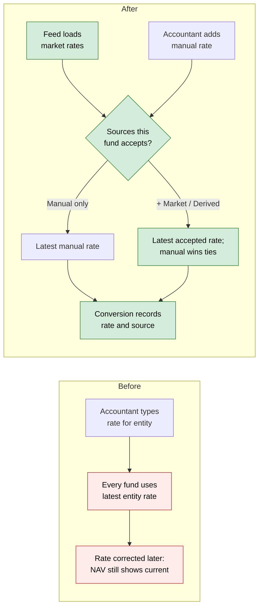
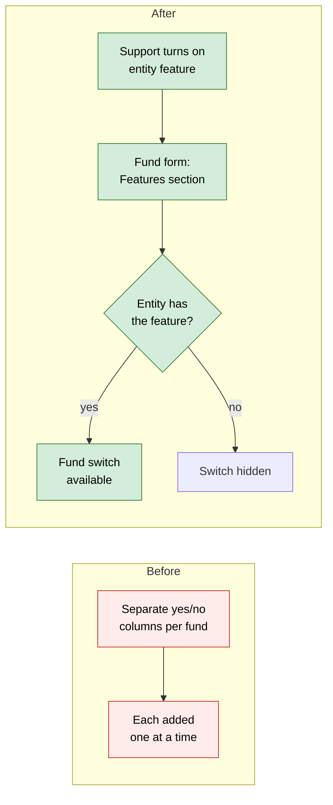
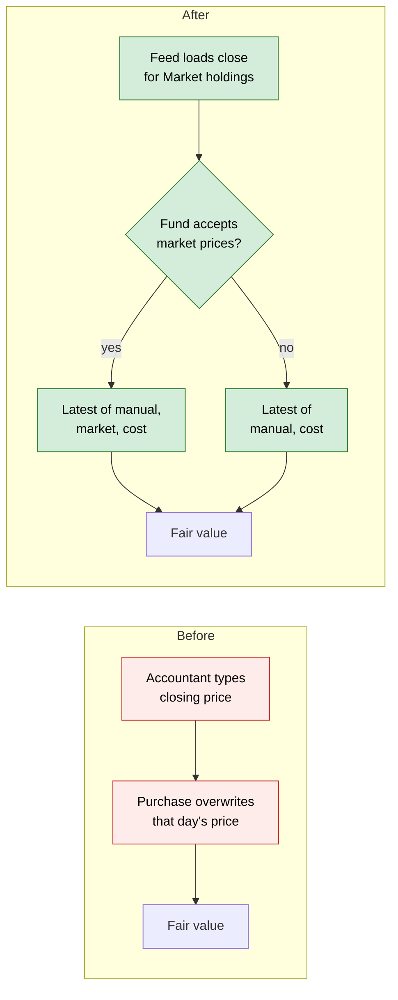
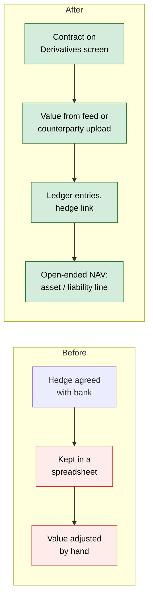
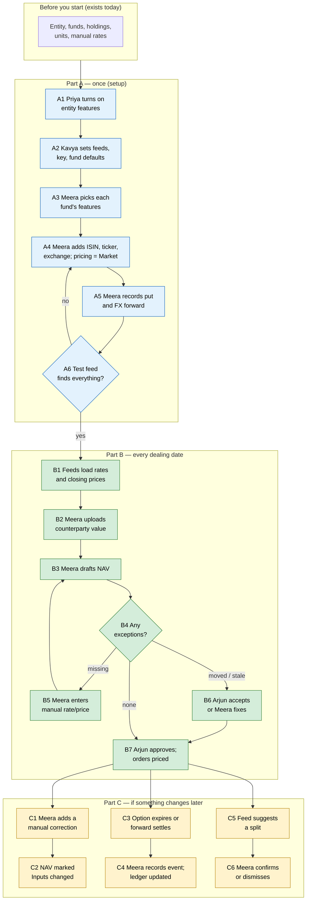

# Fund Market Data: FX Rates, Market Prices and Derivatives — Proposal

> **Audience:** Business team, product, QA, support — non-technical.
> **Companion documents:** [Design](design.md) · [Specs](specs/) · [Tasks](tasks.md)
> **New to this? Start with the [Workflow Journey](#workflow-journey)** — every action, in order, from start to the outcome.

> **Planning phase — no code changes.** This document proposes and explains the change. Do not
> edit application code while writing it; implementation happens later, in the tasks phase.

---

## Why

One CapHive entity often runs very different funds side by side: a SEBI AIF that values its
holdings quarterly with hand-entered rates, a hybrid fund with some listed shares, and an
open-ended fund holding public-market securities and some derivatives. Today every fund in the
entity is treated the same way, and that way only suits the AIF:

1. **FX rates are typed in by hand, and there is one set for the whole entity.** There is no
   daily feed, no record of where a rate came from, no reverse or cross rate (EUR→INR is not
   worked out from EUR→USD and USD→INR), and no limit on how old a rate may be. A fund that
   wants market rates and a fund that must use only the board-approved manual rates cannot both
   be served.
2. **There is no price feed for listed securities.** A listed share is priced like a private
   company: one hand-entered value per share per date. There is no ticker or exchange on a
   holding; the ISIN lives in a custom field. Each purchase also overwrites that day's price with
   the purchase price — wrong for a listed share.
3. **Derivatives cannot be held at all.** There is nowhere to record an option, future, FX
   forward or swap, and no value can go below zero, which a derivative's often does.
4. **Fund switches are scattered.** What a fund shows its investors (fund ratios, units,
   portfolio, valuations) and its AI commentary are separate yes/no columns on the fund, each
   added one at a time. There is no single, consistent place to switch a fund's features on and
   off, the way the entity already has.

The business asked (10 Oct 2026) how FX, prices and derivatives will work for funds that also hold
public-market securities and derivatives, and (11 Oct 2026) that **each feature be switched on for
the entity and then chosen per fund**, so an AIF can stay on manual rates while a public-market
fund in the same entity uses the feeds.

## What Changes

The change has six parts. Part 0 is the switchboard. Parts 1–3 can each be used by any fund,
open-ended or not. Part 4 adds the open-ended NAV checks.

**Part 0 — Switched on for the entity, chosen per fund**
1. **Entity features** (set by CapHive support, as today for other chargeable features):
   *Market FX rates*, *Market prices* and *Derivatives*. An entity without them sees nothing new.
2. **Entity Market Data settings** (entity admin): which feeds run (free public sources only in this change),
   the cross-rate pivot currency (default USD), and the defaults new funds start with.
3. **Fund features — one set of switches per fund, like the entity's.** On the fund's edit form a
   *Features* section holds every fund switch in one place:

   | Fund feature | What it does | Needs entity feature |
   |---|---|---|
   | Show fund ratios to LPs | *moves from today's fund column* | — |
   | Show fund units to LPs | *moves from today's fund column* | — |
   | Show portfolio to LPs | *moves from today's fund column* | — |
   | Show valuations to LPs | *moves from today's fund column* | — |
   | AI commentary | *moves from today's fund column* | — |
   | Editable formulas (support only) | *moves from today's fund column* | — |
   | **Accept market FX rates** | Fund may use fed rates | Market FX rates |
   | **Accept derived FX rates** | Fund may use reverse and cross rates | — |
   | **Accept market prices** | Fund may use fed prices for listed holdings | Market prices |
   | **Derivatives** | Fund can record derivative contracts | Derivatives |
   | **Use fund-specific FX rates** | Fund may hold its own manual rates, used only by that fund | — |

   **Manual rates and manual prices are always accepted** and always win on the same date — they
   are how a wrong feed value is corrected, and how an AIF works today. So a fund's FX choice is
   one of: *Manual only* · *Manual + Market* · *Manual + Derived* · *Manual + Market + Derived*.
4. **Fund limits** (open-ended funds only): maximum rate age, maximum price age, price-move
   threshold. A blank value uses the entity default. (Derivative limits are Part 5.)
5. **Existing switches move without any visible change.** Today's six fund yes/no settings are
   copied into the new fund features; every fund keeps exactly what it shows today, and the fund
   upload still accepts its *Show Fund Ratios To Lps* / *Show Fund Portfolios To Lps* columns.

**Example — one entity, three funds**

| | Growth AIF II (SEBI AIF) | Bridge Hybrid Fund | Horizon Evergreen Fund (open-ended) |
|---|---|---|---|
| FX rates | Manual only | Manual + Derived | Manual + Market + Derived |
| Prices | Manual only | Manual + Market | Manual + Market |
| Derivatives | Off | Off | On |
| US share held at 30 Oct, USD→INR | **83.00** (board-approved manual rate, 1 Apr) | 83.00 (no market rates) | **85.00** (ECB via EUR, 30 Oct) |

All three funds hold the same US share; each values it with the rates it has chosen.

**Part 1 — FX rates you can trust**
1. **Daily rate feed** for the currency pairs the entity actually uses, from the ECB euro reference rates (other pairs, such as USD→INR,
   are worked out from that day's ECB table through EUR). Manual entry and Excel upload stay as they are.
2. **Every rate says where it came from**: *Source* (Manual, Market, Derived), the provider
   (e.g. "ECB via EUR", "Upload", "via USD") and *Rate type* (Reference or Closing).
3. **Which rate a fund uses**: the most recent rate, on or before the date, among the sources the
   fund accepts. On the same date, Manual beats Market, and a direct rate beats a derived one.
4. **Reverse and cross rates** (funds that accept Derived): USD→INR from INR→USD, or EUR→INR via
   USD. A derived rate is only built from rates the fund itself accepts, and its date is the older
   of its two legs.
5. **Correcting a rate** = adding a Manual rate for that date. The fed rate stays as history.
6. **Rates are entity-wide by default; a fund can have its own.** With *Use fund-specific FX rates*
   on, a manual rate can be entered (or uploaded with a *Fund* column) for that fund only — for
   example a board-approved quarterly rate for one fund. Only that fund uses it; on the same date
   it beats the entity's rates; the most recent rate still wins otherwise. Other funds and entity
   reports never see it. Turned off, the fund's own rates are kept but not used.
7. **Market data belongs to the entity that loaded it.** Each entity's feed run stores its own
   market rates and prices, from the providers that entity chose; one entity's feed never writes
   or reads another entity's rows, so two entities may hold different market values for the same
   pair or share.
8. **Gain split into price and currency** on holdings and reports (worked figures below).
9. **Fed rates never create commitment adjustments.** The existing *exchange-rate commitment
   adjustment* option reacts to manual rates only, so a daily feed cannot create daily
   adjustments.
10. **Booked amounts never move.** Commitments, calls and distributions keep the rate used when
   they were booked. Changing a fund's accepted sources changes only what is worked out from then
   on, plus current fair values.

**Part 2 — Market prices for listed securities**
1. **Holdings get identifiers and a pricing method**: ISIN, ticker, exchange, and *Pricing
   method* — **Market**, **Model**, **Manual** or **Cost**. Existing holdings become **Manual**.
   The ISIN now held in the SEBI custom field is copied into the new ISIN field.
2. **Daily price feed** for Market holdings: NSE and BSE daily price files and the AMFI NAV file
   (free). Holdings on other exchanges (e.g. NASDAQ) stay manually priced until a licensed vendor
   is added for a client that needs it (L4).
3. **Prices land where valuations live today**, marked *Source* (Manual, Market, Cost), provider
   and *Price type* (Close, Bid, Mid).
4. **Which price a fund uses**: the most recent on or before the date among the sources the fund
   accepts. On the same date: Manual, then Market, then Cost.
5. **A purchase no longer overwrites a price.** The purchase still records a *Cost* price for that
   day (so a manual-only fund has a starting value), but it never replaces a Market or Manual one.
6. **Corporate actions are suggested, not applied.** A split or dividend reported by the feed
   appears as a suggestion; a person confirms it into the existing Stock Adjustment or income
   screens, or dismisses it.

**Part 3 — Derivatives** (funds with the *Derivatives* feature)
1. **Derivatives screen per fund**: option, warrant, future, forward, FX forward, and — in a later
   phase of this change — interest-rate swap, cross-currency swap, total-return swap and
   credit-default swap. Each records underlying, long/short, notional, strike, expiry, lot size,
   exchange or counterparty, and the ISDA/CSA agreement.
2. **Events**: trade (premium), valuation, periodic settlement, margin or collateral, exercise,
   expiry, close-out. **Exercising an option into shares creates the share purchase** (or sale,
   for a put).
3. **Values**: listed contracts from the exchange settlement price (NSE F&O daily file); OTC
   contracts from the counterparty's or administrator's statement, uploaded. CapHive does not
   price derivatives itself.
4. **Ledger entries** for premium, settlement, margin, close-out and the change in value, in the
   existing fund ledger.
5. **Hedge link**: a contract can be marked as hedging a holding or a share class.
6. **Expiry reminder** 5 business days before a contract expires.

**Part 4 — Open-ended NAV checks** (built last, on the open-ended funds branch after this work is merged into it)
1. **NAV gains two lines**: *Derivative assets* and *Derivative liabilities*.
2. **Exceptions panel** on the NAV draft: prices that moved more than the threshold, prices or
   rates older than the limit. The approver accepts (with a note) or fixes each one; Approve is
   disabled while any is open. A missing price, rate or derivative value blocks the draft, as a
   missing valuation does today.
3. **The NAV goes out of date when a rate changes** (or a derivative value is uploaded), exactly
   as it does today for a changed valuation.
4. **Private marks show their age** on the NAV breakdown.

**Part 5 — Derivative exposure limits** (a separate phase, built later; nothing in Parts 0–4 needs it)
1. **Exposure report**: each open contract's gross and counted exposure and the total. Options are
   delta-adjusted when a delta is known (full notional otherwise, labelled); short puts count at
   strike value.
2. **Two measures**, chosen per fund: *Gross* or *Commitment* (default — hedges netted against what
   they cover, opposite positions on the same underlying netted).
3. **Preset limit profiles** per fund, each number overridable (then labelled "customised"):

   | Preset | Rules |
   |---|---|
   | SEBI Cat I / II AIF | Hedging only — every contract must hedge a holding or class, and not by more than it covers; no leverage |
   | SEBI Cat III AIF | Leverage ≤ 2× NAV, Commitment |
   | UCITS-style | Commitment exposure ≤ 100 % of NAV; OTC counterparty ≤ 10 % of NAV (banks) / 5 % (others) |
   | US '40 Act limited user | Exposure ≤ 10 % of net assets, excluding currency and interest-rate hedges |
   | Custom | Any of the limits |

4. **Extra limits** (blank = off): counterparty concentration, single underlying (holdings plus
   derivatives on one name), and *no naked short calls* (on by default).
5. **On a breach**: amber at 90 % of a limit; red above it (exactly at the limit stays amber); red
   adds a NAV exception and emails Compliance and the NAV approvers once per limit per day; a new
   contract that would go red shows a confirmation with before → after figures. **Hard rules**
   (hedging only, naked short calls) refuse the contract.
6. **% of NAV checks need a NAV**, so they run on open-ended funds; other funds see amounts and the
   hard rules.
7. The SEBI figures are to be confirmed against current circulars before the presets ship.

Nothing is **BREAKING**:
- With no new entity feature switched on, every screen and figure stays as it is.
- Existing rates become *Manual*, existing valuations *Manual*, existing holdings *Manual
  pricing*, and every fund starts as *Manual only* — so every converted amount and fair value
  stays the same.
- Today's six fund switches keep their values.

### Later — TBD (not built in this change)

| # | Item | What it would add | Why it's separate | Status |
|---|---|---|---|---|
| L1 | **Cash held in other currencies** | A USD broker account in an INR fund, revalued at each NAV date | Changes how the fund ledger holds money | **TBD** |
| L2 | **Share classes in other currencies; hedged classes** | A USD class in an INR fund; the hedged class bears its own hedge result | Planned in the share-classes work; uses Part 3's hedge link | **TBD** |
| L3 | **In-house pricing models** | Option and swap valuation inside CapHive | Funds and auditors rely on independent values | **Not planned** |
| L5 | **Portfolio-company-specific FX rates** | Rates owned by a portfolio company, e.g. for its KPI conversions | The rate owner is built to allow it; only funds are owners in this change | **TBD** |
| L6 | **FBIL INR reference rates** | RBI/FBIL reference rates as a second FX provider | FBIL publishes no machine-readable feed (its site is a JavaScript app behind reCAPTCHA); decided 11 Oct 2026 to ship ECB only | **When an official source exists** |
| L4 | **Licensed vendor adapters** | Prices and rates for non-Indian markets from a vendor the client licenses, with its licence key | Built per client request (Q2, 11 Oct 2026); the provider interface built here makes it a small adapter | **Per client** |

### Flow Diagram

**Which FX rate a fund uses**



**Switching a fund feature on**



**Pricing a listed share**



**A derivative in the books**



---

## Workflow Journey

One worked journey: the entity **Caphive Capital** (INR) runs the three funds in the example
above. We follow it from switching the features on to Horizon Evergreen Fund's NAV approved for
dealing on **Friday 30 Oct 2026**, with a look at what Growth AIF II sees on the same day.

### Who is involved

| Person | Role | What they do in the journey |
|---|---|---|
| Priya | CapHive support | Switches the entity features on |
| Kavya | Entity admin | Sets feeds and fund defaults |
| Meera | Fund accountant (fund write access) | Chooses each fund's features, sets up holdings and derivatives, uploads counterparty values, drafts the NAV |
| Arjun | Fund CFO (NAV approver) | Reviews exceptions and approves the NAV |
| The investors | LPs | See the published NAV per unit — nothing new for them |

### The journey on one page



### Before you start

| Needed | Why | Where it comes from |
|---|---|---|
| Funds and holdings in CapHive | Quantities the prices multiply | Funds and Portfolio screens (exist) |
| The board-approved manual rates | Growth AIF II keeps using them | Exchange Rates screen (exists) |
| An open-ended fund with dealing dates and units | Part B's NAV | Open-ended funds (this work is merged into that branch before Part 4) |
| ISDA/CSA agreement uploaded (OTC derivatives only) | Linked from the contract | Fund documents (exist) |

### Part A — once (setup)

| Step | Who | Where (screen › button) | Action | What the system does | What you see |
|---|---|---|---|---|---|
| A1 | Priya | Admin › Entities › Caphive Capital › Edit | Ticks *Market FX rates*, *Market prices*, *Derivatives* | Saves the entity features | The three features shown as on |
| A2 | Kavya | Entity › Settings › Market Data | Turns on the FX feed (ECB) and the price feed (NSE, BSE, AMFI, NSE F&O); pivot USD; fund defaults *Manual only*, rate age 3, price age 3, threshold 10% | Saves the entity settings; works out the pairs in use (USD→INR, EUR→USD) | "Feeds on. Pairs tracked: USD→INR, EUR→USD. Next run: today 18:30 IST" |
| A3 | Meera | Fund › Edit › Features | Growth AIF II: nothing new ticked. Bridge Hybrid: *Accept derived FX rates*, *Accept market prices*. Horizon: all four new switches; limits 3 / 3 / 10% / 2× | Saves the fund features and limits; records the change in the fund's audit trail | Each fund's Features section shows its choice; *FX rates: Manual + Market + Derived* on Horizon |
| A4 | Meera | Portfolio › Instruments › Edit | ACMEIND: ticker `ACMEIND`, exchange NSE, *Pricing method* Market. Nimbus Inc (NASDAQ) stays *Manual* — no US feed yet | Checks the ISIN and ticker | *Market* badge on ACMEIND |
| A5 | Meera | Horizon › Derivatives › New contract | **Nifty put**: long 1 lot × 75, strike 24,000, expiry 26 Nov 2026, premium ₹40,000, NSE. **FX forward**: sell USD 1,00,000 at 84.00, maturity 29 Jan 2027, Bank X, *Hedges* Nimbus Inc | Creates the contracts and trade events; posts the ₹40,000 premium to the ledger | Two open contracts |
| A6 | Kavya | Entity › Settings › Market Data › Test feed | Runs a test fetch | Looks up every Market holding and every listed contract | "2 of 2 found" (ACMEIND, the put) — or each one not found, with the reason |

### Part B — every dealing date

| Step | Who | Where (screen › button) | Action | What the system does | What you see |
|---|---|---|---|---|---|
| B1 | — (scheduled, 18:30 IST) | — | — | Loads USD→INR 85.00 (ECB via EUR, Market), EUR→USD 1.08 (ECB, Market), ACMEIND ₹1,250 and the put's settlement price ₹333.33 | Exchange Rates and Valuations show the new rows with Source *Market* |
| B1a | Meera | Valuations › New | Enters Nimbus Inc $120 (Manual, 30 Oct) | Saves a Manual valuation | Nimbus valued at $120 |
| B2 | Meera | Horizon › Derivatives › FX forward › Upload valuation | Uploads Bank X's statement: −₹1,50,000 at 30 Oct | Records a valuation event; posts the change in value | *Value −₹1,50,000 (Bank X, 30 Oct)* |
| B3 | Meera | Horizon › NAVs › Draft NAV | Drafts the 30 Oct NAV | Prices each holding and contract with Horizon's accepted sources; checks ages and moves | Draft with breakdown and the Exceptions panel (mockup below) |
| B4 | — | — | — | Missing items block; moved/stale items need acceptance | "1 to review" |
| B5 | Meera | Exceptions › Enter rate/price | (Only if something is missing) | Saves it as Manual; redrafts | Exception gone |
| B6 | Arjun | Exceptions › Accept | ACMEIND +22.5% (₹1,020 → ₹1,250, results day) — accepts with a note | Records who, when and the note | *Accepted by Arjun* |
| B7 | Arjun | NAV › Approve | Approves | Locks the NAV; 30 Oct orders priced at ₹108.44 | *Approved* |

Meanwhile, **Growth AIF II** is untouched: its holding of Nimbus Inc is still valued at the manual
83.00, and its screens show nothing new except a *Source: Manual* column.

### Part C — if something changes later

| Step | Who | Where (screen › button) | Action | What the system does | What you see |
|---|---|---|---|---|---|
| C1 | Meera | Exchange Rates › New | Adds USD→INR 84.80 Manual for 30 Oct (ECB via EUR published a revision) | Manual beats Market on that date for every fund that accepts Market | Both rows listed; the Manual one marked *in use* |
| C2 | — | — | — | Horizon's 30 Oct NAV inputs no longer match | *Inputs changed* badge. A draft is redrafted; an approved, dealt NAV is never rebuilt |
| C3 | — | — | 26 Nov: put expires worthless | Expiry reminder was sent on 19 Nov | — |
| C4 | Meera | Derivatives › Put › Add event › Expiry | Records expiry | Books the realised loss of ₹40,000; closes the contract | *Closed*; leaves the NAV |
| C5 | — (scheduled) | — | NSE reports a 1:2 split for ACMEIND | Creates a suggestion; emails Fund accounting | *1 suggested corporate action* |
| C6 | Meera | Portfolio › Corporate actions › Confirm | Confirms | Creates the Stock Adjustment as if entered by hand | Quantities doubled, prices halved |

### What you see

**Horizon Evergreen Fund — NAV draft, 30 Oct 2026**

```
┌────────────────────────────────────────────────────────────────────────────┐
│ NAV draft — 30 Oct 2026                                  Status: Draft      │
├──────────────────────────────────────────┬─────────────────────────────────┤
│ Investments at fair value                │                    ₹4,02,00,000 │
│   Private Co A  10,000 × ₹500            │   ₹50,00,000  Manual · 30 Sep   │
│   ACMEIND (NSE) 20,000 × ₹1,250          │ ₹2,50,00,000  Market · NSE      │
│   Nimbus Inc 1,000 × $120 × 85.00        │ ₹1,02,00,000 Manual · ECB via EUR rate │
│ Derivative assets                        │                        ₹25,000  │
│   Nifty 24000 put  1 lot × 75 × ₹333.33  │                  Market · NSE   │
│ Cash                                     │                      ₹30,00,000 │
│ Other assets (collateral at Bank X)      │                       ₹5,00,000 │
│ Derivative liabilities                   │                    − ₹1,50,000  │
│   FX forward sell USD 1,00,000 @ 84.00   │                 Upload · Bank X │
│ Management fee payable                   │                    − ₹2,00,000  │
├──────────────────────────────────────────┼─────────────────────────────────┤
│ NAV                                      │                    ₹4,33,75,000 │
│ Units outstanding                        │                        4,00,000 │
│ NAV per unit                             │                        ₹108.44  │
├──────────────────────────────────────────┴─────────────────────────────────┤
│ Exceptions (1 to review)                                                   │
│  ⚠ ACMEIND moved +22.5% (₹1,020 → ₹1,250); threshold 10%   [Accept] [Fix]  │
└────────────────────────────────────────────────────────────────────────────┘
```

- Investments = 50,00,000 + 2,50,00,000 + 1,02,00,000 = **₹4,02,00,000**
- Put = 1 × 75 × ₹333.33 = ₹24,999.75 → **₹25,000** (rupees shown rounded)
- Gross assets = 4,02,00,000 + 25,000 + 30,00,000 + 5,00,000 = **₹4,37,25,000**
- Liabilities = 1,50,000 + 2,00,000 = **₹3,50,000**
- NAV = **₹4,33,75,000** ÷ 4,00,000 units = ₹108.4375 → **₹108.44**

**Fund › Edit › Features — Horizon Evergreen Fund**

```
┌──────────────────────────────────────────────────────────────┐
│ Features                                                      │
│  Investor visibility                                          │
│   [✓] Show fund ratios to LPs     [✓] Show fund units to LPs  │
│   [ ] Show portfolio to LPs       [ ] Show valuations to LPs  │
│  Reporting                                                    │
│   [✓] AI commentary                                           │
│  Market data                                                  │
│   FX rates   [✓] Manual (always)  [✓] Market   [✓] Derived    │
│   Prices     [✓] Manual (always)  [✓] Market                  │
│   [✓] Derivatives                                             │
│   [ ] Use fund-specific FX rates                              │
│  Limits (open-ended)       blank = entity default             │
│   Max rate age [ 3 ] business days   Max price age [ 3 ]      │
│   Price move threshold [ 10 ] %                               │
└──────────────────────────────────────────────────────────────┘
```

**Holding — Nimbus Inc in Horizon, gain split**

```
┌────────────────────────────────────────────────────────────────┐
│ Nimbus Inc — 1,000 shares                                       │
│ Cost   1,000 × $100 at 83.00 (Manual, 1 Apr) =   ₹83,00,000     │
│ Value  1,000 × $120 at 85.00 (Market, 30 Oct) = ₹1,02,00,000    │
│ Unrealised gain                               =   ₹19,00,000    │
│   Price effect     (120 − 100) × 1,000 × 85.00 = ₹17,00,000     │
│   Currency effect  $1,00,000 × (85.00 − 83.00) =  ₹2,00,000     │
│ Hedged by: FX forward, sell USD 1,00,000 @ 84.00  (−₹1,50,000)  │
└────────────────────────────────────────────────────────────────┘
```

17,00,000 + 2,00,000 = 19,00,000 ✓. In Growth AIF II the same holding shows value
1,000 × 120 × 83.00 = ₹99,60,000 and a currency effect of ₹0 — its only rate is the manual 83.00.

### What goes wrong

**A manual-only fund has no rate for a new currency.** Growth AIF II buys a holding in Rhein AG
(EUR). The entity has EUR→USD and USD→INR rates, but no EUR→INR.
- **What is shown:** saving the purchase is refused: *"No EUR→INR rate on or before 30 Oct 2026
  in this fund's accepted sources (Manual). Enter a manual rate, or accept derived rates for this
  fund."*
- **Why:** the fund accepts manual rates only; a cross rate is *Derived*, which the fund has not
  chosen. CapHive never quietly uses a rate type the fund didn't choose.
- **Fix:** Meera enters EUR→INR 88.81 (Manual, board-approved), or — if the fund's policy allows
  — ticks *Accept derived FX rates*. Bridge Hybrid, which accepts Derived, gets EUR→INR =
  1.07 × 83.00 = **88.81** built from the two manual legs, labelled *Derived (via USD)*.

**The rate feed is down on a dealing date.** On Thursday 29 Oct the ECB via EUR run fails.
- **What is shown:** Fund accounting receives *"FX feed: no rates loaded for Oct 29, 2026"*
  listing USD→INR. On 30 Oct, before the evening run, Horizon's draft is refused: *"No USD→INR
  rate within 3 business days of 30 Oct 2026 (latest: 26 Oct). Enter a manual rate or wait for
  the feed."*
- **Fix:** Meera enters 85.00 Manual with the note "ECB via EUR 30 Oct", and redrafts.

**A listed price is missing.** Rangoli Textiles (NSE) changed its ticker; the run reports
*"Rangoli Textiles — ticker not found at NSE"* and the draft is blocked with *"No price for Rangoli
Textiles on or before 30 Oct 2026"*. Meera fixes the ticker (A4) and re-runs the test feed.

### Summary: the minimum actions

| # | Action | Who | How often |
|---|---|---|---|
| 1 | Switch on entity features | Priya | Once per entity |
| 2 | Feeds and fund defaults | Kavya | Once per entity |
| 3 | Choose each fund's features and limits | Meera | Once per fund |
| 4 | Identifiers + Market pricing | Meera | Once per listed holding |
| 5 | Record each derivative contract | Meera | Once per contract |
| 6 | Upload OTC counterparty values | Meera | Every dealing date (OTC only) |
| 7 | Draft the NAV | Meera | Every dealing date |
| 8 | Review exceptions and approve | Arjun | Every dealing date |
| 9 | Record exercise / expiry / settlement; confirm corporate actions | Meera | When it happens |

---

## User Stories

### US-1: Features per entity, choice per fund

**As** Kavya, **I want** to switch market data on for the entity and let each fund choose, **so
that** our AIF stays on manual rates while our public-market fund uses the feeds.
- A fund switch whose entity feature is off is not shown on the fund form, and is refused if
  submitted directly.
- *Manual* is shown ticked and cannot be unticked, for rates and prices.
- A new fund starts with the entity's defaults.

### US-2: Fund switches in one place

**As** Meera, **I want** every fund switch in one Features section, **so that** I can see what a
fund has on at a glance.
- The six existing switches show the same values as before the change, and investors see exactly
  what they saw before.
- The fund upload's *Show Fund Ratios To Lps* and *Show Fund Portfolios To Lps* columns still work.

### US-3: Rates arrive on their own

**As** Meera, **I want** daily rates loaded for the pairs we use, **so that** I don't type them.
- Each fed rate shows Source *Market*, the provider and the rate type.
- A run that loads nothing on a weekday emails Fund accounting, listing the missing pairs.
- Weekends are skipped silently.

### US-4: Each fund uses only the rates it has chosen

**As** Arjun, **I want** a fund to use only its accepted sources, **so that** our AIF's figures
are built on board-approved rates only.
- Growth AIF II values Nimbus Inc at 83.00 while Horizon values it at 85.00 on the same day.
- On the same date Manual beats Market, and direct beats derived.
- With no accepted rate, the action is refused with the message naming the pair and the sources.

### US-5: Derived rates

**As** Meera, **I want** reverse and cross rates worked out for funds that accept them.
- A derived rate is built only from rates the fund accepts; it is labelled *Derived (via USD)* or
  *Derived (reverse)*; its date is the older leg's.

### US-6: Gain split

**As** Arjun, **I want** gain split into price and currency effect; the two always add up to the
total gain exactly.

### US-7: Listed holdings price themselves

**As** Meera, **I want** Market holdings priced from the exchange close, and a purchase never to
overwrite that price.

### US-8: Corporate actions suggested

**As** Meera, **I want** splits and dividends suggested, so I confirm rather than type them, and
a dismissed suggestion does not come back.

### US-9: Record and value a derivative

**As** Meera, **I want** to record contracts and their events, with values from the exchange or
the counterparty, and the ledger entries made for me.
- A negative value is allowed and shown as a liability.
- An option exercised into shares creates the purchase (call) or sale (put).

### US-10: Expiry reminder

**As** Meera, **I want** a reminder before a contract expires, **so that** I record the expiry or
roll it on time.

### US-12: Exposure limits (Part 5, later phase)

**As** Arjun, **I want** each fund's derivative exposure measured and checked against its profile,
**so that** a Cat III fund stays within 2× NAV and a Cat I/II fund holds hedges only.
- Amber at 90 % of a limit, red above it; red emails Compliance and approvers once a day.
- A hedging-only fund refuses unhedged contracts; naked short calls are refused unless allowed.

### US-11: Open-ended NAV checks

**As** Arjun, **I want** unusual or stale prices and rates listed before I approve, derivative
lines in the NAV, and the NAV marked out of date when a rate changes.

---

## UI Behavior

### Admin › Entities › Edit (existing)
- Three new entity features in the existing feature list: *Market FX rates*, *Market prices*,
  *Derivatives*.

### Entity › Settings › Market Data (new card; entity admin)

```
┌────────────────────────────────────────────────────────────┐
│ Market Data                                                 │
│ FX rate feed      [● On ]  ECB                       │
│ Price feed        [● On ]  NSE · BSE · AMFI · NSE F&O       │
│ Cross-rate pivot  [USD ▾]                                   │
│ New fund defaults FX: Manual only · Prices: Manual only     │
│                   Rate age 3 · Price age 3 · Threshold 10%  │
│ Pairs tracked     USD→INR, EUR→USD                          │
│ Last run          30/10/2026 18:32 — 2 rates, 41 prices     │
│ [Test feed]   [Run history]                                 │
└────────────────────────────────────────────────────────────┘
```
- The card shows only when at least one market-data entity feature is on.
- *Test feed* opens an action-summary popup listing each Market holding and listed contract and
  whether it was found.

### Fund › Edit › Features (new section of the existing fund form)
- Mockup above. Market-data rows appear only for entity features that are on; Limits only for
  open-ended funds.

### Exchange Rates screen (existing)
- New columns *Source*, *Provider*, *Rate type*. A filter by Source. Derived rows appear (labelled)
  once built.

### Fund › Derivatives (new tab, funds with the Derivatives feature)

```
┌──────────────────────────────────────────────────────────────────────────────┐
│ Derivatives — Horizon Evergreen Fund        [Exposure report] [New contract] │
│ [Open ▾]                                                                     │
├──────────────┬───────┬─────────────┬──────────┬────────────┬────────────────┤
│ Contract     │ Side  │ Notional    │ Expiry   │ Value      │ Source         │
├──────────────┼───────┼─────────────┼──────────┼────────────┼────────────────┤
│ Nifty 24000P │ Long  │ 75 × 24,000 │ 26/11/26 │   ₹25,000  │ Market · NSE   │
│ FX fwd USD   │ Short │ USD 1,00,000│ 29/01/27 │ −₹1,50,000 │ Upload · Bank X│
└──────────────┴───────┴─────────────┴──────────┴────────────┴────────────────┘
```
- Status filter defaults to *Open*. Row actions are buttons: *Add event*, *Upload valuation*,
  *Edit*. Dates follow the user's locale.

### Portfolio › Corporate actions (new tab; entities with Market prices)
- Pending suggestions with *Confirm* / *Dismiss* buttons; confirm opens the existing Stock
  Adjustment (or income) form pre-filled.

### Open-ended NAV draft (existing) — Part 4
- New lines *Derivative assets* and *Derivative liabilities*; Source and age on each priced line;
  *Exceptions* panel above Approve; Approve disabled while any exception is open.

---

## What This Feature Does NOT Cover

| Excluded | Covered In |
|---|---|
| Cash held in other currencies | Later — L1 |
| Share classes in other currencies; hedged classes | Share-classes work (L2) |
| Pricing options or swaps inside CapHive | Not planned (L3) |
| Licensed data vendors (non-Indian markets) | L4 — per client request |
| Real-time / intraday prices | Not planned — values are end of day |
| Re-converting already-booked commitments, calls or distributions | Not planned — booked amounts keep their rate |
| Regulatory filing of derivative positions | Existing SEBI reports, unchanged |

---

## Validation Rules

| Field | Rule | Default |
|---|---|---|
| Accept market FX rates / prices | Only when the entity feature is on | Off |
| Derivatives (fund) | Only when the entity feature is on | Off |
| Manual (rates, prices) | Always on; cannot be unticked | On |
| Max rate age / max price age | Whole business days, 0–30; blank = entity default: *"must be between 0 and 30"* | 3 |
| Price move threshold | 1–100 %; blank = entity default: *"must be between 1 and 100"* | 10 % |
| Leverage / counterparty / single-underlying limits (Part 5) | Optional; blank = off; presets fill them | Preset values |
| Hedging-only fund (Part 5) | Contract must have a hedge link: *"This fund allows hedging contracts only — link the holding or class it hedges"*; hedge ≤ covered value: *"Hedge exceeds the value it covers ({hedge} > {covered})"* | — |
| Naked short call (Part 5) | Needs the shares unless allowed: *"Writing this call needs {n} shares of {instrument}; the fund holds {m}"* | Not allowed |
| Feed providers | At least one when a feed is on: *"Choose at least one provider"* | — |
| ISIN | 12 characters, valid check digit: *"ISIN is not valid"* | — |
| Ticker + exchange | Unique per entity: *"Ticker already used by {instrument}"* | — |
| Pricing method Market | Needs ticker + exchange, or ISIN: *"Market pricing needs a ticker and exchange, or an ISIN"* | Manual |
| Pricing method Market on an uncovered exchange | Only exchanges the entity's price feed covers (NSE, BSE; AMFI by ISIN): *"No price feed covers {exchange}; keep this holding Manual"* | — |
| Manual rate | Same pair + date + Manual is unique (existing duplicate message) | — |
| Option | Strike, expiry, lot size, call/put, underlying required | — |
| Future / forward / FX forward | Expiry or maturity, notional or lots, underlying required; FX forward needs the forward rate | — |
| Swap (later phase) | Notional, currency, maturity, counterparty, agreement required | — |
| OTC contract | *"Counterparty can't be blank"* | — |
| Derivative event date | Not before the trade date: *"must be on or after the trade date"* | — |
| Event on a closed contract | *"Contract is closed"* | — |
| Exercise / close-out lots | Not more than open: *"Only {n} lots open"* | — |
| Put exercised physically | Fund must hold the shares: *"Fund holds only {n} shares of {instrument}"* | — |

---

## Behavior Rules

| Scenario | What User Sees |
|---|---|
| Entity feature off | No market-data switches on fund forms; figures unchanged |
| Fund accepts Manual only | Market and Derived rates ignored for that fund, however recent |
| Manual and Market on the same date | Manual used |
| Fund has its own rate and the feature on | Own rate used by that fund only; same date beats entity rates |
| Fund-specific feature turned off | Own rates kept, listed, not used |
| Upload names a fund without the feature | *"Fund {name} does not use fund-specific FX rates"* |
| Upload names a fund of another entity | *"Fund {name} not found"* |
| Market data of another entity | Never visible or used — each entity loads its own |
| Market newer than Manual (fund accepts Market) | Market used |
| No direct rate; fund accepts Derived | Reverse or cross rate used, labelled *Derived* |
| No accepted rate | *"No {FROM}→{TO} rate on or before {date} in this fund's accepted sources ({sources}). Enter a manual rate, or accept derived rates for this fund."* |
| Fed rate arrives | No commitment adjustment is created |
| Fund's accepted sources changed | Fair values recomputed; booked amounts unchanged; audit trail entry |
| Feed run loads nothing on a weekday | Email *"FX feed: no rates loaded for {date}"* / *"Price feed: no prices loaded for {date}"* to Fund accounting |
| Feed run partly fails | Same email, listing only the missing items |
| Purchase of a Market holding | A Cost price recorded; never replaces Manual or Market |
| Manual and Market price on the same date | Manual used |
| Feed reports a split already suggested or dismissed | No new suggestion |
| Contract value below zero | Shown as a liability |
| Option expires worthless | Realised loss = premium paid; contract closed |
| Option exercised (call / put, physical) | Share purchase / sale created; contract closed (or reduced) |
| Cash-settled exercise | Settlement entry only; no holding created |
| Contract 5 business days from expiry | One reminder to Fund accounting |
| Exposure at 90 % of a limit (Part 5) | Amber on the exposure report |
| Exposure above a limit (Part 5) | Red; NAV exception (open-ended); one email a day to Compliance and approvers |
| New contract would breach a limit (Part 5) | Confirmation *"{limit} {before} → {after} (limit {limit value})"*; recorded on confirm |
| Open-ended NAV: price move above threshold | Exception to accept or fix; Approve disabled |
| Open-ended NAV: rate or price older than limit | Exception to accept or fix |
| Open-ended NAV: missing rate | *"No {FROM}→{TO} rate within {n} business days of {date} (latest: {date}). Enter a manual rate or wait for the feed."* |
| Open-ended NAV: missing derivative value | *"No valuation for {contract} on or before {date}"* |
| Open-ended NAV: approve with open exceptions | *"Resolve or accept every exception first"* |
| Rate or derivative value changes after a NAV | *Inputs changed* badge |

---

## Resolved Design Decisions

| # | Decision | Resolution |
|---|---|---|
| 1 | Where are features switched on? | **Entity feature first, then per fund.** Entity features are CapHive-managed like today's; fund features sit in one fund flag set. |
| 2 | Fund switches as columns or flags? | **Flags, like the entity's**, and today's six fund yes/no columns move into them. |
| 3 | Can a fund untick Manual? | **No.** Manual is the correction path and the AIF path; it always wins on the same date. |
| 4 | Which rate when several apply? | Most recent on or before the date among accepted sources; same date: Manual > Market, direct > derived. |
| 5 | Prices: new table or valuations? | **Valuations**, with Source / Price type. |
| 6 | Feed vs hand-entered? | **Hand-entered wins** on the same date. |
| 7 | Build option/swap pricing? | **No** (L3). |
| 8 | Missing price or rate? | **Refuse / block**, never zero. |
| 9 | Derivatives as instruments or own records? | **Own records** — they can be worth less than zero and have events holdings don't. |
| 10 | Licensed vendors? | **None in this change.** Added per client request (L4), under that client's own licence. (Q2, 11 Oct 2026) |
| 11 | Which derivatives? | **All types; OTC swaps in the last derivative phase.** (Q1, answered 11 Oct 2026) |
| 12 | Does this depend on open-ended funds? | **Only Part 4.** Parts 0–3 are built from main and then merged into the open-ended funds branch, where Part 4 is built. |
| 13 | Do booked amounts change when sources change? | **No.** Only current fair values and later bookings. |
| 14 | Fund-specific rates? | **Entity-wide by default**; a fund with *Use fund-specific FX rates* may hold its own manual rates, used only by it, winning ties against entity rates (11 Oct 2026). |
| 15 | Shared market data across entities? | **No.** Market rates and prices are stored per entity, from that entity's chosen providers (11 Oct 2026). |

| 17 | Which FX feed? | **ECB only** in this change: EUR pairs directly, other pairs (e.g. USD→INR) as ECB crosses through EUR, labelled *ECB via EUR*. FBIL later (L6). (11 Oct 2026) |
| 16 | Exposure rules? | **Presets + measures + extra limits + amber/red flagging, with hedging-only and naked-short-call as hard rules — as a separate later phase (Part 5).** (Q3, 11 Oct 2026) |

### Open questions

None. The SEBI preset figures are to be confirmed against current circulars before Part 5 ships.

---

## Capabilities

### New Capabilities

- `funds/market-data-settings`: entity features, entity Market Data settings, fund feature flags
  (including the six migrated switches), fund limits.
- `funds/fx-rates`: rate sources and precedence per fund, fund-specific rates, rate feed, derived rates, corrections,
  commitment-adjustment rule, gain split, NAV rate checks.
- `funds/market-prices`: instrument identifiers and pricing method, price feed, price precedence
  per fund, cost prices on purchase, corporate-action suggestions, NAV price exceptions.
- `funds/derivative-contracts`: contract types and terms, events, values, ledger entries, exercise,
  hedge link, expiry reminder, NAV derivative lines, and (Part 5) exposure measure, limit profiles, hard rules and limit checks.

### Modified Capabilities

None. No existing spec under `openspec/specs/` covers FX, valuations, fund switches or the NAV
on main. The open-ended NAV spec (`funds/fund-nav`) arrives with the open-ended funds work; Part 4's
NAV requirements are written as additions in this change's capabilities and are reconciled with
`funds/fund-nav` when Part 4 starts.

---

## Impact

- **Existing records changed** (approval needed before build):
  - Funds — a new fund feature set; six yes/no columns move into it (dropped in a later clean-up).
  - Entities — three new entity features.
  - Exchange rates — source, provider, rate type and an optional owning fund; the "one rate per
    pair per date" rule becomes "one per pair per date **per source and owner**".
  - Valuations — source, provider, price type; same "per source" rule.
  - Instruments — ISIN, ticker, exchange, pricing method.
  - Every conversion and fair-value calculation now asks for the fund's accepted sources.
  - The purchase flow, the portfolio recompute after a new rate, and the commitment-adjustment
    option.
  - Part 4: the open-ended NAV (lines, exceptions, "inputs changed").
- **New:** Market Data settings, feed jobs and run history, Derivatives screens, corporate-action
  suggestions, exposure report and limit profiles (Part 5).
- **External services:** ECB, NSE/BSE/NSE F&O daily files, AMFI — all free public files. No licensed vendor.
- **Notifications:** internal emails for feed failures, corporate-action suggestions, contract
  expiry, and (Part 4) exceptions open on a dealing date. Nothing new to investors.
- **Uploads:** Exchange Rates and Valuations uploads accept optional Source / Price type columns;
  new upload for derivative valuations.

---

## Benefits

1. One entity can run an AIF, a hybrid and a public-market fund, each on the data it is allowed
   to use.
2. All of a fund's switches in one place, consistent with the entity's.
3. No typing of rates or listed prices.
4. Every value says where it came from and how old it is.
5. Performance split into price and currency.
6. Derivatives and hedges out of spreadsheets, into the ledger and (open-ended) the NAV.
7. A bad feed value or a changed rate can't slip into a dealing price unnoticed.

---

## FAQ

| Question | Answer |
|---|---|
| Who switches the features on? | CapHive support switches on the entity features; the entity admin sets the feeds; fund staff choose per fund. |
| Will our AIF's figures change? | No. Every fund starts as Manual only; an AIF that stays that way uses exactly the rates and prices it uses today. |
| Can a fund have its own FX rates? | Yes — switch on *Use fund-specific FX rates* for that fund and enter or upload rates against it. Everyone else keeps using the entity's rates. |
| Do two entities share market prices? | No. Each entity loads and keeps its own, from the providers it chose. |
| Can two funds value the same holding differently? | Yes, if they accept different sources — that is the point. Each value shows its source. |
| Why can't a fund turn Manual off? | Manual is how a bad feed value is corrected, and it is what an AIF uses. Turning it off would leave no way to fix a wrong rate. |
| What happens to the existing "show to LPs" settings? | They move into the fund's Features section with the same values; investors see no difference. |
| Does a fed rate change past capital calls? | No. Booked amounts keep the rate used when booked. |
| What does a feed cost? | Nothing — every source in this change is a free public file. A licensed vendor for other markets is added only when a client needs it, under their licence. |
| How are US or other foreign holdings priced? | By hand (Manual) until a vendor is added for that client. Their FX rates still come from the feed. |
| What if the feed is down? | Fund accounting is emailed; enter the rate or price by hand and carry on. |
| How are OTC swaps valued? | From the counterparty's or administrator's statement, uploaded. |
| Do closed-ended funds get this? | Yes — Parts 0–3 work for any fund. Only the NAV checks (Part 4) are open-ended. |
| Will investors notice anything? | No. |

---

## Design Principle for the Next Phase

Keep it DRY and simple:
- **One rate resolver and one price resolver**, each taking the fund's accepted sources. Every
  conversion and fair value goes through them — no second lookup path (the allocation engine's
  SQLite copy included).
- **Fund flags reuse the entity's flag mechanism** (`active_flag`), so the fund form, admin screen
  and scopes look and behave like the entity's.
- **Reuse valuations for prices**, the existing exchange-rate table for derived rates, the existing
  NAV "inputs changed" fingerprint, and the existing purchase flow for option exercise.
- **One feed framework** with a small adapter per source.
- Risks to handle head-on in design:
  - Moving six live fund columns to flags touches access rules (fund ratios, units, portfolio
    visibility) — the migration must be copy-first, switch readers, drop later.
  - Entity flags are bit positions: the open-ended branch appends `enable_evergreen_funds`; this
    branch must append after it, not collide with it.
  - Derived rates stored as rows must never trigger the portfolio recompute or commitment
    adjustment jobs.
  - A feed run saves many valuations at once; recompute each holding once per run, not once per
    price.
