# Granola Meeting Notes Sync — Design

> **Audience:** Engineering team.
> **Companion documents:** [Proposal](proposal.md) · [Spec](specs/granola-notes-sync/spec.md)

> **Planning phase — no code changes.** This document explains HOW the proposal will be built.
> Do not edit application code while writing it; implementation happens later, in the tasks phase.

> **Design, not code.** Diagrams and tables only; real class, table and path names appear inside
> them. User-facing behaviour and mockups live in the proposal, requirements in the spec.

---

## Contents

- [Overview](#overview)
- [Architecture](#architecture)
  - [Component Boundaries](#component-boundaries)
  - [Class Diagram](#class-diagram)
  - [Change Footprint](#change-footprint)
- [Data Model and States](#data-model-and-states)
  - [Data Model](#data-model)
  - [State Transitions](#state-transitions)
- [Behaviour](#behaviour)
  - [Pipeline / Flow](#pipeline--flow)
  - [Sequence Diagrams](#sequence-diagrams)
  - [Worked Examples](#worked-examples)
- [Key Components](#key-components)
  - [Decision Flows](#decision-flows)
- [Controllers and Routes](#controllers-and-routes)
- [Policy](#policy)
- [UI Changes](#ui-changes)
  - [At a glance](#at-a-glance)
  - [Journey 1: A partner connects Granola](#journey-1-a-partner-connects-granola)
  - [Journey 2: A meeting shows up on the investor (no clicks)](#journey-2-a-meeting-shows-up-on-the-investor-no-clicks)
  - [Journey 3: An admin reviews meetings CapHive couldn't place](#journey-3-an-admin-reviews-meetings-caphive-couldnt-place)
  - [Journey 4: Rescue an ignored meeting](#journey-4-rescue-an-ignored-meeting)
  - [Journey 5: The connection breaks](#journey-5-the-connection-breaks)
  - [Build notes (for implementers)](#build-notes-for-implementers)
- [Cross-cutting Concerns](#cross-cutting-concerns)
  - [Transactions and Queries](#transactions-and-queries)
  - [Exception Handling and Monitoring](#exception-handling-and-monitoring)
  - [Performance and Security](#performance-and-security)
- [Design Decisions](#design-decisions)
- [Testing](#testing)
- [Risks and Open Questions](#risks-and-open-questions)

---

## Overview

A sidekiq-cron job polls Granola's read-only REST API (`https://public-api.granola.ai/v1`) for each
connected API key. Every returned meeting is upserted into a `granola_meetings` row, unique per
entity by Granola note id. A matcher resolves attendee emails to `InvestorAccess` contacts, and the
meeting is then auto-filed as `Note`s, parked for review, or ignored. This follows the deal-ingest
pipeline (`AgentIngestedEmail` → `DealStakeholderMatcher` → `DealIngestProcessor` → `WarehouseItem`)
without its LLM parse step: Granola already produces structured attendees and a summary.

---

## Architecture

### Component Boundaries

The feature is split into six boundaries. Each arrow crossing a boundary is the **only** way the
two sides talk. Nothing reaches around a boundary: for example, controllers never call Granola
directly except to verify a key on Connect.

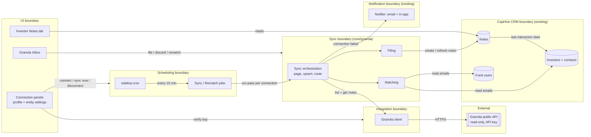

| From → To | Contract | Direction rule |
|---|---|---|
| UI → Scheduling | Enqueue a sync for one connection | UI never runs a sync inline |
| UI → Integration | Verify a key once, on Connect | The only UI call to Granola |
| UI → Sync | File, discard or re-match one meeting | Always through the filer or processor, never writing notes itself |
| Scheduling → Sync | Run one pass for one connection | One pass at a time per connection |
| Sync → Integration | List changed notes, fetch one note | Only the client knows URLs, auth and rate limits |
| Sync → CRM | Read contacts and users; create and refresh notes | Only the filer writes notes. The matcher is read-only |
| Sync → Notification | Connection needs attention | Raised only by the connection's failure handling |

### Class Diagram

Classes grouped by the boundaries above. Arrows between groups are the boundary contracts.

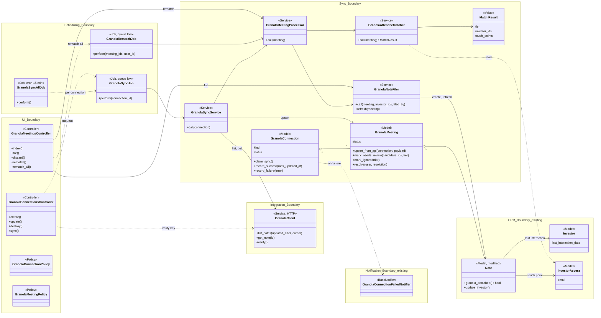

### Change Footprint

All new code lives in one new sub-domain, `app/packs/core/granola/`. Existing code only gains small
hooks. Green is new, amber is modified, grey is reused unchanged. Exact file paths are per task in
[tasks.md](tasks.md).

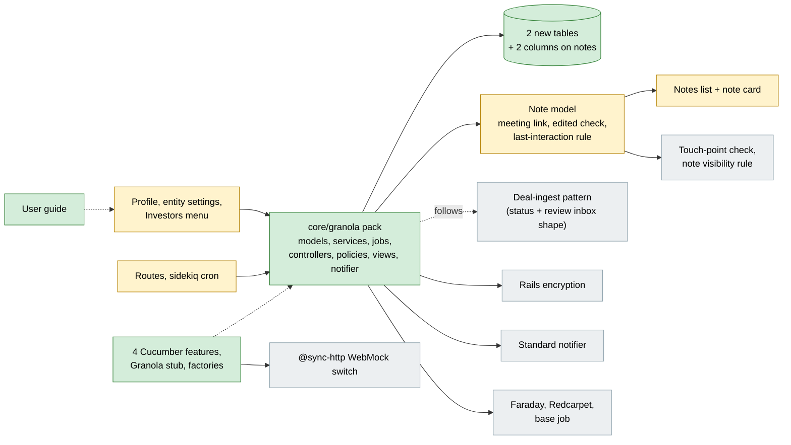

---

## Data Model and States

### Data Model

Two new tables, `granola_connections` and `granola_meetings`, plus two new columns on the existing
`notes` table. Existing tables are shown only with the columns this feature reads or adds.

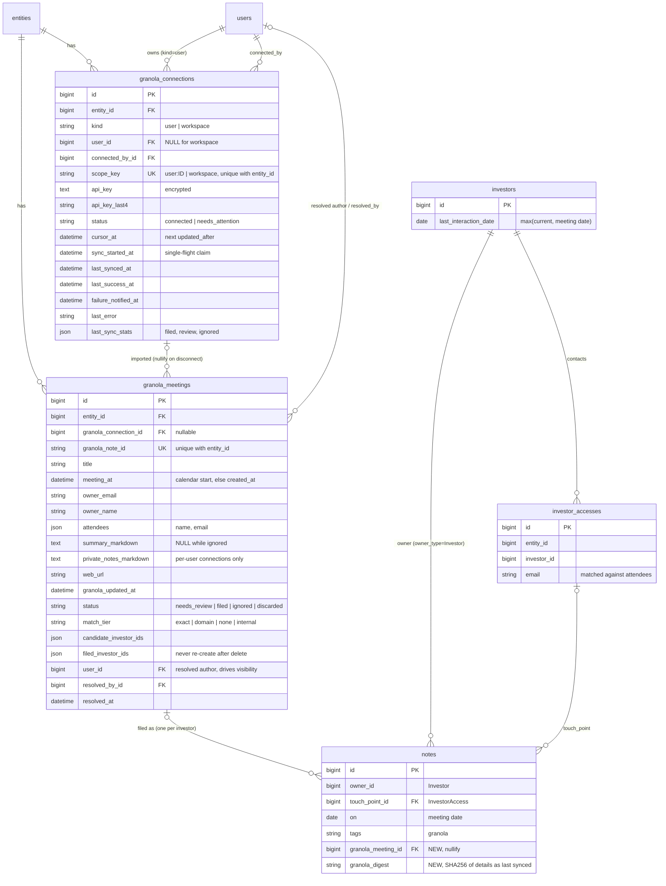

**Indexes:** unique `granola_connections[entity_id, scope_key]`; unique
`granola_meetings[entity_id, granola_note_id]`; `granola_meetings[entity_id, status, meeting_at]`
for the inbox; `notes[granola_meeting_id]`.

**Column rationale** (non-obvious columns only):

**`granola_connections`**

| Column | Why |
|---|---|
| `kind` + `user_id` | One table for both connection kinds (proposal decision 1). `user_id` NULL means workspace |
| `scope_key` | MySQL has no partial unique index. `"user:<id>"` / `"workspace"` with a unique index on `[entity_id, scope_key]` enforces "one per user, one workspace per entity" at the DB level |
| `connected_by_id` | Who gets failure alerts, and the fallback author for workspace notes |
| `api_key` (encrypted) + `api_key_last4` | Secret is never decrypted for display. Last 4 characters render the masked key |
| `cursor_at` | Granola `updated_after`. Only advanced after a fully successful pass |
| `sync_started_at` | Single-flight claim so cron and "Sync now" can't run the same connection twice |
| `last_success_at` / `failure_notified_at` | Drive the 24h prolonged-outage alert and stop repeat alerts |

**`granola_meetings`**

| Column | Why |
|---|---|
| `[entity_id, granola_note_id]` unique | Duplicate guard across a partner's key and the workspace key (spec: "Same meeting via two connections") |
| `summary_markdown` NULL while ignored | Unmatched meetings (portfolio co, personal) never store content. Re-match re-fetches from Granola |
| `private_notes_markdown` | Written only when the source connection is `kind=user`. A later workspace pass never blanks it |
| `filed_investor_ids` | `Note` is **not** soft-deleted (`Trackable` is commented out in `note.rb:2`). This list is how "deleted note not recreated" is enforced: refresh only updates notes that still exist, and never creates for an investor already listed |
| `user_id` | Resolved author, used for the note's `user` and for inbox visibility, mirroring `NotePolicy::Scope` |

**`notes`**

| Column | Why |
|---|---|
| `granola_meeting_id` | Links each filed note back to its meeting; one meeting can produce several notes (one per investor) |
| `granola_digest` | SHA256 of `details` HTML as the sync last wrote it; a mismatch means a user edited it (see `granola_detached?`) |

**Changes to existing models** (`Note`):

- New association to `GranolaMeeting` (optional).
- New derived predicate `granola_detached?` (see *Note sync ownership* above).
- `update_investor`: only for Granola notes on an `Investor` owner,
  `last_interaction_date` becomes `max(current, on)` instead of `created_at`. Manual notes and
  `DealInvestor` owners keep today's behaviour.

**FAQ**

| Question | Answer |
|---|---|
| Why a digest instead of an `edited_by_user` flag? | A flag set in the notes controller misses edits from every other path (API, MCP tools, console). Comparing digests catches all of them without a callback on `Note`. The digest is taken after save, because ActionText normalises the HTML |

### State Transitions

#### Meeting status lifecycle

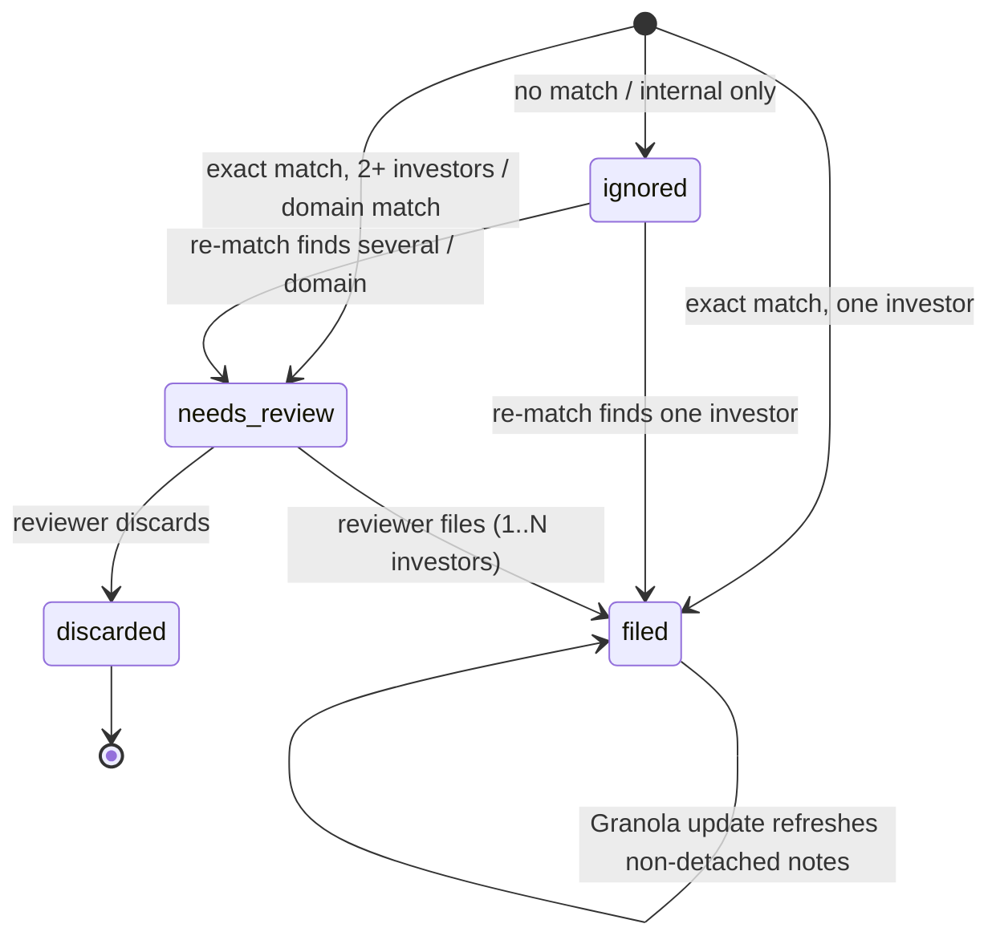

#### Connection status lifecycle

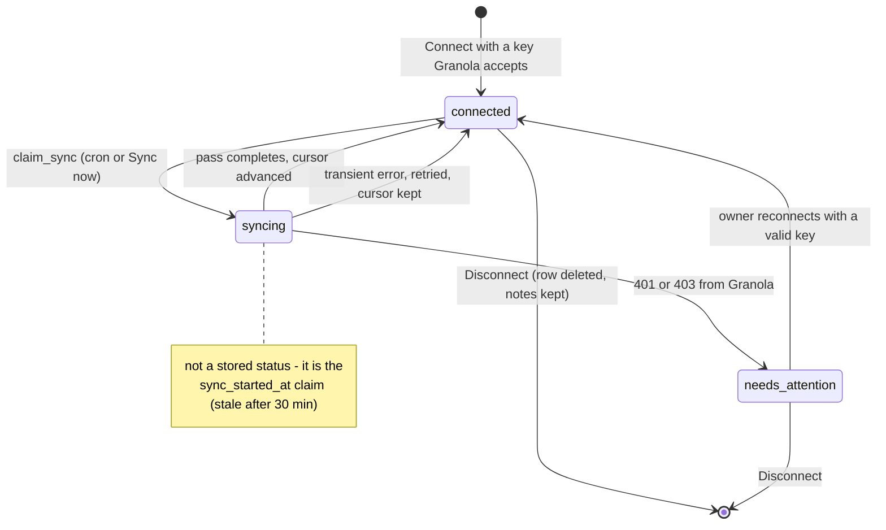

#### Note sync ownership

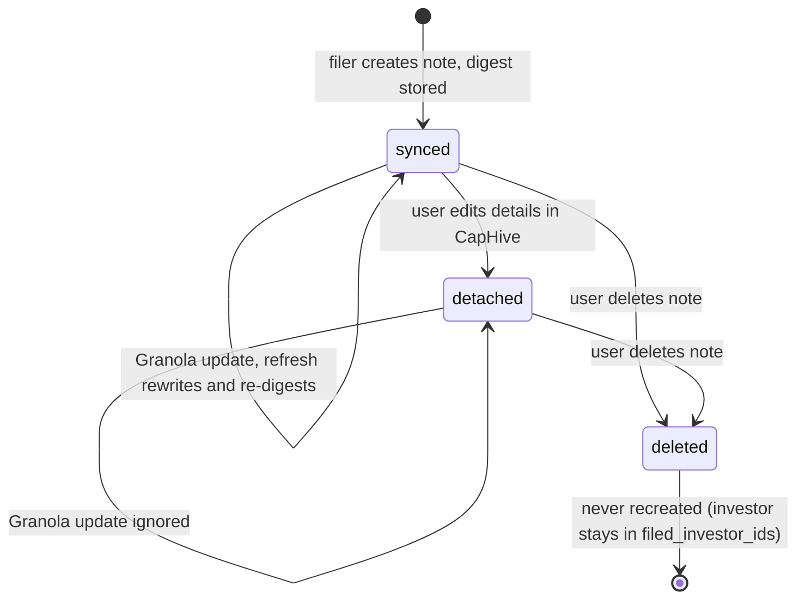

`detached` is derived, not stored: `granola_digest` differs from the digest of the current `details`
HTML.

---

## Behaviour

### Pipeline / Flow

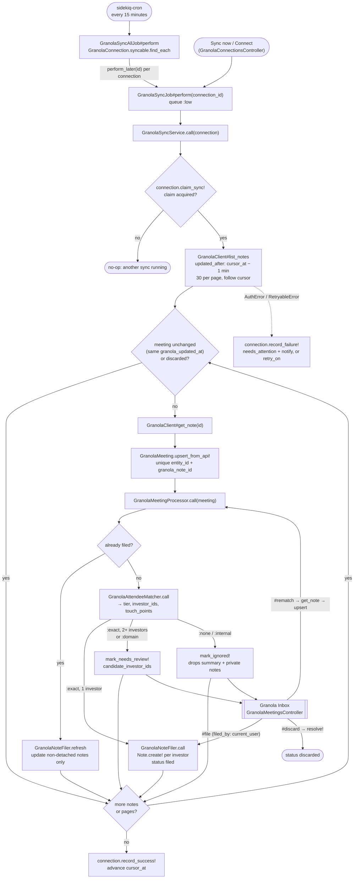

### Sequence Diagrams

Happy path: a scheduled sync auto-files a single-investor meeting.

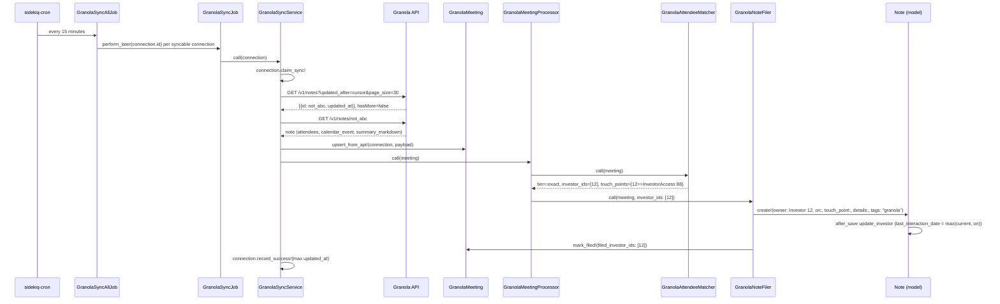

Error and edge path: the key is revoked mid-sync, and an ambiguous meeting is parked.

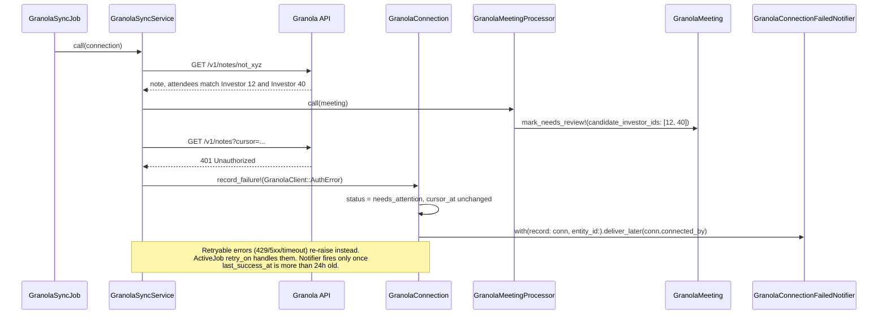

Connecting a key: verify it first, then start the 90-day backfill.

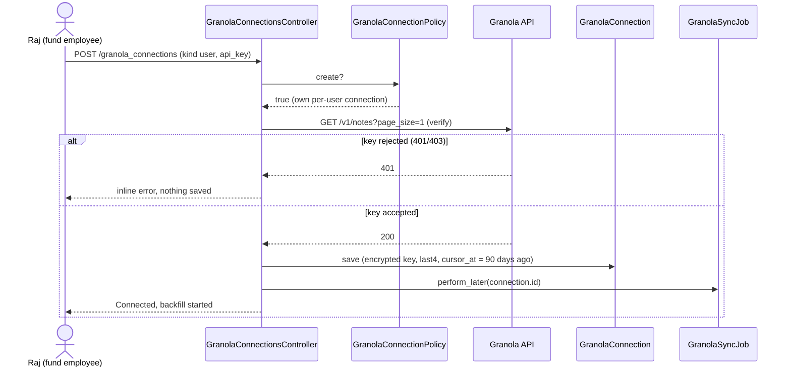

Review inbox: a fund admin files an ambiguous meeting to two investors.

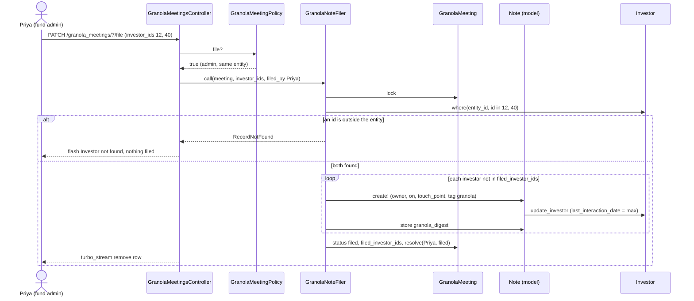

Granola changes a meeting that was already filed, and one of its notes was edited in CapHive.

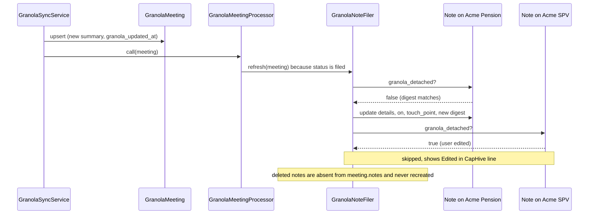

Re-match an ignored meeting after a contact is added.

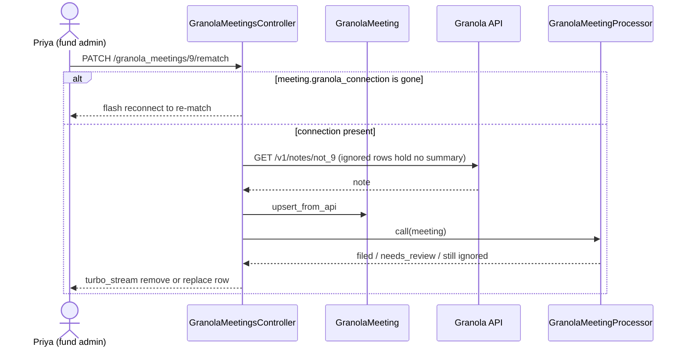

### Worked Examples

**ID legend:** **H** = Happy path · **E** = Edge case · **X** = Error (exception) case. IDs are
referenced from tasks.md and Cucumber scenario names.

**Shared setup:**

| Record | Name | Key data |
|---|---|---|
| Entity | Alpha Capital | — |
| Fund admin | Priya | priya@alphacap.com |
| Fund employee | Raj | raj@alphacap.com |
| Investor + contact | Acme Pension / Jane Doe | jane@acmepension.com |
| Investor + contact | Acme Co-invest SPV / Mark Lee | mark@acmepension.com |
| Investor + contact | Bluewater FO / Ann Roy | ann@bluewater.co |

#### Happy Path

| # | Scenario | Given | When | Then | Spec scenario | Feature |
|---|---|---|---|---|---|---|
| H1 | Connect a per-user key | Raj has no connection; Granola accepts his key ending `1a2b` | Raj clicks Connect on his profile | Connected; key shown as `grn_••••••••1a2b`; 90-day backfill queued | Valid per-user key | connections |
| H2 | Auto-file a one-investor meeting | Raj connected; "Q3 check-in" on 28/09/2026 with raj@ and jane@acmepension.com; summary "Reaffirmed Fund III"; private notes "Pushy on fees" | Sync runs | Acme Pension gets 1 note: author Raj, dated 28/09/2026, with Jane Doe, tag granola, title + summary + "Private notes" heading, Open in Granola link; meeting `filed`; last interaction 28/09/2026 | New meeting picked up · Single investor exact match is auto-filed · Note fields · Private notes via per-user connection · Author with per-user connection · Recent meeting | sync |
| H3 | Re-sync is idempotent | H2 has run | Sync runs again, meeting unchanged | Still exactly 1 note; last-sync time updated; no Granola fetch for that meeting | Nothing new | sync |
| H4 | Review, then file to two investors | "Co-invest sync" with jane@ and mark@acmepension.com | Sync runs; Priya ticks both candidates and clicks File | After sync: `needs_review` with 2 candidates, no notes. After File: 1 note on each, row gone, resolved by Priya | Multiple investors go to review · File to several investors | inbox |
| H5 | Domain match filed to one investor | "Intro call" with tom@bluewater.co (not a contact) | Sync runs; Priya picks Bluewater FO and clicks File | After sync: `needs_review`, candidate Bluewater FO. After File: 1 note on Bluewater FO | Domain-only match goes to review · File to one investor | inbox |
| H6 | Unedited note follows Granola | H2's note untouched in CapHive | Summary changes in Granola to "Reaffirmed Fund III and IV"; sync runs | Note shows the new summary and a new digest | Unedited note refreshed | updates |

#### Edge Cases

| # | Scenario | Given | When | Then | Spec scenario | Feature |
|---|---|---|---|---|---|---|
| E1 | Same meeting via two keys | Workspace (Priya) and Raj's key both return the H2 meeting | Both syncs run | One meeting record, one note, author Raj, private notes present | Same meeting via two connections | sync |
| E2 | Internal-only meeting | Meeting with only raj@ and priya@alphacap.com | Sync runs | `ignored`; no note; no summary stored | Internal-only meeting is ignored | sync |
| E3 | Stranger on a public domain | Meeting with stranger@gmail.com; a contact also uses gmail.com | Sync runs | `ignored`; no candidate from the gmail.com overlap | Public email domains never domain-match · No match is ignored | sync |
| E4 | Old meeting doesn't rewind history | Acme Pension last interaction 20/09/2026 | A meeting from 01/08/2026 is filed | Last interaction stays 20/09/2026 | Backfilled old meeting | sync |
| E5 | Workspace author fallback | Workspace connected by Priya; meeting owner advisor@consult.io has no login; attendee jane@ | Workspace sync runs | Note on Acme Pension authored by Priya, with "Imported from Granola (owner: advisor@consult.io)"; no private notes | Author with workspace connection | sync |
| E6 | Edited note is protected | H2's note edited by Priya to add "Follow up in Nov" | Summary changes in Granola; sync runs | Note unchanged; shows "Edited in CapHive — later Granola changes are not applied" | Edited note preserved | updates |
| E7 | Deleted note stays deleted | Priya deleted H2's note | Meeting changes in Granola; sync runs | No note recreated on Acme Pension | Deleted note not recreated | updates |
| E8 | Discard sticks | A meeting in the Inbox | Priya clicks Discard; later the meeting changes in Granola | Row gone and never returns | Discard | inbox |
| E9 | Re-match after adding a contact | Meeting with sam@startup.io is `ignored` | Priya adds sam@startup.io to Bluewater FO, clicks Re-match | Meeting filed on Bluewater FO | Re-match after adding a contact | inbox |
| E10 | Non-admin sees only own meetings | Inbox holds Raj's meeting and one resolved to Priya | Raj opens the Inbox | Only Raj's meeting listed; Priya sees both | Inbox visibility follows note visibility | inbox |
| E11 | Disconnect keeps notes | H2 has run | Raj clicks Disconnect and confirms | Connection and key gone; Acme Pension's note remains | Disconnect keeps imported notes | connections |

#### Error Cases

| # | Scenario | Given | When | Then (what the user sees, who is alerted) | Spec scenario | Feature |
|---|---|---|---|---|---|---|
| X1 | Invalid key on Connect | Granola rejects `grn_bad` | Raj clicks Connect | Inline "Granola rejected this API key. Check it and try again."; nothing saved; no alert | Rejected key | connections |
| X2 | Non-admin tries workspace | Raj is not a fund admin | Raj opens entity settings; posts a workspace connection directly | Section not shown; request denied | Workspace connection restricted to fund admins | connections |
| X3 | Second per-user connection | Raj already connected | Raj submits another key as a new connection | Refused; offered Disconnect or reconnect instead | Only one connection of each kind | connections |
| X4 | Key revoked mid-sync | Raj connected; Granola now returns 401 | Sync runs; later Raj enters a valid key | Needs attention with reason; cursor unchanged; Raj gets email + in-app alert; cron skips it. After reconnect: connected, resumes from the old cursor | Revoked key · Reconnect resumes | updates |
| X5 | Granola down for a day | Every call returns 503 | Syncs retry for 24 hours | No alert until 24h without success, then exactly one to Raj; none again until a success and a new failure | Prolonged outage | updates |
| X6 | Filing to another fund's investor | An investor id from a different entity | Priya submits File with it | "Investor not found"; nothing filed | Cross-entity investor rejected | inbox |
| X7 | Re-match with connection gone | Raj disconnected; his ignored meeting remains | Priya clicks Re-match | "The Granola connection that imported this meeting has been disconnected — reconnect to re-match" | — (design-only guard) | inbox |

**FAQ**

| Question | Answer |
|---|---|
| What is the retry behaviour for a 500 from Granola? | Retried with backoff, 5 attempts. The cursor does not move, so the next cron pass covers it too. The connector is alerted only after 24h without success (X5) |

---

## Key Components

Responsibilities are summarised here. The collaborations are in the Class Diagram and the timing is
in the Sequence Diagrams.

| Component | Responsibility | Notes |
|---|---|---|
| `GranolaClient` | The only class that talks HTTP to `public-api.granola.ai/v1` | Bearer key; 10s/30s timeouts; 0.2s spacing between calls (Granola allows 5 req/s); raises `AuthError` (401/403), `RetryableError` (429 honouring Retry-After, 5xx, timeout), `Error` |
| `GranolaSyncService` | One incremental pass for one connection | Claim, then page through `updated_after`, batch-lookup existing meetings per page, skip unchanged or discarded, fetch, upsert, process. The cursor advances only if every meeting in the pass succeeded |
| `GranolaAttendeeMatcher` | Attendee emails → `MatchResult` | Deterministic, no LLM. Decision flow below |
| `GranolaMeetingProcessor` | Routes one meeting by status and match | Discarded: no-op. Filed: refresh. Needs review: update candidates only, never auto-file. New or ignored: match and route |
| `GranolaNoteFiler` | Creates and refreshes notes, transactionally | Decision flow below. Markdown goes through the existing Redcarpet setup with `escape_html` |
| `GranolaSyncAllJob` / `GranolaSyncJob` | Scheduling and retries | Cron registered next to `SchedulerPollingJob` in `config/initializers/sidekiq.rb`; the pass runs inside `Chewy.strategy(:atomic)` |
| `GranolaRematchJob` | Bulk "Re-match all" | Up to 500 most recent ignored meetings in the user's scope |

### Decision Flows

#### Matching

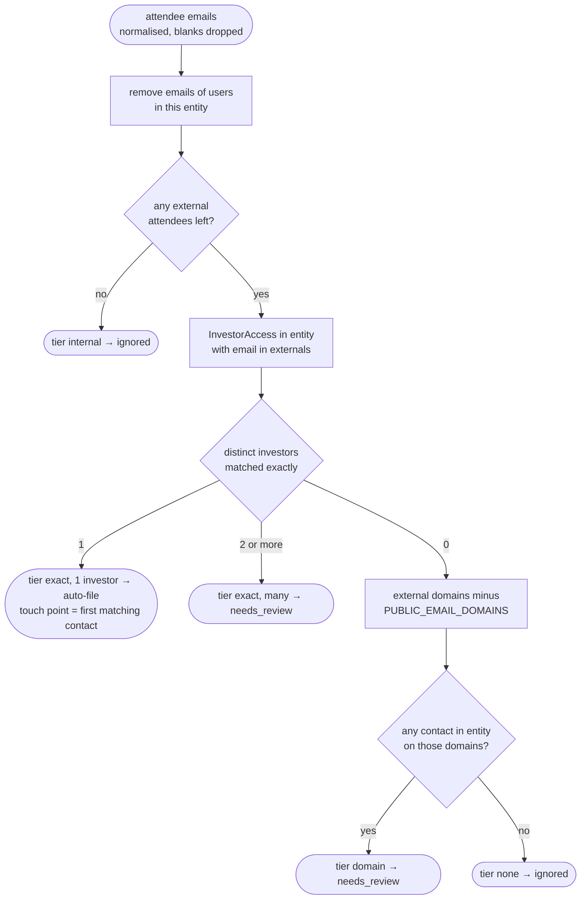

#### Filing

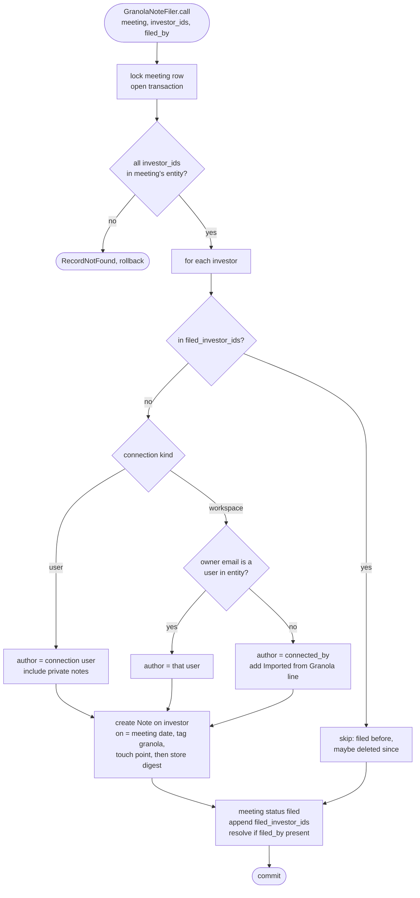

**FAQ**

| Question | Answer |
|---|---|
| Why not reuse `DealIngestProcessor` / `WarehouseItem`? | `WarehouseItem.deal_id` is NOT NULL and points at `AgentIngestedEmail`, and the deal flow starts with an LLM parse this feature does not need. We copy the shape (string status, resolve, candidate ids), not the tables |
| Why no LLM? | Granola already gives structured attendee emails. A guess is the one failure this feature must avoid |
| Why poll instead of webhooks? | Granola has no webhooks. `updated_after` is its documented incremental mechanism |
| Why never auto-file a meeting already in review? | A reviewer may be looking at it. Moving it out of the inbox silently would be surprising |

---

## Controllers and Routes

All routes go in `config/routes/core.rb`.

| Verb and path | Action | Does | Responds with |
|---|---|---|---|
| `POST /granola_connections` | `create` | authorize, verify key with Granola, save, queue backfill | redirect back; inline error if rejected |
| `PATCH /granola_connections/:id` | `update` | reconnect with a new key; keeps `cursor_at` | redirect back |
| `DELETE /granola_connections/:id` | `destroy` | delete connection; meetings nullified, notes kept | redirect back (after `turbo-confirm`) |
| `POST /granola_connections/:id/sync` | `sync` | queue `GranolaSyncJob` | "Sync started" flash |
| `GET /granola_meetings?status=` | `index` | inbox tabs `needs_review` / `ignored`, paginated, candidate names batch-loaded | HTML |
| `PATCH /granola_meetings/:id/file` | `file` | `GranolaNoteFiler.call` with `filed_by` | turbo_stream remove row |
| `PATCH /granola_meetings/:id/discard` | `discard` | `resolve!(discarded)` | turbo_stream remove row |
| `PATCH /granola_meetings/:id/rematch` | `rematch` | re-fetch, upsert, process | turbo_stream remove or replace row |
| `POST /granola_meetings/rematch_all` | `rematch_all` | queue `GranolaRematchJob` | flash |

---

## Policy

**Access control:**

| Role | Connections | Granola Inbox |
|---|---|---|
| Fund admin (`company_admin`) | own per-user connection; the entity's workspace connection | every meeting in the entity |
| Fund employee (non-admin, `enable_investors`) | own per-user connection only | meetings whose resolved author is them |
| Investor / investor advisor | none | none |
| Support (`support?`) | as fund admin | as fund admin |

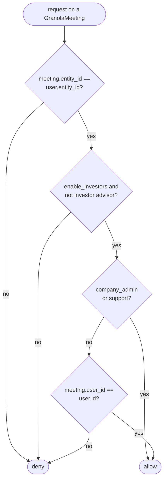

- `GranolaMeetingPolicy::Scope` applies the same rule as a query, mirroring `NotePolicy::Scope`.
- `GranolaConnectionPolicy`: a `kind=user` connection is allowed only when `record.user_id == user.id`.
  `kind=workspace` uses the same admin test as `EntityPolicy#update?` (`entity_policy.rb:56-57`).
- **Multi-tenancy:** every query scopes by `entity_id`: connections, meetings, matcher contacts and
  users, and the filer's investor load. An investor id from another entity raises instead of filing.

---

## UI Changes

This section walks through the UI as the people using it will. It starts with where Granola shows
up, then covers each journey with its screen and steps, and ends with notes for whoever builds it.
User-facing rules (messages, validation) are in the [proposal](proposal.md#behavior-rules).

### At a glance

| Where in CapHive | Today | After this change | Who sees it |
|---|---|---|---|
| My profile | No Granola | New **Granola** panel to connect your own account | Any fund employee, on their own profile |
| Entity settings | No Granola | New **Granola workspace** panel to connect the fund's shared account | Fund admins |
| Investors menu | — | New **Granola Inbox (3)** link, shown once the fund has a connection | Fund admins and employees |
| Granola Inbox | Doesn't exist | **New page** listing meetings CapHive couldn't place | Admins see all; employees see their own meetings |
| Investor → Notes tab | Manual notes only | Granola meetings appear as notes, tagged `granola`, with a link back | Same as notes today |
| Email + bell alert | — | "Granola connection needs attention" | The person who connected the key |

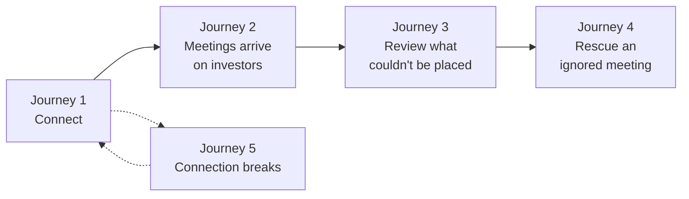

### Journey 1: A partner connects Granola

```
My profile
┌──────────────────────────────────────────────────────┐
│  Granola                                              │
│  ① Status:  ○ Not connected                           │
│  ② API key: [ grn_...                          ]      │
│     Where do I find my key? (Granola → Settings → API)│
│  ③ ⚠ Filed meetings, including your private notes,    │
│     become visible to fund admins.                    │
│  ④ [ Connect ]                                        │
└──────────────────────────────────────────────────────┘
          after Connect succeeds
┌──────────────────────────────────────────────────────┐
│  Granola                                              │
│  ① Status:  ● Connected                               │
│  ② API key: grn_••••••••1a2b                          │
│  ⑤ Last sync: 30/09/2026 14:15 — 3 filed, 1 to review │
│  ⑥ [ Sync now ]   ⑦ [ Disconnect ]                    │
└──────────────────────────────────────────────────────┘
```

| Step | The user… | They see |
|---|---|---|
| 1 | Opens **My profile** and finds the Granola panel | ① Not connected, ② empty key field, ③ the visibility warning |
| 2 | Pastes their key and clicks ④ **Connect** | Wrong key: the error appears under the field and nothing is saved. Right key: the panel switches to Connected |
| 3 | Waits a few minutes | ⑤ fills in once the first import (last 90 days) finishes. Their meetings start appearing on investors (Journey 2) |
| 4 | Optionally clicks ⑥ **Sync now** | "Sync started". ⑤ updates on the next visit |
| 5 | Optionally clicks ⑦ **Disconnect** and confirms | Back to Not connected. Notes already imported stay |

A fund admin connects the shared workspace from **Entity settings → Granola workspace**. It's the
same panel and the same steps. Only admins see it.

### Journey 2: A meeting shows up on the investor (no clicks)

```
Investor: Acme Pension → Notes tab
┌──────────────────────────────────────────────────────┐
│  28/09/2026 · Q3 check-in — Acme Pension  ① [granola] │
│  By Raj Menon · ② With: Jane Doe                      │
│                                                      │
│  ③ • Reaffirmed commitment to Fund III               │
│     • Asked for DPI by vintage                       │
│     Private notes                                    │
│     • Pushy on fees                                  │
│                                                      │
│  ④ Open in Granola ↗                                 │
│  ⑤ Edited in CapHive — later Granola changes are not  │
│     applied                          (only if edited) │
└──────────────────────────────────────────────────────┘
```

| Step | What happens | What the user sees |
|---|---|---|
| 1 | The partner finishes a call with jane@acmepension.com. Granola writes the summary | Nothing in CapHive yet |
| 2 | Within ~15 minutes CapHive picks it up and recognises Jane as Acme Pension's contact | A new note on Acme Pension: ① tag, ② the contact met, ③ summary (+ private notes for a personal key), ④ link back |
| 3 | The summary is edited later in Granola | The note updates on its own, unless someone edited it in CapHive, in which case it stays as is and shows ⑤ |

### Journey 3: An admin reviews meetings CapHive couldn't place

```
Investors menu → Granola Inbox (2)
┌────────────────────────────────────────────────────────────────────┐
│  Granola Inbox            ① [ To review (2) ]  [ Ignored ]          │
│                                                                    │
│  ② Co-invest sync · 28/09/2026 · owner Raj Menon       ↗ Granola    │
│     Attendees: jane@acmepension.com, mark@acmepension.com          │
│  ③ Why here: attendees belong to 2 investors                        │
│  ④ ☐ Acme Pension   ☐ Acme Co-invest SPV                            │
│  ⑤ Other investor: [ search…            ▾ ]                         │
│  ⑥ [ File ] (greyed until an investor is ticked)   ⑦ [ Discard ]    │
│ ────────────────────────────────────────────────────────────────── │
│  Intro call · 27/09/2026 · owner Priya Shah            ↗ Granola    │
│  Why here: email domain match only (tom@bluewater.co)              │
│  ☐ Bluewater FO                                                    │
│  [ File ]   [ Discard ]                                            │
└────────────────────────────────────────────────────────────────────┘
```

| Step | The user… | They see |
|---|---|---|
| 1 | Clicks **Granola Inbox (2)** in the Investors menu | ① the To review tab. Admins see every meeting; employees only their own |
| 2 | Reads a row | ② meeting and owner, ③ why CapHive didn't file it, ④ the investors it might belong to |
| 3 | Ticks one or more investors (or searches ⑤ for a different one) | ⑥ File becomes clickable |
| 4 | Clicks **File** | The row disappears, the count drops to (1), and each ticked investor gets the note from Journey 2 |
| 5 | Or clicks ⑦ **Discard** | The row disappears for good, even if the meeting changes in Granola later |

### Journey 4: Rescue an ignored meeting

| Step | The user… | They see |
|---|---|---|
| 1 | Opens the **Ignored** tab | Meetings where no attendee is a known investor contact (title, date, attendees only, with no summary kept) |
| 2 | Spots a real LP meeting with sam@startup.io, who isn't a contact yet | — |
| 3 | Adds sam@startup.io as a stakeholder of Bluewater FO | The usual stakeholder screen |
| 4 | Returns and clicks **Re-match** on that row | The row leaves the Ignored tab and the note appears on Bluewater FO. If it now matches several investors, it moves to **To review** instead |

### Journey 5: The connection breaks

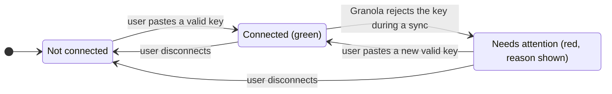

| Step | What happens | What the user sees |
|---|---|---|
| 1 | The partner revokes the key in Granola, or it expires | — |
| 2 | The next sync is rejected | Email and bell alert: "Granola connection needs attention", linking to the panel |
| 3 | They open the panel | Red **Needs attention**, the reason, and a key field |
| 4 | They paste a new key | Back to Connected, catching up from where it stopped. Nothing is lost |

### Build notes (for implementers)

| Interaction | Screen update |
|---|---|
| File / Discard | Row removed in place (Turbo Stream) and badge count decremented, with no page reload |
| Re-match | Row replaced in place, or removed if filed |
| Sync now | Flash only. The last-sync line refreshes on the next load |
| Connect / Disconnect | Normal form submit, redirect back to the panel |

- Each inbox row is a Turbo Frame. The "Other investor" picker reuses the existing investor select.
  Disabling File until a tick needs no new Stimulus controller if an existing one fits; otherwise
  add a tiny one.
- The key is never rendered in full: `grn_••••••••` plus the last four characters.
- The Inbox link appears only once the fund has a connection, so funds that don't use Granola never
  see an empty feature.

---

## Cross-cutting Concerns

### Transactions and Queries

**Queries added/changed:**

| What is read | When | N+1 risk | How it stays cheap |
|---|---|---|---|
| Connections that are allowed to sync | Every cron tick | No | Read in batches |
| Meetings already stored for one page of Granola results | Each page (≤30 meetings) | Avoided | One lookup per page by Granola id, not one per meeting |
| Fund users whose email is among the attendees | Each meeting | No | One indexed lookup per meeting |
| Investor contacts whose email is among the attendees | Each meeting | No | One indexed lookup per meeting |
| Investor contacts on the attendees' email domains | Each meeting, only when there is no exact match | No | Scans only this fund's contacts (thousands, not millions) |
| Investors chosen for filing | Each file action | No | One lookup, restricted to the fund |
| Candidate investor names in the inbox | Inbox page load | **Yes**, one per row | Collect every candidate on the page and load names once |
| Meeting link and "edited" flag on each note | Investor Notes tab | **Yes**, one per note | Preload the meeting with the notes; note text is already preloaded |

**Transaction boundaries:**

| Operation | In a transaction? | Why |
|---|---|---|
| Filing a meeting (create notes, update last interaction, mark meeting filed) | Yes, with the meeting row locked | A partial file would leave the meeting in review with some notes already created |
| Refreshing a filed meeting's notes | Yes, per meeting | Note text and stored fingerprint must change together |
| Storing a meeting fetched from Granola | No | A single row. The unique Granola-id index settles a race between two connections |
| Advancing a connection's cursor | No | A single row, written only after the whole pass succeeds |

**FAQ**

| Question | Answer |
|---|---|
| Could two syncs race and double-file? | Each connection runs one pass at a time. Two connections returning the same meeting meet at the unique Granola-id index, and the filer re-checks filed investors under the row lock |

### Exception Handling and Monitoring

| Failure scenario | Who is alerted | Channel | Detail |
|---|---|---|---|
| Invalid key on Connect | User | In-app (inline form error) | "Granola rejected this API key. Check it and try again." Nothing saved |
| Key revoked or expired during sync | User (connector) | Email + in-app | Connection goes to *needs attention* and stops syncing. Uses the standard notifier pattern (same as the KPI import-failed alert) |
| Granola rate-limits, errors or times out | Nobody at first | — | Retried automatically. The last error is shown on the connection panel |
| No successful sync for 24h | User (connector) | Email + in-app | Sent once, and reset on the next success |
| One meeting fails to process | Support | Existing error tracking | Logged with the Granola id. The rest of the pass continues and the cursor stays put, so the meeting is retried |
| Filing to an investor from another fund | User | In-app (flash) | "Investor not found". Nothing filed |
| Re-match when the connection is gone | User | In-app (flash) | "The Granola connection that imported this meeting has been disconnected — reconnect to re-match" |

**FAQ**

| Question | Answer |
|---|---|
| Could one bad meeting block everything behind it? | The rest of the pass still processes, but the cursor stays put, so the bad meeting is retried each pass. After 24h with no advance, the connector is alerted |

### Performance and Security

- Volume per connection is small: tens of meetings per week per partner. The backfill is the peak
  (about 90 days of meetings, ≤5 req/s).
- All work runs on the `:low` queue. Sync is single-flight per connection.
- There are no queries on large tables. The inbox and notes list preloads are covered above.
- **Secret:** the API key is encrypted with AR encryption, never rendered (only `api_key_last4`),
  and filtered from logs (already covered by the `_key` pattern in `filter_parameter_logging.rb:7`).
- **Tenant isolation:** entity scoping on every query. The filer loads investors by `entity_id`.
  Policies mirror `NotePolicy` and `EntityPolicy`.
- **Content minimisation:** ignored meetings store no summary or private notes. Transcripts are
  never fetched.
- **HTML injection:** Granola markdown is rendered with `escape_html: true`. ActionText sanitises on
  top of that.
- **Private notes exposure:** documented in the proposal FAQ and shown as a warning before connecting.

---

## Design Decisions

1. **One `granola_connections` table with a `kind` column.** The alternative was entity-settings
   columns for the workspace key plus a user table for personal keys. That was rejected because it
   means two sync paths, two failure paths and two UIs for one behaviour.
2. **Meeting row unique per entity, not per connection.** The alternative was per connection with
   dedupe at note level. That was rejected because the same meeting via two keys would show twice in
   the inbox and race to file.
3. **Deterministic email matching, no LLM.** The alternative was reusing `DealStakeholderMatcher` /
   an LLM. That was rejected because attendee emails are exact data, and a guess is the failure this
   feature must avoid.
4. **Ignored meetings drop their content.** The alternative was keeping the summary so re-match is
   offline. That was rejected because it would store partners' non-investor meeting content (the
   leak risk from the proposal). Re-match does one GET instead.
5. **Edit detection by digest.** The alternative was a flag set in the controller. That was rejected
   because it misses non-controller edit paths (see Model FAQ).
6. **`filed_investor_ids` instead of soft-delete.** `Note` isn't paranoid, and turning `Trackable` back
   on for notes is out of scope. The alternative was re-creating any missing note, which was rejected
   because it resurrects notes users deleted on purpose.
7. **Encrypt the key despite plain-text precedent.** `entity_settings.whatsapp_token` and similar
   columns are unencrypted. A Granola key reads a partner's entire meeting history, so encryption is
   worth being the first `encrypts` in the app. The infrastructure is already configured.

---

## Testing

Cucumber only. Every scenario is tagged `@sync-http`, so WebMock stubs Granola while local services
keep working. One fixture-driven Granola stub helper goes under `features/support/`, and jobs run
inline in steps. Existing entity, investor, contact and login steps are reused, and new steps go in
one Granola step file. The scenario-to-file mapping is the **Feature** column of the Worked Examples.

---

## Risks and Open Questions

- A Granola API change (fields, auth, rate limits) could break the sync. Mitigation: the client is
  isolated in one class, the failure alerts surface it within 24h, and the Cucumber fixtures pin
  the contract we rely on.
- Contacts sharing one email across investors send more meetings to review. Mitigation: that's
  intended. The inbox badge keeps the queue visible.
- Digest false positives if ActionText re-serialises HTML differently after a Rails upgrade.
  Mitigation: at worst, notes stop auto-updating (the safe direction). They are never overwritten.
- Workspace-only funds get no private notes. That's accepted and stated in the proposal.

| # | Question | Current Thinking | Status |
|---|---|---|---|
| 1 | Does `@sync-http` WebMock allow the other HTTP a scenario needs? | Resolved: `webmock_toggle.rb` sets `disable_net_connect!(allow_localhost: true)`, so local Elasticsearch/Redis keep working; only Granola needs stubbing | Resolved |
| 2 | Is `api_key` filtered from logs? | Resolved: `filter_parameter_logging.rb:7` filters `_key` (and `secret`, `token`), so `api_key` is already covered | Resolved |
| 3 | Exact Granola error body/status for a plan without API access | Treat as `AuthError` (403). Refine the message once seen | Deferred |
