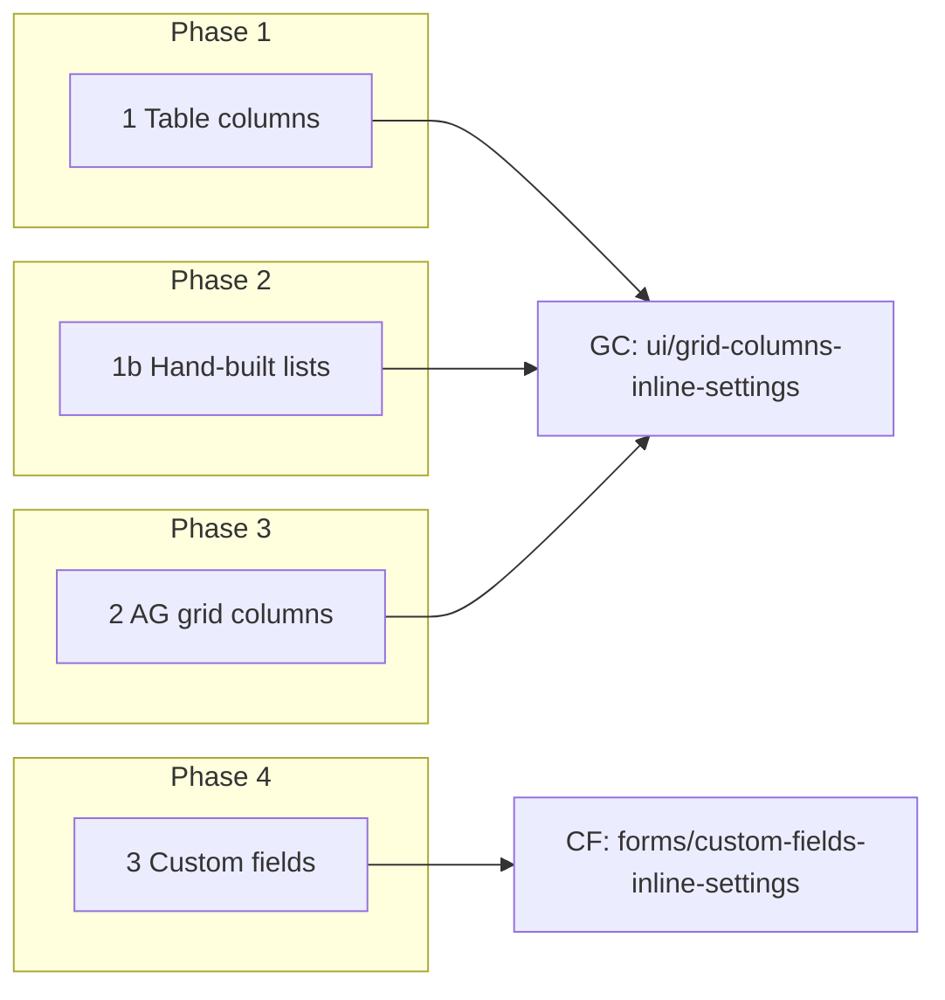
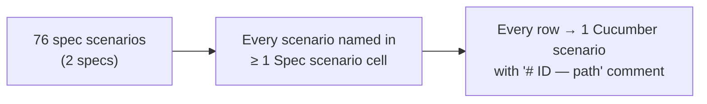

# Table columns and custom fields in place — Business Rules (H/E/X)

> **Audience:** Product, QA, developers. Every row becomes exactly one Cucumber scenario.
> **Companions:** [Proposal](proposal.md) · [Design](design.md) · [Specs](specs/)

---

## Contents

- [How to read this](#how-to-read-this)
- [Shared setup](#shared-setup)
- [1. Table columns — Phase 1](#1-table-columns--phase-1)
- [1b. Hand-built list tables — Phase 2](#1b-hand-built-list-tables--phase-2)
- [2. AG grid columns — Phase 3](#2-ag-grid-columns--phase-3)
- [3. Custom fields on record pages — Phase 4](#3-custom-fields-on-record-pages--phase-4)
- [Coverage](#coverage)

---

## How to read this

- **ID legend:** **H** = happy path · **E** = edge case · **X** = error case. IDs run across the whole file.
- **Spec scenario** column: `GC: <scenario>` = `ui/grid-columns-inline-settings`; `CF: <scenario>` =
  `forms/custom-fields-inline-settings`.
- **Feature** column: `core-gc` = `features/core/grid_columns_inline_settings.feature`; `core-gc-lists` =
  `features/core/grid_columns_hand_built_lists.feature`; `sec-gc` =
  `features/security/grid_columns_inline_settings_isolation.feature`; `core-cf` =
  `features/core/custom_fields_inline_settings.feature`; `sec-cf` =
  `features/security/custom_fields_inline_settings_isolation.feature`.
- Every scenario carries a comment above it: `# E12 — Edge case: …`.
- Money shown in INR as the app formats it; no rounding rules apply.

---

## Shared setup

| Record | Name | Key data |
|---|---|---|
| Firm | Demo Capital | Investment Fund, INR |
| Company admin | Meera | `company_admin` of Demo Capital |
| Employee | Ravi | Demo Capital employee, no `company_admin` |
| Support user | Sam | CapHive support, `company_admin` of Demo Capital |
| Fund | Growth Fund I | INR |
| Investors | Ravi Menon, Acme Family Office | Mumbai / HNI; Bengaluru / FO |
| Investor form type | Default | custom fields `risk_rating` (Select: Low, Medium, High; required), `relationship_manager` (Text, internal), `kyc_due` (Date), `net_worth` (Calculation) |
| Saved Investor columns | (when a row says so) | Name, Category, City, Tags, Committed |
| Report | "LPs by city" | Investors report of Meera; own columns Name, City, Committed |
| Other firm | Other Capital | its own Investor form type and report "Other LPs" with columns |

---

## 1. Table columns — Phase 1

### Happy path

| # | Scenario | Given | When | Then | Spec scenario | Feature |
|---|---|---|---|---|---|---|
| H1 | Button and panel list | Saved Investor columns Stakeholder, Category, City, Tags, Access | Meera opens Investors, clicks ▥ | ▥ visible right of the search box; panel lists them in order with types | GC: Company admin sees the icon; GC: Saved columns listed in order | core-gc |
| H2 | Edit and save in place | H1, search "Ravi" | Moves Access above City, renames Tags → Segment, removes City, adds Risk rating, saves | Only the table reloads: Stakeholder, Category, Access, Segment, Risk rating; search kept; toast "Investors columns saved" | GC: Reorder, rename, remove, add; GC: Add a custom field | core-gc |
| H3 | First save keeps standard columns | No saved Capital Call columns | Opens panel on Capital Calls, adds one column, saves | Panel listed the table's columns; table shows them plus the new one, same order | GC: Page standard columns when nothing is saved; GC: First save from standard columns | core-gc |
| H4 | Form type created | No Capital Call form type | Saves Capital Call columns | Form type "CapitalCall" (tag Default) created with the columns | GC: Form type created | core-gc |
| H5 | Report's own columns | "LPs by city" open | Removes City, saves | Report shows Name, Committed at once; firm columns unchanged | GC: Report with its own columns | core-gc |
| H6 | Reset | Saved Investor columns | Reset to standard columns, saves | No saved Investor columns; table shows the page's standard columns | GC: Reset | core-gc |
| H7 | Cancel / Esc | H1 | Removes City, presses Esc | Panel closes; saved columns unchanged | GC: Cancel discards | core-gc |
| H8 | Firm-wide | H2 saved | Ravi opens Growth Fund I › Investors tab | Same columns; no icon | GC: Firm-wide; GC: Employee who is not a company admin | core-gc |
| H16 | Configure Grids page | Saved Investor columns | Meera clicks Configure Grids on the Investor form type | Same list as the panel in a card; each saved row has Show / Edit / Delete | GC: From a form type page | core-gc |
| H17 | Save and delete on the full page | H16 | Drags Category first, saves; then Delete on City, confirms | Page refreshes with Category first; City removed at once | GC: Save on the full page; GC: Delete a column on the full page | core-gc |
| H18 | Add a derived field | Investors | Adds derived "RM", key `custom_fields.relationship_manager`, String, saves | Table shows RM with each investor's value | GC: Add a derived field | core-gc |

### Edge cases

| # | Scenario | Given | When | Then | Spec scenario | Feature |
|---|---|---|---|---|---|---|
| E1 | Derived field | Derived "NAV / Commitment" saved | Renames it "NAV ratio", moves it first, saves | Key, data type, alignment unchanged; label and position changed | GC: Rename a derived field | core-gc |
| E2 | Always-shown columns | All-funds Capital Commitments list, no saved columns | Opens panel, saves | Fund Name locked and not stored; Stakeholder an ordinary row and stored | GC: Page always adds a column | core-gc |
| E3 | Hidden on this page | Saved commitment columns include Investor; Ravi Menon › Commitments tab | Opens panel, saves | Investor listed "Not shown on this page"; still saved | GC: Page hides a saved column | core-gc |
| E4 | Report without own columns | Report with no columns open | Opens panel, saves | Header says firm's columns; form type columns written; report has none | GC: Report without its own columns | core-gc |
| E5 | Column removed meanwhile | Panel open listing City | City deleted elsewhere; Meera saves | Save succeeds without City | GC: Column removed meanwhile | core-gc |
| E6 | Double click | — | Two saves with the same list | One set; positions 1..n; no duplicates | GC: Double click on Save | core-gc |
| E7 | Blank heading | — | Clears Category's heading, saves | Heading "Category" | GC: Blank heading | core-gc |
| E8 | Duplicate in list | — | Save lists City twice | City once, first position | GC: Column listed twice | core-gc |
| E9 | Table in a tab | Growth Fund I › Commitments tab | Saves columns | Only the tab's frame reloads; tab stays open | GC: Table inside a tab | core-gc |
| E10 | Related record field | Capital Commitments | Adds an investor field from the related group, saves | Column saved and shown | GC: Add a related record's field | core-gc |
| E11 | Snapshot column | Snapshot view of Commitments | Opens panel | Snapshot Date not listed | GC: Snapshot column | core-gc |
| E23 | Data type and alignment | Saved Investor columns | ⌄ on Committed: Decimal, right; saves | Stored Decimal / `text-end`; cells right-aligned | GC: Change data type and alignment | core-gc |
| E24 | Derived key edit | Derived "NAV / Commitment" | ⌄: changes its key, saves | Column shows the new key's values; label unchanged | GC: Edit a derived field's key | core-gc |
| E25 | Page without a search box | A table page opened with `hide_search=true` | Meera opens it | ▥ visible at the table's top-right | GC: Page without a search box | core-gc |
| E26 | Second form type | Capital Commitment form types "Default" and "Feeder" | Configure Grids on Feeder, adds a column, saves | Feeder's columns change; Default's unchanged | GC: A second form type of the same record type | core-gc |
| E27 | Report page, no own columns | Report without columns | Configure Grids on the report page, saves | Panel listed the standard columns; the report now has its own columns | GC: From a report page | core-gc |

### Error cases

| # | Scenario | Given | When | Then (what the user sees, who is alerted) | Spec scenario | Feature |
|---|---|---|---|---|---|---|
| X1 | Non-admin | Ravi | Opens Investors; requests settings and save directly | No icon; both refused; nothing changed | GC: Employee who is not a company admin; GC: Direct request by a non-admin | sec-gc |
| X2 | Acting as investor | Meera acting as investor | Opens a table; requests settings directly | No icon; refused | GC: User acting as an investor; GC: Direct request acting as investor | sec-gc |
| X3 | Another firm | "Other LPs" | Save with a context naming it | Refused; its columns unchanged | GC: Another firm | sec-gc |
| X4 | Forged key | — | Save with new row key `entity.users` | "entity.users cannot be added"; nothing saved | GC: Column not offered | sec-gc |
| X5 | Tampered / expired context | — | Settings or save with altered token, or 13 h later | Not found; nothing saved | GC: Altered panel record | sec-gc |
| X6 | Empty list | — | Removes every column, saves | "Keep at least one column"; nothing saved | GC: Empty list | core-gc |
| X7 | Report not editable | Another user's draft report with columns | Meera saves | Refused | GC: Report the user may not edit | sec-gc |
| X8 | Extra fields | — | Save also sends `entity_id`, `owner_id`, `data_type` | Only columns, headings, order change | GC: Extra fields ignored | sec-gc |
| X9 | Unknown record type | — | Context naming a model without standard columns | Not found | GC: Unknown record type | sec-gc |
| X19 | Invalid data type | — | Save with data type `Ruby` | "Ruby is not a data type"; nothing saved | GC: Invalid data type | sec-gc |
| X20 | Other firm's Configure Grids | Other Capital's Investor form type | Meera opens its Configure Grids page | Refused | GC: Another firm's Configure Grids | sec-gc |

---

## 1b. Hand-built list tables — Phase 2

### Happy path

| # | Scenario | Given | When | Then | Spec scenario | Feature |
|---|---|---|---|---|---|---|
| H19 | Funds list unchanged by default | Funds "Growth Fund I", "Fund II"; no saved Fund columns | Meera opens Funds | Same headings, name links and Actions as before; ▥ beside the search box | GC: Today's columns by default; GC: Beside the in-page search box | core-gc-lists |
| H20 | Add a column to Distributions | A distribution "Dec 2025" with custom field `tranche` = "T1" | Adds Tranche, saves | Distributions list shows Tranche = T1 | GC: Add a column to a hand-built list | core-gc-lists |

### Edge cases

| # | Scenario | Given | When | Then | Spec scenario | Feature |
|---|---|---|---|---|---|---|
| E28 | Search and sort after customising | H20 saved; distributions "Dec 2025", "Jun 2026" | Types "Dec" in Search:, sorts by Name | Only Dec 2025 listed; sort works | GC: Search and sort after customising | core-gc-lists |
| E29 | Configure Grids offered | Capital Distribution form type | Opens its Form Type page | Configure Grids button present | GC: Configure Grids offered | core-gc-lists |
| E30 | Every converted list renders | One record each; no saved columns | Opens each of the 14 lists | Each renders with ▥ and its rows (no errors) | GC: Today's columns by default | core-gc-lists |

### Error cases

- No new rows: the same actions and policy as section 1 (X1–X9) cover every refusal.

---

## 2. AG grid columns — Phase 3

### Happy path

| # | Scenario | Given | When | Then | Spec scenario | Feature |
|---|---|---|---|---|---|---|
| H9 | AG grid columns | Capital Commitments grid view | Opens panel, adds a column, saves | Icon on the grid; only the grid reloads with the column | GC: AG grid tables; GC: Grid reloads | core-gc |

### Edge cases

| # | Scenario | Given | When | Then | Spec scenario | Feature |
|---|---|---|---|---|---|---|
| E12 | AG grid with column rules | Saved commitment columns include Investor; Ravi Menon › Commitments grid | Opens panel, saves | Investor "Not shown on this page"; still saved; Fund locked | GC: Page hides a saved column | core-gc |

### Error cases

- No new rows: the AG grids call the same actions and policy as section 1, whose X1–X9 cover every refusal.

---

## 3. Custom fields on record pages — Phase 4

### Happy path

| # | Scenario | Given | When | Then | Spec scenario | Feature |
|---|---|---|---|---|---|---|
| H10 | Icon and fields list | Ravi Menon on Default | Meera opens his page, clicks 🗎 | Icon on the details card; panel "Investor fields · Default" lists Risk rating, Relationship manager, KYC due, Net worth in order with types and flags | CF: Company admin sees the icon; CF: Fields listed in order | core-cf |
| H11 | Edit and save | H10 | Moves KYC due first, renames Relationship manager → RM, marks Internal on Risk rating (a required field can't also be read only), help "From the onboarding review", adds Source of funds (Select: Salary, Business, Inheritance), saves | Page refreshes in place, scroll kept; card shows KYC due, Risk rating, RM…; toast "Investor fields saved"; form type has the changes | CF: Reorder, rename, flags, help text, add; CF: Add a select field | core-cf |
| H12 | Shared by the form type | H11 saved | Meera opens Acme Family Office › Edit | Source of funds on the form | CF: Shared by the form type | core-cf |
| H13 | Form type created and linked | A Valuation with no form type; firm has no Valuation form type | Adds "Method note", saves | Valuation form type created with the field; the valuation linked; card shows the field label when filled | CF: Form type created and linked | core-cf |
| H14 | Remove a field | H10; Ravi Menon has KYC due 31/03/2027 | Removes KYC due, saves | Field gone from page and form; `kyc_due` value still stored | CF: Remove a field | core-cf |
| H21 | Icon on the record's form | Ravi Menon on Default | Meera opens his edit form, clicks 🗎 | Icon in the form card's header; panel warns "Saving refreshes this page — anything typed in the form and not yet saved is lost." | CF: Icon on the record's form | core-cf |
| H15 | Cancel / Esc | H10 | Renames Risk rating, presses Esc | Panel closes; form type unchanged | CF: Cancel discards | core-cf |

### Edge cases

| # | Scenario | Given | When | Then | Spec scenario | Feature |
|---|---|---|---|---|---|---|
| E13 | Record without a form type, firm has one | An investor with no form type | Opens panel, adds a field, saves | Panel lists Default's fields; investor linked to Default | CF: Record without a form type | core-cf |
| E14 | Calculation locked | Meera (not support) | Opens panel | Net worth locked "Support"; no toggles, no ✕ | CF: Calculation field locked | core-cf |
| E15 | Support may rename a calculation | Sam | Renames Net worth → "Net worth (₹)", saves | Label changed; formula unchanged | CF: Calculation field locked | core-cf |
| E16 | Regulatory fields | KYC form type with SEBI regulatory fields | Opens panel on a KYC, saves | Regulatory fields not listed; unchanged after save | CF: Regulatory field not listed | core-cf |
| E17 | Rename keeps data | Ravi Menon KYC due 31/03/2027 | Renames KYC due → "KYC review date", saves | Name `kyc_due`, type, value unchanged; page shows "KYC review date: 31/03/2027" | CF: Rename keeps the field's data | core-cf |
| E18 | Removed meanwhile | Panel open | KYC due deleted elsewhere; Meera renames it, saves | Save succeeds; KYC due stays removed | CF: Field removed meanwhile | core-cf |
| E19 | Reporting fields list | A page rendering a reporting fields list | Meera opens it | No fields icon on that list | CF: Reporting fields list | core-cf |
| E20 | Money field | — | Adds "Ticket size" as Money, saves | Field type Money, currency INR | CF: Reorder, rename, flags, help text, add | core-cf |
| E21 | Second form type | A commitment on form type tag "Feeder" | Opens panel | Header "Capital commitment fields · Feeder"; saves change only Feeder | CF: Fields listed in order | core-cf |
| E22 | Double click on Save | — | Clicks Save twice adding Source of funds | One Source of funds field; second click ignored while saving | CF: Add a select field | core-cf |

### Error cases

| # | Scenario | Given | When | Then (what the user sees, who is alerted) | Spec scenario | Feature |
|---|---|---|---|---|---|---|
| X10 | Non-admin | Ravi | Opens Ravi Menon's page; requests the panel and save directly | No icon; refused; nothing changed | CF: Employee who is not a company admin; CF: Direct request by a non-admin | sec-cf |
| X11 | Acting as investor | Meera acting as investor | Requests the panel directly | Refused | CF: Direct request acting as investor | sec-cf |
| X12 | Another firm's record | Other Capital's investor | Meera requests the panel and saves | Refused; their form type unchanged | CF: Another firm's record | sec-cf |
| X13 | Duplicate name | H10 | Adds "Risk rating", saves | "A field named Risk rating already exists"; nothing saved | CF: Duplicate name | core-cf |
| X14 | No label | — | Adds a field with an empty label | Not added; Add asks for a label; a forged save is refused | CF: New field without a label | core-cf |
| X15 | Select without options | — | Adds a Select with no options, saves | "Add at least one option" on that row; nothing saved | CF: Select without options | core-cf |
| X16 | Calculation guarded | Meera (not support) | Forged save changing Net worth's label and removing it | Net worth unchanged | CF: Calculation guarded on save | sec-cf |
| X17 | Extra fields | — | Save also sends `entity_id`, form type `name`, a field's `condition_on`, `meta_data` of an existing field | Only panel settings change | CF: Extra fields ignored | sec-cf |
| X18 | Unknown record type | — | Panel requested for `Kernel` / a model without custom fields | Not found | CF: Unknown record type | sec-cf |

---

## Coverage

| Group | H | E | X | Total |
|---|---|---|---|---|
| 1 Table columns | 11 | 16 | 11 | 38 |
| 1b Hand-built lists | 2 | 3 | 0 | 5 |
| 2 AG grid columns | 1 | 1 | 0 | 2 |
| 3 Custom fields | 7 | 10 | 9 | 26 |
| **Total** | 21 | 30 | 20 | 71 |

- `features/security/grid_columns_inline_settings_isolation.feature` and
  `features/security/custom_fields_inline_settings_isolation.feature` gather every refusal row: other firm, wrong
  role, direct request.
- An edge case found during apply gets a new row here **and** a scenario, never a scenario alone.
