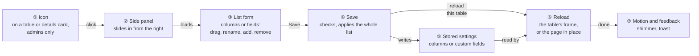
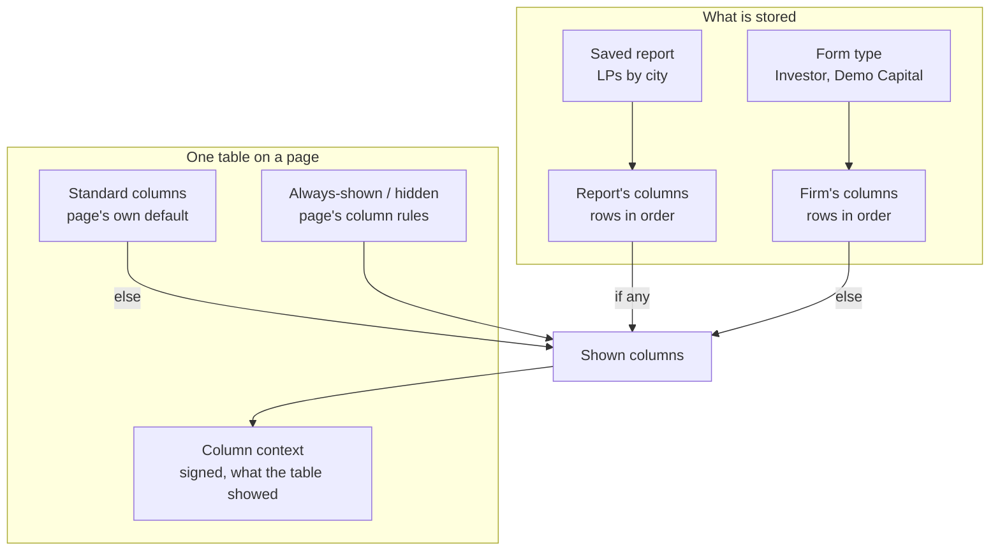
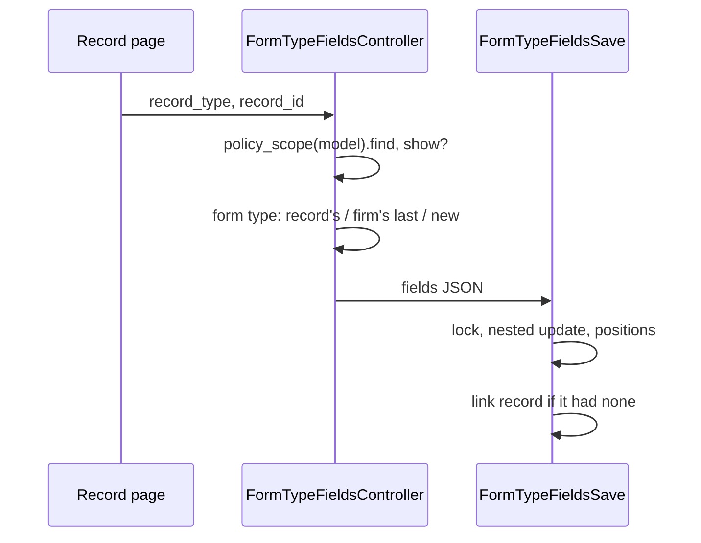
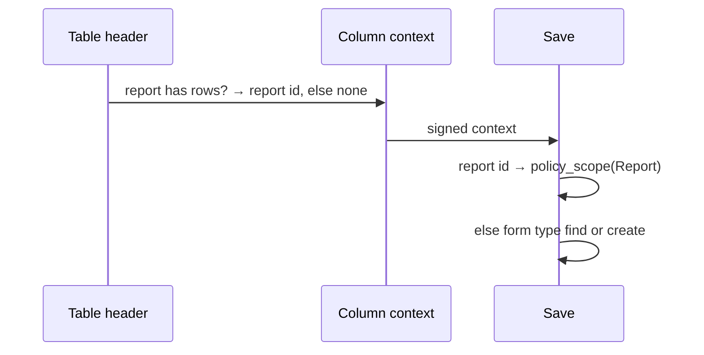
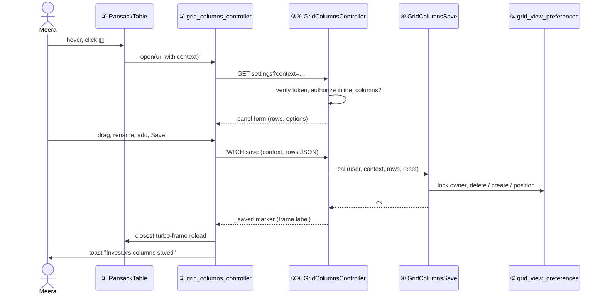
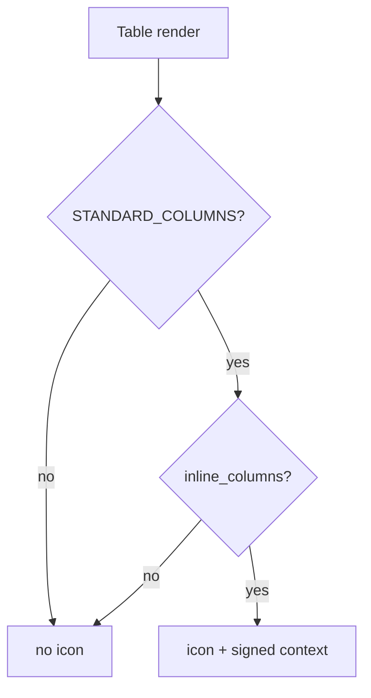
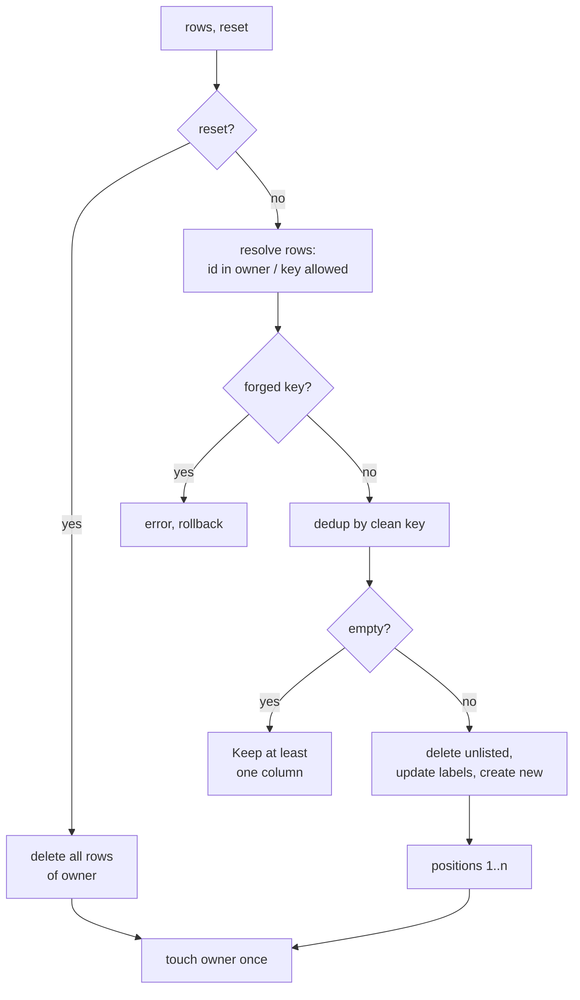
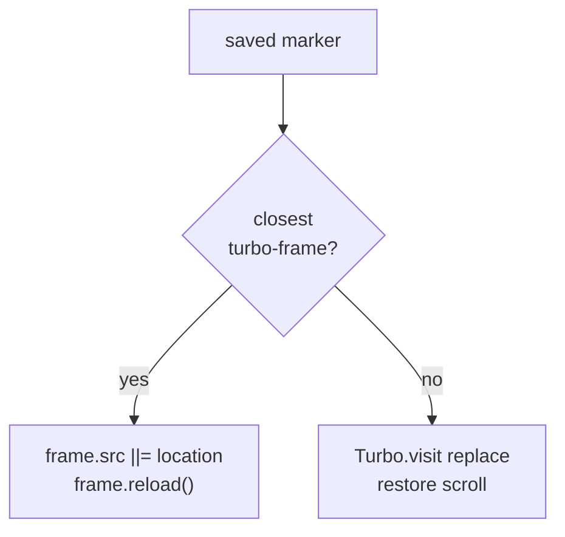
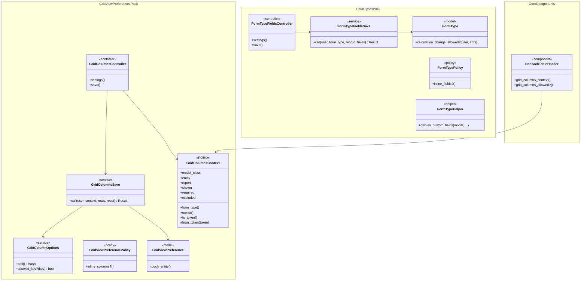

# Table columns and custom fields in place — Design

> **Audience:** Engineering team.
> **Companion documents:** [Proposal](proposal.md) · Specs: [columns](specs/ui/grid-columns-inline-settings/spec.md), [fields](specs/forms/custom-fields-inline-settings/spec.md) · [Business rules](business-rules.md) · [LLD](lld.md) · [QA checklist](qa-checklist.md)

> **Planning phase — no code changes.** This document explains HOW the proposal will be built.

> **Zoom one picture.** Part 1 draws the idea in plain words, Part 2 redraws the same picture with real
> names, Part 3 has one card per box, Part 4 is reference. ①–⑦ mean the same box everywhere.

---

## Contents

- [1. The idea](#1-the-idea)
  - [What this adds](#what-this-adds)
  - [The idea in one picture](#the-idea-in-one-picture)
  - [Key concepts](#key-concepts)
  - [Walkthrough: one example, start to finish](#walkthrough-one-example-start-to-finish)
  - [Key ideas](#key-ideas)
  - [FAQ](#faq)
- [2. The same picture with real names](#2-the-same-picture-with-real-names)
  - [Picture](#picture)
  - [What each box does](#what-each-box-does)
  - [One run, end to end](#one-run-end-to-end)
  - [Lifecycles](#lifecycles)
  - [What users see](#what-users-see)
  - [Design decisions](#design-decisions)
  - [FAQ](#faq-1)
- [3. One card per box](#3-one-card-per-box)
  - [① Columns icon](#-columns-icon)
  - [② Columns panel](#-columns-panel)
  - [③ Column list form](#-column-list-form)
  - [④ Save](#-save)
  - [⑤ Column records and options](#-column-records-and-options)
  - [⑥ Table reload](#-table-reload)
  - [⑦ Motion and feedback](#-motion-and-feedback)
- [4. Reference](#4-reference)
  - [Class diagram](#class-diagram)
  - [Data model and schema changes](#data-model-and-schema-changes)
  - [Component contracts](#component-contracts)
  - [Notifications](#notifications)
  - [Cross-cutting concerns](#cross-cutting-concerns)
  - [Worked examples](#worked-examples)
  - [Testing](#testing)
  - [Risks and open questions](#risks-and-open-questions)
  - [FAQ](#faq-2)

---

## 1. The idea

### What this adds

- A columns icon on every customisable table opens a side panel listing the table's columns; the user reorders,
  renames, removes and adds columns, then saves the whole set at once and only that table reloads.
- It follows the dashboard widget settings pattern (archive `2026-11-07-dashboard-widget-inline-settings`):
  a turbo frame loads the form into a Bootstrap offcanvas, the form posts back into the frame, and a Stimulus
  controller reacts to a "saved" marker by reloading one frame.
- No new storage: the panel edits the same `grid_view_preferences` rows Configure Grids edits.
- Phase 3 reuses the same seven boxes for **custom fields**: a fields icon on a record page's details card opens
  the same panel listing the record's form type fields; Save updates `form_custom_fields` through the Form Types
  nested update and the page refreshes in place. Each box below names both variants: *columns* and *fields*.

### The idea in one picture



### Key concepts

**How the concepts fit together**



- A table shows, in order of preference: the open report's columns, the firm's columns, the page's standard
  columns — then the page's column rules add or hide a few.
- The column context is what the table showed, signed by the server, carried by the icon to the panel and back.

**Glossary**

| Concept | What it is, in one line | Example | Stored in |
|---|---|---|---|
| Record type | The model a table lists | `Investor` | Table's model class |
| Form type | The firm's settings record for a record type | Investor form type of Demo Capital | `form_types` row |
| Firm's columns | Saved columns of a form type, in order | Name, Category, PAN | `grid_view_preferences` (owner FormType) |
| Report's columns | Saved columns of one saved report | Name, City, Committed | `grid_view_preferences` (owner Report) |
| Column owner | The form type or report whose columns the panel edits | Investor form type | — (resolved per request) |
| Standard columns | The page's default column map when nothing is saved | `Investor::STANDARD_COLUMNS` | Model constants |
| Column rules | A page's always-shown and hidden columns | Fund always shown on all-funds Commitments | `required_columns` / `excluded_columns` args |
| Derived field | A saved column whose key is a formula path | NAV / Commitment | `grid_view_preferences.derived_field` |
| Column options | The columns that may be added | Investor fields, custom fields, KYC fields | Not stored (`GridColumnOptions`) |
| Column context | Signed record of what a table showed and for whom | model, entity, report, keys | Not stored (signed token) |
| Inline columns | Permission to use the icon and panel | Meera yes, Ravi no | Not stored (`GridViewPreferencePolicy`) |
| Table frame | The turbo frame the table sits in | `investors_frame` | Rendered |
| Custom field | A field of a form type | `risk_rating` (Select, required) | `form_custom_fields` row |
| Field flags | Required / Read only / Internal | Risk rating required | `form_custom_fields.required`, `read_only`, `internal` |
| Calculation field | A custom field whose `meta_data` is a formula, support-only | `net_worth` | `form_custom_fields.field_type = 'Calculation'` |
| Regulatory field | A field added for a regulator (SEBI…) | KYC SEBI fields | `form_custom_fields.reg_env` |
| Record's form type | The form type whose fields a record shows | Ravi Menon → Default | `<model>.form_type_id` |
| Inline fields | Permission to use the fields icon and panel | Meera yes, Ravi no | Not stored (`FormTypePolicy`) |

#### Record's form type (fields)

- **What:** the form type whose fields the fields panel edits.
- **Rules:**

| Situation | Form type edited | Example |
|---|---|---|
| Record has `form_type_id` | That form type | Commitment on "Feeder" |
| Record has none, firm has one for the model | The one `WithCustomField#setup_form_type` picks (`.last` by name) | Investor → Default |
| Firm has none | New `FormType(entity: record.entity, name: model)`, created on save | Valuation |
| On save, record had none | Record linked (`form_type_id` only) | H13, E13 |

- **Does NOT cover:** moving a record to another form type — not offered.
- **Removal:** deletes the `form_custom_fields` row (as Form Types › Edit's `_destroy`); `json_fields` values stay.



#### Column owner

- **What:** the record whose column rows the panel edits.
- **Why:** a table reads a report's columns first, then the form type's; the panel must edit what the table showed.
- **Rules:**

| Situation | Owner | Example |
|---|---|---|
| `report_id` given, report has its own rows | That report | "LPs by city" |
| `report_id` given, report has no rows | The form type | Investor form type |
| No report | The form type | Investor form type |
| Form type missing | A new form type, created on save | Capital Call form type (tag "Default") |

- **Does NOT cover:** reports of another firm, or another user's draft — refused (X3, X7).
- **Undo:** none needed — nothing is written until Save.



#### Column context

- **What:** a signed, expiring token the table renders into the icon's link: record type, firm, report (when it
  owns the columns), the columns shown (label → key), the always-shown keys and the hidden keys.
- **Why:** each page picks its own standard columns and rules in its view; the server cannot rebuild them in
  another request, and the client must not be trusted to name them.
- **Kinds:**

| Field | Example | Used for |
|---|---|---|
| model | `CapitalCommitment` | Owner lookup, column options |
| entity_id | 157 | Owner lookup, policy |
| report_id | 42 or none | Owner lookup |
| shown | `{"Name" => "investor_name", …}` | First-save list, allowed keys |
| required | `["fund_name"]` | Locked rows |
| excluded | `["investor_name"]` | "Not shown on this page" rows |

- **Does NOT cover:** authorization — the policy is still checked on every request.
- **Rules:** purpose `grid_columns`, expires in 12 hours; a bad or expired token → 404, nothing saved (X5).

#### Saving the whole set

- **What:** Save sends the full ordered list; the server makes the owner's rows match it in one transaction.
- **Why:** Cancel must discard; and positions must never be half-written.
- **Rules:** rows are matched by id (existing) or key (new); unknown ids are skipped (E5); new keys must be in the
  column options or the context's shown keys (X4); duplicates kept once (E8); empty list refused (X6); Reset
  deletes every row of the owner (H6).

### Walkthrough: one example, start to finish

**Setup:** Demo Capital (entity 157); Meera is a company admin; the Investor form type exists with the custom
field `risk_rating`; no saved Investor columns. The Investors page shows `Investor::STANDARD_COLUMNS`
(Name, Category, City, Tags, Committed).

| # | When | What happens | Behind the scenes | Result |
|---|---|---|---|---|
| 1 | Meera opens Investors | Table renders | ① header resolves standard columns, policy allows, renders icon with a signed context | **Icon on hover** |
| 2 | Clicks ▥ | Panel slides in | ② controller builds the panel shell; ③ `settings` verifies context, lists 5 columns + options | **Panel open**, 5 rows |
| 3 | Drags Committed up, renames Tags → Segment, removes City, adds Risk rating | List changes | ③ client-side only | **Draft:** Name, Category, Committed, Segment, Risk rating |
| 4 | Mistake: removes Name too, then re-adds it at the end | List changes | ③ client-side | Draft: Category, Committed, Segment, Risk rating, Name |
| 5 | Drags Name back to the top | List changes | ③ | Draft: Name, Category, Committed, Segment, Risk rating |
| 6 | Clicks Save | Spinner | ④ verifies context, policy, keys; creates 5 rows under the Investor form type; touches entity once | **Saved** (5 rows, positions 1–5) |
| 7 | — | Panel closes, table shimmers | ⑥ reloads `investors_frame` from its current URL (search "Mumbai" kept) | **Table shows 5 new columns** |
| 8 | — | Toast | ⑦ | "Investors columns saved" |
| 9 | Stall: Meera clicks Save twice | Second request | ④ same list → same rows (replace, not append) | Same as row 6 |

```
 Investors   [ Mumbai        ]                                   ▥
┌────────────┬──────────┬──────────────┬─────────┬─────────────┬─────────┐
│ Name       │ Category │ Committed    │ Segment │ Risk rating │ Actions │
│ Ravi Menon │ LP       │ ₹2,50,00,000 │ HNI     │ Low         │   👁    │
└────────────┴──────────┴──────────────┴─────────┴─────────────┴─────────┘
```

**Phase 3, same story for fields** — Meera on Ravi Menon's page:

| # | When | What happens | Behind the scenes | Result |
|---|---|---|---|---|
| 10 | Points at the details card, clicks 🗎 | Panel opens | ① anchor row places the icon; ③ `FormTypeFieldsController#settings` lists Default's 4 fields | **Panel open**, Net worth locked |
| 11 | Renames, flags, adds Source of funds | List changes | ③ client-side | Draft |
| 12 | Mistake: adds "Risk rating" again, saves | Refused | ④ uniqueness on `name` | **"A field named Risk rating already exists"**, nothing saved |
| 13 | Renames it "Risk appetite", saves | Saved | ④ nested update in one transaction, positions reslotted | **Saved** |
| 14 | — | Page refreshes in place | ⑥ `Turbo.visit(replace)` + scroll restore | Card shows new labels; toast |

**What to notice**
- Nothing touched the database until row 6.
- The first save stored all 5 shown columns, not just the changed ones.
- Only the table's frame reloaded; the search stayed.

### Key ideas

| Idea | In one line | Card |
|---|---|---|
| Edit what you see | The panel starts from the columns the table showed | [③](#-column-list-form) |
| Signed context | The table, not the client, says what it showed | [①](#-columns-icon) |
| Replace the set | One transaction makes the rows match the list | [④](#-save) |
| Keys from an allowlist | New keys only from options or shown columns | [④](#-save) |
| One frame reload | The table's own turbo frame reloads | [⑥](#-table-reload) |
| Fields reuse Form Types' update | Nested attributes, uniqueness and the calculation guard, not a second saver | [④](#-save) |

### FAQ

| Question | Answer |
|---|---|
| Why not edit columns one at a time like Configure Grids? | Cancel would not undo anything, and every drag would reload the table. |
| Why sign the context instead of recomputing it? | Standard columns and column rules are chosen in each page's view from request params; recomputing would mean teaching the controller 22 pages' rules. |
| Why not store per-user columns? | Not asked; the firm-wide model is what Configure Grids already has. |

---

## 2. The same picture with real names

### Picture

```mermaid
flowchart LR
    I["① RansackTable + grid_columns/_button<br/>display_custom_fields anchor<br/><i>icon + context</i>"]
    P["② side_panel.js shell<br/>grid_columns / form_type_fields JS<br/><i>offcanvas, Esc, open</i>"]
    F["③ GridColumnsController#settings<br/>FormTypeFieldsController#settings<br/><i>list + options</i>"]
    S["④ GridColumnsSave<br/>FormTypeFieldsSave<br/><i>verify, check, apply</i>"]
    W["⑤ grid_view_preferences<br/>form_custom_fields<br/><i>stored settings</i>"]
    R["⑥ table frame reload<br/>page refresh in place<br/><i>show the result</i>"]
    M["⑦ side_panel.js + widget_settings.scss<br/><i>shimmer, toast</i>"]
    I -- "GET settings<br/>context / record" --> P
    P -- "frame src" --> F
    F -- "PATCH save<br/>list JSON" --> S
    S -- "transaction" --> W
    S -- "_saved marker" --> R
    W -- "read on render" --> R
    R -- "frame-load" --> M
    click I "#-columns-icon"
    click P "#-columns-panel"
    click F "#-column-list-form"
    click S "#-save"
    click W "#-column-records-and-options"
    click R "#-table-reload"
    click M "#-motion-and-feedback"
    classDef new fill:#d4edda,stroke:#2e7d32,color:#000
    classDef mod fill:#fff3cd,stroke:#856404,color:#000
    class F,S new
    class I,P,W,R,M mod
```



### What each box does

| # | Box | Real parts | What it does | When it runs | What it decides | Details |
|---|---|---|---|---|---|---|
| ① | Columns icon | `RansackTable`, `RansackTableHeader#grid_columns_context`, `grid_columns/_button`, 4 `_index_ag` partials | Renders the icon with a signed context | Every table render | Show icon? (policy) | [①](#-columns-icon) |
| ② | Columns panel | `grid_columns_controller.js` | Builds one offcanvas per page, opens it on frame load, Esc closes | On click | — | [②](#-columns-panel) |
| ③ | Column list form | `GridColumnsController#settings`, `grid_columns/settings.html.erb`, `grid_columns_form_controller.js` | Lists rows + options; drag/rename/remove/add/reset client-side | Panel open | Owner, rows, locked/hidden | [③](#-column-list-form) |
| ④ | Save | `GridColumnsController#save`, `GridColumnsSave` | Verifies, authorizes, validates keys, replaces rows | Save | Accept / refuse | [④](#-save) |
| ⑤ | Column records and options | `GridViewPreference`, `FormType`, `Report`, `GridColumnOptions` | Stores rows; lists addable columns | Save, panel, Configure Grids | Allowed keys | [⑤](#-column-records-and-options) |
| ⑥ | Table reload | `grid_columns_controller.js#reloadTable`, `RansackTableHeader#cache_key` | Reloads the closest turbo frame; cache sees report changes | After save | Frame vs page refresh | [⑥](#-table-reload) |
| ⑦ | Motion and feedback | `custom/side_panel.js`, `widget_settings.scss` | Shimmer, highlight, toast, reduced motion | After reload | — | [⑦](#-motion-and-feedback) |

- Phase 3 (fields) per box: ① `FormTypeHelper#display_custom_fields` renders an anchor row (`form_type_fields/_anchor`)
  · ② `form_type_fields_controller.js` on the same shell · ③ `FormTypeFieldsController#settings` +
  `form_type_fields/settings.html.erb` + `form_type_fields_form_controller.js` · ④ `FormTypeFieldsController#save` +
  `FormTypeFieldsSave` · ⑤ `FormType` / `FormCustomField` · ⑥ `side_panel.js#refreshPage` · ⑦ same.

### One run, end to end



### Lifecycles

N/A — no stored status; a column row exists or not. The panel's states (closed → open → saving → closed) are
transient UI.

### What users see

**At a glance**

| Screen | Change |
|---|---|
| Every customisable table | ▥ icon on hover (admins) |
| Columns panel | New offcanvas |
| Configure Grids | Unchanged (↗ link target) |
| 36 record pages (details card) | 🗎 icon on hover (admins) |
| Fields panel | Same offcanvas, fields list |
| Form Types › Edit | Unchanged (↗ link target) |

**Main journey** — see the proposal's [Workflow Journey](proposal.md#workflow-journey) for the wireframe;
callouts: ① icon on the table corner, ② panel header with the shared note, ③ rows and add select, ④ Save.

| Step | The user… | They see |
|---|---|---|
| 1 | points at the table | ① fades in |
| 2 | clicks ① | ② slides in with ③ |
| 3 | edits and clicks Save | spinner, then ⑥ shimmer and ⑦ toast |

**Screen standards**

| Screen | Kind | Copies | Breadcrumbs | Tabs | Turbo | Stats cards | Filter + search | Actions | Help | Full width |
|---|---|---|---|---|---|---|---|---|---|---|
| Columns panel | Side panel | `dashboard_widgets/settings.html.erb` (widget settings panel) | n/a (panel) | none | `grid_columns` frame; save replies into it; table frame reloads | none | Add select is searchable | Footer: ↗, Cancel, Save | Header note tooltip; ⓘ on "Shown columns" and "Add a column"; chips have titles; empty state n/a (≥1 row) | 480px panel |
| Table icon | Overlay button | `dashboard_widgets/_settings_button.html.erb` | — | — | — | — | — | — | Tooltip "Choose this table's columns" | — |
| Fields panel | Side panel | `dashboard_widgets/settings.html.erb` | n/a | none | `form_type_fields` frame; save replies into it; page refresh in place | none | — | Footer: ↗ (Form Types › Edit), Cancel, Save | Header note tooltip; ⓘ on Fields and Add a field; flag buttons titled; removal warning line | 480px panel |
| Details card icon | Overlay button | `dashboard_widgets/_settings_button.html.erb` | — | — | — | — | — | — | Tooltip "Change this record type's custom fields" | — |

### Design decisions

| # | Decision | Why, in one line |
|---|---|---|
| D1 | Icon rendered by `RansackTable` (one place) + one partial for AG grids | 22 tables for one change |
| D2 | Signed column context carried by the icon | Server can't rebuild each page's defaults; client can't be trusted |
| D3 | New `GridColumnsController` (`settings`, `save`), not new actions on `GridViewPreferencesController` | Keeps the old per-row controller untouched |
| D4 | `GridColumnsSave` replaces the owner's rows in one locked transaction | Cancel works; no half-written order |
| D5 | Key allowlist: options ∪ shown keys; saved rows by id | Keys are `send` chains on rows |
| D6 | Form type auto-created with tag "Default" | User decision; header reads the first by name |
| D7 | `GridColumnOptions` extracted from `configure_grids` | One list for both screens |
| D8 | Panel shell built once per page by the Stimulus controller | No layout change; no duplicate ids across frames |
| D9 | Reload the table's closest turbo frame | Every table already sits in one; keeps search/sort/page |
| D10 | Report owners touched + report version in the header cache key | Fixes stale report columns |
| D11 | New predicate `GridViewPreferencePolicy#inline_columns?` | One rule for icon and requests |
| D12 | Shared `side_panel.js` + reuse `widget-settings-panel` styles | Same look; no second copy |
| D13 | Fields icon from `display_custom_fields` via an anchor row | 36 pages, one place, no page edits |
| D14 | Fields save through `FormType#update(form_custom_fields_attributes:)` | Reuse uniqueness, callbacks, guard |
| D15 | Positions reslotted within the listed fields' slots | Regulatory/unlisted fields keep their places |
| D16 | Page refresh in place after a fields save | Details cards are table rows; no frame fits |
| D17 | `FormTypePolicy#inline_fields?` + record `show?` | Parent-policy delegation, one rule |
| D18 | ▥ always visible, moved next to the search box by the controller | Discoverable; no page edits |
| D19 | Configure Grids renders the panel's list embedded, plus Show / Edit / Delete per row | One column editor (DRY) |
| D20 | Data type, alignment, derived key and "Add derived field" in the panel | Parity with Configure Grids |
| D21 | 15 hand-built lists move to `RansackTable` (`sortable: false`), today's columns as `STANDARD_COLUMNS` | Same button everywhere; no visual change by default |

#### D1. Icon rendered by `RansackTable` + one AG partial

- **Problem:** 22 tables use `RansackTable`; 4 AG grids build their header by hand.
- **Decision:** `ransack_table.html.erb` wraps the table in a `grid-columns-host` and renders
  `grid_columns/_button` with the header; each `_index_ag` renders the same partial (phase 2).
- **Why:** one change covers phase 1; the partial is the only thing AG grids add.
- **Not chosen:** an icon in each page's view — 22 edits, easy to miss one.
- **Where:** `RansackTable`, `RansackTableHeader`, `grid_columns/_button.html.erb`, 4 `_index_ag.html.erb`.

#### D2. Signed column context

- **Problem:** Capital Commitments picks `INVESTOR_TAB_STANDARD_COLUMNS` or `STANDARD_COLUMNS` and column rules
  from params in its view; the settings request cannot see that.
- **Decision:** `GridColumnsContext` (PORO) built by `RansackTableHeader`, signed with
  `Rails.application.message_verifier(:grid_columns)`, expires 12 h; passed as `context` on the icon URL and the
  save form.
- **Why:** exact "what you see"; tamper-proof; nothing stored.
- **Not chosen:** sending the shown columns unsigned (forgeable keys); recomputing defaults server-side (22 rule sets).
- **Where:** `GridColumnsContext`, `RansackTableHeader#grid_columns_context`.

#### D3. New `GridColumnsController`

- **Problem:** `GridViewPreferencesController` is per-row, redirects to Configure Grids, and its `find_parent`
  takes owner ids from params.
- **Decision:** a new controller with `settings` (GET, `layout: false`) and `save` (PATCH) in the
  grid_view_preferences pack; routes `get 'grid_columns/settings'`, `patch 'grid_columns/save'`.
- **Why:** narrow params, no change to the old screen's behaviour.
- **Not chosen:** adding actions to the old controller — mixes two save models in one class.
- **Where:** `app/packs/misc/grid_view_preferences/controller/grid_columns_controller.rb`, `config/routes/misc.rb`.

#### D4. Replace the set in one locked transaction

- **Problem:** two admins saving at once, or a double click, could interleave deletes and positions.
- **Decision:** `GridColumnsSave` locks the owner row (`lock!`), deletes rows not listed, updates kept rows'
  label, creates new rows, then sets positions 1..n with `set_list_position`; entity/report touched once after.
- **Why:** last save wins whole; positions always 1..n.
- **Not chosen:** reusing per-row create/destroy/`insert_at` — n requests, no rollback.
- **Where:** `GridColumnsSave`.

#### D5. Key allowlist

- **Problem:** `ransack_table_row.html.erb` reads a cell with `key.split('.').inject(record) { send }`; a forged
  key is a method call on every row.
- **Decision:** a new row's key must equal (clean-key compare) a `GridColumnOptions` value or a key in the
  context's `shown`; an existing row is referenced by id within the owner and keeps its stored key.
- **Why:** no key from the client reaches `send` unless the server offered it.
- **Not chosen:** a regex on keys — still allows `entity.users`.
- **Where:** `GridColumnsSave#resolve_rows`.

#### D6. Form type auto-created

- **Problem:** Capital Calls, Fund Reports, Offers, Interests have no form type on entity 157; columns need an owner.
- **Decision:** `FormType.create!(entity:, name: model)` inside the save transaction (tag defaults to "Default");
  lookups use `GridColumnsContext#form_type` = `entity.form_types.order(:id).find_by(name:)`, and
  `RansackTableHeader` switches to the same method.
- **Why:** user decision; the same lookup on both sides guarantees the table reads what the panel wrote.
- **Not chosen:** hiding the icon when missing — fails the user's ask.
- **Where:** `GridColumnsSave`, `GridColumnsContext`, `RansackTableHeader`.

#### D7. `GridColumnOptions` extracted

- **Problem:** `configure_grids` builds the addable list (standard + additional + related + custom fields) inline.
- **Decision:** move that code, unchanged, into `GridColumnOptions.new(model_class, entity_id).call`
  → `{group => {label => key}}`; `configure_grids` flattens it as before.
- **Why:** one list for both screens; allowlist and add select agree by construction.
- **Not chosen:** copying it — two lists drift.
- **Where:** `app/packs/misc/grid_view_preferences/services/grid_column_options.rb`, `GridViewPreferencesController#configure_grids`.

#### D8. Panel shell built by the controller

- **Problem:** tables live in different frames (tabs load lazily); a panel partial per table repeats ids; a layout
  partial touches 6 layouts.
- **Decision:** `grid_columns_controller.js` creates `#grid_columns_panel` (offcanvas + `<turbo-frame id="grid_columns">`)
  in `document.body` on first click, reusing it afterwards; Turbo Drive drops it on navigation.
- **Why:** one panel per page whatever the frames; no server markup duplicated.
- **Not chosen:** layout partial; per-table partial.
- **Where:** `grid_columns_controller.js`.

#### D9. Reload the closest turbo frame

- **Problem:** the table must refresh with search, sort and page kept.
- **Decision:** after the saved marker, find `host.closest("turbo-frame")`; reload it (`frame.src ||= location.href`,
  then `frame.reload()`); no frame → `Turbo.visit(location.href, {action: "replace"})` with scroll restore.
- **Why:** all 22 tables sit inside `turbo_frame_tag with_frame(...)`; the frame's URL already carries the search.
- **Not chosen:** a `?only_table=` filter like widgets — tables already have their own frame.
- **Where:** `grid_columns_controller.js#reloadTable`.

#### D10. Fresh report columns

- **Problem:** `RansackTableHeader` caches columns 5 days with `@report_id` in the key; `GridViewPreference#touch_entity`
  touches only a FormType's entity — report column changes show late (also from Configure Grids).
- **Decision:** `touch_entity` also touches a Report owner (**existing model change, approved 2026-11-07**); the
  cache key uses the report record (its `cache_key_with_version`) instead of its id.
- **Why:** two small lines fix both screens.
- **Not chosen:** no cache for reports — hurts every report render.
- **Where:** `GridViewPreference`, `RansackTableHeader#cache_key`.

#### D11. `GridViewPreferencePolicy#inline_columns?`

- **Problem:** the icon and both actions need one rule.
- **Decision:** `inline_columns?` = `create?` (firm + company admin) `&& !user.curr_role_investor?` and, for a Report
  owner, `ReportPolicy#update?` (parent-policy delegation). Record: `GridViewPreference.new(owner:, entity_id:)`,
  as `configure_grids` builds it.
- **Why:** reuses the existing save rule; no controller-side checks.
- **Not chosen:** `configure_grids?` — any firm user, but they could not save.
- **Where:** `GridViewPreferencePolicy`.

#### D12. Shared panel helpers and styles

- **Problem:** the widget panel already has toast, reduced-motion, Esc and spinner code and the panel CSS.
- **Decision:** extract `showToast`, `prefersReducedMotion`, `bindEscape` into `app/javascript/custom/side_panel.js`,
  used by `widget_settings_controller.js` and `grid_columns_controller.js`; the new panel carries the
  `widget-settings-panel` class; only list-row styles are new (`grid_columns.scss`).
- **Why:** identical look; two real callers.
- **Not chosen:** copying the widget controller.
- **Where:** `side_panel.js`, `widget_settings_controller.js`, `grid_columns.scss`.

#### D18. ▥ always visible, next to the search box

- **Problem:** a hover-only icon is hard to find (user feedback 2026-11-07); the search box (`SearchComponent`)
  renders before the table and does not know its columns.
- **Decision:** `grid_columns/_button` renders an outlined button; `grid_columns_controller#connect` moves it
  into the same turbo frame's `.search-form-input` row (right of the input) and binds its click directly; with no
  search row it stays, visible, at the table's top-right.
- **Why:** no edits to 22 pages; a search or page change redraws frame and button together.
- **Not chosen:** a slot in `SearchComponent` (renders first); a toolbar row (empty line on every list).
- **Where:** `grid_columns/_button.html.erb`, `grid_columns_controller.js`, `grid_columns.scss`.

#### D19. Configure Grids renders the panel's list

- **Problem:** two editors for the same rows (Configure Grids and the panel) drift; the user wants the full page,
  with Show / Edit / Delete per column, kept.
- **Decision:** the panel body becomes the partial `grid_columns/_editor` (local `embedded:`); `settings` renders
  it in the offcanvas, `configure_grids` renders it in a card for the owner (context from
  `GridColumnsContext.for_owner`: `shown` = standard columns, explicit form type id so a second form type of a model
  is edited — E26), with per-row Show / Edit / Delete links to the existing `show`, `edit`, `destroy`. After a save
  the full page refreshes in place. Removed: `new`, `create` and `new.html.erb` (adding is in the shared list).
  Kept: `show`, `edit`, `update`, `destroy`, `update_column_sequence` (report builder Columns tab).
- **Why:** one list; the page, its address and its buttons stay.
- **Not chosen:** opening the panel from Form Types (user wants the full page); keeping two editors.
- **Where:** `grid_columns/_editor`, `GridViewPreferencesController#configure_grids`, `configure_grids.html.erb`, routes.

#### D20. Column details and derived fields in the panel

- **Problem:** Configure Grids edits data type, alignment and derived keys; the panel must too before it replaces it.
- **Decision:** each row's ⌄ holds data type (`GridColumnsSave::DATA_TYPES` = String Number Decimal Date HTML),
  alignment (`text-start text-center text-end` or blank) and, for derived rows, the key; "Add derived field" adds
  `{derived: true, label, key, data_type}`. A derived key is free text, as on Configure Grids (company admins only).
- **Why:** parity; the allowlist (D5) still covers non-derived keys.
- **Not chosen:** keeping derived fields on a separate page.
- **Where:** `grid_columns/settings`, `_row`, `grid_columns_form_controller.js`, `GridColumnsSave`.

#### D21. Hand-built list tables move to `RansackTable`

- **Problem:** 15 list tables write fixed `<th>`s and row cells; jQuery DataTables sorts them in the page, so
  the columns button has nothing to read or change (user, 2026-11-07).
- **Decision:** per table: `STANDARD_COLUMNS` = today's columns (labels, keys, css); rich cells (name links,
  badges, money) become decorator methods the column keys call; the view renders `RansackTable` with
  `sortable: false` (DataTables keeps search, sort, paging); the row partial renders `RansackTableRow` + its
  Actions cell. `grid_columns_controller` also places ▥ beside `.dataTables_filter` once DataTables has drawn
  (it listens for `datatable` init). Form Type page offers Configure Grids whenever `configure_grids?` (model has
  `STANDARD_COLUMNS`) instead of a hard-coded list.
- **Why:** one column mechanism; no change for firms that never customise.
- **Not chosen:** a second, client-side column chooser for DataTables (two mechanisms); converting detail,
  grouped and report tables (not lists of records).
- **Where:** 15 models/decorators/views/row partials, `grid_columns_controller.js`, `form_types/show.html.erb`.

#### Changed during the build

| Log # | What changed | Why |
|---|---|---|
| B1 | ▥ glyph → `ti-table-options`, icon only (tooltip "Choose this table's columns") | User feedback 2026-11-07: a better icon; no text label |
| B2 | Configure Grids is two columns: the editor on the left, a Turbo frame `grid_column_detail` on the right where Show / Edit open; a saved Edit returns to Configure Grids with `show_id` so the list is current and the column stays open | User feedback 2026-11-07: Show / Edit in the white space, via Turbo |
| B3 | Edit shows the heading without its "; css" part and stores it with `GridColumnsSave.stored_label` | The raw "Investor; text-col" was showing in the box |
| B4 | The editor sends a row's data type / alignment only when changed | Auto-detected types (Integer, Datetime) are not in the offered list and would otherwise be rewritten to String |
| B5 | `GridColumnOptions` takes `ADDITIONAL_COLUMNS_FROM` as strings or symbols | `Kpi` lists symbols; Configure Grids for Kpi raised NoMethodError before |
| B6 | Deals dropped from phase 2 (14 lists) | `deals/_index.html.erb` is rendered nowhere; the Deals page is cards |
| B7 | Allocations, Investment Opportunities (and Investments when paged) keep server-side Ransack sort / pagy instead of DataTables | That is how those lists already worked |
| B8 | A column added from "Add a column" is named by the label the list offered | `get_column_name` only knew STANDARD_COLUMNS, so list-only columns got humanized keys ("Name link") |
| B12 | The custom fields icon also on the record's form (form card header, panel opened for the form type — new records too when the form shows fields); the panel warns that saving refreshes the page | User feedback 2026-11-07: "the form is where the fields are shown" |
| B10 | The custom fields icon sits beside the minimize button of the collapsible card holding the fields (same outlined style); else as a round button in the breadcrumb bar; else on the card's corner | User feedback 2026-11-07 |
| B11 | The fields panel skips calculation fields for every non-support user, with no local-environment exception (Form Types › Edit keeps its own) | Stricter than the edit page, and testable (X16) |
| B9 | Sale-family policies build their class from `record.class`; the Allocations row passes the undecorated record | A decorated record looked up `AllocationDecoratorCompanyAdminPolicy`; a shared fix (`record.try(:object) \|\| record` in `SaleBasePolicy#specific_policy_class`) is noted, not made |

#### D13. Fields icon from `display_custom_fields` via an anchor row

- **Problem:** 36 show pages call `display_custom_fields(record)` inside their own `<table>`; a row partial can't
  put a button on the card.
- **Decision:** when the fields come from the record's form type (no `custom_fields:` argument), the helper also
  renders `form_type_fields/_anchor` — a hidden `<tr>` with `data-controller="form-type-fields"` and the settings
  URL; the controller places the icon on `closest(".card")` (else the table's parent) and marks it the host.
- **Why:** one change, no page edits; the reporting list (custom_fields passed) gets no icon (E19).
- **Not chosen:** editing 36 pages; a heading row (changes every page's look).
- **Where:** `FormTypeHelper#display_custom_fields`, `form_type_fields/_anchor.html.erb`, `form_type_fields_controller.js`.

#### D14. Fields save through the Form Types nested update

- **Problem:** custom fields have callbacks (`set_default_values`, option normalisation), uniqueness and a
  support-only rule for calculations, all on the existing update path.
- **Decision:** `FormTypeFieldsSave` builds a `form_custom_fields_attributes` hash from the panel list (allowed
  keys only: `id label required read_only internal help_text _destroy` for existing; `name label field_type
  meta_data` for new) and calls `form_type.update` in a transaction after `lock!`; `RecordNotUnique` mapped as the
  Form Types controller maps it.
- **Why:** one saver for custom fields; the same rules apply wherever fields are edited.
- **Not chosen:** a new writer per attribute — duplicates rules.
- **Where:** `FormTypeFieldsSave`; calculation rule extracted from `FormTypesController#update` into
  `FormType#calculation_change_allowed?(user, attrs)` and used by both (behaviour unchanged).

#### D15. Positions reslotted within the listed fields

- **Problem:** regulatory fields are not listed but share `position` with the rest; renumbering 1..n would move them.
- **Decision:** take the positions the listed fields hold now, sorted, assign them in the new order; new fields go
  after the form type's last position; `set_list_position` (no shifting callbacks).
- **Why:** unlisted fields keep their slots (E16).
- **Not chosen:** 1..n renumbering.
- **Where:** `FormTypeFieldsSave#reslot`.

#### D16. Page refresh in place after a fields save

- **Problem:** the custom fields render as rows inside each page's table; a turbo frame can't wrap table rows.
- **Decision:** on the saved marker, `side_panel.js#refreshPage` (extracted from the widget controller's defaults
  path): `Turbo.visit(location.href, {action: "replace"})`, restoring scroll on `turbo:load`.
- **Why:** correct on all 36 pages with no page changes.
- **Not chosen:** a frame per page (36 edits); morphing (the app does not enable it).
- **Where:** `side_panel.js`, `form_type_fields_controller.js`.

#### D17. `FormTypePolicy#inline_fields?` + record `show?`

- **Problem:** the panel is opened from a record; both the record and its form type must be the user's.
- **Decision:** load the record with `policy_scope(model).find(id)` and `authorize record, :show?`; then
  `authorize form_type, :inline_fields?` = `update? && !user.curr_role_investor?` (`update?` = firm + company admin).
  Model from `ApplicationRecord.model_class_from_param` and must include `WithCustomField`.
- **Why:** parent-policy delegation; no controller checks.
- **Not chosen:** only the form type check — leaks the existence of another firm's record ids.
- **Where:** `FormTypeFieldsController`, `FormTypePolicy`.

### FAQ

| Question | Answer |
|---|---|
| Why does the fields panel not reload only the card? | The card's fields are rows in the page's own table (D16). |
| Why a new controller rather than the Trailblazer pattern? | One service with `.call` is enough (single purpose); no multi-step flow. |
| Why not reuse the widget `widget-settings` controller directly? | Its reload targets dashboard widget frames and sizes; only the helpers are shared (D12). |
| What if the token is older than 12 hours? | `settings`/`save` return 404; reopening the page renders a fresh icon. |
| Does the AG grid's own Columns side bar conflict? | No; it hides columns per browser by colId; newly saved columns simply appear. |

---

## 3. One card per box

### ① Columns icon

- Round overlay button on the table's top-right corner; links to `grid_columns_settings_path(context:)` with
  `data-turbo-frame="grid_columns"` and `data-action="grid-columns#open"`.

| Owns | Reads / receives | Produces |
|---|---|---|
| Icon markup, context token | Header's resolved columns, `report_id`, column rules, current user | Link with signed context |

- Rendered only when `RansackTableHeader#grid_columns_allowed?`:
  - model defines `STANDARD_COLUMNS`;
  - header has a `current_user` and `entity`;
  - `policy(GridViewPreference.new(owner: context.owner_or_new_form_type, entity_id:)).inline_columns?`.
- Checked once per table render (not per row); memoized on the header.
- Context `shown` = header columns after `adjust_columns`, minus the snapshot column, keys cleaned.



- **Fields (phase 3):** the anchor row carries `form_type_fields_settings_path(record_type:, record_id:)`; the
  helper renders it only when `custom_fields:` is empty and `policy(form_type_or_new).inline_fields?` (checked
  once per call; the record is already loaded by the page).

**Worked examples:** [§1](business-rules.md#1-table-columns--phase-1) H1, H8, E11, X1, X2;
[§2](business-rules.md#2-ag-grid-columns--phase-3) H9; [§3](business-rules.md#3-custom-fields-on-record-pages--phase-4) H10, E19, X10, X11.

**FAQ**

| Question | Answer |
|---|---|
| Why outside the `<thead>`? | Never covers headings or sort links (same as the widget icon). |
| Does the icon break the column cache? | No — the icon is rendered outside `fetch_columns`. |

### ② Columns panel

- Offcanvas-end shell created by `grid_columns_controller.js` on the first click; `<turbo-frame id="grid_columns">`
  inside; classes `offcanvas offcanvas-end widget-settings-panel grid-columns-panel`.

| Owns | Reads / receives | Produces |
|---|---|---|
| Open/close, Esc, frame target | Frame `turbo:frame-load` | Visible panel |

- Opens on the frame's `turbo:frame-load`; Esc closes (shared `bindEscape`); tooltips use
  `data-bs-container=".grid-columns-panel"` (theme offcanvas z-index).
- The shell builder lives in `side_panel.js#ensurePanel(frameId)`; the fields panel uses frame `form_type_fields`.

**Worked examples:** [§1](business-rules.md#1-table-columns--phase-1) H7; [§3](business-rules.md#3-custom-fields-on-record-pages--phase-4) H15.

**FAQ**

| Question | Answer |
|---|---|
| Why not one panel per table? | Lazy tab frames would each add one with the same id (D8). |

### ③ Column list form

- `GridColumnsController#settings` verifies the context, resolves the owner, authorizes, and renders
  `settings.html.erb` (`layout: false`) into the frame.

| Owns | Reads / receives | Produces |
|---|---|---|
| Panel body: rows, add select, reset, footer | Context, owner rows, `GridColumnOptions` | Form with hidden `context`, `rows` (JSON), `reset` |

- Rows to list:

| Source | Row | Chips |
|---|---|---|
| Owner has rows | each row (`id`, `clean_label`, `clean_key`, `data_type`, `derived_field`) | type; Derived; "Not shown on this page" if key in `excluded` |
| Owner has none | context `shown` (`key`, label) | type from model columns |
| Context `required` keys missing from the above | locked row, not submitted | Always shown |

- `grid_columns_form_controller.js` keeps the list in the DOM: drag (HTML5), rename (input), remove, add
  (moves the option out of the select), reset (replaces the list with context `shown` standard set and sets
  `reset=1`), serialises `[{id?, key, label}]` into `rows` on submit.
- Header: "{Model plural} columns" or "Columns of report '{name}'"; note "Shared with everyone in your firm, on
  every {plural} table" or "Shared with everyone who opens this report".

- **Fields (phase 3):** `FormTypeFieldsController#settings` lists the form type's `form_custom_fields.not_regulatory`
  in position order; calculation rows locked unless `user.support?`; `form_type_fields_form_controller.js` handles
  drag, rename, flag toggles, help text, remove/undo, add (label, type, options), and serialises
  `[{id?, label, required, read_only, internal, help_text, _destroy?} | {label, field_type, options}]` into `fields`.

**Worked examples:** [§1](business-rules.md#1-table-columns--phase-1) H1, H3, H5, E2, E3, E4, E11;
[§2](business-rules.md#2-ag-grid-columns--phase-3) E12; [§3](business-rules.md#3-custom-fields-on-record-pages--phase-4) H10, E13, E14, E16, E21.

**FAQ**

| Question | Answer |
|---|---|
| Why JSON in one hidden field? | The order is the data; nested params lose it on reorder edge cases. |
| Why does Reset use the context's standard set? | It shows what the table will show after the reset. |

### ④ Save

- `GridColumnsController#save` → `GridColumnsSave.call(user:, context:, rows:, reset:)` → success: render
  `_saved.html.erb` (marker `data-label`, `data-refresh="frame"`); failure: re-render `settings` with
  errors, status `:unprocessable_content`.

| Owns | Reads / receives | Produces |
|---|---|---|
| Validation, owner resolution, row replace | Context, rows JSON, reset flag | Rows; touched entity/report; errors |

| Component | Responsibility | Transaction | Idempotency |
|---|---|---|---|
| `GridColumnsSave` | verify → resolve owner → lock → resolve rows → replace → position → touch | One DB transaction; owner `lock!` (FormType or Report row) | Same list twice → same rows |



- New row: `name` = `GridViewPreference.get_column_name(form_type, key)` (as `create` does), `label` = submitted
  label when it differs from the name, blank → nil (E7), ≤ 100 chars; `entity_id` = owner's.
- Derived rows: only `label` and `sequence` change (E1).
- Permitted params: `context`, `rows`, `reset` — nothing else (X8).

- **Fields (phase 3):** `FormTypeFieldsSave.call(user:, form_type:, record:, fields:)`:
  1. lock form type (or `save!` a new one); 2. drop ids not in the form type, regulatory ids, and calculation ids
  unless support (E18, X16); 3. new field: `field_type` ∈ Text/Number/Date/TextArea/CheckBox/Select/Money,
  `name` = `FormCustomField.to_name(label)`, Select needs options (X15), Money `meta_data` = `entity.currency`
  (E20); 4. `form_type.update(form_custom_fields_attributes:)`; 5. reslot (D15); 6. link record if its
  `form_type_id` was nil (H13, E13). Errors → 422 in the panel (X13, X14, X15).

**Worked examples:** [§1](business-rules.md#1-table-columns--phase-1) H2, H3, H4, H6, E1, E5, E6, E7, E8, X4, X5, X6, X8;
[§3](business-rules.md#3-custom-fields-on-record-pages--phase-4) H11, H13, H14, E15, E17, E18, E20, E22, X13–X17.

**FAQ**

| Question | Answer |
|---|---|
| Why lock the owner, not the rows? | Rows are created and deleted; the owner is the stable thing to serialise on. |
| A new form type — what is locked? | It is created inside the transaction; the unique name validation (non-multiple models) guards a race; multiple-allowed models use `order(:id).first`. |

### ⑤ Column records and options

- `GridViewPreference` rows (owner FormType or Report) — unchanged schema; `GridColumnOptions` lists addable
  columns.

| Owns | Reads / receives | Produces |
|---|---|---|
| Stored columns; addable list | Model constants, `FormType`/`FormCustomField` of the firm | `{group => {label => key}}` |

- Groups: model name → `STANDARD_COLUMNS` + `ADDITIONAL_COLUMNS`; "Custom fields" → firm custom fields;
  one group per `ADDITIONAL_COLUMNS_FROM` relation (its standard + custom).
- `touch_entity` after_save/destroy: FormType → entity; **Report → report** (D10).

- `form_custom_fields`: unchanged schema; `json_fields` values of removed fields are not touched (H14).

**Worked examples:** [§1](business-rules.md#1-table-columns--phase-1) E10, H5; [§3](business-rules.md#3-custom-fields-on-record-pages--phase-4) H12, H14, E17.

**FAQ**

| Question | Answer |
|---|---|
| Does Configure Grids change? | Only where its list comes from (D7); same options, same order. |

### ⑥ Table reload

- On the saved marker the controller closes the panel and reloads the host's closest turbo frame.

| Owns | Reads / receives | Produces |
|---|---|---|
| Frame reload, fallback page refresh | Saved marker, icon's host element | Fresh table |



- Header cache key: `[model, user, entity, referrer, report (versioned), default map, rules]` (D10).

- **Fields (phase 3):** marker `data-refresh="page"` → `refreshPage()` (D16).

**Worked examples:** [§1](business-rules.md#1-table-columns--phase-1) H2, H5, H8, E9; [§2](business-rules.md#2-ag-grid-columns--phase-3) H9;
[§3](business-rules.md#3-custom-fields-on-record-pages--phase-4) H11.

**FAQ**

| Question | Answer |
|---|---|
| Does the datatable controller re-initialise? | Yes — Stimulus reconnects on the new frame content. |

### ⑦ Motion and feedback

- Reuses the widget panel's shimmer (`widget-refreshing`), highlight and toast styles and the reduced-motion rules.

| Owns | Reads / receives | Produces |
|---|---|---|
| Shimmer on the host, toast | Frame load | Visual feedback |

**Worked examples:** [§1](business-rules.md#1-table-columns--phase-1) H2; [§3](business-rules.md#3-custom-fields-on-record-pages--phase-4) H11.

**FAQ**

| Question | Answer |
|---|---|
| Reduced motion? | Shimmer and highlight off; toast stays. |

---

## 4. Reference

### Class diagram



### Data model and schema changes

N/A — no tables or columns change. Existing-model changes (flagged, approved 2026-11-07):
- `GridViewPreference#touch_entity` also touches a Report owner.
- `RansackTableHeader` form type lookup ordered by id; cache key versioned by report.
- `FormType#calculation_change_allowed?` extracted from `FormTypesController#update` (same rule).
- `FormTypeHelper#display_custom_fields` renders the anchor row.

### Component contracts

| From → To | Contract | Direction rule |
|---|---|---|
| ① → ② | GET `/grid_columns/settings?context=<token>` into frame `grid_columns` | Token signed, read-only |
| ② → ③ | Frame load of the settings response | Frame id `grid_columns` |
| ③ → ④ | PATCH `/grid_columns/save` `context`, `rows` (JSON `[{id?, key, label}]`), `reset` | Only these params |
| ④ → ⑤ | Transaction on owner rows | Owner from context, never params |
| ④ → ⑥ | `_saved` marker in frame (`data-label`, `data-refresh`) | Controller reacts |
| ⑤ → ⑥ | `selected_columns` / `ag_selected_columns` on next render | Cache key versioned |
| ⑥ → ⑦ | `turbo:frame-load` on the table frame | Remove shimmer, toast |
| Configure Grids page | GET `/grid_view_preferences/configure_grids?owner_type&owner_id` renders `grid_columns/_editor` embedded | Authorized `configure_grids?`; the editor needs `inline_columns?` to save |
| ① → ② (fields) | GET `/form_type_fields/settings?record_type=&record_id=` into frame `form_type_fields` | Record loaded via policy scope |
| ③ → ④ (fields) | PATCH `/form_type_fields/save` `record_type`, `record_id`, `fields` (JSON) | Only these params |
| ④ → ⑥ (fields) | `_saved` marker `data-refresh="page"` | Page refresh in place |

### Notifications

| Notification | Trigger | Recipients | Channel | Customisable | Default | Sent once? |
|---|---|---|---|---|---|---|
| None | — | — | — | — | — | — |

- Investors: column choices are internal display settings; nothing is sent to LPs or advisors.
- Internal users: Configure Grids sends nothing today; changing a firm's columns is visible on the table itself
  and in the toast for the person saving — no alert needed.
- Custom fields: Form Types › Edit sends nothing today; the fields panel sends nothing either. New fields reach
  investors only through forms and pages they already see.

### Cross-cutting concerns

#### Transactions and queries

- One transaction per save; owner `lock!`; rows ≤ ~40; positions with `set_list_position` (no callbacks).
- `GridViewPreference.no_touching` inside, one `touch` after.

#### Exception handling and monitoring

- Validation errors render in the panel (422). Token errors → `ActiveRecord::RecordNotFound` (404). Unexpected
  errors propagate to the existing error reporting; no Noticed involvement.

#### Architecture and design patterns

| Pattern | How this design applies it | Existing example reused | Where |
|---|---|---|---|
| 1 Pack boundaries | All new Ruby in `misc/grid_view_preferences`; core component calls its public classes | grid_view_preferences pack | ④⑤ |
| 2 Thin controllers | Controller verifies, authorizes, renders; service saves | `DashboardWidgetsController#save_settings` | ③④ |
| 3 Single responsibility | Context (what was shown), Options (what may be added), Save (write) | — | ①④⑤ |
| 4 Reuse | Widget panel styles/helpers, `get_column_name`, `configure_grids` options, policy `create?` | widget inline settings | all |
| 5 Configuration as data | Not needed — columns are already data | — | — |
| 6 State machines | Not needed — no status | — | — |
| 7 Append-only audit | Not needed — display settings, same as Configure Grids | — | — |
| 8 Background work | Not needed — fast request | — | — |
| 9 Notifications | None sent | — | — |
| 10 UI | Turbo frame + Stimulus; offcanvas; copies widget panel | `dashboard_widgets/settings.html.erb` | ②③⑥⑦ |
| 11 Queries | One options query pair, owner rows once, no per-row queries | `grid_custom_field_names` | ③④ |
| 12 AI | Not needed | — | — |
| 13 Rollout | Phase 1 Ransack tables, phase 2 AG grids; each shippable | — | ① |
| 14 YAGNI / DRY | Options extracted, helpers shared; no per-user layer | — | ⑤⑦ |

#### Performance

| Page / frame / job | Rows | Queries budget, independent of rows | Preloads / grouped queries | Per-row lookups avoided |
|---|---|---|---|---|
| Any table render (icon) | n rows | +2 (form type, report rows exist?) once per table | Memoized on header | Policy checked once per table |
| `settings` | ≤ 40 columns | ≤ 6 (owner, rows, form types + fields for options) | `includes(:form_custom_fields)` | Data type from `columns_hash` |
| `save` | ≤ 40 columns | ≤ 8 + 1 write per changed row | Owner rows loaded once | Allowlist in memory |
| Show page (fields anchor) | — | +1 (form type lookup when the record has none) | Record's `form_type` already loaded by the page | Policy once per call |
| Fields `settings` | ≤ 60 fields | ≤ 5 (record, form type, fields) | Fields loaded once | Flags read from rows |
| Fields `save` | ≤ 60 fields | ≤ 8 + 1 write per changed field | `form_custom_fields` loaded once | Allowlist in memory |

- Nothing inside a row loop queries. Each phase gate runs the features with `PROSOPITE=1`.

#### Security

| Item | How this design meets it | Where | Test |
|---|---|---|---|
| 1 Authorization | Both actions `authorize ... :inline_columns?`; report via `policy_scope(Report).find`; form type via the user's entity | `GridColumnsController`, `GridViewPreferencePolicy` | X1, X2, X3, X7 |
| 2 Tenant isolation | Owner from signed context and re-checked against `user.entity`; entity_id copied from owner | `GridColumnsSave` | X3 |
| 3 Mass assignment | Permit `context`, `rows`, `reset` only; data_type/key of saved rows never from params | Controller | X8 |
| 4a Derived keys | Free text as on Configure Grids today, company admins only (`inline_columns?`); not widened | `GridColumnsSave` | H18, E24 |
| 4 No code from data | Keys only from `GridColumnOptions` or signed shown keys (row cells `send` the key); model class from token via `ApplicationRecord.model_class_from_param` + `STANDARD_COLUMNS` check | `GridColumnsSave`, `GridColumnsContext` | X4, X9 |
| 5 Injection | No SQL built from input; labels escaped in views | Views | X4 |
| 6 Background jobs | None | — | — |
| 7 Files | None | — | — |
| 8 AI | None | — | — |
| 9 Tokens | `message_verifier(:grid_columns)`, purpose-bound, 12 h expiry | `GridColumnsContext` | X5 |
| 10 Rate limiting | Admin-only, cheap request; none added | — | — |
| 11 Audit | Same as Configure Grids (not audited); no PII logged | — | — |
| 1b Authorization (fields) | Record `policy_scope(model).find` + `show?`; `authorize form_type, :inline_fields?` | `FormTypeFieldsController`, `FormTypePolicy` | X10, X11, X12 |
| 3b Mass assignment (fields) | Nested attributes built from an allowlist; never `name`/`field_type`/`meta_data`/conditions of existing fields | `FormTypeFieldsSave` | X17 |
| 4b No code from data (fields) | `record_type` via `model_class_from_param` + `WithCustomField`; calculation rows (Ruby in `meta_data`) never created or edited by non-support | `FormTypeFieldsController`, `FormTypeFieldsSave` | X16, X18 |
| 12 Verification | Brakeman clean; `features/security/grid_columns_inline_settings_isolation.feature`, `features/security/custom_fields_inline_settings_isolation.feature` | — | X1–X18 |

### Worked examples

- The H/E/X tables pass 30 rows and span 4 feature files, so they live in [business-rules.md](business-rules.md):
  - [§1 Table columns — phase 1](business-rules.md#1-table-columns--phase-1): H1–H8, H16–H18, E1–E11, E23–E27, X1–X9, X19–X20
  - [§1b Hand-built lists — phase 2](business-rules.md#1b-hand-built-list-tables--phase-2): H19–H20, E28–E30
  - [§2 AG grid columns — phase 3](business-rules.md#2-ag-grid-columns--phase-3): H9, E12
  - [§3 Custom fields — phase 4](business-rules.md#3-custom-fields-on-record-pages--phase-4): H10–H15, E13–E22, X10–X18
- Every spec scenario (75) is named in at least one row; every row is one Cucumber scenario.

### Testing

- Cucumber only: `features/core/grid_columns_inline_settings.feature` (H, E, X6; Playwright where JS matters,
  `@rack_test` otherwise) and `features/security/grid_columns_inline_settings_isolation.feature` (X1–X5, X7–X9,
  `@rack_test`). New steps in `features/step_definitions/grid_columns_inline_settings_steps.rb`; reuse the login,
  fund and investor steps and the widget-settings panel steps' patterns.
- Traceability: every scenario has a `# H1 — …` comment; code comments name the IDs of the paths they implement.
- Phase 3: `features/core/custom_fields_inline_settings.feature` and
  `features/security/custom_fields_inline_settings_isolation.feature`; steps in
  `features/step_definitions/custom_fields_inline_settings_steps.rb`.
- Regression: the widget inline-settings features (shared `side_panel.js`), existing Configure Grids and Form
  Types features (options and calculation rule extracted).

### Risks and open questions

- Risk: a page whose table is not inside a turbo frame → fallback full refresh (still correct).
- Risk: URL length of the signed context on wide standard sets (~2 KB) → fine for GET; if a page exceeds 4 KB,
  switch the settings request to POST.
- Risk: `RansackTableHeader` reads `Report.find_by(id: params[:report_id])` unscoped (columns only, no data) —
  out of scope; noted for the security backlog. The panel never edits a report outside `policy_scope`.
- Risk: multiple form types for one model (MULTIPLE_FORM_TYPES_ALLOWED) → both sides use the lowest id.
- Risk: a show page whose details are not inside a `.card` → icon falls back to the table's parent element.
- Risk: a model with `WithCustomField` but no Pundit scope → settings 500; mitigated by rendering the anchor only
  where `display_custom_fields` is called (36 known models) and a scenario per model family in QA.
- Risk: removing a field leaves `json_fields` values unseen — by decision; the panel says so.
- No open questions.

### FAQ

| Question | Answer |
|---|---|
| Will existing Configure Grids features still pass? | Yes; only the options source moves (D7) and report touches are added (D10). |
| Can a support user use it? | Only if they are a company admin of the firm, like Configure Grids saves. |
