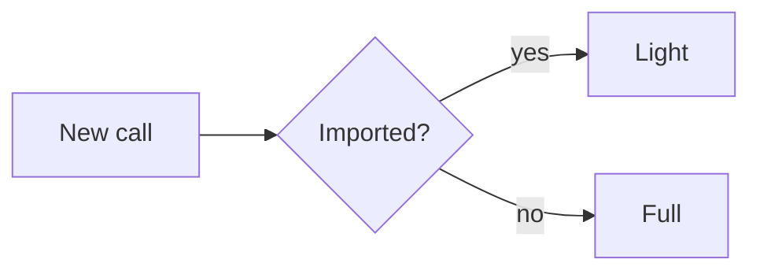
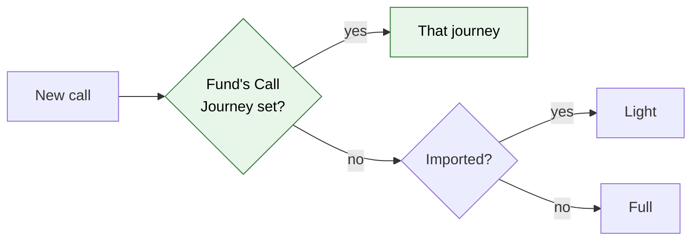

# Journey Fund Overrides — Proposal

> **Audience:** Business team, product, QA, support — non-technical.
> **Companion document:** [Design](design.md) (not written yet — this proposal records the assumptions
> to confirm first)

> **Planning phase — no code changes.** Split out of the investor KYC journey change
> ([investor-kyc-journey](../investor-kyc-journey/proposal.md), Resolved Design Decision 10) because it
> changes how the already-shipped capital call and distribution journeys start. **Needs design approval
> before any code.**

---

## Why

Today a company picks its call and distribution journeys with auto-assignment rules: imported → Light,
everything else → Full, the same for every fund. Some funds want a different journey (Fund 1's calls
always Full, Fund 2's distributions always Light), and the people who must sign off (a fund's CFO,
its compliance officer) differ per fund. Approvers and task owners are fixed users picked on the
template, so a company with ten funds would need ten copies of every template. Funds already carry
per-fund settings in their custom fields (e.g. `call_notice_on`), which is where fund admins expect
to set these.

## What Changes

- **A fund can choose its own call and distribution journeys.** Two fund custom fields, **Call
  Journey** and **Distribution Journey**, name a journey template. A new call or distribution in that
  fund gets the named journey; when the field is blank, the existing auto-assignment rules decide
  (imported → Light, otherwise Full) — today's behaviour.
- **Sign-off approvers and task owners can come from the fund's custom fields.** On a journey step, an
  admin can say "approvers: the emails in the fund's **CFO Email** field" instead of picking users. When
  a journey starts, CapHive reads that field on the record's fund, matches the emails to your company's
  users and fixes them as the step's approvers (or the task owner for reminders).
- **KYC is not affected by the fund fields** (a KYC has no fund); KYC journeys are chosen per KYC form
  type with auto-assignment rules (shipped with the KYC journey).

### Flow Diagram

Choosing a call's journey: before, company-wide rules only.

After: the fund's field first, then the same rules.

---

## Assumptions to confirm (made while the user was away)

| # | Assumption | Alternative |
|---|---|---|
| A1 | The fund fields hold a **template name** (select list of the entity's call / distribution templates) | Hold "Full" / "Light" only — simpler, but can't point at a custom template |
| A2 | The fund field **overrides** rules, including the imported → Light rule | Only override the non-imported default |
| A3 | Field names are fixed: `call_journey`, `distribution_journey` (created as fund custom fields by setup when missing) | Admin chooses the field per template |
| A4 | Recipients: a step can name a fund custom field holding comma-separated **emails**; resolved to users of the entity at launch and frozen, like picked approvers today | Resolve on every evaluation (follows field edits, but sign-offs can change mid-journey) |
| A5 | Field emails are **added to** the step's picked users (union) | Replace them |
| A6 | An email with no matching active user: the step shows "No user found for cfo@x — check the fund's CFO Email field" and, if nobody resolves, is n/a like an approver-less sign-off | Block the step until fixed |
| A7 | Recipients from fund fields apply to calls and distributions; KYC steps can name a field on the KYC's own form instead | Fund-only |

## What This Feature Does NOT Cover

| Excluded | Covered In |
|---|---|
| KYC journey per form type | investor-kyc-journey (shipped) |
| Changing a journey already running when the fund field changes | Not planned (new records only) |

## Capabilities

### Modified Capabilities

- `funds/capital-call-journey`, `funds/capital-distribution-journey`: journey choice per fund.
- `workflows/evaluated-workflow-steps`: step approvers / owners from a record's (fund's) custom field.

## FAQ

| Question | Answer |
|---|---|
| What happens to existing calls and distributions? | Nothing; like all journeys, only new records are affected. |
| What if the fund field names a template that was deleted or renamed? | Assumed: fall back to the rules and show a warning on the Workflow Templates page (to confirm in design). |

## Design Principle for the Next Phase

Reuse the launch path (`WorkflowAutoAssignmentService`) and the frozen-approver snapshot rather than
adding a second router or live lookups; resolve fund fields exactly once, at launch.
